# EgoExplorer: A Vision-Motion-Touch Observatory for Human Loco-Manipulation In Situ

Yunsong Zhou∗,†,1, Xuekun Jiang∗,1, Haiqi Shen∗,1, Hangxu Liu1, Chaojian Shi1, Yujie Liu1, Jingyuan Li1, Haoran Yang1, Jiafei Cao1, Dongzhan Zhou1, Dong Wang1, Yao Mu1, Chunhua Shen1,2 and Weinan Zhang†,1,3 1Shanghai AI Laboratory, 2Zhejiang University, 3Shanghai Jiao Tong University

Learning humanoid loco-manipulation from human demonstrations rests on observing how locomotion, posture, and object interaction evolve together as tasks unfold. Scaling collection across diverse environments, in turn, favors lightweight, portable capture systems. Yet, existing datasets provide only partial views of this coordination. Thus, we introduce EgoExplorer a 100-hour vision-motion-touch observator of human loco-mani ulation built with a wearable system. With an emphasis on professional activities, its continuous recordings align egocentric video with reconstructed whole-body motion, fine-grained finger articulation, and tactile observations, accompanied by steplevel descriptions. To achieve this coverage with sparse body sensing, we develop the Calibrate-Complete-Constrain pipeline. Concretely, reusable calibration fixes participant geometry and sensor attachments before motion inference to disentangle mounting ofsets from articulation. A temporal prior then completes unobserved joint motion, while layered constraints promote measurement agreement, temporal continuity, and geometric consistency, properties that motion plausibility alone does not guarantee. Against tracker-fitted references, the method reduces body-point error by 71.9% relative to the strongest baseline; matched evaluations also show gains in hand stability and contact estimation. Preliminary studies explore multimodal generation and conditioning alongside humanoid retargeting with whole-body control in simulation.

Ñ Homepage | § Toolkit | õ Data  
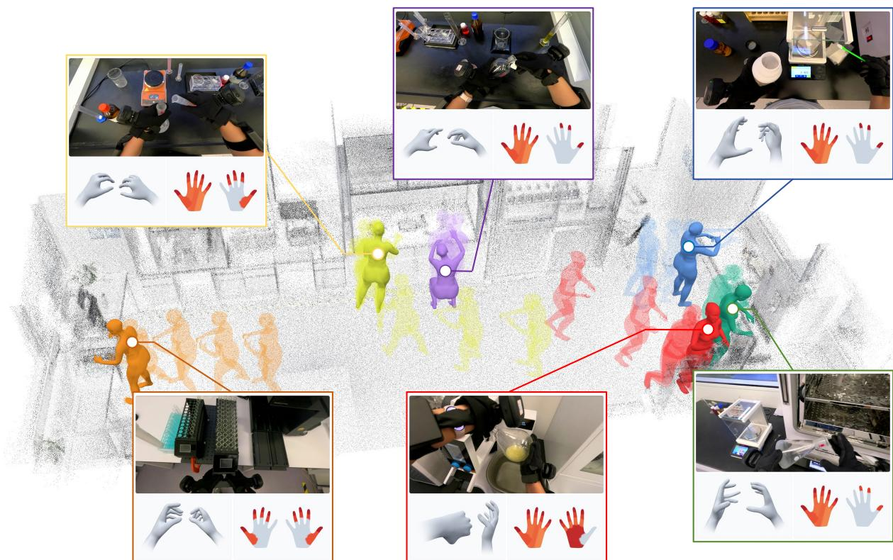  
Figure 1. A glimpse of EgoExplorer. It shows human loco-manipulation across workstations, with reconstructed body motion overlaid on the scene point cloud. Each inset is linked to a corresponding body pose along with synchronized egocentric view, finger articulation, and tactile observation.

## 1. Introduction

What a humanoid needs to reach, grasp, or carry shapes where it moves and how it positions its body (Shi et al., 2026). Learning such loco-manipulation skills calls for demonstrations spanning diverse environments, objects, and task sequences. Robot teleoperation provides such data, but dedicated hardware, on-site deployment, and sustained operator efort constrain its scalability (Punamiya et al., 2026; Zhu et al., 2026). Human activity ofers a rich alternative across everyday and professional settings, and recent work shows that egocentric demonstrations can improve robot manipulation and generalization to novel scenarios (Kareer et al., 2025; Qiu et al., 2025; Shi et al., 2026). Realizing this potential for loco-manipulation hinges on datasets that jointly record visual context, whole-body and hand motion, and measured contact throughout continuous tasks.

Building such datasets at scale entails balancing environmental coverage with the richness and fidelity of the observations. Systems built around fixed camera arrays for optical motion capture (Cao et al., 2026) or multi-view reconstruction (Bhatnagar et al., 2022; Zhang et al., 2022) can provide detailed observations, but require each recording space to be instrumented and calibrated (Kim et al., 2025; Taheri et al., 2020). Portable capture eases deployment, yet existing datasets often ofer only partial views of this coordination. Particularly, egocentric video preserves diverse visual context but leaves much of the body unobserved (Grauman et al., 2022). Wearable body tracking adds body motion, often without fine finger articulation or physical contact measurements (DeTone et al., 2026; Ma et al., 2024). Conversely, hand-focused datasets capture detailed hand motion and, in some cases touch, but typically omit the accompanying whole-body movement (Hoque et al., 2026; Song et al., 2025; Zhou et al., 2026). These partial records obscure the coupling central to loco-manipulation and therefore fall short of capturing its execution as a coherent whole.

To this end, we introduce EgoExplorer, an egocentric dataset that captures the whole-body coordination underlying human loco-manipulation through portable vision-motion-touch sensing. As depicted in Fig. 1, it aligns first-person video with reconstructed body motion, glove-measured finger articulation, and tactile observations. Collected across five environments with an emphasis on professional activities, the recordings preserve the transitions between approaching targets, adjusting posture, manipulating objects, and relocating. Step-level descriptions link these synchronized observations to the actions and progression of each task.

To support this multimodal capture, our lightweight wearable rig combines five trackers, instrumented gloves, and a head-mounted camera. Recovering whole-body trajectories requires inferring unobserved joint motion from these sparse device poses. Yet direct fitting is ambiguous: each pose depends jointly on its attachment transform and the body’s kinematic chain, allowing diferent combinations of mounting ofsets and joint configurations to explain the same sparse measurements (Jiang et al., 2022; Ponton et al., 2023). Diferently, our ${ \mathsf { C } } ^ { 3 }$ pipeline (Calibrate-Complete-Constrain) disentangles fixed body-sensor geometry from motion through a calibration protocol: prescribed participant movements are matched to a reference motion library. Using these correspondences, we refine initial estimates of body shape and scale and fit body-sensor transforms, forming a profile reusable across tasks with unchanged sensor placement. A temporal prior model then completes unobserved articulation from the calibrated anchors, yielding an initial whole-body trajectory, i.e., the motion proposal. We refine this proposal under layered constraints to promote measurement agreement and temporal continuity while penalizing self-interpenetration and ground penetration. Finally, we incorporate hand motion, touch, and expert-guided step annotations and check multimodal consistency. The resulting dataset comprises 2,715 egocentric recordings totaling 100 hours (Tab. 1).

We evaluate annotation accuracy on a purpose-built Evaluation Subset and reconstruction consistency on the Natural Recordings. Compared with the strongest evaluated body-reconstruction baseline, our system reduces body-point error by 71.9%. Hand and contact tests also show better holding stability, kinematic target recovery, and regional contact estimation than the evaluated alternatives, supporting the benefits of calibrated reconstruction and direct hand sensing. Beyond annotation quality, we conduct a preliminary exploration of training utility through Cosmos-based (NVIDIA, 2026) multimodal prediction and human-to-robot motion transfer using ZeroWBC-style (Yang et al., 2026a) whole-body control in simulation. These initial studies suggest benefits from combining synchronized modalities and illustrate the potential of the recordings for policy learning.

Table 1. Comparison of representative egocentric datasets. In the body and hand groups, ✓ is sensor-grounded label, ◦ a state inferred from images or covering a subset, ✗ absence; elsewhere ✓/◦ are full/partial support. Anchors: non-visual measurements (wrists, feet, and fingers) unafected by occlusion. Mobile capture: the wearer’s root travels rather than staying at one workstation. Loco-manip.: both are measurable in the motion data. Step labels: sub-task annotations, ✓ if written or checked by experts, ◦ if left as model output. †: judged from the released sample.
<table><tr><td rowspan="2">Dataset</td><td rowspan="2">Duration (h)</td><td colspan="3">Body state</td><td colspan="2">Hand state</td><td rowspan="2">Touch</td><td rowspan="2">Mobile capture</td><td rowspan="2">Loco- manip.</td><td rowspan="2">Step labels</td></tr><tr><td>metric full body</td><td>non-visual anchors</td><td>feet observed</td><td>articulated</td><td>non-visual anchors</td></tr><tr><td>Ego4D (Grauman et al., 2022)</td><td>3,670</td><td>x</td><td>x</td><td>x</td><td>x</td><td>x</td><td>x</td><td>√</td><td>x</td><td>1</td></tr><tr><td>Ego-Exo4D (Grauman et al., 2024)</td><td>221</td><td>o</td><td>x</td><td>x</td><td>o</td><td>x</td><td>x</td><td>√</td><td>√</td><td>√</td></tr><tr><td>Nymeria (Ma et al., 2024)</td><td>300</td><td>√</td><td>√</td><td>√</td><td>x</td><td>x</td><td>x</td><td>√</td><td>√</td><td>√</td></tr><tr><td>EgoDex (Hoque et al., 2026)</td><td>829</td><td>o</td><td>x</td><td>x</td><td>o</td><td>x</td><td>x</td><td>x</td><td>x</td><td>x</td></tr><tr><td>EgoVerse (Punamiya et al., 2026)</td><td>1,362</td><td>x</td><td>x</td><td>x</td><td>o</td><td>x</td><td>x</td><td>√</td><td>x</td><td>√</td></tr><tr><td>Open-AoE (Li et al., 2026b)</td><td>2,000</td><td>x</td><td>x</td><td>x</td><td>o</td><td>x</td><td>x</td><td>x</td><td>x</td><td>√</td></tr><tr><td>EgoLive (Li et al., 2026a)</td><td>1,680</td><td>x</td><td>x</td><td>x</td><td>o</td><td>x</td><td>x</td><td>x†</td><td>x</td><td>0</td></tr><tr><td>Xperience-10M (Ropedia, 2026)</td><td>1,059</td><td>o</td><td>x</td><td>x</td><td>0</td><td>x</td><td>x</td><td>x†</td><td>√</td><td>0</td></tr><tr><td>Egocentric-10K (Build AI, 2025)</td><td>10,000</td><td>x</td><td>x</td><td>x</td><td>x</td><td>x</td><td>x</td><td>x†</td><td>x</td><td>x</td></tr><tr><td>EgoTouch (Zhou et al., 2026)</td><td>20</td><td>x</td><td>o</td><td>x</td><td>√</td><td>√</td><td>√</td><td>x</td><td>x</td><td>x</td></tr><tr><td>OpenTouch (Song et al., 2025)</td><td>5</td><td>x</td><td>x</td><td>x</td><td>√</td><td>√</td><td>√</td><td>x</td><td>x</td><td>√</td></tr><tr><td>EGOEXPLORER</td><td>100</td><td>√</td><td>√</td><td>√</td><td>√</td><td>√</td><td>J</td><td>J</td><td>√</td><td>√</td></tr></table>

We summarize our contributions as follows: (i) EgoExplorer, a vision-motion-touch dataset that achieves rich multimodal coverage and high-fidelity motion annotations with lightweight instrumentation, capturing continuous human loco-manipulation; (ii) the ${ \mathsf { C } } ^ { 3 }$ pipeline, which decouples body-sensor calibration from motion inference and combines temporal completion with layered constraints to recover metric whole-body motion from sparse trackers. (iii) experiments demonstrating improved annotation quality and the efectiveness of our design choices, complemented by an initial assessment of the recordings’ utility for embodied learning.

## 2. Related Work

Multimodal human datasets. Calibrated capture systems provide detailed body, hand, and interaction geometry, but require instrumented spaces (Bhatnagar et al., 2022; Cao et al., 2026; Kim et al., 2025; Taheri et al., 2020; Zhang et al., 2022). Egocentric video datasets broaden activity coverage (Damen et al., 2022; Grauman et al., 2022, 2024), with manipulation-oriented collections increasingly adding hand-motion annotations (Hoque et al., 2026; Li et al., 2026a,b; Punamiya et al., 2026). Wearable body tracking adds full-body trajectories but generally lacks direct finger and tactile measurements (DeTone et al., 2026; Fan et al., 2025; Ma et al., 2024). Hand-focused datasets capture articulation, object geometry, or contact, typically without the accompanying whole-body motion (Banerjee et al., 2025; Song et al., 2025; Zhao et al., 2025; Zhou et al., 2026). EgoExplorer combines these signals in portable recordings of continuous loco-manipulation.

Motion reconstruction from partial observations. Video-based reconstruction remains sensitive to occlusion, depth ambiguity, and camera motion (Shen et al., 2024; Xu et al., 2026; Zhang et al., 2025). Sparse-tracking methods complete motion from observations using learned priors (Dai et al.,

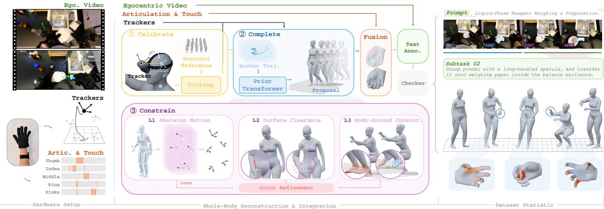  
Figure 2. Overview of EgoExplorer. The rig records egocentric video, poses from five trackers, finger articulation, and touch (Sec. 3.1). ${ \bf C } ^ { 3 }$ (Calibrate-Complete-Constrain) estimates a reusable body-sensor profile through protocol-guided calibration. A temporal prior generates a whole-body motion proposal from anchors; joint refinement then promotes skeletal measurement agreement, participant-specific surface clearance, and whole-mesh ground non-penetration (Sec. 3.2). Hand and touch are integrated with the reconstructed body, followed by expert-guided step annotation and review (Sec. 3.3). The resulting episodes align multimodal data on a shared timeline (Sec. 4).

2024; Du et al., 2023; Jiang et al., 2022, 2024b; Ponton et al., 2023). Kinematic fitting and physical regularization improve plausibility (Jiang et al., 2022, 2024a; Zheng et al., 2023). Yet matching sparse anchors leaves intermediate joints ambiguous, and mount errors can be absorbed into articulation. Our ${ \mathsf { C } } ^ { 3 }$ pipeline combines participant and mount calibration, motion completion, and constrained refinement to address sensor mismatch, self-intersection, and floor penetration.

Human data for embodied learning. Human demonstrations support cross-embodiment manipulation learning (Kareer et al., 2025; Punamiya et al., 2026; Qiu et al., 2025), mobile and humanoid policy generalization (Shi et al., 2026; Zhong et al., 2025; Zhu et al., 2026), and whole-body control through motion retargeting and contact-aware references (Yang et al., 2026a,b; Yu et al., 2026). Ego-Explorer preserves visual context, body coordination, and motion-contact relationships throughout continuous tasks, providing a resource for these learning settings.

## 3. The EgoExplorer Dataset

Egocentric video captures task semantics at scale, yet leaves key signals for loco-manipulation underconstrained: hand articulation is obscured; whole-body motion, especially lower-body support, extends beyond the camera’s field of view; and appearance alone cannot reveal tactile contact. EgoExplorer addresses this asymmetry by pairing a head-mounted camera with sparse wearable sensing, grounding body and hand motion in sensor measurements and corresponding touch records. The dataset contains 2,715 recordings (100 h) across ten task templates and five environments, spanning laboratories, factories, and homes. Following the workflow in Fig. 2, we first introduce the capture hardware (Sec. 3.1), then describe sensor calibration, body completion, and constrained refinement of fine-grained body reconstruction (Sec. 3.2), and enrich the episodes with expert-guided task boundaries and annotations (Sec. 3.3). Sec. 4 ofers a glimpse of the dataset.

## 3.1. Capture Hardware

Requirements. Fine-grained loco-manipulation capture requires accurate measurements of body motion, hand articulation, and contact in a lightweight, portable system. Studio motion capture (Cao et al., 2026; Kim et al., 2025; Taheri et al., 2020) provides dense measurements but confines collection to a calibrated multi-camera volume, whereas readily deployable video-only capture (Shen et al., 2024; Zhang et al., 2025) must infer occluded motion and visually ambiguous contact. We therefore complement sparse tracking at key body joints with direct finger sensing and optional touch for whole-body reconstruction and fine-grained interaction annotation.

Hardware. Five VIVE Ultimate Trackers locate the head, hands, and ankles $( \mathrm { A p p . ~ A } )$ , using onboard cameras for 6-DoF inside-out tracking without external base stations. Head and hand trackers establish metric camera and end-efector trajectories, while ankle trackers capture foot placement and constrain stance and support beyond the head camera’s view. Custom 3D-printed mounts rigidly couple the head tracker to a GoPro HERO13 with Media Mod and attach the others to the glove dorsum and lateral ankles, with straps for added fixation. Two interchangeable glove configurations share this layout: MANUS Metagloves measure finger articulation, while Wuji gloves additionally record tactile signals.

Deployment. The compact, reusable rig simplifies sensor setup and donning, facilitating collection across environments. Subject and mount calibration is reused across task recordings as long as the rig remains mounted. Sec. 3.2 details calibration and whole-body reconstruction from sparse measurements; App. G covers cost and deployment trade-ofs.

## 3.2. Whole-Body Reconstruction from Sparse Measurement

$\mathbf { C } ^ { 3 } \mathbf { : }$ : Calibrate-Complete-Constrain. Whole-body reconstruction calls for inferring the body joint motion from the rig’s sparse tracker poses. Yet, coupled ambiguities arise: tracker poses depend jointly on body articulation and rigid attachment to anatomical anchors (i.e., head, wrists, and ankle joint frames), allowing mounting errors to be absorbed into estimated motion. Even calibrated anchors leave intermediate joints undetermined. We address these with ${ \mathsf { C } } ^ { 3 }$ (Calibrate-Complete-Constrain; Fig. 2), separating fixed body-sensor geometry from time-varying motion. Protocol-guided calibration aligns a prescribed movement sequence $( i . e .$ , the calibration protocol) with a reference motion library by phase. Robust fitting estimates body shape, scale, and sensor-to-anchor transforms from these correspondences once per mounting configuration. Prior-guided motion completion uses a temporal motion prior, a model for completing unobserved articulation, to generate a motion proposal: an initial whole-body trajectory from anchors. Layered constraints then jointly refine skeletal measurement agreement, surface clearance, and ground non-penetration. We fuse glove-measured finger articulation and touch as direct interaction evidence.

## 3.2.1. Protocol-guided calibration

Calibration problem definition. Calibration estimates a participant-and-mount profile $\Phi \_ =$ $( \beta , s , \{ A _ { i } , a _ { i } \} _ { i = 1 } ^ { 5 } )$ . Here $\beta \in \mathbb { R } ^ { 1 0 }$ specifies SMPL-X body shape (Pavlakos et al., $2 0 1 9 )$ and $s > 0$ converts model dimensions to the participant’s metric dimensions. For tracker $i , a _ { i } \in \mathbb { R } ^ { 3 }$ is the displacement from the anchor to the device origin. $A _ { i } \in S 0 ( 3 )$ expresses the device’s axes in that same frame, where $S O ( 3 )$ denotes proper 3D rotation matrices. The five attachments correspond to the head, wrists, and ankles. These parameters remain shared across calibration actions and subsequent tasks with unchanged mounts; joint articulation varies. We estimate Φ by anchoring body dimensions, matching action phases, and fitting one attachment per device across the matched poses.

Body shape and scale initialization. Visual evidence provides an initial estimate of body proportions; direct height measurement anchors its metric size. We obtain $\beta ^ { \mathrm { v i s } } \in \mathbb { R } ^ { 1 0 }$ from a short participant video using GVHMR (Shen et al., 2024) and measure the participant’s height $h ^ { \star }$ . Let $H ( \beta )$ be the unscaled model height in neutral pose, then $\beta _ { 0 } = \beta ^ { \mathrm { v i s } }$ initializes the shape fit. Taking the visual shape as our starting point, we rescale it to the measured height $\begin{array} { r } { s _ { 0 } = \frac { h ^ { \star } } { H ( \beta ^ { \vee \mathrm { i } s } ) } } \end{array}$ . The resulting $( \beta _ { 0 } , s _ { 0 } )$ initializes the geometry fit below. The measurements are collected for the reusable profile.

Protocols. To disentangle body proportions, sensor ofsets, and world-frame alignment, we use a calibration protocol comprising standing, A- and T-poses, forward arm extension, head and wrist rotations, elbow flexion, shallow squats, leg raises, and ankle motion. A reference motion library provides consistent anatomical targets without requiring an exact match to the participant’s motion. To accommodate diferences in execution speed, we automatically match ordered holds and motion peaks in recorded tracker signals to reference actions, pairing observed device poses with corresponding reference joint poses. The library is cached and reused, limiting participant-specific work to protocol recording and profile fitting. The full protocol and sample-selection rules are detailed in App. C.1.

Forward model for calibration. A tracker’s pose is jointly determined by the body shape, the pose locating the anchor, and the attachment placing the device relative to it. Let $n = 1 , \ldots , N _ { \mathrm { c a l } }$ index matched calibration samples, with $r ( n )$ identifying the recording containing sample �. Each sample corresponds to reference action $k _ { n }$ at normalized phase $\alpha _ { n } \in [ 0 , 1 ]$ (0: start; 1: end). Phasebased correspondence accommodates diferences in execution speed, and each action may contribute multiple samples. For body shape $\beta _ { \cdot }$ , the matched reference pose specifies anchor �’s pelvis-relative position $J _ { n , i } ( \beta ) = J _ { i } ^ { k _ { n } } ( \alpha _ { n } ; \beta )$ and orientation $G _ { n , i } = G _ { i } ^ { k _ { n } } ( \alpha _ { n } )$ in the reference body frame. Let � denote body scale, and let $a _ { i }$ and $A _ { i }$ denote the fixed attachment translation and rotation expressed in anchor �’s frame. Recording-specific yaw rotation $Q _ { r }$ and pelvis translation $u _ { r }$ then give the predicted tracker position and orientation in the tracking world frame:

$$
\widehat { p } _ { n , i } = u _ { r ( n ) } + Q _ { r ( n ) } \left[ s J _ { n , i } ( \beta ) + G _ { n , i } a _ { i } \right] , \widehat { R } _ { n , i } = Q _ { r ( n ) } G _ { n , i } A _ { i } .\tag{1}
$$

Here ${ \widehat { p } } _ { n , i }$ and $\widehat { R } _ { n , i }$ are the predicted position and orientation of tracker � at matched sample �. The term $s J _ { n , i } ( \beta )$ locates the joint at metric scale and $G _ { n , i } a _ { i }$ adds the mounting ofset, ${ \widehat { p } } _ { n , i }$ enters the position loss to fit profile term Θ; the relation for $\widehat { R } _ { n , i }$ is then used separately to recover $A _ { i }$

Joint calibration objective. We define a calibration loss to jointly estimate body geometry, attachment displacements, and recording alignments, collected in $\Theta = ( \beta , s , \{ a _ { i } \} _ { i = 1 } ^ { 5 } , \{ Q _ { r } , u _ { r } \} _ { r } )$ . Anthropometric measurements and geometric priors constrain this fit to discourage compensation between limb dimensions and mounting ofsets. Initializing $( \beta , s )$ at $( \beta _ { 0 } , s _ { 0 } )$ , we solve:

$$
\Theta ^ { \mathrm { f i t } } = \arg \operatorname* { m i n } _ { \Theta ; s > 0 } \mathcal { L } _ { \mathrm { c a l } } ( \Theta ) , \mathcal { L } _ { \mathrm { c a l } } ( \Theta ) = \lambda _ { \mathrm { o b s } } \mathcal { L } _ { \mathrm { r o b u s t - p o s } } + \lambda _ { \mathrm { a n t h } } \mathcal { L } _ { \mathrm { a n t h } } + \mathcal { R } _ { \mathrm { g e o m } } .\tag{2}
$$

Here $\Theta ^ { \mathrm { f i t } }$ denotes the fitted parameters and the non-negative � coeficients weight the loss terms. $\mathcal { L } _ { \mathrm { r o b u s t - p o s } }$ compares predicted tracker positions ${ \widehat { p } } _ { n , i }$ from Eq. (1) with tracker-measured positions $p _ { n , i } ; \mathcal { L } _ { \mathrm { a n t h } }$ constrains height and arm span to their measurements; and $\mathcal { R } _ { \mathrm { g e o m } }$ anchors shape to the visual estimate and regularizes attachments, scale, and yaw. Reference rotations remain fixed during optimization. Loss definitions, squat-translation handling, and solver settings are in App. C.1.

Attachment rotation recovery. We next estimate the remaining rotation $A _ { i }$ by matching predicted tracker orientations $\widehat { R } _ { n , i }$ to measured ones $R _ { n , i }$ . With $Q _ { r ( n ) }$ and $G _ { n , i }$ fixed, the rotation-calibration routine $f _ { \mathrm { r o t } }$ fits one shared $A _ { i }$ through the orientation model in Eq. (1) across matched samples. We summarize this fitting step as $A _ { i } = f _ { \mathrm { r o t } } \big ( \{ \widehat { R } _ { n , i } , R _ { n , i } \} _ { n } \big )$ , completing Φ (App. C.1).

## 3.2.2. Prior-guided motion completion

Reconstruction requirements. With the calibrated profile Φ fixed, we reconstruct $X = \{ x _ { t } \} _ { t = 1 } ^ { T } .$ , where $x _ { t } = ( \omega _ { t } , \theta _ { t } , u _ { t } )$ comprises the global pelvis orientation, the local rotations of the 21 SMPL-X joints relative to their respective parents, and the pelvis position in the world frame. Joint positions follow from forward kinematics with the calibrated body shape $\beta$ and scale �. A temporal motion prior completes unobserved articulation from the five anchors, yielding an initial motion proposal. A proposal that is plausible under the prior may still deviate from calibrated anchor poses or exhibit body self-interpenetration and ground penetration. We therefore refine it under three constraint layers: skeletal motion, participant-specific surface clearance, and body-ground consistency.

Motion completion. The calibrated attachments map measured tracker poses $\left( p _ { t , i } , R _ { t , i } \right)$ to anatomical anchor frames: $\widetilde { R } _ { t , i } = R _ { t , i } A _ { i } ^ { \top }$ and $\widetilde { p } _ { t , i } = p _ { t , i } - \widetilde { R } _ { t , i } a _ { i }$ . These frames locate the head, wrists, and ankles but leave intermediate articulation underdetermined. To complete the unobserved motion, we extend AvatarPoser (Jiang et al., 2022) from head-and-hand inputs to all five anchors and train the transformer on AMASS (Mahmood et al., 2019). The resulting motion prior $f _ { \mathrm { p r i o r } }$ maps an �-frame observation history to initial root orientation and local body-joint rotations: $( \omega _ { t } ^ { 0 } , \theta _ { t } ^ { 0 } ) = f _ { \mathrm { p r i o r } } ( \mathbf { z } _ { t - L + 1 : t } ) .$ where $\mathbf { z } _ { t }$ encodes calibrated positions, rotations, and their temporal increments for all five anchors. We recover the pelvis position by aligning the predicted head position with its calibrated anchor: $u _ { t } ^ { 0 } = \widetilde { p } _ { t , \mathrm { h e a d } } - s \bar { J } _ { \mathrm { h e a d } } ( \omega _ { t } ^ { 0 } , \theta _ { t } ^ { 0 } ; \beta )$ , where $\bar { J } _ { \mathrm { h e a d } }$ is the unscaled pelvis-to-head displacement under the predicted root orientation and joint rotations. Together, these estimates form the initial trajectory $X ^ { 0 } = \{ ( \omega _ { t } ^ { 0 } , \theta _ { t } ^ { 0 } , u _ { t } ^ { 0 } ) \} _ { t = 1 } ^ { T }$ . Model training is detailed in App. C.2.

## 3.2.3. Layered constraints

Constraint layer 1: skeletal motion. The learned completion provides an initial articulation; refinement fits it to the current recording’s measurements. With shape, scale, and attachments fixed, forward kinematics maps each candidate state $x _ { t }$ to predicted tracker poses $( \widehat { p } _ { t , i } , \widehat { R } _ { t , i } )$ through Eq. (1). Position and orientation losses $\mathcal { L } _ { p }$ and $\mathcal { L } _ { R }$ compare these predictions with valid raw tracker observations. To regularize the fit, ${ \mathcal { L } } _ { \mathrm { p r i o r } }$ discourages unsupported deviations from $\chi ^ { 0 } , \mathcal { L } _ { \mathrm { t i m e } }$ regularizes temporal changes in articulation, and $\mathcal { L } _ { \mathrm { j o i n t } }$ penalizes extreme poses through soft joint limits. Together, these terms define $\begin{array} { r } { \mathcal { L } _ { \mathrm { s k e l } } = \sum _ { k } \lambda _ { k } \mathcal { L } _ { k } } \end{array}$ , with details in App. C.3.

Constraint layer 2: surface clearance. Skeletal agreement does not account for body thickness: an arm may intersect the torso even when its wrist matches the target. We therefore constrain the posed SMPL-X surface using the participant’s calibrated shape and scale. For nearby points sampled from distinct body parts, ${ \mathcal { L } } _ { \mathrm { s u r f } }$ penalizes insuficient oriented clearance along the target surface normal, distinguishing points outside the surface from those that have crossed it. Aggregating the largest violations per part pair concentrates corrections in problematic regions, discouraging self-intersection while respecting participant-specific geometry (App. C.4).

Constraint layer 3: body-ground consistency. An ankle anchor above the floor does not ensure that the sole, heel, or knee also clears it. We apply ${ \mathcal { L } } _ { \mathrm { f l o o r } }$ to all posed body vertices, penalizing their depth below the estimated ground plane. This constrains the body’s placement relative to the environment, including regions that approach the floor during crouching or kneeling. The term penalizes penetration without imposing foot-contact or foot-locking constraints.

Joint refinement. The three layers act on the same trajectory through a shared objective:

$$
X ^ { \star } = \arg \operatorname* { m i n } _ { X } \mathcal { L } _ { \mathrm { b o d y } } ( X ; \Phi ) , \ \mathcal { L } _ { \mathrm { b o d y } } ( X ; \Phi ) = \mathcal { L } _ { \mathrm { s k e l } } + \lambda _ { \mathrm { s u r f } } \mathcal { L } _ { \mathrm { s u r f } } + \lambda _ { \mathrm { f l o o r } } \mathcal { L } _ { \mathrm { f l o o r } } .\tag{3}
$$

The non-negative � coeficients weight the surface and ground terms; $\mathcal { L } _ { \mathrm { s k e l } }$ includes its component weights. Starting from $\chi ^ { 0 }$ , the solver evaluates all three layers at every iteration and diferentiates

through SMPL-X forward kinematics and skinning to update $( \omega _ { t } , \theta _ { t } , u _ { t } )$ , keeping Φ fixed. Optimization runs in temporal chunks, whose fitted states form $X ^ { \star } \left( \mathrm { { A p p . } \thinspace C . 6 } \right)$  
(a)  
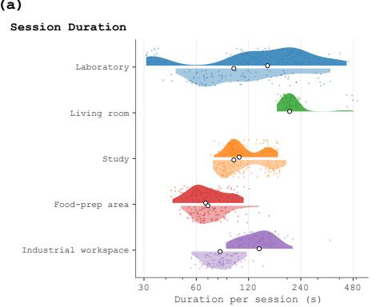

(b)  
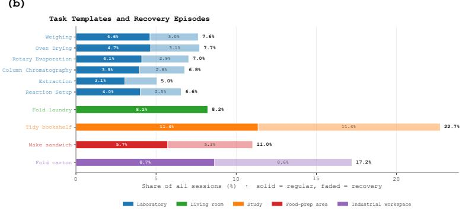  
Figure 3. Data statistics. (a) Session durations; (b) regular and recovery recordings across 10 tasks.

## 3.3. Multimodal integration and annotation

Hand and touch fusion. We directly fuse glove-measured finger geometry to the SMPL-X hands in wrist-local coordinates. Tactile observations are aligned in time and associated with the corresponding hand regions. Hand fitting and tactile processing are detailed in App. D.1.

Expert-guided procedural context. We condition of-the-shelf VLM tools (Peng et al., 2026) on egocentric video, task instructions, and expert-provided skill documents outlining workflow stages, typical progression, and relevant equipment and operations (App. D.2). The tools produce subtask segments with start/end times, skill labels, object/tool roles, observed outcomes, and concise descriptions; uncertain outcomes remain unspecified. Video timestamps align the annotations with motion and tactile streams. Finally, operators manually review video, reconstructed motion, available touch, and text for temporal alignment and semantic consistency.

## 4. Data Statistics

EgoExplorer comprises 2,715 recordings (100 hours) spanning ten task templates across five environments, with an emphasis on professional activities. Fig. 3 summarizes session duration and the balance between regular and recovery episodes, including responses to interruptions or failed attempts. Figs. 4 and 5 illustrate synchronized body–touch observations and procedural text. Further statistics on sensing coverage, motion, contact, text, and reconstructed environments are provided in App. E.

## 5. Experiments

We organize evaluation around annotation quality, preliminary training utility, and key design choices.

Evaluation setup. Our purpose-built Evaluation Subset covers whole-body motion, hand articulation, and regional contact. Evaluation addresses three aspects: kinematic accuracy, through end-point and full-body point errors; temporal quality, through tracking continuity and trajectory smoothness; and contact accuracy, through regional IoU and F1. References are modality-specific, with full-body errors measured against tracker-fitted labels. The remaining Natural Recordings lack matched accuracy references and are assessed for sensor agreement, temporal quality, and geometric

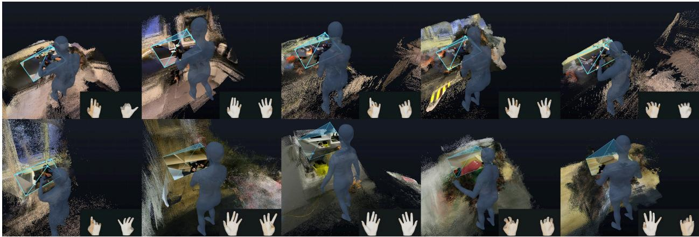

Figure 4. Synchronized body motion and touch across ten tasks. Each panel shows a matched instant, with tactile readings at lower right; gray-to-orange shading indicates baseline-relative increases.  
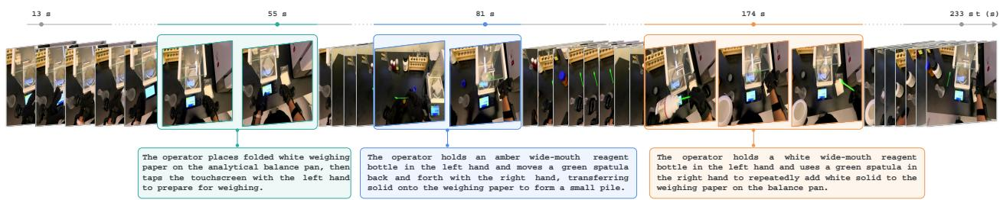  
Figure 5. Step annotations. Three color-coded subtasks with timestamps and descriptions.  
consistency. Subsets, metrics, and full-body references are detailed in Apps. F.1, F.2 and F.4.

## 5.1. Annotation Reliability

Whole-body reconstruction. Tab. 2 compares three baseline settings: public pretrained checkpoints with calibrated sensor-to-anchor conversion, direct use of raw tracker poses, and fine-tuning with five tracker anchors. EgoExplorer outperforms all three settings across every reported metric, achieving 18.0 mm body-point error and 20.3 mm at non-tracked points. Its lowest errors extend beyond the observed anchors to other body points, including elbows and knees, indicating better recovery of full-body articulation. Visual comparisons are provided in Fig. 21.

Hand motion and touch capture. Tabs. 3 and 4 compare our glove settings with visual and kinematic inference. In matched-configuration hand tests, our glove setting yields 0.4 mm holding RMS, versus 4.5 mm for HaWoR (Zhang et al., 2025) and 11.3 mm for HandFlow (Xu et al., 2026), and achieves 100% kinematic target recovery. For regional contact, our glove setting achieves 0.915 IoU, compared with 0.621 for HACO (Jung and Lee, 2025) and 0.324 for hand-pose-only inference. Together, these tests support direct sensing of finger articulation and contact.

Step text quality. Expert review of model-generated annotations (Tab. 5) finds factual errors in 11.09% of reviewed segments and unsupported claims in 2.46%. The audit also reports missed- and extra-step rates of 8.16% and 2.05%, respectively, with boundary corrections in 3.08% of segments. These residual errors motivate manual verification and correction in our workflow before release.

Table 2. Body reconstruction on the Evaluation Subset (mm; velocity: mm/s). Non-tracked: 17 unobserved joints. †Reconstructed pelvis; ‡raw tracker poses; ∗locally trained variants.
<table><tr><td>Method</td><td>Anchors</td><td>Body points↓</td><td>Non-tracked↓</td><td>PA-MPJPE↓</td><td>Root↓</td><td>Velocity↓</td></tr><tr><td>AvatarPoser (Jiang et al., 2022)</td><td>3</td><td>128.5</td><td>122.5</td><td>86.3</td><td>99.5</td><td>106.1</td></tr><tr><td>AGRoL (Du et al., 2023)</td><td>3</td><td>119.6</td><td>114.0</td><td>81.0</td><td>89.6</td><td>113.0</td></tr><tr><td>EgoPoser (Jiang et al., 2024b)</td><td></td><td>155.5</td><td>143.2</td><td>89.3</td><td>121.2</td><td>113.2</td></tr><tr><td>AvatarJLM (Zheng et al., 2023)</td><td>33</td><td>117.9</td><td>113.3</td><td>78.6</td><td>95.0</td><td>105.9</td></tr><tr><td>SAGE (Feng et al., 2024)</td><td>3</td><td>114.7</td><td>109.5</td><td>81.4</td><td>83.4</td><td>110.3</td></tr><tr><td>SparsePoser (Ponton et al., 2023)†</td><td>6†</td><td>219.2</td><td>189.9</td><td>134.4</td><td>84.3</td><td>119.1</td></tr><tr><td>AvatarPoser</td><td>3</td><td>235.3</td><td>239.9</td><td>93.0</td><td>251.1</td><td>109.6</td></tr><tr><td>AGRoL</td><td></td><td>227.5</td><td>230.0</td><td>88.7</td><td>232.0</td><td>148.8</td></tr><tr><td>AvatarPoser*</td><td>35</td><td>64.1</td><td>62.1</td><td>21.0</td><td>61.7</td><td>96.8</td></tr><tr><td>HMD-Poser (Dai et al., 2024)*</td><td>5</td><td>136.7</td><td>131.5</td><td>71.3</td><td>107.8</td><td>152.1</td></tr><tr><td>EGOEXPLORER</td><td>5</td><td>18.0</td><td>20.3</td><td>13.3</td><td>25.9</td><td>83.0</td></tr></table>

Table 3. Hand capture quality on the Evaluation Subset. Tip/Hold RMS: mm; Missing/Success: %; Gap: s.  
Table 4. Contact quality on the Evaluation Subset using frame-region labels.
<table><tr><td colspan="6">Method Tip↓ Hold RMS↓ Missing↓ Gap p95↓ Success↑</td></tr><tr><td>HaWoR (Zhang et al., 2025) 27.1</td><td></td><td>4.5</td><td>7.9</td><td>2.13</td><td>47</td></tr><tr><td>HandFlow (Xu et al., 2026) 30.7</td><td></td><td>11.3</td><td>7.8</td><td>2.09</td><td>67</td></tr><tr><td>Ours</td><td>9.5</td><td>0.4</td><td>0.0</td><td>0.00</td><td>100</td></tr></table>

<table><tr><td>Input</td><td>IoU↑</td><td>F1↑</td></tr><tr><td>RGB (HACO (Jung and Lee, 2025))</td><td>0.621</td><td>0.766</td></tr><tr><td>Hand pose only</td><td>0.324</td><td>0.490</td></tr><tr><td>Ours</td><td>0.915</td><td>0.956</td></tr></table>

Table 5. Expert review of model-generated text annotations (%).
<table><tr><td>Annotation</td><td colspan="2">Fact error↓</td><td colspan="2">Unsupported↓</td><td colspan="2">Missed steps↓</td><td colspan="2">Extra steps↓ Boundary error↓</td><td colspan="2">Unjudgeable↓</td></tr><tr><td>Model-generated</td><td>11.09</td><td></td><td>2.46</td><td></td><td>8.16</td><td></td><td>2.05</td><td>3.08</td><td></td><td>0.82</td></tr><tr><td>Metric</td><td>Separate</td><td>Joint</td><td>Condition</td><td colspan="2">Action MSE↓</td><td></td><td></td><td></td><td></td><td></td></tr><tr><td>Video PSNR (dB)↑</td><td>15.94</td><td>16.62</td><td>None</td><td colspan="2">0.0478</td><td></td><td></td><td></td><td></td><td></td></tr><tr><td>Action MSE↓</td><td>0.059</td><td>0.044 Video</td><td></td><td colspan="2">0.0277</td><td></td><td></td><td></td><td></td><td></td></tr><tr><td>Contact F1↑</td><td>0.610</td><td></td><td>0.694Video+touch</td><td colspan="2">0.0264</td><td></td><td></td><td></td><td></td><td></td></tr></table>

Table 6. Preliminary study. (a) Separate/joint Figure 6. Human motion (green) and G1 wholegeneration; (b) conditional action generation. body control policy in simulation (gold).

Table 7. Ablations on the Evaluation Subset and Natural Recordings. Pose errors: mm; velocity/slide: mm/s; jerk: m/s3; floor: %. Blue: primary metric (Avg.); gray: the baseline.
<table><tr><td rowspan="2">Configuration</td><td colspan="3">Layers</td><td colspan="4">Evaluation</td><td colspan="5">Natural</td><td rowspan="2">Avg.↓</td></tr><tr><td>L1</td><td>L2</td><td>L3</td><td>Body pts↓</td><td>Non-trk.↓</td><td>PA↓</td><td>Velocity↓</td><td>Tracker↓</td><td>Crossing↓</td><td>Floor↓</td><td>Jerk</td><td>Slide↓</td></tr><tr><td>Full (1+2+3)</td><td>√</td><td>√</td><td>√</td><td>18.0</td><td>20.3</td><td>13.3</td><td>83.0</td><td>10.5</td><td>38.1</td><td>6.0</td><td>37.6</td><td>29.1</td><td>28.4</td></tr><tr><td>Full, mean body</td><td>√</td><td>√</td><td>√</td><td>59.5</td><td>66.3</td><td>27.3</td><td>96.9</td><td>12.3</td><td>71.4</td><td>50.9</td><td>49.0</td><td>37.5</td><td>52.3</td></tr><tr><td>Full, no mount calibration</td><td>√</td><td>√</td><td>√</td><td>95.0</td><td>96.6</td><td>33.7</td><td>91.6</td><td>41.4</td><td>41.3</td><td>3.5</td><td>46.0</td><td>52.3</td><td>55.7</td></tr><tr><td>Full, uncalib. at test</td><td>√</td><td>√</td><td>√</td><td>98.1</td><td>99.6</td><td>38.8</td><td>97.3</td><td>27.5</td><td>23.1</td><td>0.6</td><td>51.0</td><td>54.9</td><td>54.5</td></tr><tr><td>Layer 1</td><td>√</td><td></td><td></td><td>16.1</td><td>18.2</td><td>11.9</td><td>81.4</td><td>9.9</td><td>72.8</td><td>57.3</td><td>33.5</td><td>27.1</td><td>36.5</td></tr><tr><td>Layer 1+2</td><td>√</td><td>√</td><td></td><td>18.1</td><td>20.4</td><td>13.2</td><td>82.3</td><td>10.1</td><td>38.7</td><td>61.4</td><td>34.4</td><td>28.7</td><td>34.1</td></tr><tr><td>Layer 1+3</td><td>√</td><td></td><td>√</td><td>15.9</td><td>18.0</td><td>11.9</td><td>82.0</td><td>10.3</td><td>73.0</td><td>5.9</td><td>36.6</td><td>27.3</td><td>31.2</td></tr><tr><td>Proposal only</td><td></td><td></td><td></td><td>79.0</td><td>75.1</td><td>29.2</td><td>125.6</td><td>109.6</td><td>82.6</td><td>29.5</td><td>19.8</td><td>117.6</td><td>74.2</td></tr></table>

## 5.2. Preliminary Training Study

We adapt Cosmos3-Edge (NVIDIA, 2026) to generate video, SMPL-X-derived action, and touch (Tab. 6). With common video/action/touch history, we compare separate and joint generation using sampled predictions at 5K training steps. Joint generation improves video PSNR from 15.94 to 16.62 dB and contact F1 from 0.610 to 0.694 over the separate models, with a lower action MSE. Conditioning action generation on recorded video over the prediction interval reduces action MSE from 0.0478 to 0.0277; adding touch reduces it to 0.0264. These conditions reveal complementary information across modalities. Retargeting two recordings to a Unitree G1 and tracking them with a ZeroWBC-style (Yang et al., 2026a) whole-body controller provides a preliminary demonstration of human-to-robot motion transfer in simulation (Fig. 6). These initial studies illustrate multimodal learning and simulated motion tracking; protocols are detailed in Apps. F.6 and F.9.

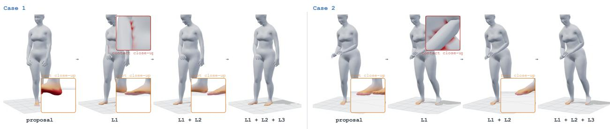  
Figure 7. Geometric refinement reduces self-intersection and floor penetration.

## 5.3. Ablation Study

Calibration and layered reconstruction. Tab. 7 shows complementary gains from successively adding Layers 1–3: body-point error drops from 79.0 to 16.1 mm, crossing pairs from 72.8 to 38.7 per frame, and floor violations from 61.4% to 6.0%, respectively. Full has the lowest Avg. (28.4; mean of nine reported values), despite higher body-point error and jerk than Layer 1 alone. Replacing calibrated shape and scale with the mean body raises body-point error from 18.0 to 59.5 mm and floor violations from 6.0% to 50.9%. Omitting mount calibration during training raises body-point error to 95.0 mm, while omitting it only at test time yields 98.1 mm. These results support fixing body-sensor geometry before motion recovery. Fig. 7 shows reduced self-intersection and floor penetration.

## 6. Conclusion

This paper introduces EgoExplorer, an egocentric dataset aligning whole-body motion, hand articulation, contact, and descriptions for human loco-manipulation. The proposed ${ \mathsf { C } } ^ { 3 }$ pipeline recovers metric body motion from sparse wearable sensing through calibration, temporal completion, and layered constraints. Evaluations show the benefits of direct sensing, and support this portable approach to capturing and studying coordinated movement and manipulation.

Limitations. Reconstruction cannot guarantee exact recovery of all joints, while tactile sensing has variable reliability. Preliminary studies leave benefits for real-world humanoid learning unverified.

## Ackonwledgement

This project is supported by Shanghai Artificial Intelligence Laboratory. We are grateful to all data collection contributors for their dedicated eforts in large-scale data acquisition. We also acknowledge the support and guidance from Prof. Minyi Guo and Prof. Hongzi Zhu.

## References

J. P. Araujo, Y. Ze, P. Xu, J. Wu, and C. K. Liu. Retargeting matters: General motion retargeting for humanoid motion tracking. arXiv preprint arXiv:2510.02252, 2025.

P. Banerjee, S. Shkodrani, P. Moulon, S. Hampali, S. Han, F. Zhang, L. Zhang, J. Fountain, E. Miller, S. Basol, R. Newcombe, R. Wang, J. J. Engel, and T. Hodan. HOT3D: Hand and Object

Tracking in 3D from Egocentric Multi-View Videos. In Proceedings of the IEEE/CVF Conference on Computer Vision and Pattern Recognition (CVPR), pages 7061–7071, June 2025. URL https: //openaccess.thecvf.com/content/CVPR2025/html/Banerjee\_HOT3D\_Hand\_and\_ Object\_Tracking\_in\_3D\_from\_Egocentric\_Multi-View\_CVPR\_2025\_paper.html.

B. L. Bhatnagar, X. Xie, I. A. Petrov, C. Sminchisescu, C. Theobalt, and G. Pons-Moll. BEHAVE: Dataset and Method for Tracking Human Object Interactions. In IEEE/CVF Conference on Computer Vision and Pattern Recognition (CVPR), pages 15914–15925, 2022. doi: 10.1109/cvpr52688.2022.01547.

Build AI. Egocentric-10K. Hugging Face dataset, 2025. URL https://huggingface.co/ datasets/builddotai/Egocentric-10K.

R. Cadene, S. Alibert, F. Capuano, M. Aractingi, A. Zouitine, P. Kooijmans, J. Choghari, M. Russi, C. Pascal, S. Palma, M. Shukor, J. Moss, A. Soare, D. Aubakirova, Q. Lhoest, Q. Gallouédec, and T. Wolf. Lerobot: An open-source library for end-to-end robot learning. In The Fourteenth International Conference on Learning Representations, 2026. URL https://arxiv.org/abs/2602.22818.

Y. Cao, H. Xie, B. Wen, R. Yao, Y. Liu, Y. Huang, Z. Liao, Y. Wang, H. Liu, X. Tian, D. Su, L. Zhuo, D. Tao, X. Wang, L. Pan, and Z. Liu. ACE-Data-0: Human-centric ambient capture as embodied data engine. arXiv preprint arXiv:2607.28625, 2026.

P. Dai, Y. Zhang, T. Liu, Z. Fan, T. Du, Z. Su, X. Zheng, and Z. Li. HMD-Poser: On-Device Real-time Human Motion Tracking from Scalable Sparse Observations. In IEEE/CVF Conference on Computer Vision and Pattern Recognition (CVPR), pages 874–884, 2024. doi: 10.1109/cvpr52733.2024.00089.

D. Damen, H. Doughty, G. M. Farinella, A. Furnari, E. Kazakos, J. Ma, D. Moltisanti, J. Munro, T. Perrett, W. Price, and M. Wray. Rescaling Egocentric Vision: Collection, Pipeline and Challenges for EPIC-KITCHENS-100. International Journal of Computer Vision, 130(1):33–55, 2022. doi: 10.1007/s11263-021-01531-2.

D. DeTone, F. Bogo, E.-T. Le, D. Frost, J. Straub, Y. Siddiqui, Y. Ye, J. Engel, R. Newcombe, and L. Ma. NymeriaPlus: Enriching Nymeria Dataset with Additional Annotations and Data. arXiv preprint arXiv:2603.18496, 2026. URL https://arxiv.org/abs/2603.18496.

Y. Du, R. Kips, A. Pumarola, S. Starke, A. Thabet, and A. Sanakoyeu. Avatars Grow Legs: Generating Smooth Human Motion from Sparse Tracking Inputs with Difusion Model. In IEEE/CVF Conference on Computer Vision and Pattern Recognition (CVPR), pages 481–490, 2023. doi: 10.1109/cvpr52729. 2023.00054.

Z. Fan, P. Dai, Z. Su, X. Gao, Z. Lv, J. Zhang, T. Du, G. Wang, and Y. Zhang. EMHI: A Multimodal Egocentric Human Motion Dataset with HMD and Body-Worn IMUs. Proceedings of the AAAI Conference on Artificial Intelligence, 39(3):2879–2887, 2025. doi: 10.1609/aaai.v39i3.32294.

H. Feng, W. Ma, Q. Gao, X. Zheng, N. Xue, and H. Xu. Stratified avatar generation from sparse observations. In Proceedings of the IEEE/CVF Conference on Computer Vision and Pattern Recognition (CVPR), 2024.

K. Grauman, A. Westbury, E. Byrne, Z. Chavis, A. Furnari, R. Girdhar, J. Hamburger, H. Jiang, M. Liu, X. Liu, M. Martin, T. Nagarajan, I. Radosavovic, S. K. Ramakrishnan, F. Ryan, J. Sharma, M. Wray, M. Xu, E. Z. Xu, C. Zhao, S. Bansal, D. Batra, V. Cartillier, S. Crane, T. Do, M. Doulaty, A. Erapalli, C. Feichtenhofer, A. Fragomeni, Q. Fu, A. Gebreselasie, C. Gonzalez, J. Hillis, X. Huang, Y. Huang, W. Jia, W. Khoo, J. Kolar, S. Kottur, A. Kumar, F. Landini, C. Li, Y. Li, Z. Li, K. Mangalam, R. Modhugu, J. Munro, T. Murrell, T. Nishiyasu, W. Price, P. R. Puentes, M. Ramazanova, L. Sari,

K. Somasundaram, A. Southerland, Y. Sugano, R. Tao, M. Vo, Y. Wang, X. Wu, T. Yagi, Z. Zhao, Y. Zhu, P. Arbelaez, D. Crandall, D. Damen, G. M. Farinella, C. Fuegen, B. Ghanem, V. K. Ithapu, C. V. Jawahar, H. Joo, K. Kitani, H. Li, R. Newcombe, A. Oliva, H. S. Park, J. M. Rehg, Y. Sato, J. Shi, M. Z. Shou, A. Torralba, L. Torresani, M. Yan, and J. Malik. Ego4D: Around the World in 3,000 Hours of Egocentric Video. In IEEE/CVF Conference on Computer Vision and Pattern Recognition (CVPR), pages 18973–18990, 2022. doi: 10.1109/cvpr52688.2022.01842.

K. Grauman, A. Westbury, L. Torresani, K. Kitani, J. Malik, T. Afouras, K. Ashutosh, V. Baiyya, S. Bansal, B. Boote, E. Byrne, Z. Chavis, J. Chen, F. Cheng, F.-J. Chu, S. Crane, A. Dasgupta, J. Dong, M. Escobar, C. Forigua, A. Gebreselasie, S. Haresh, J. Huang, M. M. Islam, S. Jain, R. Khirodkar, D. Kukreja, K. J. Liang, J.-W. Liu, S. Majumder, Y. Mao, M. Martin, E. Mavroudi, T. Nagarajan, F. Ragusa, S. K. Ramakrishnan, L. Seminara, A. Somayazulu, Y. Song, S. Su, Z. Xue, E. Zhang, J. Zhang, A. Castillo, C. Chen, X. Fu, R. Furuta, C. González, P. Gupta, J. Hu, Y. Huang, Y. Huang, W. Khoo, A. Kumar, R. Kuo, S. Lakhavani, M. Liu, M. Luo, Z. Luo, B. Meredith, A. Miller, O. Oguntola, X. Pan, P. Peng, S. Pramanick, M. Ramazanova, F. Ryan, W. Shan, K. Somasundaram, C. Song, A. Southerland, M. Tateno, H. Wang, Y. Wang, T. Yagi, M. Yan, X. Yang, Z. Yu, S. C. Zha, C. Zhao, Z. Zhao, Z. Zhu, J. Zhuo, P. Arbeláez, G. Bertasius, D. Damen, J. Engel, G. Maria Farinella, A. Furnari, B. Ghanem, J. Hofman, C. V. Jawahar, R. Newcombe, H. S. Park, J. M. Rehg, Y. Sato, M. Savva, J. Shi, M. Z. Shout, and M. Wray. Ego-Exo4D: Understanding Skilled Human Activity from First- and Third-Person Perspectives. In IEEE/CVF Conference on Computer Vision and Pattern Recognition (CVPR), pages 19383–19400, 2024. doi: 10.1109/cvpr52733.2024.01834.

R. Hartley, J. Trumpf, Y. Dai, and H. Li. Rotation averaging. International Journal of Computer Vision, 103(3):267–305, 2013. doi: 10.1007/s11263-012-0601-0.

R. Hoque, P. Huang, D. J. Yoon, M. Sivapurapu, and J. Zhang. EgoDex: Learning Dexterous Manipulation from Large-Scale Egocentric Video. In International Conference on Learning Representations (ICLR), 2026. URL https://machinelearning.apple.com/research/ egodex-learning-dexterous-manipulation.

P. J. Huber. Robust estimation of a location parameter. The Annals of Mathematical Statistics, 35(1): 73–101, 1964. doi: 10.1214/aoms/1177703732.

J. Jiang, P. Streli, H. Qiu, A. Fender, L. Laich, P. Snape, and C. Holz. AvatarPoser: Articulated Full-Body Pose Tracking from Sparse Motion Sensing. In European Conference on Computer Vision (ECCV), pages 443–460, 2022. doi: 10.1007/978-3-031-20065-6\_26.

J. Jiang, P. Streli, X. Luo, C. Gebhardt, and C. Holz. MANIKIN: Biomechanically Accurate Neural Inverse Kinematics for Human Motion Estimation. In European Conference on Computer Vision (ECCV), pages 128–146, 2024a. doi: 10.1007/978-3-031-72627-9\_8.

J. Jiang, P. Streli, M. Meier, and C. Holz. EgoPoser: Robust Real-Time Egocentric Pose Estimation from Sparse and Intermittent Observations Everywhere. In European Conference on Computer Vision (ECCV), pages 277–294, 2024b. doi: 10.1007/978-3-031-72627-9\_16.

D. S. Jung and K. M. Lee. Learning Dense Hand Contact Estimation from Imbalanced Data. In Advances in Neural Information Processing Systems (NeurIPS), 2025. URL https://arxiv.org/ abs/2505.11152

S. Kareer, D. Patel, R. Punamiya, P. Mathur, S. Cheng, C. Wang, J. Hofman, and D. Xu. EgoMimic: Scaling Imitation Learning via Egocentric Video. In IEEE International Conference on Robotics and Automation (ICRA), pages 13226–13233, 2025. doi: 10.1109/icra55743.2025.11127989.

J. Kim, J. Kim, J. Na, and H. Joo. ParaHome: Parameterizing Everyday Home Activities Towards 3D Generative Modeling of Human-Object Interactions. In Proceedings of the IEEE/CVF Conference on Computer Vision and Pattern Recognition (CVPR), pages 1816–1828, June 2025. URL https://openaccess.thecvf.com/content/CVPR2025/html/Kim\_ParaHome\_ Parameterizing\_Everyday\_Home\_Activities\_Towards\_3D\_Generative\_Modeling\_ of\_CVPR\_2025\_paper.html.

D. P. Kingma and J. Ba. Adam: A method for stochastic optimization. In International Conference on Learning Representations, 2015.

Y. Li, X. Wei, J. Luo, Y. Xiao, Y. Bai, G. Zhou, T. Zou, C. Gui, J. Wen, H. Zhang, K. Chen, X. Pan, S. Liu, D. Wang, T. An, J. Li, S. Jin, W. Zhang, T. Wang, B. Wei, Z. Huang, F. Liu, R. Li, H. Zhang, A. Li, Y. Gong, P. Cao, J. Liang, and L. Lin. EgoLive: A Large-Scale Egocentric Dataset from Real-World Human Tasks. arXiv preprint arXiv:2604.23570, 2026a. URL https://arxiv.org/abs/2604. 23570.

Z. Li, B. Yang, C. Miao, K. Zhu, H. Chen, Q. Guan, Z. Wu, W. Zhan, Y. Sun, Z. Huang, Z. Shan, Z. Jin, J. Hong, T. Wang, Y. Feng, Y. Liu, Y. Wang, Y. Yang, Z. Zhou, M. Luo, H. Cheng, B. Zhang, J. Li, J. Cai, G. Yao, J. Zhang, C. Lin, R. Xu, L. Yu, C. Shen, C. Shen, and Z. Li. Open-AoE: An Open Egocentric Manipulation Dataset and Toolchain for Embodied Learning. arXiv preprint arXiv:2607.14183, 2026b. URL https://arxiv.org/abs/2607.14183.

I. Loshchilov and F. Hutter. Decoupled weight decay regularization. In International Conference on Learning Representations, 2019.

L. Ma, Y. Ye, F. Hong, V. Guzov, Y. Jiang, R. Postyeni, L. Pesqueira, A. Gamino, V. Baiyya, H. J. Kim, K. Bailey, D. S. Fosas, C. K. Liu, Z. Liu, J. Engel, R. D. Nardi, and R. Newcombe. Nymeria: A Massive Collection of Multimodal Egocentric Daily Motion in the Wild. In European Conference on Computer Vision (ECCV), pages 445–465, 2024. doi: 10.1007/978-3-031-72691-0\_25.

N. Mahmood, N. Ghorbani, N. F. Troje, G. Pons-Moll, and M. J. Black. AMASS: Archive of Motion Capture As Surface Shapes. In IEEE/CVF International Conference on Computer Vision (ICCV), pages 5441–5450, 2019. doi: 10.1109/iccv.2019.00554.

NVIDIA. Cosmos3 Generator Action. Oficial model and training documentation, 2026. URL https: //github.com/NVIDIA/cosmos/tree/main/cookbooks/cosmos3/generator/action.

G. Pavlakos, V. Choutas, N. Ghorbani, T. Bolkart, A. A. A. Osman, D. Tzionas, and M. J. Black. Expressive Body Capture: 3D Hands, Face, and Body From a Single Image. In IEEE/CVF Conference on Computer Vision and Pattern Recognition (CVPR), pages 10967–10977, 2019. doi: 10.1109/cvpr.2019.01123.

J. Peng, X. Yu, D. Feng, Y. Yang, W. Cai, J. Xiong, G. Yang, J. Zheng, J. Cao, X. Wei, J. Pang, Y. Shen, and T. Wang. Cortex: A Bidirectionally Aligned Embodied Agent Framework for Long-horizon Manipulation. arXiv preprint arXiv:2607.05377, 2026. URL https://arxiv.org/abs/2607. 05377.

J. L. Ponton, H. Yun, A. Aristidou, C. Andujar, and N. Pelechano. SparsePoser: Real-time Full-body Motion Reconstruction from Sparse Data. ACM Transactions on Graphics, 43(1):1–14, 2023. doi: 10.1145/3625264.

R. Punamiya, S. Kareer, Z. Liu, J. Citron, R.-Z. Qiu, X. Cai, A. Gavryushin, J. Chen, D. Liconti, L. Y. Zhu, P. Aphiwetsa, B. Li, A. Cheluva, P. Kuppili, Y. Liu, D. Patel, A. Gao, H.-Y. Chung, R. Co, R. Zbizika, J. Liu, X. Xu, H. Xiong, G. Chen, S. Oliani, W. Xuan, C. Yang, X. Wang, J. Fort, R. Newcombe, J. Gao,

J. Chong, G. Matsuda, A. Doriwala, M. Pollefeys, R. Katzschmann, X. Wang, S. Song, J. Hofman, and D. Xu. EgoVerse: An Egocentric Human Dataset for Robot Learning from Around the World. arXiv preprint arXiv:2604.07607, 2026. URL https://arxiv.org/abs/2604.07607.

C. R. Qi, L. Yi, H. Su, and L. J. Guibas. PointNet++: Deep hierarchical feature learning on point sets in a metric space. In Advances in Neural Information Processing Systems (NeurIPS), volume 30, 2017.

R.-Z. Qiu, S. Yang, X. Cheng, C. Chawla, J. Li, T. He, G. Yan, D. J. Yoon, R. Hoque, L. Paulsen, G. Yang, J. Zhang, S. Yi, G. Shi, and X. Wang. Humanoid Policy ∼ Human Policy. In Proceedings of the 9th Conference on Robot Learning, volume 305 of Proceedings of Machine Learning Research, pages 2888–2906. PMLR, 2025. URL https://proceedings.mlr.press/v305/qiu25a.html.

J. Romero, D. Tzionas, and M. J. Black. Embodied hands: modeling and capturing hands and bodies together. ACM Transactions on Graphics, 36(6):1–17, 2017. doi: 10.1145/3130800.3130883.

Ropedia. Xperience-10M: A Large-Scale Egocentric Multimodal Dataset with Structured 3D/4D Annotations. Hugging Face dataset, 2026. URL https://huggingface.co/datasets/ropedia-ai/ xperience-10m.

H. Sakoe and S. Chiba. Dynamic programming algorithm optimization for spoken word recognition. IEEE Transactions on Acoustics, Speech, and Signal Processing, 26(1):43–49, 1978. doi: 10.1109/ TASSP.1978.1163055.

J. Schulman, F. Wolski, P. Dhariwal, A. Radford, and O. Klimov. Proximal policy optimization algorithms. arXiv preprint arXiv:1707.06347, 2017.

Z. Shen, H. Pi, Y. Xia, Z. Cen, S. Peng, Z. Hu, H. Bao, R. Hu, and X. Zhou. World-Grounded Human Motion Recovery via Gravity-View Coordinates. In ACM SIGGRAPH Asia Conference Papers, pages 1–11, 2024. doi: 10.1145/3680528.3687565.

M. Shi, S. Peng, J. Chen, H. Jiang, T. Li, D. Huang, P. Luo, H. Li, and L. Chen. EgoHumanoid: Unlocking In-the-Wild Loco-Manipulation with Robot-Free Egocentric Demonstration. arXiv preprint arXiv:2602.10106, 2026. URL https://arxiv.org/abs/2602.10106.

K. Shoemake. Animating rotation with quaternion curves. In Proceedings of the 12th Annual Conference on Computer Graphics and Interactive Techniques (SIGGRAPH), pages 245–254, 1985. doi: 10.1145/ 325334.325242.

Y. R. Song, J. Li, R. Fu, D. Murphy, K. Zhou, R. Shiv, Y. Li, H. Xiong, C. E. Owens, Y. Du, Y. Luo, X. Cheng, A. Torralba, W. Matusik, and P. P. Liang. OPENTOUCH: Bringing Full-Hand Touch to Real-World Interaction. arXiv preprint arXiv:2512.16842, 2025. URL https://arxiv.org/abs/ 2512.16842.

O. Taheri, N. Ghorbani, M. J. Black, and D. Tzionas. GRAB: A Dataset of Whole-Body Human Grasping of Objects. In European Conference on Computer Vision (ECCV), pages 581–600, 2020. doi: 10.1007/978-3-030-58548-8\_34.

E. Todorov, T. Erez, and Y. Tassa. MuJoCo: A physics engine for model-based control. In IEEE/RSJ International Conference on Intelligent Robots and Systems (IROS), pages 5026–5033, 2012.

S. Umeyama. Least-squares estimation of transformation parameters between two point patterns. IEEE Transactions on Pattern Analysis and Machine Intelligence, 13(4):376–380, 1991. doi: 10. 1109/34.88573.

A. Vaswani, N. Shazeer, N. Parmar, J. Uszkoreit, L. Jones, A. N. Gomez, Ł. Kaiser, and I. Polosukhin. Attention is all you need. In Advances in Neural Information Processing Systems (NeurIPS), volume 30, 2017.

M. Xu, B. Duan, Y. Gu, Z. Shen, R. Xu, and Y. Yue. HandFlow: Fully Generative 4D Hand Recovery with Flow Matching. arXiv preprint arXiv:2607.11221, 2026. URL https://arxiv.org/abs/ 2607.11221.

H. Yang, J. Bao, Y. Xin, H. Song, Y. Tian, B. Zhao, D. Wang, and X. Li. ZeroWBC: Learning Natural Whole-Body Humanoid Interaction from Human Egocentric Data. arXiv preprint arXiv:2603.09170, 2026a. URL https://arxiv.org/abs/2603.09170.

L. Yang, X. Huang, Z. Wu, A. Kanazawa, P. Abbeel, C. Sferrazza, C. K. Liu, R. Duan, and G. Shi. OmniRetarget: Interaction-Preserving Data Generation for Humanoid Whole-Body Loco-Manipulation and Scene Interaction. In IEEE International Conference on Robotics and Automation (ICRA), 2026b. URL https://omniretarget.github.io/.

R. Yu, X. Lin, J. Ma, Y. Wang, K. Luo, J. Ji, H. Wang, W. Wang, R. Zhang, P. Tan, T. Wu, R. Dai, Q. Chen, and L. Han. OmniContact: Chaining Meta-Skills via Contact Flow for Generalizable Humanoid Loco-Manipulation. arXiv preprint arXiv:2606.26201, 2026. URL https://arxiv.org/abs/ 2606.26201.

J. Zhang, J. Deng, C. Ma, and R. A. Potamias. HaWoR: World-Space Hand Motion Reconstruction from Egocentric Videos. In IEEE/CVF Conference on Computer Vision and Pattern Recognition (CVPR), pages 1805–1815, 2025. doi: 10.1109/cvpr52734.2025.00175.

S. Zhang, Q. Ma, Y. Zhang, Z. Qian, T. Kwon, M. Pollefeys, F. Bogo, and S. Tang. EgoBody: Human Body Shape and Motion of Interacting People from Head-Mounted Devices. In European Conference on Computer Vision (ECCV), pages 180–200, 2022. doi: 10.1007/978-3-031-20068-7\_11.

Y. Zhang, Z. Li, L. An, M. Li, T. Yu, and Y. Liu. Lightweight multi-person total motion capture using sparse multi-view cameras. In Proceedings of the IEEE/CVF International Conference on Computer Vision, pages 5540–5549, 2021. doi: 10.1109/ICCV48922.2021.00551. URL https: //arxiv.org/abs/2108.10378.

Y. Zhao, T. Kwon, P. Streli, M. Pollefeys, and C. Holz. EgoPressure: A Dataset for Hand Pressure and Pose Estimation in Egocentric Vision. In Proceedings of the IEEE/CVF Conference on Computer Vision and Pattern Recognition (CVPR), pages 27727–27738, 2025. URL https://openaccess.thecvf.com/content/CVPR2025/html/Zhao\_EgoPressure\_ A\_Dataset\_for\_Hand\_Pressure\_and\_Pose\_Estimation\_in\_CVPR\_2025\_paper.html.

X. Zheng, Z. Su, C. Wen, Z. Xue, and X. Jin. Realistic full-body tracking from sparse observations via joint-level modeling. In Proceedings of the IEEE/CVF International Conference on Computer Vision (ICCV), 2023.

R. Zhong, Y. Sun, J. Wen, J. Li, C. Cheng, W. Dai, Z. Zeng, H. Lu, Y. Zhu, and Y. Xu. HumanoidExo: Scalable Whole-Body Humanoid Manipulation via Wearable Exoskeleton. arXiv preprint arXiv:2510.03022, 2025. URL https://arxiv.org/abs/2510.03022.

J. Zhou, Z. Gao, F. Hong, Z. Liu, G. Zhang, W. Dai, R. Zhen, C. Lyu, H. Wu, Y. Mao, X. Wang, Y. Jiang, W. Ding, and S. Yang. TouchAnything: A Dataset and Framework for Bimanual Tactile Estimation from Egocentric Video. arXiv preprint arXiv:2605.13083, 2026. URL https://arxiv.org/abs/ 2605.13083.

Y. Zhou, C. Barnes, J. Lu, J. Yang, and H. Li. On the continuity of rotation representations in neural networks. In Proceedings of the IEEE/CVF Conference on Computer Vision and Pattern Recognition (CVPR), pages 5738–5746, 2019.

L. Y. Zhu, P. Kuppili, R. Punamiya, P. Aphiwetsa, D. Patel, S. Kareer, S. Ha, and D. Xu. EMMA: Scaling Mobile Manipulation via Egocentric Human Data. IEEE Robotics and Automation Letters, 11(3): 3087–3094, 2026. doi: 10.1109/lra.2026.3653320.

## Appendix Contents

A Capture Hardware . . . . 19   
B Data Format 19   
C Whole-Body Reconstruction from Sparse Measurement . 21   
C.1 Protocol-guided calibration 21   
C.2 Prior-guided motion completion 24   
C.3 Constraint layer 1: skeletal motion 25   
C.4 Constraint layer 2: surface clearance 26   
C.5 Constraint layer 3: body-ground consistency 27   
C.6 Joint refinement 27   
D Multimodal Integration and Annotation 27   
D.1 Hand and touch fusion 27   
D.2 Expert-provided procedural context 28   
D.3 Example text prompt . . 29   
D.4 Human verification and experimental interpretation 30   
E Data Statistics 30   
F Experiments . 37   
F.1 Evaluation setup 37   
F.2 Whole-body reconstruction: inputs and references 37   
F.3 Hand motion and contact capture 38   
F.4 Evaluation metrics 40   
F.5 Expert review of text annotations 41   
F.6 Preliminary training study 41   
F.7 Calibration and layered reconstruction ablations 42   
F.8 Professional-skill ablation 43   
F.9 Humanoid retargeting 43   
F.10 Qualitative examples . . . 45   
G Discussion on Capture Trade-ofs 48

## A. Capture Hardware

Extending Sec. 3.1, the capture system comprises a head-mounted camera, five wearable body trackers, and articulation gloves; the Wuji configuration additionally provides touch sensing. As in Sec. 3.1, custom 3D-printed mounts rigidly couple the head tracker to the camera and attach the remaining trackers to the glove dorsum and the lateral ankles, with straps for added fixation (Fig. 8). The trackers directly measure device poses, while anatomical anchors are obtained as joint frames through calibrated device-to-joint transformations. Tab. 8 summarizes the acquisition settings and manufacturer-specified characteristics of the articulation gloves. Each sensing stream preserves its native timestamps for temporal alignment, and subsequent resampling only interpolates existing measurements without introducing additional observations. The calibration parameters are reused as long as the corresponding mounts remain fixed and are recomputed after remounting.

Table 8. Capture hardware and acquisition settings. Glove rates are manufacturer specifications; per-recording timing follows native timestamps.
<table><tr><td>Stream</td><td>Hardware</td><td>Acquisition / representation</td></tr><tr><td>Ego RGB</td><td>GoPro HERO13 Black with Media Mod</td><td>30 Hz; 1920 × 970 pixels; intrinsics below</td></tr><tr><td>Body tracking</td><td>Five VIVE Ultimate Trackers; head, wrists, ankles</td><td>60 Hz; room-fixed frame with its origin at a designated reference location</td></tr><tr><td>Finger articulation</td><td>MANUS Metagloves Pro (no haptic feedback) or Wuji gloves</td><td>Five 6-DoF fingertip EMF sensors per glove; 120 Hz nominal rate</td></tr><tr><td>Regional touch</td><td>Wuji tactile configuration</td><td>24 × 31 matrix; 744 taxels per hand; 526 retained by the evaluation health mask; 120 Hz nominal rate</td></tr></table>

The camera operates at a resolution of $1 9 2 0 \times 9 7 0$ pixels, with intrinsic matrix:

$$
K = \left[ \begin{array} { c c c } { 1 0 1 2 . 0 } & { 0 } & { 9 6 0 . 0 } \\ { 0 } & { 1 0 1 6 . 0 } & { 4 3 0 . 0 } \\ { 0 } & { 0 } & { 1 } \end{array} \right] ,
$$

where the focal lengths and principal-point coordinates are expressed in pixels. For body–hand fusion, glove joint positions are transformed into the wrist-local coordinate frame. The tactile sensing matrix follows row-major indexing and is mapped to 17 anatomical regions: two regions on the thumb, three on each remaining finger, and three on the palm. The contact extraction procedure used for quantitative evaluation is specified in App. F.3, while the corresponding export interface is described in App. D.1. Fig. 8 illustrates the five body trackers, the rigid head mount coupling the camera to the head tracker, and the two interchangeable glove configurations.

## B. Data Format

The release is organized according to the LeRobotDataset v3.0 specification (Cadene et al., 2026), with all streams aligned to a common 30 Hz temporal grid. Each row corresponds to one episode timestamp, and associates the corresponding visual observation, motion, tactile, and available annotation streams. The canonical fields episode\_index, frame\_index, index, timestamp, and task\_index denote the episode, local frame, global row, episode-relative time, and task, respectively. Timestamps are episode-relative and reset to zero at the beginning of each episode. Frame-level numerical data and textual annotations are stored in Parquet, whereas egocentric frames are encoded as MP4 and retrieved via episode metadata and temporal ofsets. A shard may contain multiple episodes. The release layout is as follows:

meta/info.json; meta/stats.json; meta/tasks.parquet

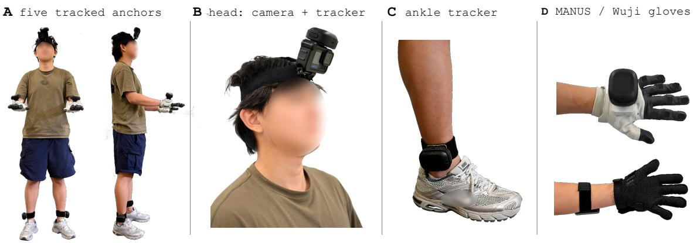  
Figure 8. Overview of the EgoExplorer capture rig. Five body trackers are mounted on the head, wrists, and ankles. MANUS gloves capture finger articulation, while Wuji gloves additionally provide tactile sensing.

meta/episodes/chunk-000/file-000.parquet

data/chunk-000/file-000.parquet

videos/observation.images.ego/chunk-000/file-000.mp4

meta/info.json specifies fps=30, feature shapes and dtypes, and shard paths; meta/stats.json stores feature statistics; and meta/tasks.parquet provides a mapping from task indices to task descriptions. Episode metadata specify row ranges and video ofsets, together with anonymized session, split, and calibration-profile identifiers. Tab. 9 lists the per-row fields.

Table 9. Contents associated with each release row. Dataset-specific features extend LeRobot’s standard indexing fields.
<table><tr><td>Field group</td><td>Per-row shape / type</td><td>Contents and conventions</td></tr><tr><td>Index and time</td><td>Scalars</td><td>Episode, frame, global row, task index, and timestamp in seconds</td></tr><tr><td>Ego RGB</td><td>Linked video frame</td><td>observation. images. ego; frame matched to the row timestamp</td></tr><tr><td>Tracker poses</td><td>5 × 3;5 × 4</td><td>Position in meters; quaternion order (x, y, z, w); per-device validity</td></tr><tr><td>Body motion</td><td>3 + 3 + 63</td><td>World pelvis position ut (m), root orientation, and 21 local body-joint rotations (axis-angle, rad)</td></tr><tr><td>Hand motion</td><td>2×45</td><td>Left/right SMPL-X finger rotations in local axis-angle form</td></tr><tr><td>Tactile readings</td><td>2 × 24 × 31</td><td>Normalized taxel readings with invalid cells masked; tactile subset only</td></tr><tr><td>Regional contact</td><td>2×17</td><td>Binary region states over each 30 Hz interval, with separate validity</td></tr><tr><td>Step annotations</td><td>Integers, text, times</td><td>Step ID, description, original interval bounds, skill, object roles, and observed outcome</td></tr><tr><td>Validity and provenance</td><td>Arrays and masks</td><td>Stream support, source-time mapping, interpolation flags, diagnostics, and review status; references where available</td></tr></table>

Step annotations will accompany every row in their annotated interval through additional annotation.\* fields; their original boundaries will be retained in seconds. Episode-level task descriptions and step-level text remain distinct. Fixed shape, scale, and mount parameters Φ will be referenced by calibration-profile ID instead of repeated in every row. Measurements, reconstructions, and reference labels will retain separate provenance; unavailable streams will be marked by validity

masks rather than encoded as measured zeros.

Body and tracker positions use a metric, right-handed, +�-up world frame. Tracker quaternions use $( x , y , z , w )$ order and active device-to-world rotations on column vectors. SMPL-X rotations are local axis-angle vectors in radians; the root orientation is world-relative. The release translation field stores the world pelvis position $u _ { t }$ defined in Sec. 3.2.2, rather than the SMPL-X library’s additive translation parameter. The conversion is specified in App. C.2.

Temporal alignment and validity. Native host timestamps are retained and converted to episoderelative seconds using their recorded time origins. The 30 Hz grid uses linear interpolation for positions, spherical linear interpolation (SLERP) (Shoemake, 1985) for rotations, and nearest recorded timestamps for RGB. Interpolated or held values retain source-time and validity information; they are not new sensor measurements. For contact, each output interval retains any valid native-rate detection within that interval; a bin without valid samples remains unavailable (App. D.1). Original step boundaries are stored in seconds, with per-row annotations assigned by interval membership.

## C. Whole-Body Reconstruction from Sparse Measurement

This section supplements ${ \mathsf { C } } ^ { 3 }$ in Sec. 3.2, following the same calibration, completion, and constraint stages. We retain its profile Φ, calibration variables Θ, motion state $x _ { t } ,$ and losses in Eqs. (1) to (3). All distances inside the optimization are in meters. Below, MS denotes the mean of squared scalar entries, $[ \cdot ] _ { + } = \operatorname* { m a x } ( \cdot , 0 )$ , and $\| \cdot \| _ { 2 }$ and $\| \cdot \| _ { F }$ are Euclidean and Frobenius norms.

## C.1. Protocol-guided calibration

Reference protocol. Fig. 9 shows the 17 ordered stages used by Sec. 3.2.1, named as in the figure: (A) body poses and articulation, (01) neutral stance, (02) head rotations, (03) A-pose, (04) T-pose, (05) forward reach, (06) elbow flexion, (07) wrist rotation, (08) shallow squat, (09) left leg raise, (10) right leg raise, and (11) ankle motion; (B) hand articulation, (12) spread/close, (13) fist/release, (14) pinch/oppose, and (15) finger flexion; and (C) root motion, (16) left/right $1 8 0 ^ { \circ }$ turns and (17) two steps forward, two backward. Stages (01)–(11) cover the body actions listed in the main text, where neutral stance corresponds to standing and forward reach to forward arm extension. A VPoser decoder (Pavlakos et al., 2019) fits body landmark targets, followed by local elbow, wrist, head, and ankle corrections. Finger targets use the MANO-compatible hand model (Romero et al., 2017). Turning and stepping add prescribed root motion and alternating support. The cached library provides the reference joint positions $J _ { n , i } ( \beta )$ and rotations $G _ { n , i }$ already defined in Eq. (1); joint positions are reevaluated at the participant’s shape during fitting.

Trajectory-based alignment and sample selection. Following Sec. 3.2.1, each sample � comes from recording $r ( n )$ and is paired with reference action $k _ { n }$ at phase $\alpha _ { n }$ . The ordered protocol identifies the action, while motion patterns and reviewed boundaries locate its interval in the recording. Within that action, we match scale-normalized pairwise tracker distances and relative orientation changes using monotonic dynamic time warping (DTW) (Sakoe and Chiba, 1978). Reviewed events in a reference recording link characteristic poses to library phases; the matching path transfers these correspondences to recording $r ( n )$ while accommodating diferent speeds and pauses. Thus $\alpha _ { n }$ is the matched reference phase, rather than a fixed fraction of elapsed recording time. The resulting observed poses $p _ { n , i } , R _ { n , i }$ are paired with the reference joint poses for $( k _ { n } , \alpha _ { n } )$ used in Eq. (1).

For static holds, we aggregate stable observations after removing transitions; for dynamic actions, we aggregate valid observations within ±0.11 s of each matched instant. Positions use coordinatewise medians and orientations use rotation averaging (Hartley et al., 2013). Invalid or geometrically

Exact source meshes Seconds = source time Left/right = wearer No mirroring Views vary for clarity

14 Pinch / oppose

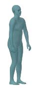  
12 Spread / close

17 reference actions / 144 s

A BODY POSES + ARTICULATION

01 Neutral stance

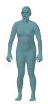  
3.5 s

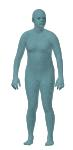  
05 Forward reach  
8.0 s

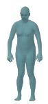  
12.5 s

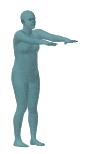  
06 Elbow flexion  
33.5 s

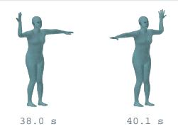  
03 A-pose  
19.5 s

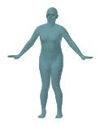  
07 Wrist rotation  
26.5 s  
04 T-pose

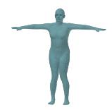

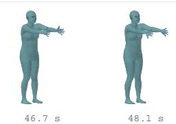  
10 Right leg raise  
08 Shallow squat  
11 Ankle motion

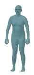  
09 Left leg raise

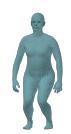  
53.0 s  
55.1 s

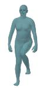  
62.8 s

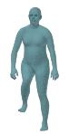  
69.8 s

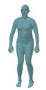  
76.8 s

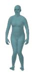  
READING THE PLATE  
80.3 s

## B HAND ARTICULATION / LEFT-HAND DETAIL

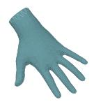  
82.0 s  
13 Fist / release

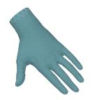  
83.8 s

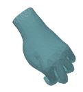  
90.8 s

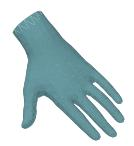  
92.5 s

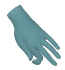  
97.0 s

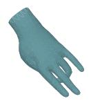  
101.5 s  
15 Finger flexion

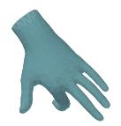  
106.0 s

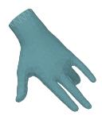  
110.5 s

C ROOT MOTION / ORDERED KEYFRAMES

16 Left / right 180-degree turns

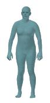  
114.0 s

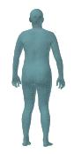  
118.1 s

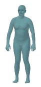  
122.2 s

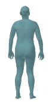  
125.9 s

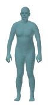  
Actual SMPL-X reference geometry; not participant reconstruction or accuracy evidence.  
17 Two steps forward, two backward  
130.0 s  
130.0 s

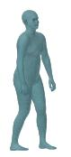  
132.7 s

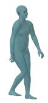  
135.5 s

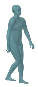  
138.5 s

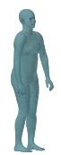  
141.3 s  
144.0 s

Figure 9. Protocol-guided body–sensor calibration sequence. Model-generated reference motions across 17 stages (144 s): (A) static holds and body articulation; (B) finger actions; (C) turning and stepping. These illustrate the protocol, not measured participant motion.

implausible tracker streams are masked by $m _ { n , i } ;$ holds and dynamic samples receive weights $w _ { n } = 1$ and 0.1, respectively. Finger, turning, and stepping stages are retained for motion checks but excluded from the body-profile fit. Matched phases, timestamps, and validity are recorded with each sample.

Step 1: jointly fit body geometry and attachment positions. With the action correspondences fixed, we solve Eq. (2), whose three terms are expanded in Eqs. (4) to (6), for the main-text variables Θ: body shape and scale, the five attachment translations $a _ { i } ,$ and each recording’s alignment $( Q _ { r } , u _ { r } )$ Each $a _ { i }$ is one anchor-local vector shared across all matched poses; reference articulation remains fixed. At each iteration, we reevaluate the SMPL-X joints at the current shape, predict tracker positions using Eq. (1), and backpropagate the calibration loss through these operations. Adam then updates all components of Θ jointly. The attachment rotations $A _ { i }$ are computed separately in Step 2.

We initialize shape and scale as in Sec. 3.2.1, set $a _ { i } = 0$ , and initialize each $Q _ { r }$ from the horizontal left–right wrist direction in the T-pose. The initial $u _ { r }$ is the coordinatewise median of observed-minuspredicted tracker positions for that recording. We optimize log � to keep scale positive. Only the first five shape coeficients are updated; the remaining five retain the visual estimate.

Robust tracker-position loss $( \mathcal { L } _ { \mathrm { r o b u s t - p o s } } )$ . A calibrated body and its fixed attachments should explain the measured tracker locations across the matched actions. Tracking spikes and imperfect execution of the reference poses can nevertheless produce large residuals. We use a Huber penalty (Huber, 1964) with threshold $\tau = 0 . 0 2 5$ m: small errors receive a quadratic penalty for precise fitting, while large errors receive a linear penalty so that a few poor observations do not dominate the calibration. For squats, the pelvis also moves while the feet remain planted. A shared translation $\delta _ { n } .$ computed as the mean observed-minus-predicted position of valid ankle trackers, accounts for this displacement without changing the mounts. It is recomputed each iteration and is zero for other actions or when no ankle is valid. With $e _ { n , i } = \widehat { p } _ { n , i } + \delta _ { n } - p _ { n , i }$ and predictions from Eq. (1), the weighted position loss is:

$$
\mathcal { L } _ { \mathrm { r o b u s t - p o s } } = \frac { \sum _ { n , i , c } w _ { n } m _ { n , i } \rho _ { 0 . 0 2 5 } ( e _ { n , i , c } ) } { 3 \operatorname* { m a x } ( 1 , \sum _ { n , i } w _ { n } m _ { n , i } ) } .\tag{4}
$$

Here � indexes Cartesian coordinates, and the denominator averages over valid weighted observations and their three coordinates. Distances are in meters; $\rho _ { \tau } ( e ) = e ^ { 2 } / 2$ for $| e | \le \tau$ and $\tau ( | e | - \tau / 2 )$ otherwise. Invalid entries are removed before arithmetic.

Measured body-size loss $( \mathcal { L } _ { \mathrm { a n t h } } )$ . Tracker agreement alone cannot reliably distinguish a longer limb from a larger mounting ofset. We therefore require the fitted body to agree with the participant’s measured height and arm span. Using the main-text model height $H ( \beta )$ , the unscaled T-pose arm span $W ( \beta )$ , and measured values $h ^ { \star } , w ^ { \star }$ , this loss is:

$$
\begin{array} { r } { \mathcal { L } _ { \mathrm { a n t h } } = ( s H ( \beta ) - h ^ { \star } ) ^ { 2 } + ( s W ( \beta ) - w ^ { \star } ) ^ { 2 } . } \end{array}\tag{5}
$$

Both measurements are in meters. The weights in Eq. (2) are $\lambda _ { \mathrm { o b s } } = 4 2 0$ and $\lambda _ { \mathrm { a n t h } } = 1 8 0 0$

Geometry regularization $( \mathcal { R } _ { \mathrm { g e o m } } )$ . Even with measured body size, several body–mount configurations may explain the sparse observations. We favor the visually estimated proportions, plausible attachment locations, and small scale and yaw corrections. Using the mean-square operator MS

defined above, the implemented regularizer is:

$$
\begin{array} { l } { { \displaystyle \mathcal { R } _ { \mathrm { g e o m } } = 0 . 0 1 2 \mathrm { M S } ( \beta ) + 0 . 1 8 \mathrm { M S } ( \beta _ { 1 : 5 } - \beta _ { 1 : 5 } ^ { \mathrm { v i s } } ) } } \\ { ~ + \frac { 2 8 0 } { 5 } \displaystyle \sum _ { i = 1 } ^ { 5 } [ \| a _ { i } \| _ { 2 } - \ell _ { i } ] _ { + } ^ { 2 } } \\ { ~ + 3 \left[ ( \| a _ { 2 } \| _ { 2 } - \| a _ { 3 } \| _ { 2 } ) ^ { 2 } + ( \| a _ { 4 } \| _ { 2 } - \| a _ { 5 } \| _ { 2 } ) ^ { 2 } \right] } \\ { ~ + 1 2 \mathrm { M S } \big ( \{ G _ { \mathrm { n e u r r a l } , i } a _ { i } - d _ { i } \} _ { i \in \{ 4 , 5 \} } \big ) } \\ { ~ + 0 . 1 8 ( \log s - \log s _ { 0 } ) ^ { 2 } + 0 . 0 1 5 \mathrm { M S } ( \{ \psi _ { r } \} _ { r } ) . } \end{array}\tag{6}
$$

Here $\ell \ = \ ( 0 . 1 8 , 0 . 1 5 , 0 . 1 5 , 0 . 1 8 , 0 . 1 8 )$ m gives soft mount-length limits in head, left/right wrist, left/right ankle order. The bilateral terms compare mount lengths, allowing mirrored local axes. $G _ { \mathrm { n e u t r a l } , i }$ is anchor �’s reference orientation in the neutral-stance stage (01); it expresses the ankle ofset in neutral body axes before comparison with $d _ { 4 } = ( 0 . 0 7 5 , 0 . 0 7 0 , 0 )$ and $d _ { 5 } = ( - 0 . 0 7 5 , 0 . 0 7 0 , 0 )$ m. The corresponding mean square averages all six ankle-ofset coordinates. Finally, $\psi _ { r }$ is the yaw angle of $Q _ { r }$ . These soft penalties limit body–mount compensation while allowing the tracker observations and measured body dimensions to determine the fit.

Adam (Kingma and Ba, 2015) runs for 1,100 iterations, with learning rates 0.008 for log-scale/yaw, 0.018 for shape/recording translation, and 0.012 for attachment translation. After each update, we clamp scale to [0.72, 1.15], optimized shape coeficients to [−3, 3], and yaw to $[ - \pi , \pi ]$ . This returns $\Theta ^ { \mathrm { f i t } }$ , including the shared $a _ { i } ;$ no per-frame attachment is fitted.

Step 2: recover attachment rotations by robust averaging. With the fitted $Q _ { r } ^ { \mathrm { f i t } }$ fixed, the orientation relation in Eq. (1) gives one candidate device-to-anchor rotation $\widetilde { A } _ { n , i }$ per valid observation. Let $\mathcal { I } _ { i }$ contain the retained samples for tracker �: static holds for wrists, and both static and selected dynamic samples for the head and ankles. Compute the mean candidate matrix $M _ { i ; }$ , take its singular value decomposition (SVD), and project it to a proper rotation:

$$
\begin{array} { r l } & { \widetilde { A } _ { n , i } = ( Q _ { r ( n ) } ^ { \mathrm { f i t } } { G } _ { n , i } ) ^ { \top } R _ { n , i } , } \\ & { M _ { i } = \displaystyle \frac { 1 } { | \mathcal { T } _ { i } | } \sum _ { n \in \mathcal { I } _ { i } } \widetilde { A } _ { n , i } = U _ { i } \Sigma _ { i } V _ { i } ^ { \top } , } \\ & { A _ { i } = U _ { i } \mathrm { d i a g } \big ( 1 , 1 , \mathrm { d e t } ( U _ { i } V _ { i } ^ { \top } ) \big ) V _ { i } ^ { \top } . } \end{array}\tag{7}
$$

The determinant correction excludes reflections. For a fixed retained set, this gives the rotation minimizing the summed squared Frobenius distances to its candidates; since �� is the right factor of $\widehat { R } _ { n , i }$ in Eq. (1) and orthogonal factors preserve the Frobenius norm, it equivalently minimizes $\begin{array} { r } { \sum _ { n \in J _ { i } } \| \widehat { R } _ { n , i } - R _ { n , i } \| _ { F } ^ { 2 } } \end{array}$ , i.e., it matches the predicted orientations $\widehat { R } _ { n , i }$ to the measured $R _ { n , i }$ as in Sec. 3.2.1. It requires no gradient optimization.

We make the estimate robust with up to three rejection rounds. After each average, compute each candidate’s angular residual as the rotation angle of $A _ { i } ^ { \top } \widetilde { A } _ { n , i }$ . Reject residuals above the larger of $1 2 ^ { \circ }$ and the median plus 2.5 times the median absolute deviation (floored at 1◦), then recompute the average. Stop if the set is unchanged or a rejection would leave fewer than four samples. An empty initial set uses an identity fallback marked as low confidence. The resulting five $A _ { i } ,$ together with the fitted shape, scale, and $a _ { i } ,$ complete the reusable profile Φ. Eq. (7) with this rejection rule is the explicit implementation of $f _ { \mathrm { r o t } }$ in Sec. 3.2.1.

## C.2. Prior-guided motion completion

Shared state and coordinate conventions. We use $x _ { t } = \left( \omega _ { t } , \theta _ { t } , u _ { t } \right)$ and the calibrated anchor frames $\widetilde { p } _ { t , i } , \widetilde { R } _ { t , i }$ from Sec. 3.2.2. Here $u _ { t }$ is the world pelvis position. The SMPL-X library’s additive translation subtracts the scaled zero-translation pelvis location from $u _ { t } ;$ conversion back to $u _ { t }$ is applied on export. This is an implementation coordinate conversion, not an additional motion variable. The five anchors are SMPL-X joints (15, 20, 21, 7, 8) in head, left/right wrist, left/right ankle order. For task-time fitting, Eq. (1) uses the rotation represented by $\omega _ { t }$ in place of $Q _ { r } ,$ joint geometry evaluated from $\theta _ { t }$ in place of the reference pose, and � in place of $u _ { r }$ . No second yaw is applied, and metric attachment ofsets $a _ { i }$ are never scaled again.

Input representation and model. The feature vector $\mathbf { z } _ { t }$ from the main text has 90 entries: for each anchor, six rotation coordinates, six relative-rotation coordinates, three positions, and three position increments. The six-dimensional rotation representation uses the first two matrix columns (Zhou et al., 2019); relative rotations are previous-rotation transpose times current rotation. Channels are packed by feature type for head/wrists (54), then ankles (36). Initial rotation increments are identity and position increments zero; increments are not divided by time.

The AvatarPoser-based (Jiang et al., 2022) transformer (Vaswani et al., 2017) prior $f _ { \mathrm { p r i o r } }$ has width 256, three encoder layers, and eight heads. The last token of an $L = 4 0$ frame trailing window predicts 22 rotations (root and 21 body joints) plus two auxiliary foot-contact logits. Initial windows are shorter. Rotation outputs are orthonormalized, interpolated back to tracker timestamps, and converted to capture coordinates. The head-alignment expression for $u _ { t } ^ { 0 }$ in Sec. 3.2.2 then gives $\chi ^ { 0 }$ ; it is not a second fitting stage.

Training data and optimization. Compatible public AvatarPoser weights initialize the network; the added 36 ankle input channels are zero-initialized. The pool combines 2,700 AMASS-derived sequences (Mahmood et al., 2019) from HDM05, CMU, and BMLrub, VPoser synthetic motion, 20 sequences from the ten B01–B10 guides at two speeds/durations, and teacher-fitted real recordings, including repetitions 1–2 of the full-body evaluation actions (App. F.1). Synthetic tracker inputs use participant shape, scale, and mounts. VPoser latent random walks last 240 frames at 60 Hz, with 2 mm Gaussian position noise and 1.5% simulated dropout. Wrist-twist augmentation duplicates 30% of synthetic sequences with $\mathbf { a } \pm 2 5 ^ { \circ }$ twist in one wrist observation and its target.

Teacher fits use 300 Adam iterations per chunk, learning rate 0.01, and $( \lambda _ { p } , \lambda _ { R } , \lambda _ { \mathrm { p r i o r } } ) =$ (10000, 60, 0.5), retaining the other active constraints. They provide task-domain supervision rather than independent ground truth. Each real recording uses its own calibration and up to 2,000 uniformly spaced 40-frame windows. Training minimizes mean SmoothL1 loss (unit threshold) on 132 rotation coordinates plus 0.25 times mean binary cross-entropy on the two foot logits. Natural-sequence foot targets are zero; this auxiliary head is not used as support evidence in refinement. AdamW (Loshchilov and Hutter, 2019) runs for three epochs, with learning rate and weight decay $1 0 ^ { - 4 }$ , batch size 32, and gradient-norm clipping at 1. The 60 Hz network timeline is internal; the release remains 30 Hz. Evaluation repetition 3 is held out as specified in App. F.1. Video and glove signals are not network inputs.

## C.3. Constraint layer 1: skeletal motion

The weighted sum $\mathcal { L } _ { \mathrm { s k e l } }$ is defined in Sec. 3.2.3 and Eq. (3); we expand its five component losses here. Within one of the temporal chunks of Sec. 3.2.3, with � frames, $t = 1 , \ldots , B$ is a local frame index and $i = 1 , \ldots , 5 $ . Let $m _ { t , i } \in \{ 0 , 1 \}$ indicate a valid tracker observation, and $N _ { \mathrm { { o b s } } } = \operatorname* { m a x } ( 1 , \textstyle \sum _ { t = 1 } ^ { B } \textstyle \sum _ { i = 1 } ^ { 5 } m _ { t , i } )$ The implemented measurement losses are coordinate-normalized squared errors:

$$
\mathcal { L } _ { P } = \frac { 1 } { 3 N _ { \mathrm { o b s } } } \sum _ { t , i } m _ { t , i } \lVert \widehat { p } _ { t , i } - p _ { t , i } \rVert _ { 2 } ^ { 2 } , \qquad \mathcal { L } _ { R } = \frac { 1 } { 9 N _ { \mathrm { o b s } } } \sum _ { t , i } m _ { t , i } \lVert \widehat { R } _ { t , i } - R _ { t , i } \rVert _ { F } ^ { 2 } .\tag{8}
$$

Predictions come from Eq. (1) and are compared with raw device observations $p _ { t , i } , R _ { t , i } ,$ , as specified in the main text. The inferred anchor frames in Sec. 3.2.2 are used for completion. Dividing by 3 and 9 averages scalar components; it does not remove the diference in physical units. The rotational objective is chordal matrix distance, not the geodesic angle used by diagnostic reporting. For the chunk of $\chi ^ { 0 }$ , the regularizers are:

$$
\mathcal { L } _ { \mathrm { p r i o r } } = \mathrm { M } S ( \theta - \theta ^ { 0 } ) + 0 . 2 \mathrm { M } S ( \omega - \omega ^ { 0 } ) + 0 . 2 \mathrm { M } S ( u - u ^ { 0 } ) ,\tag{9}
$$

$$
\mathcal { L } _ { \mathrm { t i m e } } = \mathrm { M S } ( \{ \theta _ { t } - \theta _ { t - 1 } \} _ { t = 2 } ^ { B } ) .\tag{10}
$$

Here $\theta , \omega , u$ stack the chunk’s main-text states and superscript 0 denotes the proposal. With fixed shape, the library’s additive-translation ofset cancels in $u - u ^ { 0 }$ . The temporal term is zero for $B = 1$ Rotation regularizers use axis-angle diferences; none of these diferences is normalized by elapsed time. The active configuration neither enforces temporal coupling across chunk boundaries nor uses overlapping chunks.

Let $\kappa _ { t , l }$ and $\epsilon _ { t , l }$ be geometric knee and elbow flexion angles, with zero at straight extension, and $\eta _ { t }$ the pelvis-to-neck angle from the upward axis. The active soft-angle loss is:

$$
\begin{array} { l } { { \displaystyle { \mathcal { L } } _ { \mathrm { j o i n t } } = \frac { 1 } { 2 B } \sum _ { t , l } [ \kappa _ { t , l } - 1 2 5 \pi / 1 8 0 ] _ { + } ^ { 2 } + \frac { 1 } { 2 B } \sum _ { t , l } [ \epsilon _ { t , l } - 1 4 0 \pi / 1 8 0 ] _ { + } ^ { 2 } } } \\ { { \displaystyle ~ + \frac { 1 } { B } \sum _ { t } [ \eta _ { t } - 1 5 \pi / 1 8 0 ] _ { + } ^ { 2 } . } } \end{array}\tag{11}
$$

Here � indexes the two sides. The torso threshold is an engineering bias, not an anatomical limit; genuine deep bends may be penalized. This term belongs to $\mathcal { L } _ { \mathrm { s k e l } }$ in Eq. (3), even though its angles are evaluated from posed joint geometry.

## C.4. Constraint layer 2: surface clearance

We evaluate the posed SMPL-X surface already used in the main text’s surface and ground layers. Let $\boldsymbol { \nu } _ { t , j } \in \mathbb { R } ^ { 3 }$ denote surface vertex � in the tracking world frame, obtained from $x _ { t }$ with fixed $( \beta , s )$ Vertices are model outputs, not additional measurements or optimization variables. The six sampled parts are the torso, head, left arm, right arm, left leg, and right leg. Their 30 ordered distinct-part pairs form $\mathcal { P }$ . Skinning weights assign a vertex to its strongest part when that part’s weight exceeds 0.8; two boundary-erosion steps exclude transition regions, and farthest-point sampling (Qi et al., 2017) selects 256 interior vertices per part on the fixed neutral mesh. Let $S _ { b }$ contain the sampled vertex indices of part $b ;$ these are the “points sampled from distinct body $\mathsf { p a r t } s ^ { \prime \prime }$ in Sec. 3.2.3. For $j \in S _ { b }$ , let $j ^ { \prime }$ be its nearest sampled vertex on target part $b ^ { \prime } { _ { \bot } }$ , and let $\mathbf { N } _ { t , j ^ { \prime } }$ be that vertex’s area-weighted unit surface normal. The signed clearance $d _ { t , j } ^ { b , b ^ { \prime } }$ is positive outside the target surface and negative once it is crossed; the 0.10 m gate restricts the penalty to nearby points, and TopK aggregates the largest violations per part pair. The adopted oriented penalty is:

$$
\begin{array} { r l r } & { \displaystyle { d _ { t , j } ^ { b , b ^ { \prime } } = \langle \nu _ { t , j } - \nu _ { t , j ^ { \prime } } , \mathbf N _ { t , j ^ { \prime } } \rangle } , } & \\ & { \displaystyle { q _ { t , j } ^ { b , b ^ { \prime } } = 1 \{ \| \nu _ { t , j } - \nu _ { t , j ^ { \prime } } \| _ { 2 } < 0 . 1 0 \} [ 0 . 0 1 8 - d _ { t , j } ^ { b , b ^ { \prime } } ] _ { + } ^ { 2 } , } } & \\ & { \displaystyle { \mathcal L _ { \mathrm { s u r f } } = \frac { 1 } { B | \mathcal P | K } \sum _ { t = 1 } ^ { B } \sum _ { ( b , b ^ { \prime } ) \in \mathcal P } \sum _ { j \in \mathrm { T o p K } ( q _ { t } ^ { b , b ^ { \prime } } ) } q _ { t , j } ^ { b , b ^ { \prime } } , \qquad K = 8 . } } & \end{array}\tag{12}
$$

Distances are in meters; TopK selects the eight largest penalties, including zeros when fewer than eight are active. Nearest indices, normals, and the 0.10 m support gate are recomputed each iteration

without gradients; gradients flow through both selected vertex positions. The 0.018 m clearance discourages local penetration, but the gate can omit deep intersections and this local proxy is not an exact signed distance field or a collision-free guarantee.

## C.5. Constraint layer 3: body-ground consistency

The estimated ground plane of Sec. 3.2.3 is the horizontal plane at height $g$ in the +�-up world frame. Summing over all posed body vertices $\nu _ { t , j } ( \mathrm { A p p . ~ C . 4 } )$ , the floor term is:

$$
\mathcal { L } _ { \mathrm { f l o o r } } = \frac { 1 } { B } \sum _ { t = 1 } ^ { B } \sum _ { j } [ g - \nu _ { t , j } ^ { ( y ) } ] _ { + } ^ { 2 } .\tag{13}
$$

The sum over vertices is intentionally not averaged, and the superscript $( y )$ selects the vertical coordinate. Unless overridden, the launcher sets $g$ to the fifth percentile of valid ankle-tracker heights minus 0.12 m; this heuristic height estimate is used instead of fitting a plane to scene geometry.

## C.6. Joint refinement

The solver minimizes Eq. (3) using the component losses in Eqs. (8) to (13), with the calibrated profile fixed. In $\begin{array} { r } { \mathcal { L } _ { \mathrm { s k e l } } = \sum _ { k } \lambda _ { k } \mathcal { L } _ { k } } \end{array}$ , the weights are $( \lambda _ { p } , \lambda _ { R } , \lambda _ { \mathrm { p r i o r } } , \lambda _ { \mathrm { t i m e } } , \lambda _ { \mathrm { j o i n t } } ) = ( 3 0 0 0 , 2 0 , 2 , 5 , 1 0 0 )$ ; in Eq. (3), $\lambda _ { \mathrm { s u r f } } = 3 0 0 0$ and $\lambda _ { \mathrm { f l o o r } } = 5 0$ . Contact, capsule, torso-hull, sole-only floor, and sole-flatness weights are zero. The batch wrapper uses Adam (Kingma and Ba, 2015) for 60 iterations per chunk with gradient-norm clipping at 2. Its initial learning rate/chunk size is (0.004, 256); bounded fallbacks are (0.002, 256), (0.001, 256), (0.0005, 256), (0.001, 128), and (0.0005, 128). Each chunk starts from its states in $\chi ^ { 0 }$ . Every Adam iteration evaluates all three layers and updates the state $x _ { t }$ through the library translation conversion in App. C.2; there are no separate skeletal, surface, or ground optimization passes. Concatenating the non-overlapping fitted chunks gives $\chi ^ { \star }$ . The argmin in Eq. (3) specifies the objective; the implementation returns its finite-iteration numerical estimate, without a global-optimum guarantee. Failed chunks use the bounded retry settings above.

## D. Multimodal Integration and Annotation

## D.1. Hand and touch fusion

Hand alignment and fitting. As in Sec. 3.3, finger articulation is fitted in wrist-local coordinates after body reconstruction. Glove positions are translated to the measured wrist origin and rotated into its frame; wrist-local Wuji inputs enter directly. Both layouts retain four landmarks per finger, including the tip (20 non-wrist landmarks); the 25-node layout discards four extra palm/metacarpal nodes. A sequence-fixed similarity aligns these points to the calibrated model’s flat hand, using the median of up to 12 frames with the straightest fingers. Scale is the ratio of model/glove RMS radii about the wrist; rotation uses SVD with reflection correction (Umeyama, 1991). This hand scale is separate from body scale �.

The MANO-compatible SMPL-X hand (Pavlakos et al., 2019; Romero et al., 2017) optimizes its 45 local axis-angle coordinates per side. The fitting objective is:

$$
\mathcal { L } _ { \mathrm { h a n d } } = 1 0 0 0 \mathcal { L } _ { \mathrm { p o i n t s } } + 0 . 0 1 5 \mathcal { L } _ { \mathrm { d i r e c t i o n s } } + 0 . 0 0 3 \mathcal { L } _ { \mathrm { f l a t } } + 0 . 0 0 4 \mathcal { L } _ { \mathrm { c o n t i n u i t y } } + 0 . 0 2 \mathcal { L } _ { \mathrm { a n g l e } } .\tag{14}
$$

The point term averages squared coordinate errors over the 20 wrist-local landmarks in meters. The direction term averages one minus cosine similarity along the 20 finger bones, with vector norms floored at $1 0 ^ { - 8 }$ . The flat-hand term is mean squared pose deviation from the model’s flat-hand pose. Continuity averages squared adjacent-frame pose diferences and adds twice the mean squared diference from the preceding window’s final pose; the latter is omitted for the first window. The angle term averages squared excess of each of the 15 joint-rotation magnitudes above 2.7 radians.

Left/right objectives Eq. (14) are summed. At most 480 frames are sampled over the hands’ overlapping time range and fitted in 90-frame windows with 60 Adam iterations and learning rate 0.04. After accounting for host-time origins, hand rotations are SLERPed onto the body timeline; endpoint holds outside the fitted span retain coverage flags. Fusion replaces hand-pose arrays while preserving the fitted body, root, shape, scale, and attachments.

Tactile processing. Wearable tactile response weakens with use and depends on wearing tension and channel health. Raw amplitude therefore cannot by itself distinguish light contact from reduced sensitivity or missing data. The three interfaces in Tab. 10 retain native values (L0), baselinerelative changes (L1), and 17-region contact with separate health/validity (L2). Unresponsive taxels are excluded from regional support; insuficient support makes a region unavailable, not negative. Baselines, response normalization, and region mappings accompany each recording. These are contact indicators, not calibrated force or pressure measurements.

Contact is temporally associated with motion, not used to constrain body IK. To preserve brief touches on the 30,Hz grid, each region’s output is the logical OR of valid native-rate detections within the ${ 1 / 3 0 } , { s }$ bin centered on the output timestamp. Bins without valid samples are masked. This release rule difers from the controlled press study’s 30,Hz signal averaging, baselines, thresholds, and scoring masks (App. F.3). The tactile L0–L2 interfaces are unrelated to the three body-constraint layers.

Table 10. Tactile interfaces used by the release and evaluation. Binary contact and channel validity are distinct; neither normalized amplitude nor a health indicator is an absolute pressure measurement.

<table><tr><td>Interface</td><td>Meaning</td></tr><tr><td>LO: raw signal</td><td>Native taxel readings and validity, with range and any sentinels defined by the device schema. Wearing-dependent offsets and gain remain.</td></tr><tr><td>L1: signal change</td><td>Changes relative to a no-contact baseline; still dependent on sensor response and configuration.</td></tr><tr><td>L2: regional contact</td><td>Binary regional contact with validity/health recorded separately. Regional mapping and threshold calibration are versioned.</td></tr></table>

## D.2. Expert-provided procedural context

The of-the-shelf annotation tools (Peng et al., 2026) in Sec. 3.3 receive video, task instructions, and expert-written procedural context. Tab. 11 summarizes preparation, reaction, monitoring, workup, extraction, concentration, and purification. These descriptions supply terminology and likely procedural transitions; observed activity determines which steps are annotated and in what order.

Table 11. Example procedural knowledge supplied by laboratory Skills documents.
<table><tr><td>Experimental stage</td><td>Information provided to the annotation model</td></tr><tr><td>Material preparation</td><td>Retrieve reagents, catalysts, containers, and consumables; bring them to the preparation bench and organize them by use. Preparation may include rinsing pipettes, taring a balance, weighing solids, and transferring material.</td></tr><tr><td>Reaction setup</td><td>Add materials to a reaction flask in the specified sequence, adjust heating and stirring, and monitor the apparatus. The document distinguishes reagent addition from device adjustment.</td></tr><tr><td>Reaction monitoring</td><td>For TLC, take a sample, spot a plate, and inspect it under UV illumination. For HPLC preparation, transfer and dilute a sample, mix it, filter it into a vial, and label the vial.</td></tr><tr><td>Quenching and workup</td><td>Move the reaction vessel to the workup area, handle receiving vessels, pour liquids, and inspect temperature or pH readouts as described in the procedure.</td></tr><tr><td>Extraction</td><td>Fill a separatory funnel, allow layers to settle, open and close the stopcock, collect layers in separate vessels, and repeat mixing and separation when required.</td></tr><tr><td>Rotary evaporation</td><td>Attach the flask, set the apparatus, operate vacuum/heating/rotation controls, monitor concentration, stop the apparatus, release vacuum, detach the flask, and weigh it.</td></tr><tr><td>Column chromatography</td><td>Mix the sample with silica, load and install the column, connect tubing, operate the apparatus, and collect fractions.</td></tr></table>

## D.3. Example text prompt

The example below includes the procedural background itself, alongside the annotation request. It is adapted from the laboratory document to illustrate the input supplied to the model; it is not a verbatim archived run prompt.

Task. You are annotating a first-person recording of chemical laboratory work. Divide the observed activity into meaningful procedural steps and write a concise description of each step.

Episode instruction. <task description for this recording>

Observations. <video or sampled frames with source timestamps>

Professional Skills: laboratory workflow context. The experiment may include the stages below. This information explains the procedure and the operations you may see; the recording may cover only a subset of them.

1. Preparation. Reagents, catalysts, vessels, and consumables are retrieved from storage, brought to the bench, and arranged by use. A balance may be tared before solids are weighed and transferred; pipettes may be rinsed before liquid handling.

2. Reaction setup. Materials are added to a reaction flask. The example procedure describes adding solvent, solid substrate, liquid reagent, and catalyst in sequence, followed by adjustment of heating and stirring and observation of the apparatus.

3. Monitoring. TLC involves sampling, spotting a plate, and UV inspection. HPLC sample preparation can involve liquid transfer, dilution, mixing, filtration into a sample vial, and labeling.

4. Workup. The reaction vessel may be moved from the stirring station to the fume hood. Subsequent operations include handling the receiving vessel, pouring, adjusting controls, and inspecting relevant readouts.

5. Extraction. A mixture is transferred into a separatory funnel and allowed to separate into layers. The stopcock is opened to drain a layer into a receiver and closed to stop drainage; the other layer is collected separately. Addition of extraction solvent, mixing, settling, and separation may be repeated.

6. Rotary evaporation. The flask is connected to the evaporator, controls are adjusted, and concentration is monitored. Later operations include stopping the apparatus, releasing vacuum, removing the flask, and weighing it.

7. Column chromatography. Sample and silica are mixed, material is loaded into a column, the column and tubing are installed, and the apparatus is operated to collect fractions.

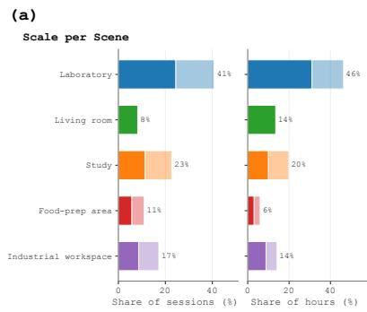

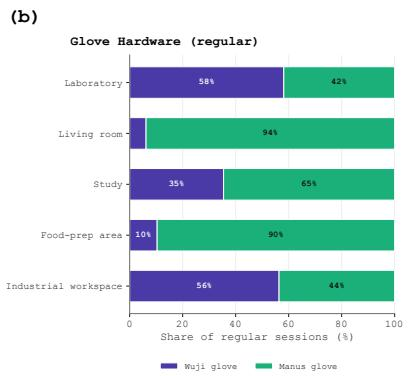

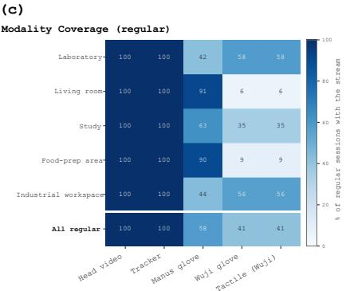  
Figure 10. Collection scale and coverage: (a) recording and duration shares by environment; (b) glove configurations; (c) sensing-stream coverage. Panels $^ { ( \mathrm { b , c } ) }$ use regular recordings.

Annotation instructions. Use this background to identify equipment and interpret the stage of the experiment. Follow the video when deciding which operations occurred and where their boundaries lie. Preserve visible relocation, repetition, and correction. Describe the action and its target concretely, such as “attaches the flask to the rotary evaporator.” Do not insert steps solely because they appear in the procedure. Leave unreadable quantities, uncertain identities, and unobserved outcomes unspecified.

Output. Return a time-ordered list of segments with start\_time, end\_time (source-video seconds), skill, description, object\_roles, and observed\_outcome. Use a short operation label for skill and null for an outcome that cannot be established from the video.

## D.4. Human verification and experimental interpretation

As stated in Sec. 3.3, operators review the egocentric video, reconstructed motion, available touch, and draft text together for temporal alignment and semantic consistency. They check action and object identification, omitted or extra steps, unsupported statements, and temporal boundaries (App. F.5). The ablation in Tab. 15 adds or removes the procedural document while retaining the same annotation model and other inputs. It tests the benefit of professional background knowledge, with no model retraining. Its automated draft assessment remains distinct from the expert review in Tab. 5.

## E. Data Statistics

Collection scale and sensing coverage. EgoExplorer contains 2,715 recordings totaling 100 hours across ten task templates and five environments. Laboratory activities account for 41% of recordings and 46% of duration; the remaining recordings span the living room (8%), study (23%), food-preparation area (11%), and industrial workspace (17%). Figs. 3 and 10 distinguish regular and recovery episodes and summarize their durations and sensing coverage. Among regular recordings, head video and tracker streams are available throughout; MANUS and Wuji glove streams cover 58% and 41%, respectively. Measured touch accompanies the Wuji configuration and is available in 41% of regular recordings. These rounded percentages describe stream availability, not reconstruction accuracy. The analyses below use the signals and health masks required by each diagnostic; their cohorts should not be equated with the full collection.

Movement and task progression. Fig. 11 summarizes 3D head-path length, locomotion and manipulation bout duration, and the dynamics of all five trackers. Short locomotion bouts alternate with sustained manipulation, particularly in laboratory and industrial work. The study and living-room recordings include longer head paths, while ankle dynamics distinguish locomotion from stationary manipulation. Tracker speed, acceleration, and jerk describe recorded behavior; reconstruction quality is evaluated separately in Tab. 7. Fig. 12 illustrates the temporal structure in a reaction-setup episode, aligning ego frames with motion and detected posture across two consecutive intervals. Displayed speed is capped at 1,500 mm/s; the detected states are descriptive diagnostics.

(a)  
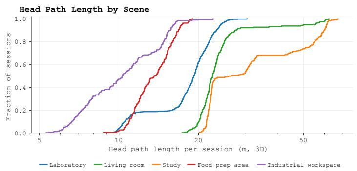

(b)  
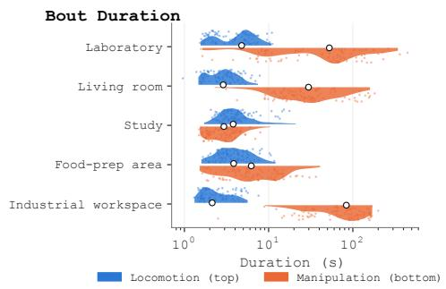

(c)  
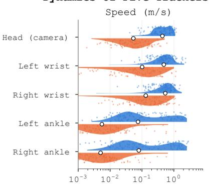

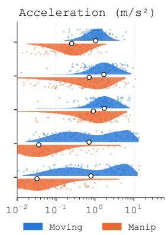

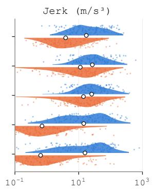  
Figure 11. Movement statistics: (a) 3D head paths; (b) locomotion and manipulation bout durations; (c) five-tracker dynamics, with units indicated on the axes.

Hand activity and contact. Fig. 13 relates contact events and hand activity to locomotion and stationary manipulation. Panel (a) reports time-weighted unilateral and bimanual occupancy over 545 regular Wuji recordings with healthy tactile streams on both hands. Panel (b) uses 565 recordings, comprising 1,110 healthy hand streams; the median event frequency across hands is 722 events per hour. Events last at least 0.1 s, with gaps shorter than 0.15 s merged. Panel (c) distinguishes locomotion from stationary periods with active or idle hands, marking hands active above 150 mm/s mean wrist speed. These summaries capture diferences in task structure: bimanual contact occupies 62% of industrial recording time, whereas laboratory recordings show more left-only contact (52%).

Regional contact coverage. Fig. 14 resolves contact over the 17 anatomical regions in Fig. 19. Each value is the median active fraction among contact frames. Multiple regions can be active together; rows therefore need not sum to one. Parentheses give the number of analyzed hands by environment and side. A region is n/a if fewer than three recordings have at least 30% live taxels there, including unsupported right-hand index and central-palm regions.

Environmental context. Fig. 15 shows registered reconstructions of the five capture environments. Together with the synchronized body–touch examples in Fig. 4, these views place the recorded motions and interactions in their working spaces. Released geometry is limited by capture quality and privacy requirements.

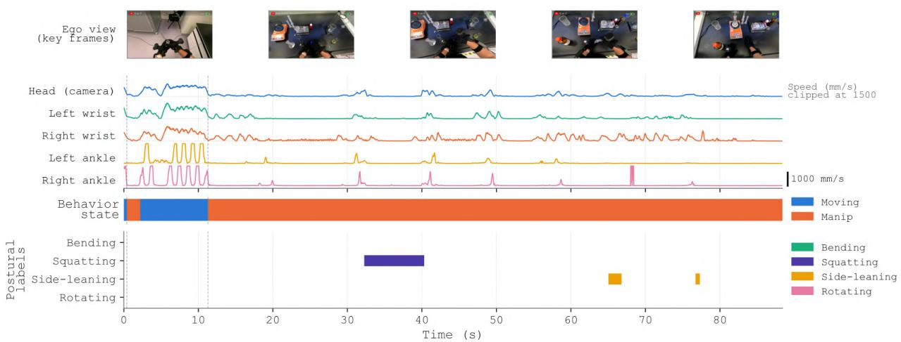

(b) Late interval  
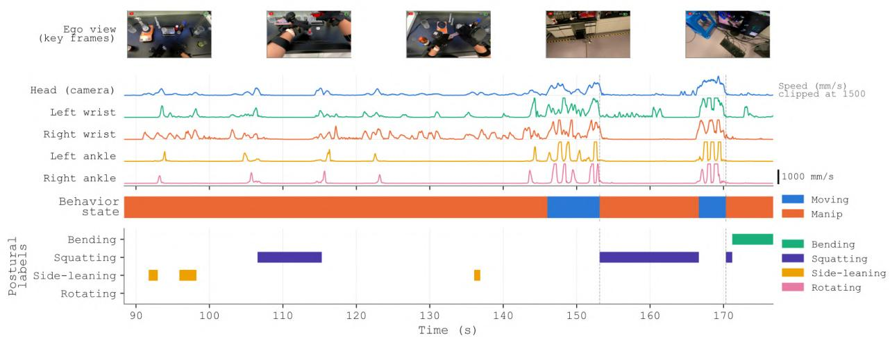  
Figure 12. A reaction-setup episode in two consecutive intervals. Rows align ego frames, tracker speed, behavior, and posture; dashed lines mark detected movement-to-manipulation transitions.

Table 12. Caption coverage, duration, length, and exact duplication.
<table><tr><td>Statistic</td><td>Value</td></tr><tr><td>Temporal coverage (video-duration weighted)</td><td>99.9998%</td></tr><tr><td>Segment duration p50 / p90 (s)</td><td>7.486 / 24.000</td></tr><tr><td>Mean caption length (characters)</td><td>98.87</td></tr><tr><td>Caption length p50 / p90 (characters)</td><td>87 /163</td></tr><tr><td>Exact duplicate rate</td><td>0.0402%</td></tr></table>

Text coverage and vocabulary. Tab. 12 describes the caption corpus. Temporal coverage is the union of annotated intervals divided by total video duration, pooled over recordings; it reaches 99.9998%. Segment duration has median 7.486 s and 90th percentile 24.000 s. Captions average 98.87 characters, with an exact duplicate rate of 0.0402%, computed as $( N - N _ { \mathrm { u n i q u e } } ) / N$ over caption strings. These measures describe coverage and granularity; semantic quality is assessed in Apps. F.5 and F.8.

Fig. 16 complements these statistics with the frequency of terms in the step descriptions. Prominent words name laboratory containers and equipment, including beakers, flasks, funnels, and balances, together with actions such as weighing, holding, tilting, and adjusting. Spatial terms and references to instrument readings add context to these descriptions. This vocabulary reflects the strong laboratory presence in the analyzed corpus; Fig. 5 shows how the descriptions are attached to individual task steps.

(c)  
(a)  

(b)  

  
Figure 13. Hand activity and contact: (a) unilateral/bimanual occupancy; (b) event frequency; (c) locomotion and stationary hand activity. Panels (a,b) retain healthy tactile streams.

<table><tr><td></td><td></td><td></td><td></td><td rowspan=1 colspan=1>Index</td><td rowspan=1 colspan=1>Index</td><td rowspan=1 colspan=1>Middle</td><td rowspan=1 colspan=1>Middle</td><td rowspan=1 colspan=1>Middle</td><td></td></tr><tr><td></td><td></td><td></td><td></td><td rowspan=1 colspan=1>middle</td><td rowspan=1 colspan=1>proximal</td><td rowspan=1 colspan=1>distal</td><td rowspan=1 colspan=1>middle</td><td rowspan=1 colspan=1>proximal</td><td></td></tr><tr><td></td><td rowspan=1 colspan=1>0.27</td><td rowspan=1 colspan=1>0.21</td><td rowspan=1 colspan=1>0.16</td><td rowspan=1 colspan=1>0.08</td><td rowspan=1 colspan=1>0.26</td><td rowspan=1 colspan=1>0.14</td><td rowspan=1 colspan=1>0.05</td><td rowspan=1 colspan=1>0.30</td><td></td></tr><tr><td rowspan=1 colspan=1>Lab R (146)</td><td rowspan=1 colspan=1>0.00</td><td rowspan=1 colspan=1>0.04</td><td rowspan=1 colspan=1>0.30</td><td rowspan=1 colspan=1>0.35</td><td rowspan=1 colspan=1>0.06</td><td rowspan=1 colspan=1>0.00</td><td rowspan=1 colspan=1>0.00</td><td rowspan=1 colspan=1>0.00</td><td></td></tr><tr><td rowspan=1 colspan=1>Living L (3)</td><td rowspan=1 colspan=1>0.01</td><td rowspan=1 colspan=1>0.00</td><td rowspan=1 colspan=1>0.02</td><td rowspan=1 colspan=1>&lt;.01</td><td rowspan=1 colspan=1>0.51</td><td rowspan=1 colspan=1>0.08</td><td rowspan=1 colspan=1>0.02</td><td rowspan=1 colspan=1>0.01</td><td></td></tr><tr><td rowspan=1 colspan=1>Living R (3)</td><td rowspan=1 colspan=1>0.00</td><td rowspan=1 colspan=1>0.00</td><td rowspan=1 colspan=1>n/a</td><td rowspan=1 colspan=1>n/a</td><td rowspan=1 colspan=1>n/a</td><td rowspan=1 colspan=1>0.17</td><td rowspan=1 colspan=1>0.03</td><td rowspan=1 colspan=1>0.66</td><td></td></tr><tr><td rowspan=1 colspan=1>Study L (7)</td><td rowspan=1 colspan=1>0.01</td><td rowspan=1 colspan=1>0.33</td><td rowspan=1 colspan=1>0.14</td><td rowspan=1 colspan=1>0.07</td><td rowspan=1 colspan=1>0.12</td><td rowspan=1 colspan=1>0.38</td><td rowspan=1 colspan=1>0.29</td><td rowspan=1 colspan=1>0.07</td><td></td></tr><tr><td rowspan=1 colspan=1>Study R (8)</td><td rowspan=1 colspan=1>0.16</td><td rowspan=1 colspan=1>0.46</td><td rowspan=1 colspan=1>n/a</td><td rowspan=1 colspan=1>n/a</td><td rowspan=1 colspan=1>n/a</td><td rowspan=1 colspan=1>0.59</td><td rowspan=1 colspan=1>0.23</td><td rowspan=1 colspan=1>0.10</td><td></td></tr><tr><td rowspan=1 colspan=1>Food L (7)</td><td rowspan=1 colspan=1>0.08</td><td rowspan=1 colspan=1>0.02</td><td rowspan=1 colspan=1>0.20</td><td rowspan=1 colspan=1>0.06</td><td rowspan=1 colspan=1>0.26</td><td rowspan=1 colspan=1>0.19</td><td rowspan=1 colspan=1>0.09</td><td rowspan=1 colspan=1>0.09</td><td></td></tr><tr><td rowspan=1 colspan=1>Food R (10)</td><td rowspan=1 colspan=1>0.05</td><td rowspan=1 colspan=1>0.09</td><td rowspan=1 colspan=1>n/a</td><td rowspan=1 colspan=1>n/a</td><td rowspan=1 colspan=1>n/a</td><td rowspan=1 colspan=1>0.27</td><td rowspan=1 colspan=1>0.02</td><td rowspan=1 colspan=1>0.21</td><td></td></tr><tr><td rowspan=1 colspan=1>Industry L (7)</td><td rowspan=1 colspan=1>0.08</td><td rowspan=1 colspan=1>0.02</td><td rowspan=1 colspan=1>0.10</td><td rowspan=1 colspan=1>0.09</td><td rowspan=1 colspan=1>0.41</td><td rowspan=1 colspan=1>0.11</td><td rowspan=1 colspan=1>0.00</td><td rowspan=1 colspan=1>0.00</td><td></td></tr><tr><td rowspan=1 colspan=1>Industry R (7)</td><td rowspan=1 colspan=1>0.08</td><td rowspan=1 colspan=1>0.16</td><td rowspan=1 colspan=1>n/a</td><td rowspan=1 colspan=1>n/a</td><td rowspan=1 colspan=1>n/a</td><td rowspan=1 colspan=1>0.17</td><td rowspan=1 colspan=1>0.17</td><td rowspan=1 colspan=1>0.15</td><td></td></tr><tr><td rowspan=3 colspan=8>(b) Ring and little fingers, and palmRing     Ring     Ring     Pinky               Pinkydistal</td><td rowspan=1 colspan=1></td><td></td></tr><tr><td rowspan=1 colspan=1>Pinky</td><td rowspan=1 colspan=1>Pinky</td><td rowspan=1 colspan=1>Pinky</td><td rowspan=1 colspan=1>Palm</td><td rowspan=1 colspan=1>Palm</td><td></td></tr><tr><td rowspan=1 colspan=2>middleproximal</td><td rowspan=1 colspan=1>distal</td><td rowspan=1 colspan=1>middle</td><td rowspan=1 colspan=1>proximal</td><td rowspan=1 colspan=1>radial</td><td rowspan=1 colspan=1>central</td><td rowspan=1 colspan=1>ulnar</td></tr><tr><td rowspan=1 colspan=1>Lab L (165)</td><td rowspan=1 colspan=1>0.14</td><td rowspan=1 colspan=1>0.16</td><td rowspan=1 colspan=1>0.26</td><td rowspan=1 colspan=1>0.24</td><td rowspan=1 colspan=1>0.28</td><td rowspan=1 colspan=1>0.08</td><td rowspan=1 colspan=1>0.14</td><td rowspan=1 colspan=1>0.06</td><td rowspan=1 colspan=1>0.14</td></tr><tr><td rowspan=1 colspan=1>Lab R (146)</td><td rowspan=1 colspan=1>0.08</td><td rowspan=1 colspan=1>0.10</td><td rowspan=1 colspan=1>0.08</td><td rowspan=1 colspan=1>0.05</td><td rowspan=1 colspan=1>0.13</td><td rowspan=1 colspan=1>0.00</td><td rowspan=1 colspan=1>0.01</td><td rowspan=1 colspan=1>0.04</td><td rowspan=1 colspan=1>0.04</td></tr><tr><td rowspan=1 colspan=1>Living L (3)</td><td rowspan=1 colspan=1>0.02</td><td rowspan=1 colspan=1>&lt;.01</td><td rowspan=1 colspan=1>0.11</td><td rowspan=1 colspan=1>&lt;.01</td><td rowspan=1 colspan=1>0.12</td><td rowspan=1 colspan=1>0.01</td><td rowspan=1 colspan=1>0.00</td><td rowspan=1 colspan=1>0.32</td><td rowspan=1 colspan=1>0.02</td></tr><tr><td rowspan=1 colspan=1>Living R (3)</td><td rowspan=1 colspan=1>&lt;.01</td><td rowspan=1 colspan=1>0.02</td><td rowspan=1 colspan=1>0.06</td><td rowspan=1 colspan=1>0.20</td><td rowspan=1 colspan=1>0.01</td><td rowspan=1 colspan=1>0.00</td><td rowspan=1 colspan=1>0.00</td><td rowspan=1 colspan=1>n/a</td><td rowspan=1 colspan=1>&lt;.01</td></tr><tr><td rowspan=1 colspan=1>Study L (7)</td><td rowspan=1 colspan=1>0.03</td><td rowspan=1 colspan=1>0.01</td><td rowspan=1 colspan=1>0.12</td><td rowspan=1 colspan=1>0.10</td><td rowspan=1 colspan=1>0.05</td><td rowspan=1 colspan=1>0.13</td><td rowspan=1 colspan=1>&lt;.01</td><td rowspan=1 colspan=1>0.21</td><td rowspan=1 colspan=1>0.02</td></tr><tr><td rowspan=1 colspan=1>Study R (8)</td><td rowspan=1 colspan=1>0.27</td><td rowspan=1 colspan=1>0.36</td><td rowspan=1 colspan=1>0.25</td><td rowspan=1 colspan=1>0.03</td><td rowspan=1 colspan=1>0.04</td><td rowspan=1 colspan=1>0.14</td><td rowspan=1 colspan=1>0.03</td><td rowspan=1 colspan=1>n/a</td><td rowspan=1 colspan=1>0.00</td></tr><tr><td rowspan=1 colspan=1>Food L (7)</td><td rowspan=1 colspan=1>0.21</td><td rowspan=1 colspan=1>0.10</td><td rowspan=1 colspan=1>0.10</td><td rowspan=1 colspan=1>0.28</td><td rowspan=1 colspan=1>0.20</td><td rowspan=1 colspan=1>0.05</td><td rowspan=1 colspan=1>0.03</td><td rowspan=1 colspan=1>0.24</td><td rowspan=1 colspan=1>0.00</td></tr><tr><td rowspan=1 colspan=1>Food R (10)</td><td rowspan=1 colspan=1>0.05</td><td rowspan=1 colspan=1>0.00</td><td rowspan=1 colspan=1>0.09</td><td rowspan=1 colspan=1>0.43</td><td rowspan=1 colspan=1>0.04</td><td rowspan=1 colspan=1>0.08</td><td rowspan=1 colspan=1>0.02</td><td rowspan=1 colspan=1>n/a</td><td rowspan=1 colspan=1>0.02</td></tr><tr><td rowspan=1 colspan=1>Industry L (7)</td><td rowspan=1 colspan=1>0.01</td><td rowspan=1 colspan=1>0.01</td><td rowspan=1 colspan=1>0.11</td><td rowspan=1 colspan=1>0.05</td><td rowspan=1 colspan=1>0.26</td><td rowspan=1 colspan=1>0.01</td><td rowspan=1 colspan=1>0.01</td><td rowspan=1 colspan=1>0.03</td><td rowspan=1 colspan=1>0.00</td></tr><tr><td rowspan=1 colspan=1>Industry R (7)</td><td rowspan=1 colspan=1>0.09</td><td rowspan=1 colspan=1>0.01</td><td rowspan=1 colspan=1>0.06</td><td rowspan=1 colspan=1>0.43</td><td rowspan=1 colspan=1>0.00</td><td rowspan=1 colspan=1>0.01</td><td rowspan=1 colspan=1>0.00</td><td rowspan=1 colspan=1>n/a</td><td rowspan=1 colspan=1>0.00</td></tr></table>

Figure 14. Contact-frame occupancy by region: (a) thumb, index, and middle fingers; (b) ring and little fingers, and palm. L/R denotes the hand; n/a indicates insuficient live-taxel support.

  
Figure 15. Reconstructed capture environments: laboratory, industrial workspace, living room, foodpreparation area, and study. Each panel shows one registered view.

graduatedcylinder equipment separate round bottom bottle mouth tube rack inse ti   
paper adjust grip glass liquid beaker plastic slender nearby weighing titbenchtop rotate instrument funnel flask hold panel front   
base position right side bench bottle utensil memta inin wash holdcontact tray balance vial let stand contain left side test tube rack

Figure 16. Step-annotation vocabulary. Word size indicates term frequency; frequent terms describe laboratory objects, equipment, and manipulation.

## F. Experiments

## F.1. Evaluation setup

The Evaluation Subset in Sec. 5 contains separate controlled body, hand, and contact tests (Tab. 13). Whole-body capture covers six static and four dynamic actions (Fig. 17), each repeated three times. Repetitions 1–2 support network adaptation; repetition 3 supplies ten held-out test recordings. Hand tests cover ten right-hand configurations, with three glove repetitions per configuration. The video comparison uses 30 recordings per method: 20 with a static camera and ten with camera motion. These are separately recorded matched configurations, not synchronized hand-pose references. Contact tests use button-marked press intervals and task-specific anatomical regions. The detailed settings below apply to the reported comparisons, rather than to the entire collection.

Table 13. Action groups in the Evaluation Subset. Guides specify intended actions; references and recording counts are defined separately for each modality.  
Modality IDs Action coverage / controls   
Hands H01–H03 Spread, hook, fist; articulation and self-occlusion   
Hands H04–H07 Thumb opposition to each of the other fingers   
Hands H08–H10 Tripod pinch, lateral pinch, spherical grasp   
Body, static B01–B06 Overhead, left/right cross-body reach, bend, left/right lunge   
Body, dynamic B07–B10 Sit/stand, rectangular step sequence, separate left/right forward kicks   
Contact T01–T05 Thumb–index press, bar press, spherical press, five-finger press, palm press; ON/OFF controls

The remaining Natural Recordings have no matched accuracy references. Body ablations use a 200-recording development pool, of which eight support surface-term selection and the other 192 form the reported natural-data cohort. This separation concerns constraint selection; it is not an unseen-task or participant-generalization split. The protocol guides illustrate intended actions; fitted body references and measured hand/contact references remain separate from those illustrations.

## F.2. Whole-body reconstruction: inputs and references

Inputs and baseline adaptations. Tab. 14 summarizes the inputs and controls of all main-text comparisons. Public three-anchor baselines observe the head and hands after calibrated deviceto-joint conversion; rows marked as raw tracker poses omit that conversion. Our system and the five-anchor AvatarPoser∗ and HMD-Poser∗ variants also observe both ankles. AvatarPoser∗ uses a held-out checkpoint fine-tuned on repetitions 1–2 and calibration recordings, and is evaluated before geometric refinement. HMD-Poser (Dai et al., 2024) uses a local five-tracker adaptation trained on synthetic data without oficial pretrained weights. SparsePoser (Ponton et al., 2023) additionally receives a pelvis pose borrowed from our reconstruction. Comparisons use common body points and timestamps; diferent sensing inputs are retained as explicit system diferences. The construction ablations instead fix the five-anchor inputs.

Table 14. Inputs and reference controls for the main-text comparisons.
<table><tr><td>Comparison</td><td>Inputs</td><td>Controls / reference</td></tr><tr><td>Public body baselines</td><td>Head and wrists</td><td>Calibrated anchor conversion; raw-pose variants omit it</td></tr><tr><td>AvatarPoser*/ HMD-Poser*</td><td>Five trackers</td><td>Local training; distinct training data and adapters (App. F.2)</td></tr><tr><td>SparsePoser†</td><td>Five trackers + borrowed pelvis</td><td>Assisted input; pelvis from our reconstruction</td></tr><tr><td>EGOExPLORER body reconstruction</td><td>Five trackers</td><td>Fixed profile; gloves are fused only after body fitting</td></tr><tr><td>HaWoR / HandFlow / glove</td><td>Video or glove skeleton</td><td>Matched held configurations; shared retargeter (App. F.3)</td></tr><tr><td>HACO / pose rule / glove</td><td>RGB, hand pose, or touch</td><td>Same scored frames and regions; exclusions disclosed (App. F.3)</td></tr><tr><td>Text and skill review</td><td>RGB + instruction (+ skills)</td><td>Expert audit (App. F.5); automated skill ablation (Tab. 15)</td></tr><tr><td>Cosmos3-Edge</td><td>Joint generation</td><td>Preliminary training and conditioning studies (App. F.6)</td></tr></table>

Full-body reference labels for the Evaluation Subset. The controlled full-body recordings of the evaluation participant (ten actions × three repetitions, Tab. 13) do not have an independent optical reference. The accuracy numbers in Tabs. 2 and 7 are therefore measured against reference labels: the same five-tracker refinement run for 300 iterations (learning rate 0.01, position weight 104) with the participant’s calibration, plus a per-frame pose prior from the protocol library (weight 30 on hip, spine, knee, ankle and foot rotations) that selects the intended articulation where the tracker constraints alone admit several branches (forward bend, lunge, sit/stand, leg raise). These labels agree with the trackers to within 5 mm and were reviewed frame-by-frame; the scoring uses a common body model and coordinate frame. The labels also share our fitting model, calibration, and constraints, so agreement with them is not independent ground-truth accuracy and can favor related methods. Baselines that do not observe the feet are still scored on the same 22 body joints. Repetitions 1–2 train the participant-specific proposal network; repetition 3 forms the full-body portion of the Evaluation Subset (Fig. 21). For this participant the joint-limit block additionally contains a signed knee-hyperextension term, a pelvis-roll term (both weight 100) and a 90◦ torso-lean limit so that deep bends are admissible; evaluation on the Natural Recordings keeps the production configuration.

For visualization, one instant per recording is selected from the fitted reference, using the last of the candidate instants for peak deviation from the initial stance, deepest knee flexion, strongest trunk lean, and lowest pelvis position. All methods are shown at this same instant in App. F.10.

## F.3. Hand motion and contact capture

Matched hand comparison. The configurations in Fig. 18 are captured with the articulation glove and a RealSense D435 RGB stream (1280 × 720, 30 fps), reconstructed by HaWoR and HandFlow (Xu et al., 2026; Zhang et al., 2025). All outputs use the same retargeter, filter, and 20-DoF Wuji hand model. Each recording’s held configuration is the coordinatewise median of finite wrist-local landmarks in its central hold interval. Ten glove-derived median robot configurations define the task prototypes. Glove trials are scored with the tested repetition excluded from prototype construction. Thus the comparison tests pose retention and kinematic target recovery, without a robot dynamics rollout.

Contact references and exclusions. Button-held intervals mark perceived contact, and the T01– T05 instructions specify the expected regions (Fig. 19). Scoring includes between-press negatives, excludes frames within ±100 ms of button transitions, and excludes initial presses without a preceding

Both arms overhead

  
Both arms to the left  
Both arms to the right

  
Moderate forward bend

  
Left leg forward lunge

  
Right leg forward lunge

  
Sit down and stand up  
Walk a rectangle

  
Left straight-leg forward kick  
Right straight-leg forward kick

  
Figure 17. Full-body action guides for the Evaluation Subset (B01–B10): static holds followed by multi-phase actions.

rest window. The same task-specific region and time masks apply to all methods; regions outside the task mask are not counted as negative examples.

Glove detector and comparison methods. For the controlled study, 120 Hz readings are averaged into 30 Hz video bins. A taxel’s baseline is its median during the 0.1–0.6 s preceding a press; its activation threshold is the maximum of 0.02, three robust rest standard deviations, and the 99.5th percentile of rest fluctuations. The health mask, estimated from earlier recordings, retains 526 of 744 taxels. A region is active when at least two and at least 5% of its valid taxels exceed their thresholds. HACO (Jung and Lee, 2025) vertex predictions use the same count/fraction rule; a dark-glove image mask supplies the hand box when its bare-hand detector fails. The pose-only rule uses the glove skeleton: fingers must flex at least 40◦ relative to the most open pose and remain below 15 mm/s over a 0.25 s window for at least 0.2 s. Three or more flexed fingers indicate a grasp; otherwise only flexed fingertips are marked. The glove detector uses annotated rest windows, which should be considered

  
Finger spread

  
Hook grip

  
Closed fist

  
Thumb–index

  
Thumb–middle

  
Thumb–ring

  
Thumb–little

  
Tripod pinch

  
Lateral pinch

  
Spherical grip

Figure 18. Hand action guides for the Evaluation Subset (H01–H10, in order). Generated MANO poses illustrate the instructions and local hand configurations.  
  
Fingertip opposition

  
Four-finger hook

  
Power grasp

  
Five-finger pinch

  
Palm press

  
17 tactile regions distal middle proximal palm

Figure 19. Contact-action guides (T01–T05) and the 17-region anatomical map. Red marks protocolspecified regions, not measured contact. Scoring uses button-marked press intervals and the masks in App. F.3.

when interpreting the system comparison.

## F.4. Evaluation metrics

Body accuracy (Tabs. 2 and 7). Body-point error averages Euclidean distances over 22 SMPL-X joints (pelvis through wrists), in mm. Non-tracked error uses the 17 joints outside the head, wrists, and ankles; the pelvis is included, with its error also reported separately as Root. Root error is pelvis displacement in the fixed calibrated frame. PA-MPJPE centers each pose, matches its Frobenius norm to the reference, and applies the SVD rotation with reflection correction (Umeyama, 1991); the norm-matching scale is not separately optimized by least squares. Velocity error averages Euclidean diferences of joint velocities, computed from adjacent positions divided by their timestamp intervals, in mm/s. Scores use matched timelines and finite observations, averaged within each recording and then equally across recordings. No per-frame alignment is applied except for PA-MPJPE.

Hand accuracy, stability, and continuity (Tab. 3). Tip averages the Euclidean discrepancy of the five held fingertips in wrist-local coordinates after matching hand length to the reference. Hold RMS (root mean square) measures within-hold scatter: subtract each fingertip’s median held position from its emitted positions, square the Euclidean distances, average across fingertips and valid hold frames, and take the square root (mm). It is a stability measure, not independent pose accuracy. Missing is the fraction of frames with no finite pose; Gap p95 is the 95th-percentile duration of contiguous missing runs pooled across recordings. Success assigns the retargeted median pose to the closest of ten glove-derived prototypes, using RMS landmark distance with weights 3 for tips, 0 for wrist, and 1 elsewhere. A trial succeeds when the nearest prototype matches its instructed configuration; chance is 10%.

Sensor agreement and geometry (Tab. 7). Tracker RMS squares Euclidean distances between predicted and observed device positions, averages over valid device–frame pairs, and takes the square root (mm); recording-level RMS values are then averaged equally. Predictions use each variant’s mount model, so this measures sensor agreement. Crossing counts intersecting triangle pairs between distinct, non-adjacent body parts using the same independent checker and 5 Hz sample times for all variants; frame counts are averaged within recordings, then across recordings. Floor is the fraction of frames with any posed vertex more than 5 mm below the shared ground plane.

Temporal quality (Tab. 7). Slide is mean horizontal foot speed during common support intervals, reported in mm/s. Support is inferred from raw ankles with horizontal speed below 100 mm/s, height within 30 mm of that ankle’s fifth-percentile height, and duration at least 0.3 s; pairs separated by more than 0.1 s are excluded. Jerk uses pelvis-relative joint positions in meters while preserving world orientation. After resampling to 30 Hz without bridging invalid samples or gaps above 0.1 s, take the third forward diference, multiply by $3 0 ^ { 3 }$ , and average its vector norm over joint–frame pairs, then equally over recordings $( \mathrm { m } / \mathrm { s } ^ { 3 } )$ . No smoothing is applied. Avg. is the unweighted arithmetic mean of the nine displayed values in Tab. 7, including jerk and both data cohorts. This summary depends on displayed units and has no single physical unit.

Regional contact (Tab. 4). After the shared masks in App. F.3, true positives (TP), false positives (FP), and false negatives (FN) are pooled over retained frame–region decisions, including non-contact time. IoU is $T P / ( T P + F P + F N )$ and F1 is $2 T P / ( 2 T P + F P + F N )$ ; task-wise scores are not averaged. Missing sensing support is excluded, not relabeled as no contact.

## F.5. Expert review of text annotations

Language review. Tab. 5 reports expert review of model-generated text annotations prior to manual correction. The audit covers 487 segments. Factual errors concern incorrect actions, objects, tools, or outcomes; unsupported claims lack evidence in the recording; missed and extra steps denote omissions and spurious additions, respectively; unjudgeable cases are reported separately. Boundary error is the fraction of reviewed segments requiring temporal correction: 15 of 487 segments (3.08%), reported at the segment level rather than as absolute timing deviation, with no frame-accurate boundary ground truth available. Unjudgeable segments are those for which the available recording does not support a judgment. Factual-error, unsupported-claim, extra-step, boundary, and unjudgeable rates use reviewed segments; missed-step rate uses the reference steps that should be described. These denominators need not coincide. All rates reflect pre-correction audit findings; human verification and correction follow model annotation. The automated professional-skill ablation is reported separately in Tab. 15.

## F.6. Preliminary training study

Pilot representation and metrics. Tab. 6 summarizes two preliminary Cosmos3-Edge (NVIDIA, 2026) studies: separate versus joint output generation and conditional action generation. For the output comparison, video-only, action-only, touch-only, and joint models all receive video/action/touch history. We report their 5,000-step checkpoints using the same sampled-evaluation implementation.

The separate-model row combines the video, action, and touch scores of three independently trained models, one per output; it is not an ensemble prediction or an average across models. Action uses the model’s 57-dimensional hand-pose representation, derived from SMPL-X forward kinematics: head and wrist poses plus wrist-local fingertip positions. Each action coordinate value � is normalized as $\mathrm { c l i p } ( 2 ( v - v _ { 1 \% } ) / \mathrm { m a x } ( v _ { 9 9 \% } - v _ { 1 \% } , 1 0 ^ { - 6 } ) - 1 , - 1 , 1 )$ , where $v _ { 1 \% }$ and $v _ { 9 9 \% }$ are its 1st and 99th percentiles computed from training sessions only. Action MSE is therefore an error in normalized feature space, distinct from the body-point and fingertip errors in millimeters used for annotation evaluation. Touch uses a separate token stream with regional contact, intensity, and validity information; missing regions are masked.

Training settings. The 5K configuration uses batch size 64 and AdamW with momentum coeficients (0.9, 0.95), learning rates $5 \times 1 0 ^ { - 5 }$ for the unfrozen backbone and $5 \times 1 0 ^ { - 4 }$ for new modality heads. Backbone weight decay is $0 . 0 1$ ; new heads use no decay. A 200-step warmup precedes cosine decay, with gradient-norm clipping at 1 and seed 0. Training predicts clean targets from noisy inputs: video-latent and action MSE have weight 1, regional contact MSE weight 3, and tactile-intensity MSE weight 1.5. Invalid contact regions are masked. Separate models activate only their own output losses, while the joint model activates all three streams.

Temporal split and scoring. The loader splits at session level within each task: sorted session indices congruent to five modulo ten form validation; all windows from a session remain in the same partition. The pilot uses 16 observed and 16 generated samples at 15 Hz, distinct from the release grid. Pixel-space PSNR evaluation uses 256 held-out windows, two samples per window, and 20 denoising steps. Prediction and target latents are decoded with the same clean historical context; PSNR scores the generated interval against the VAE-decoded target, not directly against uncompressed camera frames. PSNR is $1 0 \log _ { 1 0 } ( 1 / \mathrm { M S E _ { p i x e l } } )$ in dB for pixels in [0, 1], averaged over windows and samples. Action MSE averages the 57 normalized features, excluding padding channels. Contact predictions threshold the mean of sampled binary states above 0.5; F1 pools TP, FP, and FN over valid region–time entries as in App. F.4. The current output comparison in Tab. 6 reports higher video PSNR and contact F1 and lower action MSE for joint generation.

Conditional action generation. In the second study of Tab. 6, recorded video, or video and touch together, from the same interval as the generated action are supplied as conditions. The unconditioned row receives no such additional observations; the video/action/touch history remains available to all rows. Because these conditions are observed over the action interval, this test measures cross-modal conditioning rather than prediction from history alone. Action MSE is computed in the same normalized feature space as above.

## F.7. Calibration and layered reconstruction ablations

Within each cohort of Tab. 7, layer variants share the same five-anchor inputs, proposal checkpoint, calibrated profile, and 60-iteration budget. Proposal only skips refinement; Layer 1, Layer 1+2, Layer $1 + 3$ , and Full activate the corresponding terms of Eq. (3) without retraining. Mean body replaces participant-specific shape and scale while retaining mounts and the reconstruction procedure; proposals are recomputed under that geometry. No mount calibration uses identity rotations and zero attachment translations in training, inference, and refinement, with a correspondingly trained network. Uncalibrated at test retains the calibrated network but omits attachment correction during inference and refinement.

The natural-data cohort retains its production proposals. The independently fine-tuned five-anchor AvatarPoser row in Tab. 2 has its own training pool and unrefined checkpoint; comparing its 64.1 mm with the 79.0 mm proposal-only row does not isolate refinement. The within-cohort layer rows provide

Table 15. Professional-skill document ablation with the same annotation model. Automated judge results on unrevised drafts (%; lower is better).
<table><tr><td>Metric</td><td>Without Skills</td><td>With Skills</td></tr><tr><td>Windows flagged for factual errors</td><td>76.07</td><td>69.55</td></tr><tr><td>Windows flagged for unsupported claims</td><td>71.78</td><td>66.26</td></tr><tr><td>Missed model-reference events</td><td>48.97</td><td>41.92</td></tr></table>

that comparison. Geometric scores must be read alongside pose and tracker errors: moving the body toward sensor locations can reduce crossing or floor violations without improving articulation.

## F.8. Professional-skill ablation

Tab. 15 compares unrevised annotation drafts generated with and without professional Skills documents (App. D.2). The annotation model, input videos, task instructions, and decoding settings are held fixed; no model retraining is involved. An automated judge flags factual errors and unsupported claims at the window level, while event omission is measured against model-provided reference events. Adding Skills documents lowers these three rates by 6.52, 5.52, and 7.05 percentage points, respectively. These automated assessments are distinct from the expert audit in Tab. 5; generated annotations still undergo human verification and correction.

## F.9. Humanoid retargeting

Downstream humanoid control motivates preserving metric root translation, per-joint rotations, and hand pose at a common sampling rate rather than normalizing skeletons. Fig. 20 illustrates the transfer of a 135 s reaction-setup recording to a Unitree G1, including reconstructed SMPL-X motion, kinematic retargeting, and physics-based execution. The kinematic stage uses GMR (Araujo et al., 2025) whole-body inverse kinematics (IK) with position and orientation targets, followed by root-height correction to prevent sole penetration. We compare the corrected trajectories with GMR-scaled and ofset human targets at nine corresponding body origins: the pelvis, feet, knees, elbows, and wrists. At temporally matched samples, the mean position errors for the reaction-setup and reagent-weighing clips are 6.8 and 7.0 cm, respectively; the corresponding wrist errors are 7.5 and 7.8 cm. These residuals include discrepancies between human joint centers and robot link origins. Position errors average Euclidean distances over the stated origins and matched frames. The 14-body robot-reference score uses pelvis, torso, and bilateral hip, knee, ankle, shoulder, elbow, and wrist link origins. Root orientation is the angle of the relative quaternion, averaged over frames; it is not a yaw-only error.

The physics-based stage follows the ZeroWBC (Yang et al., 2026a) training recipe and uses a reinforcement-learning tracking policy in MuJoCo (Todorov et al., 2012). Unlike the original architecture, our implementation feeds short- and long-horizon targets to an MLP and is trained only on the two clips. After 15,000 PPO (Schulman et al., 2017) iterations, full-clip evaluation at 50 Hz yields mean 14-body tracking errors of 4.6 and 3.6 cm after aligning torso horizontal position and yaw with the robot reference, compared with 6.6 and 4.8 cm without alignment. No falls occur. Global wrist errors are 5.8 and 4.0 cm. Root-position errors are 3.8 and 2.5 cm, and root-orientation errors are 1.8 and 1.3◦, respectively. Relative to the same human targets and nine body origins used above, the simulated trajectories have mean errors of 8.5 and 6.8 cm and wrist errors of 9.0 and 8.2 cm, without evaluation-time alignment. Thus, human-to-robot mapping error and robot-reference tracking error are measured against diferent references and should not be added.

Error sources. The post-IK floor correction raises the root by 2.7–6.7 cm across the two clips.

  
Figure 20. Humanoid retargeting of a recorded episode. Green: reconstructed human motion; blue: G1 kinematic retargeting; gold: physics-based whole-body control in simulation. The trajectories are ofset for visualization.

Mean wrist error increases from approximately 5.6 cm before correction to 7.5 and 7.8 cm afterward. Removing pelvis translation alone still leaves wrist errors of 7.0 and 6.9 cm and elbow errors of 9.8 and 9.5 cm in the kinematic retargeting. Thus, global displacement does not explain the full residual, and the current body mapping and IK trade-ofs leave substantial articulation error. For the control policy, wrist and foot position rewards use exp $( - \overline { { e ^ { 2 } } } / 0 . 3 ^ { 2 } )$ , with distances measured in meters. A 5 cm deviation therefore yields a reward of approximately 0.97. The joint-position reward has weight 0.1, and no dedicated elbow- or knee-position rewards are used. These choices provide limited incentives for centimeter-level precision, and their individual efects have not been isolated by ablation. The results therefore demonstrate preliminary simulated motion transfer rather than precise object interaction. Joint optimization of ground contact and body targets, together with tighter tracking rewards, remains an important direction for future work.

Robustness, hands, and scope. A second rollout also remains fall-free under random basevelocity perturbations applied every 2–4 s, with horizontal components in [−500, 500] mm/s and yaw velocity in [−0.5, 0.5] rad/s. Fingers are retargeted independently to the three-finger hand by matching fingertip vectors in the palm frame, yielding fingertip errors of 1.1–2.2 cm. The thumb– index aperture follows the human aperture with correlations of 0.991–0.993 (Pearson correlation of thumb–index fingertip distances over matched frames). Hand poses are decoded using the same SMPL-X hand mean as in glove fitting. Fingers are replayed kinematically, while the tracking policy controls the 29 body joints. Evaluation replays the training clips and therefore does not establish generalization to unseen tasks. This example demonstrates transfer of recorded motion, not hardware deployment; deployment would additionally require state estimation and safety constraints, which are not evaluated here.

## F.10. Qualitative examples

Fig. 21 compares EgoExplorer with six baselines at matched instants from the Evaluation Subset. Our results more closely recover the displayed forward bends, lunges, and leg raises, including articulation between tracked endpoints. Rows follow B01–B10 in Tab. 13; the lateral raises, square walk, and leg raises correspond to the cross-body reaches, rectangular step sequence, and straight-leg forward kicks. This visual comparison complements Tab. 2; the sensing inputs and fitted references are specified in App. F.2.

Temporal body and touch examples. Fig. 22 expands the ten sessions in Fig. 4, with six synchronized instants per row, evenly spaced from 10% to 90% of each recording. These sequences complement the text studies with continuous body motion and contact observations.

  
Figure 21. Qualitative reconstruction comparison on the Evaluation Subset. Each row shows the same instant for the fitted reference (grey), EgoExplorer (orange), and baselines (blue), rendered from a shared viewpoint.

  
Figure 22. Body and touch over time, ordered left to right. Rows: reagent weighing, oven retrieval, reaction setup, extraction, rotary evaporation, column chromatography, bookshelf organization, sandwich preparation, clothes folding, and cardboard-box folding. Insets show both hands’ synchronized touch; gray-to-orange denotes baseline-relative increments.

## G. Discussion on Capture Trade-ofs

EgoExplorer combines portable deployment with accurate motion reconstruction and complementary visual, body, hand, and tactile observations. Its wearable rig supports collection in existing environments, while participant and mount calibration grounds the recovered motion in measured geometry. The body, hand, and contact comparisons in Tabs. 2 to 4 support the quality of these annotations relative to the evaluated baselines. Together, portability, annotation quality, and sensing coverage motivate this design for capturing human loco-manipulation across tasks and workspaces. Tab. 16 summarizes the deployment trade-ofs.

Table 16. Capture arrangements and deployment requirements.
<table><tr><td>Approach / example</td><td>Sensing arrangement</td><td>Deployment requirement</td></tr><tr><td>Multi-view RGB</td><td>External RGB cameras</td><td>Overlapping views, synchronization, camera cal- ibration</td></tr><tr><td>HOT3D</td><td>Optical markers on hands and objects</td><td>Calibrated infrared-camera volume</td></tr><tr><td>Nymeria</td><td>Inertial body suit and Aria devices</td><td>Wearable sensors; no external camera array</td></tr><tr><td>ParaHome</td><td>IMU suit, gloves, and 70 RGB cameras</td><td>Instrumented camera volume</td></tr><tr><td>EGOEXPLORER</td><td>Five inside-out trackers, ego camera, gloves</td><td>Body-sensor calibration; no external array or base stations</td></tr></table>

Deployment and sensing. Multi-view RGB reconstruction provides an afordable route to wholebody capture within a calibrated volume. FreeMoCap supports ordinary USB cameras and recommends three to four views for general motion capture. Such arrays require overlapping views, synchronization, and intrinsic/extrinsic calibration; moving the cameras requires renewed calibration. Multi-view methods can also recover hands, although occlusion and the small image scale of fingers make fine articulation challenging (Zhang et al., 2021). Direct glove sensing complements body capture and can additionally provide measured contact. Hybrid systems such as ParaHome combine cameras, an inertial suit, and gloves (Kim et al., 2025); HOT3D uses optical markers for hands and objects (Banerjee et al., 2025); Nymeria combines an inertial body suit with wearable Aria devices (Ma et al., 2024). Our rig avoids external camera-array and base-station setup and reuses its body–sensor calibration while mounts remain fixed. Its inside-out trackers still depend on suitable visual conditions.

Hardware costs. Tab. 17 reports costs in USD, excluding computers, software licenses, mounting/cabling accessories, taxes, shipping, and setup labor; prices are public listings recorded in September 2026.

At USD 69.99 per C920s, four to six RGB cameras cost less than the USD 1,184 tracker subsystem, making camera arrays attractive for fixed capture spaces. The suit and optical-camera entries are hardware-only listings. MANUS publishes no list price, so its entry uses a reseller listing (September 16, 2026) excluding the software license; the camera uses GoPro list prices, USD 399.99 plus 79.99. With the Wuji price converted to USD, subtotals are approximately USD 7,979 (MANUS) and 5,397 (Wuji), trading added wearable hardware for deployment flexibility and direct finger/contact measurements.

Table 17. Reference hardware costs in USD. Camera counts are illustrative; glove options are alternatives.
<table><tr><td>Hardware / configuration</td><td>Quantity</td><td>Cost (USD)</td></tr><tr><td>RGB array: Logitech C920s</td><td>4–6 cameras</td><td>280-420</td></tr><tr><td>EGoExPLoRER body tracking: Ultimate Trackers + dongle</td><td>5 + 1</td><td>1,184</td></tr><tr><td>Rokoko Smartsuit Pro II</td><td>1 suit</td><td>2,295</td></tr><tr><td>OptiTrack Flex 13</td><td>8 cameras</td><td>≥8,792</td></tr><tr><td>Ego camera: HERO13 Black + Media Mod</td><td>1 set</td><td>480</td></tr><tr><td>MANUS Metagloves Pro, non-haptic</td><td>1 pair</td><td>6,315</td></tr><tr><td>Wuji gloves</td><td>1 pair</td><td>≈3,733</td></tr></table>