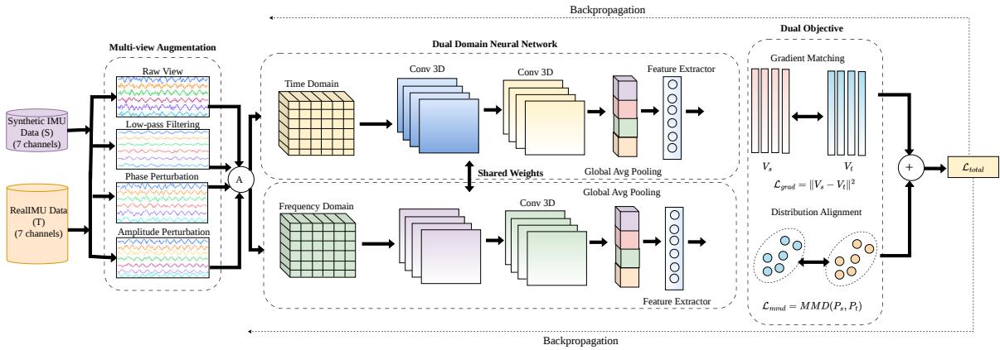
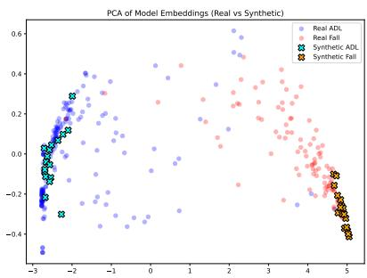

# FALLNEST: Dual-Domain Dataset Condensation of Imbalanced IMU Data for Wearable Fall Detection

Rashi Niyas P∗, Dr. Ritika Jain†, and Dr. Hitika Tiwari∗

∗Indian Institute of Technology Madras Zanzibar zda24m005@iitmz.ac.in, hitika@iitmz.ac.in

†Indian Institute of Technology Guwahati Assam, India rjain1992@iitg.ac.in

## Abstract

Wearable fall detection is hampered by rare fall events, scarce labeled IMU data, and the cost of training deep models on large, imbalanced corpora. Existing methods either rely on hand-crafted features with shallow classifiers, which limits learning from raw signals, or train deep networks on full datasets that require re-sampling to counter class skew and demand substantial data and compute. To address this, we propose a novel Fall detection framework via Normalized-gradient and Embedding matched Synthetic Time–frequency condensation, dubbed FALLNEST, a data-centric approach that distills large, imbalanced IMU datasets into tiny, class-balanced synthetic training sets. Building on dual-domain time-series condensation (CondTSC), FALLNEST introduces a fall-specific 7-channel input with accelerometer vector magnitude, class-balanced K-Means initialization, and normalized gradient matching with gradient clipping, combined with MMD-based embedding alignment and multi-view Fourier-domain augmentation, so that class balance arises from the condensed set itself rather than from re-sampling. We evaluate on SisFall, KFall, and MobiFall using strict subject-wise splits and naturally imbalanced test sets, reporting accuracy, Macro-F1, and PR-AUC over five seeds. A 102K-parameter TinyCNN trained on only 32 to 146 synthetic windows (about only 1% of the training windows) reaches 93.5-95.8% mean accuracy and 0.89-0.98 PR-AUC, with standard deviations of 1.0-1.7% in accuracy, demonstrating the efficacy of our approach.

Keywords: Fall detection, wearable sensors, dataset condensation, class imbalance, dualdomain matching.

## Introduction

Falls are a leading cause of injury among older adults and a recurring hazard in workplaces [1], and wearable inertial measurement units (IMUs) enable continuous, unobtrusive monitoring [2]. Learning a reliable fall detector from IMU data is hard for two reasons. Falls are rare compared with activities of daily living (ADLs), so labeled data are scarce and skewed [3], and wearables operate under tight power, memory, and processing budgets [4]. The usual remedies for skew, oversampling and augmentation, enlarge the training set and its compute cost. Lightweight pipelines instead rely on hand-crafted features, for example spectral features from 25 Hz IMU data fed to a feed-forward network [5], which limits learning from raw signals. Deep networks learn features automatically and reach nearperfect accuracy on standard benchmarks [6, 7, 8], but need large imbalanced training sets, substantial compute, and often re-sampling. Dataset condensation distills a large dataset into a small synthetic set that retains its training value [9]. It has mainly been studied on images, and its time-series extension [10] was not evaluated on wearable fall detection under subject-wise splits with naturally imbalanced test sets.

We propose Fall detection framework via Normalized-gradient and Embedding-matched Synthetic Time–frequency condensation (FALLNEST), which shrinks the training data rather than the model. It distills a large, imbalanced IMU dataset into a tiny, class-balanced synthetic set on which a lightweight CNN learns discriminative fall patterns. FALLNEST builds on CondTSC [10] and differs in four ways: (i) a fall-specific 7-channel input (tri-axial accelerometer, tri-axial gyroscope, accelerometer vector magnitude); (ii) class-balanced K-Means initialization, which balances the set by construction; (iii) normalized gradient matching with gradient clipping, which stabilizes optimization across datasets of very different sizes; and (iv) strict subject-wise splits with naturally imbalanced test sets. Raw signals are left unfiltered so that sharp impact peaks are preserved. On SisFall [11], KFall [12], and MobiFall [13], a 102 K-parameter TinyCNN trained on 32 to 146 synthetic windows (about 1% of the training windows) reaches 93.5 to 95.8% mean accuracy and 0.89 to 0.98 PR-AUC over five seeds. The roughly 100-fold reduction applies to the downstream training set, not to the data accessed during condensation, which uses all of $\tau { : }$ ; a real validation set only selects the checkpoint.

Our contributions are: a dual-domain condensation framework that turns imbalanced IMU recordings into compact, class-balanced training sets without re-sampling; a dual-objective scheme pairing normalized, clipped gradient matching with MMD alignment in both domains, plus multi-view Fourier augmentation; and a rigorous evaluation protocol (subjectwise splits, natural test priors, accuracy, Macro-F1, PR-AUC over five seeds) with ablations and a PCA analysis of real versus synthetic embeddings. All datasets are public, and code will be released upon acceptance.

## Method

FALLNEST condenses a large, imbalanced IMU training set into a tiny, class-balanced synthetic set, and a lightweight classifier is trained on that set alone (Fig. 1). Recordings become subject-disjoint windows; a balanced synthetic set is initialized with class-wise K-Means and refined in time and frequency domains through four augmented views by a joint normalized gradient-matching and MMD objective (Alg. 1). A TinyCNN is then trained on the condensed set (S), selected on a real validation set (V), and evaluated on a subject-independent, naturally imbalanced test set $( \mathcal { T } _ { \mathrm { t e s t } } )$ .   
The real training set is $\mathcal { T } = \{ ( x _ { i } , y _ { i } ) \} _ { i = 1 } ^ { n }$ with $x _ { i } \in \mathbb { R } ^ { C \times L } \left( C = 7 \right.$ channels, L time steps) and $y _ { i } \in \{ 0 , 1 \}$ (0: ADL, 1: Fall); $\mathcal { T } _ { c }$ denotes class $^ { c , }$ and the validation set $\nu$ and test set $\mathcal { T } _ { \mathrm { t e s t } }$ are subject-disjoint from $\tau$ and each other. The synthetic set $s$ holds spc learnable tensors per class with fixed labels:

$$
s p c = \lceil 0 . 0 1 n / 2 \rceil , \qquad | \pmb { S } | = 2 s p c \approx 0 . 0 1 | \pmb { \mathcal { T } } | ,\tag{1}
$$

with $n = | \tau |$ counting all training windows. With ${ \mathcal { L } } _ { { \mathcal { D } } } ( \theta )$ the mean cross-entropy of a network with parameters $\theta$ on set $\mathcal { D } _ { \mathrm { { ; } } }$ , condensation seeks

$$
\operatorname* { m i n } _ { \boldsymbol { \mathscr { S } } } \mathscr { L } _ { \mathcal { T } } \big ( \boldsymbol { \theta } ^ { * } ( \boldsymbol { \mathscr { S } } ) \big ) \quad \mathrm { s . t . } \quad \boldsymbol { \theta } ^ { * } ( \boldsymbol { \mathscr { S } } ) = \arg \operatorname* { m i n } _ { \boldsymbol { \theta } } \mathcal { L } _ { \boldsymbol { S } } ( \boldsymbol { \theta } ) ,\tag{2}
$$

i.e. a network trained only on $s$ should perform on real data like one trained on $\tau .$ Solving Eq. (2) exactly needs a training run per update, so we replace it with the matching objectives of Eqs. (5) and (6).

  
Figure 1: FALLNEST pipeline. Imbalanced IMU windows $\tau$ are condensed into a class-balanced set S via K-Means initialization, four-view Fourier augmentation, and joint gradient/MMD matching in the time and frequency domains. A TinyCNN is then trained on the obtained condensed set $\boldsymbol { \mathcal { S } }$ and tested on $\mathcal { T } _ { \mathrm { t e s t } }$

## Data Preparation

SisFall, KFall, and MobiFall contain 15, 15, and 4 fall types and 19, 21, and 9 ADL types; all falls map to $y { = } 1$ and all ADLs to y=0. Recordings are resampled to 200 Hz and segmented with a $2 \thinspace s$ stride into windows of L = 2000, 1200, and 1000 samples (10, 6, and ${ 5 \mathrm { s } } ,$ chosen from each dataset’s mean fall duration). Each window inherits the binary label of its source trial, since only trial-level labels are available, and windows containing transitions are kept so that training matches deployment. Splits are $b y$ subject (26/6/6, 16/4/4, and 15/4/13 subjects for SisFall, MobiFall, and KFall; all five seeds share the same split; see Table 1). Besides the tri-axial accelerometer and gyroscope, each window carries the accelerometer vector magnitude $\mathrm { A V M } _ { t } = \sqrt { a _ { x , t } ^ { 2 } + a _ { y , t } ^ { 2 } + a _ { z , t } ^ { 2 } }$ of the raw axes $a _ { \cdot , t }$ at step t, an orientationindependent impact measure. Each of the 7 channels is standardized with the mean and std of $\tau$ . No global low-pass filter is applied, since it would smooth the impact peak; smoothing enters only as an augmentation view.

## Class-Balanced K-Means Initialization

For each class c we cluster the flattened windows $\operatorname { v e c } ( x )$ of $\mathcal { T } _ { c }$ into spc clusters (Eq. (1)) with centroids $\mu _ { c , k }$

$$
\left\{ \mu _ { c , k } \right\} _ { k = 1 } ^ { s p c } = \arg \operatorname* { m i n } _ { \left\{ \mu _ { k } \right\} } \sum _ { x \in { \mathcal { T } } _ { c } } \operatorname* { m i n } _ { k } \left\| \mathrm { v e c } ( x ) - \mu _ { k } \right\| _ { 2 } ^ { 2 } ,\tag{3}
$$

and reshape each $\mu _ { c , k }$ to $C \times L$ as an initial synthetic sample. Both classes get exactly spc samples, so S is balanced whatever the real fall/ADL ratio, and centroids spread over the dominant modes of each class, which matters most for the heterogeneous ADL class. Centroids (Eq. (3)) are averages and blur sharp peaks, so restoring impact structure is the job of the refinement.

## Dual-Domain Representation

The time-domain input is the window itself; the frequency-domain input is the channelaveraged magnitude spectrogram

$$
\begin{array} { r } { \mathbf { P } ( x ) = \frac { 1 } { C } \sum _ { j = 1 } ^ { C } \left| \mathrm { S T F T } ( x _ { j } ) \right| \in \mathbb { R } ^ { 1 2 9 \times F } , } \end{array}\tag{4}
$$

where $x _ { j }$ is channel $j , n _ { \mathrm { f f } } = 2 5 6 ( \mathrm { g i v i n g } n _ { \mathrm { f t } } / 2 + 1 = 1 2 9$ frequency bins), hop 64, and $F = 2 8$ , 15, 12 frames for SisFall, KFall, MobiFall. Each domain $d \in \{ \mathfrak { t } , \mathfrak { f } \}$ has its own backbone $\phi _ { d }$ , shared between synthetic and real data.

## Multi-View Fourier Augmentation

Each sample S is observed through four views v: the raw signal and three Fourier-domain views produced in sequence. The low-pass view $S _ { \mathrm { L P F } } = \mathrm { F F T } ^ { - 1 } ( H _ { f _ { c } } \odot \mathrm { F F T } ( S ) )$ ) applies a hard mask $H _ { f _ { c } }$ (⊙: elementwise product) at cutoff $f _ { c } = 5$ Hz and emphasizes macro-motion. The phase-perturbed view $S _ { \mathrm { P P } }$ rebuilds $S _ { \mathrm { L P F } }$ from its spectrum magnitude and its phase plus noise $\mathbf { p } \sim \mathcal { N } ( 0 , 0 . 1 ^ { 2 } )$ per frequency bin (tolerance to small timing shifts). The magnitudeperturbed view $S _ { \mathrm { M P } }$ adds $\mathbf { r } \sim \mathcal { N } ( 0 , 0 . 1 )$ to each magnitude bin of $S _ { \mathrm { P P } }$ (intensity variation). All views are returned to the time domain.

## Dual-Objective Matching

For domain $d ,$ view v, and class $^ { c , }$ we draw random initial parameters $\theta _ { d } ^ { 0 }$ of $\phi _ { d }$ , take $N$ differentiable SGD steps on $v ( S _ { c } )$ giving $\theta _ { d } ^ { S }$ and M SGD steps on real batches of $\mathcal { T } _ { c }$ giving $\theta _ { d } ^ { \mathcal { T } }$ , and form the displacements $G ^ { S } = \theta _ { d } ^ { 0 } - \bar { \theta } _ { d } ^ { S }$ and $G ^ { T } = \theta _ { d } ^ { 0 } - \theta _ { d } ^ { T }$ . They are aligned with a normalized squared distance, which, unlike cosine matching, penalizes both direction and magnitude mismatch:

$$
\mathcal { L } _ { \mathrm { g r a d } } ^ { ( v , d ) } = \sum _ { c } \frac { \Vert G ^ { S } - G ^ { T } \Vert _ { 2 } ^ { 2 } } { \Vert G ^ { S } \Vert _ { 2 } ^ { 2 } + \Vert G ^ { T } \Vert _ { 2 } ^ { 2 } + \epsilon } .\tag{5}
$$

Here $\epsilon > 0$ is a small constant, and each class-wise term lies in $[ 0 , 2 ]$ regardless of dataset size, comparable to the bounded MMD term. Penultimate-layer embeddings $z ^ { S }$ and $z ^ { \mathcal { T } }$ of synthetic and real samples of the same class are aligned with the squared MMD under a Gaussian kernel of bandwidth $\sigma = 1$

$$
\mathcal { L } _ { \mathrm { e m b } } ^ { ( v , d ) } = \sum _ { c } \mathrm { M M D } ^ { 2 } \big ( z ^ { S } , z ^ { \mathcal { T } } \big ) .\tag{6}
$$

Eq. (5) aligns how the network learns, Eq. (6) what it represents, and the total objective (weight $\lambda _ { \mathrm { e m b } }$ on the embedding term) is

$$
\mathcal { L } = \sum _ { v } \sum _ { d } \Big ( \mathcal { L } _ { \mathrm { g r a d } } ^ { ( v , d ) } + \lambda _ { \mathrm { e m b } } \mathcal { L } _ { \mathrm { e m b } } ^ { ( v , d ) } \Big ) , \quad \lambda _ { \mathrm { e m b } } = 1 .\tag{7}
$$

We backpropagate through the unrolled inner loop, clip $\nabla _ { \mathcal { S } } \mathcal { L } \ ( \mathrm { E q . ~ } ( 7 ) )$ elementwise to [−1, 1], and update S with Adam $( \mathrm { l r } = 0 . 0 1 )$ .

Algorithm 1 FALLNEST condensation and training   
Input: Train set T , spc, views (raw, LPF, PP, MP), domains {t, f}, N, M, λemb   
Output: Trained classifier $f _ { \theta ^ { \ast } }$   
1: $S _ { c } \gets \mathsf { K }$ -Means centroids of $\mathcal { T } _ { c } , c \in \{ 0 , 1 \}$ ▷ Eq. (3)   
2: for epoch = 1 to 100 do   
3: for each view v, domain d, class c do   
4: draw $\theta _ { d } ^ { 0 } ;$ run N SGD steps on $v ( S _ { c } )$ and M on batches of $\mathcal { T } _ { c }$   
5: $\mathcal { L } _ { \mathrm { \Phi } } + = \mathrm { \bar { \mathcal { L } } _ { \mathrm { g r a d } } } + \lambda _ { \mathrm { e m b } } \mathcal { L } _ { \mathrm { e m b } }$ ▷ Eqs. (5), (6)   
6: end for   
7: S ← AdamS, $\mathrm { c l i p } _ { [ - 1 , 1 ] } ( \nabla _ { S } \mathcal { L } ) \big )$ ; stop early if converged   
8: end for   
9: Train a fresh TinyCNN on S; keep the epoch with best Macro-F1 on V

## Downstream Training, Backbone, and Evaluation

A fresh TinyCNN is trained on S only (cross-entropy, 100 epochs, Adam lr 0.001, batch size 16). Each backbone has three Conv1D–BatchNorm–ReLU blocks, adaptive average pooling, and a fully connected layer; the deployed classifier is the time-domain TinyCNN alone, and the frequency branch is used only during condensation. The model has 102 K parameters (≈400 KB in float32) and needs about 103 M MACs (L=1000) to 206 M MACs (L=2000) per inference, with 2.15 ms median CPU latency (Kaggle CPU, single-threaded PyTorch, batch size 1). These are architecture properties, not condensation effects; microcontroller validation is future work. We keep the checkpoint with the highest Macro-F1 on the real validation set, e∗ = arg max MacroF1 $( f _ { \theta _ { e } } ; \mathcal { V } )$ , where $f _ { \theta _ { e } }$ is the classifier after epoch $e ;$ since condensation uses T alone, V is the only other real data that enters. The checkpoint is evaluated once on $\mathcal { T } _ { \mathrm { t e s t } }$ . Each of five seeds draws a new K-Means initialization, runs an independent condensation, and trains a new classifier on the same subject-wise split. We report mean ± std of Accuracy, Macro-F1, and PR-AUC (Fall positive), plus fall precision, recall, specificity, and false alarms per hour (FA/h, false-positive windows per ADL hour at the 2 s stride; a window-level estimate on laboratory data). Overlapping windows from one trial are correlated, so window counts overstate independent events.

## Theoretical Analysis of the Objective

Fix a domain, view, and class, and let $\Delta = \theta ^ { S } - \theta ^ { T } = G ^ { T } - G ^ { S }$ be the parameter gap, r the class-wise summand of Eq. (5), and P the real-batch distribution. Assume the real loss $L _ { P }$ (expected cross-entropy under P) is Λ-Lipschitz and β-smooth on a convex set containing the iterates, SGD steps (rate $\eta ,$ gradient norm $\leq g _ { \mathrm { m a x } } )$ are bounded by $\eta g _ { \mathrm { m a x } }$ (so $\Omega ^ { 2 } = \eta ^ { 2 } \hat { g _ { \mathrm { m a x } } ^ { 2 } } ( N ^ { 2 } + M ^ { 2 } ) + \epsilon )$ , the head loss is approximable in the RKHS of the Gaussian kernel (norm ≤ B, error ≤ κ), and the $n _ { T }$ real embeddings are i.i.d. from P given S.

Corollary 1. Let $\delta \in [ r _ { 0 } , 1 )$ with $r _ { 0 }$ the value of r at $\epsilon = 0 , s = 1 / ( 1 - \delta ) , \rho _ { \pm } =$ $s \pm { \sqrt { s ^ { 2 } - 1 } }$ , and $K ( \delta ) = 1 + \rho _ { + } ^ { 2 }$ . Then cos $\angle ( G ^ { \mathcal { S } } , G ^ { \mathcal { T } } ) \geq 1 - \delta , \| G ^ { \mathcal { S } } \| / \| G ^ { \mathcal { T } } \| \in [ \rho _ { - } , \rho _ { + } ] .$ $| L _ { P } ( \theta ^ { S } ) - L _ { P } ( \theta ^ { T } ) | \leq \Lambda \| \Delta \|$ , and, with probability at least $1 - \eta ^ { \prime }$ over the real batch,

$$
\| \Delta \| \leq \operatorname* { m i n } { \left\{ \Omega { \sqrt { r } } , \sqrt { \delta K ( \delta ) } \| G ^ { \mathcal { T } } \| \right\} } ,\tag{8}
$$

$$
\begin{array} { r } { L _ { P } ( \theta ^ { S } ) \leq L _ { S } ( \theta ^ { S } ) + B \left[ \sqrt { \mathscr { L } _ { \mathrm { e m b } } } + \frac { 1 + \sqrt { \ln ( 1 / \eta ^ { \prime } ) } } { \sqrt { n _ { T } } } \right] + 2 \kappa . } \end{array}\tag{9}
$$

Eq. (8) shows that Eq. (5) controls both direction and scale of the update, which bounds the real-loss gap to the real-trained network, while Eq. (9) lets the MMD term of Eq. (6) bound the real loss by the synthetic loss. The constants are unmeasured, so the bounds are qualitative and concern the training distribution, not unseen subjects (assessed empirically below).

## Experimental Setup

## Datasets and Implementation

We evaluate on three binary fall-detection dat and MobiFall (24). Dataset statistics and subje All condensation hyperparameters are fixed across datasets, except the real-data batch size, with $s p c = \{ 7 3 , 1 6 , 1 8 \}$ for SisFall, MobiFall, and KFall, respectively. Condensation uses at most 100 epochs, learning rate 0.01, $\lambda _ { \mathrm { e m b } } = 1$ N = 15, M = 100, inner learning rate 0.001, patience 10, and $f _ { c } = 5 \mathrm { H z }$ . The real batch size is 128 for SisFall and 64 for KFall and MobiFall. No dataset-specific hyperparameter tuning is performed. All models are implemented in PyTorch and trained on a 16 GB P100 GPU. Experiments use five fixed random seeds; seed 42 is used for representative single-run results. Since the subject splits remain fixed across seeds, the reported standard deviations capture initialization

Table 1: Dataset statistics after subject-wise splitting (2 s stride). T is the only set used for condensation, V only selects the checkpoint, and $\mathcal { T } _ { \mathrm { t e s t } }$ is used once and keeps its natural class distribution.
<table><tr><td>Dataset</td><td>Split</td><td>Subj.</td><td>Win.</td><td>Total</td><td>ADL</td><td>Fall</td></tr><tr><td rowspan="3">SisFall</td><td>T</td><td>26</td><td>10s</td><td>14,528</td><td>10,259</td><td>4,269</td></tr><tr><td>V</td><td>6</td><td></td><td>2,962</td><td>2,287</td><td>675</td></tr><tr><td> $\mathcal { T } _ { \mathrm { t e s t } }$ </td><td>6</td><td></td><td>2,778</td><td>2,328</td><td>450</td></tr><tr><td rowspan="3">MobiFall</td><td>T</td><td>16</td><td>5s</td><td>3,146</td><td>2,568</td><td>578</td></tr><tr><td>V</td><td>4</td><td></td><td>1,000</td><td>856</td><td>144</td></tr><tr><td> $\mathcal { T } _ { \mathrm { t e s t } }$ </td><td>4</td><td></td><td>571</td><td>427</td><td>144</td></tr><tr><td rowspan="3">KFall</td><td>T</td><td>15</td><td>6s</td><td>3,574</td><td>2,272</td><td>1,302</td></tr><tr><td>V</td><td>4</td><td></td><td>1,046</td><td>583</td><td>463</td></tr><tr><td>Ttest</td><td>13</td><td></td><td>2,933</td><td>1,922</td><td>1,011</td></tr></table>

variability rather than variability across subject partitions.

## Results and Discussion

## Classification Performance

Table 2 reports test Accuracy, Macro-F1, and PR-AUC. Using only 1% of training windows, FALLNEST achieves 93.5–95.8% accuracy and 0.891–0.975 PR-AUC, exceeding the always-ADL accuracy baselines by 9.7, 20.7, and 30.3 percentage points on SisFall, MobiFall, and KFall, respectively. Compared with full-data training, accuracy drops by 6.4, 4.5, and 3.6 points, respectively; SisFall also shows the largest PR-AUC reduction (0.999 to 0.891). Although five-seed variability is modest (1.0–1.7 accuracy points; 0.013–0.023 PR-AUC), fixed test subjects mean these standard deviations reflect initialization variability only. SisFall’s larger performance gap may relate to its lower fall prevalence, longer windows that dilute impact signatures (Table 1), and greater ADL heterogeneity relative to its 146- sample condensed set;these hypotheses require targeted evaluation. Table 4 presents the performance metrics in terms of precision, recall, and specificity for each dataset.

## Comparison with Equal-Budget Real Subsets

Does condensation beat simply training on a 1% real subset? Table 3 compares FALLNEST with random real subsets of the same size |S|, drawn either uniformly or with equal numbers per class, under the same TinyCNN, checkpoint selection, and five-seed protocol.

Table 2: Main results on subject-independent, naturally imbalanced $\mathcal { T } _ { \mathrm { t e s t } }$ . Rows S train on the condensed set (1% of T), mean ± std over 5 seeds; rows T train the same TinyCNN on the full set (single run). Size is the number of training windows. Always-ADL accuracy floors: 83.8/74.8/65.5%; random-scorer PR-AUC floors: 0.162/0.252/0.345 (SisFall/MobiFall/KFall).
<table><tr><td>Dataset</td><td>Train set</td><td>Size</td><td>Acc (%)</td><td>Macro-F1</td><td>PR-AUC</td></tr><tr><td>SisFall</td><td>S (condensed) T (full)</td><td>146 14,528</td><td>93.50±1.02 99.85</td><td>0.887±0.016 0.990</td><td>0.891±0.023 0.999</td></tr><tr><td>MobiFall</td><td>S (condensed) T (full)</td><td>32 3,146</td><td>95.48±1.73 100.00</td><td>0.942±0.023 1.000</td><td>0.975±0.017 1.000</td></tr><tr><td>KFall</td><td>S (condensed) T (full)</td><td>36 3,574</td><td>95.80±1.68 99.39</td><td>0.954±0.018 0.999</td><td>0.973±0.013 1.000</td></tr></table>

Table 3: Equal-budget comparison, Acc / Macro-F1 / PR-AUC (mean over 5 seeds). Random subsets contain |S| windows drawn from T.  
Table 4: Operating-point metrics (seed 42)
<table><tr><td>Training set</td><td>SisFall</td><td>MobiFall</td><td>KFall</td></tr><tr><td>Real (uniform)</td><td>94.0/0.90/0.88</td><td>91.73/0.892/0.915</td><td>89.74/0.89/0.90</td></tr><tr><td>Real (balanced)</td><td>92.55/0.879/0.765</td><td>93.06/0.916/0.932</td><td>95.2/0.95/0.86</td></tr><tr><td>FALLNEST (ours)</td><td>93.50/0.887/0.891</td><td>95.48/0.942/0.975</td><td>95.80/0.954/0.973</td></tr></table>

<table><tr><td>Dataset</td><td>Precision Recall Specificity</td><td></td><td></td></tr><tr><td>SisFall</td><td>0.84</td><td>0.86</td><td>0.97</td></tr><tr><td>MobiFall</td><td>0.90</td><td>0.97</td><td>0.96</td></tr><tr><td>KFall</td><td>0.96</td><td>0.94</td><td>0.98</td></tr></table>

On MobiFall and KFall, where only 32 and 36 samples are available, FALLNEST leads in accuracy and especially PR-AUC (0.975 and 0.973 versus at most 0.932 and 0.90 for the random subsets), so condensation helps most where random draws leave ADL regions uncovered, whereas synthetic samples span both classes (Fig. 2). On SisFall the uniform subset is competitive in accuracy (94.0 versus 93.5) and Macro-F1, so there condensation mainly improves ranking quality over the class-balanced subset (PR-AUC 0.891 versus 0.765), and its benefit over uniform sampling is not established. Balancing alone does not explain the gains on the two smaller datasets, since the class-balanced subset trails FALLNEST in all three metrics there.

## Comparison with Full-Data Methods

Table 5 lists recent full-data methods, which report 98–99.8% accuracy on these datasets, with the FALLNEST rows for the same datasets below. Each published row gives one metric only, accuracy for most methods and PR-AUC for the BiLSTM–BiGRU model, so a full comparison on both metrics is not possible. Against these methods, FALLNEST gives up about 3–6 points of accuracy (for example 99.3% versus 93.5% on SisFall) while using about two orders of magnitude fewer training windows. The comparison is not like for like, because published protocols differ in splitting, class balance, and metrics. LiteFallNet [8] and BiLSTM–BiGRU [7] use random window-level splits, which can inflate results through temporal leakage, whereas [6] and [14] use variants of subject-wise cross-validation. One could suspect that published numbers are inflated by window-level splits, but our own fulldata TinyCNN under strict subject-wise splitting reaches 99.85%, 100.00%, and 99.39%, at the level of the published methods, so leakage is not the main explanation. These benchmarks appear saturated under either protocol, and the 3–6 point gap is mostly the price of the 100-fold data reduction. We do not claim parity with full-data training. The case for condensation is use cases in which storing or processing the full corpus is impractical, such as rapid prototyping or on-device personalization.

  
Figure 2: PCA projection of feature embeddings. Synthetic samples (crosses) lie within the real ADL and Fall distributions (circles).

Table 5: Published full-data methods (100% of the training data) versus FALLNEST (about 1%). Splits and metrics differ, so the table is indicative only.
<table><tr><td>Method (year)</td><td>Dataset</td><td>Acc / PR-AUC</td></tr><tr><td>Deep learning (2024) [6] LiteFallNet (2025) [8]</td><td>SisFall / MobiFall KFall / SisFall</td><td>Acc ≈ 99.3 / 99.6% Acc ≈ 99.0 / 98–99%</td></tr><tr><td>BiLSTM–BiGRU (2025) [7]</td><td>SisFall</td><td>PR-AUC ≈ 0.99</td></tr><tr><td>Hybrid KNN (2020) [14]</td><td>KFall</td><td>Acc ≈ 99.8%</td></tr><tr><td>FALLNEST (1% data)</td><td>SisFall</td><td>93.5% / 0.891</td></tr><tr><td>FALLNEST (1% data)</td><td>MobiFall</td><td>95.5% / 0.975</td></tr><tr><td>FALLNEST (1% data)</td><td>KFall</td><td>95.8% / 0.973</td></tr></table>

## Ablation Studies

Table 6 reports single runs (seed 42), for different ablations. MobiFall is generally the most sensitive. Accuracy and PR-AUC sometimes diverge: on MobiFall, several variants lose 6–20 accuracy points while keeping PR-AUC at 0.97–0.98, suggesting an operating-point shift between validation (14.4% fall prevalence) and test data (25.2%). Frequency-only is the exception, with PR-AUC down to 0.71.

Domain. Frequency-only loses 4.3, 27.3, and 4.7 accuracy points on SisFall, MobiFall, and KFall, and time-only loses 3.6, 0.9, and 4.0. The dual-domain gain is clear on SisFall and KFall, while the MobiFall time-only result is within seed noise. The frequency-only collapse on MobiFall may reflect its 12 spectrogram frames.

Initialization. Random initialization costs 1.7 and 5.6 points on SisFall and MobiFall and gains 0.3 on KFall; on SisFall, PR-AUC drops from 0.90 to 0.79.

Table 6: Ablations, Acc (%) / PR-AUC, single run (seed 42). Full = dual domain, K-Means init., multi-view aug., combined loss.
<table><tr><td>Config.</td><td>SisFall</td><td>MobiFall</td><td>KFall</td></tr><tr><td>Full</td><td>95.03/0.90</td><td>98.07/0.996</td><td>96.59/0.99</td></tr><tr><td>Freq. only</td><td>90.78/0.896</td><td>70.75/0.71</td><td>91.9/0.93</td></tr><tr><td>Time only</td><td>91.47/0.88</td><td>97.20/0.995</td><td>92.57/0.91 96.9/0.95</td></tr><tr><td>Random init No aug.</td><td>93.30/0.79 91.68/0.83</td><td>92.47/0.98 78.11/0.978</td><td>95.02/0.95</td></tr><tr><td>Grad. only</td><td>93.74/0.85</td><td>84.41/0.97</td><td>94.6/0.93</td></tr><tr><td>MMD only</td><td>88.66/0.84</td><td>91.07/0.97</td><td>93.7/0.92</td></tr></table>

Augmentation. Removing it costs 3.4, 20.0, and 1.6 points, most on MobiFall, where only 32 samples are condensed. Its preserved PR-AUC suggests an operating-point effect. Loss. Either loss alone is below the combination, except gradient-only on SisFall (within noise). Gradient-only beats MMD-only on SisFall and KFall, and the reverse holds on MobiFall. The ablations do not isolate AVM, normalized versus cosine matching, or clipping, and we include no CondTSC or other coreset/condensation baselines (e.g. herding, k-center, DM), so these differences from CondTSC are design choices, not validated gains.

Condensation reduces the training data and offline compute, not inference latency, memory, or energy, so we report both and claim no deployment speedup from it. Table 7 trains architectures from 0.8 K to about 1 M parameters on the same condensed sets.

TinyCNN is best on SisFall and MobiFall and within 0.2 points on KFall (96.6 versus 96.8 for LargeMLP). Smaller CNNs underfit unevenly: MicroCNN is 2.7 points below TinyCNN on SisFall but 30.0 on MobiFall, below the 74.8% always-ADL floor, while SmallCNN (76.7%) and LargeMLP (75.1%) barely exceed it. On SisFall the high floor (83.8%) hides this, and

Table 7: Model-scale sweep on the same condensed S (Acc / Macro-F1; Acc only for KFall; seed 42) and cost of the TinyCNN used throughout.
<table><tr><td>Arch.</td><td>Params</td><td>SisFall</td><td>MobiFall</td><td>KFall</td></tr><tr><td>MicroCNN</td><td>0.8K</td><td>92.3/0.87</td><td>68.1/0.67</td><td>73.6</td></tr><tr><td>SmallCNN</td><td>10K</td><td>93.3/0.88</td><td>76.7/0.75</td><td></td></tr><tr><td>TinyCNN</td><td>102K</td><td>95.0/0.91</td><td>98.1/0.975</td><td>96.6</td></tr><tr><td>LargeMLP</td><td>~500K-1M</td><td>93.3/0.88</td><td>75.1/0.73</td><td>96.8</td></tr><tr><td colspan="2">MACs / size / CPU latency</td><td></td><td>103–206 M / ≈400 KB / 2.15 ms</td><td></td></tr><tr><td colspan="2">Condensation time</td><td>~82 min</td><td>~21 min</td><td>~26 min</td></tr><tr><td colspan="2">Train: S vs. full T</td><td>~8 vs 37 min ~3 vs 18 min ~4.5 vs 25 min</td><td></td><td></td></tr></table>

Macro-F1 (0.87 versus 0.91) is the better indicator. LargeMLP differs in architecture as well as size, so the sweep does not isolate parameter count. TinyCNN needs 103–206 M MACs, about 400 KB, and 2.15 ms median CPU latency (single-threaded PyTorch, batch size 1); we did not test it on a microcontroller. Training on S is 4.6 to 6 times faster than on the full T , but condensation plus training (about 90, 24, and 30.5 min) exceeds one full-data run (37, 18, and 25 min), so condensation pays off only when many architectures or hyperparameters are tried on one condensed set.

## Conclusion

We proposed Fall detection framework via Normalized-gradient and Embedding-matched Synthetic Time–frequency condensation (FALLNEST), a dual-domain dataset condensation framework for wearable fall detection that distills a large, imbalanced IMU training set into a tiny, class-balanced synthetic set using class-balanced K-Means initialization, a 7-channel input with AVM, normalized and clipped gradient matching with MMD alignment, and multi-view Fourier augmentation. Under strict subject-wise splits and naturally imbalanced test sets, a 102 K-parameter TinyCNN trained on 32 to 146 synthetic windows (about 1% of the training windows) reaches 93.5–95.8% mean accuracy and 0.89–0.98 PR-AUC over five seeds, 3.6 to 6.4 points below full-data training. The ablations indicate that K-Means initialization, multi-view augmentation, and the combined loss each matter, most clearly where the synthetic set is smallest. Inference cost was measured on a CPU only; future work includes false-alarm analysis on free-living data and microcontroller deployment.

## References

[1] World Health Organization, “Falls,” 2024, Accessed: 2024-09-15. 1

[2] Avneesh Singh, Saqib Ur Rehman, Somsak Yongchareon, and Peter H. J. Chong, “Sensor technologies for fall detection systems: A review,” IEEE Sensors Journal, vol. 20, no. 13, pp. 6889–6919, 2020. 1

[3] Nannapas Pannurat, Treethep Thiemjarus, and Ekarat Nantajeewarawat, “Automatic fall monitoring: A review,” Sensors, vol. 14, no. 7, pp. 12900–12936, 2014. 1

[4] Christian Banbury, Jessica Hinkle, Bo Hu, Shuo Lu, Jonathan Masi, Orest Melnyk, Alex Miller, Yang Ni, Vikas Saletore, Jack Smith, Andrew Trask, Shiva Venkatraman, Haoran Xu, Bin Yang, David Young, and Haotian Zhao, “The challenges and opportunities of machine learning for embedded systems,” Proc. 11th USENIX Conf. on Networked Systems Design and Implementation (NSDI), pp. 317–329, 2014. 1

[5] Sara Campanella, Alaa Alnasef, Laura Falaschetti, Alberto Belli, Paola Pierleoni, and Lorenzo Palma, “A novel embedded deep learning wearable sensor for fall detection,” IEEE Sensors Journal, vol. 24, no. 9, pp. 15219–15229, 2024. 1

[6] Jinxi Zhang, Zhen Li, Yu Liu, Jian Li, Hualong Qiu, Mohan Li, Guohui Hou, and Zhixiong Zhou, “An effective deep learning framework for fall detection: model development and study design,” Journal of medical internet research, vol. 26, pp. e56750, 2024. 1, 7, 8

[7] Mithun Singh Ahirwar and Vaibhav Soni, “Optimized fall detection using hybrid bilstm bigru additive attention model and baoa driven feature selection system,” Scientific Reports, vol. 15, no. 1, pp. 39254, 2025. 1, 7, 8

[8] Emmanuel Owusu, Isaac Acquah, Michael Asiedu Asare, and Benjamin Appiah Yeboah, “Litefallnet: A lightweight deep learning model for efficient real-time fall detection,” Digital Health, vol. 11, pp. 20552076251386698, 2025. 1, 7, 8

[9] Tongzhou Wang, Jun-Yan Zhu, Antonio Torralba, and Alexei A. Efros, “Dataset distillation,” arXiv preprint arXiv:1811.10959, 2020. 1

[10] Zhanyu Liu, Ke Hao, Guanjie Zheng, and Yanwei Yu, “Dataset condensation for time series classification via dual domain matching,” in Proceedings ofthe 30th ACM SIGKDD Conference on Knowledge Discovery and Data Mining. 2024, pp. 1980–1989, ACM. 1, 2

[11] Angela Sucerquia, Jos’e David L’opez, and Jes’us Francisco Vargas-Bonilla, “Sisfall: A fall and movement dataset,” Sensors, vol. 17, no. 1, pp. 198, 2017. 2

[12] Xiaoqun Yu, Jaehyuk Jang, and Shuping Xiong, “A large-scale open motion dataset (kfall) and benchmark algorithms for detecting pre-impact fall of the elderly using wearable inertial sensors,” Frontiers in Aging Neuroscience, vol. 13, pp. 692865, 2021. 2

[13] George Vavoulas, Matthew Pediaditis, Emmanouil G Spanakis, and Manolis Tsiknakis, “The mobifall dataset: An initial evaluation of fall detection algorithms using smartphones,” in 13th IEEE International Conference on BioInformatics and BioEngineering. IEEE, 2013, pp. 1–4. 2

[14] Xiaoqun Yu, Hai Qiu, and Shuping Xiong, “A novel hybrid deep neural network to predict pre-impact fall for older people based on wearable inertial sensors,” Frontiers in bioengineering and biotechnology, vol. 8, pp. 63, 2020. 7, 8