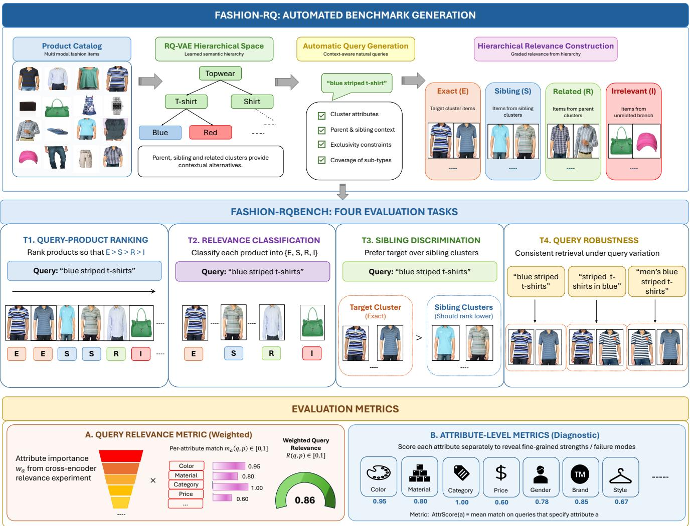
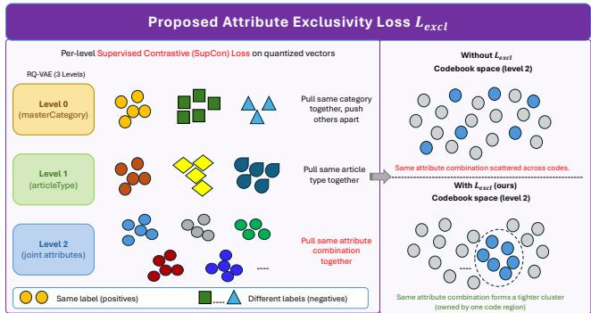

# FASHION-RQ: Mining Hierarchical Semantic Structure for Automated Evaluation of Fashion Retrieval

Tripti Shukla   
Glance   
Bengaluru, India   
tripti.shukla@glance.com   
Rohit Garg   
Glance   
Bengaluru, India   
rohit.garg@glance.com   
Shwetha Somasundaram   
Glance   
Bengaluru, India   
shwetha.s@glance.com   
Paul Duff   
Glance   
Vilnius, Lithuania   
paul.duff@glance.com   
Akshat Gupta   
Glance   
Bengaluru, India   
akshat.gupta@glance.com   
Ian Anderson   
Glance   
London, United Kingdom   
ian.anderson@glance.com

## Abstract

Evaluating fashion retrieval systems remains challenging due to the limited availability of benchmarks that capture the fine-grained, open-ended queries encountered in real-world search and recommendation. Existing benchmarks often rely on manual curation, predefined taxonomies, or synthetic prompts, limiting scalability and semantic coverage. We introduce FASHION-RQ: Mining Hierarchical Semantic Structure for Automated Evaluation of Fashion Retrieval, an automated framework that derives user-type queries and relevance sets directly from catalog structure. Our key insight is that hierarchical discrete representations learned by Residual Quantized Variational Autoencoders (RQ-VAE) organize products into semantically coherent clusters at progressively finer granularities. We leverage this structure to construct FASHION-RQBENCH, a scalable benchmark without manual query annotation orpredefined taxonomies. Weproposefour complementary tasks for evaluating ranking, relevance classification, fine-grained sibling discrimination, and paraphrase robustness, alongside query- and attribute-level relevance metrics. Experiments across recent retrieval models demonstrate that FASHION-RQBENCH differentiates model capabilities across query types and attributes. A human study further shows that benchmark queries achieve comparable naturalness and higher intent clarity than real user queries, supporting their validity for real-world evaluation. The code and FASHION-RQBENCH dataset will be publicly released upon acceptance.

## 1. Introduction

Fashion retrieval is inherently set-valued and graded. A query such as “lightweight cotton kurtas for summer” constrains multiple attributes, including product type, material, and season, and many catalog items may satisfy these constraints to different degrees. Relevance is therefore compositional: an item may match some attributes while violating others. A single aggregate ranking score can hide these differences. For example, two systems may achieve similar nDCG while one retrieves the correct garment in the wrong color and the other retrieves the correct color for the wrong garment. Evaluating such systems requires relevance labels that are set-valued, graded, and decomposable by attribute.

Existing fashion benchmarks do not provide these properties. Manual fashion retrieval datasets typically associate a query with a single target item [22, 51], penalizing other valid results. Graded set-valued annotations are possible, but expensive: ESCI contains 2.6M judgments for 130K queries [34]. Moreover, manually collected labels are tied to a particular catalog snapshot and query distribution. Automatic assessment using language models [44] removes annotation cost, but typically produces an independent relevance score for each query–item pair and does not identify which query attributes are satisfied or violated. These approaches also treat items independently, overlooking the relationships among products in the catalog.

We instead observe that the catalog itself contains the structure needed to define relevance sets. Recent retrieval and recommendation systems such as DSI [40], RI-POR [55], and TIGER [32] represent items using sequences of discrete codes learned with residual quantization [19]. Because these codes are organized from coarse to fine, they induce a prefix tree over the catalog: items sharing a prefix form increasingly specific groups. We repurpose this structure not as an index for retrieval, but as an automatic annotation mechanism. However, vanilla RQ-VAE does not guarantee that a code corresponds to a single semantic attribute, which can produce heterogeneous clusters. We therefore introduce an attribute exclusivity loss that encourages each quantization level to specialize to a coherent attribute, making the resulting hierarchy suitable for defining relevance sets. A prefix then defines a relevance set, its length controls granularity, and the shared-prefix length between an item and the target prefix provides graded relevance without a hand-authored taxonomy.

  
Figure 1. Overview of FASHION-RQ. The framework leverages an RQ-VAE hierarchy to automatically generate natural-language queries and graded relevance sets, with Exact, Sibling, Related, and Irrelevant relationships. The resulting benchmark supports four complementary retrieval tasks, while weighted query relevance and attribute-level metrics evaluate overall intent satisfaction and fine-grained attribute matching.

Building on this hierarchy, we filter clusters that are too small or heterogeneous to serve as relevance sets and compute each retained cluster’s relational context: the attributes that distinguish it from its parent and sibling clusters. A language model then verbalizes this structured evidence into shopper-style queries. Importantly, the language model generates the query but does not determine relevance; relevance is inherited deterministically from the semantic ID (SID) [32] structure.

We instantiate this framework on the public Myntra Fashion Product Images catalog [2], containing 44,446 items, and construct FASHION-RQBENCH: 588 clusters across three granularity levels and 5,380 attributeenriched queries. The benchmark provides four complementary tasks: query–product ranking, hierarchical relevance classification, sibling discrimination, and paraphrase robustness. We additionally introduce a weighted queryrelevance score and per-attribute scores to distinguish overall retrieval quality from fine-grained attribute satisfaction. Figure 1 provides an overview of the complete FASHION-RQBENCH pipeline, from hierarchical benchmark construction to query generation, evaluation tasks, and metrics.

Evaluation of ten off-the-shelf sparse and dense retrieval models, without fine-tuning, shows that aggregate ranking performance alone can mask important weaknesses. Dense encoders achieve substantially higher ranking quality than BM25 [36] (nDCG@10 = 0.87 vs. 0.77), yet the best model achieves only 0.51 accuracy on four-way hierarchical relevance classification. Model scale is also not consistently predictive: the 4B Qwen3 [42] encoder slightly outperforms its 8B counterpart on sibling discrimination. Attribute-level evaluation further localizes these differences: models perform strongly on product type and gender (> 0.93) but substantially worse on material (≈ 0.52) and style (≈ 0.43). Finally, a human study comparing benchmark queries with real user queries shows comparable perceived naturalness and strong intent clarity, supporting Fashion-RQBENCH as a proxy for real-world fashion search. Our contributions are:

• We repurpose RQ-VAE semantic identifiers as an automatic annotation mechanism and introduce an attribute exclusivity loss that encourages quantization levels to encode coherent attributes. Prefixes define relevance sets, prefix length controls granularity, and shared-prefix length defines graded relevance.

• We introduce a cluster-conditioned query generation procedure that captures each cluster’s attribute distribution and its relational differences from parent and sibling clusters, enabling automatic generation of shopper-style queries.

• We introduce FASHION-RQBENCH, comprising 588 clusters, 5,380 attribute-enriched queries, and 44,446 products, with deterministic graded relevance and four complementary evaluation tasks.

• We propose weighted query-relevance and per-attribute metrics that distinguish overall intent satisfaction from fine-grained attribute satisfaction.

## 2. Related Works

Fashion Retrieval Datasets and Benchmarks. Fashion retrieval involves fine-grained attributes such as product type, color, pattern, material, occasion, season, and price. Existing resources address different aspects of this problem. DeepFashion [22] and DeepFashion2 [11] provide large-scale benchmarks for fashion recognition, detection, segmentation, and retrieval; Fashion200K [12] and Shopping100k [3] support attribute-based search; FACAD [53] focuses on fashion captioning; and Fashion Product Images [2] provides the catalog schema used in our work. Language-conditioned retrieval is studied primarily through composed image retrieval, including FashionIQ [51], and more general benchmarks such as CIRR [23], CIRCO [4], and LaSCo [20], with fashion-oriented encoders including FashionCLIP [6], Marqo-FashionSigLIP [16], and GCL [57].

Most existing fashion benchmarks use single-target relevance, whereas open-ended product queries can correspond to a set of valid items; CIRCO [4] is a notable exception, but at modest scale. Graded set-valued relevance is available in product search: ESCI [33], for example, provides exact, substitute, complement, and irrelevant labels, but requires 2.6M manual judgments for 130K queries. Manual construction also fixes the query distribution and catalog snapshot, making large-scale regeneration costly. Outside fashion, QUEST [25] automatically constructs set-valued queries from Wikipedia categories, but relies on an existing taxonomy. In contrast, FASHION-RQ derives both relevance sets and queries from the catalog’s learned semantic structure, avoiding manual relevance annotation and predefined taxonomies.

Generative Retrieval and Semantic Identifiers. Generative retrieval directly decodes item identifiers from queries. DSI [40] and NCI [49] established this paradigm, with hierarchical identifier construction shown to be effective. Subsequent approaches learn identifiers through discrete autoencoding [39] or residual quantization for relevance-aware, prefix-scorable representations [55]. In recommendation, TIGER [32] represents items using SIDs produced by an RQ-VAE [19, 45]; its coarse-to-fine codebooks induce a prefix hierarchy, while Singh et al. [38] demonstrate benefits for cold-start and long-tail recommendation.

Recent work explicitly shapes this hierarchy. HiD-VAE [9] supervises quantization levels with hierarchical item tags and introduces a uniqueness objective to reduce code collisions. These approaches, however, use semantic identifiers primarily as representations for downstream retrieval or recommendation. FASHION-RQ instead repurposes the hierarchy as an annotation structure: prefixes define product groups at different granularities and sharedprefix length provides graded relevance. We further introduce level-wise attribute supervision with an attribute exclusivity loss to encourage semantically coherent clusters, using the resulting tree to construct the benchmark rather than the retrieval identifiers themselves.

Automated Query and Relevance Construction. Synthetic query generation reduces the cost of manual annotation. Doc2Query [30] generates queries for documents, while InPars [5] and Promptagator [8] use LLM-generated query–document pairs for retrieval training. These approaches are primarily document-conditioned: a query is generated from an individual document and typically inherits a single positive target. Rahmani et al. [31] extend synthetic generation to evaluation, using LLM-generated queries and judgments to reproduce retrieval rankings, but the resulting relevance labels remain pairwise LLM assessments. BEIR [43], in contrast, aggregates existing manually annotated datasets, while ExcluIR [56] focuses on phenomenon-specific retrieval with manually constructed

queries.

FASHION-RQ uses cluster-conditioned generation: queries are generated from a purified cluster’s attribute distribution together with its relational differences from parent and sibling clusters. The cluster itself therefore defines a multi-item relevance set, while the relational context encourages queries that distinguish the target group from nearby alternatives. The LLM only verbalizes catalogderived evidence; it does not assign relevance, keeping the resulting labels independent of the generator.

Evaluating Retrieval Beyond Binary Relevance. Graded metrics such as nDCG [15] require relevance judgments, motivating LLM-based assessors such as UMBRELA [44]. Such assessors produce holistic query–item scores and therefore do not reveal which attributes are satisfied or violated. Attribute-level evaluation has been explored through attribute-specific retrieval metrics [24], conditional similarity [47], compositionality benchmarks [13, 54], and constraint-satisfaction measures [1]. However, these settings either evaluate individual attributes, use curated distractors, or operate over restricted constraint types rather than decomposing relevance over a ranked product catalog.

FASHION-RQ combines set-valued graded relevance with joint attribute-level evaluation. Our weighted queryrelevance score and per-attribute metrics are computed from the structured query representation $\phi ( q )$ , separating overall intent satisfaction from fine-grained attribute satisfaction. Because relevance is inherited deterministically from the semantic-ID hierarchy and attribute scores use a fixed catalog schema, the evaluation is reproducible and inspectable without per-pair human or LLM judgments.

## 3. FASHION-RQ: Automated Benchmark Generation

We introduce FASHION-RQ, an automated framework for constructing retrieval benchmarks from product catalogs without manual query or relevance annotation. It exploits the hierarchical structure induced by residual quantization: SID prefixes define relevance sets at multiple granularities, while catalog statistics generate natural-language queries that represent the target cluster and discriminate it from nearby alternatives.

Given a catalog $\mathcal { T } = \{ i _ { 1 } , . . . , i _ { N } \}$ , each item i is represented by a dense embedding $\mathbf { e } _ { i } \ \in \ \mathbb { R } ^ { 1 0 2 4 }$ and catalog metadata including product type, category, color, gender, usage, price, and textual information. A hierarchical tokenizer maps each item to a SID $s _ { i } ~ = ~ ( s _ { i } ^ { ( 1 ) } , s _ { i } ^ { ( 2 ) } , s _ { i } ^ { ( 3 ) } )$ with $L \ = \ 3$ quantization levels and $K \ : = \ : 6 4$ codes per level. A prefix $p ^ { ( \ell ) } = ( s ^ { ( 1 ) } , \ldots , s ^ { ( \ell ) } )$ defines the cluster $C \big ( p ^ { ( \ell ) } \big ) = \Big \{ i \in \mathcal { I } : s _ { i } ^ { ( 1 : \ell ) } = p ^ { ( \ell ) } \Big \}$ , where $\ell = 1$ and $\ell = 3$ correspond to the coarsest and finest granularities, respectively.

Our benchmark construction consists of four stages: (1) hierarchical semantic representation, which induces a coarse-to-fine catalog hierarchy; (2) cluster purification, which removes unreliable clusters; (3) relational context construction, which identifies attributes distinguishing each cluster from its parent and siblings; and (4) automatic query generation, which produces queries satisfying coverage and discriminability requirements. The resulting benchmark contains natural-language queries paired with automatically derived relevance sets at multiple hierarchy levels.

Problem Formulation. Fashion retrieval should be evaluated across multiple levels of semantic granularity, as queries may target broad product groups or fine-grained subsets. FASHION-RQ uses semantic IDs (SIDs) to construct such an evaluation hierarchy: each SID prefix $p ^ { ( \ell ) }$ defines a catalog cluster $C ( \boldsymbol { p } ^ { ( \ell ) } )$ , from which we generate natural-language queries $Q \dot { ( } p ^ { ( \ell ) } )$ and derive their groundtruth relevance sets.

We use an RQ-VAE to induce this hierarchy, as residual quantization captures entangled attribute interactions and organizes products into semantically coherent clusters at multiple granularities. This structure provides a cataloggrounded basis for realistic query generation and reproducible evaluation of fashion retrieval systems.

With $K \ : = \ : 6 4$ codes and $L \ : = \ : 3$ levels, the hierarchy admits $\textstyle \sum _ { \ell = 1 } ^ { L } K ^ { \ell } = 6 4 + 6 4 ^ { 2 } + 6 4 ^ { 3 } \approx 2 . 7 \times 1 0 ^ { 5 }$ prefixes, making manual benchmark construction impractical. FASHION-RQ therefore automatically selects prefixes, derives their relevance sets, and generates queries:

$$
\boldsymbol { \mathcal { B } } = \left\{ ( q _ { j } , p _ { j } ^ { ( \ell ) } , C ( p _ { j } ^ { ( \ell ) } ) , \phi ( q _ { j } ) ) \right\} _ { j = 1 } ^ { N } ,\tag{1}
$$

where $q _ { j }$ is the natural-language query, $p _ { j } ^ { ( \ell ) }$ its semantic granularity, $C ( p _ { j } ^ { ( \ell ) } )$ its relevance set, and $\phi ( q _ { j } )$ its structured attributes.

  
Figure 2. Attribute Exclusivity Loss. Per-level supervised contrastive supervision encourages progressively finer attribute semantics to form compact, distinct regions in the RQ-VAE codebooks, reducing the scattering of identical attribute combinations across codes.

Hierarchical Semantic Representation. We first represent each product using a multimodal embedding from Marqo-FashionSigLIP [16], trained with Generalized Contrastive Learning (GCL) on rich product signals, including product images, descriptions, categories, style, color, material, keywords, and fine-grained details, across over one million fashion products. This provides a semantically rich representation beyond text-only descriptions.

Given $\mathbf { e } _ { i } \in \mathbb { R } ^ { 1 0 2 4 }$ , an MLP encoder $f _ { \theta }$ maps each product to $z _ { i } = f _ { \theta } ( \mathbf { e } _ { i } ) \in \mathbb { R } ^ { 3 2 }$ with architecture $1 0 2 4  5 1 2 $ $2 5 6  1 2 8  3 2$ . We apply residual quantization [19] with $L = 3$ codebooks of $K = 6 4$ codes. Starting from $r _ { i } ^ { ( 0 ) } = z _ { i } .$ , residual quantization selects the code and updates the residual at each level:

$$
\begin{array} { r l } & { s _ { i } ^ { ( \ell ) } = \arg \underset { k \in \{ 1 , \ldots , K \} } { \operatorname* { m i n } } \left\| r _ { i } ^ { ( \ell - 1 ) } - \mathbf { c } _ { k } ^ { ( \ell ) } \right\| _ { 2 } ^ { 2 } , } \\ & { r _ { i } ^ { ( \ell ) } = r _ { i } ^ { ( \ell - 1 ) } - \mathbf { c } _ { s _ { i } ^ { ( \ell ) } } ^ { ( \ell ) } . } \end{array}\tag{2}
$$

The quantized representation is $\begin{array} { r } { \hat { z } _ { i } = \sum _ { \ell = 1 } ^ { L } \mathbf { c } _ { s _ { i } ^ { ( \ell ) } } ^ { ( \ell ) } } \end{array}$ . Thus, the hierarchy captures coarse-to-fine product structure.

For benchmark construction, the induced clusters should be both exhaustive and exclusive: items sharing an attribute combination should be grouped together, while distinct combinations should map to distinct codes. Reconstruction and VQ losses promote exhaustivity by preserving the input embedding, but do not explicitly prevent semantically different combinations from sharing a code. We therefore augment the objective with an attribute-based exclusivity loss:

$$
\mathcal { L } = \mathcal { L } _ { \mathrm { r e c o n } } + \sum _ { \ell = 1 } ^ { L } \left( \mathcal { L } _ { \mathrm { c o d e b o o k } } ^ { ( \ell ) } + \beta \mathcal { L } _ { \mathrm { c o m m i t } } ^ { ( \ell ) } \right) + \lambda _ { \mathrm { e x c l } } \mathcal { L } _ { \mathrm { e x c l } } .\tag{3}
$$

The exclusivity loss applies supervised contrastive learning [18] directly to the quantized code vectors $\begin{array} { r } { q _ { i } ^ { ( \ell ) } = \mathbf { c } _ { s _ { i } ^ { ( \ell ) } } ^ { ( \ell ) } , } \end{array}$ keeping the supervision local to each codebook. Figure 2 illustrates this level-wise exclusivity supervision. We use masterCategory at level 1, articleType at level 2, and all articleType-anchored joint attributes (color, gender, usage, season, age group, price tier, and fashion type) at level 3. For attributes with at least one valid positive pair in a minibatch, the corresponding losses are averaged:

$$
\mathcal { L } _ { \mathrm { e x c l } } = \sum _ { \ell = 1 } ^ { L } \frac { 1 } { | \mathcal { A } _ { \mathrm { v a l i d } } ^ { ( \ell ) } | } \sum _ { a \in \mathcal { A } _ { \mathrm { v a l i d } } ^ { ( \ell ) } } \mathrm { S u p C o n } ( \boldsymbol { q } ^ { ( \ell ) } , \boldsymbol { y } _ { a } ; \tau ) .\tag{4}
$$

This prevents sparse attributes from diluting the available supervision while enforcing exclusivity directly at each discrete level. We set $\tau = 0 . 0 7$ , following supervised contrastive learning [18], and $\lambda _ { \mathrm { e x c l } } = 0 . 0 5$ to keep the exclusivity term subordinate to the primary reconstruction and quantization losses. At inference, SIDs are obtained deterministically using the same residual quantization procedure, yielding $s _ { i } \in \{ 0 , \ldots , 6 3 \} ^ { 3 }$

Cluster Purification. The induced hierarchy may contain small or heterogeneous clusters. We therefore purify it posthoc, independent of RQ-VAE training. Using articleType as the anchor attribute, cluster purity is the fraction of labeled items belonging to the dominant product type:

$$
\operatorname { P u r i t y } ( p ^ { ( \ell ) } ) = \frac { \operatorname* { m a x } _ { a } | \{ i \in C ( p ^ { ( \ell ) } ) : \mathtt { a T } _ { i } = a \} | } { | \{ i \in C ( p ^ { ( \ell ) } ) : \mathtt { a T } _ { i } \neq \mathtt { n u l 1 } \} | } .\tag{5}
$$

We retain prefixes with $| C ( p ^ { ( \ell ) } ) | \ge 5$ and ${ \mathrm { P u r i t y } } ( p ^ { ( \ell ) } ) \geq$ 0.80; at the finest level, we additionally require at least two items. All qualifying prefixes are retained to preserve hierarchy coverage.

Relational Context. Purity does not capture how a cluster differs from nearby alternatives. For each surviving prefix $p ^ { ( \ell ) }$ , we compare it with its parent and up to three siblings. For categorical attribute value (a, v), we compute

$$
\Delta _ { a = v } ( p ^ { ( \ell ) } , R ) = \mathrm { p c t } _ { C ( p ^ { ( \ell ) } ) } ( a = v ) - \mathrm { p c t } _ { R } ( a = v ) ,\tag{6}
$$

where R denotes the parent or a sibling. For numeric attributes, we compare mean, median, minimum, maximum, and quartiles. Differences of at least 20 percentage points are retained as exclusivity constraints, identifying attributes that distinguish the target from nearby clusters.

Automatic Query Generation. For each purified cluster, we generate ${ \dot { Q } } ( \boldsymbol { p } ^ { ( \ell ) } )$ from its attribute distribution and relational context, targeting exhaustiveness and exclusivity. Each sub-type occupying $\ge ~ 5 \%$ of the cluster receives at least one query; a catch-all query covers the remainder. Attribute combinations covering $\ge 9 0 \% \& \ge 5 0 \%$ of a cluster define discriminative and coverage signatures, respectively.

We use an instruction-following LLM (Gemini [41]; temperature 0.2, top-p 0.8) whose prompt includes these signatures, attribute distributions, parent/sibling context, and exclusivity constraints. It is instructed to produce complete shopper-style queries using discriminative attributes, verify separation from siblings, and avoid unsupported universal claims. The LLM returns 6–12 queries plus cluster insights, validation checks, and a coverage map linking major product types to queries. Outputs are parsed leniently; the full prompt and schema are provided in the supplementary material.

Query Attribute Enrichment. For attribute-aware evaluation, each unique generated query is converted by the same LLM into {product\_type, gender, age\_group, color,

pattern, material, occasion, brand, price\_hint, style\_ tags}. Unexpressed attributes are null, multi-valued attributes may contain multiple values, and brand is populated only when explicitly mentioned. Duplicate queries are removed globally before enrichment.

## 4. Benchmark Definition & Tasks.

Source Dataset. We propose FASHION-RQBENCH, a benchmark for evaluating fine-grained fashion retrieval and ranking. It is constructed from the public Myntra Fashion Product Images [2] catalog, comprising 44,446 products with structured metadata, free-text descriptions, and product images. Each item is represented by a 1024-dimensional embedding generated using Marqo-FashionSigLIP [16], and assigned a 3-level SID using the RQ-VAE model described in Section 3. Table 1 provides an overview of Fashion-RQBENCH. More details are provided in the supplementary.

Table 1. Overview of the Fashion-RQBENCH evaluation set.
<table><tr><td>Statistic</td><td>Value</td><td>Details</td></tr><tr><td>Master categories</td><td>5</td><td>Apparel, Accessories, Footwear, Personal Care, Free Items</td></tr><tr><td>Subcategories</td><td>45</td><td></td></tr><tr><td>Article types</td><td>143</td><td>1</td></tr><tr><td>Base colors</td><td>47</td><td></td></tr><tr><td>Genders</td><td>5</td><td>Men, Women, Unisex, Boys, Girls</td></tr><tr><td>Benchmark clusters</td><td>588</td><td>17 / 135 / 436 at levels 1 / 2 / 3</td></tr><tr><td>Enriched queries</td><td>5,380</td><td>2–12 per cluster</td></tr><tr><td>Unique query strings</td><td>5,305</td><td>98.7% of queries</td></tr><tr><td>Mean query length</td><td>10.0</td><td>3–26 words</td></tr><tr><td>Level-1 cluster size</td><td>823.9</td><td>Range: 6–5,349</td></tr><tr><td>Level-2 cluster size</td><td>219.2</td><td>Range: 5–4,896</td></tr><tr><td>Level-3 cluster size</td><td>79.5</td><td>Range: 5–4,888</td></tr></table>

Generated Benchmark. We exploit the hierarchical RQ-VAE SID structure to construct benchmark instances without manual taxonomy design. Each qualifying 1-, 2-, or 3-level SID prefix that satisfies the purity and minimumsize criteria is materialized as a cluster record. This yields 588 clusters, comprising 17, 135, and 436 clusters at levels 1, 2, and 3, respectively (Table 1). Attribute values exhibit substantial lexical diversity, supporting evaluation beyond a fixed vocabulary.

Benchmark Tasks. We define four complementary tasks over the same SID hierarchy, with candidate construction and relevance labels derived deterministically, eliminating the need for an independently authored product taxonomy. For a level-3 anchor cluster, candidates receive four graded relevance levels: Exact (same level-3 prefix), Sibling (same level-2 prefix), Related (same level-1 prefix), and Irrelevant (different level-1 prefix), with scores 3, 2, 1, and 0, respectively. Thus, a single representation defines semantic neighborhoods, evaluation instances, and graded relevance, yielding a consistent and reproducible protocol.

• Query–Product Ranking. Given a natural-language query and a fixed candidate pool containing Exact, Sibling, Related, and Irrelevant items, rank the candidates according to relevance. We report nDCG@10 and Recall@10, both overall and for explicitly constrained attributes.

• Hierarchical Relevance Classification. Given a query– product pair, predict one of the four relevance classes. We report accuracy and macro-F1.

• Sibling Discrimination. Given one target item and closely related sibling distractors, identify the target leaf cluster. The task emphasizes fine-grained distinctions between semantically similar products. We report nDCG@3 and Recall@3 for ranked predictions, or binary accuracy when a single item is selected.

• Query Paraphrase Robustness. We use the query groups generated by our method in Section 3 as paraphrases: since all queries from a cluster describe the same target intent by construction, we evaluate them against a shared candidate pool. This isolates sensitivity to query wording from candidate-pool variation. We measure robustness using Consistency@K, the mean pairwise Jaccard overlap of top-K retrieved item sets.

## 5. Evaluation Framework

FASHION-RQ evaluates retrieval quality at three complementary levels: (i) task-level performance using the hierarchy-derived relevance labels, (ii) overall query relevance based on attribute satisfaction, and (iii) attributelevel diagnostics that identify specific strengths and failure modes. All metrics are computed from the automatically constructed queries, query metadata, and SID hierarchy, without requiring additional human annotation. The four tasks use the common relevance structure defined in Section 4.

Task-Level Metrics. We evaluate each task using metrics suited to its corresponding objective as defined in Section 4. For Query–Product Ranking (T1), we report nDCG@5/10 and Recall@5/10, both overall and for explicitly constrained attributes. For Hierarchical Relevance Classification (T2), we report accuracy and macro-F1, with per-class precision, recall, and F1 for additional analysis.

For Sibling Discrimination (T3), we report nDCG@1/3 and Recall@1/3 to measure fine-grained target-cluster identification. For Query Paraphrase Robustness (T4), we measure retrieval stability using Consistency@5/10, defined as the mean pairwise Jaccard overlap between the top-K result sets across paraphrases, and report the mean nDCG@10 across paraphrases.

Weighted Query Relevance. The hierarchy-based metrics assess whether retrieved products belong to the intended semantic neighborhood, but do not quantify satisfaction of the individual attributes expressed in a query. Moreover, attributes are not equally important in shopping intent: a user may accept a different brand, but not a different product type. We therefore introduce a weighted query relevance score that measures query-level intent satisfaction, with attribute weights derived from a cross-encoder trained to reflect relevance patterns in real user data.

Let A(q) denote the attributes explicitly expressed in query q, as specified by its structured representation ϕ(q).

Table 2. Performance on the four FASHION-RQ tasks. Best results are shown in bold and second-best results are underlined.
<table><tr><td></td><td colspan="2">T1: Ranking</td><td colspan="2">T2: Relevance Classification</td><td colspan="2">T3: Sibling Discrimination</td><td colspan="2">T4: Paraphrase Robustness</td></tr><tr><td>Model</td><td>nDCG@10</td><td>Recall@10</td><td>Accuracy</td><td>Macro-F1</td><td>nDCG@3</td><td>Recall@3</td><td>Consistency@5</td><td>Consistency@10</td></tr><tr><td>BM25 [36]</td><td>0.7736</td><td>0.7376</td><td>0.4023</td><td>0.3919</td><td>0.6142</td><td>0.7723</td><td>0.5067</td><td>0.7419</td></tr><tr><td>RoBERTa-large [21]</td><td>0.7391</td><td>0.7252</td><td>0.3749</td><td>0.3481</td><td>0.5491</td><td>0.7260</td><td>0.4462</td><td>0.7135</td></tr><tr><td>SimCSE-RoBERTa-large [52]</td><td>0.8655</td><td>0.8242</td><td>0.5046</td><td>0.5047</td><td>0.6421</td><td>0.8145</td><td>0.5914</td><td>0.8197</td></tr><tr><td>Sentence-T5-large [29]</td><td>0.8235</td><td>0.7845</td><td>0.4328</td><td>0.4227</td><td>0.6610</td><td>0.8318</td><td>0.5879</td><td>0.8115</td></tr><tr><td>Qwen3-Embedding-4B [42]</td><td>0.8719</td><td>0.8279</td><td>0.5145</td><td>0.5146</td><td>0.6641</td><td>0.8232</td><td>0.6041</td><td>0.8373</td></tr><tr><td>Qwen3-Embedding-8B [42]</td><td>0.8686</td><td>0.8241</td><td>0.5036</td><td>0.5037</td><td>0.6550</td><td>0.8211</td><td>0.6022</td><td>0.8295</td></tr><tr><td>E5-Mistral-7B-Instruct [48]</td><td>0.8699</td><td>0.8258</td><td>0.5134</td><td>0.5135</td><td>0.6462</td><td>0.8145</td><td>0.5893</td><td>0.8233</td></tr><tr><td>ColBERTv2 [37]</td><td>0.8597</td><td>0.8103</td><td>0.4827</td><td>0.4827</td><td>0.6624</td><td>0.8242</td><td>0.5608</td><td>0.7889</td></tr><tr><td>SPLADE++ [10]</td><td>0.8628</td><td>0.8141</td><td>0.4936</td><td>0.4937</td><td>0.6662</td><td>0.8349</td><td>0.5855</td><td>0.8089</td></tr><tr><td>Contriever-MSMARCO [14]</td><td>0.8628</td><td>0.8164</td><td>0.4796</td><td>0.4797</td><td>0.6553</td><td>0.8277</td><td>0.5621</td><td>0.8073</td></tr></table>

For each $a \in { \mathcal { A } } ( q )$ , an attribute-match function $m _ { a } ( q , p ) \in$ [0, 1] measures agreement between the query and product. The comparator depends on attribute type: exact or synonym matching for categorical attributes, distance-based matching for ordinal attributes, and semantic similarity for perceptual attributes. For color, perceptual CIE76 [35] distance is additionally used when both values are recognized colors. Missing product attributes receive a neutral score to avoid penalizing incomplete catalog metadata. Details are provided in the supplementary material.

We aggregate attribute matches using importance weights $w _ { a }$ obtained from the cross-encoder relevance experiment in Section 6:

$$
R ( q , p ) = \frac { \sum _ { a \in \mathcal { A } ( q ) } w _ { a } , m _ { a } ( q , p ) } { \sum _ { a \in \mathcal { A } ( q ) } w _ { a } } .\tag{7}
$$

Only explicitly specified attributes contribute, ensuring that $R ( q , p )$ measures expressed user intent rather than generic product similarity. The score lies in [0, 1], with higher values indicating stronger overall query satisfaction.

Attribute-Level Scores. While $R ( q , p )$ measures overall query satisfaction, we retain individual attribute matches to diagnose fine-grained retrieval behavior. For each attribute $^ { a , }$ we report the mean match score over queries that explicitly specify a: $\begin{array} { r } { \operatorname { A t t r S c o r e } ( a ) = \frac { 1 } { | { \mathcal { Q } } _ { a } | } \sum _ { q \in { \mathcal { Q } } _ { a } } m _ { a } ( q , p _ { q } ) } \end{array}$ where ${ \mathcal { Q } } _ { a }$ denotes the queries specifying a. We report scores for product type, gender, age group, color, material, occasion, brand, pattern, price, and style, enabling attributespecific strengths and failure modes that may be obscured by aggregate metrics.

## 6. Experiments

Cross-encoder derived attribute importance. The attribute weights in $R ( q , p )$ are distilled from a crossencoder trained on real product-search data, including the ESCI [34] filtered to fashion relevant queries and internal production-scale proprietary data. Since its proprietary training data precludes direct use as an evaluation model, we use the cross-encoder as a knowledge source and estimate attribute importance through matched twin-pair ablation and regression-based analysis. We normalize the resulting estimates to obtain non-negative weights $w _ { a }$ that sum to one, which are used to aggregate per-attribute match scores into the model-agnostic query-relevance score. The resulting weights are shown in Table 3; full estimation procedures, per-attribute confidence diagnostics, and sample sizes are provided in supplementary.

Baselines. We evaluate FASHION-RQ using ten off-theshelf retrieval baselines spanning sparse lexical and dense semantic retrieval. The sparse family includes BM25 [36] on settings. The dense family comprises nine pretrained encoders covering 355M–8B parameter scales, different pooling strategies, and both non-instruction-tuned and instruction-tuned query encoders. These include generalpurpose sentence encoders as well as recent large embedding models. All baselines are evaluated without training or fine-tuning on FASHION-RQ; queries and catalog products are encoded using their native published configurations, and candidates are ranked by lexical matching or embedding similarity, respectively. This setup evaluates the extent to which existing retrieval representations generalize to the fine-grained, hierarchically structured fashion queries in FASHION-RQ.

Results. Table 2 reports the primary results across the four FASHION-RQ tasks, using two complementary metrics for each task. Overall, dense and learned sparse retrievers consistently outperform the lexical BM25 baseline, demonstrating the benefit of semantic representations for fine-grained fashion retrieval.

For T1, Qwen3-Embedding-4B achieves the best performance on both nDCG@10 (0.8719) and Recall@10 (0.8279), followed closely by E5-Mistral-7B-Instruct and SimCSE-RoBERTa-large. The dense and learned sparse models form a relatively tight performance range, while RoBERTa-large, which lacks retrieval-specific training, performs worst.

For T2, Qwen3-Embedding-4B again achieves the best performance, with 0.5145 accuracy and 0.5146 macro-F1, narrowly followed by E5-Mistral-7B-Instruct. The close agreement between accuracy and macro-F1 suggests that the relative ordering is not driven by a single relevance class. RoBERTa-large obtains the lowest accuracy (0.3749), highlighting the importance of retrieval-oriented representation learning for hierarchical relevance discrimination.

Table 3. Weighted query-relevance and attribute-level matching scores across retrieval models. Attribute weights $w _ { a }$ are derived from the cross-encoder and used to compute the overall weighted relevance score, Rel.
<table><tr><td>Model</td><td>Rel.</td><td> $\mathbf { A 8 e }$ </td><td>Brand</td><td>Color</td><td>Gender</td><td>Mat.</td><td>Occ.</td><td>Pattern</td><td>Price</td><td>Prod.</td><td>Style</td></tr><tr><td>Qwen3-Emb.-8B [42]</td><td>0.9274</td><td>0.9907</td><td>0.8560</td><td>0.9125</td><td>0.9750</td><td>0.5367</td><td>0.9632</td><td>0.8521</td><td>0.6484</td><td>0.9409</td><td>0.4291</td></tr><tr><td>E5-Mistral-7B [48]</td><td>0.9158</td><td>0.9900</td><td>0.8914</td><td>0.8782</td><td>0.9676</td><td>0.5232</td><td>0.9618</td><td>0.8465</td><td>0.6543</td><td>0.9395</td><td>0.4265</td></tr><tr><td>Qwen3-Emb.-4B [42]</td><td>0.9254</td><td>0.9895</td><td>0.8221</td><td>0.8965</td><td>0.9721</td><td>0.5217</td><td>0.9624</td><td>0.8327</td><td>0.6426</td><td>0.9438</td><td>0.4204</td></tr><tr><td>Sentence-T5-L [29]</td><td>0.9018</td><td>0.9918</td><td>0.7587</td><td>0.9159</td><td>0.9911</td><td>0.5310</td><td>0.9628</td><td>0.8395</td><td>0.6562</td><td>0.9392</td><td>0.4229</td></tr><tr><td>Sup-SimCSE-RoBERTa-L [52]</td><td>0.8923</td><td>0.9922</td><td>0.6613</td><td>0.9008</td><td>0.9873</td><td>0.5003</td><td>0.9616</td><td>0.8296</td><td>0.6247</td><td>0.9368</td><td>0.4292</td></tr><tr><td>BM25 [36]</td><td>0.8753</td><td>0.9826</td><td>0.7927</td><td>0.8451</td><td>0.8889</td><td>0.4987</td><td>0.9585</td><td>0.7934</td><td>0.6169</td><td>0.8929</td><td>0.4211</td></tr><tr><td>RoBERTa-L [21]</td><td>0.8340</td><td>0.9671</td><td>0.6776</td><td>0.7388</td><td>0.8793</td><td>0.3361</td><td>0.9338</td><td>0.6373</td><td>0.5193</td><td>0.8528</td><td>0.4222</td></tr><tr><td>ColBERTv2 [37]</td><td>0.9198</td><td>0.9885</td><td>0.8571</td><td>0.8615</td><td>0.9672</td><td>0.5307</td><td>0.9638</td><td>0.8560</td><td>0.6228</td><td>0.9350</td><td>0.4271</td></tr><tr><td>SPLADE++ [10]</td><td>0.9209</td><td>0.9877</td><td>0.8597</td><td>0.8594</td><td>0.9712</td><td>0.5343</td><td>0.9639</td><td>0.8526</td><td>0.6325</td><td>0.9361</td><td>0.4278</td></tr><tr><td>Contriever-MSMARCO [14]</td><td>0.9155</td><td>0.9850</td><td>0.8615</td><td>0.8479</td><td>0.9560</td><td>0.5268</td><td>0.9600</td><td>0.8332</td><td>0.6294</td><td>0.9320</td><td>0.4247</td></tr><tr><td> $w _ { a }$ </td><td>一</td><td>0.066</td><td>0.211</td><td>0.138</td><td>0.127</td><td>0.063</td><td>0.008</td><td>0.060</td><td>0.024</td><td>0.290</td><td>0.012</td></tr></table>

T3 is more challenging, requiring discrimination among products from closely related sibling clusters. SPLADE++ achieves the best nDCG@3 (0.6662) and Recall@3 (0.8349), followed by Qwen3-Embedding-4B on nDCG@3 and Sentence-T5-large on Recall@3. This shows that finegrained sibling discrimination does not necessarily improve with model size or dense semantic representations.

For T4, Qwen3-Embedding-4B achieves the highest Consistency@5 (0.6041) and Consistency@10 (0.8373), indicating the most stable retrieval across paraphrases. Dense and learned retrievers generally show higher consistency than BM25, particularly at the shallow cutoff, where lexical matching is more sensitive to wording changes. The weaker ranking but comparatively stable behavior of RoBERTa-large further demonstrates that paraphrase consistency captures a distinct retrieval property.

Overall, Qwen3-Embedding-4B achieves the strongest results on three of the four tasks, while SPLADE++ performs best on sibling discrimination. The complementary results demonstrate that FASHION-RQ assesses not only overall retrieval quality, but also hierarchical relevance discrimination and robustness to query variation.

Table 4. Mean ratings from the user study on a 5-point Likert scale. Higher scores indicate greater perceived naturalness and intent clarity.
<table><tr><td>Source</td><td>Naturalness</td><td>Intent Clarity</td></tr><tr><td>CHAT</td><td>3.52</td><td>2.83</td></tr><tr><td>LLM</td><td>2.84</td><td>3.76</td></tr><tr><td>RQBENCH (Ours)</td><td>3.62</td><td>3.91</td></tr></table>

Query-Relevance Evaluation. Table 3 shows that Qwen3- Embedding-8B achieves the highest weighted relevance score (0.9274), followed closely by SPLADE++ (0.9209) and ColBERTv2 (0.9198), demonstrating that both dense and learned sparse retrievers can capture fine-grained query intent. BM25 scores lower (0.8753), while RoBERTa-Large ranks last (0.8340). Attribute-level results reveal strong alignment for age, occasion, gender, and product type across models, whereas material and style remain consistently weaker. Notably, the weighted score distinguishes models with similar aggregate performance through their attribute-level behavior, demonstrating its ability to expose fine-grained differences in query satisfaction.

User Study. We conducted a user study to assess the naturalness and intent clarity of queries from three sources: our Fashion-RQBENCH (RQBENCH), real user queries (CHAT), and LLM-generated queries (LLM). 32 participants rated each query on a 5-point Likert scale for both dimensions. Inter-rater reliability was high, with Cronbach’s [7] α = 0.977 for naturalness and α = 0.969 for intent clarity, indicating strong agreement among raters.

Table 4 summarizes the mean ratings. Naturalness ratings are comparable between RQBENCH and CHAT, with mean scores of 3.62 and 3.52, respectively. In contrast, intent clarity shows a strong separation: RQBENCH achieves the highest mean score (3.91), followed by LLM (3.76), while CHAT is substantially lower (2.83), with all pairwise differences statistically significant. These results indicate that RQBENCH queries preserve the naturalness of real user language while providing substantially clearer and more actionable intent. We provide more details on the study in supplementary.

## 7. Conclusion

We introduced FASHION-RQ, an automated benchmark construction framework that leverages hierarchical semantic structure to generate realistic queries and graded relevance sets without manual annotation. Using an RQ-VAE with attribute exclusivity supervision, FASHION-RQ produces coherent fine-grained clusters and exploits parent–sibling relations to construct diverse retrieval scenarios. We instantiate this framework as FASHION-

RQBENCH, a benchmark for evaluating fashion retrieval models through complementary retrieval tasks, weighted query-relevance evaluation, and attribute-level metrics. Together, FASHION-RQ and FASHION-RQBENCH provide a scalable and semantically grounded alternative to manually curated fashion retrieval benchmarks. FASHION-RQ depends on catalog quality, the underlying multimodal representation, and LLM-generated queries, which may introduce coverage and linguistic biases. The automatically derived relevance structure also approximates rather than replaces human judgments. Future work will explore human validation, broader domains and attributes, richer semantic relations, and adaptive benchmark generation.

## 8. Appendix

## 8.0.1. Codebook Size Ablation Study.

We study the effect of RQ-VAE [19] codebook size on the semantic-ID hierarchy by comparing codebook sizes of 64, 128, and 256 with three quantization levels, while keeping all other settings fixed. The results characterize the trade-off between cluster purity and cluster fragmentation. As the codebook size increases, the available semantic-ID space grows from $6 4 ^ { 3 } = 2 6 2 , 1 4 4 \mathrm { t o } 2 5 6 ^ { 3 } = 1 6 , 7 7 7 , 2 1 6 ,$ , substantially exceeding the 44,446 catalog items. Consequently, larger codebooks produce increasingly fragmented clusters, reducing the number of items sharing the same semantic-ID prefixes.

Table 5. Effect of codebook size on weighted attribute purity for 64, 128 and 256 size.
<table><tr><td>Attribute</td><td>64</td><td>128</td><td>256</td></tr><tr><td>Master Category</td><td>99.8%</td><td>50.4%</td><td>1.0%</td></tr><tr><td>Subcategory</td><td>99.4%</td><td>50.2%</td><td>1.0%</td></tr><tr><td>Article Type</td><td>98.3%</td><td>49.7%</td><td>1.0%</td></tr><tr><td>Gender</td><td>98.1%</td><td>49.6%</td><td>1.0%</td></tr><tr><td>Base Color</td><td>87.9%</td><td>44.5%</td><td>1.0%</td></tr><tr><td>Usage</td><td>97.7%</td><td>49.4%</td><td>1.0%</td></tr></table>

Interestingly, weighted global purity and mean percluster purity exhibit different trends. Weighted purity emphasizes the large clusters and therefore decreases sharply with increasing codebook size. In contrast, mean per-cluster purity can increase because fragmentation creates many small, trivially pure clusters. Thus, high unweighted cluster purity alone does not imply a useful semantic hierarchy: excessively large codebooks can produce highly pure but near-singleton clusters that provide little shared semantic structure.

The fragmentation trend is evident across all three levels (Table 6). At the coarsest level, the average cluster size decreases from 824 items for the 64-codebook to 166.5 for the 256-codebook. At full depth, the corresponding cluster size decreases from 1.86 to 1.23 items, indicating that many semantic IDs become effectively item-specific. The 128- codebook configuration provides an intermediate operating point, with an estimated 285.0 items per D1 cluster and 1.48 items per full-depth cluster.

Overall, these results motivate using a moderate codebook size when constructing a semantic-ID benchmark: the codebook must provide sufficient capacity to separate finegrained products while retaining meaningful item sharing within semantic-ID prefixes. In our benchmark construction, we therefore use the codebook configuration size of 64 which provides the desired balance between semantic purity and cluster density.

## 8.0.2. Query Generation Methodology.

Signature construction. For each semantic-ID prefix, we derive attribute signatures using combinations of masterCategory, subCategory, articleType, brandName, baseColor, gender, usage, price, and productDisplayName. We construct two complementary signature sets. Discriminating signatures identify highly specific cluster characteristics, requiring at least 10% cluster coverage and 90% precision against the full catalog; the top eight are retained based on exclusivity, precision, and coverage. These signatures guide query generation toward attributes that distinguish the target cluster from its siblings. Coverage signatures require at least 5% coverage and 50% precision, with the top 20 retained, and are used to ensure that queries collectively cover the major product types within the cluster. The primary producttype axis is selected as the most specific attribute whose dominant value provides the highest cluster purity, with masterCategory as the fallback.

Query generation. For each qualified prefix, the Gemini prompt combines fixed generation instructions with clusterspecific evidence. The instructions require natural and complete-sentence queries, coverage of all product types accounting for at least 5% of the cluster plus a catch-all for minority types, and discrimination from sibling clusters. Queries are grounded in productDisplayName and description language while avoiding queries based solely on an attribute value unless that value is shared by all cluster items. The prompt further provides the major product types and their frequencies, sibling-level attribute contrasts, and a structured DATA CONTEXT containing the prefix metadata, attribute signatures, attribute distributions, parent statistics, and sibling differences.

## Query Generation Prompt.

You are an expert analyst of hierarchical fashion semantic

Table 6. Cluster fragmentation as a function of codebook size.
<table><tr><td></td><td colspan="2">64</td><td colspan="2">128</td><td colspan="2">256</td></tr><tr><td>Level</td><td>Clusters</td><td>Items/Cl.</td><td>Clusters</td><td>Items/Cl.</td><td>Clusters</td><td>Items/Cl.</td></tr><tr><td>D1</td><td>44</td><td>823.9</td><td>156</td><td>285.0</td><td>267</td><td>166.5</td></tr><tr><td>D2</td><td>3,378</td><td>219.2</td><td>10,378</td><td>48.28</td><td>17,378</td><td>3.56</td></tr><tr><td>D3</td><td>23,956</td><td>79.5</td><td>30,045</td><td>13.48</td><td>36,122</td><td>1.23</td></tr></table>

ID clusters and a specialist in   
e-commerce search behavior.   
Your task is to understand what a   
given semantic prefix represents   
by analyzing: - High-precision   
attribute signatures (combinations   
of attributes strongly associated   
with the prefix) - Differences from   
its parent cluster (what makes it   
more specific) - Differences from   
sibling clusters (what makes it   
unique and non-overlapping)   
Based on this, infer the underlying   
product concept that this prefix   
encodes.   
Then generate natural-language user   
queries that a real shopper would   
type into a fashion recommendation   
system (e.g., Myntra, Amazon,   
Flipkart). These queries must:   
1. Sound natural and human-like   
(NOT attribute lists like   
’color=black AND material=leather’).   
2. Reflect real shopping intent   
(style, occasion, product type,   
etc.). 3. Be phrased properly.   
4. Be EXHAUSTIVE: the set of   
queries must collectively retrieve   
EVERY item in the prefix group.   
- Generate at least one distinct   
query for each major product type   
(>5% share) listed in the coverage   
section. - Add a broad catch-all   
query to cover minor types (<5%   
share) that are not individually   
addressed. 5. Be EXCLUSIVE: no   
query should retrieve items from   
sibling prefixes or from outside   
this cluster. - For every query,   
verify it cannot be satisfied by the   
dominant attributes of each sibling   
listed in the exclusivity section.   
- Use target-only discriminating   
attributes as anchors wherever   
possible. 6. Prefer commonly used   
fashion terminology over internal   
attribute names. 7. Ground each

query in the dominant phrases from   
description/productDisplayName to   
make the intent explicit. 8. Never   
use a single attribute value unless   
100% of items share it; describe   
multi-value ranges collectively.   
Additional guidelines: - Use   
attribute signatures to ground the   
meaning. - Use parent deltas to   
explain what makes this cluster   
more specific than its parent.   
- Use sibling contrasts and the   
exclusivity constraints below to   
sharpen boundaries.   
Return ONLY a valid JSON object   
(no markdown fences, no extra   
text) with these keys: {   
"insights": "<concise explanation   
of what this prefix represents>",   
"user\_queries": ["<query 1>",   
"<query 2>", ...], // 6-12 queries,   
covering all major AND minor   
product types "delta\_vs\_parent":   
"<key ways this prefix is more   
specific than its parent>",   
"delta\_vs\_siblings": "<key   
distinguishing factors vs sibling   
prefixes>", "validation\_checks":   
["<rule 1>", ...], // one   
rule per major product type   
confirming coverage; one rule per   
sibling confirming exclusivity   
"coverage\_map": {"<product\_type>":   
"<which query covers it>", ...} //   
explicit mapping from each major   
product type to the query index that   
covers it }   
EXHAUSTIVE COVERAGE REQUIREMENT --   
this prefix contains {N} distinct   
product types: • {value}: {pct}%   
({count} items) ← MUST be reachable   
by at least one query ...   
Minority types (<5% each): {names}   
← cover collectively with a broad   
query   
EXCLUSIVITY CONSTRAINTS -- your   
queries must NOT retrieve items

from these sibling prefixes:   
Sibling {prefix} ({size} items)   
Contains: {top\_categories}   
Sibling-only attributes (avoid   
these in target queries): {attr=val   
(+Xpp in sibling); ...} Target-only   
attributes (safe anchors for   
exclusivity): {attr=val (+Xpp   
in target); ...} ... For EVERY   
query you write, verify it would NOT   
match the dominant attributes of the   
sibling prefixes above.   
DATA CONTEXT: {json:   
target\_prefix.metadata,   
target\_prefix.blueprint,   
target\_prefix.discriminating\_signatures,   
target\_prefix.coverage\_signatures,   
target\_prefix.common\_attributes,   
target\_prefix.full\_attribute\_distribution,   
parent.record,   
parent.category\_deltas\_vs\_parent,   
parent.numeric\_deltas\_vs\_parent,   
sibling\_comparisons}

Generation and validation. Queries are generated using gemini-2.5-flash with temperature 0.2 and top-$\begin{array} { r } { p \ = \ 0 . 8 . } \end{array}$ The requested output contains an interpretation of the cluster, 6–12 user queries, parent/sibling differences, validation checks, and an explicit product-type-toquery coverage\_map. Responses are parsed using structured JSON extraction with a free-text fallback to preserve valid queries from partially malformed outputs. The returned coverage map is subsequently compared against the required product-type set, and uncovered types are recorded as coverage gaps.

Prefix qualification. To ensure that query generation operates on semantically coherent groups, a prefix is processed only when its articleType purity is at least 0.80 and its cluster contains at least two items. Prefixes failing either criterion are excluded from generation.

## 8.0.3. Per-task Benchmark Statistics

Table 1 in main paper reports aggregate statistics for Fashion-RQBENCH; here we break these down per evaluation task and report the relevance-label balance, attributetag taxonomy, and catalog coverage underlying each task.

Table 7. Per-task composition of Fashion-RQBENCH. All queries are anchored at level-3 (leaf) clusters; Task 1 and Task 4 share the same 2,477 anchor queries (Task 4 paraphrases each one 2–10×).
<table><tr><td>Task</td><td># Queries</td><td># Pairs/Cands</td><td>Cands per Query</td><td>Leaf Clusters</td><td>Query Length</td></tr><tr><td>T1: Ranking</td><td>2,477</td><td>36,782</td><td>12–15 (mean 14.8)</td><td>416</td><td>3–26 words (mean 10.1)</td></tr><tr><td>T2: Relevance Classification</td><td>2,477</td><td>19,731</td><td>7–8 (mean 8.0)</td><td>416</td><td>3–26 words (mean 10.1)</td></tr><tr><td>T3: Sibling Discrimination</td><td>1,968</td><td>9,801</td><td>4–5 (mean 5.0)</td><td>331</td><td>3–26 words (mean 10.1)</td></tr><tr><td>T4: Query Robustness (Paraphrase)</td><td>416 groups</td><td>2,477 queries</td><td>12–15 (mean 14.9)</td><td>416</td><td>2–10 paraphrases/group (mean 6.0)</td></tr></table>

Relevance-label balance. Across the ranking and classification tasks, candidates are drawn with near-uniform coverage of the four relevance tiers (Exact / Sibling / Related / Irrelevant), avoiding trivial class-imbalance shortcuts:

Table 8. Relevance-label distribution over (query, candidate) pairs.
<table><tr><td>Task</td><td>Exact</td><td>Sibling</td><td>Related</td><td>Irrelevant</td></tr><tr><td>T1: Ranking (36,782 pairs)</td><td>20.2%</td><td>25.9%</td><td>26.9%</td><td>26.9%</td></tr><tr><td>T2: Classification (19,731 pairs)</td><td>25.1%</td><td>24.7%</td><td>25.1%</td><td>25.1%</td></tr></table>

Attribute-tag taxonomy. Each ranking query is annotated with 0–8 attribute tags (mean 3.8) drawn from a 10-way taxonomy, with the following coverage over the 2,477 queries: product\_type (2,475), gender (1,892), occasion (1,349), brand (945), style\_tags (896), color (845), age\_group (627), pattern (156), material (153), price\_hint (80).

Sibling discrimination. Each of the 1,968 queries pairs exactly one correct item against 3–4 distractor clusters (mean 3.89) sampled from neighboring leaf clusters, yielding 4–5 candidates per query — a harder, lower-cardinality setting than Task 1/2 designed to isolate fine-grained (sibling-level) confusability.

Catalog coverage. The benchmark draws from the full 44,446-item catalog with broad metadata diversity: sampled items span masterCategory {Apparel: 7,622, Accessories: 6,760, Footwear: 3,699, Personal Care: 1,570, Free Items: 73, Sporting Goods: 7} (Task 2 pairs) and gender {Men: 8,996, Women: 8,913, Unisex: 1,279, Boys: 284, Girls: 259}, with price ranging \$90–\$17,995 (median \$1,199, mean \$1,744). Across all four tasks, the benchmark touches 8,841 unique items (19.9% of the catalog) as either queries’ anchor items or candidates/distractors.

## 8.0.4. Attribute-Level Relevance Scoring

This section details the comparator $m _ { a } ( q , p )$ used for each attribute $a \in { \mathcal { A } } ( q )$ in weighted query relevance section of the main paper. All soft-text comparators use cosine similarity between Marqo-FashionCLIP [16] text embeddings of the compared strings, denoted sim(·, ·). When a product lacks a structured value for an expressed query attribute, the comparator returns a neutral score of 0.5 rather than 0, so that missing catalog metadata is not conflated with an actual mismatch.

Product type. A hierarchical comparison against the product’s full category path masterCategory > subCategory > articleType. If the query’s product-type string occurs as a substring anywhere in the lower-cased path, the score is floored at 0.85 (refined upward by sim against the leaf category when available). Otherwise, $\begin{array} { r l } { m _ { a } ( q , p ) } & { { } = } \end{array}$ max $\big ( \operatorname* { m a x } _ { \ell \in \mathrm { l e v e l s } } \mathrm { s i m } ( q _ { a } , \ell )$ ， sim(qa, full path), i.e.

the best similarity across the three individual hierarchy levels and the concatenated path.

Gender. Categorical, after synonym normalization (e.g. "men", "man", "male", "boys" → male). Exact match after normalization scores 1.0; a query or product value of unisex against the other gender scores 0.7; any other mismatch scores 0.1.

Age group. Ordinal, over the ordered scale {baby, toddler, kids, adult} (Myntra’s ageGroup field, e.g. "Adults-Men", is reduced to this scale by keeping only the age segment). Exact match scores 1.0; otherwise the score decays linearly with ordinal distance, $\operatorname* { m a x } ( 0 , 1 - 0 . 3 5 \left| \operatorname { i d x } ( q _ { a } ) - \operatorname { i d x } ( p _ { a } ) \right| )$ ; a value outside the ordered scale scores 0.3.

Color. Perceptual CIE76 ∆E distance in CIELAB [35] space between a query color and a product color, computed via a curated dictionary of ∼90 named colors mapped to representative sRGB values. Identical color strings score 1.0 directly. When both values resolve to a known color, $m _ { a } ( q , p ) = \operatorname* { m a x } ( 0 , \ 1 - \Delta E / 1 2 0 )$ , taking the maximum over all query×product color pairs. When either color is not in the dictionary, the comparator falls back to $\sin ( q _ { a } , p _ { a } )$ If the product has no structured baseColor, the query color list is instead compared against the product description text.

Material, occasion, pattern, style. These four attributes share one comparator shape: the product’s value list is parsed from the semi-structured articleAttributes field (fabric/pattern/fit/occasion keys) and, when that yields noth ing, backfilled by matching a curated domain vocabulary (e.g. pattern terms like "floral print", "polka dot"; style/fit terms like "slim fit", "off shoulder"; occasion terms like "business casual", "loungewear") against the product title and description. Given the resulting product value list, $m _ { a } ( q , p ) = \mathrm { m a x } _ { v \in q _ { a } , u \in p _ { a } } \mathrm { s i m } ( v , u )$ over all query×product value pairs. If the product has no values for the attribute at all, $q _ { a }$ is instead compared against the raw description (and, for occasion/pattern/style, the full category path) text as a single string.

Brand. Case-insensitive exact-or-substring match against the catalog’s brand field: $m _ { a } ( q , p ) = 1 . 0$ if either string contains the other, else 0.0.

Price hint. Both query and product price are bucketed into three tiers (budget / mid-range / premium) using INR thresholds $( < 7 0 0 , 7 0 0 { - } 2 0 0 0 , > 2 0 0 0$ , from the catalog’s list price). Matching tiers score 1.0; any mismatch scores 0.3 (rather than 0, since adjacent price tiers are a much smaller miss than an unrelated product).

Optional visual grounding. When enabled, product\_type, color, pattern, material, occasion, and style additionally probe a FashionCLIP image embedding of the product photo with a short attribute-specific text prompt (the attribute value plus the query’s product type as context, e.g. "striped shirt"), and the attribute’s final score is max $( m _ { a } ^ { \mathrm { t e x t } } ( q , p ) , ~ m _ { a } ^ { \mathrm { i m a g e } } ( q , p ) ) ~ -$ letting either signal recover from a missing or noisy metadata field.

Aggregation. For a given query, only the subset of attributes $\scriptstyle A ( q )$ actually expressed in that query’s structured representation contribute to its relevance score; the corresponding cross-encoder weights $w _ { a }$ are renormalized to sum to 1 over $\scriptstyle A ( q )$ before the weighted sum is taken. A query with a multi-intent structured representation (e.g. a gift-set query implying several distinct product asks) is scored against every intent variant independently, and the best-matching variant’s score is kept — a retrieved product is credited if it satisfies at least one of the query’s intents well.

## 8.0.5. Cross-Encoder-Based Attribute Importance Estimation

We estimate attribute-level importance using a crossencoder trained on real fashion search interactions. The cross-encoder serves as an independent relevance oracle, allowing us to derive attribute weights without relying on the retrieval systems or evaluation metrics being compared in Fashion-RQBENCH. We use two complementary estimation procedures: a controlled matched-pair ablation and an independent regression-based cross-check.

Cross-encoder oracle. We train a cross-encoder using the ModernBERT-large [50] architecture on a combination of proprietary internal relevance dataset (prop-rel) and a fashion-filtered subset of ESCI [34]. The model predicts binary query–product relevance, and we use its raw output logit as the relevance score. As ESCI’s US-locale subset spans fashion and non-fashion domains, we filter it to (query, product) pairs whose title or description contains fashion-specific keywords, treating products labeled exact for a given query as relevant and those labeled substitute, complement, or irrelevant as irrelevant; a query may be paired with multiple products, yielding multiple queryproduct pairs. Combining this ESCI-filtered subset with prop-rel gives 539,849 training samples over 44,670 unique queries and 58,792 validation samples over 4,985 unique queries. Of the training queries, 14,467 (32.4%) come from the ESCI-filtered set and 30,203 (67.6%) from prop-rel; the validation split has an analogous 1,611 (32.3%) / 3,374 (67.7%) split. At the (query, product) sample level, ESCI accounts for 251,100 (46.5%) of training data and 27,876 (47.4%) of validation data, with the remainder — 288,749 (53.5%) train, 30,916 (52.6%) val — from prop-rel.

We initialize the model from a checkpoint [28] pretrained on sentence similarity, and represent product text as "name |brand |gender |color |materials |description". The model is trained with binary cross-entropy loss, mean pooling, label smoothing (ϵ = 0.1), and batch size 512. On our internal test set of 2,353 unique queries and 12,619 queryproduct pairs (positive rate 0.632), with threshold=0.5, the cross-encoder achieves 0.818 ROC-AUC and a Brier score of 0.162, versus 0.233 for a baseline predicting the marginal positive rate for every pair.

We validate the oracle on a manually constructed sanity set of 100 query–product examples covering multiple attributes. The model achieves a relevant–irrelevant probability margin of 0.616 and pairwise ranking accuracy of 97.0%, exceeding our validation criteria of 0.15 and 75%, respectively.

Attribute annotations. Item-level attributes are obtained independently from the public Myntra fashion catalog [2]. Product type, gender, age group, color, and usage/occasion are obtained from structured metadata, while material and pattern are extracted from the attribute text. Price is discretized into budget, mid-range, and premium categories. Query-side attributes are obtained from naturally occurring enriched queries. Query and item attributes are canonicalized using the same normalization procedure before computing attribute matches.

Matched-pair ablation. For each attribute a, we construct matched “twin” item pairs that agree on relevant control attributes but differ in a. Given a query specifying value $v _ { 1 }$ of attribute a, the two items are scored by the crossencoder and their logit difference is computed as

$$
\begin{array} { r } { \Delta _ { i } = s _ { \mathrm { C E } } ( q _ { i } , x _ { 1 } ) - s _ { \mathrm { C E } } ( q _ { i } , x _ { 2 } ) . } \end{array}\tag{8}
$$

We additionally score each twin pair against randomly sampled queries to obtain a null distribution. For each attribute, we report the mean logit difference, a twin-pairclustered 95% bootstrap confidence interval using 2,000 resamples, sign consistency, and a distinguishability-fromnull diagnostic. Confidence tiers reflect both sample size and whether the confidence interval excludes zero. Results are shown in Table 9.

Regression cross-check. As an independent validation, we construct query–product pairs from real queries and encode each attribute as $f _ { a } ~ \in ~ \{ 1 , 0 , 0 . 5 \}$ for match, mismatch, and unspecified, respectively. After standardizing the ten attribute features, we fit a Ridge regression [46] to the cross-encoder logits using $N = 6 { , } 2 0 5$ pairs. The regression achieves $R ^ { 2 } = 0 . 4 9 0$ . Variance inflation factors (VIFs) [26] between 1.00 and 1.10 indicate negligible multicollinearity among the attribute features. The regression coefficients, VIFs, and resulting blended weights are reported in Table 10.

Weight construction. For each method, negative estimates are clipped to zero and the resulting values are normalized to sum to one. We compute the Spearman rank correlation between the two sets of raw estimates as an agreement measure. The final attribute weight $w _ { a }$ is obtained by averaging the two normalized weight vectors and renormalizing the result to sum to one. These weights are subsequently used by the attribute-aware relevance metric in Section 3 of main paper.

## 8.0.6. Baseline Models and Implementation Details 8.1. Baseline Model Configurations

We evaluate 12 retrieval baselines spanning four architecture families—lexical, learned-sparse, multi-vector lateinteraction, and dense single-vector models—following the taxonomy of Kamalloo et al. [17]. All models are evaluated as frozen, off-the-shelf checkpoints without task-specific fine-tuning. The exact configurations used for each baseline are provided in Tables 11–13.

†The base T5-large hidden size is 1024; the model’s built-in projection head produces 768-dimensional embeddings.

‡auto EOS handling was empirically verified against the tokenizer for Qwen3-Embedding-0.6B and the same policy was applied to the 4B and 8B checkpoints without independent re-verification. §For E5-Mistral-7B-Instruct, EOS is appended once manually after truncation. .

## 9. User Study Additional Details

Query sources. We evaluated three blinded query sources, with 20 queries per source (N = 60): RQBENCH sampled our generated queries; CHAT, real user shopping queries filtered by majority-vote intent labels $( \geq 2 / 3$ LLM judges), scope, length, deduplication, and manual NSFW/PII screening; and LLM, unconditioned, personafree shopping-query generations without dataset conditioning or few-shot examples. For RQBENCH, 20 queries were randomly sampled (seed 42). CHAT and LLM were similarly sampled from curated pools of 50 using seed 42. All 60 queries were then randomly interleaved (seed 2026), assigned hidden IDs, and presented without source labels.

Rating protocol. Each query was rated independently on two 5-point Likert scales: naturalness (1 = very unnatural/scripted, 5 = very natural) and intent clarity (1 = very vague, 5 = very clear/specific). Raters were explicitly instructed to treat the dimensions independently.

Table 9. Controlled matched-twin-pair ablation using the cross-encoder relevance oracle. N denotes the number of query–twin-pair observations. ∆ is the mean cross-encoder logit difference, and the confidence interval is obtained by resampling twin pairs with replacement. Sign consistency denotes the fraction of observations having the same sign as ∆.
<table><tr><td>Attribute</td><td> $N$ </td><td> $\overline { { \Delta } }$ </td><td>95% CI</td><td>Sign Consistency</td></tr><tr><td>Product Type</td><td>561</td><td>0.579</td><td>[0.440, 0.713]</td><td>0.78</td></tr><tr><td>Gender</td><td>730</td><td>0.730</td><td>[0.625, 0.838]</td><td>0.80</td></tr><tr><td>Age Group</td><td>129</td><td>0.737</td><td>[0.537, 0.951]</td><td>0.83</td></tr><tr><td>Color</td><td>786</td><td>0.926</td><td>[0.828, 1.025]</td><td>0.86</td></tr><tr><td>Material</td><td>259</td><td>0.589</td><td>[0.384, 0.796]</td><td>0.75</td></tr><tr><td>Occasion</td><td>952</td><td>0.072</td><td>[-0.010, 0.153]</td><td>0.53</td></tr><tr><td>Pattern</td><td>282</td><td>0.581</td><td>[0.342, 0.830]</td><td>0.71</td></tr><tr><td>Style Tags</td><td>6</td><td>0.002</td><td>[-0.274, 0.513]</td><td>0.50</td></tr><tr><td>Brand</td><td>633</td><td>1.409</td><td>[1.282, 1.537]</td><td>0.90</td></tr><tr><td>Price Hint</td><td>172</td><td>0.242</td><td>[0.046, 0.433]</td><td>0.60</td></tr></table>

Table 10. Regression-based attribute importance and final blended weights. Ridge coefficients are estimated from cross-encoder logits. VIF measures multicollinearity among attribute features.
<table><tr><td>Attribute</td><td>Ridge Coef.</td><td>VIF</td><td>Final  $w _ { a }$ </td></tr><tr><td>Product Type</td><td>0.467</td><td>1.10</td><td>0.290</td></tr><tr><td>Gender</td><td>0.125</td><td>1.06</td><td>0.127</td></tr><tr><td>Age Group</td><td>0.006</td><td>1.00</td><td>0.066</td></tr><tr><td>Color</td><td>0.114</td><td>1.01</td><td>0.138</td></tr><tr><td>Material</td><td>0.026</td><td>1.02</td><td>0.063</td></tr><tr><td>Occasion</td><td>0.004</td><td>1.02</td><td>0.008</td></tr><tr><td>Pattern</td><td>0.021</td><td>1.00</td><td>0.060</td></tr><tr><td>Style Tags</td><td>0.024</td><td>1.02</td><td>0.012</td></tr><tr><td>Brand</td><td>0.177</td><td>1.02</td><td>0.211</td></tr><tr><td>Price Hint</td><td>0.006</td><td>1.00</td><td>0.024</td></tr></table>

Table 11. Lexical, learned-sparse, and multi-vector retrieval baselines.
<table><tr><td>Model</td><td>Scoring</td><td>Key Hyperparameters</td></tr><tr><td>BM25 [36]</td><td>Sparse lex- ical</td><td> $k _ { 1 } = 1 . 2 , b = 0 . 7 5 ; \mathrm { E n g l i s h }$  stopwords; Porter stemmer</td></tr><tr><td>SPLADE++ EnsembleDis-</td><td>Learned sparse</td><td> $\scriptstyle { \mathrm { m a x } } \_ { \mathrm { s e q } \_ { \mathrm { l e n } } = 5 1 2 } ;$  batch size=64;</td></tr><tr><td>til [10]</td><td></td><td>max  $\begin{array} { r } { \mathrm { : ( l o g ( 1 ~  { ~ + ~ } \mathrm { \ R e L U ( \cdot ) } ) ) } } \end{array}$  over MLM logits; vocabu- lary  $\mathrm { s i z e } { = } 3 0 \mathrm { , } 5 2 2$ </td></tr><tr><td rowspan="2">ColBERTv2 [37]</td><td>Multi- vector</td><td>128 dimensions/token; query_maxlen=32;</td></tr><tr><td>MaxSim</td><td>doc_maxlen=180; FP16 with FP32 MaxSim accu- mulation; batch size=128</td></tr></table>

Table 12. Dense single-vector retrieval baselines with non-LLM backbones.
<table><tr><td>Model</td><td>Dim.</td><td>Pooling</td><td>Max Seq. Len</td></tr><tr><td>Contriever-MSMARCO [14]</td><td>768</td><td>Mean</td><td>512</td></tr><tr><td>RoBERTa-large [21]</td><td>1024</td><td>Mean(first + last layer)</td><td>512</td></tr><tr><td>SimCSE-sup (RoBERTa-large) [52]</td><td>1024</td><td> $\mathtt { p o o l e r \_ o u t p u t } \mathtt { ( C L S ) }$ </td><td>512</td></tr><tr><td>Sentence-T5-large [29]</td><td>768†</td><td> $\mathrm { M e a n + D e n s e ( 1 0 \bar { 2 } 4 \to 7 6 8 , t a n h ) }$ </td><td>256</td></tr></table>

Table 13. LLM-backbone embedding baselines. All models use last-token pooling, bfloat16, and $\ell _ { 2 }$ normalization. Queries are prefixed with “Given a fashion product search query, retrieve relevant product listings that match the $q u e r y '$ , while documents are unprefixed.
<table><tr><td>Model</td><td>Params.</td><td>Dim.</td><td>Max Seq. Len</td><td>EOS Policy</td></tr><tr><td>Qwen3-Embedding-0.6B [42]</td><td>0.6B</td><td>1024</td><td>8192</td><td>auto‡</td></tr><tr><td>Qwen3-Embedding-4B [42]</td><td>4B</td><td>2560</td><td>8192</td><td>auto‡</td></tr><tr><td>Qwen3-Embedding-8B [42]</td><td>8B</td><td>4096</td><td>8192</td><td>auto‡</td></tr><tr><td>E5-Mistral-7B-Instruct [48]</td><td>7B</td><td>4096</td><td>4096</td><td>manual$</td></tr><tr><td>SFR-Embedding-Mistral [27]</td><td>7B</td><td>4096</td><td>4096</td><td>auto</td></tr></table>

Participants and reliability. Thirty-two raters evaluated all 60 queries on both dimensions, yielding valid ratings after removing unparseable responses. Cronbach’s α was 0.977 for naturalness and 0.969 for intent clarity.

Statistical analysis. For each dimension, we performed a Kruskal–Wallis omnibus test followed by pairwise Mann– Whitney U tests for all three source pairs. Pairwise p-values were Holm-corrected, with $\alpha = 0 . 0 5$

Qualitative examples. Representative naturalness scores (lowest/highest) were: RQBENCH, ‘Casual black or brown sunglasses.” (3.10) / ‘Celine Dion brown sunglasses.” (4.03); CHAT, ‘Put me in a dusty pink lilac saree with like 50% sheer flowy fabric and a light golden blouse with straps sweetheart neckline.” (2.52) / ‘Silk gown.” (4.23); and LLM, ‘Can you show me some elegant evening gowns for a black-tie event?” (2.77) / ‘Show me some stylish handbagsfor everyday use.” (4.33).

Representative intent-clarity scores (lowest/highest) were: RQBENCH, I want to buy a perfume gift set.” (3.37) / Show me Celine Dion brown sunglasses.” (4.31); CHAT, Dark green pieces.” (1.66) / Put me in a dusty pink lilac saree with like 50% sheer flowy fabric and a light golden blouse with straps sweetheart neckline.” (4.00); and LLM, I need a dress that transitions from day to night.” (2.33) / I want a raincoat that’s both stylish and waterproof.” (4.29).

## References

[1] Marah I Abdin, Suriya Gunasekar, Varun Chandrasekaran, Jerry Li, Mert Yuksekgonul, Rahee Peshawaria, Ranjita Naik, and Besmira Nushi. Kitab: Evaluating llms on constraint satisfaction for information retrieval. In International Conference on Learning Representations, pages 30664–30686, 2024. 4

[2] Param Aggarwal. Fashion product images dataset, 2019. 2, 3, 6, 13

[3] Kenan E. Ak, Joo Hwee Lim, Jo Yew Tham, and Ashraf A. Kassim. Efficient multi-attribute similarity learning towards attribute-based fashion search. In 2018 IEEE Winter Conference on Applications of Computer Vision (WACV), pages 1671–1679, 2018. 3

[4] Alberto Baldrati, Lorenzo Agnolucci, Marco Bertini, and Alberto Del Bimbo. Zero-shot composed image retrieval with textual inversion. In 2023 IEEE/CVF International Conference on Computer Vision (ICCV), pages 15292–15301. IEEE, 2023. 3

[5] Luiz Bonifacio, Hugo Abonizio, Marzieh Fadaee, and Rodrigo Nogueira. Inpars: Data augmentation for information retrieval using large language models. arXiv preprint arXiv:2202.05144, 2022. 3

[6] Patrick John Chia, Giuseppe Attanasio, Federico Bianchi, Silvia Terragni, Ana Rita Magalhaes, Diogo Goncalves, Ciro Greco, and Jacopo Tagliabue. Contrastive language and vision learning of general fashion concepts. Scientific Reports, 12(1):18958, 2022. 3

[7] Lee J. Cronbach. Coefficient alpha and the internal structure of tests. Psychometrika, 16(3):297–334, 1951. 8

[8] Zhuyun Dai, Vincent Zhao, Ji Ma, Yi Luan, Jianmo Ni, Jing Lu, Anton Bakalov, Kelvin Guu, Keith B. Hall, and Ming-Wei Chang. Promptagator: Few-shot dense retrieval from 8 examples. ArXiv, abs/2209.11755, 2022. 3

[9] Dengzhao Fang, Jingtong Gao, Chengcheng Zhu, Yu Li, Xiangyu Zhao, and Yi Chang. Hid-vae: Interpretable generative recommendation via hierarchical and disentangled semantic ids. arXiv preprint arXiv:2508.04618, 2025. 3

[10] Thibault Formal, Carlos Lassance, Benjamin Piwowarski, and Stéphane Clinchant. Splade v2: Sparse lexical and expansion model for information retrieval, 2021. 7, 8, 14

[11] Yuying Ge, Ruimao Zhang, Xiaogang Wang, Xiaoou Tang, and Ping Luo. Deepfashion2: A versatile benchmark for detection, pose estimation, segmentation and re-identification

of clothing images. In 2019 IEEE/CVF Conference on Com puter Vision and Pattern Recognition (CVPR), pages 5332– 5340. IEEE, 2019. 3

[12] Xintong Han, Zuxuan Wu, Phoenix X Huang, Xiao Zhang, Menglong Zhu, Yuan Li, Yang Zhao, and Larry S Davis. Automatic spatially-aware fashion concept discovery. In 2017 IEEE international conference on computer vision (ICCV), pages 1472–1480. IEEE, 2017. 3

[13] Cheng-Yu Hsieh, Jieyu Zhang, Zixian Ma, Aniruddha Kembhavi, and Ranjay Krishna. Sugarcrepe: Fixing hackable benchmarks for vision-language compositionality. Advances in neural information processing systems, 36:31096–31116, 2023. 4

[14] Gautier Izacard, Mathilde Caron, Lucas Hosseini, Sebastian Riedel, Piotr Bojanowski, Armand Joulin, and Edouard Grave. Unsupervised dense information retrieval with contrastive learning, 2022. 7, 8, 14

[15] Kalervo Järvelin and Jaana Kekäläinen. Cumulated gainbased evaluation of ir techniques. ACM Trans. Inf. Syst., 20 (4):422–446, 2002. 4

[16] Myong Chol Jung and Jesse Clark. Marqo-FashionCLIP and Marqo-FashionSigLIP, 2024. 3, 5, 6, 11

[17] Ehsan Kamalloo, Nandan Thakur, Carlos Lassance, Xueguang Ma, Jheng-Hong Yang, and Jimmy Lin. Resources for brewing beir: Reproducible reference models and statistical analyses. In Proceedings ofthe 47th International ACM SIGIR Conference on Research and Development in Information Retrieval, pages 1431–1440, New York, NY, USA, 2024. Association for Computing Machinery. 13

[18] Prannay Khosla, Piotr Teterwak, Chen Wang, Aaron Sarna, Yonglong Tian, Phillip Isola, Aaron Maschinot, Ce Liu, and Dilip Krishnan. Supervised contrastive learning, 2021. 5

[19] Doyup Lee, Chiheon Kim, Saehoon Kim, Minsu Cho, and Wook-Shin Han. Autoregressive image generation using residual quantization. In 2022 IEEE/CVF conference on computer vision and pattern recognition (CVPR), pages 11513–11522. IEEE, 2022. 1, 3, 5, 9

[20] Matan Levy, Rami Ben-Ari, Nir Darshan, and Dani Lischinski. Data roaming and quality assessment for composed im age retrieval. In Proceedings of the AAAI conference on artificial intelligence, pages 2991–2999, 2024. 3

[21] Yinhan Liu, Myle Ott, Naman Goyal, Du Jingfei, Mandar Joshi, Danqi Chen, Omer Levy, Mike Lewis, Luke Zettlemoyer, and Veselin Stoyanov. Roberta: A robustly optimized bert pretraining approach. arXiv preprint arXiv:1907.11692, 2019. 7, 8, 14

[22] Ziwei Liu, Ping Luo, Shi Qiu, Xiaogang Wang, and Xiaoou Tang. Deepfashion: Powering robust clothes recog nition and retrieval with rich annotations. In Proceedings of IEEE Conference on Computer Vision and Pattern Recognition (CVPR), 2016. 1, 3

[23] Zheyuan Liu, Cristian Rodriguez-Opazo, Damien Teney, and Stephen Gould. Image retrieval on real-life images with pretrained vision-and-language models. In 2021 IEEE/CVF In ternational Conference on Computer Vision (ICCV), pages 2105–2114. IEEE, 2021. 3

[24] Zhe Ma, Jianfeng Dong, Zhongzi Long, Yao Zhang, Yuan He, Hui Xue, and Shouling Ji. Fine-grained fashion similarity learning by attribute-specific embedding network. In Proceedings of the AAAI Conference on artificial intelligence, pages 11741–11748, 2020. 4

[25] Chaitanya Malaviya, Peter Shaw, Ming-Wei Chang, Kenton Lee, and Kristina Toutanova. Quest: A retrieval dataset of entity-seeking queries with implicit set operations. In Proceedings of the 61st Annual Meeting of the Association for Computational Linguistics (Volume 1: Long Papers), pages 14032–14047, 2023. 3

[26] Donald W. Marquardt. Generalized inverses, ridge regression, biased linear estimation, and nonlinear estimation. Technometrics, 12(3):591–612, 1970. 13

[27] Rui Meng, Ye Liu, Shafiq Rayhan Joty, Caiming Xiong, Yingbo Zhou, and Semih Yavuz. Sfr-embedding-mistral: Enhance text retrieval with transfer learning. Salesforce AI Research Blog, 2024. 14

[28] D. Lee Miller. Modernce sts: An sts cross encoder model, 2025. 13

[29] Jianmo Ni, Gustavo Hernández Ábrego, Noah Constant, Ji Ma, Keith Hall, Daniel Cer, and Yinfei Yang. Sentence-T5: Scalable sentence encoders from pre-trained text-to-text models. In Findings of the Association for Computational Linguistics: ACL 2022, pages 1864–1874, Dublin, Ireland, 2022. Association for Computational Linguistics. 7, 8, 14

[30] Rodrigo Nogueira, Wei Yang, Jimmy Lin, and Kyunghyun Cho. Document expansion by query prediction. arXiv preprint arXiv:1904.08375, 2019. 3

[31] Hossein A Rahmani, Nick Craswell, Emine Yilmaz, Bhaskar Mitra, and Daniel Campos. Synthetic test collections for retrieval evaluation. In Proceedings of the 47th International ACM SIGIR Conference on Research and Development in Information Retrieval, pages 2647–2651, 2024. 3

[32] Shashank Rajput, Nikhil Mehta, Anima Singh, Raghunandan Hulikal Keshavan, Trung Vu, Lukasz Heldt, Lichan Hong, Yi Tay, Vinh Tran, Jonah Samost, et al. Recommender systems with generative retrieval. Advances in Neural Information Processing Systems, 36:10299–10315, 2023. 1, 2, 3

[33] Chandan K Reddy, Lluís Màrquez, Fran Valero, Nikhil Rao, Hugo Zaragoza, Sambaran Bandyopadhyay, Arnab Biswas, Anlu Xing, and Karthik Subbian. Shopping queries dataset: A large-scale esci benchmark for improving product search. arXiv preprint arXiv:2206.06588, 2022. 3

[34] Chandan K. Reddy, Lluís Màrquez, Fran Valero, Nikhil Rao, Hugo Zaragoza, Sambaran Bandyopadhyay, Arnab Biswas, Anlu Xing, and Karthik Subbian. Shopping queries dataset: A large-scale ESCI benchmark for improving product search. 2022. 1, 7, 12

[35] Alan R. Robertson. The cie 1976 color-difference formulae. Color Research and Application, 2:7–11, 1977. 7, 12

[36] Stephen Robertson and Hugo Zaragoza. The probabilistic relevance framework: BM25 and beyond. Now Publishers Inc, 2009. 3, 7, 8, 14

[37] Keshav Santhanam, Omar Khattab, Jon Saad-Falcon, Christopher Potts, and Matei Zaharia. Colbertv2: Effective and efficient retrieval via lightweight late interaction, 2022. 7, 8, 14

[38] Anima Singh, Trung Vu, Nikhil Mehta, Raghunandan Keshavan, Maheswaran Sathiamoorthy, Yilin Zheng, Lichan Hong, Lukasz Heldt, Li Wei, Devansh Tandon, et al. Better generalization with semantic ids: A case study in ranking for recommendations. In Proceedings ofthe 18th ACM Con ference on Recommender Systems, pages 1039–1044, 2024. 3

[39] Weiwei Sun, Lingyong Yan, Zheng Chen, Shuaiqiang Wang, Haichao Zhu, Pengjie Ren, Zhumin Chen, Dawei Yin, Maarten Rijke, and Zhaochun Ren. Learning to tokenize for generative retrieval. Advances in Neural Information Pro cessing Systems, 36:46345–46361, 2023. 3

[40] Yi Tay, Vinh Tran, Mostafa Dehghani, Jianmo Ni, Dara Bahri, Harsh Mehta, Zhen Qin, Kai Hui, Zhe Zhao, Jai Gupta, et al. Transformer memory as a differentiable search index. Advances in neural information processing systems, 35:21831–21843, 2022. 1, 3

[41] Gemini Team, Rohan Anil, Sebastian Borgeaud, Jean Baptiste Alayrac, Jiahui Yu, Radu Soricut, Johan Schalk wyk, Andrew M. Dai, Anja Hauth, Katie Millican, David Silver, Melvin Johnson, Ioannis Antonoglou, Julian Schrit twieser, Amelia Glaese, Jilin Chen, Emily Pitler, Timothy Lillicrap, Angeliki Lazaridou, Orhan Firat, James Molloy, Michael Isard, Paul R. Barham, Tom Hennigan, Benjamin Lee, Fabio Viola, Malcolm Reynolds, Yuanzhong Xu, Ryan Doherty, Eli Collins, Clemens Meyer, Eliza Rutherford, Erica Moreira, Kareem Ayoub, Megha Goel, Jack Krawczyk, Cosmo Du, Ed Chi, Heng-Tze Cheng, Eric Ni, Purvi Shah, Patrick Kane, Betty Chan, Manaal Faruqui, Aliaksei Severyn, Hanzhao Lin, YaGuang Li, Yong Cheng, Abe Itty cheriah, Mahdis Mahdieh, Mia Chen, Pei Sun, Dustin Tran, Sumit Bagri, Balaji Lakshminarayanan, Jeremiah Liu, An dras Orban, Fabian Güra, Hao Zhou, Xinying Song, Aurelien Boffy, Harish Ganapathy, Steven Zheng, HyunJeong Choe, Ágoston Weisz, Tao Zhu, Yifeng Lu, Siddharth Gopal, Jarrod Kahn, Maciej Kula, Jeff Pitman, Rushin Shah, Emanuel Taropa, Majd Al Merey, Martin Baeuml, Zhifeng Chen, Lau rent El Shafey, Yujing Zhang, Olcan Sercinoglu, George Tucker, Enrique Piqueras, Maxim Krikun, Iain Barr, Niko lay Savinov, Ivo Danihelka, Becca Roelofs, Anaïs White, Anders Andreassen, Tamara von Glehn, Lakshman Yagati, Mehran Kazemi, Lucas Gonzalez, Misha Khalman, Jakub Sygnowski, Alexandre Frechette, Charlotte Smith, Laura Culp, Lev Proleev, Yi Luan, Xi Chen, James Lottes, Nathan Schucher, Federico Lebron, Alban Rrustemi, Na talie Clay, Phil Crone, Tomas Kocisky, Jeffrey Zhao, Bartek Perz, Dian Yu, Heidi Howard, Adam Bloniarz, Jack W. Rae, Han Lu, Laurent Sifre, Marcello Maggioni, Fred Al cober, Dan Garrette, Megan Barnes, Shantanu Thakoor, Ja cob Austin, Gabriel Barth-Maron, William Wong, Rishabh Joshi, Rahma Chaabouni, Deeni Fatiha, Arun Ahuja, Gaurav Singh Tomar, Evan Senter, Martin Chadwick, Ilya Ko rnakov, Nithya Attaluri, Iñaki Iturrate, Ruibo Liu, Yunx uan Li, Sarah Cogan, Jeremy Chen, Chao Jia, Chenjie Gu, Qiao Zhang, Jordan Grimstad, Ale Jakse Hartman, Xavier Garcia, Thanumalayan Sankaranarayana Pillai, Jacob De vlin, Michael Laskin, Diego de Las Casas, Dasha Valter, Connie Tao, Lorenzo Blanco, Adrià Puigdomènech Badia,

David Reitter, Mianna Chen, Jenny Brennan, Clara Rivera, Sergey Brin, Shariq Iqbal, Gabriela Surita, Jane Labanowski, Abhi Rao, Stephanie Winkler, Emilio Parisotto, Yiming Gu, Kate Olszewska, Ravi Addanki, Antoine Miech, Annie Louis, Denis Teplyashin, Geoff Brown, Elliot Catt, Jan Balaguer, Jackie Xiang, Pidong Wang, Zoe Ashwood, Anton Briukhov, Albert Webson, Sanjay Ganapathy, Smit Sang havi, Ajay Kannan, Ming-Wei Chang, Axel Stjerngren, Josip Djolonga, Yuting Sun, Ankur Bapna, Matthew Aitchison, Pedram Pejman, Henryk Michalewski, Tianhe Yu, Cindy Wang, Juliette Love, Junwhan Ahn, Dawn Bloxwich, Ke hang Han, Peter Humphreys, Thibault Sellam, James Bradbury, Varun Godbole, Sina Samangooei, Bogdan Damoc, Alex Kaskasoli, Sébastien M. R. Arnold, Vijay Vasudevan, Shubham Agrawal, Jason Riesa, Dmitry Lepikhin, Richard Tanburn, Srivatsan Srinivasan, Hyeontaek Lim, Sarah Hodkinson, Pranav Shyam, Johan Ferret, Steven Hand, Ankush Garg, Tom Le Paine, Jian Li, Yujia Li, Minh Giang, Alexander Neitz, Zaheer Abbas, Sarah York, Machel Reid, Elizabeth Cole, Aakanksha Chowdhery, Dipanjan Das, Dominika Rogozinska, Vitaliy Nikolaev, Pablo Sprechmann, Zachary´ Nado, Lukas Zilka, Flavien Prost, Luheng He, Marianne Monteiro, Gaurav Mishra, Chris Welty, Josh Newlan, Dawei Jia, Miltiadis Allamanis, Clara Huiyi Hu, Raoul de Liedekerke, Justin Gilmer, Carl Saroufim, Shruti Rijhwani, Shaobo Hou, Disha Shrivastava, Anirudh Baddepudi, Alex Goldin, Adnan Ozturel, Albin Cassirer, Yunhan Xu, Daniel Sohn, Devendra Sachan, Reinald Kim Amplayo, Craig Swan son, Dessie Petrova, Shashi Narayan, Arthur Guez, Siddhartha Brahma, Jessica Landon, Miteyan Patel, Ruizhe Zhao, Kevin Villela, Luyu Wang, Wenhao Jia, Matthew Rahtz, Mai Giménez, Legg Yeung, James Keeling, Petko Georgiev, Diana Mincu, Boxi Wu, Salem Haykal, Rachel Saputro, Kiran Vodrahalli, James Qin, Zeynep Cankara, Ab hanshu Sharma, Nick Fernando, Will Hawkins, Behnam Neyshabur, Solomon Kim, Adrian Hutter, Priyanka Agrawal, Alex Castro-Ros, George van den Driessche, Tao Wang, Fan Yang, Shuo yiin Chang, Paul Komarek, Ross McIlroy, Mario Luciˇ c, Guodong Zhang, Wael Farhan, Michael Sharman,´ Paul Natsev, Paul Michel, Yamini Bansal, Siyuan Qiao, Kris Cao, Siamak Shakeri, Christina Butterfield, Justin Chung, Paul Kishan Rubenstein, Shivani Agrawal, Arthur Mensch, Kedar Soparkar, Karel Lenc, Timothy Chung, Aedan Pope, Loren Maggiore, Jackie Kay, Priya Jhakra, Shibo Wang, Joshua Maynez, Mary Phuong, Taylor Tobin, Andrea Tacchetti, Maja Trebacz, Kevin Robinson, Yash Katariya, Se bastian Riedel, Paige Bailey, Kefan Xiao, Nimesh Ghelani, Lora Aroyo, Ambrose Slone, Neil Houlsby, Xuehan Xiong, Zhen Yang, Elena Gribovskaya, Jonas Adler, Mateo Wirth, Lisa Lee, Music Li, Thais Kagohara, Jay Pavagadhi, Sophie Bridgers, Anna Bortsova, Sanjay Ghemawat, Zafarali Ahmed, Tianqi Liu, Richard Powell, Vijay Bolina, Mariko Iinuma, Polina Zablotskaia, James Besley, Da-Woon Chung, Timothy Dozat, Ramona Comanescu, Xiance Si, Jeremy Greer, Guolong Su, Martin Polacek, Raphaël Lopez Kaufman, Simon Tokumine, Hexiang Hu, Elena Buchatskaya, Yingjie Miao, Mohamed Elhawaty, Aditya Siddhant, Ne nad Tomasev, Jinwei Xing, Christina Greer, Helen Miller,

Shereen Ashraf, Aurko Roy, Zizhao Zhang, Ada Ma, Ange los Filos, Milos Besta. Rory Blevins, Ted Klimenko, Chih Kuan Yeh, Soravit Changpinyo, Jiaqi Mu, Oscar Chang, Mantas Pajarskas, Carrie Muir, Vered Cohen, Charline Le Lan, Krishna Haridasan, Amit Marathe, Steven Hansen, Sholto Douglas, Rajkumar Samuel, Mingqiu Wang, Sophia Austin, Chang Lan, Jiepu Jiang, Justin Chiu, Jaime Alonso Lorenzo, Lars Lowe Sjösund, Sébastien Cevey, Zach Gle icher, Thi Avrahami, Anudhyan Boral, Hansa Srinivasan, Vittorio Selo, Rhys May, Konstantinos Aisopos, Léonard Hussenot, Livio Baldini Soares, Kate Baumli, Michael B. Chang, Adrià Recasens, Ben Caine, Alexander Pritzel, Filip Pavetic, Fabio Pardo, Anita Gergely, Justin Frye, Vinay Ramasesh, Dan Horgan, Kartikeya Badola, Nora Kassner, Subhrajit Roy, Ethan Dyer, Víctor Campos Campos, Alex Tomala, Yunhao Tang, Dalia El Badawy, Elspeth White, Basil Mustafa, Oran Lang, Abhishek Jindal, Sharad Vikram, Zhitao Gong, Sergi Caelles, Ross Hemsley, Gregory Thorn ton, Fangxiaoyu Feng, Wojciech Stokowiec, Ce Zheng, Phoebe Thacker, Çaglar Ünlü, Zhishuai Zhang, Mohammad˘ Saleh, James Svensson, Max Bileschi, Piyush Patil, Ankesh Anand, Roman Ring, Katerina Tsihlas, Arpi Vezer, Marco Selvi, Toby Shevlane, Mikel Rodriguez, Tom Kwiatkowski, Samira Daruki, Keran Rong, Allan Dafoe, Nicholas FitzGer ald, Keren Gu-Lemberg, Mina Khan, Lisa Anne Hendricks, Marie Pellat, Vladimir Feinberg, James Cobon-Kerr, Tara Sainath, Maribeth Rauh, Sayed Hadi Hashemi, Richard Ives, Yana Hasson, Eric Noland, Yuan Cao, Nathan Byrd, Le Hou, Qingze Wang, Thibault Sottiaux, Michela Paganini, Jean-Baptiste Lespiau, Alexandre Moufarek, Samer Hassan, Kaushik Shivakumar, Joost van Amersfoort, Amol Mand hane, Pratik Joshi, Anirudh Goyal, Matthew Tung, An drew Brock, Hannah Sheahan, Vedant Misra, Cheng Li, Ne manja Rakicevi´ c, Mostafa Dehghani, Fangyu Liu, Sid Mit-´ tal, Junhyuk Oh, Seb Noury, Eren Sezener, Fantine Huot, Matthew Lamm, Nicola De Cao, Charlie Chen, Sidharth Mudgal, Romina Stella, Kevin Brooks, Gautam Vasudevan, Chenxi Liu, Mainak Chain, Nivedita Melinkeri, Aaron Co hen, Venus Wang, Kristie Seymore, Sergey Zubkov, Rahul Goel, Summer Yue, Sai Krishnakumaran, Brian Albert, Nate Hurley, Motoki Sano, Anhad Mohananey, Jonah Joughin, Egor Filonov, Tomasz K˛epa, Yomna Eldawy, Jiawern Lim, Rahul Rishi, Shirin Badiezadegan, Taylor Bos, Jerry Chang, Sanil Jain, Sri Gayatri Sundara Padmanabhan, Subha Putta gunta, Kalpesh Krishna, Leslie Baker, Norbert Kalb, Vamsi Bedapudi, Adam Kurzrok, Shuntong Lei, Anthony Yu, Oren Litvin, Xiang Zhou, Zhichun Wu, Sam Sobell, Andrea Sicil iano, Alan Papir, Robby Neale, Jonas Bragagnolo, Tej Toor, Tina Chen, Valentin Anklin, Feiran Wang, Richie Feng, Mi lad Gholami, Kevin Ling, Lijuan Liu, Jules Walter, Hamid Moghaddam, Arun Kishore, Jakub Adamek, Tyler Mercado, Jonathan Mallinson, Siddhinita Wandekar, Stephen Cagle, Eran Ofek, Guillermo Garrido, Clemens Lombriser, Maksim Mukha, Botu Sun, Hafeezul Rahman Mohammad, Josip Matak, Yadi Qian, Vikas Peswani, Pawel Janus, Quan Yuan, Leif Schelin, Oana David, Ankur Garg, Yifan He, Oleksii Duzhyi, Anton Älgmyr, Timothée Lottaz, Qi Li, Vikas Yadav, Luyao Xu, Alex Chinien, Rakesh Shivanna,

Aleksandr Chuklin, Josie Li, Carrie Spadine, Travis Wolfe, Kareem Mohamed, Subhabrata Das, Zihang Dai, Kyle He, Daniel von Dincklage, Shyam Upadhyay, Akanksha Maurya, Luyan Chi, Sebastian Krause, Khalid Salama, Pam G Rabinovitch, Pavan Kumar Reddy M, Aarush Selvan, Mikhail Dektiarev, Golnaz Ghiasi, Erdem Guven, Hi manshu Gupta, Boyi Liu, Deepak Sharma, Idan Heimlich Shtacher, Shachi Paul, Oscar Akerlund, François-Xavier Aubet, Terry Huang, Chen Zhu, Eric Zhu, Elico Teixeira, Matthew Fritze, Francesco Bertolini, Liana-Eleonora Mari nescu, Martin Bölle, Dominik Paulus, Khyatti Gupta, Tejasi Latkar, Max Chang, Jason Sanders, Roopa Wilson, Xuewei Wu, Yi-Xuan Tan, Lam Nguyen Thiet, Tulsee Doshi, Sid Lall, Swaroop Mishra, Wanming Chen, Thang Luong, Seth Benjamin, Jasmine Lee, Ewa Andrejczuk, Dominik Rabiej, Vipul Ranjan, Krzysztof Styrc, Pengcheng Yin, Jon Simon, Malcolm Rose Harriott, Mudit Bansal, Alexei Robsky, Geoff Bacon, David Greene, Daniil Mirylenka, Chen Zhou, Obaid Sarvana, Abhimanyu Goyal, Samuel Andermatt, Patrick Siegler, Ben Horn, Assaf Israel, Francesco Pongetti, Chih-Wei "Louis" Chen, Marco Selvatici, Pedro Silva, Kathie Wang, Jackson Tolins, Kelvin Guu, Roey Yogev, Xiaochen Cai, Alessandro Agostini, Maulik Shah, Hung Nguyen, Noah Ó Donnaile, Sébastien Pereira, Linda Friso, Adam Stambler, Adam Kurzrok, Chenkai Kuang, Yan Romanikhin, Mark Geller, ZJ Yan, Kane Jang, Cheng-Chun Lee, Wojciech Fica, Eric Malmi, Qijun Tan, Dan Banica, Daniel Balle, Ryan Pham, Yanping Huang, Diana Avram, Hongzhi Shi, Jasjot Singh, Chris Hidey, Niharika Ahuja, Pranab Saxena, Dan Dooley, Srividya Pranavi Potharaju, Eileen O’Neill, Anand Gokulchandran, Ryan Foley, Kai Zhao, Mike Dusenberry, Yuan Liu, Pulkit Mehta, Ragha Kotikalapudi, Chalence Safranek-Shrader, Andrew Goodman, Joshua Kessinger, Eran Globen, Prateek Kolhar, Chris Gorgolewski, Ali Ibrahim, Yang Song, Ali Eichenbaum, Thomas Brov elli, Sahitya Potluri, Preethi Lahoti, Cip Baetu, Ali Ghor bani, Charles Chen, Andy Crawford, Shalini Pal, Mukund Sridhar, Petru Gurita, Asier Mujika, Igor Petrovski, Pierre-Louis Cedoz, Chenmei Li, Shiyuan Chen, Niccolò Dal Santo, Siddharth Goyal, Jitesh Punjabi, Karthik Kappaganthu, Chester Kwak, Pallavi LV, Sarmishta Velury, Himadri Choudhury, Jamie Hall, Premal Shah, Ricardo Figueira, Matt Thomas, Minjie Lu, Ting Zhou, Chintu Kumar, Thomas Jurdi, Sharat Chikkerur, Yenai Ma, Adams Yu, Soo Kwak, Victor Ähdel, Sujeevan Rajayogam, Travis Choma, Fei Liu, Aditya Barua, Colin Ji, Ji Ho Park, Vincent Hellendoorn, Alex Bailey, Taylan Bilal, Huanjie Zhou, Mehrdad Khatir, Charles Sutton, Wojciech Rzadkowski, Fiona Macintosh, Roopali Vij, Konstantin Shagin, Paul Medina, Chen Liang, Jinjing Zhou, Pararth Shah, Yingying Bi, Attila Dankovics, Shipra Banga, Sabine Lehmann, Marissa Bredesen, Zifan Lin, John Eric Hoffmann, Jonathan Lai, Raynald Chung, Kai Yang, Nihal Balani, Arthur Bražinskas, Andrei Sozanschi, Matthew Hayes, Héctor Fernández Alcalde, Peter Makarov, Will Chen, Antonio Stella, Liselotte Snijders, Michael Mandl, Ante Kärrman, Paweł Nowak, Xinyi Wu, Alex Dyck, Krishnan Vaidyanathan, Raghavender R, Jessica Mallet, Mitch Rudominer, Eric Johnston, Sushil Mittal,

Akhil Udathu, Janara Christensen, Vishal Verma, Zach Irv ing, Andreas Santucci, Gamaleldin Elsayed, Elnaz Davoodi, Marin Georgiev, Ian Tenney, Nan Hua, Geoffrey Cideron, Edouard Leurent, Mahmoud Alnahlawi, Ionut Georgescu, Nan Wei, Ivy Zheng, Dylan Scandinaro, Heinrich Jiang, Jasper Snoek, Mukund Sundararajan, Xuezhi Wang, Zack Ontiveros, Itay Karo, Jeremy Cole, Vinu Rajashekhar, Lara Tumeh, Eyal Ben-David, Rishub Jain, Jonathan Uesato, Romina Datta, Oskar Bunyan, Shimu Wu, John Zhang, Pi otr Stanczyk, Ye Zhang, David Steiner, Subhajit Naskar, Michael Azzam, Matthew Johnson, Adam Paszke, Chung Cheng Chiu, Jaume Sanchez Elias, Afroz Mohiuddin, Faizan Muhammad, Jin Miao, Andrew Lee, Nino Vieillard, Jane Park, Jiageng Zhang, Jeff Stanway, Drew Garmon, Abhi jit Karmarkar, Zhe Dong, Jong Lee, Aviral Kumar, Lu owei Zhou, Jonathan Evens, William Isaac, Geoffrey Irv ing, Edward Loper, Michael Fink, Isha Arkatkar, Nanxin Chen, Izhak Shafran, Ivan Petrychenko, Zhe Chen, Johnson Jia, Anselm Levskaya, Zhenkai Zhu, Peter Grabowski, Yu Mao, Alberto Magni, Kaisheng Yao, Javier Snaider, Norman Casagrande, Evan Palmer, Paul Suganthan, Alfonso Cas taño, Irene Giannoumis, Wooyeol Kim, Mikołaj Rybinski,´ Ashwin Sreevatsa, Jennifer Prendki, David Soergel, Adrian Goedeckemeyer, Willi Gierke, Mohsen Jafari, Meenu Gaba, Jeremy Wiesner, Diana Gage Wright, Yawen Wei, Harsha Vashisht, Yana Kulizhskaya, Jay Hoover, Maigo Le, Lu Li, Chimezie Iwuanyanwu, Lu Liu, Kevin Ramirez, Andrey Khorlin, Albert Cui, Tian LIN, Marcus Wu, Ricardo Aguilar, Keith Pallo, Abhishek Chakladar, Ginger Perng, Elena Al lica Abellan, Mingyang Zhang, Ishita Dasgupta, Nate Kush man, Ivo Penchev, Alena Repina, Xihui Wu, Tom van der Weide, Priya Ponnapalli, Caroline Kaplan, Jiri Simsa, Shuangfeng Li, Olivier Dousse, Fan Yang, Jeff Piper, Nathan Ie, Rama Pasumarthi, Nathan Lintz, Anitha Vijayakumar, Daniel Andor, Pedro Valenzuela, Minnie Lui, Cosmin Padu raru, Daiyi Peng, Katherine Lee, Shuyuan Zhang, Somer Greene, Duc Dung Nguyen, Paula Kurylowicz, Cassidy Hardin, Lucas Dixon, Lili Janzer, Kiam Choo, Ziqiang Feng, Biao Zhang, Achintya Singhal, Dayou Du, Dan McKin non, Natasha Antropova, Tolga Bolukbasi, Orgad Keller, David Reid, Daniel Finchelstein, Maria Abi Raad, Remi Crocker, Peter Hawkins, Robert Dadashi, Colin Gaffney, Ken Franko, Anna Bulanova, Rémi Leblond, Shirley Chung, Harry Askham, Luis C. Cobo, Kelvin Xu, Felix Fischer, Jun Xu, Christina Sorokin, Chris Alberti, Chu-Cheng Lin, Colin Evans, Alek Dimitriev, Hannah Forbes, Dylan Banarse, Zora Tung, Mark Omernick, Colton Bishop, Rachel Sterneck, Rohan Jain, Jiawei Xia, Ehsan Amid, Francesco Piccinno, Xingyu Wang, Praseem Banzal, Daniel J. Mankowitz, Alex Polozov, Victoria Krakovna, Sasha Brown, MohammadHos sein Bateni, Dennis Duan, Vlad Firoiu, Meghana Thotakuri, Tom Natan, Matthieu Geist, Ser tan Girgin, Hui Li, Jiayu Ye, Ofir Roval, Reiko Tojo, Michael Kwong, James Lee-Thorp, Christopher Yew, Danila Sinopalnikov, Sabela Ramos, John Mellor, Abhishek Sharma, Kathy Wu, David Miller, Nico las Sonnerat, Denis Vnukov, Rory Greig, Jennifer Beattie, Emily Caveness, Libin Bai, Julian Eisenschlos, Alex Ko rchemniy, Tomy Tsai, Mimi Jasarevic, Weize Kong, Phuong

Dao, Zeyu Zheng, Frederick Liu, Fan Yang, Rui Zhu, Tian Huey Teh, Jason Sanmiya, Evgeny Gladchenko, Nejc Trdin, Daniel Toyama, Evan Rosen, Sasan Tavakkol, Linting Xue, Chen Elkind, Oliver Woodman, John Carpenter, George Papamakarios, Rupert Kemp, Sushant Kafle, Tanya Grunina, Rishika Sinha, Alice Talbert, Diane Wu, Denese Owusu-Afriyie, Cosmo Du, Chloe Thornton, Jordi Pont-Tuset, Pradyumna Narayana, Jing Li, Saaber Fatehi, John Wieting, Omar Ajmeri, Benigno Uria, Yeongil Ko, Laura Knight, Amélie Héliou, Ning Niu, Shane Gu, Chenxi Pang, Yeqing Li, Nir Levine, Ariel Stolovich, Rebeca Santamaria Fernandez, Sonam Goenka, Wenny Yustalim, Robin Strudel, Ali Elqursh, Charlie Deck, Hyo Lee, Zonglin Li, Kyle Levin, Raphael Hoffmann, Dan Holtmann-Rice, Olivier Bachem, Sho Arora, Christy Koh, Soheil Hassas Yeganeh, Siim Põder, Mukarram Tariq, Yanhua Sun, Lucian Ionita, Mo jtaba Seyedhosseini, Pouya Tafti, Zhiyu Liu, Anmol Gulati, Jasmine Liu, Xinyu Ye, Bart Chrzaszcz, Lily Wang, Nikhil Sethi, Tianrun Li, Ben Brown, Shreya Singh, Wei Fan, Aaron Parisi, Joe Stanton, Vinod Koverkathu, Christo pher A. Choquette-Choo, Yunjie Li, TJ Lu, Abe Ittycheriah, Prakash Shroff, Mani Varadarajan, Sanaz Bahargam, Rob Willoughby, David Gaddy, Guillaume Desjardins, Marco Cornero, Brona Robenek, Bhavishya Mittal, Ben Albrecht, Ashish Shenoy, Fedor Moiseev, Henrik Jacobsson, Alireza Ghaffarkhah, Morgane Rivière, Alanna Walton, Clément Crepy, Alicia Parrish, Zongwei Zhou, Clement Farabet, Carey Radebaugh, Praveen Srinivasan, Claudia van der Salm, Andreas Fidjeland, Salvatore Scellato, Eri Latorre-Chimoto, Hanna Klimczak-Plucinska, David Bridson, Dario´ de Cesare, Tom Hudson, Piermaria Mendolicchio, Lexi Walker, Alex Morris, Matthew Mauger, Alexey Guseynov, Alison Reid, Seth Odoom, Lucia Loher, Victor Cotruta, Madhavi Yenugula, Dominik Grewe, Anastasia Petrushk ina, Tom Duerig, Antonio Sanchez, Steve Yadlowsky, Amy Shen, Amir Globerson, Lynette Webb, Sahil Dua, Dong Li, Surya Bhupatiraju, Dan Hurt, Haroon Qureshi, Ananth Agar wal, Tomer Shani, Matan Eyal, Anuj Khare, Shreyas Ram mohan Belle, Lei Wang, Chetan Tekur, Mihir Sanjay Kale, Jinliang Wei, Ruoxin Sang, Brennan Saeta, Tyler Liechty, Yi Sun, Yao Zhao, Stephan Lee, Pandu Nayak, Doug Fritz, Manish Reddy Vuyyuru, John Aslanides, Nidhi Vyas, Martin Wicke, Xiao Ma, Evgenii Eltyshev, Nina Martin, Hardie Cate, James Manyika, Keyvan Amiri, Yelin Kim, Xi Xiong, Kai Kang, Florian Luisier, Nilesh Tripuraneni, David Madras, Mandy Guo, Austin Waters, Oliver Wang, Joshua Ainslie, Jason Baldridge, Han Zhang, Garima Pruthi, Jakob Bauer, Feng Yang, Riham Mansour, Jason Gelman, Yang Xu, George Polovets, Ji Liu, Honglong Cai, Warren Chen, XiangHai Sheng, Emily Xue, Sherjil Ozair, Christof Angermueller, Xiaowei Li, Anoop Sinha, Weiren Wang, Julia Wiesinger, Emmanouil Koukoumidis, Yuan Tian, Anand Iyer, Madhu Gurumurthy, Mark Goldenson, Parashar Shah, MK Blake, Hongkun Yu, Anthony Urbanowicz, Jennimaria Palomaki, Chrisantha Fernando, Ken Durden, Harsh Mehta, Nikola Momchev, Elahe Rahimtoroghi, Maria Georgaki, Amit Raul, Sebastian Ruder, Morgan Redshaw, Jinhyuk Lee, Denny Zhou, Komal Jalan, Dinghua Li, Blake Hechtman,

Parker Schuh, Milad Nasr, Kieran Milan, Vladimir Miku lik, Juliana Franco, Tim Green, Nam Nguyen, Joe Kelley, Aroma Mahendru, Andrea Hu, Joshua Howland, Ben Var gas, Jeffrey Hui, Kshitij Bansal, Vikram Rao, Rakesh Ghiya, Emma Wang, Ke Ye, Jean Michel Sarr, Melanie Moran ski Preston, Madeleine Elish, Steve Li, Aakash Kaku, Jigar Gupta, Ice Pasupat, Da-Cheng Juan, Milan Someswar, Tejvi M., Xinyun Chen, Aida Amini, Alex Fabrikant, Eric Chu, Xuanyi Dong, Amruta Muthal, Senaka Buthpitiya, Sarthak Jauhari, Nan Hua, Urvashi Khandelwal, Ayal Hitron, Jie Ren, Larissa Rinaldi, Shahar Drath, Avigail Dabush, Nan-Jiang Jiang, Harshal Godhia, Uli Sachs, Anthony Chen, Yicheng Fan, Hagai Taitelbaum, Hila Noga, Zhuyun Dai, James Wang, Chen Liang, Jenny Hamer, Chun-Sung Ferng, Chenel Elkind, Aviel Atias, Paulina Lee, Vít Listík, Mathias Carlen, Jan van de Kerkhof, Marcin Pikus, Krunoslav Za her, Paul Müller, Sasha Zykova, Richard Stefanec, Vitaly Gatsko, Christoph Hirnschall, Ashwin Sethi, Xingyu Fed erico Xu, Chetan Ahuja, Beth Tsai, Anca Stefanoiu, Bo Feng, Keshav Dhandhania, Manish Katyal, Akshay Gupta, Atharva Parulekar, Divya Pitta, Jing Zhao, Vivaan Bhatia, Yashodha Bhavnani, Omar Alhadlaq, Xiaolin Li, Peter Danenberg, Dennis Tu, Alex Pine, Vera Filippova, Abhipso Ghosh, Ben Limonchik, Bhargava Urala, Chaitanya Krishna Lanka, Derik Clive, Yi Sun, Edward Li, Hao Wu, Kevin Hongtongsak, Ianna Li, Kalind Thakkar, Kuanysh Omarov, Kushal Majmundar, Michael Alverson, Michael Kucharski, Mohak Patel, Mudit Jain, Maksim Zabelin, Paolo Pelagatti, Rohan Kohli, Saurabh Kumar, Joseph Kim, Swetha Sankar, Vineet Shah, Lakshmi Ramachandruni, Xiangkai Zeng, Ben Bariach, Laura Weidinger, Tu Vu, Alek Andreev, Antoine He, Kevin Hui, Sheleem Kashem, Amar Subra manya, Sissie Hsiao, Demis Hassabis, Koray Kavukcuoglu, Adam Sadovsky, Quoc Le, Trevor Strohman, Yonghui Wu, Slav Petrov, Jeffrey Dean, and Oriol Vinyals. Gemini: A family of highly capable multimodal models, 2025. 5

[42] Qwen Team. Qwen3 embedding: Advancing text embedding and reranking. arXiv preprint arXiv:2506.05176, 2025. 3, 7, 8, 14

[43] Nandan Thakur, Nils Reimers, Andreas Rücklé, Abhishek Srivastava, and Iryna Gurevych. Beir: A heterogenous benchmark for zero-shot evaluation of information retrieval models. arXiv preprint arXiv:2104.08663, 2021. 3

[44] Shivani Upadhyay, Ronak Pradeep, Nandan Thakur, Nick Craswell, and Jimmy Lin. Umbrela: Umbrela is the (opensource reproduction of the) bing relevance assessor. arXiv preprint arXiv:2406.06519, 2024. 1, 4

[45] Aaron van den Oord, Oriol Vinyals, and Koray Kavukcuoglu. Neural discrete representation learning. In NeurIPS, 2017. 3

[46] Wessel N. van Wieringen. Lecture notes on ridge regression, 2026. 13

[47] Sagar Vaze, Nicolas Carion, and Ishan Misra. Genecis: A benchmark for general conditional image similarity. In 2023 IEEE/CVF Conference on Computer Vision and Pat tern Recognition (CVPR), pages 6862–6872. IEEE, 2023. 4

[48] Liang Wang, Nan Yang, Xiaolong Huang, Linjun Yang, Rangan Majumder, and Furu Wei. Improving text em-

beddings with large language models. arXiv preprint arXiv:2401.00368, 2023. 7, 8, 14

[49] Yujing Wang, Yingyan Hou, Haonan Wang, Ziming Miao, Shibin Wu, Qi Chen, Yuqing Xia, Chengmin Chi, Guoshuai Zhao, Zheng Liu, et al. A neural corpus indexer for document retrieval. Advances in Neural Information Processing Systems, 35:25600–25614, 2022. 3

[50] Benjamin Warner, Antoine Chaffin, Benjamin Clavié, Orion Weller, Oskar Hallström, Said Taghadouini, Alexis Gallagher, Raja Biswas, Faisal Ladhak, Tom Aarsen, Griffin Thomas Adams, Jeremy Howard, and Iacopo Poli. Smarter, better, faster, longer: A modern bidirectional encoder for fast, memory efficient, and long context finetuning and inference. In Proceedings of the 63rd Annual Meeting of the Association for Computational Linguistics (Volume 1: Long Papers), pages 2526–2547, Vienna, Austria, 2025. Association for Computational Linguistics. 12

[51] Hui Wu, Yupeng Gao, Xiaoxiao Guo, Ziad Al-Halah, Steven Rennie, Kristen Grauman, and Rogerio Feris. Fashion iq: A new dataset towards retrieving images by natural language feedback. In 2021 IEEE/CVF Conference on Computer Vision and Pattern Recognition (CVPR), pages 11302–11312. IEEE, 2021. 1, 3

[52] Xing Wu, Chaochen Gao, Yipeng Su, Jizhong Han, Zhongyuan Wang, and Songlin Hu. Smoothed contrastive learning for unsupervised sentence embedding, 2022. 7, 8, 14

[53] Xuewen Yang, Heming Zhang, Di Jin, Yingru Liu, Chi-Hao Wu, Jianchao Tan, Dongliang Xie, Jue Wang, and Xin Wang. Fashion captioning: Towards generating accurate descriptions with semantic rewards. In Computer Vision – ECCV 2020, pages 1–17, Cham, 2020. Springer International Publishing. 3

[54] Mert Yuksekgonul, Federico Bianchi, Pratyusha Kalluri, Dan Jurafsky, and James Zou. When and why visionlanguage models behave like bags-of-words, and what to do about it? 2022. 4

[55] Hansi Zeng, Chen Luo, Bowen Jin, Sheikh Muhammad Sarwar, Tianxin Wei, and Hamed Zamani. Scalable and effective generative information retrieval. In Proceedings of the ACM Web Conference 2024, pages 1441–1452, 2024. 1, 3

[56] Wenhao Zhang, Mengqi Zhang, Shiguang Wu, Jiahuan Pei, Zhaochun Ren, Maarten De Rijke, Zhumin Chen, and Pengjie Ren. Excluir: Exclusionary neural information retrieval. In Proceedings of the AAAI conference on artificial intelligence, pages 13295–13303, 2025. 3

[57] Tianyu Zhu, Myong Chol Jung, and Jesse Clark. Generalized contrastive learning for multi-modal retrieval and ranking. In Companion Proceedings of the ACM on Web Conference 2025, pages 661–670, 2025. 3