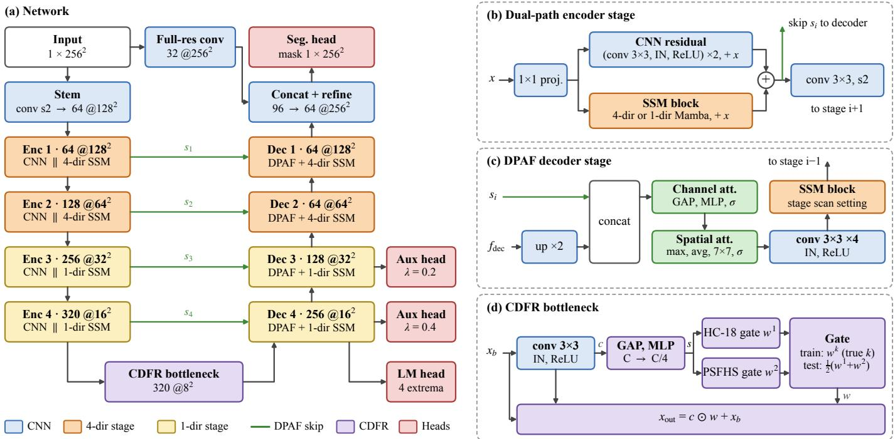
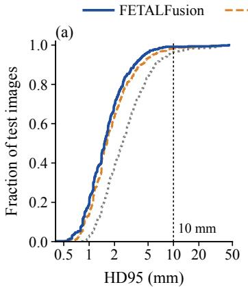
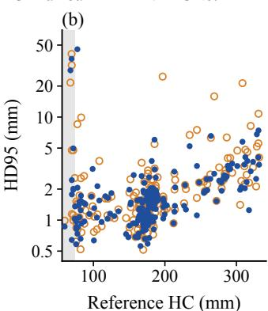

# FETALFusion: Resolution-Aware State-Space Modeling for Multi-Domain Fetal Head Segmentation

Ammar Bhilwarawala

School of Computer Engineering,

KIIT Deemed to be University

Bhubaneswar, India

ammarbhilwarawala@gmail.com

Mainak Bandyopadhyay

School of Computer Engineering,

KIIT Deemed to be University

Bhubaneswar, India

mainak.bandyopadhyayfcs@kiit.ac.in

Abstract—Head circumference (HC) measured from 2D ultrasound is a routine marker of fetal growth, and automating it needs segmentations whose boundaries hold up on individual scans, not only on average. We present FETALFusion, a dualpath CNN-Mamba encoder-decoder for fetal head segmentation across acquisition types. It applies four-directional state-space scans only at the two highest-resolution stages, routes bottleneck features through domain-specific channel gates that are averaged at test time, and adds a weak landmark shape prior. We train jointly on transabdominal (HC-18) and transperineal (PSFHS) images and compare ten methods on a held-out test set of 471 images, each trained under one schedule and scored by surface distances at native resolution. FETALFusion reaches a Dice score of 0.963 and an HD95 of 2.10 mm without test-time augmentation or a domain label. It improves on U-Mamba on all five reported metrics (HD95 reduced by 0.31 mm; Holm-corrected $p < 1 0 ^ { - 4 } )$ , a lead that holds under test-time augmentation and across two independent training runs, and in the mean on U-Net, Attention U-Net and TransUNet. Residual encoders close the gap: a ResNet-34 UNet++ exceeds FETALFusion, and an ImageNetinitialised ResNet-34 U-Net is best overall (HD95 1.75 mm). The ablation agrees. Calibrated against run-to-run variation, it attributes FETALFusion’s measurable gains to the landmark shape prior and, on transperineal images, to the domain gates, while removing the state-space branch does not measurably change accuracy. HC from the predicted masks agrees with the clinical reference at an intraclass correlation of 0.9986.

Index Terms—Fetal head segmentation, state-space models, multi-domain generalization, ultrasound image analysis, boundary-aware segmentation.

## I. INTRODUCTION

Fetal head circumference (HC) measured from 2D ultrasound is used to track growth through pregnancy and to flag microcephaly and macrocephaly [1]. Manual measurement varies between operators, and automated segmentation is the obvious route to standardised biometry. The harder part is making it dependable on the individual scan: a method that is excellent on average can still return a badly wrong contour for a particular patient.

The difficulty is geometric. The fetal skull appears as a thin elliptical rim whose opposite sides can sit a large fraction of the image apart. A convolutional encoder relates the two sides only after heavy downsampling, by which point the rim has blurred. Our earlier Attention-ResUNet [2] strengthened a residual U-Net for this task with multi-scale attention gates, but it inherits the same limit. Self-attention covers that range directly, as in TransUNet [3], but its cost grows quadratically with the number of tokens, which is expensive at the resolutions where the boundary is still sharp.

State-space models offer linear-time sequence modelling with input-dependent gating. Mamba [4] has been adapted to medical segmentation by flattening 2D feature maps into 1D sequences [5], [6], and later work refines the serialisation itself, with high-order interactions in the 2D selective scan [7] or token clustering for local context [8]. Row-major flattening is weak at high resolution: two boundary points at the top and bottom of the skull, a few dozen pixels apart in the image, sit several thousand positions apart in the sequence at 1282, and a causal scan carries information one way only. Columnwise and reversed scans address both. At $3 2 ^ { \frac { \cdot } { 2 } }$ the whole map is 1,024 tokens, and the extra directions have far less to add.

That asymmetry suggests assigning scan directions by resolution. FETALFusion (Fig. 1) is built around the idea, with a mechanism for the domain shift between transabdominal and transperineal acquisitions that needs no scanner label at test time. We evaluate it under a strict protocol: a held-out test split, one training schedule for every model, surface distances at native resolution, and an ablation read against run-to-run variation.

## Contributions.

1) FETALFusion, a dual-path CNN-Mamba segmenter with resolution-aware scanning, Conditional Domain Feature Routing (CDFR) and a landmark shape prior. Under matched training it improves on U-Mamba and VM-UNet on every reported metric and, in the mean, on U-Net, Attention U-Net, an nnU-Net-style ResU-Net and TransUNet, with and without test-time augmentation; its HC estimates agree with the clinical reference at ICC 0.9986.

2) Label-free multi-domain inference. Averaging the domain gates at test time loses nothing against routing with the true domain label, and on transperineal images the gates improve boundary accuracy over a single shared gate.

  
Fig. 1. FETALFusion. (a) U-shaped network with four-directional state-space scanning at $1 2 8 ^ { 2 }$ and $6 4 ^ { 2 }$ and single-directional scanning at $3 2 ^ { 2 }$ and $1 6 ^ { 2 } ,$ in both encoder and decoder. Skips $s _ { i }$ enter the decoder through DPAF. The auxiliary heads on decoder stages 4 and 3 and the landmark head on stage 4 are used only during training. (b) Encoder stage: a residual CNN branch and a state-space branch process the same input and are summed (Eq. 1); the 1×1 projection is the identity when channel counts match. (c) Decoder stage: DPAF fuses the upsampled decoder features with the skip, followed by convolutions and a state-space block. (d) CDFR: the gate is selected by the true acquisition type during training and averaged at inference, so no domain label is needed.

3) A calibrated study. Every ablation effect must exceed run-to-run variation measured over two training runs, and ten baselines separate the encoder and its initialisation from the state-space design. The landmark prior, domain gating on the harder domain and the placement of four-directional scans matter; at this data scale the state-space branch as a whole and the attention fusion do not.

## II. METHOD

## A. Resolution-Aware Dual-Path Encoder

FETALFusion follows the U-shaped layout of U-Net [9]. A stride-2 convolutional stem maps the $2 5 6 ^ { \overline { { 2 } } }$ input to $1 2 8 ^ { 2 }$ at 64 channels. Instance Normalization [10] is used throughout, as it is less sensitive to intensity differences between probes and vendors [11], and a two-layer projection keeps a 32-channel full-resolution map, concatenated with the last decoder output so the thin rim survives downsampling.

Four encoder stages with channels [64, 128, 256, 320] emit skip connections at $\mathrm { \bar { 1 2 8 ^ { 2 } , 6 4 ^ { 2 } , 3 2 ^ { 2 } } }$ and $1 6 ^ { 2 }$ , with a bottleneck at 8×8. Each stage runs two branches on the same input and sums them:

$$
\mathbf { f } = \mathbf { C } \mathbf { N } \mathbf { N } _ { \mathrm { { r e s } } } ( \mathbf { x } ) + \mathbf { M } \mathbf { a m } \mathbf { b } \mathbf { a } _ { \mathrm { { R A } } } ( \mathbf { x } ) ,\tag{1}
$$

where $\mathrm { C N N _ { r e s } }$ is a two-layer residual convolutional block and MambaRA is the resolution-aware state-space block.

Resolution-aware scanning. At $1 2 8 ^ { 2 }$ and $6 4 ^ { 2 }$ , four Mamba instances (state dimension 16, convolution width $^ { 4 , }$ expansion factor 2) scan the flattened map left-to-right, right-to-left, topto-bottom and bottom-to-top, and a learned projection merges them:

$$
\begin{array} { r } { \mathbf { y } = W _ { \mathrm { m } } [ \mathrm { S } _ { \mathrm { l r } } ( \mathbf { z } ) ; \mathrm { S } _ { \mathrm { r l } } ( \mathbf { \overleftarrow { z } } ) ; \mathrm { S } _ { \mathrm { t b } } ( \mathbf { z } _ { \mathrm { c } } ) ; \mathrm { S } _ { \mathrm { b t } } ( \mathbf { \overleftarrow { z } } _ { \mathrm { c } } ) ] , } \end{array}\tag{2}
$$

with $\mathbf { z } \in \mathbb { R } ^ { H W \times d }$ the row-major sequence, $\mathbf { z } _ { \mathrm { c } }$ its column-major counterpart, a sequence reversal and $W _ { \mathrm { m } } \in \mathbb { R } ^ { d \times 4 d }$ . At $3 2 ^ { 2 }$ and $1 6 ^ { 2 }$ a single left-to-right scan is used. Decoder stages inherit the setting of the encoder stage at the same resolution, so four-directional scanning appears on both sides of the network at $1 2 8 ^ { 2 }$ and $6 4 ^ { 2 }$ and nowhere else. This takes the network from 32 scan instances under uniform four-directional scanning to 20. Section III-F reports what that does to accuracy and cost.

## B. Conditional Domain Feature Routing

HC-18 and PSFHS differ in probe geometry, field of view and tissue appearance. Rather than train a model per domain or require a scanner label at test time, CDFR learns a perdomain channel recalibration in the manner of squeeze-andexcitation [12] and collapses it at inference.

A convolution refines the bottleneck features $\mathbf { x } _ { b }$ . Global average pooling and a two-layer MLP $( C  C / 4  C / 4$

C = 320) produce an embedding s, and two domain-specific heads each emit a sigmoid gate $\mathbf { \bar { w } } ^ { ( k ) } \in [ 0 , 1 ] ^ { C }$

$$
\begin{array} { r } { \mathbf { x } _ { \mathrm { o u t } } = \mathbf { C } \mathbf { o n v } ( \mathbf { x } _ { b } ) \odot \mathbf { w } ^ { ( k ) } + \mathbf { x } _ { b } . } \end{array}\tag{3}
$$

During training the ground-truth acquisition type selects the active head, so domain-specific gradients reach only its parameters; no domain-classification loss is used. At inference the gates are averaged, $\mathbf { w } _ { \mathrm { i n f } } { = } \frac { 1 } { 2 } \big ( \mathbf { w } ^ { ( 1 ) } { + } \mathbf { w } ^ { ( 2 ) } \big )$ , and no label is consulted. The two heads do learn different routings: on heldout images their gate vectors have cosine similarity 0.75 and differ by 0.40 per channel on average.

## C. DPAF Decoder

Each decoder stage upsamples by $2 \times$ bilinearly and fuses the result with the matching encoder skip through a Dual-Path Attention Fusion block. Attention on skip connections has been used to suppress irrelevant encoder activations [2], [13]; DPAF concatenates encoder and decoder features $\mathbf { f } _ { \mathrm { c a t } }$ and applies channel attention followed by spatial attention, as in CBAM [14]:

$$
\begin{array} { r l } & { \mathbf { f } _ { c } = \mathbf { f } _ { \mathrm { c a t } } \odot \sigma \big ( \mathbf { M L P } ( \mathrm { G A P } ( \mathbf { f } _ { \mathrm { c a t } } ) ) \big ) , } \\ & { \mathbf { f } _ { s } = \mathbf { f } _ { c } \odot \sigma \big ( \mathbf { C o n v } _ { 7 } ( [ \mathbf { M a x } ( \mathbf { f } _ { c } ) ; \mathbf { A v g } ( \mathbf { f } _ { c } ) ] ) \big ) , } \end{array}\tag{4}
$$

with an MLP reduction ratio of 8. Four 3×3 convolutions refine $\mathbf { f } _ { s } ,$ followed by a Mamba block at the stage’s scan setting, to attenuate speckle carried along the skip before it reaches the boundary.

## D. Training Objective

$$
\mathcal { L } = \mathcal { L } _ { \mathrm { s e g } } + 0 . 4 \mathcal { L } _ { \mathrm { a u x } } ^ { ( 4 ) } + 0 . 2 \mathcal { L } _ { \mathrm { a u x } } ^ { ( 3 ) } + 0 . 0 5 \mathcal { L } _ { \mathrm { l m } } ,\tag{5}
$$

where $\begin{array} { r } { \mathcal { L } _ { \mathrm { s e g } } = \frac { 1 } { 2 } \mathcal { L } _ { \mathrm { f o c a l } } + \frac { 1 } { 2 } \mathcal { L } _ { \mathrm { d i c e } } } \end{array}$ combines focal loss [15] $( \gamma = 2$ $\alpha { = } 0 . 2 5$ , label smoothing 0.05) with soft Dice [16]. The two auxiliary terms apply the same composite at decoder stages 4 and 3 as deep supervision. ${ \mathcal { L } } _ { \mathrm { l m } }$ is a mean squared error on the four boundary extrema of the mask (topmost, bottommost, leftmost and rightmost pixel, normalised to [0, 1]), regressed from decoder stage 4. It acts as a weak elliptical shape prior. Algorithm 1 gives the complete forward pass and marks where training and inference differ.

## III. EXPERIMENTS

## A. Data and Protocol

Datasets. HC-18 [1] provides 999 transabdominal images, mostly 800×540 pixels, with elliptical outline annotations, per-image pixel spacing and a reference HC. Spacing varies widely, from 0.055 to 0.308 mm/px on our test split (mean 0.143). We close and fill the outlines; five needed an extra dilation step to close, and every test-set mask reproduces the reference HC to within 2.5 mm, so filling does not contribute to test error. PSFHS [19] provides 1,358 intrapartum transperineal images at 256×256, from which we take the fetal-head class.

Splits. Each dataset is split 70/10/20 into training, validation and test, stratified by acquisition type: 1,650 training, 236 validation and 471 test images (200 HC-18, 271 PSFHS). Early stopping and checkpoint selection use the validation split, scored through the label-free inference path. Every number reported here comes from the test split, which no model sees during training or selection.

Algorithm 1 FETALFusion forward pass, with the training   
and inference paths   
Input: image x; scan schedule D = (4, 4, 1, 1); domain label k (training   
only)   
Output: mask yˆ; training-only outputs $\hat { \mathbf { y } } _ { 4 } , \hat { \mathbf { y } } _ { 3 } , \hat { \mathbf { p } }$   
1: u ← FullRes(x), h ← Stem(x)   
2: for $i = 1 , \dots , 4$ do ▷ encoder   
3: h ← Proj (h)   
4: $\mathbf { s } _ { i } \gets \mathrm { C N N } _ { \mathrm { r e s } } ( \mathbf { h } ) + \mathrm { S S M } _ { \mathcal { D } _ { i } } ( \mathbf { h } )$ ▷ Eqs. (1), (2)   
5: h ← Down(si) ▷ stride-2 conv   
6: end for   
7: c ← Conv(h), e ← MLP(GAP(c))   
8: if training then   
9: w ← σ(gk(e)) ▷ true domain   
10: else   
11: $\begin{array} { r } { \mathbf { w }  \frac { 1 } { 2 } \sum _ { j = 1 } ^ { 2 } \sigma ( g _ { j } ( \mathbf { e } ) ) } \end{array}$ ▷ no label   
12: end if   
13: h ← c ⊙ w + h ▷ Eq. (3)   
14: for i = 4, . . . , 1 do ▷ decoder   
15: h ← DPAF(si, Up(h)) ▷ Eq. (4)   
16: h ← SSMD (Conv(h))   
17: if i = 4: yˆ4 ← Aux4(h), pˆ ← LM(h)   
18: $\mathbf { i f } \ i = 3 ; \hat { \mathbf { y } } _ { 3 } \gets \mathrm { A u x } _ { 3 } ( \mathbf { h } )$   
19: end for   
20: $\hat { \mathbf { y } } \gets \sigma \big ( \mathrm { H e a d } ( \mathrm { R e f i n e } ( [ \mathrm { U p } ( \mathbf { h } ) ; \mathbf { u } ] ) ) \big )$   
21: if training: minimise Eq. (5) ▷ landmarks from the mask

Training. One configuration is used for every model in the paper, including both baselines and all ablation variants: up to 50 epochs with early stopping (patience 12), AdamW [20] (learning rate and weight decay $1 0 ^ { - 4 } )$ , a 5-epoch linear warmup followed by cosine decay, gradient clipping at norm 1.0, batch size 16, full precision, and one augmentation pipeline (flips, rotation within ±20◦, elastic deformation with α =120 and σ = 10, brightness and contrast jitter, Gaussian blur, sharpness adjustment). All models are trained from scratch on a single NVIDIA T4 (16 GB).

Metrics. We report Dice (DSC), IoU, HD95, average surface distance (ASD) and normalised surface Dice (NSD) at a 1.5 mm tolerance [21]. Surface pixels are extracted by binary erosion and distances come from an exact Euclidean distance transform over all of them, with no subsampling. Predictions are resampled to native resolution before measurement, so each HC-18 image is measured with its own spacing. PSFHS provides no spacing; we apply a nominal 0.28 mm/px to every method, which makes PSFHS millimetre values a fixed rescaling of pixel distances. Comparisons are unaffected, but absolute PSFHS distances should not be read as physical. Methods are compared with the paired Wilcoxon signed-rank test [22] on matched images, Holm correction [23] across comparisons, and bootstrap 95% intervals on the mean paired difference.

Baselines. We compare against two state-space segmenters, U-Mamba [5] and VM-UNet [6]; five convolutional ones, U-Net, Attention U-Net, a residual U-Net with nnU-Net’s 2D defaults, and U-Net and UNet++ with a ResNet-34 encoder (Table I); and TransUNet in a lite configuration. All are trained from scratch under the protocol above; the ResNet-34 models use segmentation models pytorch. Our U-Mamba appends a Mamba block to each residual encoder stage at $6 4 ^ { 2 }$ and below, and our VM-UNet uses four-directional selectivescan blocks after a 4×4 patch embedding. The published VM-UNet initialises from ImageNet-pretrained VMamba weights and reports lower accuracy without them [6], so it should be read as a weak baseline. To measure what initialisation contributes, we also train the ResNet-34 U-Net from ImageNet weights, the only pretrained model in the paper.

TABLE I  
HELD-OUT TEST SET (n=471), MEAN OVER IMAGES. ALL METHODS TRAINED UNDER ONE SCHEDULE, FROM SCRATCH UNLESS STATED. FETALFUSION USES AVERAGED CDFR GATES AND NO DOMAIN LABEL, AND IS THE FIRST OF TWO TRAINING RUNS (SECTION III-D). HD95 MED.: MEDIAN HD95. >10 MM: IMAGES WITH HD95 ABOVE 10 MM. TTA: FOUR-VIEW FLIP TEST-TIME AUGMENTATION FOR EVERY METHOD. LATENCY: ONE 256×256 IMAGE ON A T4. BOLD: BEST AMONG THE MODELS TRAINED FROM SCRATCH.
<table><tr><td></td><td></td><td></td><td colspan="7">No test-time augmentation</td><td colspan="2">With TTA</td></tr><tr><td>Method</td><td>Params (M)</td><td>ms/img</td><td>DSC↑</td><td>IoU↑</td><td>HD95↓</td><td>HD95 med.↓</td><td>ASD↓</td><td>NSD↑</td><td>&gt;10mm↓</td><td>DSC↑</td><td>HD95↓</td></tr><tr><td>U-Net [9]</td><td>31.0</td><td>40.6</td><td>.9600</td><td>.9272</td><td>2.32</td><td>1.51</td><td>0.78</td><td>.8816</td><td>9</td><td>.9608</td><td>2.10</td></tr><tr><td>Att. U-Net [13]</td><td>31.4</td><td>40.8</td><td>.9603</td><td>.9272</td><td>2.26</td><td>1.51</td><td>0.78</td><td>.8804</td><td>9</td><td>.9610</td><td>2.15</td></tr><tr><td>ResU-Net (nnU-Net-style) [11]</td><td>5.9</td><td>9.4</td><td>.9557</td><td>.9180</td><td>2.70</td><td>1.73</td><td>0.88</td><td>.8556</td><td>12</td><td>.9592</td><td>2.42</td></tr><tr><td>ResNet-34 U-Net [17]</td><td>24.4</td><td>6.4</td><td>.9605</td><td>.9278</td><td>2.02</td><td>1.46</td><td>0.75</td><td>.8850</td><td>4</td><td>.9626</td><td>1.88</td></tr><tr><td>UNet++ (ResNet-34) [18]</td><td>26.1</td><td>11.9</td><td>.9640</td><td>.9323</td><td>1.88</td><td>1.48</td><td>0.70</td><td>.8929</td><td>2</td><td>.9645</td><td>1.85</td></tr><tr><td>TransUNet-lite [3]</td><td>18.8</td><td>37.0</td><td>.9586</td><td>.9226</td><td>2.42</td><td>1.74</td><td>0.82</td><td>.8649</td><td>7</td><td>.9602</td><td>2.23</td></tr><tr><td>VM-UNet [6]</td><td>30.0</td><td>34.5</td><td>.9337</td><td>.8842</td><td>3.62</td><td>2.50</td><td>1.27</td><td>.7609</td><td>17</td><td>.9373</td><td>3.09</td></tr><tr><td>U-Mamba [5]</td><td>7.3</td><td>11.8</td><td>.9601</td><td>.9253</td><td>2.41</td><td>1.63</td><td>0.81</td><td>.8721</td><td>8</td><td>.9631</td><td>2.07</td></tr><tr><td>FETALFusion</td><td>16.8</td><td>36.6</td><td>.9627</td><td>.9301</td><td>2.10</td><td>1.52</td><td>0.75</td><td>.8855</td><td>4</td><td>.9651</td><td>1.87</td></tr><tr><td>ImageNet initialisation (all rows above are trained from scratch)</td><td></td><td></td><td></td><td></td><td></td><td></td><td></td><td></td><td></td><td></td><td></td></tr><tr><td>ResNet-34 U-Net, ImageNet [17]</td><td>24.4</td><td>6.4</td><td>.9664</td><td>.9365</td><td>1.75</td><td>1.40</td><td>0.66</td><td>.9051</td><td>2</td><td>.9678</td><td>1.65</td></tr></table>

## B. Comparison with Baselines

FETALFusion improves on U-Mamba on all five metrics (Table I). HD95 falls by 0.31 mm (95% interval [−0.57, −0.05]) and DSC rises by 0.0026 ([0.0008, 0.0043]), with Holm-corrected $p \ \leq \ 1 . 3 { \times } 1 0 ^ { - 5 }$ on every metric. VM-UNet trails both by a wide margin. The lead over U-Mamba does not depend on the inference protocol: with four-view flip augmentation applied to every method, FETALFusion still leads by 0.20 mm in HD95 ([−0.34, −0.11]) and 0.0020 in DSC $( p \leq 2 . 4 \times 1 0 ^ { - 4 } )$ . Fig. 2a shows the whole distribution. FETALFusion’s curve sits to the left of U-Mamba’s, with a lower HD95 at the 25th, 50th, 75th and 90th percentiles. The second training run of the full model also leads U-Mamba on all five metrics (HD95 −0.42 mm, every $p < 1 0 ^ { - 7 }$ Section III-D).

By acquisition type the gain over U-Mamba is clearest on PSFHS, where HD95 falls by 0.23 mm ([−0.33, −0.12]) and the median from 1.70 to 1.58 mm. On HC-18 the mean falls by 0.43 mm but the interval crosses zero ([−1.01, 0.15]) and the medians are level (1.51 against 1.49 mm). The count of images above 10 mm (4 against 8) does not survive augmentation (3 against 2), so we do not read it as a robust difference.

Against the convolutional and transformer baselines the ranking follows the encoder. FETALFusion improves on

U-Net, Attention U-Net, the nnU-Net-style ResU-Net and TransUNet-lite in mean DSC and HD95 under both protocols, each by more than twice its run-to-run s.d. A ResNet-34 U-Net trained from scratch is level with it (DSC 0.0022 lower, HD95 0.08 mm lower); UNet++ with the same encoder exceeds it without augmentation (DSC +0.0013, HD95 −0.22 mm) and ties under augmentation; and ImageNet initialisation gives the best result in Table I (DSC 0.9664, HD95 1.75 mm) at about a sixth of FETALFusion’s latency. These single runs are compared on aggregates against FETALFusion’s run-torun variation, not tested for significance. They agree with the ablation (Section III-E): at this data scale a strong, ideally pretrained, convolutional encoder matters more than the statespace branch. The standard FLOP counter misses the fused selective-scan kernel, so we report latency instead.

## C. Label-Free Inference

Supplying the true acquisition type to the CDFR gates leaves DSC unchanged to four decimals and lowers HD95 by 0.024 mm, well inside the run-to-run variation; with testtime augmentation the difference vanishes (below 0.001 mm). The averaged gates cost nothing, so label-free deployment is a property of the method. Test-time augmentation itself adds 0.0024 to DSC and removes 0.23 mm from HD95.

## D. Run-to-Run Variation

The selective-scan kernel and data-loader ordering are not deterministic, so identical settings give different models. Over two independent training runs the full model reaches DSC 0.9629 ± 0.0004, HD95 2.05 ± 0.08 mm and NSD 0.886 ± 0.001 (mean±s.d.); the paired test does not distinguish the runs on any of the five metrics $( p > 0 . 1 3 )$ . The variation sits almost entirely in HC-18, where the runs differ by 0.26 mm in HD95 against 0.005 mm on PSFHS, driven by the small-head failures of Section III-G. An ablation effect counts only if it is significant after Holm correction across the seven variants, against each run, and larger than the difference between runs.

TABLE II  
COMPONENT ABLATION, HELD-OUT TEST SET, NO TEST-TIME AUGMENTATION. FULL MODEL: MEAN OVER TWO INDEPENDENT TRAINING RUNS, WITH THE S.D. IN THE ∆ COLUMNS. ∆: RELATIVE TO THAT MEAN. BOLD: SIGNIFICANT AFTER HOLM CORRECTION AGAINST EACH RUN AND LARGER THAN THE DIFFERENCE BETWEEN RUNS.
<table><tr><td>Variant</td><td>DSC</td><td>∆ HD95</td><td>∆</td><td>NSD</td><td> $\Delta$ </td></tr><tr><td>Full model (2 runs)</td><td>.9629</td><td>±.0004</td><td>2.047  $\pm . 0 7 6$ </td><td></td><td> $. 8 8 6 3 \ \pm . 0 0 1 2 $ </td></tr><tr><td>w/o SSM branch</td><td>.9628</td><td>-.0001</td><td>1.944</td><td>-.103.8887</td><td> $+ . 0 0 2 4$ </td></tr><tr><td>w/o DPAF</td><td>.9628</td><td>-.0001</td><td>2.135  $+ . 0 8 8$ </td><td></td><td> $. 8 8 7 1 \ + . 0 0 0 8$ </td></tr><tr><td>w/o landmark prior</td><td>.9589</td><td>-.0040</td><td>2.143  $+ . 0 9 6$ </td><td></td><td> $. 8 6 8 4 \mathrm { ~  ~ { ~ - . 0 1 7 9 } ~ }$ </td></tr><tr><td>Shared gate, no CDFR</td><td>.9612</td><td>-.0017</td><td>2.093  $+ . 0 4 6$ </td><td></td><td> $. 8 7 7 7 \mathrm { ~  ~ { ~ - . 0 0 8 6 } ~ }$ </td></tr></table>

TABLE III

SCAN DIRECTIONS AT $1 2 8 ^ { 2 } , 6 4 ^ { 2 } , 3 2 ^ { 2 } , 1 6 ^ { 2 }$ . ACCURACY ON THE HELD-OUT TEST SET; COST ON ONE T4. SSM: STATE-SPACE PARAMETERS (M). MEM: PEAK TRAINING MEMORY AT BATCH 8 (GB). OURS: MEAN OF THE TWO FULL-MODEL RUNS.
<table><tr><td>Schedule</td><td>DSC</td><td>HD95</td><td>NSD</td><td>SSM</td><td>ms/img</td><td>Mem</td></tr><tr><td> $1 - 1 - 1 - 1$ </td><td>.9620</td><td>2.048</td><td>.8777</td><td>2.44</td><td>22.0</td><td>4.64</td></tr><tr><td> $4 { - } 1 { - } 1 { - } 1$ </td><td>.9587</td><td>2.179</td><td>.8670</td><td>2.67</td><td>31.4</td><td>6.47</td></tr><tr><td> ${ \bf 4 } { \bf - 4 } { \bf - 1 } { \bf - 1 }$  (ours)</td><td>.9629</td><td>2.047</td><td>.8863</td><td>3.20</td><td>35.9</td><td>7.18</td></tr><tr><td> $4 { - } 4 { - } 4 { - } 4$ </td><td>.9624</td><td>1.957</td><td>.8797</td><td>9.20</td><td>42.4</td><td>7.63</td></tr></table>

## E. Ablation

Table II removes one component at a time, each trained from scratch under the same schedule. The landmark prior is the clearest contributor: without it DSC falls by 0.0040 and NSD by 0.0179, the largest effects in Table II, although the term carries a weight of only 0.05. Its HD95 change (+0.10 mm) is smaller than the difference between runs, so we do not claim it. Replacing the two CDFR gates with one shared gate lowers pooled DSC by 0.0017, and the effect comes from PSFHS: there the shared gate is worse on all three metrics (HD95 +0.08 mm with intervals excluding zero, NSD −0.0145; $p \leq 0 . 0 1$ against each run, surviving Holm correction over the six domain-metric tests), about eighteen times the run-to-run variation on that domain, while on HC-18 it makes no detectable difference.

Removing the state-space branch leaves DSC unchanged, and its mean HD95 sits 0.103 mm below the full model, just inside the difference between runs; no paired test finds a consistent change (Holm-corrected $p \geq 0 . 4 9$ on every metric), and it trains in a third of the time (58 against 172 minutes). Removing DPAF is likewise not significant. At this data scale the convolutional path already recovers the head.

## F. Scan Schedule: Accuracy and Cost

Table III sweeps where the four-directional scans go, and placement matters. Restricting them to the highest resolution (4-1-1-1) is significantly worse than the resolution-aware schedule in DSC (−0.0042) and NSD (−0.0193) against each run, although its HD95 change (+0.13 mm) is not consistent across runs. Extending them to every stage (4-4-4-4) buys nothing: accuracy is tied, while the resolution-aware schedule needs 35% of its state-space parameters, 15% less latency and

  
Fig. 2. (a) Cumulative distribution of per-image HD95 on the 471 test images, no test-time augmentation. (b) HD95 against reference HC on the 200 HC-18 test images. Filled: FETALFusion; hollow: U-Mamba. The shaded band marks heads below the 5th percentile of HC (74 mm), where the largest errors of both methods occur.

6% less training memory; the two $1 2 8 ^ { 2 }$ blocks alone take 37% of the forward time.

The single-directional schedule (1-1-1-1) is the strongest alternative: it ties with the resolution-aware schedule after correction and is cheaper (22.0 against 35.9 ms). The resolutionaware schedule keeps a small NSD edge (+0.0086) whose bootstrap interval excludes zero against each run but which does not survive Holm correction, so the case for multidirectional scanning rests on that margin. What the sweep does establish is that four-directional scans, when used, belong at $1 2 8 ^ { 2 }$ and $6 4 ^ { 2 }$ together and not below. The dip at 4-1-1-1 is a single run we cannot explain, so we treat it with care.

## G. Where the Errors Are

The largest boundary errors concentrate on the smallest heads (Fig. 2b). On the ten HC-18 test images below the 5th percentile of HC (74 mm), FETALFusion’s mean HD95 is 8.1 mm against 2.0 mm on the rest (U-Mamba: 11.1 mm). Its three largest errors are early-gestation heads (HC 68 to 78 mm), over-segmented to 1.4 to 2.1 times the true area. By DSC, the bottom decile is almost entirely transperineal (43 of 47). Size-aware sampling is the obvious remedy.

## H. Clinical HC Agreement

HC is fitted as an ellipse to the predicted mask at native resolution with each image’s pixel spacing, and compared against the HC-18 reference HC rather than one rederived from the ground-truth mask. On the 200 HC-18 test images FETALFusion reaches Pearson $r ~ = ~ 0 . 9 9 8 7 .$ $\operatorname { I C C } ( 2 , 1 ) = 0 . 9 9 8 6$ [24], a mean bias of +0.44 mm, 95% limits of agreement of $[ - 6 . 5 9 , + 7 . 4 7 ]$ mm [25] and a mean absolute error of 2.61 mm, with 88% of estimates within 5 mm. U-Mamba reaches ICC 0.9979, wider limits $\left( \left[ - 8 . 2 0 , + 9 . 3 4 \right] \right.$ mm) and a mean absolute error of 2.90 mm; the difference in absolute error is not significant $( p = 0 . 3 8 )$ . The ImageNetinitialised U-Net does better still (ICC 0.9990, mean absolute error 2.35 mm). For scale, an ellipse fitted to the ground-truth mask itself has a mean absolute error of 1.15 mm, the share owed to the measurement pipeline.

## IV. CONCLUSION

FETALFusion segments the fetal head across two acquisition types with DSC 0.963, HD95 2.10 mm and HC agreement at ICC 0.9986, needs no domain label at test time, and improves on the state-space baselines and on the classic convolutional and transformer baselines under a protocol in which every model is trained and measured the same way. The domain gates earn their place on the harder, transperineal domain, and the landmark prior is the most useful single component.

The ablation is equally informative about what does not drive accuracy at this scale. Removing the state-space branch does not measurably change accuracy, and single-directional scanning ties with the resolution-aware schedule. The latter is best read as the efficient way to use four-directional scanning: it matches uniform scanning at a third of the statespace parameters and beats placing the extra directions at the highest resolution alone. The baseline comparison points the same way from the other side: ResNet-34 encoders match or exceed FETALFusion, and ImageNet initialisation helps most. Carrying the parts that do help, the landmark prior and the domain gates, onto a pretrained residual encoder is the natural next step.

We recommend surface distances on a held-out split, with a measured run-to-run variation, as the default protocol for this task.

Code. Training, evaluation and analysis notebooks, the exact splits and the per-image results behind every table are available at https://github.com/Ammar-ss/FETALFusion.

## LIMITATIONS

We use two public datasets and train the full model twice and every other configuration once; more training runs would sharpen the HD95 comparisons on HC-18, where run-to-run drift is largest. The baselines are single runs compared on aggregates; all but one are trained from scratch, which disadvantages VM-UNet and TransUNet in particular, and FETAL-Fusion is larger than our U-Mamba, so that comparison does not isolate design from capacity. PSFHS millimetre figures rest on a nominal pixel spacing, and CDFR is untested beyond two domains. No cross-scanner, prospective or clinical-workflow evaluation has been done, and none of these results is evidence of readiness for clinical use.

## REFERENCES

[1] T. L. A. van den Heuvel, D. de Bruijn, C. L. de Korte, and B. van Ginneken, “Automated measurement of fetal head circumference using 2D ultrasound images,” PLoS ONE, vol. 13, no. 8, p. e0200412, 2018.

[2] A. Bhilwarawala and M. Bandyopadhyay, “Attention-ResUNet for automated fetal head segmentation,” presented at the 5th Int. Conf. Advanced Network Technologies and Intelligent Computing (ANTIC), Gwalior, India, Dec. 2025. arXiv:2604.18148.

[3] J. Chen, Y. Lu, Q. Yu, X. Luo, E. Adeli, Y. Wang, L. Lu, A. L. Yuille, and Y. Zhou, “TransUNet: Transformers make strong encoders for medical image segmentation,” arXiv:2102.04306, 2021.

[4] A. Gu and T. Dao, “Mamba: Linear-time sequence modeling with selective state spaces,” arXiv:2312.00752, 2023.

[5] J. Ma, F. Li, and B. Wang, “U-Mamba: Enhancing long-range dependency for biomedical image segmentation,” arXiv:2401.04722, 2024.

[6] J. Ruan, J. Li, and S. Xiang, “VM-UNet: Vision Mamba UNet for medical image segmentation,” arXiv:2402.02491, 2024.

[7] R. Wu, Y. Liu, P. Liang, and Q. Chang, “H-vmunet: High-order Vision Mamba UNet for medical image segmentation,” Neurocomputing, vol. 624, p. 129447, 2025.

[8] Y. Zhu, D. Zhang, Y. Lin, Y. Feng, and J. Tang, “Merging context clustering with visual state space models for medical image segmentation,” IEEE Trans. Med. Imag., vol. 44, no. 5, pp. 2131–2142, 2025.

[9] O. Ronneberger, P. Fischer, and T. Brox, “U-Net: Convolutional networks for biomedical image segmentation,” in Proc. MICCAI, 2015, pp. 234–241.

[10] D. Ulyanov, A. Vedaldi, and V. Lempitsky, “Instance normalization: The missing ingredient for fast stylization,” arXiv:1607.08022, 2016.

[11] F. Isensee, P. F. Jaeger, S. A. A. Kohl, J. Petersen, and K. H. Maier-Hein, “nnU-Net: A self-configuring method for deep learning-based biomedical image segmentation,” Nature Methods, vol. 18, no. 2, pp. 203–211, 2021.

[12] J. Hu, L. Shen, and G. Sun, “Squeeze-and-excitation networks,” in Proc. CVPR, 2018, pp. 7132–7141.

[13] O. Oktay, J. Schlemper, L. Le Folgoc, M. Lee, M. Heinrich, K. Misawa, K. Mori, S. McDonagh, N. Y. Hammerla, B. Kainz, B. Glocker, and D. Rueckert, “Attention U-Net: Learning where to look for the pancreas,” arXiv:1804.03999, 2018.

[14] S. Woo, J. Park, J.-Y. Lee, and I. S. Kweon, “CBAM: Convolutional block attention module,” in Proc. ECCV, 2018, pp. 3–19.

[15] T.-Y. Lin, P. Goyal, R. Girshick, K. He, and P. Dollar, “Focal loss for´ dense object detection,” in Proc. ICCV, 2017, pp. 2980–2988.

[16] F. Milletari, N. Navab, and S.-A. Ahmadi, “V-Net: Fully convolutional neural networks for volumetric medical image segmentation,” in Proc. 3DV, 2016, pp. 565–571.

[17] K. He, X. Zhang, S. Ren, and J. Sun, “Deep residual learning for image recognition,” in Proc. CVPR, 2016, pp. 770–778.

[18] Z. Zhou, M. M. Rahman Siddiquee, N. Tajbakhsh, and J. Liang, “UNet++: A nested U-Net architecture for medical image segmentation,” in Proc. DLMIA, MICCAI Workshops, LNCS vol. 11045, 2018, pp. 3– 11.

[19] G. Chen, J. Bai, Z. Ou, Y. Lu, and H. Wang, “PSFHS: Intrapartum ultrasound image dataset for AI-based segmentation of pubic symphysis and fetal head,” Scientific Data, vol. 11, no. 1, p. 436, 2024.

[20] I. Loshchilov and F. Hutter, “Decoupled weight decay regularization,” in Proc. ICLR, 2019.

[21] S. Nikolov et al., “Clinically applicable segmentation of head and neck anatomy for radiotherapy: Deep learning algorithm development and validation study,” J. Med. Internet Res., vol. 23, no. 7, p. e26151, 2021.

[22] F. Wilcoxon, “Individual comparisons by ranking methods,” Biometrics Bulletin, vol. 1, no. 6, pp. 80–83, 1945.

[23] S. Holm, “A simple sequentially rejective multiple test procedure,” Scand. J. Statist., vol. 6, no. 2, pp. 65–70, 1979.

[24] P. E. Shrout and J. L. Fleiss, “Intraclass correlations: Uses in assessing rater reliability,” Psychological Bulletin, vol. 86, no. 2, pp. 420–428, 1979.

[25] J. M. Bland and D. G. Altman, “Statistical methods for assessing agreement between two methods of clinical measurement,” The Lancet, vol. 327, no. 8476, pp. 307–310, 1986.