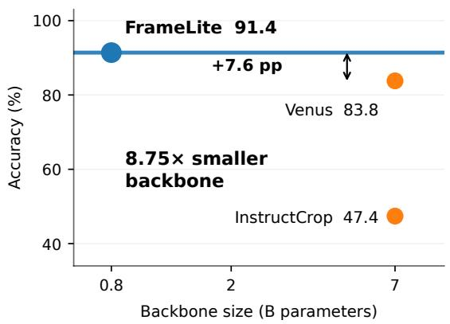
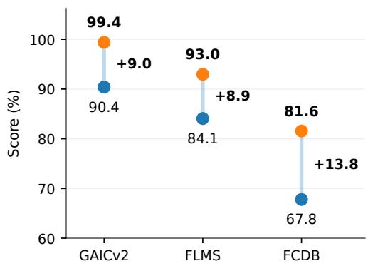
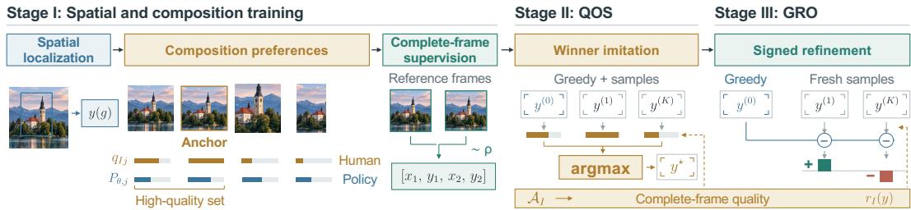
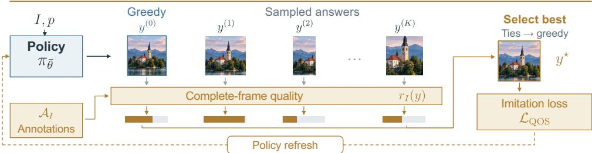
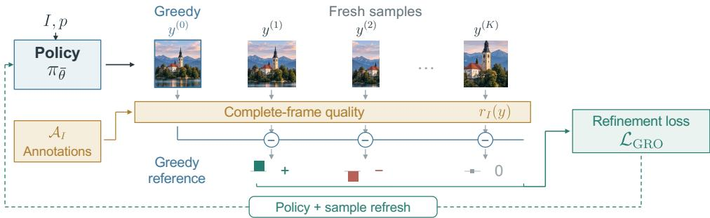
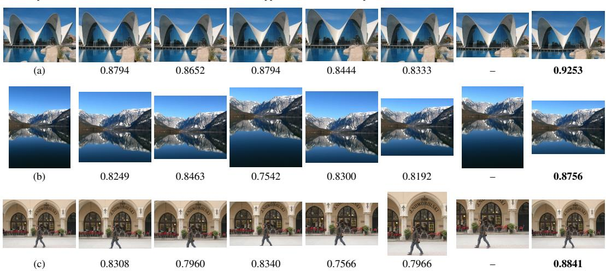
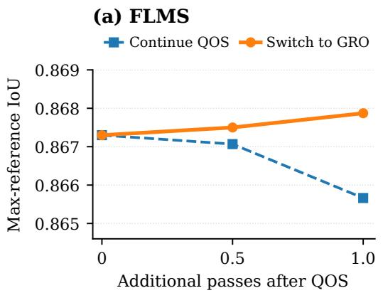
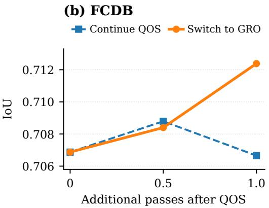

# FRAMELITE: DECISION-ORIENTEDAESTHETIC CROPPING WITH A COMPACTVISION–LANGUAGE MODEL

Jianze Li1, Kai Liu1, Ziqing Zhang1, Weihang Zhang2, Yong Guo1, Linghe Kong1, Yulun Zhang1†

1Shanghai Jiao Tong University

2Institute of Media Technology and Experience Design, Huawei

## ABSTRACT

Aesthetic image cropping improves composition by balancing subjects, context, and image boundaries. Large vision–language models bring semantic knowledge to this task, but their scale limits lightweight photography assistance. We propose FrameLite, a compact cropping model built on Qwen3.5-0.8B. Our approach is motivated by the observation that a small model can generate better crops than its first answer suggests. We develop three-stage training to turn this potential into stronger direct predictions. Spatial and composition training establishes localization and framing preferences. Quality-Guided Online Supervision (QOS) then learns the highest-quality complete answers among the current policy’s generated candidates. Greedy-Referenced Optimization (GRO) further refines the policy using positive and negative quality differences relative to its current greedy answer. Both online stages use annotation-derived feedback, while inference returns one coordinate answer without search or an external scorer. Experiments show that FrameLite outperforms the compared large-VLM croppers across public benchmarks with a substantially smaller backbone. Controlled studies confirm that selecting high-quality training answers improves the final model beyond online sampling alone. We will release our code and model weights at https://github.com/JianzeLi-114/FrameLite.

## 1 INTRODUCTION

Aesthetic image cropping selects a visually coherent region by adjusting image boundaries, removing distractions, and balancing subjects with their surroundings. Beyond locating salient objects, it determines how much context to retain, where to leave space, and which visual relationships to preserve. Multiple windows can therefore form reasonable compositions (Jia et al., 2022). Progress spans view evaluation and proposal learning (Chen et al., 2017b; Wei et al., 2018), grid anchors (Zeng et al., 2019; 2022), and composition-aware or spatial–semantic modeling (Hong et al., 2021; Zhang et al., 2022; Su et al., 2024). Feature extrapolation, professional-composition transfer, and global assessment provide further ways to learn framing (Liu et al., 2023; Hong et al., 2024; Zhang et al., 2026; Yang et al., 2026). These advances support automatic reframing and motivate stronger semantic reasoning about subject placement and photographic composition.

Vision–language models (VLMs) connect cropping with instruction following, aesthetic knowledge, and contextual examples (Zhong et al., 2022; Sheng et al., 2025; Du et al., 2026; Lee et al., 2025). Current methods also incorporate compositional reasoning, multimodal guidance, and capture-time assistance (Dong et al., 2026; You et al., 2026; Li et al., 2026). Their deployment requirements can nevertheless be demanding for everyday photography. Cropper uses an external Gemini service with retrieval and iterative refinement (Lee et al., 2025); InstructCrop’s released implementation adopts LLaVA-1.6-7B (Sheng et al., 2025; Sheng, n.d.); Venus-Q and CROP also use 7B-class backbones (Du et al., 2026; Dong et al., 2026). These systems offer valuable explanations and interactions. A person composing a photograph on a phone may need one immediate, actionable suggestion (Li et al., 2025). Large model weights place pressure on device memory, while cloud access and repeated generation add dependencies and response costs. This motivates a compact VLM

(a) Compact VLM cropping GAICv2 Acc1/5 at ε = 0.85

  
(b) Beyond the first answer First answer Best of 16

  
Figure 1: Better first answers with a compact model. (a) GAICv2 $\mathrm { A c c } _ { 1 / 5 }$ at $\epsilon = 0 . 8 5$ versus nominal VLM backbone size; the horizontal line marks FrameLite. (b) First-answer and best-of-16 results from the same early supervised Qwen model. Best of 16 selects the highest-scoring sampled crop using human reference annotations. Scores are percentages of the GAICv2 $\mathrm { A c c } _ { 1 / 5 } ^ { 0 . 8 5 }$ acceptance rate, FLMS maximum-reference IoU, and FCDB single-reference IoU.

that can make a strong framing decision through a short, self-contained prediction path. The practical challenge is to express semantic judgments as precise boundaries within this compact model, while keeping the interaction as simple as a single actionable framing suggestion for the photographer.

Our preliminary experiments reveal a useful opportunity: a small model trained with grounding and composition supervision can generate better crops than its first answer suggests. Choosing the best of sixteen samples using human references substantially improves quality across the evaluated benchmarks (Figure 1b). This gap motivates target selection: the model must learn which of its plausible compositions best reflects the annotated preference. Test-time search would pass exploration costs to the user, while fixed targets leave the model’s current alternatives unexamined. This raises a central question: how can a compact model learn from its own alternatives to make a stronger first-answer cropping decision for the same input photograph?

We propose FrameLite, a direct aesthetic cropping model built on Qwen3.5-0.8B (Qwen Team, 2026). Spatial and composition training connects localization, candidate-quality learning, and completeframe supervision. Quality-Guided Online Supervision (QOS) then learns the highest-reward answer among the policy’s greedy and sampled crops, adapting reward-selected learning (Dong et al., 2023) to its evolving outputs. We further propose Greedy-Referenced Optimization (GRO), our crop-specific use of self-critical optimization (Rennie et al., 2017), to learn the quality differences between sampled crops and the current greedy answer. Training thus moves from learning what to frame, to finding better answers, to refining their likelihoods. Deployment retains the same compact model and a single coordinate answer, with no candidate selection.

Across public cropping benchmarks, FrameLite delivers leading performance among the compared VLM croppers with a fraction of their nominal backbone size (Figure 1a). With the same number of generated training candidates, learning the best answers yields a stronger final model than learning random ones, even after the same subsequent GRO training. These results connect compact models with accurate direct framing for lightweight photography assistance.

Our contributions connect compact crop prediction with progressive decision learning:

• A compact aesthetic cropping model. We propose FrameLite, a sub-billion-parameter vision–language model that combines spatial understanding and composition learning to predict a complete crop directly from the input image.

• Quality-Guided Online Supervision (QOS). We learn refreshed, high-quality complete answers from the current policy, connecting annotated preferences to its generated alternatives.

• Progressive refinement with GRO. We couple winner imitation with signed, greedyreferenced quality feedback to refine the policy within the same compact architecture.

## 2 RELATED WORK

## 2.1 AESTHETIC CROPPING AND PHOTOGRAPHIC ASSISTANCE

Learning-based cropping models compositional preferences through candidate scoring, ranking, and direct prediction. VFN, VEN, and VPN learn view evaluation and proposals with pairwise supervision (Chen et al., 2017b; Wei et al., 2018), while grid anchors reduce the candidate space (Zeng et al., 2019; 2022). Attention and subject-aware models guide crop generation and refinement (Wang & Shen, 2017; Yang et al., 2023). ASM-Net, CACNet, HCIC, and S2CNet model salient-region placement, composition rules, human-relative structure, and object relationships (Tu et al., 2020; Hong et al., 2021; Zhang et al., 2022; Su et al., 2024). CGS and TransView capture relations among candidates and across crop boundaries (Li et al., 2020; Pan et al., 2021); set prediction accommodates diverse compositions (Jia et al., 2022), and spatial-aware features with rank consistency extend comparative supervision to unlabeled images (Wang et al., 2023). Feature extrapolation, outpainting supervision, professional-composition retrieval, and global feature alignment provide complementary sources of visual context, candidate comparisons, and photographic composition knowledge (Liu et al., 2023; Hong et al., 2024; Zhang et al., 2026; Yang et al., 2026).

Vision–language methods connect photographic quality with semantic intent. VILA learns aesthetic representations from image–comment pairs (Ke et al., 2023), while AesExpert and PhotoEye support aesthetic instruction following and photographic critique (Huang et al., 2024; Qi et al., 2025). ClipCrop uses CLIP representations for text- or image-conditioned cropping (Radford et al., 2021; Zhong et al., 2022); InstructCrop and Venus learn cropping instructions and rationale-supported prediction (Sheng et al., 2025; Du et al., 2026). Cropper combines retrieved examples with iterative refinement (Lee et al., 2025), whereas CROP aligns compositional reasoning with expert preferences (Dong et al., 2026). Beyond crop prediction, smart point-and-shoot photography offers camera-pose guidance (Li et al., 2025), and PhotoFramer and ShutterMuse provide multimodal composition instructions and capture-time assistance (You et al., 2026; Li et al., 2026).

## 2.2 REWARD-GUIDED LEARNING AND POLICY OPTIMIZATION

Reward-guided learning uses generated outputs to construct training supervision. RAFT samples candidate responses, selects high-reward examples, and fine-tunes the model on the selected outputs (Dong et al., 2023). Cropping-specific reinforcement learning includes A2-RL and Fast A3RL, which learn sequential window adjustments under aesthetic feedback (Li et al., 2018; 2019). For sequence generation, self-critical sequence training (SCST) uses the model’s own inference output as a reward baseline and updates sampled sequences according to their relative rewards (Rennie et al., 2017). These approaches provide distinct ways to exploit outcome quality, through selected-output imitation or reward-weighted updates to the learned policy.

## 3 METHOD

FrameLite uses three-stage decision learning to locate important content, assess alternative framings, and commit to one answer. Spatial and composition training first learns from annotated regions, crop preferences, and complete reference frames (Figure 2). Quality-Guided Online Supervision (QOS) then selects a high-quality answer from the current policy’s greedy and sampled crops (Figure 3(a)). Greedy-Referenced Optimization (GRO) uses each new sample’s quality relative to the current greedy answer (Figure 3(b)). All three stages improve the same compact policy for direct crop prediction from a single greedy coordinate answer at inference.

## 3.1 FORMULATION AND MODEL

A crop’s quality depends on the joint placement of its boundaries. We represent it as a normalized box in $\tilde { B = } \{ ( x _ { 1 } , \bar { y _ { 1 } } , x _ { 2 } , y _ { 2 } ) : \bar { 0 } \leq x _ { 1 } < x _ { 2 } \leq 1 , \ 0 \leq y _ { 1 } < y _ { 2 } \leq 1 \}$ . Given image I and fixed prompt p, the policy generates a coordinate sequence y:

$$
\pi _ { \boldsymbol { \theta } } ( y \mid I , p ) = \prod _ { t = 1 } ^ { T ( y ) } \pi _ { \boldsymbol { \theta } } ( y _ { t } \mid I , p , y _ { < t } ) .\tag{1}
$$

  
Figure 2: Three-stage training of FrameLite. For annotated crop j of image $I , q _ { I j }$ and $P _ { \theta , j }$ are human and policy preference probabilities; $\rho$ gives reference-sampling weights. $y ( g )$ serializes region g as normalized corner coordinates $( x _ { 1 } , y _ { 1 } , x _ { 2 } , y _ { 2 } )$ . QOS imitates the best answer $y ^ { \star }$ among greedy $y ^ { ( 0 ) }$ and K samples $y ^ { ( 1 : K ) }$ ; GRO refines fresh samples relative to greedy. Both use quality $r _ { I } ( y )$ defined by human crop annotations $\boldsymbol { \mathcal { A } } _ { I }$ associated with each training image.

A parser $\mathcal { P }$ maps $y$ to a complete box or invalid symbol ⊥. We use Qwen3.5-0.8B (Qwen Team, $2 0 2 6 )$ with a frozen visual encoder. Stage I adapts its visual merger and language LoRA (Hu et al., 2022); subsequent stages update language adapters. The training distribution D contains images and crop annotations $\boldsymbol { A } _ { I } ,$ , with the chosen example weights. Annotations provide supervision and quality feedback, without being supplied to the prediction model.

## 3.2 STAGE I: SPATIAL AND COMPOSITION TRAINING

Spatial localization. A subject’s position and extent organize the surrounding composition. We therefore first teach the policy to locate important content through referring-expression localization (Yu et al., 2016). For an expression e and annotated region g, let $y ( g )$ serialize its coordinates. The loss averages negative log likelihood over valid target tokens in a training batch:

$$
\mathcal { L } _ { \mathrm { l o c } } = - \frac { 1 } { | \mathcal { T } _ { \mathrm { l o c } } | } \sum _ { ( i , t ) \in \mathcal { T } _ { \mathrm { l o c } } } \log \pi _ { \theta } ( y ( g _ { i } ) _ { t } \mid I _ { i } , e _ { i } , y ( g _ { i } ) _ { < t } ) ,\tag{2}
$$

where $\tau _ { \mathrm { l o c } }$ indexes those tokens. The region target in Figure 2 teaches spatial grounding; it does not prescribe a tight subject box as the final aesthetic crop. The remaining training steps learn how to place the final frame around the located subject and its surrounding context.

Composition preferences. Several windows may preserve the same subject while differing in context, balance, and empty space; learning one reference leaves their relative quality unused. Given rated annotations $\bar { \mathcal { A } } _ { I } \stackrel {  } { = } \{ ( g _ { j } , u _ { j } ) \} _ { j = 1 } ^ { \bar { M _ { I } } }$ , we therefore align the policy’s preferences over complete answers with human scores. Let $\boldsymbol { z } _ { \theta , j } = \log \pi _ { \theta } ( \boldsymbol { y } ( \boldsymbol { g } _ { j } ) \mid I , p )$ and define the two preference distributions over the annotated candidate frames of the same input image:

$$
q _ { I j } = \frac { \exp ( \widetilde { u } _ { j } / \tau ) } { \sum _ { k } \exp ( \widetilde { u } _ { k } / \tau ) } , \qquad P _ { \theta , j } = \frac { \exp ( z _ { \theta , j } ) } { \sum _ { k } \exp ( z _ { \theta , k } ) } ,\tag{3}
$$

where $\widetilde { u } _ { j }$ is a normalized annotation score and τ controls the concentration of the target distribution. The model probabilities are normalized over the full annotated candidate list so that the relative likelihoods of alternative framings can be compared directly.

A good target should provide a concrete answer without discarding the fact that several answers may be acceptable. We select an anchor $g _ { a }$ as a quality-weighted IoU medoid within the high-quality subset $\mathcal { H } _ { I }$ , and combine three complementary signals:

$$
\mathcal { L } _ { \mathrm { c o m p } } = \mathbb { E } _ { I } \left[ \underbrace { - z _ { \theta , a } } _ { \mathrm { a n c h o r } } \underbrace { - \sum _ { j } q _ { I j } \log P _ { \theta , j } } _ { \mathrm { r e l a t i v e ~ q u a l i t y } } \underbrace { - \log \left( \sum _ { j \in \mathcal { H } _ { I } } P _ { \theta , j } \right) } _ { \mathrm { h i g h - q u a l i t y ~ s e t } } \right] .\tag{4}
$$

The anchor supplies a concrete answer, the listwise term aligns quality preferences, and the set term favors multiple acceptable compositions without fixing their probability allocation. Together, these signals adapt complete-answer learning to the ambiguity of aesthetic framing.

(a) Quality-Guided Online Supervision  
  
(b) Greedy-Referenced Optimization

  
Figure 3: Online supervision and refinement. Given image I and prompt p, policy $\pi _ { \bar { \theta } }$ with current parameters ¯θ generates greedy answer $y ^ { ( 0 ) }$ and independent samples $y ^ { ( j ) } , j = 1 , \dotsc , K .$ . Annotations $\boldsymbol { \mathcal { A } } _ { I }$ define quality $r _ { I } ( y )$ . (a) ${ \mathcal { L } } _ { \mathrm { Q O S } }$ increases the likelihood of the best answer $y ^ { \star }$ , favoring greedy on ties. (b) $\mathcal { L } _ { \mathrm { G R O } }$ weights sampled answers’ log-likelihoods by signed quality differences from greedy. Dashed loops refresh the policy and candidates after each update.

Complete-frame supervision. Relative preferences alone specify which annotated crops should rank higher; direct prediction also requires assigning likelihood to full coordinate answers. We next consolidate this behavior using the available reference frames and their fixed annotation-derived weights $\rho _ { I j } \geq 0$ , with $\begin{array} { r } { \sum _ { j } \rho _ { I j } \stackrel { } { = } 1 } \end{array}$ for each training image:

$$
\mathcal { L } _ { \mathrm { a n n } } = - \mathbb { E } _ { ( I , A _ { I } ) \sim \mathcal { D } } \left[ \sum _ { j } \rho _ { I j } \log \pi _ { \theta } ( y ( g _ { j } ) \mid I , p ) \right] .\tag{5}
$$

A single reference receives unit weight; multiple references can express quality or acceptance preferences. Sampling complete references under these weights preserves alternative framings, instead of creating a new box by averaging their boundaries. This supervision also accommodates images with a final crop but no candidate ranking. Spatial localization, preference learning, and full-answer supervision are successive parts of Stage I, yielding the initial policy $\pi _ { \theta _ { \mathrm { i n i t } } }$

## 3.3 STAGE II: QUALITY-GUIDED ONLINE SUPERVISION (QOS)

Annotated frames do not reveal which alternatives a policy generates when making its own decisions. We propose Quality-Guided Online Supervision (QOS) to bridge this gap by selecting a complete answer from the current policy under an annotation-defined quality criterion. Refreshed during training, the target connects the model’s current outputs to human framing preferences.

To compare complete frames, let $R ( I , b ; { \mathcal { A } } _ { I } )$ evaluate a crop using its training annotations. A single accepted frame supports endpoint agreement; several acceptable frames support best-reference matching; and rated alternatives support quality-weighted agreement. We assign a sequence reward after its complete coordinates have been generated:

$$
\begin{array} { r } { r _ { I } ( y ) = \left\{ { \begin{array} { l l } { R ( I , \mathcal { P } ( y ) ; A _ { I } ) , } & { \mathcal { P } ( y ) \in \mathcal { B } , } \\ { r _ { \mathrm { i n v a l i d } } , } & { \mathcal { P } ( y ) = \perp , } \end{array} } \right. } \end{array}\tag{6}
$$

where $r _ { \mathrm { i n v a l i d } }$ is below any valid reward. The same fixed criterion guides both online stages, so target selection and policy refinement optimize a consistent notion of complete-frame quality.

At the start of an update, let $\bar { \theta }$ denote the current parameters. The policy generates its greedy answer and K independent alternatives, then selects the highest-reward complete answer:

$$
\begin{array} { r l } & { y ^ { ( 0 ) } = \mathrm { G r e e d y } ( \pi _ { \bar { \theta } } , I , p ) , \qquad y ^ { ( j ) } \sim \pi _ { \bar { \theta } } ( \cdot \mid I , p ) , } \\ & { \quad j ^ { \star } = \arg \underset { j \in \{ 0 , \dots , K \} } { \operatorname* { m a x } } r _ { I } ( y ^ { ( j ) } ) , \quad y ^ { \star } = y ^ { ( j ^ { \star } ) } . } \end{array}\tag{7}
$$

Including the greedy answer gives the selection a natural fallback: $r _ { I } ( y ^ { \star } ) \ge r _ { I } ( y ^ { ( 0 ) } )$ ) within each generated set. Ties favor the greedy answer. Thus, exploration supplies alternatives while the quality criterion decides whether any is a better target than the current first response. This relation concerns target selection, not a guarantee that every parameter update improves greedy quality.

QOS then increases the likelihood of the selected answer:

$$
\mathcal { L } _ { \operatorname { Q O S } } ( \theta ; \bar { \theta } ) = - \mathbb { E } _ { ( I , \mathcal { A } _ { I } ) \sim \mathcal { D } } \mathbb { E } _ { y ^ { ( 1 : K ) } \sim \pi _ { \bar { \theta } } } \left[ \log \pi _ { \theta } ( y ^ { \star } \mid I , p ) \right] .\tag{8}
$$

Candidates and selection are held fixed during differentiation, with the update evaluated at $\theta = \bar { \theta } .$ The updated policy supplies the next batch of candidates. This use of reward-selected learning (Dong et al., 2023) couples target discovery to the policy’s actual decisions, while human annotations keep selection tied to composition quality. Each image contributes one selected complete answer; QOS does not explicitly encode how much the unselected answers improve on or fall below the current prediction for the same input image at the current stage of policy learning.

## 3.4 STAGE III: GREEDY-REFERENCED OPTIMIZATION (GRO)

Greedy-Referenced Optimization (GRO) extends winner imitation to feedback on all sampled frames, evaluating each complete framing decision relative to the answer the policy would currently return.

A crop’s absolute score does not indicate improvement over the current decision. The greedy answer provides an image-specific, policy-dependent reference. For fresh samples from the current policy, we define a signed quality advantage for each sampled coordinate answer:

$$
A _ { j } = r _ { I } ( y ^ { ( j ) } ) - r _ { I } ( y ^ { ( 0 ) } ) , \qquad j = 1 , \ldots , K .\tag{9}
$$

A positive advantage identifies a sampled frame that is better under the training criterion; a negative advantage identifies an inferior alternative. Because the reference is recomputed from the current policy, the comparison follows its evolving framing ability rather than a fixed historical answer.

We use the self-critical sequence-training estimator (Rennie et al., 2017) to optimize the quality of complete coordinate answers under this image-specific reference:

$$
\mathcal { L } _ { \mathrm { G R O } } ( \theta ; \bar { \theta } ) = - \mathbb { E } _ { ( I , A _ { I } ) \sim \mathcal { D } } \mathbb { E } _ { y ^ { ( 1 : K ) } \sim \pi _ { \bar { \theta } } } \left[ \frac { 1 } { K } \sum _ { j = 1 } ^ { K } \mathrm { s g } ( A _ { j } ) \log \pi _ { \theta } ( y ^ { ( j ) } \mid I , p ) \right] ,\tag{10}
$$

where sg stops gradients through the reward difference and the update is evaluated at $\theta = { \bar { \theta } } .$ . Unlike a target-selection rule, this objective retains the sign and magnitude of each sampled answer’s relative quality. Its loss terms encourage higher-quality sequences and discourage inferior ones. The reward is assigned to the joint framing decision, while the full sequence probability propagates that feedback through the coordinate answer. The greedy output serves as the reference and receives no separate imitation loss for its coordinate sequence in this stage.

QOS learns high-quality answers already reachable by the policy; GRO then uses fresh alternatives to refine their relative likelihoods. The transition transfers parameters, not a fixed candidate pool. A shared quality function connects target discovery with refinement of the first answer.

## 4 EXPERIMENTS

## 4.1 EXPERIMENTAL SETTINGS

Datasets. We evaluate on GAICv2 (Zeng et al., 2022), FLMS (Fang et al., 2014), and FCDB (Chen et al., 2017a), with 500, 500, and 345 test images, respectively. These benchmarks offer complementary annotation formats: GAICv2 rates multiple candidate windows, FLMS provides several reference crops, and FCDB specifies one reference crop per image. Spatial training uses RefCOCO and RefCOCO+ (Yu et al., 2016); crop training uses GAIC, CPC (Wei et al., 2018), and official FCDB training images. FLMS is excluded from crop training, allowing us to examine whether the learned framing preferences transfer beyond the supervised data sources.

Table 1: Comparison with representative cropping methods. Acc denotes GAICv2 $\mathrm { A c c } _ { 1 / 5 }$ . BDE penalizes invalid predictions with 1. Bold/underline mark the best/second-best results for each metric across the displayed methods evaluated under the same benchmark protocol.
<table><tr><td rowspan="2">Method</td><td rowspan="2">Venue</td><td colspan="2">GAICv2</td><td colspan="2">FLMS</td><td colspan="2">FCDB</td></tr><tr><td> $\operatorname { A c c } ^ { . 8 5 } \uparrow$ </td><td> $\operatorname { A c c } ^ { . 9 0 } \uparrow$ </td><td>IoU↑</td><td>BDE↓</td><td>IoU↑</td><td>BDE↓</td></tr><tr><td colspan="8">Traditional methods</td></tr><tr><td>VFN</td><td>MM&#x27;17</td><td>0.5500</td><td>0.2640</td><td>0.7976</td><td>0.0500</td><td>0.6433</td><td>0.0948</td></tr><tr><td>VEN</td><td>CVPR&#x27;18</td><td>0.0340</td><td>0.0120</td><td>0.7075</td><td>0.0619</td><td>0.5863</td><td>0.1057</td></tr><tr><td>VPN</td><td>CVPR&#x27;18</td><td>0.0380</td><td>0.0080</td><td>0.8234</td><td>0.0399</td><td>0.6574</td><td>0.0878</td></tr><tr><td>GAICD</td><td>TPAMI&#x27;22</td><td>0.8300</td><td>0.7640</td><td>0.8025</td><td>0.0470</td><td>0.6759</td><td>0.0819</td></tr><tr><td>CACNet</td><td>CVPR&#x27;21</td><td>0.5100</td><td>0.2360</td><td>0.8401</td><td>0.0368</td><td>0.6967</td><td>0.0751</td></tr><tr><td colspan="8">VLM-based methods</td></tr><tr><td>Cropper</td><td>CVPR&#x27;25</td><td>0.6900</td><td>0.6460</td><td>0.7845</td><td>0.0829</td><td>0.6519</td><td>0.1089</td></tr><tr><td>InstructCrop</td><td>MM&#x27;25</td><td>0.4740</td><td>0.1680</td><td>0.8145</td><td>0.0422</td><td>0.6848</td><td>0.0774</td></tr><tr><td>Venus</td><td>CVPR&#x27;26</td><td>0.8380</td><td>0.7200</td><td>0.8638</td><td>0.0304</td><td>0.6836</td><td>0.0794</td></tr><tr><td>FrameLite</td><td>Ours</td><td>0.9140</td><td>0.8340</td><td>0.8679</td><td>0.0297</td><td>0.7124</td><td>0.0704</td></tr></table>

Evaluation protocol. We consider automatic free-form cropping: each method returns one crop without receiving a reference aspect ratio. On GAICv2, we report $\mathrm { A c c } _ { 1 / 5 }$ at IoU thresholds 0.85 and 0.90. A prediction is accepted if its IoU with any top-five rated reference, including cutoff ties, reaches the threshold. FLMS measures the maximum IoU between that single prediction and its human references; FCDB uses the unique reference. We also report boundary displacement error (BDE), the mean absolute deviation of the four normalized coordinates. FLMS BDE uses the same reference selected by maximum IoU, so overlap and boundary error describe agreement with one matched frame. Scores are averaged over the full test set. Acceptance evaluates agreement with highly rated candidates, while IoU and BDE quantify retained-area overlap and boundary placement.

Implementation details. FrameLite uses Qwen3.5-0.8B with a frozen visual encoder. Stage I adapts the visual merger and language LoRA; QOS and GRO update only the language adapters. Both online stages sample four alternatives to the current greedy answer and share an annotation-defined reward. We use AdamW (Loshchilov & Hutter, 2019) with an image batch size of 32. The final model receives one pass of QOS followed by one pass of GRO; their learning-rate schedules use base rates of $2 \times 1 0 ^ { - 6 }$ and $1 0 ^ { - 6 }$ , respectively. The online adapters use LoRA rank 64 and $\alpha = 1 2 8$ , and preprocessing preserves image aspect ratios. All benchmarks use the same final checkpoint, fixed crop prompt, and greedy coordinate decoding, with no candidate search or reranking.

## 4.2 COMPARISON WITH EXISTING METHODS

We compare with VFN (Chen et al., 2017b), VEN and VPN (Wei et al., 2018), GAICD (Zeng et al., 2019; 2022), CACNet (Hong et al., 2021), Cropper (Lee et al., 2025), InstructCrop (Sheng et al., 2025), and Venus (Du et al., 2026). These methods span candidate scoring, composition-aware prediction, and retrieval-augmented or direct VLM cropping.

Quantitative results. The same FrameLite model leads the displayed methods in acceptance, overlap, and boundary accuracy (Table 1). GAICv2 acceptance improves by 7.6 and 7.0 percentage points over the strongest listed competitors. Relative to Venus on FLMS, BDE decreases by 2.4%, alongside higher IoU. The BDE ranking also holds on the common valid-image sets, indicating closer boundary placement beyond the effect of invalid predictions.

Qualitative results. In Figure 4(a), FrameLite preserves the curved roofline while reducing foreground rocks. In (b), it balances the mountain range and its reflection, removing excess sky and open water. In (c), it retains the pedestrian’s full body and feet, which several competing crops truncate. These examples illustrate content-dependent framing: reducing peripheral regions for architecture and landscapes while retaining the spatial extent needed for an intact human subject.

## 4.3 ABLATION STUDIES

We examine Stage-I initialization and the gains from QOS and GRO, then compare matched objectives to assess quality-based target selection and relative-quality refinement.

GAICD  
Input  
  
Figure 4: Qualitative comparison. Scores below predictions are IoU. For multi-reference evaluation, the displayed human reference may differ from each prediction’s matched reference.

Table 2: Contributions of the three training stages. The upper block compares online paths from full Stage I; the lower block varies Stage-I components, followed by matched complete-frame supervision, QOS, and GRO. Each online stage uses one pass. Bold is determined before rounding.
<table><tr><td rowspan="2">Training configuration</td><td colspan="2">GAICv2</td><td colspan="2">FLMS</td><td colspan="2">FCDB</td></tr><tr><td> $\operatorname { A c c } ^ { . 8 5 } \uparrow$ </td><td> $\operatorname { A c c } ^ { . 9 0 } \uparrow$ </td><td>IoU↑</td><td>BDE↓</td><td>IoU↑</td><td>BDE↓</td></tr><tr><td>Stage I</td><td>0.9040</td><td>0.7840</td><td>0.8512</td><td>0.0338</td><td>0.7013</td><td>0.0745</td></tr><tr><td>Stage I → GRO</td><td>0.9060</td><td>0.8340</td><td>0.8635</td><td>0.0302</td><td>0.7110</td><td>0.0704</td></tr><tr><td>Stage I → QOS</td><td>0.9140</td><td>0.8320</td><td>0.8673</td><td>0.0299</td><td>0.7069</td><td>0.0722</td></tr><tr><td>Stage I → QOS → GRO</td><td>0.9140</td><td>0.8340</td><td>0.8679</td><td>0.0297</td><td>0.7124</td><td>0.0704</td></tr><tr><td>Localization omitted</td><td>0.8800</td><td>0.8120</td><td>0.8553</td><td>0.0320</td><td>0.7096</td><td>0.0717</td></tr><tr><td>Anchor supervision only</td><td>0.9060</td><td>0.8300</td><td>0.8627</td><td>0.0307</td><td>0.7055</td><td>0.0729</td></tr></table>

Spatial and composition training. One variant omits localization; the other retains it but uses only anchor supervision for composition learning, jointly removing the listwise and high-quality-set terms. Both receive matched complete-frame supervision, QOS, and GRO. Localization omission lowers GAICv2 acceptance by 3.4/2.2 percentage points; anchor-only supervision lowers it by 0.8/0.4 points and reduces FCDB IoU by 0.0069. Both variants underperform the full model on all six final metrics (Table 2). These final gaps remain despite later training, supporting spatial grounding and multi-candidate preferences. Stagewise results are provided in the supplementary material.

Contributions of QOS and GRO. Starting from the full Stage-I model, either online stage improves direct prediction without changing the architecture or decoding (Table 2). QOS lowers FLMS BDE from 0.0338 to 0.0299, improving boundary placement alongside overlap. QOS alone performs better on FLMS, whereas GRO alone gives stronger FCDB agreement. Applying QOS followed by GRO achieves the best IoU on both datasets. These gains motivate comparing winner imitation with relative-quality refinement under matched training conditions.

Quality-based target selection. To separate exploration from target selection, we replace the QOS winner with a uniform random candidate while preserving the sampling budget and online refreshing, then apply the same GRO schedule. QOS yields lower BDE at the final endpoint: 0.0297 versus 0.0334 on FLMS, and 0.0704 versus 0.0762 on FCDB (Table 3a). Its benefit extends beyond crossing acceptance thresholds to more accurate boundary placement. QOS also improves all six final metric over fixed-reference supervision under the same GRO refinement.

Fixed references express human preferences, while random targets follow the current policy without favoring better framing. QOS combines both through quality-based selection. Random supervision produces only 24 distinct FLMS boxes across 500 images, all sharing the same left boundary and the same right boundary. GRO increases this count to 81 but does not recover QOS’s quality. This suggests that preferring better generated answers shapes the candidates available for later policy refinement under the same annotation-defined quality criterion.

Table 3: Target selection and policy refinement. (a) Models trained on different supervision targets undergo the same GRO refinement; random selection and QOS use equal candidate budgets. (b) Different update rules refine a common QOS model. Image exposure and learning-rate schedules are matched within each block. Bold marks the best values before rounding.
<table><tr><td rowspan="2">Training objective</td><td colspan="2">GAICv2</td><td colspan="2">FLMS</td><td colspan="2">FCDB</td></tr><tr><td> $\operatorname { A c c } ^ { . 8 5 } \uparrow$ </td><td> $\operatorname { A c c } ^ { . 9 0 } \uparrow$ </td><td>IoU↑</td><td>BDE↓</td><td>IoU↑</td><td>BDE↓</td></tr><tr><td colspan="7">(a) Target selection before policy refinement</td></tr><tr><td>Reference targets → GRO</td><td>0.8920</td><td>0.8300</td><td>0.8580</td><td>0.0324</td><td>0.7109</td><td>0.0719</td></tr><tr><td>Random targets → GRO</td><td>0.8560</td><td>0.8200</td><td>0.8554</td><td>0.0334</td><td>0.6997</td><td>0.0762</td></tr><tr><td>QOS → GRO</td><td>0.9140</td><td>0.8340</td><td>0.8679</td><td>0.0297</td><td>0.7124</td><td>0.0704</td></tr><tr><td colspan="7">(b) Policy refinement after QOS</td></tr><tr><td>Continue QOS</td><td>0.9100</td><td>0.8260</td><td>0.8657</td><td>0.0301</td><td>0.7067</td><td>0.0721</td></tr><tr><td>Positive-only GRO</td><td>0.9100</td><td>0.8120</td><td>0.8661</td><td>0.0297</td><td>0.7085</td><td>0.0709</td></tr><tr><td>Full GRO</td><td>0.9140</td><td>0.8340</td><td>0.8679</td><td>0.0297</td><td>0.7124</td><td>0.0704</td></tr></table>

  
Figure 5: Refining the QOS policy. Both curves start from the same QOS model with matched image exposure and learning-rate schedules. Markers show initial, half-pass, and one-pass evaluations; lines connect measured greedy-output scores. The two panels use different vertical ranges.

Relative-quality refinement. From the same QOS model, GRO increases FLMS IoU by about 0.0006 and FCDB IoU by 0.0055, while reducing BDE on both datasets. Continued QOS instead lowers final FLMS quality and loses its intermediate FCDB gain (Figure 5). These results support switching from winner imitation to signed quality feedback after QOS has learned to favor highquality complete answers among its own generated cropping alternatives.

Clipping advantages to max $( A _ { j } , 0 )$ removes feedback from worse answers. Full GRO gives higher acceptance and IoU, and lower FCDB BDE, while positive-only GRO has marginally lower FLMS BDE before rounding (Table 3b). Because clipping also changes update magnitude, these results favor the complete rule without establishing negative feedback as independently necessary.

## 5 CONCLUSION

We propose FrameLite, a compact vision–language model for direct aesthetic cropping. Spatial and composition training builds its initial capabilities, QOS identifies high-quality answers to imitate, and GRO refines their quality relative to the current greedy prediction. Experiments show strong cropping performance with a sub-billion-parameter backbone. Controlled comparisons support quality selection beyond online sampling alone and the subsequent use of relative-quality feedback. This training process strengthens direct decisions without adding search or scoring at deployment. Personalized preferences and broader photographic intentions offer promising extensions for adapting crop decisions to individual users and diverse capture contexts.

## REFERENCES

Yi-Ling Chen, Tzu-Wei Huang, Kai-Han Chang, Yu-Chen Tsai, Hwann-Tzong Chen, and Bing-Yu Chen. Quantitative Analysis of Automatic Image Cropping Algorithms: A Dataset and Comparative Study. In WACV, 2017a. 6

Yi-Ling Chen, Jan Klopp, Min Sun, Shao-Yi Chien, and Kwan-Liu Ma. Learning to Compose with Professional Photographs on the Web. In ACM MM, 2017b. 1, 3, 7

Hanze Dong, Wei Xiong, Deepanshu Goyal, Yihan Zhang, Winnie Chow, Rui Pan, Shizhe Diao, Jipeng Zhang, Kashun Shum, and Tong Zhang. RAFT: Reward rAnked FineTuning for Generative Foundation Model Alignment. Transactions on Machine Learning Research, 2023. 2, 3, 6

Zhitong Dong, Chao Li, Jie Yu, and Hao Chen. CROP: Expert-Aligned Image Cropping via Compositional Reasoning and Optimizing Preference. arXiv preprint arXiv:2605.12545, 2026. 1, 3

Tianxiang Du, Hulingxiao He, and Yuxin Peng. Venus: Benchmarking and Empowering Multimodal Large Language Models for Aesthetic Guidance and Cropping. In CVPR, 2026. 1, 3, 7

Chen Fang, Zhe Lin, Radomír Mech, and Xiaohui Shen. Automatic Image Cropping Using Visual ˇ Composition, Boundary Simplicity and Content Preservation Models. In ACM MM, 2014. 6

Chaoyi Hong, Shuaiyuan Du, Ke Xian, Hao Lu, Zhiguo Cao, and Weicai Zhong. Composing Photos Like a Photographer. In CVPR, 2021. 1, 3, 7

James Hong, Lu Yuan, Michaël Gharbi, Matthew Fisher, and Kayvon Fatahalian. Learning Subject-Aware Cropping by Outpainting Professional Photos. In AAAI, 2024. 1, 3

Edward J. Hu, Yelong Shen, Phillip Wallis, Zeyuan Allen-Zhu, Yuanzhi Li, Shean Wang, Lu Wang, and Weizhu Chen. LoRA: Low-Rank Adaptation of Large Language Models. In ICLR, 2022. 4

Yipo Huang, Xiangfei Sheng, Zhichao Yang, Quan Yuan, Zhichao Duan, Pengfei Chen, Leida Li, Weisi Lin, and Guangming Shi. AesExpert: Towards Multi-modality Foundation Model for Image Aesthetics Perception. In ACM MM, 2024. 3

Gengyun Jia, Huaibo Huang, Chaoyou Fu, and Ran He. Rethinking Image Cropping: Exploring Diverse Compositions from Global Views. In CVPR, 2022. 1, 3

Junjie Ke, Keren Ye, Jiahui Yu, Yonghui Wu, Peyman Milanfar, and Feng Yang. VILA: Learning Image Aesthetics from User Comments with Vision-Language Pretraining. In CVPR, 2023. 3

Seung Hyun Lee, Jijun Jiang, Yiran Xu, Zhuofang Li, Junjie Ke, Yinxiao Li, Junfeng He, Steven Hickson, Katie Datsenko, Sangpil Kim, Ming-Hsuan Yang, Irfan Essa, and Feng Yang. Cropper: Vision-Language Model for Image Cropping through In-Context Learning. In CVPR, 2025. 1, 3, 7

Debang Li, Huikai Wu, Junge Zhang, and Kaiqi Huang. A2-RL: Aesthetics Aware Reinforcement Learning for Image Cropping. In CVPR, 2018. 3

Debang Li, Huikai Wu, Junge Zhang, and Kaiqi Huang. Fast A3RL: Aesthetics-Aware Adversarial Reinforcement Learning for Image Cropping. IEEE Transactions on Image Processing, 2019. 3

Debang Li, Junge Zhang, Kaiqi Huang, and Ming-Hsuan Yang. Composing Good Shots by Exploiting Mutual Relations. In CVPR, 2020. 3

Jiawan Li, Fei Zhou, Zhipeng Zhong, Jiongzhi Lin, and Guoping Qiu. Towards Smart Point-and-Shoot Photography. In CVPR, 2025. 1, 3

Jiayu Li, Yixiao Fang, Tianyu Hu, Wei Cheng, Ping Huang, Zheheng Fan, Gang Yu, and Xingjun Ma. ShutterMuse: Capture-Time Photography Guidance with MLLMs. arXiv preprint arXiv:2606.25763, 2026. 1, 3

Xiaoyu Liu, Ming Liu, Junyi Li, Shuai Liu, Xiaotao Wang, Lei Lei, and Wangmeng Zuo. Beyond Image Borders: Learning Feature Extrapolation for Unbounded Image Composition. In ICCV, 2023. 1, 3

Ilya Loshchilov and Frank Hutter. Decoupled Weight Decay Regularization. In ICLR, 2019. 7

Zhiyu Pan, Zhiguo Cao, Kewei Wang, Hao Lu, and Weicai Zhong. TransView: Inside, Outside, and Across the Cropping View Boundaries. In ICCV, 2021. 3

Daiqing Qi, Handong Zhao, Jing Shi, Simon Jenni, Yifei Fan, Franck Dernoncourt, Scott Cohen, and Sheng Li. The Photographer’s Eye: Teaching Multimodal Large Language Models to See, and Critique Like Photographers. In CVPR, 2025. 3

Qwen Team. Qwen3.5: Towards Native Multimodal Agents. Official model release, 2026. 2, 4

Alec Radford, Jong Wook Kim, Chris Hallacy, Aditya Ramesh, Gabriel Goh, Sandhini Agarwal, Girish Sastry, Amanda Askell, Pamela Mishkin, Jack Clark, Gretchen Krueger, and Ilya Sutskever. Learning Transferable Visual Models from Natural Language Supervision. In ICML, 2021. 3

Steven J. Rennie, Etienne Marcheret, Youssef Mroueh, Jerret Ross, and Vaibhava Goel. Self-Critical Sequence Training for Image Captioning. In CVPR, 2017. 2, 3, 6

Xiangfei Sheng. InstructCrop: Official Implementation. GitHub repository, n.d. 1

Xiangfei Sheng, Pangu Xie, Weidong Zou, Pengfei Chen, Tong Zhu, and Leida Li. InstructCrop: Teaching Multimodal Large Language Models to Crop Aesthetic Images. In ACM MM, 2025. 1, 3, 7

Yukun Su, Yiwen Cao, Jingliang Deng, Fengyun Rao, and Qingyao Wu. Spatial-Semantic Collaborative Cropping for User Generated Content. In AAAI, 2024. 1, 3

Yi Tu, Li Niu, Weijie Zhao, Dawei Cheng, and Liqing Zhang. Image Cropping with Composition and Saliency Aware Aesthetic Score Map. In AAAI, 2020. 3

Chao Wang, Li Niu, Bo Zhang, and Liqing Zhang. Image Cropping with Spatial-Aware Feature and Rank Consistency. In CVPR, 2023. 3

Wenguan Wang and Jianbing Shen. Deep Cropping via Attention Box Prediction and Aesthetics Assessment. In ICCV, 2017. 3

Zijun Wei, Jianming Zhang, Xiaohui Shen, Zhe Lin, Radomír Mech, Minh Hoai, and Dimitris Samaras. Good View Hunting: Learning Photo Composition from Dense View Pairs. In CVPR, 2018. 1, 3, 6, 7

Guo-Ye Yang, Wen-Yang Zhou, Yun Cai, Song-Hai Zhang, and Fang-Lue Zhang. Focusing on Your Subject: Deep Subject-Aware Image Composition Recommendation Networks. Computational Visual Media, 2023. 3

Haotian Yang, Zhile Yang, Kin-Man Lam, Patrick Le Callet, and Xin Sun. Global Attention-Fused Image Cropping with Attention-Guided and Global-Aligned Crop Evaluator. arXiv preprint arXiv:2608.04821, 2026. 1, 3

Zhiyuan You, Ke Wang, He Zhang, Xin Cai, Jinjin Gu, Tianfan Xue, Chao Dong, and Zhoutong Zhang. PhotoFramer: Multi-modal Image Composition Instruction. In CVPR, 2026. 1, 3

Licheng Yu, Patrick Poirson, Shan Yang, Alexander C. Berg, and Tamara L. Berg. Modeling Context in Referring Expressions. In ECCV, 2016. 4, 6

Hui Zeng, Lida Li, Zisheng Cao, and Lei Zhang. Reliable and Efficient Image Cropping: A Grid Anchor Based Approach. In CVPR, 2019. 1, 3, 7

Hui Zeng, Lida Li, Zisheng Cao, and Lei Zhang. Grid Anchor Based Image Cropping: A New Benchmark and an Efficient Model. IEEE Transactions on Pattern Analysis and Machine Intelligence, 2022. 1, 3, 6, 7

Bo Zhang, Li Niu, Xing Zhao, and Liqing Zhang. Human-Centric Image Cropping with Partition-Aware and Content-Preserving Features. In ECCV, 2022. 1, 3

Ke Zhang, Tianyu Ding, Jiachen Jiang, Tianyi Chen, Ilya Zharkov, Vishal M. Patel, and Luming Liang. ProCrop: Learning Aesthetic Image Cropping from Professional Compositions. In AAAI, 2026. 1, 3

Zhihang Zhong, Mingxi Cheng, Zhirong Wu, Yuhui Yuan, Yinqiang Zheng, Ji Li, Han Hu, Stephen Lin, Yoichi Sato, and Imari Sato. ClipCrop: Conditioned Cropping Driven by Vision-Language Model. arXiv preprint arXiv:2211.11492, 2022. 1, 3