# FlashVSR+: Efficient Video Super-Resolution via Hybrid Attention and Reward-Yield Distribution Matching

Ruchang Yao1,2 Shi Guo1† Junhao Zhuang3 Mingde Yao2,4 Xin Cai1,2

Jiahao Zhan² Bin Fu1 Xinyuan Chen1 Yu Qiao1 Tianfan Xue1,2,4†

1Shanghai AI Lab 2MMLAB CUHK 3Tsinghua University 4CPII under InnoHK

† denotes corresponding authors.

## Abstract

Recent video super-resolution (VSR) models achieve efficient one-step generation through diffusion distillation. However, high-resolution inference remains costly, and distilled models are difficult to align with human preferences. These challenges call for improvements in both model architecture and training strategy. We present FlashVSR+ to address both limitations. On the architecture side, we introduce hybrid attention based on the strong locality observed in pretrained VSR models, while retaining sparse global interaction for long-range consistency. It achieves up to 2× DiT speedup and 45% lower peak memory, enabling spatially untiled 4K VSR on a single 24GB RTX 4090. On the training side, we propose Reward-Yield Distribution Matching Distillation (Ry-DMD) for preferencealigned one-step generation. Ry-DMD uses reward-weighted teacher rollouts to incorporate black-box rewards into distribution matching, without backpropagating through the reward model. We further show that Ry-DMD generalizes beyond VSR to T2I generation. Together, FlashVSR+ delivers stronger restoration quality and substantially improves high-resolution efficiency, with consistent gains in user preference. We release our code, models, and training data at www.flashvsr.tech.

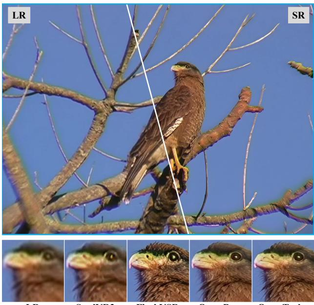

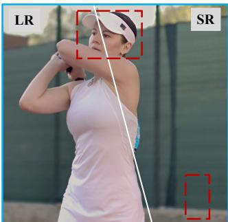

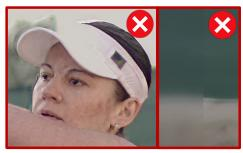

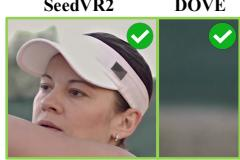

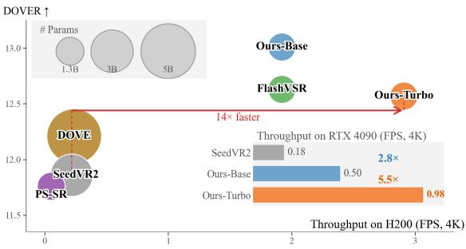  
Figure 1. FlashVSR+ achieves high-quality and efficient video restoration. Left: We recover fine visual details while maintaining natural textures. Right: At 4K resolution, we suppress visible artifacts and enable substantially faster inference on both H200 equivalent GPU and a RTX 4090.

## 1 Introduction

Video super-resolution (VSR) reconstructs high-resolution videos from low-resolution inputs. It supports applications such as smartphone photography, social media, live streaming, and cost-effective upscaling of AI-generated videos to 2K or 4K resolution. Reconstruction-based VSR aggregates complementary information across frames to improve distortion oriented fidelity (Chan et al., 2022a;b; Shi et al., 2022). These methods benefit from stronger propagation, alignment, and spatiotemporal modeling, but the perception-distortion trade-off often leads to over-smoothed textures when high-frequency details are ambiguous (Blau and Michaeli, 2018). Generative VSR addresses this limitation by utilizing learned image or video priors to synthesize perceptually realistic details (Zhou et al., 2024; Chen et al., 2024; Xu et al., 2025c; Li et al., 2025), and has achieved substantial progress in visual quality.

Despite these advances, efficient and flexible generative VSR remains hindered by two bottlenecks. (1) Computational efficiency: Diffusion-based approaches rely on costly multi-step denoising trajectories (Zhou et al., 2024; Chen et al., 2024). Although recent one-step VSR methods greatly reduce this latency by distilling the multi-step generation trajectory into a single step (Song et al., 2023; Yin et al., 2024a;b; Sun et al., 2026; Zhuang et al., 2026; Lv et al., 2026), the computation and memory costs of spatiotemporal attention remain prohibitive for high-resolution videos (e.g., 2K and 4K resolution). As a result, inference on consumer-grade GPUs (e.g., RTX 4090) often requires spatial tiling, which limits global context and may introduce boundary artifacts, as illustrated in Fig. 1. (2) Preference-aligned distillation: Standard one-step distillation method DMD (Yin et al., 2024a;b) matches the teacher distribution but cannot explicitly favor outputs that better align with human preferences, such as more accurate text rendering. Existing reward-guided methods typically rely on multi-step stochastic trajectories (Black et al., 2024; Fan et al., 2023) or differentiable reward signals (Clark et al., 2024; Jia et al., 2025), making them ill-suited to deterministic one-step generators with black-box rewards.

To address these bottlenecks, we present FlashVSR+, a one-step VSR framework with hybrid attention for efficient high-resolution restoration and Ry-DMD for preference-aligned distillation with black-box rewards. Together, they make one-step generative VSR more efficient, enabling spatially untiled 4K VSR inference on a single 24GB RTX 4090, while better aligning outputs with human preferences.

For high-resolution efficiency, we find that pretrained VSR models such as FlashVSR (Zhuang et al., 2026) exhibit strong spatiotemporal attention locality, but with substantial variation across layers. Attention is highly concentrated within compact neighborhoods in many blocks, suggesting that dense attention is unnecessary throughout the backbone, while fully local attention would be overly restrictive. We therefore introduce a hybrid attention architecture that replaces most original attention blocks with efficient local spatiotemporal attention while retaining a small number of sparse global blocks. This design achieves up to 2× DiT acceleration and nearly halves peak memory, enabling spatially untiled 4K VSR on a single 24GB RTX 4090 while maintaining comparable restoration quality.

For preference-aligned distillation, one-step generators are particularly challenging because stochasticity is limited to the input seed, while black-box rewards provide no gradients for direct optimization. We propose Reward-Yield Distribution Matching Distillation (Ry-DMD), which uses multiple teacher rollouts to expose the stochasticity available to a one-step generator and reweights them with black-box rewards. The difference between the reward-weighted and original teacher predictions provides a preference direction, which is added to standard DMD to favor higher-reward teachersupported outputs. We validate Ry-DMD on OCR-guided VSR and further demonstrate its applicability to text-to-image generation.

To further scale up one-step VSR distillation, a natural strategy is to increase the training budget and data size. However, we find that longer DMD training does not yield consistent gains, revealing nonmonotonic behavior. Instead, student initialization and teacher capacity play a more important role in final performance.

## 2 Related Work

## 2.1 Video Super-Resolution

Conventional VSR methods recover missing details through alignment, propagation, and spatiotemporal aggregation (Wang et al., 2019; Chan et al., 2021; 2022a; Shi et al., 2022; Liang et al., 2022), but often produce over-smoothed textures in perceptually ambiguous regions (Blau and Michaeli, 2018). Generative VSR instead leverages learned priors to synthesize realistic details, including adversarial (Chu et al., 2020; Xu et al., 2025c) and diffusion-based approaches (Rota et al., 2024; Zhou et al., 2024; Chen et al., 2024; Li et al., 2025; Chen et al., 2026c). To reduce the cost of iterative sampling, recent methods increasingly target one-step restoration through direct fine-tuning, adversarial post-training, or distillation (Liu et al., 2025; Chen et al., 2026d; Wang et al., 2026; Sun et al., 2026; Zhuang et al., 2026; Lv et al., 2026). Recent image SR and restoration methods have also explored reward or preference guided post-training (Yi et al., 2026; Zhao et al., 2026; Xu et al., 2025a). Nevertheless, one-step VSR still faces challenges in both high-resolution inference efficiency and reward-guided post-training. FlashVSR+ targets these two aspects with hybrid attention and Ry-DMD, respectively.

## 2.2 Efficient Attention for Visual Generation

The quadratic cost of dense attention has motivated sparse and sub-quadratic alternatives for visual generation. Video diffusion methods exploit structured spatiotemporal sparsity or locality-aware computation to reduce attention cost (Xi et al., 2025; Yang et al., 2026; Shen et al., 2025; Xu et al., 2025b; Li et al., 2026). Another line of work adopts efficient attention backbones, including linear attention and hybrid architectures that periodically retain full softmax attention for global information exchange (Xie et al., 2025a;b; Chen et al., 2026b;a). In contrast, FlashVSR+ exploits the locality observed in a pretrained VSR model, replacing most global-attention blocks with spatiotemporal local attention while retaining a small number of global blocks.

## 2.3 Reward Optimization for One/Few-Step Generative Models

Reward-guided post-training has been extensively studied for multi-step diffusion models, where denoising trajectories enable policy optimization, differentiable reward backpropagation, and preference learning (Fan et al., 2023; Black et al., 2024; Clark et al., 2024; Wallace et al., 2024; Liu et al., 2026; Zheng et al., 2026). Extending these approaches to few-step and one-step generators remains challenging. While few-step models still preserve short denoising trajectories, one-step generators directly map noise to samples and lack such intermediate optimization signals. Existing few-step approaches explore reward-guided distribution matching and related optimization strategies (Jiang et al., 2026; Huang et al., 2026; Dong et al., 2026), while one-step methods typically rely on inference-time optimization or differentiable reward surrogates (Eyring et al., 2024; Jia et al., 2025; Zhu et al., 2026). Ry-DMD instead enables black-box reward optimization for deterministic one-step generators by introducing a reward-tilted teacher target within the DMD framework.

## 3 Method

## 3.1 Overview

Following FlashVSR (Zhuang et al., 2026), FlashVSR+ adopts the three-stage training framework shown in Fig. 2. In Stage 1, we train a 14B full-attention multi-step model with flow matching as the teacher. In Stage 2, we replace the 1.3B backbone with our hybrid-attention architecture and train it to provide a strong initialization for one-step generation. In Stage 3, we distill the initialized student into a one-step VSR model using distribution matching together with the pixel loss. Ry-DMD further injects scalar reward feedback into the teacher term without reward backpropagation. Training details are provided in Appendix A.

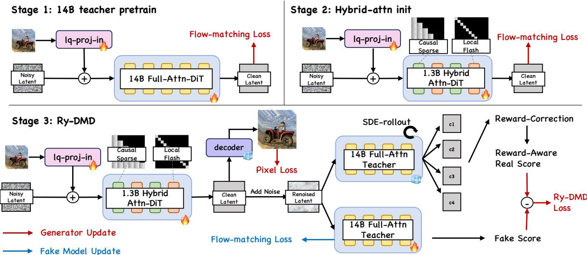  
Figure 2. Overview of the FlashVSR+ training pipeline. Stage 1 trains a 14B full-attention multi-step teacher on image and video data. Stage 2 trains the hybrid-attention student to obtain a strong initialization. Stage 3 distills the student into a one-step generator using Ry-DMD, where reward feedback modifies the teacher term estimation without requiring reward gradients.

## 3.2 Efficient One-Step VSR with Hybrid Attention

Spatiotemporal attention is a major scalability bottleneck for causal VSR at high resolution. To understand the potential redundancy of full attention, we examine the attention patterns of a pretrained one-step VSR model. As shown in Fig. 3(a), attention is highly concentrated within local neighborhoods, which cover only \~ 1% of valid key blocks yet receive \~ 20% of the total attention mass. We quantify this behavior using the local attention mass, defined as the fraction of attention assigned to valid local key blocks. Higher local attention mass indicates stronger concen-

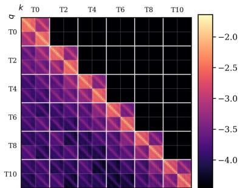

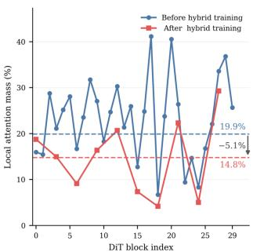  
(a). Spatiotemporal attention locality  
(b). Layer-wise attention shift  
Figure 3. Attention locality and adaptation in causal VSR. (a) Attention concentrates in compact spatiotemporal neighborhoods. (b) Local attention mass varies across DiT blocks, and hybrid training reduces the locality of retained global-attention blocks.

tration within local neighborhoods, suggesting that many non-local interactions are weakly weighted yet still require computation, leading to unnecessary overhead. As shown in Fig. 3(b), local attention is strongly enriched across DiT blocks but varies substantially across layers, motivating a hybrid rather than purely local design.

Motivated by this observation, we introduce hybrid attention, which replaces most attention blocks with efficient spatiotemporal local attention while retaining sparse global-attention blocks. Specifically, we denote the local attention configuration as (s, t, b), where s and t denote the numbers of spatial and preceding temporal key blocks used in local attention, and b denotes the number of DiT blocks replaced by local attention. We then analyze how attention adapts after hybrid training. For visualization, we use the setting $( s , t , b ) = ( 3 , 1 , 2 0 )$ , with after-training measurements taken only on retained global-blocks. As shown in Fig. 3(b), the retained global-attention blocks exhibit reduced local attention mass after hybrid training, indicating a shift toward non-local interactions. This suggests that hybrid attention allows the retained global-attention blocks to better capture non-local interactions, leading to more efficient attention computation.

In the final model, we adopt a regular interleaving of local and global blocks and use $( s , t , b ) = ( 3 , 1 , 2 5 )$ retaining one global-attention block every five DiT blocks (Fig. 2, Stages 2&3). This design achieves up to 2× DiT acceleration and nearly halves peak memory usage, with detailed evaluations in Section 4.2.

## 3.3 Reward-Yield Distribution Matching Distillation

Adapting a deterministic one-step generator to a downstream objective or preferences is not straightforward. Continuing standard DMD on task-specific data can adapt the training distribution, but does not explicitly favor outputs with better human preference. Direct reward optimization within DMD is possible, but non-differentiable rewards require differentiable surrogates for backpropagation. We propose Reward-Yield Distribution Matching Distillation (Ry-DMD). As illustrated in Fig. 4, Ry-DMD transforms the teacher distribution toward higher-reward outputs, such as clearer and more recognizable text, by constructing a reward-tilted target. The resulting target shift is then converted into a correction to the DMD teacher term. This preserves the overall DMD training framework while enabling the use of black-box objectives such as OCR, which we validate on VSR in Sec. 4.3; we further demonstrate its generality on text-to-image generation in Sec. 4.4.

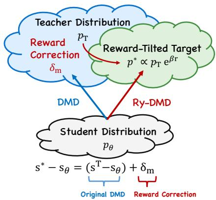  
Figure 4. Conceptual illustration of Ry-DMD.

## 3.3.1 Reward-Tilted Distribution Matching

Our goal is to modify the teacher distribution toward higher-reward regions while preserving its original support. As a distribution-level motivation, we consider an exponential tilt of the clean teacher distribution. Let c denote the condition and $p _ { \mathrm { T } , 0 } ( x _ { 0 } \mid c )$ the clean teacher distribution. Given a scalar reward $r ( x _ { 0 } , c )$ , we define the reward-tilted distribution as

$$
\begin{array} { r } { p _ { 0 } ^ { \star } ( x _ { 0 } \mid c ) \propto p _ { \mathrm { T } , 0 } ( x _ { 0 } \mid c ) \exp \bigl ( \beta r ( x _ { 0 } , c ) \bigr ) , } \end{array}\tag{1}
$$

where $\beta > 0$ controls the strength of reward tilting. This reweighting increases the relative probability of higher-reward samples while remaining within the support of the teacher distribution. As $\beta  0 ,$ $p _ { 0 } ^ { \star }$ reduces to $p _ { \mathrm { T } , 0 }$ , recovering the standard teacher-matching objective. Equivalently, Eq. 1 arises as the solution to a KL-regularized expected-reward objective; the derivation is provided in Appendix E.1.

## 3.3.2 Local Reward-Tilted Teacher Target

The global target in Eq. 1 is not directly available during DMD training. Instead, at each noisy student state, we sample multiple teacher continuations and use their rewards to estimate how reward tilting would shift the local teacher target. During DMD training, the one-step generator predicts $x _ { 0 } ^ { \theta } = \stackrel { \bf { \omega } } { G } _ { \theta } ( z , c )$ , which is re-noised to

$$
x _ { \sigma } = ( 1 - \sigma ) x _ { 0 } ^ { \theta } + \sigma \epsilon , \qquad \epsilon \sim { \mathcal { N } } ( 0 , I ) .\tag{2}
$$

Starting from $x _ { \sigma . }$ , a stochastic K-step teacher rollout produces $x _ { 0 } = \mathcal { T } _ { \mathrm { T } } ( x _ { \sigma } , c ; \eta )$ , where η denotes the stochastic noise used during the rollout. These rollouts provide a Monte Carlo approximation of the conditional teacher endpoint distribution $q _ { \mathrm { T } } ^ { K } ( x _ { 0 } \mid x _ { \sigma } , c )$ . Extending the reward-tilting principle in Eq. 1 to this conditional distribution, we define a reward-reweighted rollout distribution as

$$
q _ { \mathrm { T } , \beta } ^ { K } ( x _ { 0 } \mid x _ { \sigma } , c ) \propto q _ { \mathrm { T } } ^ { K } ( x _ { 0 } \mid x _ { \sigma } , c ) \exp \bigl ( \beta r ( x _ { 0 } , c ) \bigr ) .\tag{3}
$$

We estimate the resulting target shift using J independent teacher rollouts $\{ x _ { 0 } ^ { ( j ) } \} _ { j = 1 } ^ { J }$ with rewards $r _ { j } =$ $r ( x _ { 0 } ^ { ( j ) } , c )$ . Let $\pi _ { j }$ denote the normalized reward weight of the j-th rollout, with $\pi _ { j } \propto \exp ( \beta a _ { j } )$ and

$a _ { j } = \left( r _ { j } - { \bar { r } } \right) / \left( s _ { r } + \varepsilon \right)$ , where rewards are standardized within each rollout group for robustness to reward scale. We then compute the original and reward-weighted teacher endpoint means as

$$
\widehat { m } _ { \mathrm { T } } = J ^ { - 1 } \sum _ { j = 1 } ^ { J } x _ { 0 } ^ { ( j ) } , \qquad \widehat { m } _ { \beta } = \sum _ { j = 1 } ^ { J } \pi _ { j } x _ { 0 } ^ { ( j ) } .\tag{4}
$$

and use their difference

$$
\delta m = \widehat { m } _ { \beta } - \widehat { m } _ { \mathrm { T } }\tag{5}
$$

as the reward-induced shift of the local teacher target. Crucially, δm is estimated entirely from teacher samples and scalar reward evaluations, without differentiating through the reward function. The normalized form of the local tilt, the Monte Carlo estimator, and additional interpretation are provided in Appendix E.2.

## 3.3.3 Reward-Yield DMD Update

The reward-weighted rollouts tell us how the teacher endpoint target should move to favor higherreward outputs. We incorporate this shift directly into the teacher term of DMD, while leaving the remaining distribution-matching procedure unchanged. Specifically, we convert the estimated endpoint displacement into a correction of the teacher term:

$$
\begin{array} { r } { s _ { \mathrm { T } } ^ { \mathrm { R Y } } = s _ { \mathrm { T } } + \lambda _ { \mathrm { R Y } } \frac { \delta m } { \operatorname* { m a x } ( \sigma , \varepsilon _ { \sigma } ) } , } \end{array}\tag{6}
$$

where $\lambda _ { \mathrm { R Y } }$ controls the reward-correction strength and $\varepsilon _ { \sigma }$ stabilizes the update at small noise levels.   
The conversion from the endpoint displacement to the teacher correction is provided in Appendix E.3.

## 4 Experiments

## 4.1 Comparison with State-of-the-Art VSR Methods

We evaluate on synthetic benchmarks, including YouHQ40 (Zhou et al., 2024), SPMCS (Tao et al., 2017), and RealisVideo-4K (Zhao et al., 2025), as well as the real-world VideoLQ (Chan et al., 2022b) and AI-generated AIGC35 benchmarks. Table 2 compares FlashVSR+ with representative VSR methods, including RealVi-Former (Zhang and Yao, 2024), DOVE (Chen et al., 2026d), SeedVR2-3B (Wang et al., 2026), PS-SR (Wu et al., 2026), and FlashVSR (Zhuang et al., 2026). We report PSNR, SSIM, and LPIPS (Zhang et al., 2018) on datasets with ground truth, and MUSIQ (Ke et al., 2021),

Table 1. Human preference study. Preference margins relative to Ours-Base.
<table><tr><td>Method</td><td>Fidelity</td><td>Quality</td><td>Overall</td></tr><tr><td>RealViFormer</td><td>-70%</td><td>-72%</td><td>-73%</td></tr><tr><td>DOVE</td><td>-68%</td><td>-68%</td><td>-70%</td></tr><tr><td>DLoRAL</td><td>-38%</td><td>-28%</td><td>-35%</td></tr><tr><td>SeedVR2</td><td>-53%</td><td>-55%</td><td>-56%</td></tr><tr><td>PS-SR</td><td>-38%</td><td>-38%</td><td>-41%</td></tr><tr><td>FlashVSR</td><td>-15%</td><td>-10%</td><td>-15%</td></tr><tr><td>Ours-Turbo</td><td>-7%</td><td>-5%</td><td>-6%</td></tr><tr><td>Ours-Base</td><td>0%</td><td>0%</td><td>0%</td></tr></table>

CLIPIQA (Wang et al., 2023), NIQE (Mittal et al., 2012), and DOVER (Wu et al., 2023a) on all datasets. FlashVSR+ achieves strong overall restoration quality, with qualitative results in Fig. 5 showing better preservation of text, fine textures, and natural details with fewer spurious artifacts. We further conduct a blinded pairwise user study following the GSB protocol used in (Wang et al., 2026). Ours-Base serves as the anchor, and each method pair is evaluated on 20 videos randomly sampled from RealisVideo-4K, VideoLQ, and AIGC35 benchmarks. Participants compare the two outputs in terms of visual fidelity, perceptual quality, and overall preference. Table 1 reports the resulting preference margins relative to Ours-Base. Ours-Base is preferred over all compared methods, while Ours-Turbo remains close despite its higher inference efficiency.

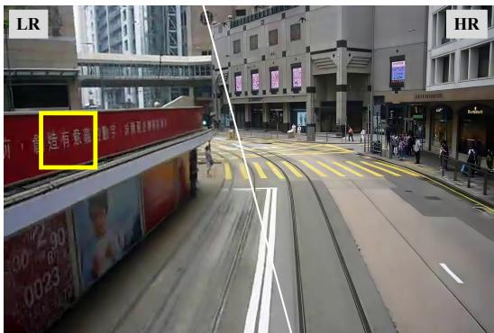

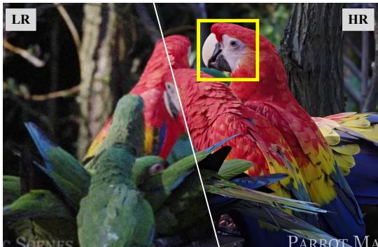

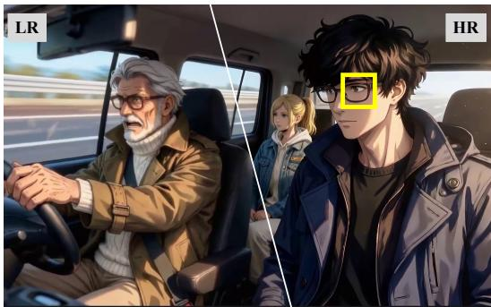

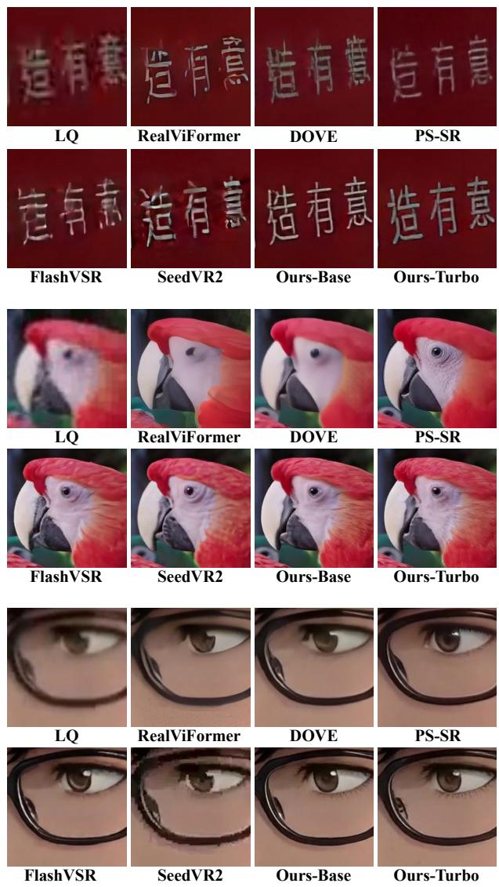  
Figure 5. Qualitative comparison with representative VSR methods. Zoomed regions highlight the reconstruction of text, fine textures, and facial details.

Figure 6. Efficiency comparison on 89-frame videos. (a) GPU time and peak memory on NVIDIA H200 equivalent GPU. (b) End-to-end wall-clock inference time on NVIDIA RTX 4090, including CPU KV-cache offloading and asynchronous prefetching overhead.  
(a) NVIDIA H200 equivalent GPU
<table><tr><td rowspan="2">Method</td><td rowspan="2">Backbone Params (B)</td><td colspan="3">GPU Time (s) ↓</td><td colspan="3">Peak Memory (GB) ↓</td></tr><tr><td>1080p</td><td>2K</td><td>4K</td><td>1080p</td><td>2K</td><td>4K</td></tr><tr><td>DOVE</td><td>5.0</td><td>89.38</td><td>165.3</td><td>374.7</td><td>26.54</td><td>26.22</td><td>26.56</td></tr><tr><td>PS-SR</td><td>1.3</td><td>228.4</td><td>1123.1</td><td>1751.4</td><td>47.79</td><td>50.63</td><td>50.63</td></tr><tr><td>SeedVR2</td><td>3.0</td><td>51.46</td><td>157.8†</td><td>410.5†</td><td>111.21</td><td>49.57†</td><td>51.76+</td></tr><tr><td>Ours-Base</td><td>1.3</td><td>7.91</td><td>17.28</td><td>46.34</td><td>13.11</td><td>21.29</td><td>45.00</td></tr><tr><td>Ours-Turbo</td><td>1.3</td><td>6.63</td><td>12.31</td><td>30.59</td><td>8.72</td><td>13.23</td><td>26.33</td></tr></table>

(b) NVIDIA RTX 4090  
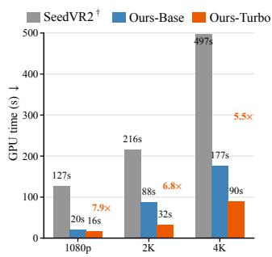  
† SeedVR2 full-frame inference OOMs so we use tiled inference.  Ours-Base shares the same architecture and inference procedure as FlashVSR on H200 equivalent GPU. FlashVSR's attention operators are unsupported on RTX 4090.

Table 2. Quality comparison with state-of-the-art VSR methods under varying inference costs. Top-1/2/3 results are highlighted in red/orange/yellow.
<table><tr><td rowspan=1 colspan=8>SeedVR2-3B PS-SR FlashVSR Ours-Base Ours-Turbo</td></tr><tr><td rowspan=1 colspan=1>PSNR ↑</td><td rowspan=1 colspan=1>23.50</td><td rowspan=1 colspan=2>20.91    23.34</td><td rowspan=1 colspan=2>22.35  22.53</td><td rowspan=1 colspan=1>23.64</td><td rowspan=1 colspan=1>23.51</td></tr><tr><td rowspan=1 colspan=1>SSIM↑</td><td rowspan=1 colspan=1>0.6051</td><td rowspan=1 colspan=1>0.5532</td><td rowspan=1 colspan=1>0.6206</td><td rowspan=1 colspan=1>0.5899</td><td rowspan=1 colspan=1>0.5787</td><td rowspan=1 colspan=1>0.6250</td><td rowspan=1 colspan=1>0.6097</td></tr><tr><td rowspan=1 colspan=1>LPIPS↓</td><td rowspan=1 colspan=1>0.3528</td><td rowspan=1 colspan=1>0.3514</td><td rowspan=1 colspan=1>0.2768</td><td rowspan=1 colspan=1>0.3122</td><td rowspan=1 colspan=1>0.2721</td><td rowspan=1 colspan=1>0.2698</td><td rowspan=1 colspan=1>0.2728</td></tr><tr><td rowspan=1 colspan=1>YouHQ40 MUSIQ↑</td><td rowspan=1 colspan=1>60.36</td><td rowspan=1 colspan=1>60.82</td><td rowspan=1 colspan=1>57.17</td><td rowspan=1 colspan=1>66.20</td><td rowspan=1 colspan=1>65.91</td><td rowspan=1 colspan=1>64.71</td><td rowspan=1 colspan=1>63.91</td></tr><tr><td rowspan=1 colspan=1>CLIPIQA ↑</td><td rowspan=1 colspan=1>0.3823</td><td rowspan=1 colspan=1>0.3964</td><td rowspan=1 colspan=1>0.3703</td><td rowspan=1 colspan=1>0.5063</td><td rowspan=1 colspan=1>0.4701</td><td rowspan=1 colspan=1>0.4257</td><td rowspan=1 colspan=1>0.4322</td></tr><tr><td rowspan=1 colspan=1>NIQE↓</td><td rowspan=1 colspan=1>3.490</td><td rowspan=1 colspan=1>4.581</td><td rowspan=1 colspan=1>4.213</td><td rowspan=1 colspan=1>3.72</td><td rowspan=1 colspan=1>3.385</td><td rowspan=1 colspan=1>3.560</td><td rowspan=1 colspan=1>3.737</td></tr><tr><td rowspan=1 colspan=1>DOVER↑</td><td rowspan=1 colspan=1>10.42</td><td rowspan=1 colspan=1>10.97</td><td rowspan=1 colspan=1>12.23</td><td rowspan=1 colspan=1>12.93</td><td rowspan=1 colspan=1>13.47</td><td rowspan=1 colspan=1>13.33</td><td rowspan=1 colspan=1>13.37</td></tr><tr><td rowspan=1 colspan=1>PSNR ↑</td><td rowspan=1 colspan=1>22.64</td><td rowspan=1 colspan=1>23.09</td><td rowspan=1 colspan=1>22.24</td><td rowspan=1 colspan=1>21.16</td><td rowspan=1 colspan=1>21.35</td><td rowspan=1 colspan=1>22.34</td><td rowspan=1 colspan=1>22.43</td></tr><tr><td rowspan=1 colspan=1>SSIM↑</td><td rowspan=1 colspan=1>0.5651</td><td rowspan=1 colspan=1>0.6109</td><td rowspan=1 colspan=1>0.5867</td><td rowspan=1 colspan=1>0.5452</td><td rowspan=1 colspan=1>0.5398</td><td rowspan=1 colspan=1>0.5714</td><td rowspan=1 colspan=1>0.5654</td></tr><tr><td rowspan=1 colspan=1>LPIPS↓</td><td rowspan=1 colspan=1>0.3368</td><td rowspan=1 colspan=1>0.2738</td><td rowspan=1 colspan=1>0.2521</td><td rowspan=1 colspan=1>0.3240</td><td rowspan=1 colspan=1>0.2680</td><td rowspan=1 colspan=1>0.2700</td><td rowspan=1 colspan=1>0.2647</td></tr><tr><td rowspan=1 colspan=1>SPMCS  MUSIQ↑</td><td rowspan=1 colspan=1>61.91</td><td rowspan=1 colspan=1>68.93</td><td rowspan=1 colspan=1>65.63</td><td rowspan=1 colspan=1>69.47</td><td rowspan=1 colspan=1>69.59</td><td rowspan=1 colspan=1>70.09</td><td rowspan=1 colspan=1>70.13</td></tr><tr><td rowspan=1 colspan=1>CLIPIQA ↑</td><td rowspan=1 colspan=1>0.3416</td><td rowspan=1 colspan=1>0.4605</td><td rowspan=1 colspan=1>0.4633</td><td rowspan=1 colspan=1>0.4650</td><td rowspan=1 colspan=1>0.4618</td><td rowspan=1 colspan=1>0.4753</td><td rowspan=1 colspan=1>0.4546</td></tr><tr><td rowspan=1 colspan=1>NIQE↓</td><td rowspan=1 colspan=1>3.781</td><td rowspan=1 colspan=1>4.234</td><td rowspan=1 colspan=1>3.601</td><td rowspan=1 colspan=1>3.971</td><td rowspan=1 colspan=1>3.389</td><td rowspan=1 colspan=1>3.401</td><td rowspan=1 colspan=1>3.411</td></tr><tr><td rowspan=1 colspan=1>DOVER↑</td><td rowspan=1 colspan=1>7.428</td><td rowspan=1 colspan=1>8.352</td><td rowspan=1 colspan=1>8.462</td><td rowspan=1 colspan=1>8.907</td><td rowspan=1 colspan=1>9.250</td><td rowspan=1 colspan=1>9.676</td><td rowspan=1 colspan=1>9.811</td></tr><tr><td rowspan=1 colspan=1>PSNR ↑</td><td rowspan=1 colspan=1>30.81</td><td rowspan=1 colspan=1>23.26</td><td rowspan=1 colspan=1>30.88</td><td rowspan=1 colspan=1>28.35</td><td rowspan=1 colspan=1>30.84</td><td rowspan=1 colspan=1>31.23</td><td rowspan=1 colspan=1>32.06</td></tr><tr><td rowspan=3 colspan=1>Realis-4KSSIM↑LPIPS↓DOVER↑</td><td rowspan=1 colspan=1>0.8240</td><td rowspan=1 colspan=1>0.7841</td><td rowspan=1 colspan=1>0.8206</td><td rowspan=1 colspan=1>0.8517</td><td rowspan=1 colspan=1>0.8596</td><td rowspan=1 colspan=1>0.8639</td><td rowspan=1 colspan=1>0.8724</td></tr><tr><td rowspan=1 colspan=1>0.1631</td><td rowspan=1 colspan=1>0.213</td><td rowspan=1 colspan=1>0.1929</td><td rowspan=1 colspan=1>0.1970</td><td rowspan=1 colspan=1>0.1671</td><td rowspan=1 colspan=1>0.1639</td><td rowspan=1 colspan=1>0.1625</td></tr><tr><td rowspan=1 colspan=1>11.35</td><td rowspan=1 colspan=1>12.60</td><td rowspan=1 colspan=2>12.93   12.20</td><td rowspan=1 colspan=1>13.27</td><td rowspan=1 colspan=1>13.43</td><td rowspan=1 colspan=1>13.30</td></tr><tr><td rowspan=3 colspan=1>NIQE↓MUSIQ↑VideoLQCLIPIQA ↑</td><td rowspan=1 colspan=1>4.485</td><td rowspan=1 colspan=1>4.915</td><td rowspan=1 colspan=1>5.114</td><td rowspan=1 colspan=1>5.00</td><td rowspan=1 colspan=1>4.309</td><td rowspan=1 colspan=1>4.619</td><td rowspan=1 colspan=1>4.784</td></tr><tr><td rowspan=1 colspan=1>49.40</td><td rowspan=1 colspan=1>45.79</td><td rowspan=1 colspan=1>38.70</td><td rowspan=1 colspan=1>45.34</td><td rowspan=1 colspan=1>49.70</td><td rowspan=1 colspan=1>47.64</td><td rowspan=1 colspan=1>46.93</td></tr><tr><td rowspan=1 colspan=1>0.3117</td><td rowspan=1 colspan=1>0.3009</td><td rowspan=1 colspan=1>0.233</td><td rowspan=1 colspan=1>0.3066</td><td rowspan=1 colspan=1>0.3140</td><td rowspan=1 colspan=1>0.2939</td><td rowspan=1 colspan=1>0.3013</td></tr><tr><td rowspan=1 colspan=1>DOVER↑</td><td rowspan=1 colspan=1>7.217</td><td rowspan=1 colspan=3>7.542    5.955   7.769</td><td rowspan=1 colspan=1>7.811</td><td rowspan=1 colspan=1>8.045</td><td rowspan=1 colspan=1>7.827</td></tr><tr><td rowspan=1 colspan=1>NIQE↓</td><td rowspan=1 colspan=1>4.983</td><td rowspan=1 colspan=1>5.173</td><td rowspan=1 colspan=1>4.816</td><td rowspan=1 colspan=1>4.923</td><td rowspan=1 colspan=1>4.888</td><td rowspan=1 colspan=1>4.851</td><td rowspan=1 colspan=1>5.014</td></tr><tr><td rowspan=2 colspan=1>MUSIQ↑AIGC35CLIPIQA ↑</td><td rowspan=1 colspan=1>48.08</td><td rowspan=1 colspan=1>48.78</td><td rowspan=1 colspan=1>47.40</td><td rowspan=1 colspan=1>50.08</td><td rowspan=1 colspan=1>50.83</td><td rowspan=1 colspan=1>50.30</td><td rowspan=1 colspan=1>49.53</td></tr><tr><td rowspan=1 colspan=1>0.3871</td><td rowspan=1 colspan=1>0.4130</td><td rowspan=1 colspan=1>0.3945</td><td rowspan=1 colspan=1>0.4546</td><td rowspan=1 colspan=1>0.4058</td><td rowspan=1 colspan=1>0.4012</td><td rowspan=1 colspan=1>0.4001</td></tr><tr><td rowspan=1 colspan=1>DOVER↑</td><td rowspan=1 colspan=1>10.91</td><td rowspan=1 colspan=2>12.21    11.86</td><td rowspan=1 colspan=1>11.76</td><td rowspan=1 colspan=1>12.63</td><td rowspan=1 colspan=1>13.01</td><td rowspan=1 colspan=1>12.57</td></tr></table>

We achieve substantial efficiency gains for highresolution VSR. We evaluate computational efficiency in Figure 6 using 89-frame videos at 1080p, 2K, and 4K resolutions on NVIDIA H200 equivalent GPU and consumer RTX 4090 GPUs. We substantially reduce both inference latency and peak memory compared with the base model, enabling high-resolution restoration with much lower computational overhead. In particular, with additional memory optimizations, we enable 4K VSR inference on a single RTX 4090; implementation details are provided in Appendix B.

## 4.2 Efficient VSR with Hybrid Attention

We evaluate hybrid attention both before and after adaptation. The training-free setting tests how much of the

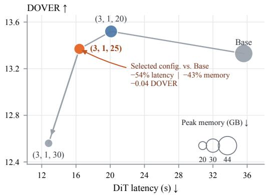  
Figure 7. Quality and efficiency of trained hybrid attention. The (3, 1,25) configuration achieves the best balance between DiT cost and restoration quality.

pretrained attention can be localized directly, while the adapted setting measures the resulting quality and efficiency after training the modified architecture.

We first consider the training-free setting. We use (3, 1, 15) as a conservative reference and vary one factor at a time. Since the attention pattern is modified without retraining, we only count clear structural failures as artifacts, including block or grid-shaped corruption and severe temporal ghosting; minor changes in sharpness or texture are not considered failures. The pretrained model tolerates (3,1, 15), but reducing the spatial or temporal context, or increasing the number of localized blocks, quickly introduces artifacts. In particular, (1, 1, 15), (3, 0, 15), and configurations with $b \geq 2 0$ fail under direct replacement, motivating explicit adaptation of the modified attention structure.

We next adapt these hybrid-attention configurations. As shown in Fig. 7, adaptation substantially extends the usable range of hybrid attention. Increasing the number of local-attention blocks reduces latency and peak memory while preserving restoration quality up to (3, 1,25), whereas further localization to (3, 1, 30) causes a clear quality drop. We therefore adopt (3, 1, 25) as the default configuration. The more restrictive (1,1, 15) and (3,0, 15) configurations still exhibit visible artifacts after adaptation and are therefore excluded from the figure.

## 4.3 Reward-Guided VSR Post-Training

We evaluate Ry-DMD on OCR-guided VSR post-training, a task requiring fine-grained visual fidelity (Yuan et al., 2026), using a synthetic text-focused dataset with annotated text ground truth; details of the data generation pipeline are provided in Appendix F. All methods start from the same pretrained one-step VSR model.

Following the standard practice in Flow-GRPO (Liu et al., 2026), given target text y and the text Î recognized by PaddleOCR (Cui et al., 2025), we compute the OCR reward as $r _ { \mathrm { O C R } } ~ = ~ 1 - ~$

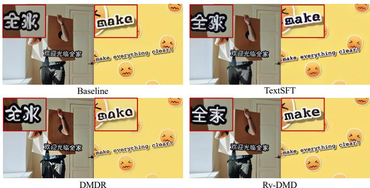  
Figure 8. Qualitative comparison of OCR-guided VSR posttraining. Ry-DMD restores more recognizable text, while DMDR often introduces artifacts.

$\hat { \bf m i n } ( d _ { \mathrm { L e v } } ( \hat { y } , y ) , | y | )$ , where both strings are stripped of spaces before evaluation. |y|

We compare four post-training strategies. Baseline denotes the original pretrained model without further adaptation. TextSFT continues standard DMD training on the text-focused dataset, testing whether task-specific data alone is sufficient. DMDR (Jiang et al., 2026) directly introduces an OCR optimization objective into DMD training; since the OCR reward is non-differentiable, we use a CTC-based differentiable surrogate and backpropagate through the OCR model. Instead, Ry-DMD directly uses the scalar OCR reward without requiring its gradient. As shown in Table 3, Ry-DMD achieves the strongest OCR improvement while preserving restoration quality. The qualitative results in Fig. 8 further show clearer text restoration with fewer artifacts.

Table 3. Quantitative results of OCR-guided post-training.
<table><tr><td colspan="5">Method OCR ↑ PSNR ↑ LPIPS↓MUSIQ ↑ DOVER ↑</td></tr><tr><td>Baseline 0.624</td><td>23.94</td><td>0.246</td><td>75.35</td><td>9.79</td></tr><tr><td>TextSFT 0.656</td><td>22.02</td><td>0.295</td><td>76.41</td><td>10.58</td></tr><tr><td>DMDR 0.527</td><td>19.01</td><td>0.374</td><td>74.17</td><td>8.48</td></tr><tr><td>Ry-DMD 0.776</td><td>24.86</td><td>0.240</td><td>75.80</td><td>10.90</td></tr></table>

## 4.4 Generalization to Text-to-Image Generation

We further evaluate whether Ry-DMD generalizes beyond restoration by applying it to one-step SDXL text-to-image generation. We initialize the student from a one-step DMD2 model (Yin et al., 2024a) distilled from SDXL (Podell et al., 2024). Training uses OCR prompts from Flow-GRPO (Liu et al., 2026) together with a disjoint training split of DrawBench (Saharia et al., 2022). We optimize a combined reward consisting of OCR and PickScore. Ry-DMD relies only on scalar reward evaluations and does not backpropagate through either scorer.

We report PickScore (Kirstain et al., 2023), HPSv2 (Wu et al., 2023b), ImageReward (Xu et al., 2023), and the LAION aesthetic predictor (Schuhmann et al., 2022). As shown in Table 4, Ry-DMD improves the

Table 4. Reward-guided text-to-image generation on SDXL.
<table><tr><td>Model</td><td></td><td></td><td></td><td></td><td>NFE ↓ OCR ↑ PickScore ↑ HPSv2 ↑ ImageReward ↑ Aesthetic ↑</td><td></td></tr><tr><td>SDXL</td><td>50</td><td>0.125</td><td>22.2</td><td>27.5</td><td>0.87</td><td>5.48</td></tr><tr><td>DMD2</td><td>4</td><td>0.098</td><td>22.5</td><td>29.2</td><td>0.83</td><td>5.47</td></tr><tr><td>One-step DMD2</td><td>1</td><td>0.087</td><td>22.0</td><td>26.8</td><td>0.67</td><td>5.39</td></tr><tr><td>Ry-DMD (ours)</td><td>1</td><td>0.241</td><td>22.7</td><td>29.6</td><td>1.02</td><td>5.44</td></tr></table>

OCR score from 0.087 to 0.241, surpassing the 50-step teacher, while maintaining or improving complementary quality metrics. Ry-DMD also generalizes to four-step SD3.5-M, improving OCR accuracy from 0.501 to 0.824 without increasing NFE. As shown in Fig. 9, Ry-DMD improves text rendering while preserving scene content and overall visual quality. Additional results and hyperparameter analysis are provided in Appendices C and D.

  
A close-up candle labeled Prompt. "Vanilla Scent" in a warm, cozy setting with soft lighting.

  
A detective holding a magnifying glass engraved with “Truth Finder” in a dimly lit vintage office.

  
A modern metallic elevator button cover displaying "Break Glass for Drama", with reflective surfaces and soft lighting.

Figure 9. Qualitative comparison of Ry-DMD on 4-step SD3.5-M. Ry-DMD substantially improves text correctness and legibility while preserving the intended scene content. Beyond text rendering, the resulting images often exhibit cleaner structures, more coherent materials and lighting, and improved overall visual quality.

## 4.5 Rethinking DMD Scaling for One-Step VSR

To understand how to effectively scale up one-step VSR training, we first investigate whether allocating a larger optimization budget can consistently improve DMD performance. To reduce domain bias, we construct a fixed held-out evaluation set by sampling from multiple benchmarks, including AIGC, YouHQ, and VideoLQ, covering both synthetic and real-world content with diverse degradations. Intermediate checkpoints are evaluated using MUSIQ and DOVER.

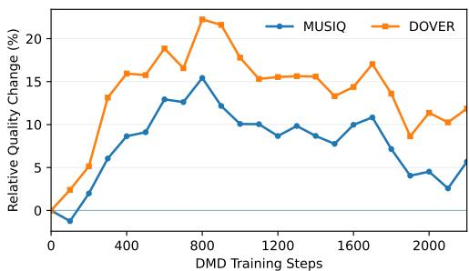  
Figure 10. Ablation on DMD steps.一

As shown in Fig. 10, both metrics improve rapidly during early DMD training. However, the gains do not persist: after an early peak, performance becomes non-monotonic and can decline with continued optimization. Simply increasing the number of DMD updates therefore does not reliably yield a better one-step VSR model.

We next examine two other components of the distillation setup: student initialization and teacher capacity. As shown in Table 5, both a stronger initialization and a larger teacher consistently improve the final student, with their combination performing best. These results indicate that effective DMD scaling depends on the overall distillation setup rather than optimization duration alone.

Table 5. Ablation on student initialization and teacher capacity.
<table><tr><td>Init.</td><td colspan="3">Teacher MUSIQ ↑ DOVER ↑</td></tr><tr><td>Base</td><td>1.3B</td><td>45.87</td><td>8.512</td></tr><tr><td>Strong</td><td>1.3B</td><td>48.20</td><td>8.738</td></tr><tr><td>Base</td><td>14B</td><td>51.76</td><td>9.144</td></tr><tr><td>Strong</td><td>14B</td><td>52.78</td><td>9.417</td></tr></table>

## 5 Conclusion

We introduce FlashVSR+, combining hybrid spatiotemporal attention with Ry-DMD for efficient and reward-guided one-step VSR. The framework improves the quality efficiency trade-off and enables spatially untiled 4K inference on a single 24GB RTX 4090. Ry-DMD enables black-box reward optimization without reward backpropagation, with benefits demonstrated in both VSR and text-to-image generation.

## References

Kevin Black, Michael Janner, Yilun Du, Ilya Kostrikov, and Sergey Levine. Training diffusion models with reinforcement learning. In International Conference on Learning Representations, volume 2024, pages 4965–4987, 2024.

Yochai Blau and Tomer Michaeli. The perception-distortion tradeoff. In 2018 IEEE/CVF Conference on Computer Vision and Pattern Recognition, pages 6228–6237. IEEE, 2018.

Kelvin CK Chan, Xintao Wang, Ke Yu, Chao Dong, and Chen Change Loy. Basicvsr: The search for essential components in video super-resolution and beyond. In 2021 IEEE/CVF Conference on Computer Vision and Pattern Recognition (CVPR), pages 4945–4954. IEEE, 2021.

Kelvin CK Chan, Shangchen Zhou, Xiangyu Xu, and Chen Change Loy. Basicvsr++: Improving video super-resolution with enhanced propagation and alignment. In 2022 IEEE/CVF Conference on Computer Vision and Pattern Recognition (CVPR), pages 5962–5971. IEEE, 2022a.

Kelvin CK Chan, Shangchen Zhou, Xiangyu Xu, and Chen Change Loy. Investigating tradeoffs in realworld video super-resolution. In 2022 IEEE/CVF Conference on Computer Vision and Pattern Recognition (CVPR), pages 5952–5961. IEEE, 2022b.

Junsong Chen, Jincheng Yu, Yitong Li, Shuchen Xue, Haozhe Liu, Jingyu Xin, Yuyang Zhao, Tian Ye, Zhangjie Wu, Zian Wang, et al. Sana-video 2.0: Hybrid linear attention with attention residuals for efficient video generation. arXiv preprint arXiv:2607.21553, 2026a.

Junsong Chen, Yuyang Zhao, Jincheng Yu, Ruihang Chu, Junyu Chen, Shuai Yang, Xianbang Wang, Yicheng Pan, Zhou Daquan, Huan Ling, et al. Sana-video: Efficient video generation with block linear diffusion transformer. In International Conference on Learning Representations, volume 2026, pages 38973–38997, 2026b.

Junyang Chen, Jiangxin Dong, Long Sun, Yixin Yang, and Jinshan Pan. Stcdit: Spatio-temporally consistent diffusion transformer for high-quality video super-resolution. In Proceedings of the IEEE/CVF Conference on Computer Vision and Pattern Recognition, pages 38281–38290, 2026c.

Zheng Chen, Zichen Zou, Kewei Zhang, Xiongfei Su, Xin Yuan, Yong Guo, and Yulun Zhang. Dove: Efficient one-step diffusion model for real-world video super-resolution. Advances in Neural Information Processing Systems, 38:85218–85237, 2026d.

Zhikai Chen, Fuchen Long, Zhaofan Qiu, Ting Yao, Wengang Zhou, Jiebo Luo, and Tao Mei. Learning spatial adaptation and temporal coherence in diffusion models for video super-resolution. In 2024 IEEE/CVF Čonference on Computer Vision and Pattern Recognition (CVPR), pages 9232–9241. IEEE, 2024.

Mengyu Chu, You Xie, Jonas Mayer, Laura Leal-Taixé, and Nils Thuerey. Learning temporal coherence via self-supervision for gan-based video generation. ACM Transactions on Graphics (TOG), 39(4):75–1, 2020.

Kevin Clark, Paul Vicol, Kevin Swersky, and David Fleet. Directly fine-tuning diffusion models on differentiable rewards. In International Conference on Learning Representations, volume 2024, pages 4793–4822, 2024.

Cheng Cui, Ting Sun, Manhui Lin, Tingquan Gao, Yubo Zhang, Jiaxuan Liu, Xueqing Wang, Zelun Zhang, Changda Zhou, Hongen Liu, et al. Paddleocr 3.0 technical report. arXiv preprint arXiv:2507.05595, 2025.

Linwei Dong, Ruoyu Guo, Ge Bai, Zehuan Yuan, Yawei Luo, and Changqing Zou. Guiding distribution matching distillation with gradient-based reinforcement learning. arXiv preprint arXiv:2604.19009, 2026.

Luca Eyring, Shyamgopal Karthik, Karsten Roth, Alexey Dosovitskiy, and Zeynep Akata. Reno: Enhancing one-step text-to-image models through reward-based noise optimization. Advances in Neural Information Processing Systems, 37:125487–125519, 2024.

Ying Fan, Olivia Watkins, Yuqing Du, Hao Liu, Moonkyung Ryu, Craig Boutilier, Pieter Abbeel, Mohammad Ghavamzadeh, Kangwook Lee, and Kimin Lee. Dpok: Reinforcement learning for finetuning text-to-image diffusion models. Advances in neural information processing systems, 36:79858– 79885, 2023.

Yushi Huang, Xiangxin Zhou, Ruoyu Wang, Chi Zhang, Jun Zhang, and Tianyu Pang. Reinforcing few-step generators via reward-tilted distribution matching. arXiv preprint arXiv:2605.26108, 2026.

Zhiwei Jia, Yuesong Nan, Huixi Zhao, and Gengdai Liu. Reward fine-tuning two-step diffusion models via learning differentiable latent-space surrogate reward. In 2025 IEEE/CVF Conference on Computer Vision and Pattern Recognition (CVPR), pages 12912–12922. IEEE, 2025.

Dengyang Jiang, Dongyang Liu, Zanyi Wang, Qilong Wu, Liuzhuozheng Li, Hengzhuang Li, Xin Jin, Changsheng Lu, Zhen Li, Mengmeng Wang, et al. Distribution matching distillation meets reinforcement learning. In European Conference on Computer Vision, pages 281–299. Springer, 2026.

Junjie Ke, Qifei Wang, Yilin Wang, Peyman Milanfar, and Feng Yang. Musiq: Multi-scale image quality transformer. In 2021 IEEE/CVF International Conference on Computer Vision (ICCV), pages 5128–5137. IEEE, 2021.

Yuval Kirstain, Adam Polyak, Uriel Singer, Shahbuland Matiana, Joe Penna, and Omer Levy. Pick-apic: An open dataset of user preferences for text-to-image generation. Advances in neural information processing systems, 36:36652–36663, 2023.

Xiaohui Li, Yihao Liu, Shuo Cao, Ziyan Chen, Shaobin Zhuang, Xiangyu Chen, Yinan He, Yi Wang, and Yu Qiao. Diffvsr: Revealing an effective recipe for taming robust video super-resolution against complex degradations. In 2025 IEEE/CVF International Conference on Computer Vision (ICCV), pages 15319–15328. IEEE, 2025.

Xingyang Li, Muyang Li, Tianle Cai, Haocheng Xi, Shuo Yang, Yujun Lin, Lvmin Zhang, Songlin Yang, Jinbo Hu, Kelly Peng, et al. Radial attention: (o(nlogn)) sparse attention with energy decay for long video generation. Advances in Neural Information Processing Systems, 38:16822–16852, 2026.

Jingyun Liang, Yuchen Fan, Xiaoyu Xiang, Rakesh Ranjan, Eddy Ilg, Simon Green, Jiezhang Cao, Kai Zhang, Radu Timofte, and Luc V Gool. Recurrent video restoration transformer with guided deformable attention. Advances in neural information processing systems, 35:378–393, 2022.

Jie Liu, Gongye Liu, Jiajun Liang, Yangguang Li, Jiaheng Liu, Xintao Wang, Pengfei Wan, Di Zhang, and Wanli Ouyang. Flow-grpo: Training flow matching models via online rl. Advances in neural information processing systems, 38:40783–40818, 2026.

Yong Liu, Jinshan Pan, Yinchuan Li, Qingji Dong, Chao Zhu, Yu Guo, and Fei Wang. Ultravsr: Achieving ultra-realistic video super-resolution with efficient one-step diffusion space. In Proceedings of the 33rd ACM International Conference on Multimedia, pages 7785–7794, 2025.

Zhengyao Lv, Menghan Xia, Xintao Wang, and Kwan-Yee K Wong. Duo-vsr: Dual-stream distillation for one-step video super-resolution. arXiv preprint arXiv:2603.22271, 2026.

Anish Mittal, Rajiv Soundararajan, and Alan C Bovik. Making a "completely blind" image quality analyzer. IEEE Signal processing letters, 20(3):209–212, 2012.

Dustin Podell, Zion English, Kyle Lacey, Andreas Blattmann, Tim Dockhorn, Jonas Müller, Joe Penna, and Robin Rombach. Sdxl: Improving latent diffusion models for high-resolution image synthesis. In International Conference on Learning Representations, volume 2024, pages 1862–1874, 2024.

Claudio Rota, Marco Buzzelli, and Joost van de Weijer. Enhancing perceptual quality in video superresolution through temporally-consistent detail synthesis using diffusion models. In European Conference on Computer Vision, pages 36–53. Springer, 2024.

Chitwan Saharia, William Chan, Saurabh Saxena, Lala Li, Jay Whang, Emily L Denton, Kamyar Ghasemipour, Raphael Gontijo Lopes, Burcu Karagol Ayan, Tim Salimans, et al. Photorealistic textto-image diffusion models with deep language understanding. Advances in neural information processing systems, 35:36479–36494, 2022.

Christoph Schuhmann, Romain Beaumont, Richard Vencu, Cade Gordon, Ross Wightman, Mehdi Cherti, Theo Coombes, Aarush Katta, Clayton Mullis, Mitchell Wortsman, et al. Laion-5b: An open large-scale dataset for training next generation image-text models. Advances in neural information processing systems, 35:25278–25294, 2022.

Xuan Shen, Chenxia Han, Yufa Zhou, Yanyue Xie, Yifan Gong, Quanyi Wang, Yiwei Wang, Yanzhi Wang, Pu Zhao, and Jiuxiang Gu. Draftattention: Fast video diffusion via low-resolution attention guidance. arXiv preprint arXiv:2505.14708, 2025.

Shuwei Shi, Jinjin Gu, Liangbin Xie, Xintao Wang, Yujiu Yang, and Chao Dong. Rethinking alignment in video super-resolution transformers. Advances in Neural Information Processing Systems, 35:36081– 36093, 2022.

Yang Song, Prafulla Dhariwal, Mark Chen, and Ilya Sutskever. Consistency models. arXiv preprint arXiv:2303.01469, 2023.

Yujing Sun, Lingchen Sun, Shuaizheng Liu, Rongyuan Wu, Zhengqiang Zhang, and Lei Zhang. Onestep diffusion for detail-rich and temporally consistent video super-resolution. Advances in Neural Information Processing Systems, 38:172821–172841, 2026.

Xin Tao, Hongyun Gao, Renjie Liao, Jue Wang, and Jiaya Jia. Detail-revealing deep video superresolution. In 2017 IEEE International Conference on Computer Vision (ICCV), pages 4482–4490. IEEE, 2017.

Bram Wallace, Meihua Dang, Rafael Rafailov, Linqi Zhou, Aaron Lou, Senthil Purushwalkam, Stefano Ermon, Caiming Xiong, Shafiq Joty, and Nikhil Naik. Diffusion model alignment using direct preference optimization. In 2024 IEEE/CVF Conference on Computer Vision and Pattern Recognition (CVPR), pages 8228–8238. IEEE, 2024.

Jianyi Wang, Kelvin CK Chan, and Chen Change Loy. Exploring clip for assessing the look and feel of images. In Proceedings of the AAAI conference on artificial intelligence, volume 37, pages 2555–2563, 2023.

Jianyi Wang, Shanchuan Lin, Zhijie Lin, Yuxi Ren, Meng Wei, Zongsheng Yue, Shangchen Zhou, Hao Chen, Yang Zhao, Ceyuan Yang, et al. Seedvr2: One-step video restoration via diffusion adversarial post-training. In International Conference on Learning Representations, volume 2026, pages 40987–41009, 2026.

Xintao Wang, Kelvin CK Chan, Ke Yu, Chao Dong, and Chen Change Loy. Edvr: Video restoration with enhanced deformable convolutional networks. In 2019 IEEE/CVF Conference on Computer Vision and Pattern Recognition Workshops (CVPRW), pages 1954–1963. IEEE, 2019.

Aiqiu Wu, Zhaofan Qiu, Ting Yao, and Tao Mei. Ps-sr: Pseudo-single-step video super-resolution via speculative diffusion. In Proceedings of the IEEE/CVF Conference on Computer Vision and Pattern Recognition, pages 38218–38227, 2026.

Haoning Wu, Erli Zhang, Liang Liao, Chaofeng Chen, Jingwen Hou, Annan Wang, Wenxiu Sun, Qiong Yan, and Weisi Lin. Exploring video quality assessment on user generated contents from aesthetic and technical perspectives. In 2023 IEEE/CVF International Conference on Computer Vision (ICCV), pages 20087–20097. IEEE, 2023a.

Xiaoshi Wu, Yiming Hao, Keqiang Sun, Yixiong Chen, Feng Zhu, Rui Zhao, and Hongsheng Li. Human preference score v2: A solid benchmark for evaluating human preferences of text-to-image synthesis. arXiv preprint arXiv:2306.09341, 2023b.

Haocheng Xi, Shuo Yang, Yilong Zhao, Chenfeng Xu, Muyang Li, Xiuyu Li, Yujun Lin, Han Cai, Jintao Zhang, Dacheng Li, et al. Sparse videogen: Accelerating video diffusion transformers with spatialtemporal sparsity. arXiv preprint arXiv:2502.01776, 2025.

Enze Xie, Junsong Chen, Junyu Chen, Han Cai, Haotian Tang, Yujun Lin, Zhekai Zhang, Muyang Li, Ligeng Zhu, Yao Lu, et al. Sana: Efficient high-resolution text-to-image synthesis with linear diffusion transformers. In The Thirteenth International Conference on Learning Representations, 2025a.

Enze Xie, Junsong Chen, Yuyang Zhao, Jincheng Yu, Ligeng Zhu, Chengyue Wu, Yujun Lin, Zhekai Zhang, Muyang Li, Junyu Chen, et al. Sana 1.5: Efficient scaling of training-time and inference-time compute in linear diffusion transformer. arXiv preprint arXiv:2501.18427, 2025b.

Haoxuan Xu, Yi Liu, Tianfu Li, Ruolin Shen, Boyuan Jiang, Jinlong Peng, Donghao Luo, Xiaobin Hu, Shuicheng Yan, and Haoang Li. Irpo: Boosting image restoration via post-training grpo. arXiv preprint arXiv:2512.00814, 2025a.

Jiazheng Xu, Xiao Liu, Yuchen Wu, Yuxuan Tong, Qinkai Li, Ming Ding, Jie Tang, and Yuxiao Dong. Imagereward: Learning and evaluating human preferences for text-to-image generation. Advances in Neural Information Processing Systems, 36:15903–15935, 2023.

Ruyi Xu, Guangxuan Xiao, Haofeng Huang, Junxian Guo, and Song Han. Xattention: Block sparse attention with antidiagonal scoring. arXiv preprint arXiv:2503.16428, 2025b.

Yiran Xu, Taesung Park, Richard Zhang, Yang Zhou, Eli Shechtman, Feng Liu, Jia-Bin Huang, and Difan Liu. Videogigagan: Towards detail-rich video super-resolution. In 2025 IEEE/CVF Conference on Computer Vision and Pattern Recognition (CVPR), pages 2139–2149. IEEE, 2025c.

Shuo Yang, Haocheng Xi, Yilong Zhao, Muyang Li, Jintao Zhang, Han Cai, Yujun Lin, Xiuyu Li, Chenfeng Xu, Kelly Peng, et al. Sparse videogen2: Accelerate video generation with sparse attention via semantic-aware permutation. Advances in Neural Information Processing Systems, 38:96965–96991, 2026.

Qiaosi Yi, Shuai Li, Rongyuan Wu, Lingchen Sun, Zhengqiang Zhang, and Lei Zhang. Gdpo-sr: Group direct preference optimization for one-step generative image super-resolution. arXiv preprint arXiv:2603.16769, 2026.

Tianwei Yin, Michaël Gharbi, Taesung Park, Richard Zhang, Eli Shechtman, Fredo Durand, and William T Freeman. Improved distribution matching distillation for fast image synthesis. Advances in neural information processing systems, 37:47455–47487, 2024a.

Tianwei Yin, Michaël Gharbi, Richard Zhang, Eli Shechtman, Fredo Durand, William T Freeman, and Taesung Park. One-step diffusion with distribution matching distillation. In 2024 IEEE/CVF Conference on Computer Vision and Pattern Recognition (CVPR), pages 6613–6623. IEEE, 2024b.

Ziye Yuan, Ruchang Yao, Chengxin Zheng, Yusheng Zhao, Daxiang Dong, and Ming Zhang. Detached skip-links and r-probe: Decoupling feature aggregation from gradient propagation for mllm ocr. In International Conference on Machine Learning, pages 152198–152218. PMLR, 2026.

Richard Zhang, Phillip Isola, Alexei A Efros, Eli Shechtman, and Oliver Wang. The unreasonable effectiveness of deep features as a perceptual metric. In 2018 IEEE/CVF conference on computer vision and pattern recognition, pages 586–595. IEEE, 2018.

Yuehan Zhang and Angela Yao. Realviformer: Investigating attention for real-world video superresolution. In European conference on computer vision, pages 412–428. Springer, 2024.

Shijie Zhao, Xuanyu Zhang, Bin Chen, Weiqi Li, Qunliang Xing, Kexin Zhang, Yan Wang, Junlin Li, Li Zhang, Jian Zhang, et al. Oars: Process-aware online alignment for generative real-world image super-resolution. arXiv preprint arXiv:2603.12811, 2026.

Weisong Zhao, Jingkai Zhou, Xiangyu Zhu, Weihua Chen, Xiao-Yu Zhang, Zhen Lei, and Fan Wang. Realisvsr: Detail-enhanced diffusion for real-world 4k video super-resolution. arXiv preprint arXiv:2507.19138, 2025.

Kaiwen Zheng, Huayu Chen, Haotian Ye, Haoxiang Wang, Qinsheng Zhang, Kai Jiang, Hang Su, Stefano Ermon, Jun Zhu, and Ming-Yu Liu. Diffusionnft: Online diffusion reinforcement with forward process. In International Conference on Learning Representations, volume 2026, pages 134129–134150, 2026.

Shangchen Zhou, Peiqing Yang, Jianyi Wang, Yihang Luo, and Chen Change Loy. Upscale-a-video: Temporal-consistent diffusion model for real-world video super-resolution. In 2024 IEEE/CVF Conference on Computer Vision and Pattern Recognition (CVPR), pages 2535–2545. IEEE, 2024.

Yuanzhi Zhu, Xi Wang, Stéphane Lathuilière, and Vicky Kalogeiton. Diffusion reinforcement learning via centered reward distillation. arXiv preprint arXiv:2603.14128, 2026.

Junhao Zhuang, Shi Guo, Xin Cai, Xiaohui Li, Yihao Liu, Chun Yuan, and Tianfan Xue. Flashvsr: Towards real-time diffusion-based streaming video super resolution. In Proceedings of the IEEE/CVF Conference on Computer Vision and Pattern Recognition, pages 43482–43493, 2026.

## A Training Details

In Stage 1, we train the 14B full-attention teacher for 4 days using LoRA with rank 384, AdamW with $( \beta _ { 1 } , \beta _ { 2 } ) \ = \ ( 0 . 9 , 0 . 9 9 9 )$ , a learning rate of $2 \times 1 0 ^ { - 5 }$ , and a batch size of 16. In Stage 2, we initialize the hybrid-attention student from pretrained FlashVSR stage-2 checkpoint and perform full-parameter training for 2 days using AdamW with $( \beta _ { 1 } , \beta _ { 2 } ) = ( 0 . 9 , 0 . 9 \bar { 9 } 9 )$ , a learning rate of $1 \times 1 0 ^ { - 5 } ,$ a batch size of 32, and EMA. In Stage 3, we perform full-parameter one-step distillation for 600 steps using the 14B teacher, AdamW with $\mathbf { \bar { ( } } \beta _ { 1 } , \beta _ { 2 } ) \mathbf { \bar { = } } \mathbf { ( } 0 , 0 . 9 9 9 )$ , a learning rate of $1 \times 1 0 ^ { - 5 }$ , a batch size of 16, and EMA. Training uses a filtered coreset together with the text-SFT augmentation. For Ry-DMD, we set $\beta = 0 . 1$ $\lambda _ { \mathrm { R Y } } = \bar { 0 } . 2 , J = 4$ , and $K = 3$

## B RTX 4090 Implementation

The attention operators used in our H200 equivalent GPU implementation are not directly supported on RTX 4090 GPUs. We therefore implement a lightweight Triton adaptation based on FlashAttention-2 to support the same hybrid-attention computation on Ada GPUs.

For 4K inference, the main memory bottleneck comes from the persistent KV cache of the retained global-attention layers. We selectively offload these KV caches to pinned CPU memory and asynchronously transfer them on a dedicated CUDA stream. Before the corresponding layer is executed in the next streaming chunk, the cache is prefetched back to GPU. This substantially reduces persistent GPU memory usage while overlapping most data transfers with computation. Importantly, this adaptation does not introduce spatial tiling: each frame is processed at its full spatial resolution, while only the KV-cache residency is changed. This enables spatially untiled 4K inference on a single 24GB RTX 4090.

## C Ry-DMD Hyperparameter Analysis

We study the sensitivity of Ry-DMD to four key hyperparameters on SDXL: the reward temperature $\beta ,$ the correction weight $\lambda _ { \mathrm { R Y } }$ , the number of teacher rollouts J, and the rollout depth K. Unless otherwise specified, we use $\dot { \beta } = 0 . 1 , \lambda _ { \mathrm { R Y } } = 0 . 2 , J = 4 ,$ and $K = 3$ . We vary one parameter at a time while keeping the others fixed. As shown in Table 6, Ry-DMD is stable under moderate variations of its hyperparameters, while overly strong reward weighting or correction degrades performance.

Table 6. Hyperparameter analysis of Ry-DMD on SDXL. We vary one hyperparameter at a time from the default configuration $( \bar { \beta } , \lambda _ { \mathrm { R Y } } , J , K ) = ( 0 . 1 , 0 . 2 , 4 , 3 )$
<table><tr><td>Setting</td><td> $\beta$ </td><td> $\lambda _ { \mathrm { R Y } }$  J K</td><td>OCR↑</td><td>ImageReward ↑</td></tr><tr><td>Default</td><td>0.1</td><td>0.2 4 3</td><td>0.241</td><td>1.02</td></tr><tr><td> $\beta$ </td><td>0.05 0.2 0.4</td><td>一 一 一 一</td><td>0.212 一 0.236 0.203 一</td><td>0.98 1.01 0.92</td></tr><tr><td> $\lambda _ { \mathrm { R Y } }$ </td><td>一 一 一</td><td>0.05 一 0.1 0.4 1 一</td><td>0.201 0.237 0.198</td><td>0.98 1.01 0.89</td></tr><tr><td>J</td><td>一 一</td><td>2 一 一 8 一 一</td><td>0.227 0.248</td><td>1.00 1.04</td></tr><tr><td> $K$ </td><td>一 一</td><td>2 一 一 4 一 一</td><td>0.239 0.239</td><td>1.01 1.03</td></tr></table>

## D Extending Ry-DMD to Few-Step Generation

We provide additional quantitative results for four-step SD3.5-M with OCR-guided post-training. As shown in Table 7, Ry-DMD improves OCR accuracy from 0.501 to 0.824 without increasing NFE. Meanwhile, HPSv2, ImageReward, and Aesthetic scores all improve, indicating that better text rendering does not come at the expense of general image quality. Qualitative comparisons are provided in Fig. 9.

Table 7. Ry-DMD on 4-step SD3.5-M. Ry-DMD substantially improves OCR accuracy while preserving the original 4-step sampling budget and improving general image-quality and preference metrics.
<table><tr><td>Method</td><td>NFE↓</td><td>OCR↑</td><td>HPSv2↑</td><td>ImageReward ↑</td><td>Aesthetic ↑</td></tr><tr><td>SD3.5-M (4-step)</td><td>4</td><td>0.501</td><td>30.3</td><td>1.02</td><td>5.52</td></tr><tr><td>+ Ry-DMD</td><td>4</td><td>0.824</td><td>31.2</td><td>1.23</td><td>5.54</td></tr></table>

## E Additional Derivations for Ry-DMD

This section provides supporting derivations for Ry-DMD introduced in Section 3.3. We first show that the global reward-tilted target arises from a KL-regularized expected-reward objective. We then derive the local reward-tilted endpoint mean and its finite-rollout estimator, followed by the connection between the resulting endpoint shift and the DMD teacher correction.

## E.1 Derivation of the Reward-Tilted Target

For a fixed condition $c ,$ consider the KL-regularized expected-reward objective

$$
\mathcal { I } ( \boldsymbol { q } ) = \mathbb { E } _ { \boldsymbol { x } _ { 0 } \sim \boldsymbol { q } ( \cdot | \boldsymbol { c } ) } \left[ r ( \boldsymbol { x } _ { 0 } , \boldsymbol { c } ) \right] - \frac { 1 } { \beta } D _ { \mathrm { K L } } \left( \boldsymbol { q } ( \cdot | \boldsymbol { c } ) \| p _ { \mathrm { T } , 0 } ( \cdot | \boldsymbol { c } ) \right) ,\tag{7}
$$

subject to $\textstyle \int q ( x _ { 0 } \mid c ) \mathrm { d } x _ { 0 } = 1$ . Introducing a Lagrange multiplier for the normalization constraint and setting the functional derivative with respect to q to zero gives

$$
\log \frac { q ^ { \star } ( x _ { 0 } \mid c ) } { p _ { \mathrm { T } , 0 } ( x _ { 0 } \mid c ) } = \beta r ( x _ { 0 } , c ) + { \mathrm { c o n s t . } }\tag{8}
$$

Therefore,

$$
p _ { 0 } ^ { \star } ( x _ { 0 } \mid c ) = \frac { p _ { \mathrm { T } , 0 } ( x _ { 0 } \mid c ) \exp ( \beta r ( x _ { 0 } , c ) ) } { Z ( c ) } , \qquad Z ( c ) = \mathbb { E } _ { p _ { \mathrm { T } , 0 } ( \cdot \mid c ) } \left[ \exp ( \beta r ( x _ { 0 } , c ) ) \right] ,\tag{9}
$$

which recovers the reward-tilted target in Eq. 1. The exponential tilt changes the relative density of teacher-supported samples according to their rewards while preserving the support of the teacher distribution. In the limit $\bar { \beta ^ { * } } \to 0 , p _ { 0 } ^ { \star } ( \cdot \mid c ) \breve { \to } p _ { \mathrm { T } , 0 } ( \cdot \mid c )$

## E.2 Local Reward-Tilted Mean Estimation

During DMD training, reward tilting is applied locally to the conditional endpoint distribution induced by stochastic teacher rollouts from the current noisy state. For fixed $( x _ { \sigma } , c )$ , let $q _ { \mathrm { T } } ^ { K } ( x _ { 0 } \mid x _ { \sigma } , c )$ denote the endpoint distribution induced by a stochastic K-step teacher sampler. The normalized form of Eq. 3 is

$$
q _ { \mathrm { T } , \beta } ^ { K } ( x _ { 0 } \mid x _ { \sigma } , c ) = \frac { q _ { \mathrm { T } } ^ { K } ( x _ { 0 } \mid x _ { \sigma } , c ) \exp ( \beta r ( x _ { 0 } , c ) ) } { Z _ { \beta } ( x _ { \sigma } , c ) } ,\tag{10}
$$

where

$$
Z _ { \beta } ( x _ { \sigma } , c ) = \mathbb { E } _ { x _ { 0 } \sim q _ { \mathrm { T } } ^ { K } ( \cdot \vert x _ { \sigma } , c ) } \left[ \exp ( \beta r ( x _ { 0 } , c ) ) \right] .\tag{11}
$$

The mean endpoint under the reward-tilted distribution is therefore

$$
m _ { \beta } ( x _ { \sigma } , c ) = \frac { \mathbb { E } _ { x _ { 0 } \sim q _ { \mathrm { T } } ^ { K } ( \cdot | x _ { \sigma } , c ) } \left[ x _ { 0 } \exp ( \beta r ( x _ { 0 } , c ) ) \right] } { \mathbb { E } _ { x _ { 0 } \sim q _ { \mathrm { T } } ^ { K } ( \cdot | x _ { \sigma } , c ) } \left[ \exp ( \beta r ( x _ { 0 } , c ) ) \right] } ,\tag{12}
$$

while the original conditional teacher mean is

$$
m _ { \mathrm { T } } ( x _ { \sigma } , c ) = \mathbb { E } _ { x _ { 0 } \sim q _ { \mathrm { T } } ^ { K } ( \cdot | x _ { \sigma } , c ) } [ x _ { 0 } ] .\tag{13}
$$

We denote the population-level displacement induced by reward tilting as

$$
\Delta m = m _ { \beta } ( x _ { \sigma } , c ) - m _ { \mathrm { T } } ( x _ { \sigma } , c ) .\tag{14}
$$

In practice, we draw J independent teacher rollouts

$$
x _ { 0 } ^ { ( j ) } \overset { \mathrm { i . i . d . } } { \sim } q _ { \mathrm { T } } ^ { K } ( \cdot \mid x _ { \sigma } , c ) , \qquad j = 1 , \ldots , J ,\tag{15}
$$

with rewards $r _ { j } = r ( x _ { 0 } ^ { ( j ) } , c )$ . Without reward standardization, the corresponding self-normalized Monte Carlo estimates are

$$
\widehat { m } _ { \beta } = \sum _ { j = 1 } ^ { J } \pi _ { j } x _ { 0 } ^ { ( j ) } , \qquad \pi _ { j } = \frac { \exp ( \beta r _ { j } ) } { \sum _ { k = 1 } ^ { J } \exp ( \beta r _ { k } ) } ,\tag{16}
$$

and

$$
\widehat { m } _ { \mathrm { T } } = \frac { 1 } { J } \sum _ { j = 1 } ^ { J } x _ { 0 } ^ { ( j ) } .\tag{17}
$$

The finite-rollout estimate of the reward-induced endpoint shift is thus

$$
\delta m = \widehat { m } _ { \beta } - \widehat { m } _ { \mathrm { T } } ,\tag{18}
$$

corresponding to Eq. 5. The expression above gives the unstandardized estimator of ∆m. In practice, we compute δm using the group-standardized weights below, as in Eq. 5.

Reward standardization. In the practical algorithm, rewards are standardized within each rollout group as

$$
a _ { j } = \frac { r _ { j } - \bar { r } } { s _ { r } + \varepsilon } , \qquad \pi _ { j } = \frac { \exp ( \beta a _ { j } ) } { \sum _ { k = 1 } ^ { J } \exp ( \beta a _ { k } ) } .\tag{19}
$$

Centering by ī does not affect the normalized exponential weights, since the common multiplicative factor cancels. Dividing by $s _ { r } + \varepsilon$ is equivalent to using a rollout-dependent effective temperature

$$
\beta _ { \mathrm { e f f } } = \frac { \beta } { s _ { r } + \varepsilon } ,\tag{20}
$$

which reduces sensitivity to the numerical scale of different reward functions while preserving their within-group ordering. The standardized weights therefore implement a group-adaptive tilt, while the fixed-β population formulas above describe the unstandardized case.

Small-β interpretation. For additional intuition, a first-order expansion of Eq. 12 gives

$$
\Delta m = \beta { \mathrm { C o v } } _ { q _ { \mathrm { T } } ^ { K } ( \cdot | x _ { \sigma } , c ) } \left( x _ { 0 } , r ( x _ { 0 } , c ) \right) + { \mathcal O } ( \beta ^ { 2 } ) .\tag{21}
$$

Thus, in the small $- \beta$ regime, reward tilting moves the conditional teacher endpoint mean along variations in $x _ { 0 }$ that covary positively with the reward.

## E.3 From Endpoint Shift to the DMD Teacher Correction

We finally derive how the endpoint displacement estimated above translates into the reward correction in Eq. 6. In this section, $s _ { \mathrm { T } }$ denotes the parameterized teacher term used in our DMD update. For $\sigma > 0 ,$ it is related to its associated clean-endpoint target ${ \cdot \mu _ { \mathrm { T } } } ( x _ { \sigma } , c )$ by

$$
s _ { \mathrm { T } } ( x _ { \sigma } , c ) = { \frac { \mu _ { \mathrm { T } } ( x _ { \sigma } , c ) - x _ { \sigma } } { \sigma } } .\tag{22}
$$

Ry-DMD modifies the clean teacher target using the estimated reward-induced endpoint displacement:

$$
\mu _ { \mathrm { T } } ^ { \mathrm { R Y } } ( x _ { \sigma } , c ) = \mu _ { \mathrm { T } } ( x _ { \sigma } , c ) + \lambda _ { \mathrm { R Y } } \delta m ,\tag{23}
$$

where $\lambda _ { \mathrm { R Y } }$ controls the correction strength. Substituting this target into Eq. 22 yields

$$
\begin{array} { r } { s _ { \mathrm { T } } ^ { \mathrm { R Y } } ( x _ { \sigma } , c ) = \frac { \mu _ { \mathrm { T } } \left( x _ { \sigma } , c \right) + \lambda _ { \mathrm { R Y } } \delta m - x _ { \sigma } } { \sigma } } \\ { = s _ { \mathrm { T } } ( x _ { \sigma } , c ) + \lambda _ { \mathrm { R Y } } \frac { \delta m } { \sigma } . } \end{array}\tag{24}
$$

Thus, under the above parameterization, the factor $1 / \sigma$ follows directly from converting a cleanendpoint displacement into a displacement of the teacher term. For numerical stability at small noise levels, we use

$$
d _ { \mathrm { R Y } } = \frac { \delta m } { \operatorname* { m a x } ( \sigma , \varepsilon _ { \sigma } ) } ,\tag{25}
$$

which gives the practical update

$$
s _ { \mathrm { T } } ^ { \mathrm { R Y } } = s _ { \mathrm { T } } + \lambda _ { \mathrm { R Y } } d _ { \mathrm { R Y } } ,\tag{26}
$$

equivalent to Eq. 6. Thus, Ry-DMD leaves the remaining DMD optimization procedure unchanged and requires only sampled teacher endpoints and scalar reward evaluations, without differentiating through the reward function. Here, $\mu _ { \mathrm { T } }$ remains the original teacher target, and δm is used as a rolloutestimated residual correction; the construction does not require $\mu _ { \mathrm { T } } = m _ { \mathrm { T } }$

## F Synthetic Text-OCR VSR Dataset

To study OCR-guided post-training, we construct a synthetic text-focused VSR dataset from the same video corpus used in our VSR pipeline. Synthetic text is rendered onto decoded high-quality frames to form the target video, and the corresponding low-quality input is generated with the standard VSR degradation pipeline. Since the text is procedurally generated, its content and spatial annotations are known exactly.

Text rendering. Each sample contains one or two text instances sampled from a multilingual corpus covering English, Chinese, numeric strings, and several additional languages. We randomize font, size, color, outline, opacity, and shadow. Text remains temporally coherent across the video and follows simple motion patterns such as static placement, translation, scale/rotation changes, or partial motion outside the frame. Per-frame locations and visibility are retained as annotations.

Filtering and OCR supervision. We discard invalid renderings with unsupported characters, insufficient size, or negligible visible area. For OCR reward computation, only sufficiently visible annotated text regions are evaluated, and a small number of valid frames are sampled from each video for efficiency. All compared post-training methods use the same source videos, rendered targets, degradation process, and filtering rules.

Each sample additionally stores lightweight text metadata used for OCR supervision. A schematic example is shown below:

```jsonl
{
"source_path": "/videos/example.mp4",
"gt_video": "[F, 3, H, W]",
"1q_video": "[F, 3, H, W]",
"text_metadata": {
"instances": [{
"text": "EXAMPLE 42",
"language": "en",
"motion_type": "translate",
"frames":[
{"frame_index": 0,
"bbox": [x0, y0, x1, y1],
"visible_ratio": 1.0}
]
}]
}
}
```