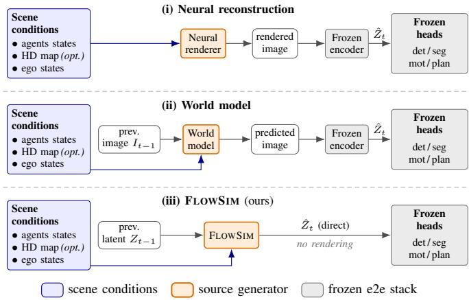
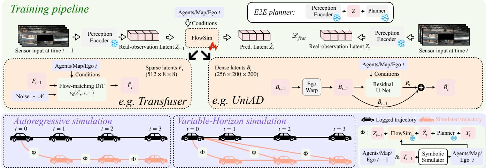
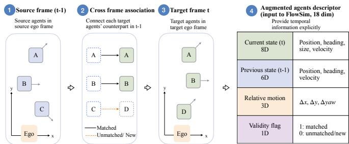
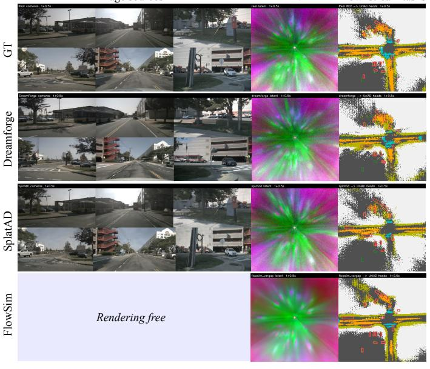
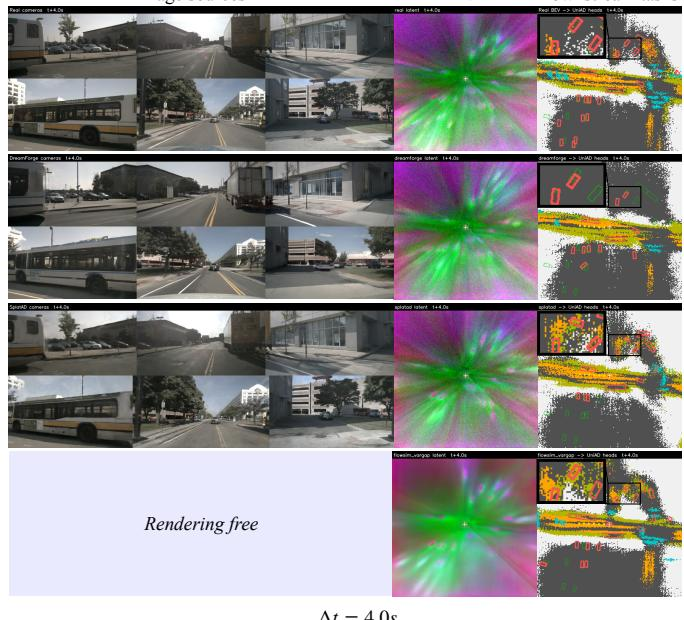
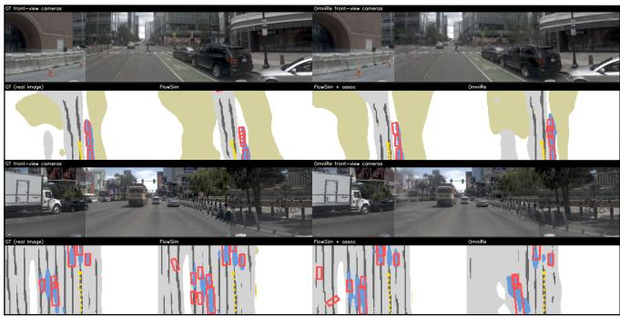
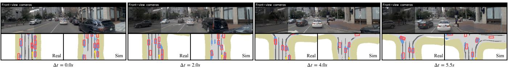

# FlowSim: Rendering-Free Closed-Loop Simulation for Evaluating End-to-End Driving Systems

1st Hanfeng Wu   
Karlsruhe Institute of Technology   
BMW Group   
Munich, Germany   
hanfeng.wu@bmw.de   
2rd Alvaro Marcos-Ramiro BMW Group Munich, Germany   
alvaro.marcos-ramiro@bmw.de   
3th Michael Schmidt   
BMW Group   
Munich, Germany   
michael.se.schmidt@bmw.de

4th Christoph Stiller Karlsruhe Institute of Technology Karlsruhe, Germany stiller@kit.edu

Abstract— Closed-loop evaluation of end-to-end (E2E) driving systems typically relies on generating sensor observations and re-processing them through the perception encoder, introducing substantial computational cost and a sim2real gap between simulated and real sensor observations. In this paper, we ask a more fundamental question: is image-space simulation necessary for closed-loop evaluation of E2E driving systems? We propose FLOWSIM, a rendering-free simulation paradigm that predicts the internal latent representation directly from a previous latent and target-frame symbolic scene conditions. The predicted latent is then processed by the original frozen downstream modules, eliminating image rendering and perception re-encoding. Explicit cross-frame agent association improves latent transition prediction and rollout stability, while variablehorizon simulation enables long-horizon prediction from a common real anchor without accumulating intermediate rollout errors. Experiments on nuScenes and NavSim demonstrate that FLOWSIM preserves downstream behavior competitively with, and often exceeds image-space simulation in source-toreference agreement across variable simulation horizons and both dense and sparse latent representations. By predicting the latent directly, both instantiations of FLOWSIM simulate each step in 0.04–0.06s, substantially faster than the image-space simulation methods they are compared against. These results establish FLOWSIM as an efficient and practical alternative to conventional image-space simulation methods.

## I. INTRODUCTION

Simulation plays a central role in the development and validation of E2E driving systems. Existing evaluation frameworks [1], [2], [3] can assess driving behavior under evolving scene conditions, but can not update the internal state of the driving system during rollout. In contrast, sensor simulation approaches generate future sensor observations and re-process them through the perception stack, allowing the internal state of the system to evolve over time. As illustrated in Fig. 1, both neural reconstruction approaches and driving world models ultimately rely on an observation space simulation pipeline before decisions can be produced. However, E2E driving systems do not make decisions directly from pixels. Instead, observations are transformed into an intermediate latent representation from which downstream tasks are derived. This raises a fundamental question:

  
Fig. 1. Comparison of our simulation paradigm (FLOWSIM) with 2 existing closed-loop simulation protocols for evaluating E2E driving systems, each producing a latent $\hat { Z } _ { t }$ that is sourced by the same frozen downstream heads. (i) Neural reconstruction renders the target frame from the explicit scene conditions (agent boxes, ego pose) into pixels, which the frozen encoder re-encodes into $\hat { Z } _ { t }$ . (ii) A world model likewise produces pixels for the same encoder, conditioned on its own previous images $I _ { t - 1 }$ together with the scene conditions. (iii) FLOWSIM is conditioned on the previous latent Zt−1 and the same scene conditions, yet predicts the latent $\hat { Z } _ { t }$ directly, bypassing image rendering and re-encoding.

## Is image-space simulation actually necessary for closed-loop evaluation of E2E driving systems?

In this paper, we argue that it is not. We introduce FLOWSIM, a rendering-free simulation paradigm that evaluates an E2E driving system directly through its internal latent representation. Instead of generating images and re-running the perception encoder, FLOWSIM predicts the latent state expected by the downstream modules from previous frame latent and target frame symbolic scene conditions, including ego state, map context, and surrounding agents. The predicted latent is then processed by the original frozen downstream stack without modification. This formulation replaces the conventional closed-loop simulation pipeline

$$
\mathrm { S c e n e }  \mathrm { R e n d e r i n g }  \mathrm { P e r c e p t i o n }  \mathrm { P l a n n i n g } ,
$$

with

$$
\mathrm { S c e n e } \to \mathrm { L a t e n t ~ S i m u l a t i o n } \to \mathrm { P l a n n i n g } .
$$

The goal therefore shifts from reconstructing observations to preserving the behavior of the target driving system.

Realizing this paradigm requires the simulator to model how the scene changes between the source and target frames. Target-frame agent states describe the targeted scene but do not explicitly encode which agents persist across time. FLOWSIM therefore introduces associated-agent conditioning, which augments each target agent with its sourceframe correspondence and relative motion. This converts temporal correspondence from an implicit inference problem into an explicit conditioning signal. The same conditional formulation also supports simulation across different temporal horizons. Conventional autoregressive rollout feeds each generated latent back into the next transition, mixing future-state prediction with compounding errors under generated-to-generated inputs. FLOWSIM instead supports real-anchored variable-horizon simulation: a future latent at a selected horizon is predicted directly from a logged latent anchor and the symbolic scene conditions at the target time. Variable-horizon training allows a single simulation step to handle these different horizons while preserving the real-tosimulated transition used during training.

FLOWSIM is intended as a simulation paradigm rather than a specific generative architecture: we instantiate it on both the dense bird’s-eye-view (BEV) latent used by UniAD [4] and the sparse latent representation used by TransFuser [5] (Sec. III-A), and validate on nuScenes and NavSim that it preserves downstream behavior competitively with, and often more faithfully than, image-space simulation baselines while simulating each step in only 0.04–0.06s.

Our contributions are summarized as follows:

• We introduce FLOWSIM, a rendering-free latent-space simulation paradigm for closed-loop evaluation of E2E driving systems, eliminating image generation while achieving simulation speeds of 0.04–0.06s per step.

• We propose agent association conditioning, which explicitly encodes cross-frame agent correspondence and relative motion for latent transition prediction.

• We introduce variable-horizon simulation, supported by variable-horizon training, which predicts future latent states directly from a common real anchor while avoiding drift through intermediate generated latents.

• We establish a source-to-reference agreement protocol and validate the complete framework across dense UniAD and sparse TransFuser latent representations on nuScenes and NavSim.

## II. RELATED WORK

## A. Neural Reconstruction of Driving Scenes

Recent work on Neural fields and 3D Gaussian Splatting [6] has been used to reconstruct dynamic urban scenes by decomposing static background from moving actors, for sensor simulation [7], [8], [9], [10], [11], [12]. We use two such reconstructions, OMNIRE [8] and SPLATAD [10], as image sources in our own evaluation. These methods deliver high visual fidelity, but they operate in raw sensor space: any E2E stack under evaluation must re-encode the rendered frames through its full perception backbone. As a result, simulation fidelity depends on both the quality of the rendered observations and how faithfully they produce the same latent representation as real sensor data. They are also fit per scene to a logged trajectory, so when the ego deviates from the original log, the simulator must extrapolate unseen viewpoints beyond the recorded data.

## B. World Models and Latent Simulation for Driving

Recent driving world models represent future scenes in various forms, including multiview video observations [13], [14], [15], [16], [17], [18], [19], dense or sparse latent representations [20], [21], occupancy states [22], and planneroriented latent features [23], [24], [25]. Despite their differences in representation, most methods learn the scene representation and forecasting model jointly, treating the representation itself as part of the world model. By contrast, FLOWSIM does not define its own predictive representation. Instead, it directly simulates the latent representation produced by an independently trained and frozen driving stack.

Temporal consistency of dynamic agents presents another challenge. Most controllable driving generators represent agents using frame-wise symbolic states and leave temporal correspondence across frames to be inferred implicitly by the model [15], [18], [17]. TrackDiffusion [26] introduces explicit instance-level conditioning through image space tracklets to improve appearance consistency across generated videos. FLOWSIM instead addresses this by explicitly conditioning on cross-frame agent correspondence and relative motion (Sec. III-B).

Long-horizon prediction remains another central challenge. Existing approaches typically either improve autoregressive stability through rollout-aware training and self correction mechanisms, as explored by HorizonDrive [27], or avoid recursive rollout by predicting multiple future steps jointly, as in Drive-WM [13], DWM [28] and DreamForge [14]. FLOWSIM instead supports real-anchored variable-horizon simulation across multiple prediction horizons using only single prediction step (Sec. III-F).

## III. METHOD

## A. General Latent-Simulation Formulation

FLOWSIM formulates simulation as direct latent prediction inside a frozen E2E driving stack. Rather than generating sensor observations and re-running the perception encoder, FLOWSIM predicts the target latent directly from a previous latent and symbolic target-scene conditions. Let $Z _ { t }$ denote the internal latent representation produced by a frozen E2E driving system at time t, immediately before its downstream heads. Depending on the target architecture, $Z _ { t }$ may take the form of a dense bird’s-eye-view (BEV) representation, as in UniAD, or a sparse latent feature set, as in TransFuser. Given the latent state from the previous timestep and the target scene conditions, FLOWSIM predicts the next latent according to

  
Fig. 2. Overview of FLOWSIM. Top: Training. A frozen perception encoder extracts the source and target latents, $Z _ { t - 1 }$ and $Z _ { t } ,$ from real sensor observations. Given $Z _ { t - 1 }$ and target-frame symbolic scene conditions, FLOWSIM predicts $\hat { Z } _ { t }$ and is trained to reconstruct the target latent $Z _ { t }$ . The same formulation is instantiated with a residual U-Net for UniAD’s dense BEV representation and a conditional flow-matching model for TransFuser’s sparse latent representation. Bottom: Simulation protocols. FLOWSIM supports both autoregressive simulation and variable-horizon simulation. In the latter, multiple future horizons are simulated directly from a common real latent anchor, preserving the real-to-simulated transition used during training and avoiding intermediate autoregressive drift. The predicted latent is passed directly to the frozen downstream stack to obtain the ego trajectory. Both simulation protocols can be coupled with a symbolic scene simulator that updates the ego and surrounding agents from the planned trajectory, enabling closed-loop simulation without image rendering.

$$
\hat { Z } _ { t } = f _ { \theta } ( Z _ { t - 1 } , A _ { t } , M _ { t } , e _ { t } ) ,\tag{1}
$$

where $A _ { t }$ denotes surrounding agent condition, $M _ { t }$ denotes map context, and $e _ { t }$ denotes ego-state change. The simulator $f _ { \theta }$ is the only trainable component. All downstream modules remain frozen throughout training and evaluation.

As illustrated in Fig. 2, the simulator is trained using latent representations extracted from the target driving stack. During training, the frozen perception encoder generates paired latent states $\left( Z _ { t - 1 } , Z _ { t } \right)$ from real sensor observations. FLOWSIM learns to predict $Z _ { t }$ from $Z _ { t - 1 }$ and the targetframe scene conditions. During evaluation, only $Z _ { t - 1 }$ and the scene conditions are available; the predicted latent $\hat { Z } _ { t }$ is injected directly into the frozen downstream stack.

A key advantage of this formulation is that it is agnostic to the structure of the latent representation: the simulator interface is identical whether the target latent is dense or sparse, decoupling the simulation paradigm from the choice of generative architecture. In this work, we instantiate $f _ { \theta }$ using a residual U-Net for dense BEV representations and a conditional flow-matching [29] DiT for sparse latent representations, while keeping the conditioning, training, and evaluation framework unchanged. The rest of this section details the condition of cross-frame agent correspondence (Sec. III-B), two concrete instantiations of $f _ { \theta }$ for dense and sparse latents (Secs. III-D and III-C), the shared training objective (Sec. III-E) and variable-horizon training and simulation protocol (Sec. III-F).

  
Fig. 3. Associated dynamic-agent conditioning. Each target-frame agent is augmented with information from its corresponding source-frame agent. The resulting descriptor combines the target state, source state, relative motion, and a validity flag, explicitly exposing cross-frame correspondence and temporal dynamics to the latent simulator. New agents without a valid correspondence are retained with an invalid flag rather than removed.

## B. Associated Dynamic-Agent Conditioning

Target-frame agent states describe the target scene but do not explicitly encode cross-frame agent correspondence. Most controllable driving world models similarly represent dynamic agents as independent frame-wise symbolic states, leaving temporal correspondence to be inferred implicitly by the model. As a result, the simulator must determine which source-frame agent each target-frame agent corresponds to, while simultaneously predicting the latent transition. This ambiguity becomes increasingly important as the source-totarget interval grows.

We address this issue by converting temporal correspondence from an implicit inference problem into an explicit conditioning signal. Instead of providing independent perframe agent states, we augment each target-frame agent with information from its corresponding source-frame agent and the motion connecting the two states $( \mathrm { F i g } . 3 )$ . For each targetframe agent with state

$$
s _ { i } ^ { t } = [ x _ { i } , y _ { i } , y a w _ { i } , s i z e _ { i } , v e l o c i t y _ { i } ] ,\tag{2}
$$

we construct an associated descriptor $a _ { i } ^ { t } \in A _ { t }$ , with

$$
a _ { i } ^ { t } = [ s _ { i } ^ { t } , s _ { i } ^ { t - 1 } , \Delta s _ { i } , c _ { i } ] ,\tag{3}
$$

where $s _ { i } ^ { t - 1 }$ denotes the corresponding source-frame agent, $\Delta { } s _ { i }$ describes their relative motion, and $c _ { i }$ indicates whether a valid correspondence exists.

Such agent association descriptor provides explicit exposure of cross-frame correspondence and motion history to the latent simulator. The simulator no longer needs to recover temporal relationships implicitly from the scene layout and can instead focus on modeling the latent transition. This conditioning formulation is shared by both dense and sparse FLOWSIM instantiations and improves both single-step and autoregressive rollout stability.

## C. Sparse Instantiation: Conditional Flow Matching

We first instantiate FLOWSIM on sparse latent representations such as the fused token representation used by TRANS-FUSER. Given the previous latent $F _ { t - 1 }$ and the target-frame scene conditions, the simulator predicts the target latent through a DiT-based velocity field trained with conditional flow matching (Fig. 2). Specifically,

$$
v _ { \theta } ( \ell _ { \tau } , \tau , F _ { t - 1 } , A _ { t } , M _ { t } , e _ { t } )\tag{4}
$$

is trained to transport a noise sample to the target latent $F _ { t }$ along a probability path indexed by $\tau \in [ 0 , 1 ]$ . The predicted latent $\hat { F } _ { t }$ is obtained by integrating the learned flow field at inference time. Following FlowDrive [30], agent, map, and ego states are each encoded to token sequences via lightweight MLPs/CNN and fused via cross-attention. Flowmatching DiT provides an effective generative framework for token-based latent representations and serves here as one instantiation of the general simulator $f _ { \theta }$

## D. Dense Instantiation: Residual BEV Prediction

Dense BEV representations such as those used by UNIAD pose a different challenge. Unlike sparse latent features, BEV features contain strong spatial structure, and an ego warp typically provides a strong approximation of the target latent. In this setting, the primary objective is not generating a new latent from scratch, but predicting localized scene changes conditioned on agent motion. We therefore instantiate $f _ { \theta }$ as an ego-motion-aligned residual predictor (Fig. 2). The previous BEV latent $B _ { t - 1 }$ is first warped into the target ego frame using the relative ego motion in $e _ { t } ,$ , producing an aligned feature map $\bar { B } _ { t - 1 }$ . The residual predictor then estimates the residual latent change $R _ { t }$ with

$$
{ \hat { B } } _ { t } = { \bar { B } } _ { t - 1 } + R _ { t } .\tag{5}
$$

Residual prediction formulates the task as learning deviations from an ego warp, focusing model capacity on dynamic content rather than reconstructing the entire BEV representation. We implement the residual predictor using a standard Residual U-Net. The U-Net downsamples $\bar { B } _ { t - 1 }$ through four resolution stages $( 2 0 0  1 0 0  5 0  2 5 )$ , injecting agent, map, and status tokens via cross-attention at the $2 5 \times 2 5$ bottleneck with spatial tokens.

## E. Training Objective

FLOWSIM is trained to predict the latent representation produced by a frozen E2E driving stack. Since the frozen downstream stack operates directly on the latent representation, training FLOWSIM to reconstruct the target latent provides a direct objective without requiring additional taskspecific supervision. We therefore optimize a simple latent reconstruction objective,

$$
\begin{array} { r } { \mathcal { L } = \| \hat { Z } _ { t } - Z _ { t } \| _ { 1 } . } \end{array}\tag{6}
$$

The same objective is used for both dense and sparse instantiations. All downstream modules remain frozen throughout training and are used only during evaluation.

## F. Variable-Horizon Training and Simulation

Autoregressive rollout predicts a long horizon through a sequence of generated-to-generated transitions. In contrast, variable-horizon simulation predicts a target latent directly from a latent extracted from a logged frame. The source and target frames need not be adjacent, allowing the same anchor to support predictions at different future horizons.

To train a single simulator for these variable-horizon transitions, we constructed training pairs using multiple sourcetarget intervals $\Delta t$ from the supported horizon range, and the source latent $Z _ { t - \Delta t }$ , target latent $Z _ { t }$ , associated-agent descriptors $A _ { t } ^ { ( \Delta t ) } .$ , map context $M _ { t } ,$ and accumulated egostate change $\mathbf { \Delta } _ { e _ { t } } ^ { ( \Delta t ) }$ are constructed for that interval. The training objective becomes

$$
\mathcal { L } _ { \mathrm { V H } } = \left. \ b { f _ { \theta } } \left( \ b { Z _ { t - \Delta t } } , \ b { A _ { t } ^ { ( \Delta t ) } } , \ b { M _ { t } } , \ b { e _ { t } ^ { ( \Delta t ) } } \right) - \ b { Z _ { t } } \right. _ { 1 } .\tag{7}
$$

Sampling $\Delta t$ exposes the simulator to different amounts of ego motion, agent motion, and scene change within a single training run. At evaluation time, the trained model can directly predict a target latent at any supported horizon from the nearest available real anchor, without recursively generating the intermediate latent states. This keeps each transition consistent with the real-to-simulated input pattern used during training. Because each target horizon is predicted independently, the conditioning inputs can be updated online as the simulated scene evolves. This makes variablehorizon simulation naturally compatible with closed-loop deployment, unlike clip-based video generators [13], [28], [14] that pre-generate a fixed future sequence and cannot easily incorporate intermediate updates of evolving scenes.

## IV. EVALUATION PROTOCOL

## A. Baselines

We evaluate dense latent simulation on nuScenes with a frozen UNIAD stack and sparse latent simulation on NavSim/OpenScene with a frozen TRANSFUSER stack. On nuScenes, we compare FLOWSIM with two image-space sources: SPLATAD [10], a per-scene neural reconstruction method, and DREAMFORGE [14], a conditional driving video model. We also include a training-free warp baseline that ego-aligns the previous real BEV but predicts no residual $( R _ { t } \mathrm { = } 0$ in Eq. (5)). On NavSim, we compare FLOWSIM with OMNIRE [8], a neural reconstruction method for urban scenes. All simulation sources have access to the same targetframe symbolic conditions: ego, map, agent. The comparison therefore isolates the simulation source itself rather than differences in the available scene information. The latents generated by all sources are evaluated through the same frozen stack for each dataset, using only frame samples valid for every source in the corresponding comparison.

## B. Source-to-Reference Agreement

We evaluate simulation sources by how faithfully they preserve the behavior of a frozen driving stack, rather than by image realism, latent reconstruction accuracy, or task accuracy against ground-truth annotations. The reference branch encodes real observations to a latent $Z _ { t }$ and then the frozen heads yield the results of downstream tasks. The source branch differs only in how the latent is obtained: an image-space source re-encodes generated observations through the same encoder, whereas FLOWSIM injects its predicted $\hat { Z } _ { t }$ directly. Different latent sources are decoded by the same frozen heads and compared through task-specific agreement metrics.

Let $P _ { h }$ be a frozen head, h indexing detection, segmentation, motion, or planning. We define source-to-reference agreement as

$$
D _ { h } = d _ { h } \Big ( P _ { h } ( \hat { Z } _ { t } ) , P _ { h } ( Z _ { t } ) \Big ) ,\tag{8}
$$

with $d _ { h }$ a task-specific discrepancy. This measures how replacing the simulation source changes the frozen stack’s behavior, not accuracy against annotations: the stack may itself err, and an ideal simulation source behaves as if the real latent were present.

For planning we compare trajectories over the stack’s own planner horizon (UNIAD: six waypoints, 3.0s; TRANS-FUSER: eight, 4.0s). With N waypoints,

$$
\mathrm { A D E } = \frac { 1 } { N } \sum _ { k = 1 } ^ { N } \| \hat { p } _ { k } - p _ { k } \| _ { 2 } , \qquad \mathrm { F D E } = \| \hat { p } _ { N } - p _ { N } \| _ { 2 } ,\tag{9}
$$

where $\hat { p } _ { k }$ and $p _ { k }$ produced by simulated and real latents through the same planner; these are agreement errors, not errors against a GT trajectory. We additionally report, for UNIAD: detection IoU and center ADE, lane and drivablearea IoU, and motion prediction and planning ADE/FDE; for TRANSFUSER: BEV segmentation pixel and mIoU agreement, detection box-center L2 and heading error, and the same planning ADE/FDE.

## C. Simulation Protocols

a) FLOWSIM.: We evaluate the two protocols introduced in Sec. III-F: variable-horizon (VH) simulation, which predicts $\hat { Z } _ { t }$ directly from a real anchor $Z _ { t - \Delta t }$ (Eq. (7)) and can thus reach multiple horizons from a common real anchor without recursively consuming generated latents, and autoregressive (AR) simulation, which instead feeds each predicted latent back as the next source, introducing a simto-sim shift absent from training.

b) Image-space sources on nuScenes.: The imagespace baselines require source-specific evaluation protocols because they differ substantially in how future frames and temporal context are generated. SPLATAD reconstructs a logged scene and does not extrapolate in time, so $\Delta t$ not applicable. We evaluate SPLATAD [10] in two settings: $g t$ history, where real images build UNIAD’s history and only the target images are rendered, and generated history, where rendered images are used for history BEV. DREAM-FORGE [14] supports temporal extrapolation by jointly generating a future video clip rather than recursively feeding back individual frames. For horizons beyond a single clip (>1.33s), rollouts are constructed by chaining generated clips, using the last frame of one clip to initialize the next. The resulting frames are processed by the frozen UNIAD encoder and downstream modules. At $\Delta t = 0 . 5 \mathrm { s } ,$ both DREAMFORGE and FLOWSIM are conditioned on the same logged history. However, DREAMFORGE benefits from UNIAD’s native image encoder when constructing the BEV features, whereas FLOWSIM must predict the target BEV directly. At longer horizons, DREAMFORGE operates on its own generated history, introducing accumulated imagegeneration and re-encoding errors.

c) Image-space source on NavSim.: TRANSFUSER is a single-frame planner with no streaming latent history. We therefore evaluate OMNIRE [8] by rendering each target frame independently, passing it through the frozen TRANS-FUSER encoder and heads, and comparing the outputs with those computed by the corresponding real frame over all common valid frames.

## D. Logged Conditions and the Symbolic Simulator

In a complete closed-loop deployment the agent, map, and ego conditions can be supplied by a symbolic scene simulator that updates the scene from the frozen stack’s planned trajectory (Fig. 2; Sec. V-C). The quantitative experiments below instead use logged symbolic conditions, which isolate the quality of the latent simulator and provide a real-observation reference for agreement measurement, unavailable for arbitrary counterfactual scenes.

## E. Implementation Details

FLOWSIM is trained on 4 A100(40GB) GPUs: total batch size 32 for 13 epochs for the dense UNIAD instantiation, and 128 for 50 epochs for the sparse TRANSFUSER instantiation. For all experiments on nuScenes, agreement is evaluated over the 150 validation scenes with 3858 common frames. For all experiments on NavSim navtest, evaluation is performed with 147 logged sequences and 6332 common tokens.

## V. EXPERIMENTS

Our experiments address four questions. RQ1: does FLOWSIM preserve downstream tasks’ agreement as faithfully as image-space simulation sources? RQ2: does explicit cross-frame agent association improve latent transition prediction? RQ3: does variable-horizon training support realanchored simulation across horizons, and RQ4: how does it differ from autoregressive simulation as error accumulates? We study UNIAD with a dense BEV latent on nuScenes and TRANSFUSER with a sparse latent on NavSim; all sources follow Sec. IV for evaluation protocols.

TABLE I  
MULTI-HORIZON DOWNSTREAM AGREEMENT WITH UNIAD UNDER THE PROTOCOL IN SEC. IV-C. FLOWSIM USES REAL-ANCHORED LATENT PREDICTION; DREAMFORGE AND SPLATAD ARE IMAGE-SPACE SOURCES, AND WARP IS A TRAINING-FREE EGO-MOTION BASELINE. SPLATAD DOES NOT EXTRAPOLATE TEMPORALLY, SO ITS GT-HISTORY/GENERATED-HISTORY RESULTS ARE REPEATED FOR REFERENCE. † INDICATES THE CPU OFFLOAD, BECAUSE OF INSUFFICIENT VRAM ON A100(40GB). BOLD INDICATES THE BEST RESULT AT EACH HORIZON.
<table><tr><td rowspan="2">Source</td><td rowspan="2">∆t</td><td colspan="2">Detection</td><td colspan="2">Map</td><td colspan="2">Motion</td><td colspan="2">Planning</td><td colspan="2">Inference</td></tr><tr><td>IoU↑</td><td>cADE↓</td><td>Lane↑</td><td>Drive.↑</td><td>ADE↓</td><td>FDE↓</td><td>ADE↓</td><td>FDE↓</td><td>Time (s)↓</td><td>VRAM(GB)↓</td></tr><tr><td>SPLATAD (gt hist.) [10]</td><td rowspan="4">0.5 s</td><td>0.75</td><td>1.86</td><td>0.48</td><td>0.84</td><td>6.03</td><td>11.03</td><td>0.31</td><td>0.64</td><td>0.13</td><td>4.5</td></tr><tr><td>DREAMFORGE (gt hist.) [14]</td><td>0.65</td><td>2.32</td><td>0.48</td><td>0.85</td><td>6.35</td><td>11.57</td><td>0.30</td><td>0.61</td><td>92.3</td><td>38.2</td></tr><tr><td>Warp (Rt=0)</td><td>0.57</td><td>1.89</td><td>0.46</td><td>0.82</td><td>5.87</td><td>10.72</td><td>0.62</td><td>1.14</td><td>&lt; 0.01</td><td></td></tr><tr><td>FLOwSIM (VH, assoc.)</td><td>0.68</td><td>1.69</td><td>0.48</td><td>0.86</td><td>5.96</td><td>10.88</td><td>0.53</td><td>0.97</td><td>0.04</td><td>3.0</td></tr><tr><td>SPLATAD (gen. hist.)</td><td rowspan="3">1.5 s</td><td>0.55</td><td>4.65</td><td>0.35</td><td>0.73</td><td>8.13</td><td>14.87</td><td>0.61</td><td>1.19</td><td>0.13</td><td>4.5</td></tr><tr><td>DREAMFORGE (gen. hist.)</td><td>0.38</td><td>6.17</td><td>0.27</td><td>0.69</td><td>8.92</td><td>16.29</td><td>0.99</td><td>2.08</td><td>267.8</td><td>40.0</td></tr><tr><td>Warp (Rt=0)</td><td>0.37</td><td>3.94</td><td>0.34</td><td>0.69</td><td>7.70</td><td>13.95</td><td>1.35</td><td>2.41</td><td>&lt; 0.01</td><td></td></tr><tr><td>FLOwSIM (VH, assoc.)</td><td rowspan="3"></td><td>0.58</td><td>1.99</td><td>0.43</td><td>0.82</td><td>7.09</td><td>12.86</td><td>0.61</td><td>1.14</td><td>0.04</td><td>3.0</td></tr><tr><td>SPLATAD (gen. hist.)</td><td>0.55</td><td>4.65</td><td>0.35</td><td>0.73</td><td>8.13</td><td>14.87</td><td>0.61</td><td>1.19</td><td>0.13</td><td>4.5</td></tr><tr><td>DREAMFORGE (gen. hist.)</td><td>0.38</td><td>5.91</td><td>0.26</td><td>0.67</td><td>8.99</td><td>16.41</td><td>0.97</td><td>2.03</td><td>401.5</td><td>25.8†</td></tr><tr><td>Warp (Rt=0)</td><td rowspan="3">2.5 s</td><td>0.31</td><td>5.33</td><td>0.27</td><td>0.61</td><td>8.04</td><td>14.53</td><td>2.03</td><td>3.61</td><td>&lt; 0.01</td><td></td></tr><tr><td>FLowSIM (VH, assoc.)</td><td>0.56</td><td>2.12</td><td>0.40</td><td>0.81</td><td>7.24</td><td>13.14</td><td>0.60</td><td>1.13</td><td>0.04</td><td>3.0</td></tr><tr><td>SPLATAD (gen. hist.)</td><td>0.55</td><td>4.65</td><td>0.35</td><td>0.73</td><td>8.13</td><td>14.87</td><td>0.61</td><td>1.19</td><td>0.13</td><td>4.5</td></tr><tr><td></td><td rowspan="3">4.0 s</td><td>0.36</td><td>6.16</td><td>0.24</td><td>0.65</td><td>8.83</td><td>16.11</td><td>0.99</td><td>2.07</td><td>726.0</td><td>25.8†</td></tr><tr><td>DREAMFORGE (gen. hist.)</td><td>0.24</td><td>6.81</td><td>0.21</td><td>0.52</td><td>8.17</td><td>14.75</td><td>2.77</td><td>4.88</td><td>&lt; 0.01</td><td></td></tr><tr><td>Warp (Rt=0) FLOwSIM (VH, assoc.)</td><td>0.55</td><td>2.18</td><td>0.38</td><td>0.79</td><td>7.44</td><td>13.50</td><td>0.66</td><td>1.23</td><td>0.04</td><td>3.0</td></tr></table>

TABLE II

DOWNSTREAM AGREEMENT WITH TRANSFUSER ON NAVSIM NAVTEST. WE COMPARE THE IMAGE-SPACE OMNIRE RECONSTRUCTION WITH FLOWSIM UNDER AUTOREGRESSIVE (AR) AND REAL-ANCHORED VARIABLE-HORIZON (VH) SIMULATION, WITH AND WITHOUT AGENT ASSOCIATION. EACH STEP CORRESPONDS TO A 0.5 S KEYFRAME (n=4 DENOTES 2.0 S). BOLD MARKS THE BEST FLOWSIM RESULT AT EACH HORIZON. TIME DENOTES CUMULATIVE SOURCE-GENERATION TIME TO REACH EACH HORIZON.
<table><tr><td></td><td></td><td colspan="2">Segmentation</td><td colspan="2">Detection</td><td colspan="2">Planning</td><td>Inference</td></tr><tr><td>Source</td><td>n</td><td></td><td>Pix.↑ mIoU↑</td><td>Box L2↓ Head.↓</td><td></td><td>ADE↓</td><td>FDE↓</td><td>Time (s)↓</td></tr><tr><td>OMNIRE [8]</td><td>一</td><td>0.77</td><td>0.42</td><td>5.78</td><td>0.84</td><td>0.61</td><td>1.60</td><td>0.45</td></tr><tr><td rowspan="4">FLOWSIM (AR, no assoc.)</td><td>1</td><td>0.89</td><td>0.64</td><td>2.36</td><td>0.48</td><td>0.44</td><td>1.17</td><td>0.06</td></tr><tr><td>2</td><td>0.86</td><td>0.59</td><td>2.67</td><td>0.58</td><td>0.59</td><td>1.56</td><td>0.12</td></tr><tr><td>3</td><td>0.85</td><td>0.56</td><td>2.76</td><td>0.62</td><td>0.67</td><td>1.77</td><td>0.18</td></tr><tr><td>4</td><td>0.85</td><td>0.55</td><td>2.76</td><td>0.62</td><td>0.71</td><td>1.89</td><td>0.24</td></tr><tr><td rowspan="4">FLOWSIM (AR, assoc.)</td><td>1</td><td>0.89</td><td>0.65</td><td>2.36</td><td>0.43</td><td>0.38</td><td>1.00</td><td>0.06</td></tr><tr><td>2</td><td>0.87</td><td>0.60</td><td>2.73</td><td>0.53</td><td>0.49</td><td>1.31</td><td>0.12</td></tr><tr><td>3</td><td>0.86</td><td>0.58</td><td>2.83</td><td>0.57</td><td>0.55</td><td>1.47</td><td>0.18</td></tr><tr><td>4</td><td>0.85</td><td>0.56</td><td>2.84</td><td>0.60</td><td>0.58</td><td>1.56</td><td>0.23</td></tr><tr><td rowspan="4">FLOWSIM (VH, assoc.)</td><td>1</td><td>0.88</td><td>0.62</td><td>2.51</td><td>0.49</td><td>0.49</td><td>1.31</td><td>0.06</td></tr><tr><td>2</td><td>0.88</td><td>0.62</td><td>2.57</td><td>0.50</td><td>0.50</td><td>1.35</td><td>0.06</td></tr><tr><td>3</td><td>0.87</td><td>0.61</td><td>2.60</td><td>0.52</td><td>0.51</td><td>1.38</td><td>0.06</td></tr><tr><td>4</td><td>0.87</td><td>0.60</td><td>2.66</td><td>0.53</td><td>0.52</td><td>1.40</td><td>0.06</td></tr></table>

## A. Latent-Space vs. Image-Space Simulation

a) Dense (nuScenes).: Table I compares direct latent prediction with image-space simulation across increasing source-to-target horizons. At ∆t=0.5s, when the UNIAD receives real history for image-space methods through

UNIAD’s native encoder, the methods exhibit complementary strengths: DREAMFORGE achieves the lowest planning error (0.30/0.61m ADE/FDE), SPLATAD has the highest detection IoU (0.75), and FLOWSIM achieves the lowest detection center error (1.69m) while remaining competitive in planning (0.53/0.97m). The balance shifts at longer horizons, where UNIAD must consume generated history from image-space methods. From 1.5 to 4.0s, FLOWSIM with variable-horizon (VH) simulation and agent association (assoc.) outperforms DREAMFORGE on every reported metric and surpasses generated-history SPLATAD on nearly all metrics. At 4.0s, for example, FLOWSIM improves detection IoU from 0.36 to 0.55 and reduces planning ADE/FDE from 0.99/2.07m to 0.66/1.23m relative to DREAMFORGE. FLOWSIM is also consistently the cheapest source: its single latent-transition step takes only 0.04s and 3.0 GB of VRAM at every horizon, versus 0.13s/4.5 GB for SPLATAD and 92.3–726.0s/up to 40.0 GB for DREAMFORGE.

Fig. 4 qualitatively explains this difference. DREAM-FORGE must generate an image sequence autoregressively, so generation errors accumulate in its history before being reencoded by UNIAD. SPLATAD avoids this temporal extrapolation but still incurs a rendering-to-perception domain gap when its rendered observations are re-encoded. In contrast, FLOWSIM predicts the BEV latent directly from a common real anchor and the target symbolic conditions, avoiding image-space simulation. Although its predicted BEV features appear smoother in the visualization, the resulting downstream tasks’ outputs remain close to those predicted by real observations. Thus, preserving all observation-level feature variation is not necessary for preserving the downstream behavior relevant to simulation-based evaluation.

BEV  
Downstream tasks  
  
Δt = 0.5s

Image sources  
BEV  
Downstream tasks  
  
Δt = 4.0s

Fig. 4. Qualitative comparison of image-space and latent-space simulation on nuScenes, at a short (∆t=0.5s, left) and a long (∆t=4.0s, right) horizon. Each row shows, for a given source, the surround-view image inputs (or GT reference), the resulting BEV feature, and UNIAD’s downstream detection/lane/drivable-area/planning outputs decoded from it. The green and red boxes are GT annotations (agent conditions) and predicted results respectively. DREAMFORGE and SPLATAD must render an image and re-encode it through UNIAD’s frontend; FLOWSIM predicts the BEV latent directly and is rendering-free. At ∆t=0.5s all sources remain close to GT, but at ∆t=4.0s DREAMFORGE and SPLATAD accumulate visible rendering and re-encoding artifacts that degrade the BEV feature and downstream outputs, while FLOWSIM’s latent and decoded outputs stay closer to GT.  
  
Fig. 5. Qualitative single-frame agreement on NavSim navtest (two scenes with $\Delta t = 0 . 5 s ) .$ Top row: front-view camera crops used to obtain the source latent for the real GT frame and for OMNIRE’s independently rendered frame. Bottom row: corresponding TRANSFUSER-predicted BEV segmentation, detected agent boxes, and planning results for GT, FLOWSIM without and with agent association, and OMNIRE.

b) Sparse (NavSim).: The same conclusion holds for the sparse latent of TRANSFUSER. In the single-frame NavSim setting, FLOWSIM with agent association outperforms the image-space OMNIRE baseline on every reported metric (Table II), improving segmentation mIoU from 0.42 to 0.65 and reducing planning ADE from 0.61 to 0.38m, while also simulating each step in 0.06s versus OMNIRE’s 0.45s. Fig. 5 shows the corresponding qualitative behavior: OMNIRE’s rendered-then-re-encoded observations blur lane boundaries and shift agent boxes, whereas FLOWSIM preserves both directly in latent space. This result across dense and sparse representations supports the central premise that decision-consistent latent simulation can be a more faithful and efficient alternative to image-space simulation for preserving downstream tasks’ behavior in simulation.

## B. Variable-Horizon Simulation and Agent Association

Real-anchored variable-horizon simulation avoids autoregressive drift (RQ3–RQ4). We compare two ways of reaching a future horizon. In autoregressive (AR) simulation, each generated latent is fed back as the input to the next prediction, so errors introduced at one step affect all subsequent predictions. In variable-horizon (VH) simulation, each target latent is instead predicted directly from a logged real anchor and the symbolic conditions at the queried horizon. Thus, VH isolates horizon-dependent simulation fidelity from the additional error introduced by recursive sim-to-sim rollouts.

Across both latent representations, this distinction becomes larger as the horizon increases. On dense UNIAD latents (Table III), AR simulation yields planning FDEs of 1.32, 1.42, and 1.45m at 1.5, 2.5, and 4.0s, respectively, whereas VH prediction remains lower at 1.14, 1.13, and 1.23m. The sparse TRANSFUSER results show the same trade-off more clearly (Table II). AR is stronger for the immediate transition, achieving 0.38m planning ADE at n=1, compared with 0.49m for VH. However, AR’s error accumulates from 0.38 to 0.58m by n=4, while VH remains nearly constant from 0.49 to 0.52m and becomes preferable from the later simulation steps onward. These results show that VH training and simulation trade some short-horizon fidelity for substantially reduced long-horizon drift. Agent association improves dynamic transition prediction and rollout stability (RQ2). We compare AR simulation with and without associated-agent conditioning. On dense UNIAD latents, the two variants are comparable at short horizons, but their behavior diverges sharply under repeated feedback. At 4.0s, removing association increases planning ADE/FDE from

  
Fig. 6. Counterfactual closed-loop rollout illustrated in Sec. V-C. We show four sampled steps of the 5.5s rollout; each panel shows the front-view cameras together with the BEV segmentation decoded from the logged real latent (Real) and from FLOWSIM’s closed-loop simulated latent (Sim).  
TABLE III

FLOWSIM ROLLOUT ABLATION WITH UNIAD AT FOUR HORIZONS: TWO autoregressive VARIANTS (WITH/WITHOUT ASSOCIATED AGENTS) THAT RE-FEED EACH GENERATED LATENT, AND THE variable-horizon VARIANT REPRODUCED FROM TABLE I. BOLD MARKS THE BEST PER HORIZON.
<table><tr><td rowspan="2">Protocol</td><td rowspan="2">∆t</td><td colspan="2">Detection</td><td colspan="2">Map</td><td colspan="2">Planning</td></tr><tr><td>IoU↑</td><td>cADE↓</td><td>Lane↑</td><td>Driv.↑</td><td>ADE↓</td><td>FDE↓</td></tr><tr><td rowspan="4">FLOWSIM (AR, no assoc.)</td><td>0.5 s</td><td>0.69</td><td>1.41</td><td>0.49</td><td>0.86</td><td>0.61</td><td>1.19</td></tr><tr><td>1.5 s</td><td>0.58</td><td>2.13</td><td>0.36</td><td>0.77</td><td>1.25</td><td>2.45</td></tr><tr><td>2.5 s</td><td>0.54</td><td>2.77</td><td>0.28</td><td>0.70</td><td>1.60</td><td>3.10</td></tr><tr><td>4.0 s</td><td>0.46</td><td>4.80</td><td>0.19</td><td>0.61</td><td>1.97</td><td>3.76</td></tr><tr><td rowspan="4">FLOWSIM (AR, assoc.)</td><td>0.5 s</td><td>0.64</td><td>1.76</td><td>0.49</td><td>0.86</td><td>0.48</td><td>0.92</td></tr><tr><td>1.5 s</td><td>0.56</td><td>2.02</td><td>0.40</td><td>0.81</td><td>0.67</td><td>1.32</td></tr><tr><td>2.5 s</td><td>0.55</td><td>2.12</td><td>0.37</td><td>0.79</td><td>0.74</td><td>1.42</td></tr><tr><td>4.0 s</td><td>0.54</td><td>2.19</td><td>0.34</td><td>0.77</td><td>0.77</td><td>1.45</td></tr><tr><td rowspan="4">FLOWSIM (VH, assoc.)</td><td>0.5 s</td><td>0.68</td><td>1.69</td><td>0.48</td><td>0.86</td><td>0.53</td><td>0.97</td></tr><tr><td>1.5 s</td><td>0.58</td><td>1.99</td><td>0.43</td><td>0.82</td><td>0.61</td><td>1.14</td></tr><tr><td>2.5 s</td><td>0.56</td><td>2.12</td><td>0.40</td><td>0.81</td><td>0.60</td><td>1.13</td></tr><tr><td>4.0 s</td><td>0.55</td><td>2.18</td><td>0.38</td><td>0.79</td><td>0.66</td><td>1.23</td></tr></table>

0.77/1.45m to 1.97/3.76m and increases detection center error from 2.19 to 4.80m (Table III). The sparse TRANSFUSER results further show that association improves the transition itself, not only its long-horizon accumulation: at n=1, it reduces planning ADE from 0.44 to 0.38m and heading error from 0.48 to 0.43. Its benefit persists throughout rollout, reducing planning ADE from 0.71 to 0.58m at n=4 (Table II). Explicit source–target correspondence therefore allows the simulator to model agent motion directly rather than infer it from independent frame-wise scene descriptions, improving both simulation agreement and stability.

## C. Toward Closed-Loop Evaluation

While Secs. V-A and V-B use logged symbolic conditions for real-referenced agreement, FLOWSIM’s conditioning interface is agnostic to their source and can instead be driven by a reactive symbolic simulator. Fig. 6 demonstrates this using VH simulation with TRANSFUSER on a counterfactual scenario: a leading vehicle that originally stops at a red light is edited to keep driving. At each step, FLOWSIM uses the geometrically nearest logged real frame as the source latent anchor, while the agent, map, and ego conditions are instead updated online by the symbolic simulator from FLOWSIM’s own previous planned trajectory rather than the log. Over the 5.5s rollout, FLOWSIM continues to produce plausible, coherent outputs that diverge from the logged behavior as the counterfactual takes effect, illustrating how VH simulation supports closed-loop deployment by allowing the scene conditions to be updated between simulation steps.

## VI. CONCLUSION AND LIMITATIONS

We presented FLOWSIM, a rendering-free latent simulation paradigm for E2E driving systems that predicts future latents directly from a previous latent and symbolic scene conditions. To support stable latent transitions and long-horizon simulation, we introduced explicit agent association and realanchored variable-horizon simulation. Using a source-toreference agreement protocol, we showed that FLOWSIM can match or exceed image-space simulation baselines in downstream agreement while running significantly faster.

A limitation of this design is that FLOWSIM is tied to the latent space of a specific frozen perception encoder, requiring a corresponding simulator to be trained for each target E2E stack. While FLOWSIM does not re-execute the perception encoder during simulation, its supervision is derived from the encoder’s latent representations on real sensor observations. The simulator is therefore trained to reproduce the latent that the encoder would have produced under the target scene conditions, reflecting the encoder’s behavior for simulation.

Taken together, FLOWSIM serves as a latent-space interface for closed-loop evaluation without image rendering, and we hope it provides a step toward more efficient and scalable evaluation of E2E driving systems.

## REFERENCES

[1] D. Dauner et al., “NavSim: Data-Driven Non-Reactive Autonomous Vehicle Simulation and Benchmarking,” in NeurIPS, 2024.

[2] W. Cao et al., “Pseudo-Simulation for Autonomous Driving,” in CoRL, 2025.

[3] H. Caesar et al., “nuScenes: A multimodal dataset for autonomous driving,” in CVPR, 2020.

[4] Y. Hu et al., “Planning-oriented autonomous driving,” in CVPR, 2023.

[5] K. Chitta et al., “TransFuser: Imitation with transformer-based sensor fusion for autonomous driving,” IEEE Trans. Pattern Anal. Mach. Intell., 2022.

[6] B. Kerbl et al., “3D Gaussian splatting for real-time radiance field rendering,” ACM Trans. Graph., 2023.

[7] Y. Yan et al., “Street Gaussians: Modeling dynamic urban scenes with Gaussian splatting,” in ECCV, 2024.

[8] Z. Chen et al., “OmniRe: Omni urban scene reconstruction,” in ICLR, 2025.

[9] A. Tonderski et al., “NeuRAD: Neural rendering for autonomous driving,” in CVPR, 2024.

[10] G. Hess et al., “SplatAD: Real-Time Lidar and Camera Rendering with 3D Gaussian Splatting for Autonomous Driving,” arXiv:2411.16816, 2024.

[11] S. Huang et al., “Neural LiDAR fields for novel view synthesis,” in ICCV, 2023.

[12] H. Wu et al., “Dynamic LiDAR re-simulation using compositional neural fields,” in CVPR, 2024.

[13] Y. Wang et al., “Driving into the future: Multiview visual forecasting and planning with world model for autonomous driving,” in CVPR, 2024.

[14] J. Mei et al., “DreamForge: Motion-aware autoregressive video generation for multi-view driving scenes,” arXiv:2409.04003, 2024.

[15] Y. Wen et al., “Panacea: Panoramic and controllable video generation for autonomous driving,” in CVPR, 2024.

[16] R. Gao et al., “MagicDrive-V2: High-resolution long video generation for autonomous driving with adaptive control,” in ICCV, 2025.

[17] X. Ren et al., “Cosmos-Drive-Dreams: Scalable synthetic driving data generation with world foundation models,” arXiv:2506.09042, 2025.

[18] L. Russell et al., “GAIA-2: A controllable multi-view generative world model for autonomous driving,” arXiv:2503.20523, 2025.

[19] A. Bar et al., “Navigation world models,” in CVPR, 2025.

[20] Y. Zhang et al., “BEVWorld: A multimodal world simulator for autonomous driving via scene-level BEV latents,” arXiv:2407.05679, 2024.

[21] R. Wang et al., “SparseWorld: Enhancing End-to-End Autonomous Driving via World Models with Sparse Scene Representation,” arXiv:2605.24354, 2026.

[22] W. Zheng et al., “OccWorld: Learning a 3D occupancy world model for autonomous driving,” in ECCV, 2024.

[23] Y. Li et al., “Enhancing end-to-end autonomous driving with latent world model,” in ICLR, 2025.

[24] Y. Zheng et al., “World4Drive: End-to-end autonomous driving via intention-aware physical latent world model,” in ICCV, 2025.

[25] J. Yang et al., “Auto-JEPA: A Latent World Model of Continuous Intent for End-to-End Autonomous Driving,” arXiv:2607.29031, 2026.

[26] P. Li et al., “TrackDiffusion: Tracklet-conditioned video generation via diffusion models,” arXiv:2312.00651, 2023.

[27] C. Zhang et al., “HorizonDrive: Self-Corrective Autoregressive World Model for Long-horizon Driving Simulation,” arXiv:2605.11596, 2026.

[28] Z. Ding et al., “Diffusion World Model: Future Modeling Beyond Step-by-Step Rollout for Offline Reinforcement Learning,” arXiv:2402.03570, 2024.

[29] Y. Lipman et al., “Flow matching for generative modeling,” in ICLR, 2023.

[30] L. Wang et al., “FlowDrive: moderated flow matching with data balancing for trajectory planning,” arXiv:2509.21961, 2025.