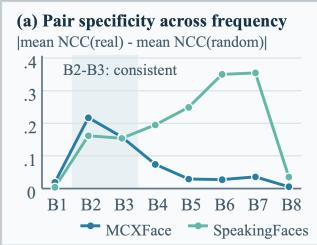
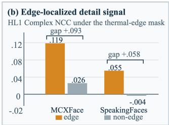
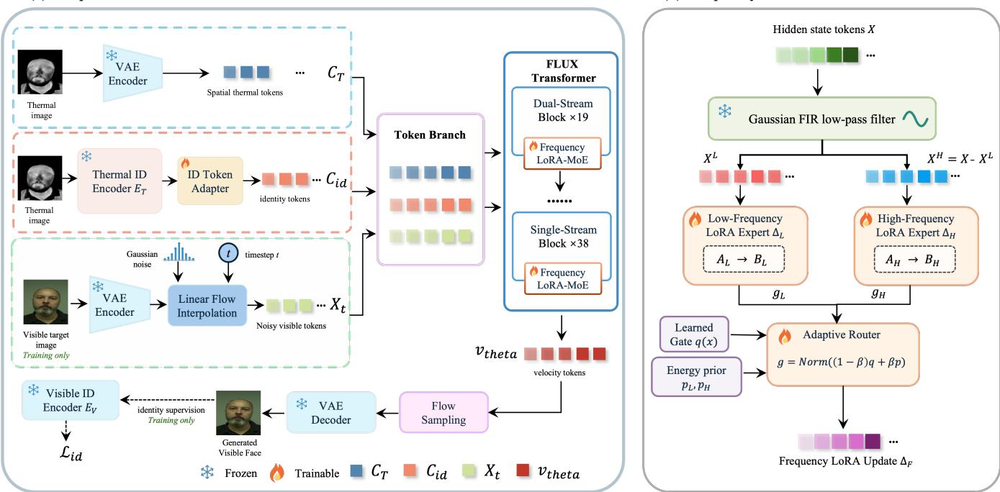
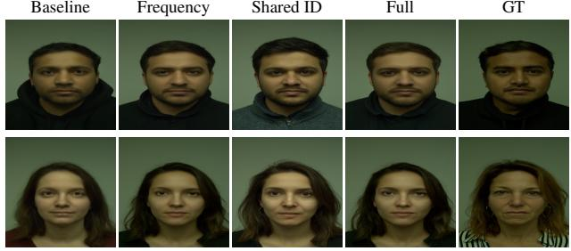
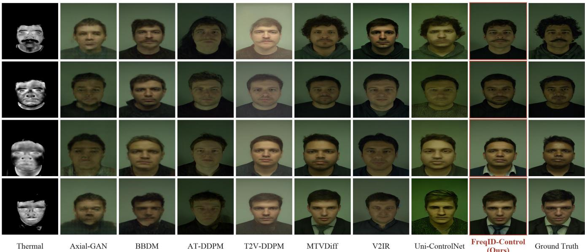

# FreqID-Control: Frequency Routing and Identity Conditioning for Thermal-to-Visible Face Translation

Haojie Li1, Xinlong Sun2, Xiaohaoyang Lei3, Kai Cheng3, Yiguo Qiao2, Xu Yang2, Cunjian Chen3

1Monash University, Monash Suzhou Research Institute, Suzhou, China

2Southeast University, School of Computer Science and Engineering, PALM Lab, Nanjing, China 3Monash University, Faculty of Information Technology, Australia

## Abstract

Thermal-to-visible (T2V) face translation has important applications in nighttime biometric recognition, low-light surveillance, and human interpretation of thermal observations. The task remains challenging because thermal images do not directly record visible appearance, while the cross-spectral cues useful for reconstruction vary across frequency components and semantic roles. Existing spatially conditioned models tend to process these cues through a homogeneous adaptation path and do not explicitly separate local structure from global identity. We propose FreqID-Control, a parameter-eficient framework that organizes thermal guidance according to spectral reliability and semantic role while preserving the pretrained generative prior. It combines frequency-routed lowrank adaptation, which allocates separate transformation subspaces to low-frequency structure and high-frequency detail, with shared cross-spectral identity conditioning, which supplies compact global identity tokens independently of spatial thermal tokens. A controlled analysis on MCXFace and SpeakingFaces provides the empirical basis for this design, revealing stable low-frequency correspondence and edge-localized detail correspondence. Experiments on both datasets demonstrate strong image fidelity and biometric identity preservation, while controlled ablations on MCXFace confirm the complementary contributions of frequency routing and shared identity conditioning.

## 1 Introduction

Thermal-to-visible (T2V) face translation supports crossspectral biometric recognition in nighttime surveillance, low-light security, and search-and-rescue scenarios. When visible-light sensors cannot provide reliable observations, thermal cameras can still capture facial patterns associated with emitted radiation. However, thermal imagery does not record reflected visible appearance and therefore cannot uniquely determine pigmentation, reflectance, or fine visiblespectrum textures. The central objective of T2V face translation is thus not to recover every unobserved appearance attribute, but to preserve the facial structure and identity information shared across spectra while using a visible-domain generative prior to synthesize plausible domain-specific details.

Existing approaches to T2V face translation have improved cross-spectral synthesis through attribute-preserving synthesis (Di, Zhang, and Patel 2018), identity-spectrum disentanglement (Anghelone et al. 2021), visible-domain prior transfer (Mei, Guo, and Patel 2022), feature-aligned identity conditioning (Lin et al. 2024) and multimodal conditional latent difusion (Xia et al. 2026b). Despite this progress, prior work has largely focused on improving the overall cross-spectral mapping, with less attention to how thermal cues of unequal reliability and identity information should be organized within the generative process. First, many conditional generators represent the thermal input as a homogeneous spatial condition, although facial structure, fine details, and sensor artifacts provide thermal-visible correspondence of unequal reliability. Processing them through a uniform conditioning pathway makes it dificult to preserve reliable structural cues while suppressing modality-specific or noisy responses, potentially weakening facial geometry or introducing unstable details. Second, spatial correspondence alone does not guarantee identity consistency. Existing identity losses and feature-alignment objectives provide useful training supervision, but they generally do not represent cross-spectral identity as an independent condition during denoising. Consequently, a generated face may appear visually plausible while deviating from the identity of the thermal input. Addressing both challenges is particularly dificult with limited paired thermal-visible face data, motivating the reuse of pretrained generative and identity priors.

Pretrained DiT-based generators provide a strong visibledomain prior under limited paired data (Peebles and Xie 2023). We therefore construct a task-specific FLUX-T2V baseline that encodes the thermal image as an aligned condition-token stream while keeping the pretrained VAE and transformer frozen. This design focuses learning on cross-spectral control rather than visible-face synthesis. However, a single low-rank path must process all thermal cues, while identity remains embedded in the spatial condition. These limitations motivate frequency-specialized adaptation and a separate cross-spectral identity condition.

To examine the first limitation, we conduct a controlled cross-dataset frequency study, with the full protocol and numerical results reported in the supplementary material. As summarized in Figure 1, pair-specific low-frequency structural correspondence is consistently observed across datasets, whereas high-frequency correspondence is less stable, more dataset-dependent, and concentrated around facial edges. Thermal evidence should therefore not be adapted uniformly. Although image-domain frequency is not equivalent to frequency in transformer hidden states, these observations motivate the testable hypothesis that separate low- and high-frequency update subspaces, combined through statedependent routing, can better accommodate their diferent reliability.

  
Figure 1: Frequency-domain motivation. (a) Absolute real– random mean Complex-NCC gaps across FFT bands. B2–B3 show pair-specific correspondence across datasets, whereas finer-frequency behavior varies. (b) HL1 Complex NCC at thermal-edge and non-edge locations, showing edgeconcentrated transferable detail.

We introduce FreqID-Control, a parameter-eficient framework built on the baseline. Motivated by the frequency evidence above and the need for independent identity guidance, it organizes thermal information along two complementary axes: spectral reliability and semantic role. First, the thermal input is encoded as a spatial condition sequence by the baseline conditioning pathway, preserving its aligned facial layout. Frequency LoRA-MoE then decomposes intermediate token sequences into low- and high-frequency components and assigns them to separate low-rank experts, with state-adaptive routing controlling their contributions. In parallel, a pretrained cross-spectral identity module maps the same thermal face into a modality-shared identity space, and a lightweight resampler converts the resulting global representation into compact context tokens. The spatial and identity sequences remain distinct until multimodal attention, allowing local structure and global identity to guide generation without being collapsed into a single condition stream.

Our contributions are summarized as follows:

• We establish a cross-dataset frequency profile of paired thermal-visible faces through real/random/self controls, sensor-noise suppression, and edge-conditioned analysis, providing an empirical rationale for frequency-selective adaptation.

• We introduce Frequency LoRA-MoE for parametereficient cross-spectral DiT adaptation. Separate lowrank subspaces model low-frequency structure and highfrequency detail, while learned and energy-based routing adjust their contributions without fine-tuning the generative backbone.

• We introduce Shared Cross-Spectral Identity Conditioning, which learns identity-discriminative factors jointly supported by thermal and visible faces rather than mapping thermal features toward a visible-specific representation. The resulting shared identity representation is resampled into compact tokens and injected through a condition branch separate from spatial thermal tokens.

## 2 Related Work

## T2V Face Translation

T2V face translation maps a thermal observation to a visiblespectrum face. Early approaches learn this cross-spectral mapping using supervised synthesis networks. Multi-region models combine global facial prediction with locally specialized mappings to recover spatially varying details (Riggan, Short, and Hu 2018), while attribute-preserving adversarial models use facial attributes to guide visible synthesis (Di, Zhang, and Patel 2018). Later methods address data scarcity by exploiting abundant visible-face data to reduce reliance on paired thermal-visible samples (Mei, Guo, and Patel 2022). These methods establish facial structure and identity as central generation objectives, but generally learn visible-domain synthesis and cross-spectral transfer jointly within dedicated networks.

Difusion models provide a probabilistic alternative to adversarial image translation. Palette formulates general imageto-image tasks as conditional denoising (Saharia et al. 2022), whereas BBDM constructs a Brownian bridge directly between source and target domains (Li et al. 2023). For thermal faces, T2V-DDPM adapts conditional difusion to thermalto-visible synthesis (Nair and Patel 2023), and DifTV combines latent difusion with heterogeneous feature alignment and dual-stage conditioning for identity preservation (Lin et al. 2024). Recent approaches further incorporate facial attributes or thermal-depth-text cues to constrain visible appearance and identity (Cai, Yoshie, and Ieiri 2025; Xia et al. 2026a). Together, these studies show that difusion models can combine generative priors with increasingly rich structural, semantic, and identity-related guidance for T2V syn thesis.

Pretrained latent difusion and difusion transformers (DiTs) reduce the need to learn the visible-image distribution from limited paired data (Rombach et al. 2022; Peebles and Xie 2023). ControlNet attaches a trainable residual branch to a frozen difusion model (Zhang, Rao, and Agrawala 2023), while OminiControl encodes image conditions with the DiT’s own VAE and processes condition and noisy-image tokens in a unified sequence using lowrank updates (Tan et al. 2025a). OminiControl2 focuses on reusing compressed condition features for eficient inference (Tan et al. 2025b). These general-purpose control frameworks provide flexible mechanisms for image conditioning, but are not designed around the frequency-dependent reliability and cross-spectral identity requirements specific to T2V face generation.

## Cross-Spectral Identity

Face-recognition models such as ArcFace learn discriminative angular geometry from visible-spectrum identities (Deng et al. 2019), but their embeddings are not inherently invariant to thermal-visible appearance changes. Heterogeneous facerecognition methods therefore introduce modality-specific transformations or shared embedding spaces to reduce the cross-spectral gap (George, Mohammadi, and Marcel 2023). In generative T2V systems, identity is encouraged through recognition objectives, heterogeneous feature alignment, attribute guidance, or multimodal conditions (Lin et al. 2024; Cai, Yoshie, and Ieiri 2025; Xia et al. 2026a). DifTV, in particular, explicitly injects aligned identity-related features through dual-stage conditioning (Lin et al. 2024). Across these designs, identity may serve as supervision, an aligned feature, or an explicit condition, but it is generally learned jointly with translation or integrated with other guidance streams. Comparatively less attention has been given to establishing a frozen cross-spectral identity representation before translation and exposing it as a condition stream distinct from spatial thermal features.

## 3 Method

## Problem Formulation and Baseline

Let $I _ { T } \in [ 0 , 1 ] ^ { 3 \times H \times W }$ be a thermal face and $I _ { V }$ its paired visible target. A frozen variational autoencoder (VAE) encodes and packs them into token sequences

$$
c _ { T } = \mathcal { P } ( \mathcal { E } _ { \mathrm { v a e } } ( I _ { T } ) ) , \qquad x _ { 0 } = \mathcal { P } ( \mathcal { E } _ { \mathrm { v a e } } ( I _ { V } ) ) ,\tag{1}
$$

where $c _ { T } , x _ { 0 } \in \mathbb { R } ^ { N \times d _ { z } }$ and $\mathcal { P }$ denotes F $\_ \mathrm { U X ^ { \cdot } s 2 \times 2 }$ latent packing. Following flow matching, we draw $x _ { 1 } \sim \mathcal { N } ( 0 , I )$ and $z \sim \mathcal { N } ( 0 , 1 )$ , set $t = \sigma ( z )$ , and construct

$$
x _ { t } = ( 1 - t ) x _ { 0 } + t x _ { 1 } , \qquad v ^ { * } = x _ { 1 } - x _ { 0 } .\tag{2}
$$

The baseline predicts $v _ { \mathrm { b a s e } } ( x _ { t } , c _ { T } , t )$ while the FLUX backbone and VAE remain frozen.

The baseline represents the thermal image as an aligned spatial-token branch and learns the cross-spectral mapping through low-rank adaptation. We write token features rowwise. For $X \in \mathbb { R } ^ { N \times d _ { \mathrm { i n } } ^ { \bullet } }$ , a rank $- r _ { b }$ thermal adapter modifies a selected linear projection as

$$
\mathcal { L } _ { \mathrm { b a s e } } ( \boldsymbol { X } ) = \boldsymbol { X } \boldsymbol { W } ^ { \top } + \frac { \alpha _ { b } } { r _ { b } } ( \boldsymbol { X } \boldsymbol { A } _ { b } ^ { \top } ) \boldsymbol { B } _ { b } ^ { \top } ,\tag{3}
$$

where $W \in \mathbb { R } ^ { d _ { \mathrm { o u t } } \times d _ { \mathrm { i n } } }$ is frozen, $A _ { b } \in \mathbb { R } ^ { r _ { b } \times d _ { \mathrm { i n } } }$ is the downprojection, and $B _ { b } \in \mathbb { R } ^ { d _ { \mathrm { o u t } } \times r _ { b } }$ is the up-projection. Thus, the trainable weight update is $\Delta W _ { b } = ( \alpha _ { b } / r _ { b } ) B _ { b } A _ { b }$ , while Eq. (3) follows the row-token convention used by the implementation. After baseline training, this adapter is loaded into FreqID-Control, activated only for the spatial thermal branch, and kept frozen. It supplies an initial thermal-to-visible mapping upon which the frequency and identity components are optimized.

Figure 2 summarizes the proposed framework. We model three input sequences: thermal identity tokens $C _ { \mathrm { i d } }$ , noisy visible tokens ${ \bf \dot { \boldsymbol X } } _ { t } ,$ and spatial thermal tokens $C _ { T }$ . The two thermal-derived branches serve diferent roles. $C _ { T }$ preserves spatially aligned structure through the baseline conditioning path, whereas $C _ { \mathrm { i d } }$ provides a compact global identity cue. Branch states are embedded independently and then interact through FLUX multimodal attention:

$$
[ C _ { \mathrm { i d } } ^ { \ell + 1 } , X _ { t } ^ { \ell + 1 } , C _ { T } ^ { \ell + 1 } ] = { \mathcal { B } } _ { \ell } ( [ C _ { \mathrm { i d } } ^ { \ell } , X _ { t } ^ { \ell } , C _ { T } ^ { \ell } ] ) .\tag{4}
$$

Thus, the source information is shared across blocks, but the injected representation is not constant: every block updates each branch and recomputes its frequency routing from the current hidden states.

## Frequency LoRA-MoE

Low-rank adaptation and expert routing provide complementary mechanisms for parameter-eficient residual learning and conditional specialization (Hu et al. 2022; Shazeer et al. 2017). We combine these principles with a lightweight tokenfrequency decomposition tailored to the measured reliability of thermal-visible correspondence.

Token-frequency decomposition. Consider the input $X \in$ $\mathbb { R } ^ { B \times N \times d _ { \mathrm { i n } } }$ to a patched attention projection. We apply a fixed depthwise Gaussian finite-impulse-response kernel $\dot { K }$ along the token dimension:

$$
X ^ { L } = K * X , \qquad X ^ { H } = X - X ^ { L } .\tag{5}
$$

The operation is performed independently for each feature channel and branch. Because packed image tokens follow raster order, it captures low- versus high-frequency variation along the token sequence with negligible parameters. We use the term token frequency to distinguish this operation from an exact two-dimensional Fourier decomposition.

Frequency-specialized LoRA experts. Two LoRA experts process the low-pass and residual high-pass components, respectively:

$$
\Delta _ { i } ( X ^ { i } ) = { \frac { \alpha _ { i } } { r _ { i } } } ( X ^ { i } A _ { i } ^ { \top } ) B _ { i } ^ { \top } , \qquad i \in \{ L , H \} ,\tag{6}
$$

where $A _ { i } \in \mathbb { R } ^ { r _ { i } \times d _ { \mathrm { i n } } }$ and $B _ { i } \in \mathbb { R } ^ { d _ { \mathrm { o u t } } \times r _ { i } }$ . The low-frequency expert models slowly varying structure, whereas the highfrequency expert models rapidly varying detail. Their independent low-rank subspaces prevent a single adapter from using the same update for both regimes.

Learned-spectral routing. The router combines a learned token-wise distribution with a sample-level componentenergy prior. For each token, the learned distribution is

$$
q ( X ) = \operatorname { s o f t m a x } ( X G ^ { \top } / \tau ) , \qquad G \in \mathbb { R } ^ { 2 \times d _ { \mathrm { i n } } } ,\tag{7}
$$

where the softmax is taken over the two experts and τ is the temperature. From the decomposed components, we estimate the per-sample energies

$$
\begin{array} { r c l } { { } } & { { } } & { { e _ { i } = \displaystyle \frac { 1 } { N d _ { \mathrm { i n } } } \| X ^ { i } \| _ { F } ^ { 2 } , } } \\ { { } } & { { } } & { { { } } } \\ { { } } & { { } } & { { p _ { H } = \displaystyle \frac { e _ { H } } { e _ { L } + e _ { H } + \epsilon } , \quad p _ { L } = 1 - p _ { H } . } } \end{array}\tag{8}
$$

where $i \in \{ L , H \}$ . The prior $p = [ p _ { L } , p _ { H } ]$ is broadcast over the token dimension. Let $\beta = \sigma ( \rho )$ be a learned scalar for each projection. We blend the learned distribution and the broadcast energy prior, then normalize over the two experts:

$$
\begin{array} { l } { \widetilde { g } _ { n , i } = ( 1 - \beta ) q _ { n , i } + \beta p _ { i } , } \\ { g _ { n , i } = \displaystyle \frac { \widetilde { g } _ { n , i } } { \sum _ { j \in \{ L , H \} } \widetilde { g } _ { n , j } + \epsilon } . } \end{array}\tag{9}
$$

Although t is not supplied directly to $G ,$ routing is recomputed at every denoising step from the evolving hidden state and is therefore state-adaptive. With two experts and $k = 2 .$ both experts remain active and the gate acts as a soft mixture rather than sparse dispatch.

(b) Frequency LoRA-MoE  
  
Figure 2: Overview of FreqID-Control. The thermal input provides a spatial condition through the frozen FLUX-based T2V pathway and a global identity condition through the shared cross-spectral encoder and trainable resampler. Spatial, identity, and noisy-latent states remain separate until multimodal attention. Frequency LoRA-MoE decomposes each current hidden state into low- and high-frequency token components, applies specialized low-rank experts, and routes their updates back to the projection. Gray modules are frozen; orange and green modules are trainable.

At each patched projection, the two gated expert outputs are summed and added as a scaled residual to the projection output. The frozen baseline LoRA remains active only on the spatial thermal branch. Frequency adapters are installed in Q/K/V projections of all 19 dual-stream and 38 singlestream FLUX blocks, and in the output projection of each dual-stream attention block, for 190 patched linear layers in total.

To promote specialization, we penalize high-pass leakage from the low expert and low-pass leakage from the high expert:

$$
\mathcal { L } _ { \mathrm { f r e q } } = \sum _ { \ell } \left( \frac { \| \Delta _ { L } ^ { \ell } - K * \Delta _ { L } ^ { \ell } \| _ { F } ^ { 2 } } { | \Delta _ { L } ^ { \ell } | } + \frac { \| K * \Delta _ { H } ^ { \ell } \| _ { F } ^ { 2 } } { | \Delta _ { H } ^ { \ell } | } \right) ,\tag{10}
$$

where $| \Delta _ { i } ^ { \ell } |$ denotes the number of elements in the corresponding expert output, matching the mean-squared reduction used in training.

## Cross-Spectral Identity Conditioning

Learning a shared cross-spectral identity space. Our objective is to retain identity factors jointly supported by thermal and visible observations while suppressing modalityspecific appearance. We use modality-specific shallow stems $E _ { T }$ and $\bar { E _ { V } }$ to absorb sensor-dependent statistics, followed by a shared IResNet body S and a common projector $P _ { \mathrm { i d } } .$ The network is initialized from an IResNet-100 pretrained with ArcFace on Glint360K, but the visible branch is not a frozen teacher. Both modalities jointly optimize the shared identity representation:

$$
f _ { m } = \operatorname { n o r m } ( P _ { \mathrm { i d } } ( S ( E _ { m } ( I _ { m } ) ) ) ) , \qquad m \in \{ T , V \} .\tag{11}
$$

The modality-specific stems and shared body are optimized at diferent learning rates, allowing shallow layers to adapt to spectral statistics without rapidly overwriting the pretrained identity geometry. A shared angular-margin classifier imposes common identity decision boundaries on both modalities:

$$
\mathcal { L } _ { \mathrm { c l s } } = \frac { 1 } { 2 } \left( \mathcal { L } _ { \mathrm { a r c } } ^ { T } + \mathcal { L } _ { \mathrm { a r c } } ^ { V } \right) .\tag{12}
$$

To directly preserve identity evidence shared across spectra, we maximize the similarity of all same-identity cross-modal samples,

$$
\mathcal { L } _ { \mathrm { p a i r } } = 1 - \frac { 1 } { | \mathcal { P } | } \sum _ { ( i , j ) \in \mathcal { P } } f _ { T , i } ^ { \top } f _ { V , j } ,\tag{13}
$$

where $\mathcal { P } = \{ ( i , j ) : y _ { T , i } = y _ { V , j } \}$ . A symmetric multipositive InfoNCE objective uses a cross-modal feature queue to attract same-identity samples and separate diferent identities in both retrieval directions. Identity prototypes $\bar { f } _ { T , k }$ and $\bar { f } _ { V , k }$ further define relation matrices R and $R _ { V }$ , with entries $R _ { a b } = \overline { { f _ { a } ^ { \top } } } \bar { f } _ { b }$ . Their of-diagonal discrepancy is regularized by

$$
\begin{array} { r } { \mathcal { L } _ { \mathrm { r e l } } = \mathrm { S m o o t h L 1 } ( R _ { T } , R _ { V } ) . } \end{array}\tag{14}
$$

Finally, a modality discriminator D receives the embeddings through a gradient-reversal layer (GRL):

$$
\mathcal { L } _ { \mathrm { d o m } } = \mathrm { C E } ( D ( \mathrm { G R L } _ { \lambda _ { d } } ( [ f _ { T } ; f _ { V } ] ) ) , m ) .\tag{15}
$$

The discriminator learns to identify the input spectrum, whereas the reversed gradient discourages the identity encoder from retaining modality-predictive directions. The complete identity-pretraining objective is

$$
\begin{array} { r l } & { \mathcal { L } _ { \mathrm { p r e } } = \lambda _ { a } \mathcal { L } _ { \mathrm { c l s } } + \lambda _ { p } \mathcal { L } _ { \mathrm { p a i r } } } \\ & { ~ + \lambda _ { c } \mathcal { L } _ { \mathrm { n c e } } + \lambda _ { r } \mathcal { L } _ { \mathrm { r e l } } + \mathcal { L } _ { \mathrm { d o m } } . } \end{array}\tag{16}
$$

This formulation does not regress thermal embeddings toward a fixed visible target. Instead, modality-specific stems absorb spectrum-dependent observations, while shared parameters, symmetric cross-modal objectives, and domain confusion encourage the common space to retain identitydiscriminative factors supported by both spectra. After pretraining, the entire identity encoder is frozen. The thermal branch provides the identity condition, and the visible branch embeds generated faces for identity supervision during translation training.

Identity-token resampling. At translation time, only the thermal embedding is available. A trainable two-layer transformer resampler uses M learned queries to map $f _ { T }$ into the FLUX context dimension:

$$
C _ { \mathrm { i d } } = \mathcal { R } ( f _ { T } ; Q ) \in \mathbb { R } ^ { M \times d } .\tag{17}
$$

We use $M = 4 .$ . These tokens bypass the standard context embedder, receive distinct positional identifiers, and enter attention as an independent context branch. The identity representation is therefore not merged into the spatial thermal sequence or used only as a training loss. Instead, compact global identity tokens and spatially aligned thermal tokens remain structurally distinct until multimodal attention determines their interaction.

## Training Objectives

The primary flow-matching objective is

$$
\mathcal { L } _ { \mathrm { f l o w } } = \| v _ { \theta } ( x _ { t } , c _ { T } , C _ { \mathrm { i d } } , t ) - v ^ { * } \| _ { 2 } ^ { 2 } .\tag{18}
$$

For suficiently low noise, the predicted clean latent is

$$
\hat { x } _ { 0 } = x _ { t } - t v _ { \theta } ( x _ { t } , c _ { T } , C _ { \mathrm { i d } } , t ) .\tag{19}
$$

After VAE decoding, the frozen visible identity branch extracts $f _ { \mathrm { g e n } }$ . We define

$$
\mathcal { L } _ { \mathrm { i d } } = { \bf 1 } [ t \leq t _ { \mathrm { m a x } } ] ( 1 - t ) ^ { \gamma } \left( 1 - \cos ( f _ { \mathrm { g e n } } , f _ { T } ) \right) .\tag{20}
$$

The complete objective is

$$
\begin{array} { r } { \mathcal { L } = \mathcal { L } _ { \mathrm { { f l o w } } } + \lambda _ { f } \mathcal { L } _ { \mathrm { f r e q } } + \lambda _ { \mathrm { i d } } \mathcal { L } _ { \mathrm { i d } } . } \end{array}\tag{21}
$$

The current configuration sets $\lambda _ { f } ~ = ~ 1 0 ^ { - 3 } , ~ \lambda _ { \mathrm { { i d } } } ~ = ~ 0 . 0 5 .$ $t _ { \mathrm { m a x } } = 0 . 3 5$ , and $\gamma = 2$ . The trainable parameters comprise the frequency LoRA experts, learned gates and blend coeficients, and identity resampler; all generative backbone parameters, the baseline spatial-conditioning adapter, and the cross-spectral identity encoder are frozen.

## 4 Experiments

We evaluate FreqID-Control through translation quality, biometric identity preservation, qualitative comparison, and controlled component ablations. The cross-dataset frequency analysis that motivates the architecture is reported in the supplementary material.

## Experimental Setup

Datasets. MCXFace provides spatially registered observations from 51 identities acquired over three sessions under multiple illumination settings (George, Mohammadi, and Marcel 2023). Following the T2V preprocessing protocol, we form 6,120 thermal-visible pairs at 256×256 resolution. The identity-disjoint partition assigns 41 subjects (4,920 pairs) to training and the remaining 10 subjects (1,200 pairs) to testing. Within the training identities, cross-spectral identity pretraining uses 33 subjects for optimization and 8 for validation.

SpeakingFaces records synchronized thermal and visible video from 142 participants (Abdrakhmanova et al. 2021). After removing invalid or poorly aligned frames, our protocol retains 7,700 paired face samples spanning nine viewpoint configurations. We use 5,400 pairs from 100 identities for training and 2,300 pairs from 42 disjoint identities for testing. No test identity is used to optimize either the translation model or the cross-spectral identity encoder.

Implementation details. We use FLUX.1-dev as the frozen generative backbone. The Frequency LoRA-MoE is installed in the attention projections of all 19 dual-stream and 38 single-stream transformer blocks. Unless otherwise stated, the low- and high-frequency experts use rank 8, a length-9 FIR kernel, temperature 5, residual scale 0.1, and soft two-expert routing. The identity resampler produces four 3,072-dimensional context tokens. Translation training runs for 8,000 optimizer updates using bfloat16, an efective batch size of8, gradient clipping at 0.5, and Prodigy with weight decay 0.01. Inputs and targets are directly resized to 256 × 256. We sample each image with 28 denoising steps, guidance scale 1.8, image-guidance scale 1.0, and seed 42.

The cross-spectral identity encoder uses an ArcFace IResNet-100 initialized from Glint360K. Thermal and visible images pass through modality-specific shallow stems and a shared identity body; both modalities are jointly optimized for 30,000 steps, with a lower learning rate applied to the shared pretrained layers. Training combines angular-margin classification, paired alignment, cross-modal InfoNCE, relation preservation, and domain confusion. The complete identity encoder is frozen before translation training.

Metrics and baselines. Translation quality is measured with FID, LPIPS, PSNR, and SSIM. For biometric evaluation, ArcFace embeddings are used to compute Rank-1 identification and verification rates at false-acceptance rates of 1% and 0.1%. Embedding-based identity scores are computed on images for which the face detector returns a valid face, and the number of valid detections is recorded separately. Image metrics are computed at 256×256 with PyIQA using matched generated and reference images. We compare against available adversarial and difusion T2V systems under their reported dataset protocols; controlled ablations evaluate the baseline, frequency-only, identity-only, and complete variants on a common test manifest.

Frequency
<table><tr><td></td><td colspan="4">MCXFace</td><td colspan="4">SpeakingFaces</td></tr><tr><td>Method</td><td>FID↓</td><td>LPIPS ↓</td><td>SSIM ↑</td><td>PSNR ↑</td><td>FID↓</td><td>LPIPS ↓</td><td>SSIM ↑</td><td>PSNR ↑</td></tr><tr><td>Axial-GAN</td><td>129.62</td><td>0.2131</td><td>0.6441</td><td>17.82</td><td>46.69</td><td>0.1729</td><td>0.6673</td><td>20.45</td></tr><tr><td>BBDM</td><td>127.06</td><td>0.1926</td><td>0.7629</td><td>20.50</td><td>41.40</td><td>0.2112</td><td>0.7161</td><td>26.51</td></tr><tr><td>AT-DDPM</td><td>116.02</td><td>0.2621</td><td>0.6402</td><td>17.39</td><td>71.34</td><td>0.4063</td><td>0.5554</td><td>8.75</td></tr><tr><td>T2V-DDPM</td><td>120.65</td><td>0.2445</td><td>0.6740</td><td>18.37</td><td>36.33</td><td>0.2705</td><td>0.6832</td><td>15.53</td></tr><tr><td>DiffTV</td><td></td><td></td><td></td><td></td><td>34.02</td><td>0.1650</td><td>0.7504</td><td>29.45</td></tr><tr><td>Uni-ControlNet</td><td>97.01</td><td>0.2151</td><td>0.7181</td><td>20.01</td><td>29.20</td><td>0.3017</td><td>0.7042</td><td>19.81</td></tr><tr><td>MTVDiff (thermal-only)</td><td>93.96</td><td>0.2001</td><td>0.7367</td><td>20.45</td><td>20.14</td><td>0.1320</td><td>0.7836</td><td>20.91</td></tr><tr><td>DiffV2IR (thermal-only)</td><td>89.71</td><td>0.2220</td><td>0.6718</td><td>19.56</td><td>22.13</td><td>0.2007</td><td>0.7609</td><td>20.93</td></tr><tr><td>FreqID-Control</td><td>74.86</td><td>0.1626</td><td>0.7647</td><td>21.25</td><td>21.74</td><td>0.1637</td><td>0.7969</td><td>21.96</td></tr></table>

Table 1: Reported thermal-to-visible image-quality results on MCXFace and SpeakingFaces. Published baselines follow their respective evaluation protocols; the best reported value for each dataset and metric is shown in bold. Dashes indicate unavailable results.

## Main Translation Results

As shown in Table 1, FreqID-Control achieves the best reported MCXFace results across all four image-quality metrics. In particular, it improves SSIM from the previous best of 0.7629 to 0.7647, indicating stronger preservation of crossspectrally supported facial structure. This structural improvement is accompanied by consistent gains in distributional, perceptual, and pixel-level quality: FID decreases from 89.71 to 74.86, LPIPS from 0.1926 to 0.1626, and PSNR increases from 20.50 to 21.25 dB. These results show that FreqID-Control improves structural consistency without sacrificing visible-domain synthesis quality.

On SpeakingFaces, FreqID-Control leads in SSIM and the identity measures in Table 3, but trails thermal-only MTVDif in FID and LPIPS and DifTV in PSNR. This profile matches our emphasis on cross-spectrally supported structure and identity rather than pixel-level recovery of visibleonly appearance, indicating a metric trade-of rather than uniform superiority.

Figure 4 compares MCXFace results with varied facial structure, hairstyle, and facial hair. Earlier methods frequently blur facial boundaries or alter identity-related geometry. In comparison, FreqID-Control more consistently preserves the principal structure of the thermal observation while producing a coherent visible-spectrum face.

## Ablation Study

<table><tr><td>Frequency LoRA-MoE</td><td>Shared ID FID↓</td><td>LPIPS ↓</td><td>SSIM↑</td><td>PSNR↑</td><td>Rank-1 ↑</td></tr><tr><td></td><td></td><td>77.95</td><td>0.1990 0.7060</td><td>18.63</td><td>0.8725</td></tr><tr><td>√</td><td></td><td>75.13</td><td>0.1698 0.7494</td><td>21.12</td><td>0.9471</td></tr><tr><td></td><td>√</td><td>74.84</td><td>0.1779 0.7362</td><td>20.86</td><td>0.9271</td></tr><tr><td>√</td><td>√</td><td>74.86</td><td>0.1626 0.7647</td><td>21.25</td><td>0.9682</td></tr></table>

Table 2: Component ablation on MCXFace.

Component efects. All variants in Table 2 share the same baseline and test manifest. Frequency LoRA-MoE improves every metric, including a 2.49 dB PSNR gain and a Rank-1 increase from 0.8725 to 0.9471, supporting its role in adapting cross-spectral structure and detail. Identity conditioning alone lowers FID to 74.84 and raises Rank-1 to 0.9271, showing that shared identity tokens add a global modalitycompatible cue beyond spatial conditioning. Combining both components yields the best LPIPS, SSIM, PSNR, and Rank-1 (0.9682), while its FID is efectively tied with identity conditioning alone. This result supports their complementary roles in frequency-aware structural adaptation and global cross-spectral identity guidance.

Baseline  
Shared ID  
Full  
  
GT  
Figure 3: Qualitative component ablation on two MCXFace samples. The full model combines Frequency LoRA-MoE and shared identity conditioning.

## Identity Preservation Results

Table 3 shows that FreqID-Control reaches Rank-1 scores of 0.9682 on MCXFace and 0.9688 on SpeakingFaces. The controlled ablation in Table 2 attributes this gain partly to Shared ID, which raises MCXFace Rank-1 from 0.8725 to 0.9271; its further increase to 0.9682 with Frequency LoRA-MoE demonstrates their complementary identity and structural guidance. On SpeakingFaces, the full model also obtains the highest reported Rank-1 and verification rates under the reported protocol. On MCXFace, however, MTVDif retains higher VR@1% and VR@0.1% despite its lower Rank-1. These results show a consistent advantage in Rank-1 identification on both datasets, but not uniform superiority at all verification operating points. Because the published rows follow diferent evaluation protocols, comparisons beyond our controlled ablation should be interpreted as reference results.

Figure 4: Qualitative comparison on four MCXFace test samples. DifV2IR uses its thermal-only setting; the FreqID-Control column is outlined, and Ground Truth is shown last.
<table><tr><td></td><td colspan="3">MCXFace</td><td colspan="3">SpeakingFaces</td></tr><tr><td>Method</td><td>Rank-1</td><td>VR@1%</td><td>VR@0.1%</td><td>Rank-1</td><td>VR@1%</td><td>VR@0.1%</td></tr><tr><td>Axial-GAN</td><td>0.6815</td><td>0.0833</td><td>0.0033</td><td>0.2357</td><td>0.1606</td><td>0.0402</td></tr><tr><td>BBDM</td><td>0.7571</td><td>0.0960</td><td>0.0037</td><td>0.8659</td><td>0.5933</td><td>0.1257</td></tr><tr><td>AT-DDPM</td><td>0.5664</td><td>0.0704</td><td>0.0122</td><td>0.4169</td><td>0.3422</td><td>0.0782</td></tr><tr><td>T2V-DDPM</td><td>0.6815</td><td>0.1154</td><td>0.0256</td><td>0.4940</td><td>0.3357</td><td>0.0816</td></tr><tr><td>DiffTV</td><td></td><td></td><td></td><td>0.6885</td><td>0.0754</td><td>0.0159</td></tr><tr><td>DiffV2IR</td><td>0.7834</td><td>0.1090</td><td>0.0192</td><td>0.5159</td><td>0.3660</td><td>0.0679</td></tr><tr><td>Uni-ControlNet</td><td>0.3758</td><td>0.0630</td><td>0.0126</td><td>0.8619</td><td>0.6987</td><td>0.4555</td></tr><tr><td>MTVDiff (multimodal)</td><td>0.8726</td><td>0.2774</td><td>0.0258</td><td>0.9376</td><td>0.8011</td><td>0.3131</td></tr><tr><td>FreqID-Control</td><td>0.9682</td><td>0.1338</td><td>0.0127</td><td>0.9688</td><td>0.9000</td><td>0.6353</td></tr></table>

Table 3: Cross-spectral face-recognition results on MCXFace and SpeakingFaces. Published baselines follow the evaluation compiled by MTVDif (Xia et al. 2026a); its row uses thermal–depth–text input, whereas FreqID-Control uses only thermal imagery. Results from diferent recognition protocols are reference comparisons. Best values are bold, and dashes denote unavailable results.

## 5 Conclusion

We presented FreqID-Control, a parameter-eficient T2V framework that separates spatial thermal control from cross-spectral identity guidance. Frequency LoRA-MoE adapts low-frequency structure and selectively reliable highfrequency detail, while the shared identity pathway extracts identity-discriminative factors supported by both spectra. Controlled MCXFace ablations show that the two modules improve the FLUX-T2V baseline and are complementary. Across MCXFace and SpeakingFaces, FreqID-Contro achieves strong structural and identity results, but not every image-quality metric or verification operating point. This reflects our objective of preserving cross-spectrally supported geometry and identity; visible-only attributes absent from thermal observations are generated plausibly rather than recovered.

## References

Abdrakhmanova, M.; Kuzdeuov, A.; Jarju, S.; Khassanov, Y.; Lewis, M.; and Varol, H. A. 2021. SpeakingFaces: A Large-Scale Multimodal Dataset of Voice Commands with Visual and Thermal Video Streams. Sensors, 21(10): 3465.

Anghelone, D.; Chen, C.; Faure, P.; Ross, A.; and Dantcheva, A. 2021. Explainable Thermal to Visible Face Recognition Using Latent-Guided Generative Adversarial Network. In 2021 16th IEEE International Conference onAutomatic Face and Gesture Recognition (FG 2021), 1–8. IEEE Press.

Cai, M.; Yoshie, O.; and Ieiri, Y. 2025. Multi-Attribute

Guided Thermal Face Image Translation Based on Latent Difusion Model. In 2025 IEEE International Joint Conference on Biometrics, 1–9.

Deng, J.; Guo, J.; Xue, N.; and Zafeiriou, S. 2019. ArcFace: Additive Angular Margin Loss for Deep Face Recognition. In Proceedings of the IEEE/CVF Conference on Computer Vision and Pattern Recognition, 4690–4699.

Di, X.; Zhang, H.; and Patel, V. M. 2018. Polarimetric Thermal to Visible Face Verification via Attribute Preserved Synthesis. In Proceedings of the IEEE International Conference on Biometrics: Theory, Applications, and Systems, 1–10.

George, A.; Mohammadi, A.; and Marcel, S. 2023. Prepended Domain Transformer: Heterogeneous Face Recognition without Bells and Whistles. IEEE Transactions on Information Forensics and Security, 18: 133–146.

Hu, E. J.; Shen, Y.; Wallis, P.; Allen-Zhu, Z.; Li, Y.; Wang, S.; Wang, L.; and Chen, W. 2022. LoRA: Low-Rank Adaptation of Large Language Models. In International Conference on Learning Representations.

Li, B.; Xue, K.; Liu, B.; and Lai, Y.-K. 2023. BBDM: Imageto-Image Translation with Brownian Bridge Difusion Models. In Proceedings of the IEEE/CVF Conference on Computer Vision and Pattern Recognition, 1952–1961.

Lin, J.; Zhao, G.; Xu, J.; Wang, G.; Wang, Z.; Dantcheva, A.; Du, L.; and Chen, C. 2024. DifTV: Identity-Preserved Thermal-to-Visible Face Translation via Feature Alignment and Dual-Stage Conditions. In Proceedings ofthe 32ndACM International Conference on Multimedia, 10930–10938.

Mei, Y.; Guo, P.; and Patel, V. M. 2022. Escaping Data Scarcity for High-Resolution Heterogeneous Face Hallucination. In Proceedings of the IEEE/CVF Conference on Computer Vision and Pattern Recognition, 18676–18686.

Nair, N. G.; and Patel, V. M. 2023. T2V-DDPM: Thermal to Visible Face Translation Using Denoising Difusion Probabilistic Models. In Proceedings of the IEEE International Conference on Automatic Face and Gesture Recognition, 1– 7.

Peebles, W.; and Xie, S. 2023. Scalable Difusion Models with Transformers. In Proceedings of the IEEE/CVF International Conference on Computer Vision, 4195–4205.

Riggan, B. S.; Short, N. J.; and Hu, S. 2018. Thermal to Visible Synthesis of Face Images Using Multiple Regions. In Proceedings ofthe IEEE Winter Conference on Applications of Computer Vision, 30–38.

Rombach, R.; Blattmann, A.; Lorenz, D.; Esser, P.; and Ommer, B. 2022. High-Resolution Image Synthesis with Latent Difusion Models. In Proceedings of the IEEE/CVF Conference on Computer Vision and Pattern Recognition, 10684–10695.

Saharia, C.; Chan, W.; Chang, H.; Lee, C.; Ho, J.; Salimans, T.; Fleet, D. J.; and Norouzi, M. 2022. Palette: Image-to-Image Difusion Models. In ACM SIGGRAPH 2022 Conference Proceedings, 1–10. Article 15.

Shazeer, N.; Mirhoseini, A.; Maziarz, K.; Davis, A.; Le, Q. V.; Hinton, G. E.; and Dean, J. 2017. Outrageously Large Neural Networks: The Sparsely-Gated Mixture-of-Experts

Layer. In International Conference on Learning Representations.

Tan, Z.; Liu, S.; Yang, X.; Xue, Q.; and Wang, X. 2025a. OminiControl: Minimal and Universal Control for Difusion Transformer. In Proceedings ofthe IEEE/CVF International Conference on Computer Vision, 14940–14950.

Tan, Z.; Xue, Q.; Yang, X.; Liu, S.; and Wang, X. 2025b. OminiControl2: Eficient Conditioning for Difusion Transformers. arXiv:2503.08280.

Xia, Z.; Li, H.; Lin, J.; Qiao, Y.; and Chen, C. 2026a. MTVDif: Multimodal Conditional Latent Difusion for Enhanced Thermal-to-Visible Face Translation. arXiv:2607.19886.

Xia, Z.; Li, H.; Lin, J.; Qiao, Y.; and Chen, C. 2026b. MTVDif: Multimodal Conditional Latent Difusion for Enhanced Thermal-to-Visible Face Translation. In Favaro, P.; Kukelova, Z.; Maki, A.; Rohrbach, A.; Schindler, K.; and Tombari, F., eds., Computer Vision – ECCV 2026, 36–52. Cham: Springer Nature Switzerland.

Zhang, L.; Rao, A.; and Agrawala, M. 2023. Adding Conditional Control to Text-to-Image Difusion Models. In Proceedings of the IEEE/CVF International Conference on Computer Vision, 3836–3847.