# From Pixels to Executable Physics: Behavior-Grounded World Models for Embodied Action Consequence Prediction

Ruo Chen1,2,\* Jiahua Pang1,3,\* Yingjie NIU1,†,‡ Hongyi Lin4,5 Jun Tian1,6 Yang Zhu2,† Chao Li1,†

1DEEP Robotics 2Zhejiang University 3Beijing Institute of Technology

4Massachusetts Institute of Technology 5Tsinghua University

6University of Illinois at Urbana-Champaign

\*Equal contribution ‡Project leader

†Corresponding authors: Yingjie NIU: niu.yingjie@g.sp.m.is.nagoya-u.ac.jp

Yang Zhu: zhuyang88@zju.edu.cn Chao Li: lichao@deeprobotics.cn

Project: https://developer.deeprobotics.cn/research/articles/dr-wm/index.html

In outdoor environments, varying terrain and contact conditions can cause identical action commands to produce different motion outcomes for quadruped robots. Predicting these outcomes is essential for reliable navigation and informed path selection. Existing video world models can generate visually plausible futures, yet often struggle to capture robot dynamics and terrain interactions, leading to overly optimistic predictions of action outcomes. We present DR-WM, a physically consistent world model that incorporates robot–terrain contact dynamics to predict the consequences of quadruped actions. Starting from an initial RGB image, our method reconstructs scene geometry and integrates dense, dimensionless priors over terrain contact properties, calibrated using real-world action–response data. The resulting terrain model supports the simulation of physics with spatially varying contact properties such as friction. Given the initial state of the robot and candidate action sequences, we simulate its future motion and use the resulting camera trajectories and rendered geometry to guide the training of a video world model. The generated future observations are then used to update the terrain reconstruction, enabling iterative model rollouts without additional real-world images. Extensive experiments demonstrate that DR-WM substantially outperforms geometry-only baselines and baselines with uniform physical parameters on key physical metrics characterizing action outcomes, while achieving the best performance among the evaluated baselines. These physically grounded predictions support more informed action selection: across 90 challenging scenarios, an 8B vision–language model augmented with DR-WM outperforms an unassisted 32B vision–language model on five of six evaluation metrics.

## 1 Introduction

Outdoor quadruped navigation depends not only on scene semantics and geometric traversability but also on how terrain contact affects robot motion. As embodied navigation moves from structured laboratory settings to complex outdoor environments, robots encounter spatially varying friction, support, and contact conditions. Under the same low-level controller, an identical nominal motion command may produce steady progress, slipping, attitude disturbances, or even instability (Chen et al., 2024). Reliable outdoor navigation therefore requires both understanding what is in the scene and predicting what wil happen when an action is executed on the current terrain.

A natural approach is to predict candidate action outcomes before execution, rule out high-risk behaviors, and decide whether to proceed or adjust motion. However, real-world robot trials are costly and time-consuming. World models offer a promising alternative, enabling policies or planners to compare candidate actions through visual predictions of their outcomes (Ha and Schmidhuber, 2018; Hafner et al., 2019a;b).

However, a visually plausible future is not necessarily physically realizable. Existing video world models typically generate future observations in two ways. One class conditions on predefined camera trajectories to synthesize viewpoint changes and scene motion. This assumes the ground-truth camera trajectory and cannot determine whether it is physically feasible on the current terrain. Another class predicts video directly from actions, but most current applications focus on game generation and remain far removed from real-world settings. Scene geometry alone is also insufficient: geometrically similar surfaces can produce markedly different robot responses due to different contact properties. Consequently, existing models may depict smooth forward motion even when the same action would cause severe slipping or instability in reality.

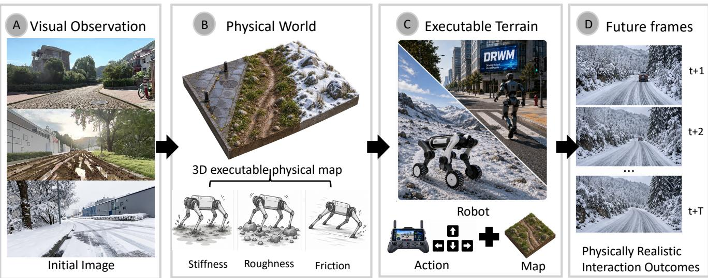

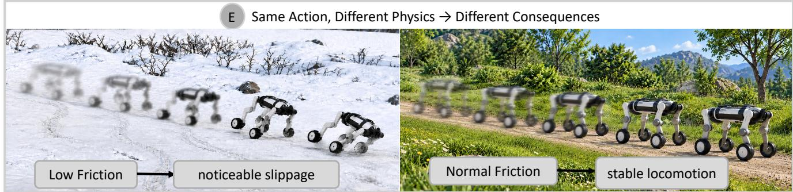  
Figure 1: Overview of DR-WM. The model constructs an executable terrain representation from visual observations, then simulates terrain dynamics to predict future observations and terrain-dependent action outcomes.

In this research we focus on physical consistency between robot motion and visual predictions: candidate actions and spatially varying terrain contact jointly determine the robot state trajectory, from which camera motion is derived. This poses two key challenges. First, a single RGB image provides only uncertain priors over terrain properties (Chen et al., 2024). These priors require calibration using real robot action–response data to obtain contact parameters that reproduce robot motion. Second, as the robot moves beyond the initial field of view, the model must complete unobserved regions and estimate their contact properties. Although video models can complete visual content using scene priors and coarse 3D information (Team Wan et al., 2025; Zhao et al., 2025), long-horizon motion predictions may still deviate from real outcomes without behavior-grounded physical representations of these regions.

To address these challenges, we propose DR-WM, a physically consistent world model for robot–terrain interaction (Figure 1). Given an initial RGB image, the robot’s initial state, and candidate action sequences, DR-WM jointly predicts future robot motion and the corresponding visual observations. Our core idea is to model physical evolution and visual completion sepa rately while coupling them through a shared robot state trajectory: contact dynamics determine how the robot moves, and the video model predicts what it will see as a result. Unlike methods that guide video generation with coarse simulation (Li et al., 2025), DR-WM predicts motion using a terrain contact model calibrated against real robot behavior.

Specifically, DR-WM integrates terrain modeling, physics-guided video generation, and iterative scene updates. First, we reconstruct scene geometry from visual observations and train PhyMap to predict dense, normalized priors for contact properties. We then map these priors to effective contact parameters using real-world robot action–response data. This calibration mapping is learned exclusively from the training data and remains fixed at test time. Second, for each candidate action, we simulate the resulting robot motion using the calibrated contact parameters and derive the corresponding camera trajectory from the predicted base poses (Genesis Authors, 2024). Conditioned on this trajectory and coarse geometric renderings, the video model generates future frames. Finally, we use the generated frames to estimate the geometry and contact properties of previously unobserved regions. By propagating the robot state across chunks and incrementally extending the terrain representation, DR-WM supports long-horizon rollouts without requiring additional real-world images. A decision model then evaluates the candidate actions using these predicted observations and selects the action expected to produce more stable, lower-risk motion (Figure 2). Experiments show that the behavior-calibrated, spatially varying contact model substantially outperforms geometry-only and uniform-physics baselines on key motion-prediction metrics. DR-WM further outperforms every competing baseline on all reported video metrics. Across 90 challenging action-selection scenarios, an 8B VLM augmented with DR-WM outperforms a standalone 32B VLM on five of the six evaluation metrics. Our main contributions are as follows:

(1) Physical World Model for Robot Navigation. We propose DR-WM, a unified framework for terrain-dependent action consequence prediction. It integrates terrain understanding, behavior-calibrated physics simulation, and a video model tailored to robot motion prediction.

(2) Large-Scale Multimodal Physical Dataset. We introduce Physcene, comprising two distinct subsets. Physcene–Image contains 2.58M images with dense physical priors. Physcene–Robot provides over 100K dedicated robot clips with visua observations, robot states, and control signals.

(3) Physically Plausible Simulation. DR-WM’s autoregressive reasoning achieves the best performance on Physcene–Robot evaluations, making world models practically useful for real-world robot navigation.

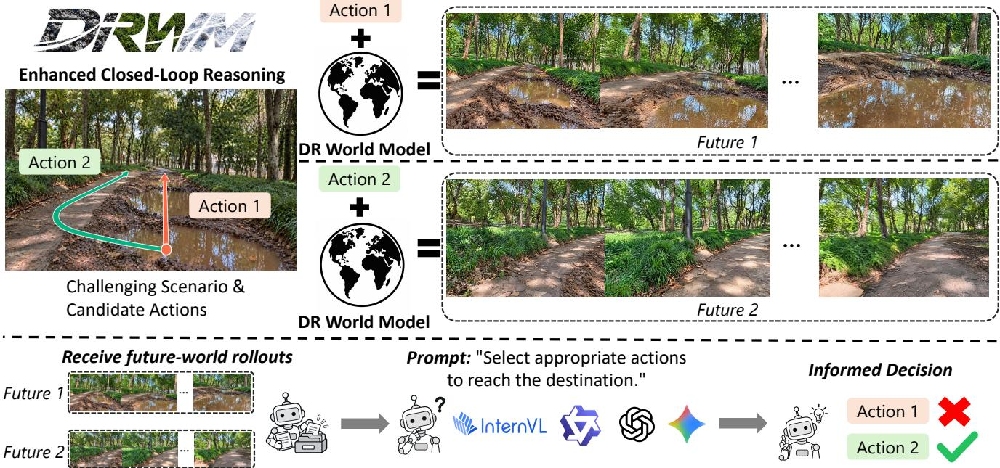  
Figure 2: VLM action-selection pipeline. For each candidate action, DR-WM predicts future observations and iteratively feeds them back into scene reconstruction and physics simulation. The VLM compares the resulting rollouts and selects the safer action. In this example, it chooses the detour (Action 2) over traversing the muddy terrain (Action 1); see Section 4.4.

## 2 Related Work

## 2.1 Visual and Action-Conditioned World Models

Visual world models have evolved from latent prediction to controllable video generation. Early approaches predict future observations for action evaluation (Finn and Levine, 2017; Hafner et al., 2019a). Interactive models extend this idea to control-conditioned video (Yang et al., 2024; Bruce et al., 2024). Geometry-aware methods such as Spatia and WorldStereo further improve spatial consistency and camera control through 3Dguidance (Zhao et al., 2025; Zhang et al., 2026). Yet these systems emphasize camera-driven exploration, with limited modeling of physically grounded navigation actions. Our DR-WM instead uses simulated robot actions to determine future motion and camera trajectories before visual prediction.

## 2.2 3D Reconstruction toward Physical Scene Understanding

Recent 3D reconstruction methods such as VGGT and MapAnything enable efficient scene reconstruction from images (Wang et al., 2025; Keetha et al., 2026). Building on these geometric representations, IGGT and VGGT-Segmentor further incorporate instance-level and semantic understanding (Li et al., 2026; Gao et al., 2026). However, physical scene properties are still less explored. Recent VLM-based methods such as SiPhy and PhysGS begin to address this direction by estimating physical attributes from visual cues (Le et al., 2026; Chopra et al., 2026). These approaches often rely on multi-stage inference, making efficient scene-wide physical prediction challenging. DR-WM targets this gap by extending feed-forward 3D reconstruction with dense physical priors.

## 2.3 Robot Navigation Data

Navigation datasets cover diverse domains. NuScenes targets urban driving (Caesar et al., 2020), while RELLIS-3D and GOOSE focus on unstructured outdoor environments (Jiang et al., 2022; Mortimer et al., 2024). ScanNet provides indoor geometry (Dai et al., 2017), and SCAND records navigation behavior (Karnan et al., 2022). However, most datasets remain domain-specific and capture limited physical variation across terrain surfaces. Terrain perception estimates traversability and physical properties (Frey et al., 2023; Miki et al., 2022; Chen et al., 2024), whereas real-to-sim methods infer simulator parameters from observed responses (Chebotar et al., 2019; Ramos et al., 2019). Our work connects visual understanding with executable physics for future prediction.

## 3 Method

## 3.1 Physical–Visual Prediction Framework

DR-WM predicts robot motion and future observations under terrain-dependent contact dynamics. PhyMap reconstructs geometry and dense physical priors from causal views. Calibrated using real robot action-response data, these priors define executable terrain parameters. Genesis (Genesis Authors, 2024) then simulates robot motion from this terrain, the curren state, and commands. The resulting camera trajectories and rendered controls guide video generation. Future viewpoints thus arise from robot–terrain interaction rather than prescribed trajectories.

To formalize this physical–visual prediction, let $s _ { t }$ denote the robot state, comprising the floating-base pose, velocity, and joint states. Then $a _ { t }$ denotes the recorded command and $I _ { t }$ the synchronized robot-camera RGB frame. At chunk boundary $\tau _ { k } ,$ history $\mathcal { H } _ { k }$ contains the initial real frame $\bar { I } _ { 0 } = I _ { 0 }$ and generated frames $\begin{array} { r } { \bar { I } _ { j } = \hat { I } _ { j } \mathrm { ~ f o r ~ } 0 < j \leq \tau _ { k } . \mathcal { H } _ { k } } \end{array}$ also includes the current state and next $H$ commands, excluding future real frames. The joint prediction is factorized as:

$$
\begin{array} { r l } {  { p ( s _ { \tau _ { k } + 1 : \tau _ { k } + H } , I _ { \tau _ { k } + 1 : \tau _ { k } + H } \mid \mathcal { H } _ { k } ) } \quad } & { } \\ & { = p _ { \Gamma } ( s _ { \tau _ { k } + 1 : \tau _ { k } + H } \mid s _ { \tau _ { k } } , a _ { \tau _ { k } : \tau _ { k } + H - 1 } , \Theta _ { k } ) p _ { \psi } \big ( I _ { \tau _ { k } + 1 : \tau _ { k } + H } \mid \bar { I } _ { 0 : \tau _ { k } } , \mathcal { T } _ { k } , \mathcal { C } _ { k } , \mathcal { R } _ { k } \big ) , } \end{array}\tag{1}
$$

where $\Theta _ { k }$ denotes the executable terrain and $\mathcal { T } _ { k }$ the simulated camera trajectory. The rendered 3D control and strictly past reference views are denoted by $\mathcal { C } _ { k }$ and $\mathcal { R } _ { k }$ , respectively. Genesis implements the physical factor deterministically, and the video model generates the corresponding future observations. Figure 3 summarizes the architecture. Appendix B provides calibration details.

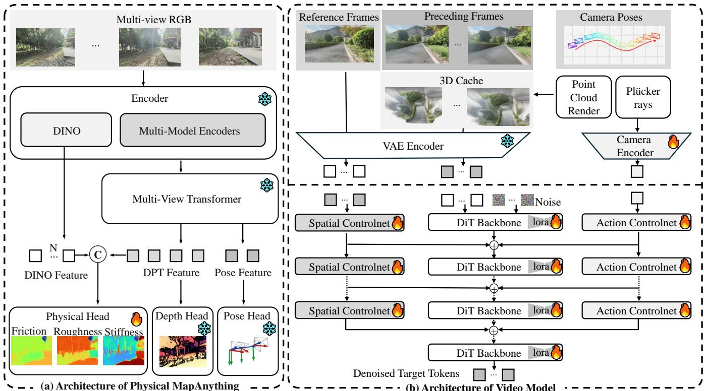  
Figure 3: Architecture of DR-WM. (a) PhyMap reconstructs geometry and physical priors. (b) Spatial and action ControlNets guide video generation using camera poses and rendered geometry.

## 3.2 PhyMap: Dataset and Physical-Prior Learning

PhyMap constructs a geometry-aligned physical representation with a frozen MapAnything backbone (Keetha et al., 2026):

$$
\mathcal { W } _ { k } ^ { \mathrm { p h y } } = \mathcal { P } _ { \omega } ( \mathcal { V } _ { k } ) = \left\{ ( x _ { i } , c _ { i } , q _ { i } , z _ { i } ) \right\} _ { i = 1 } ^ { N _ { k } } , \qquad z _ { i } = ( z _ { i } ^ { f } , z _ { i } ^ { r } , z _ { i } ^ { s } ) \in [ 0 , 1 ] ^ { 3 } ,\tag{2}
$$

where $x _ { i } \in \mathbb { R } ^ { 3 } , c _ { i } .$ , and $q _ { i }$ denote position, RGB, and geometric confidence, respectively. The three dimensionless channels represent friction, roughness, and stiffness priors, which are later mapped to simulator parameters.

To support PhyMap training, we construct Physcene–Image, a large-scale image dataset with dense physical-prior supervi sion, combining our real-world quadruped data, public indoor and off-road datasets, and web videos to cover diverse scenes. CLIP (Radford et al., 2021) guides scene-based video filtering, followed by frame extraction and deduplication. We then use ActiveSAM (Tien and Shen, 2026) to segment all images into a unified set of 32 semantic classes covering terrain, obstacles, and traffic participants. The complete dataset contains 2.58M unique RGB-mask pairs: 1.5M on-robot, 690K indoor, 44.6K off-road, and 350K web samples. For physical supervision, we construct a class-to-property lookup table from LLM priors. The table converts segmentation masks into dense targets for three normalized physical properties. Appendix C provides the detailed source breakdown.

The frozen backbone provides multi-scale DPT (Ranftl et al., 2021) and DINOv2 (Oquab et al., 2024) features, along with depth, normals and confidence. A trainable physical decoder predicts $z _ { v } ( u )$ at pixel u in view v. Supervision combines a masked smooth- $. L _ { 1 }$ loss on the physical targets with auxiliary terrain classification. Training follows a view-count curriculum that progressively increases the number of causal input views. The predicted priors are lifted into 3D to form a physical field aligned with the reconstructed point cloud.

## 3.3 Behavior-Grounded Executable Physics

The normalized physical field is mapped pointwise by $g _ { \phi }$ to executable terrain parameters $\theta ( x ) = ( \mu ( x ) , \rho ( x ) , \tau _ { c } ( x ) )$ . Here $\mu$ denotes the ground friction coefficient, $\rho$ an executable roughness/contact-scale proxy, and $\tau _ { c }$ the contact constraint time constant. Larger visual stiffness is mapped monotonically to a smaller $\tau _ { c } .$ This parameterization builds on terrain physicalparameter perception (Chen et al., 2024) and is calibrated from observed robot responses. The mapping uses monotone piecewise interpolation:

$$
\mu = \operatorname { P L } ( z ^ { f } ; A _ { f } ) , \qquad \rho = \operatorname { P L } ( z ^ { r } ; A _ { r } ) , \qquad \tau _ { c } = \exp ( \operatorname { P L } ( z ^ { s } ; \{ ( a , \log b ) : ( a , b ) \in A _ { s } \} ) ) ,\tag{3}
$$

followed by clipping to the registered Genesis ranges. In the held-out executable-prior experiment, $\rho$ controls the contactimpedance transition width, with the point-cloud collision height held fixed.

Behavior grounding identifies scene-level effective contact parameters using synchronized real action-response snippets. For snippet $i , D _ { i }$ measures the normalized discrepancy between Genesis replay and real trajectory, velocity, orientation, and impact responses:

$$
\theta ^ { * } = \arg \operatorname* { m i n } _ { \theta } \frac { 1 } { | \mathcal { D } _ { \mathrm { c a l } } | } \sum _ { i \in \mathcal { D } _ { \mathrm { c a l } } } D _ { i } ( \theta ) .\tag{4}
$$

Here, $\mathcal { D } _ { \mathrm { c a l } }$ contains snippets from the calibration scene. The resulting mapping combines this behavioral optimum with monotone endpoint priors, grounding the predicted physical channels in robot response. The robust discrepancy and identifiability scope are described in Appendix B.

## 3.4 Video Generation Model Training

Built on a Wan backbone (Team Wan et al., 2025), the generator integrates spatial and action control through two complementary branches. The spatial branch adopts coarse 3D conditioning (Li et al., 2025): RGB and confidence controls are rendered from the causal point map, encoded by the frozen Wan VAE, and injected through VACE (Jiang et al., 2025). Spatial refer ences are selected from $r \ < \ \tau _ { k }$ using visible-point overlap, as in Spatia (Zhao et al., 2025). In parallel, a dedicated action ControlNet conditions generation on camera poses derived from robot motion. The dual-ControlNet design is introduced to maintain reliable action following under complex off-road terrain while preserving spatial consistency. Detailed ablations are provided in Appendix E.

Training proceeds in two stages. The first stage optimizes the spatial VACE branch, input projection, and LoRA adapters in the attention and feed-forward projections (Hu et al., 2021). The second stage introduces the action ControlNet and jointly optimizes it with the LoRA adapters, while preserving spatial control. Conditioned history and reference latents receive timestep zero, while the loss is applied only to future latent tokens. Appendix B provides further training and conditioning details.

## 3.5 Causal Autoregressive Rollout

At chunk k, the complete executable update is:

$$
\begin{array} { r l r l } & { \mathcal { W } _ { k } ^ { \mathrm { p h y } } = \mathcal { P } _ { \omega } ( \{ \bar { I } _ { j } : j \in \mathcal { I } _ { k } \} ) , } & { \qquad } & { \mathcal { I } _ { k } \subseteq \{ 0 , \ldots , \tau _ { k } \} , } \\ & { \quad \Theta _ { k } = g _ { \phi } ( \mathcal { W } _ { k } ^ { \mathrm { p h y } } ) , } & { \qquad } & { s _ { \tau _ { k } + 1 : \tau _ { k } + H } = F _ { \Gamma } ( s _ { \tau _ { k } } , a _ { \tau _ { k } : \tau _ { k } + H - 1 } ; \Theta _ { k } ) , } \\ & { \quad \mathcal { T } _ { k } = K ( s _ { \tau _ { k } : \tau _ { k } + H } , T _ { B C } ) , } & { \qquad } & { \hat { I } _ { \tau _ { k } + 1 : \tau _ { k } + H } \sim p _ { \psi } ( \cdot \mid \bar { I } _ { 0 : \tau _ { k } } , \mathcal { T } _ { k } , \mathcal { C } _ { k } , \mathcal { R } _ { k } ) . } \end{array}\tag{5}
$$

The $\mathcal { T } _ { k }$ indexes only the initial frame and previously generated views, excluding future real observations. Genesis resumes from its checkpoint, preserving state continuity across chunks. Each new video chunk extends the fixed prefix and supplies views for the next PhyMap update. Appendix B details bootstrap and keyframe selection.

Through this causal autoregressive rollout, DR-WM predicts terrain-dependent action consequences by iterating PhyMap reconstruction, Genesis simulation, and video generation. The resulting videos provide future context for VLMs to compare candidate actions and inform decisions.

## 4 Experiments

## 4.1 Experimental Setup

Experiments evaluate executable physical priors, action conditioned motion, and future observation prediction. We further examine their utility for VLM action selection. The appendices report additional ablations, physical prior remapping, long horizon causal rollouts, and Genesis in the loop motion prediction. Appendix C describes the VLM segmentation and lookup baseline.

Evaluation uses held-out scenes from Physcene–Robot, the robot-interaction subset of Physcene. Physcene–Robot contains over 100K synchronized M20/Lite3 clips with RGB observations, robot states, and control commands. Scene-level partitions are disjoint, and the behavior-calibrated PhyMap mapping remains fixed at test time. Tables 1, 2, 3, and 4 all use held-out Physcene–Robot scenes. The executable-prior ablation in Table 4 varies only terrain contact parameters, keeping all other settings fixed. Non-oracle rollouts exclude future real RGB frames from their inputs. Resampling applies only to evaluation outputs. Reported confidence intervals are computed by bootstrapping scenes. Appendix A provides further evaluation details.

## 4.2 Comparison with Action-Conditioned World Models

To evaluate action-conditioned world models, we compare DR-WM with representative baselines. The comparison includes image-to-video, camera-controlled, and action-conditioned methods. We compare CogVideoX1.5 (Yang et al., 2025), Wan2.2- TI2V (Team Wan et al., 2025), WorldStereo (Zhang et al., 2026), Matrix-Game 3.0 (Wang et al., 2026), the Cosmos 3 AV configuration (NVIDIA, 2026), EgoWM (Bagchi et al., 2026), LingBot-World-Base (Robbyant Team et al., 2026), and NWM (Bar et al., 2025). All methods share the same initial frame and are evaluated against the same recorded future. Controllable baselines receive recorded actions or measured camera poses; image-to-video baselines receive a matched prompt. DR-WM receives the initial robot state and commands and predicts robot/camera motion through Genesis (Figure 4).

Table 1 evaluates generated videos on 50 Physcene–Robot scenes using GPT-5.5 (OpenAI, 2026) as the evaluator. Following multidimensional video evaluation (Li et al., 2025; Huang et al., 2023), we consider imaging quality, aesthetics, motion quality, temporal consistency, action adherence, and physical realism. The first four assess visual quality and temporal coherence, while the latter two capture agreement with the commanded motion and robot–terrain interaction. All methods share the same prompts and evaluation protocol. DR-WM performs best on all six criteria, improving action adherence from 0.913 to 0.949

Table 1: VLM-based automatic evaluation of generated video quality on on-robot scenes.
<table><tr><td>Method</td><td>Imaging↑ Aesthetic↑ Motion↑</td><td></td><td></td><td></td><td></td><td>Temp. Cons.↑ Action Adh.↑ Phys. Realism↑</td></tr><tr><td>CogVideoX1.5</td><td>0.736</td><td>0.742</td><td>0.826</td><td>0.781</td><td>0.839</td><td>0.793</td></tr><tr><td>Wan2.2-TI2V</td><td>0.779</td><td>0.774</td><td>0.859</td><td>0.846</td><td>0.884</td><td>0.842</td></tr><tr><td>WorldStereo</td><td>0.783</td><td>0.763</td><td>0.875</td><td>0.861</td><td>0.892</td><td>0.858</td></tr><tr><td>Matrix-Game 3.0</td><td>0.789</td><td>0.782</td><td>0.886</td><td>0.864</td><td>0.913</td><td>0.870</td></tr><tr><td>Cosmos 3</td><td>0.797</td><td>0.791</td><td>0.881</td><td>0.873</td><td>0.908</td><td>0.864</td></tr><tr><td>EgoWM</td><td>0.624</td><td>0.653</td><td>0.798</td><td>0.669</td><td>0.801</td><td>0.706</td></tr><tr><td>LingBot-World</td><td>0.673</td><td>0.666</td><td>0.419</td><td>0.714</td><td>0.334</td><td>0.328</td></tr><tr><td>NWM</td><td>0.243</td><td>0.287</td><td>0.094</td><td>0.118</td><td>0.041</td><td>0.069</td></tr><tr><td>DR-WM (Ours)</td><td>0.814</td><td>0.812</td><td>0.924</td><td>0.896</td><td>0.949</td><td>0.913</td></tr></table>

and physical realism from 0.870 to 0.913 over Matrix-Game 3.0.

Table 2 complements these primarily reference-free scores with reference comparisons: PSNR (pixel fidelity), LPIPS (Zhang et al., 2018) and DINO similarity (Caron et al., 2021) (perceptual/structural agreement), RAFT flow error (Teed and Deng, 2020), and FVD-16 (Unterthiner et al., 2019) (short-video distributions).

A frozen estimator recovers video camera poses for RotErr and ATE against recorded trajectories. Evaluation uses a common resolution and 17 aligned positions, excluding the initial frame. WorldStereo uses its sparse-trajectory timestamps; other baselines use the common four-second window.

Table 2: Reference aligned evaluation of camera motion and video fidelity.
<table><tr><td>Method</td><td>RotErr (°)↓</td><td>ATE (m)↓|</td><td>PSNR↑</td><td>LPIPS↓</td><td>DINO Sim.↑</td><td>Flow EPE↓</td><td>FVD-16↓</td></tr><tr><td>CogVideoX1.5</td><td>6.357</td><td>20.497</td><td>13.68</td><td>0.4810</td><td>0.6082</td><td>21.546</td><td>738.37</td></tr><tr><td>Wan2.2-TI2V</td><td>7.717</td><td>11.860</td><td>13.53</td><td>0.4272</td><td>0.6990</td><td>18.819</td><td>683.42</td></tr><tr><td>WorldStereo</td><td>7.060</td><td>6.395</td><td>13.24</td><td>0.4843</td><td>0.6213</td><td>22.199</td><td>599.33</td></tr><tr><td>Matrix-Game 3.0</td><td>4.923</td><td>1.704</td><td>14.27</td><td>0.4623</td><td>0.6902</td><td>9.053</td><td>1199.86</td></tr><tr><td>Cosmos 3</td><td>20.805</td><td>3.653</td><td>15.09</td><td>0.3987</td><td>0.7441</td><td>11.992</td><td>801.40</td></tr><tr><td>EgoWM</td><td>7.469</td><td>1.073</td><td>15.24</td><td>0.4317</td><td>0.6377</td><td>8.592</td><td>824.32</td></tr><tr><td>LingBot-World</td><td>13.167</td><td>13.514</td><td>13.58</td><td>0.5020</td><td>0.6021</td><td>16.329</td><td>1148.22</td></tr><tr><td>NWM</td><td>67.217</td><td>14.852</td><td>12.20</td><td>0.6151</td><td>0.2079</td><td>88.469</td><td>1525.20</td></tr><tr><td>DR-WM (Ours)</td><td>3.980</td><td>0.961</td><td>17.01</td><td>0.2818</td><td>0.7993</td><td>6.001</td><td>567.27</td></tr></table>

In a blind study, 100 volunteers rated anonymized clips, given a common initial frame and target-motion reference. Mean 0–100 ratings for action/physical plausibility, motion fidelity, temporal consistency, and visual quality appear in Table 3. DR-WM leads by 9.3, 7.6, 8.8, and 5.5 points over the strongest baseline, respectively.

Table 3: Blind human evaluation on M20/Lite3 clips. Cells are mean ratings on a 0–100 scale.
<table><tr><td>Method</td><td>Act./Phys. Plaus.↑</td><td>Motion Fid.↑</td><td>Temp. Cons.↑</td><td>Visual Qual.↑</td></tr><tr><td>CogVideoX1.5</td><td>74.6</td><td>76.8</td><td>75.9</td><td>77.2</td></tr><tr><td>Wan2.2-TI2V</td><td>83.8</td><td>81.5</td><td>81.2</td><td>85.3</td></tr><tr><td>Cosmos 3</td><td>82.4</td><td>84.1</td><td>83.6</td><td>84.7</td></tr><tr><td>LingBot-World</td><td>51.8</td><td>56.3</td><td>60.4</td><td>66.8</td></tr><tr><td>DR-WM (Ours)</td><td>93.1</td><td>91.7</td><td>92.4</td><td>90.8</td></tr></table>

## 4.3 Held-Out Executable-Prior Ablation

We evaluate 34 clips from 22 held-out scenes of Physcene–Robot with frozen PhyMap and $g _ { \phi } .$ All variants share collision geometry, initial state, action, controller, and simulator. Geometry Only uses default physical parameters. Uniform PhyMap broadcasts each calibrated contact-parameter field’s valid-terrain mean, while Full PhyMap retains spatial variation. Thus, Uniform PhyMap removes spatial variation while preserving each parameter’s mean. The metrics cover base trajectory, relative vertical motion, roll/pitch, and velocity. Vertical RMSE compares predicted and ground-truth vertical displacements in their respective initial base frames. And velocities are computed using the same pose-differentiation procedure.

Table 4: Executable physical prior ablation on on-robot scenes.
<table><tr><td>Method</td><td>Base ATE (m)↓</td><td>Vert. RMSE (m)↓</td><td>R/P RMSE (°)↓</td><td>Vel. RMSE (m/s)↓</td></tr><tr><td>Geometry Only</td><td>0.1683</td><td>0.0830</td><td>8.0215</td><td>1.2238</td></tr><tr><td>Uniform PhyMap</td><td>0.1450</td><td>0.0500</td><td>4.8269</td><td>1.0850</td></tr><tr><td>Full PhyMap</td><td>0.1380</td><td>0.0378</td><td>3.3553</td><td>1.0246</td></tr></table>

Table 4 reports the held-out results. Compared with Geometry Only, Full PhyMap reduces base ATE by 18.0%, verticalmotion RMSE by 54.5%, roll/pitch RMSE by 58.2%, and velocity RMSE by 16.3%. Compared with Uniform PhyMap, retaining spatial variation reduces base ATE by 4.8%, vertical-motion RMSE by 24.4%, roll/pitch RMSE by 30.5%, and velocity RMSE by 5.6%, giving Full PhyMap the best mean performance on all four metrics.

## 4.4 VLM Action Selection with Closed-Loop Physical Rollouts

We evaluate VLM action selection on 90 challenging scenes with candidate-wise closed-loop physical–visual rollouts. Qwen3- VL-8B and Qwen3-VL-32B (Bai et al., 2025) share the current image, goal, candidate descriptions, and output specification. Their future context is either absent (None), generated by Wan (Generic WM), or provided by DR-WM as time-stamped frames (Figure 2). For the selected branch, we measure goal progress (Prog.), path efficiency (Eff.), world-up tilt RMS, mean tilt over the highest-tilt 10% (Tilt T10), logged contact-point slip (Slip), and arrival time. Bold/underlined values in Table 5 mark best/second-best results across both sizes.

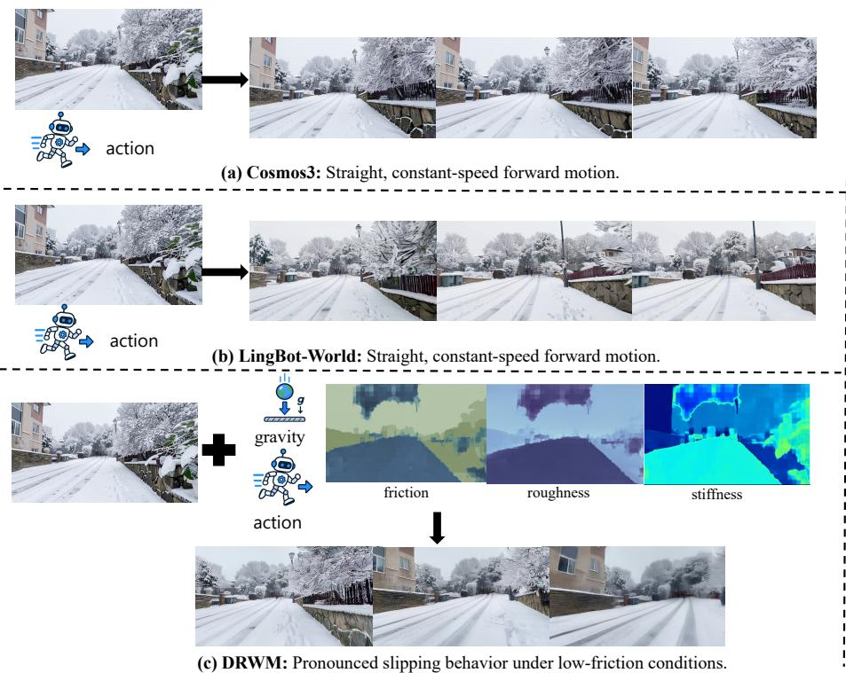

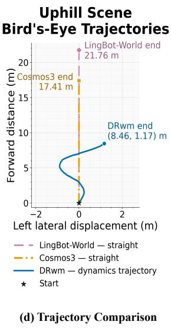  
Figure 4: Qualitative comparison on an uphill snowy scene. Cosmos 3 and LingBot-World follow straight, constant-speed motion conditions, whereas DR-WM predicts a dynamics-mediated trajectory from the action and inferred low-friction terrain properties. The right panel compares the resulting bird’s-eye trajectories.

Table 5: VLM action selection on 90 challenging scenes with no future context, generic world-model rollouts, or DR-WM’s closed-loop physical–visual rollouts.
<table><tr><td>VLM</td><td>Rollout model Prog.↑</td><td></td><td>Tilt RMS (°)↓</td><td>Tilt T10 (°)↓ Slip (m/s)↓ Arrival (s)↓</td><td></td><td></td><td>Eff.↑</td></tr><tr><td rowspan="3">Qwen3-VL-8B</td><td>None</td><td>0.7492</td><td>2.5760</td><td>4.8268</td><td>0.1580</td><td>7.3188</td><td>0.7912</td></tr><tr><td>Generic WM</td><td>0.8442</td><td>3.1755</td><td>6.3250</td><td>0.1772</td><td>7.6076</td><td>0.8097</td></tr><tr><td>DR-WM</td><td>0.8754</td><td>2.2590</td><td>4.1889</td><td>0.1317</td><td>7.5310</td><td>0.8980</td></tr><tr><td rowspan="3"></td><td>None</td><td>0.8586</td><td>2.5856</td><td>5.1715</td><td>0.1675</td><td>7.5415</td><td>0.9284</td></tr><tr><td>Qwen3-VL-32B Generic WM</td><td>0.8465</td><td>2.6262</td><td>5.0278</td><td>0.1556</td><td>7.5785</td><td>0.9130</td></tr><tr><td>DR-WM</td><td>0.8921</td><td>2.1871</td><td>4.0894</td><td>0.1351</td><td>7.3338</td><td>0.9699</td></tr></table>

DR-WM leads five metrics for 8B and all six for 32B. For 8B, progress rises from 0.7492 to 0.8754 and efficiency from 0.7912 to 0.8980 over no future context; unassisted 8B remains fastest (7.3188 s). Generic WM improves 8B progress but worsens tilt and slip. With DR-WM assistance, the 8B model achieves better mean results than the unassisted 32B model on five of the six metrics. Upper-tail tilt and slip decrease by 19.0% and 21.4%; mean arrival time improves by only 0.0105 s. Path efficiency is the exception (0.8980 vs. 0.9284).

## 5 Conclusion

We presented DR-WM, a behavior-grounded world model for robot–terrain interaction that grounds video prediction in executable physics calibrated from real action–response data. By using physical simulation to guide video generation and generated observations to update terrain reconstruction, DR-WM supports continued physical–visual rollout for comparing candidate actions. Its spatially varying terrain physics improves held-out motion prediction over geometry-only and uniformphysics alternatives, while DR-WM leads the reported automatic, reference-aligned, and human evaluations. Notably, its predicted future observations enable an 8B VLM to achieve better mean results than an unassisted 32B model on five of six action-selection metrics.

Despite these results, reliable prediction depends on the accuracy of reconstruction, contact modeling, and generated observations. Because generated observations update the terrain reconstruction, prediction errors may propagate across successive rollouts. Improving geometric consistency and contact modeling over longer horizons is therefore an important direction for future work. More broadly, our results highlight the value of grounding visual world models in measured robot responses. Connecting commanded actions to terrain-dependent motion and its visual consequences offers a path toward more informed action selection before real-world execution.

## References

Adam Allevato, Elaine Schaertl Short, Mitch Pryor, and Andrea L. Thomaz. TuneNet: One-shot residual tuning for system identification and sim-to-real robot task transfer, 2020. URL https://arxiv.org/abs/1907.11200.

Gregorio Ambrosio-Cestero, Jose-Raul Ruiz-Sarmiento, and Javier Gonzalez-Jimenez. The Robot@Home2 dataset: A new release with improved usability tools. SoftwareX, 23:101490, 2023. doi: 10.1016/j.softx.2023.101490.

Anurag Bagchi, Zhipeng Bao, Homanga Bharadhwaj, et al. Walk through paintings: Egocentric world models from internet priors, 2026. URL https://arxiv.org/abs/2601.15284.

Shuai Bai, Yuxuan Cai, Ruizhe Chen, et al. Qwen3-VL technical report, 2025. URL https://arxiv.org/abs/2511. 21631.

Amir Bar, Gaoyue Zhou, Danny Tran, Trevor Darrell, and Yann LeCun. Navigation world models, 2025. URL https: //arxiv.org/abs/2412.03572.

Jake Bruce, Michael Dennis, Ashley Edwards, et al. Genie: Generative interactive environments, 2024. URL https: //arxiv.org/abs/2402.15391.

Holger Caesar, Varun Bankiti, Alex H. Lang, Sourabh Vora, Venice Erin Liong, Qiang Xu, Anush Krishnan, Yu Pan, Giancarlo Baldan, and Oscar Beijbom. nuScenes: A multimodal dataset for autonomous driving. In Proceedings of the IEEE/CVF Conference on Computer Vision and Pattern Recognition (CVPR), pages 11621–11631, 2020. URL https://openaccess.thecvf.com/content\_CVPR\_2020/html/Caesar\_nuScenes\_A\_ Multimodal\_Dataset\_for\_Autonomous\_Driving\_CVPR\_2020\_paper.html.

Mathilde Caron, Hugo Touvron, Ishan Misra, et al. Emerging properties in self-supervised vision transformers, 2021. URL https://arxiv.org/abs/2104.14294.

Yevgen Chebotar, Ankur Handa, Viktor Makoviychuk, et al. Closing the sim-to-real loop: Adapting simulation randomization with real world experience, 2019. URL https://arxiv.org/abs/1810.05687.

Jiaqi Chen, Jonas Frey, Ruyi Zhou, et al. Identifying terrain physical parameters from vision – towards physical-parameteraware locomotion and navigation, 2024. URL https://arxiv.org/abs/2408.16567.

Samarth Chopra, Jing Liang, Gershom Seneviratne, and Dinesh Manocha. PhysGS: Bayesian-inferred Gaussian splatting for physical property estimation. In Proceedings of the IEEE/CVF Conference on Computer Vision and Pattern Recognition (CVPR), pages 18980–18990, 2026.

Angela Dai, Angel X. Chang, Manolis Savva, Maciej Halber, Thomas Funkhouser, and Matthias Nießner. ScanNet: Richly annotated 3D reconstructions of indoor scenes. In Proceedings of the IEEE Conference on Computer Vision and Pattern Recognition (CVPR), pages 5828–5839, 2017. URL https://openaccess.thecvf.com/content\_cvpr\_ 2017/html/Dai\_ScanNet\_Richly-Annotated\_3D\_CVPR\_2017\_paper.html.

Chelsea Finn and Sergey Levine. Deep visual foresight for planning robot motion, 2017. URL https://arxiv.org/ abs/1610.00696.

Jonas Frey, Matias Mattamala, Nived Chebrolu, et al. Fast Traversability Estimation for Wild Visual Navigation. In Proceed ings ofRobotics: Science and Systems, Daegu, Republic of Korea, July 2023. doi: 10.15607/RSS.2023.XIX.054.

Yulu Gao, Bohao Zhang, Zongheng Tang, Jitong Liao, Wenjun Wu, and Si Liu. Vggt-segmentor: Geometry-enhanced crossview segmentation. In Proceedings of the IEEE/CVF Conference on Computer Vision and Pattern Recognition, pages 21690–21700, 2026.

Genesis Authors. Genesis: A generative and universal physics engine for robotics and beyond, December 2024. URL https://github.com/Genesis-Embodied-AI/Genesis.

David Ha and Jurgen Schmidhuber. World models, 2018. URL¨ https://zenodo.org/record/1207631.

Danijar Hafner, Timothy Lillicrap, Jimmy Ba, and Mohammad Norouzi. Dream to control: Learning behaviors by latent imagination. arXiv preprint arXiv:1912.01603, 2019a.

Danijar Hafner, Timothy Lillicrap, Ian Fischer, et al. Learning latent dynamics for planning from pixels, 2019b. URL https://arxiv.org/abs/1811.04551.

Raphael Hagmanns, Peter Mortimer, Miguel Granero, Thorsten Luettel, and Janko Petereit. Excavating in the wild: The GOOSE-Ex dataset for semantic segmentation. In 2025 IEEE International Conference on Robotics and Automation

(ICRA), 2025. doi: 10.1109/ICRA55743.2025.11127604. URL https://arxiv.org/abs/2409.18788.

Edward J. Hu, Yelong Shen, Phillip Wallis, et al. LoRA: Low-rank adaptation of large language models, 2021. URL https: //arxiv.org/abs/2106.09685.

Ziqi Huang, Yinan He, Jiashuo Yu, et al. VBench: Comprehensive benchmark suite for video generative models, 2023. URL https://arxiv.org/abs/2311.17982.

Peng Jiang, Philip Osteen, Maggie Wigness, and Srikanth Saripalli. RELLIS-3D dataset: Data, benchmarks and analysis, 2022. URL https://arxiv.org/abs/2011.12954.

Zeyinzi Jiang, Zhen Han, Chaojie Mao, et al. VACE: All-in-one video creation and editing, 2025. URL https://arxiv. org/abs/2503.07598.

Haresh Karnan, Anirudh Nair, Xuesu Xiao, Garrett Warnell, Soren Pirk, Alexander Toshev, Justin Hart, Joydeep Biswas, and¨ Peter Stone. Socially compliant navigation dataset (SCAND): A large-scale dataset of demonstrations for social navigation. IEEE Robotics and Automation Letters, 7(4):11807–11814, 2022. doi: 10.1109/LRA.2022.3184025.

Nikhil Keetha, Norman Muller, Johannes Sch¨ onberger, et al. MapAnything: Universal feed-forward metric 3D reconstruction.¨ In International Conference on 3D Vision (3DV). IEEE, 2026.

H. W. Kuhn. The Hungarian method for the assignment problem. Naval Research Logistics Quarterly, 2(1-2):83–97, 1955. doi: 10.1002/nav.3800020109. URL https://onlinelibrary.wiley.com/doi/abs/10.1002/nav. 3800020109.

Hoang Le, Joonwoo Kwon, Elkhan Ismayilzada, Yufei Zhang, and Zijun Cui. SiPhy: Single-image physical property reasoning. In European Conference on Computer Vision (ECCV), 2026.

Hao Li, Zhengyu Zou, Fangfu Liu, Xuanyang Zhang, Fangzhou Hong, Yukang Cao, Yushi Lan, Manyuan Zhang, Gang Yu, Dingwen Zhang, and Ziwei Liu. Iggt: Instance-grounded geometry transformer for semantic 3d reconstruction. In International Conference on Learning Representations, 2026.

Zizhang Li, Hong-Xing Yu, Wei Liu, et al. WonderPlay: Dynamic 3D scene generation from a single image and actions, 2025. URL https://arxiv.org/abs/2505.18151.

Takahiro Miki, Joonho Lee, Jemin Hwangbo, et al. Learning robust perceptive locomotion for quadrupedal robots in the wild. Science Robotics, 7(62), January 2022. ISSN 2470-9476. doi: 10.1126/scirobotics.abk2822. URL http://dx.doi. org/10.1126/scirobotics.abk2822.

Peter Mortimer, Raphael Hagmanns, Miguel Granero, Thorsten Luettel, Janko Petereit, and Hans-Joachim Wuensche. The GOOSE dataset for perception in unstructured environments. In 2024 IEEE International Conference on Robotics and Automation (ICRA), pages 14838–14844, 2024. doi: 10.1109/ICRA57147.2024.10611298.

NVIDIA. Cosmos 3: Omnimodal world models for physical AI, 2026. URL https://arxiv.org/abs/2606.02800.

OpenAI. GPT-5.5 System Card. https://openai.com/index/gpt-5-5-system-card/, 2026.

Maxime Oquab, Timothee Darcet, Th´ eo Moutakanni, et al. DINOv2: Learning robust visual features without supervision,´ 2024. URL https://arxiv.org/abs/2304.07193.

Qwen Team. Qwen3.8-Max: A new bar for coding and cowork, August 2026. URL https://qwen.ai/blog?id= qwen3.8.

Alec Radford, Jong Wook Kim, Chris Hallacy, Aditya Ramesh, Gabriel Goh, Sandhini Agarwal, Girish Sastry, Amanda Askell, Pamela Mishkin, Jack Clark, Gretchen Krueger, and Ilya Sutskever. Learning transferable visual models from natural language supervision. In Proceedings of the 38th International Conference on Machine Learning, volume 139 of Proceedings of Machine Learning Research, pages 8748–8763. PMLR, 2021. URL https://proceedings.mlr. press/v139/radford21a.html.

Fabio Ramos, Rafael Carvalhaes Possas, and Dieter Fox. BayesSim: adaptive domain randomization via probabilistic infer ence for robotics simulators, 2019. URL https://arxiv.org/abs/1906.01728.

Rene Ranftl, Alexey Bochkovskiy, and Vladlen Koltun. Vision transformers for dense prediction. In´ 2021 IEEE/CVF Inter national Conference on Computer Vision (ICCV), pages 12159–12168, 2021. doi: 10.1109/ICCV48922.2021.01196.

Robbyant Team, Zelin Gao, Qiuyu Wang, et al. Advancing open-source world models, 2026. URL https://arxiv.org/ abs/2601.20540.

Xuesong Shi, Dongjiang Li, Pengpeng Zhao, Qinbin Tian, Yuxin Tian, Qiwei Long, Chunhao Zhu, Jingwei Song, Fei Qiao, Le Song, Yangquan Guo, Zhigang Wang, Yimin Zhang, Baoxing Qin, Wei Yang, Fangshi Wang, Rosa H. M. Chan, and Qi She. Are we ready for service robots? the OpenLORIS-Scene datasets for lifelong SLAM. In 2020 IEEE International Conference on Robotics and Automation (ICRA), pages 3139–3145, 2020. URL https://arxiv.org/abs/1911. 05603.

Ken Shoemake. Animating rotation with quaternion curves. In Proceedings of the 12th Annual Conference on Computer Graphics and Interactive Techniques, SIGGRAPH ’85, page 245–254, New York, NY, USA, 1985. Association for Com-

puting Machinery. ISBN 0897911660. doi: 10.1145/325334.325242. URL https://doi.org/10.1145/325334. 325242.

Yinghao Shuai, Ran Yu, Yuantao Chen, Zijian Jiang, Xiaowei Song, Nan Wang, Jv Zheng, Jianzhu Ma, Meng Yang, Zhicheng Wang, Wenbo Ding, and Hao Zhao. PUGS: Zero-shot physical understanding with Gaussian splatting. In 2025 IEEE International Conference on Robotics and Automation (ICRA), pages 4478–4485, 2025. doi: 10.1109/ICRA55743.2025. 11128683.

Matthew Sivaprakasam, Parv Maheshwari, Mateo Guaman Castro, Samuel Triest, Micah Nye, Steve Willits, Andrew Saba, Wenshan Wang, and Sebastian Scherer. Tartandrive 2.0: More modalities and better infrastructure to further self-supervised learning research in off-road driving tasks. In IEEE International Conference on Robotics and Automation (ICRA), 2024.

Nikhil Sobanbabu, Guanqi He, Tairan He, Yuxiang Yang, and Guanya Shi. Sampling-based system identification with active exploration for legged robot Sim2Real learning, 2025. URL https://arxiv.org/abs/2505.14266.

Team Wan, Ang Wang, Baole Ai, et al. Wan: Open and advanced large-scale video generative models. arXiv preprint arXiv:2503.20314, 2025.

Zachary Teed and Jia Deng. RAFT: Recurrent all-pairs field transforms for optical flow, 2020. URL https://arxiv. org/abs/2003.12039.

Tran Dinh Tien and Zhiqiang Shen. ActiveSAM: Image-conditional class pruning for fast and accurate open-vocabulary segmentation. arXiv preprint arXiv:2606.16996, 2026. doi: 10.48550/arXiv.2606.16996. URL https://arxiv.org/ abs/2606.16996.

Thomas Unterthiner, Sjoerd van Steenkiste, Karol Kurach, et al. Towards accurate generative models of video: A new metric & challenges, 2019. URL https://arxiv.org/abs/1812.01717.

Abhinav Valada, Gabriel L. Oliveira, Thomas Brox, and Wolfram Burgard. Deep multispectral semantic scene understanding of forested environments using multimodal fusion. In International Symposium on Experimental Robotics (ISER), 2016. URL https://lmb.informatik.uni-freiburg.de/Publications/2016/OB16c/.

Kavisha Vidanapathirana, Joshua Knights, Stephen Hausler, Mark Cox, Milad Ramezani, Jason Jooste, Ethan Griffiths, Sha heer Mohamed, Sridha Sridharan, Clinton Fookes, and Peyman Moghadam. WildScenes: A benchmark for 2D and 3D semantic segmentation in large-scale natural environments. The International Journal of Robotics Research, 44(4):532– 549, 2025. doi: 10.1177/02783649241278369.

Jianyuan Wang, Minghao Chen, Nikita Karaev, Andrea Vedaldi, Christian Rupprecht, and David Novotny. VGGT: Visual geometry grounded transformer. In Proceedings of the IEEE/CVF Conference on Computer Vision and Pattern Recognition (CVPR), pages 5294–5306, 2025. URL https://openaccess.thecvf.com/content/CVPR2025/html/ Wang\_VGGT\_Visual\_Geometry\_Grounded\_Transformer\_CVPR\_2025\_paper.html.

Zile Wang, Zexiang Liu, Jiaxing Li, Kaichen Huang, Baixin Xu, Fei Kang, Mengyin An, Peiyu Wang, Biao Jiang, Yichen Wei, Yidan Xietian, Jiangbo Pei, Liang Hu, Boyi Jiang, Hua Xue, Zidong Wang, Haofeng Sun, Wei Li, Wanli Ouyang, Xianglong He, Yang Liu, Yangguang Li, and Yahui Zhou. Matrix-Game 3.0: Real-time and streaming interactive world model with long-horizon memory, 2026. URL https://arxiv.org/abs/2604.08995.

Maggie Wigness, Sungmin Eum, John G. Rogers, David Han, and Heesung Kwon. A rugd dataset for autonomous navigation and visual perception in unstructured outdoor environments. In IEEE/RSJ International Conference on Intelligent Robots and Systems (IROS), 2019.

Sherry Yang, Yilun Du, Kamyar Ghasemipour, et al. Learning interactive real-world simulators, 2024. URL https:// arxiv.org/abs/2310.06114.

Zhuoyi Yang, Jiayan Teng, Wendi Zheng, Ming Ding, Shiyu Huang, Jiazheng Xu, Yuanming Yang, Wenyi Hong, Xiaohan Zhang, Guanyu Feng, Da Yin, Yuxuan Zhang, Weihan Wang, Yean Cheng, Bin Xu, Xiaotao Gu, Yuxiao Dong, and Jie Tang. CogVideoX: Text-to-video diffusion models with an expert transformer, 2025. URL https://arxiv.org/ abs/2408.06072.

Chandan Yeshwanth, Yueh-Cheng Liu, Matthias Nießner, and Angela Dai. ScanNet++: A high-fidelity dataset of 3D indoor scenes. In Proceedings of the IEEE/CVF International Conference on Computer Vision (ICCV), 2023. URL https: //arxiv.org/abs/2308.11417.

Jie Yin, Ang Li, Tao Li, Wenxian Yu, and Danping Zou. M2DGR: A multi-sensor and multi-scenario SLAM dataset for ground robots. IEEE Robotics and Automation Letters, 7(2):2266–2273, 2021. URL https://arxiv.org/abs/ 2112.13659.

Wenhao Yu, Jie Tan, C. Karen Liu, and Greg Turk. Preparing for the unknown: Learning a universal policy with online system identification, 2017. URL https://arxiv.org/abs/1702.02453.

Richard Zhang, Phillip Isola, Alexei A. Efros, Eli Shechtman, and Oliver Wang. The unreasonable effectiveness of deep features as a perceptual metric, 2018. URL https://arxiv.org/abs/1801.03924.

Yidi Zhang, Ning An, Chenhui Shi, Shuo Wang, Hao Wei, Pengju Zhang, Xinrui Meng, Zengpeng Sun, Jinke Wang, Wenliang Liang, Fulin Tang, and Yihong Wu. CID-SIMS: Complex indoor dataset with semantic information and multi-sensor data from a ground wheeled robot viewpoint. The International Journal of Robotics Research, 43(7):899–917, 2024. doi: 10.1177/02783649231222507.

Yisu Zhang, Chenjie Cao, Tengfei Wang, Xuhui Zuo, Junta Wu, Jianke Zhu, and Chunchao Guo. WorldStereo: Bridging camera-guided video generation and scene reconstruction via 3D geometric memories, 2026. URL https://arxiv. org/abs/2603.02049.

Jinjing Zhao, Fangyun Wei, Zhening Liu, et al. Spatia: Video generation with updatable spatial memory, 2025. URL https: //arxiv.org/abs/2512.15716.

## APPENDIX

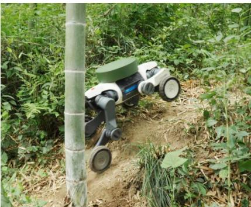

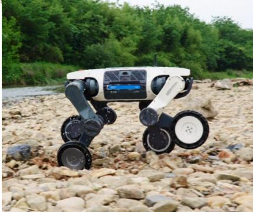

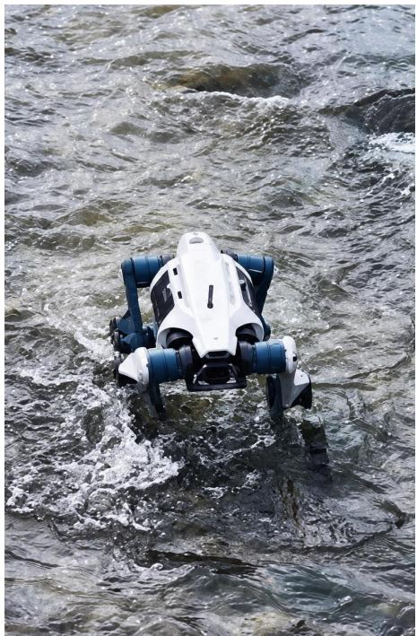

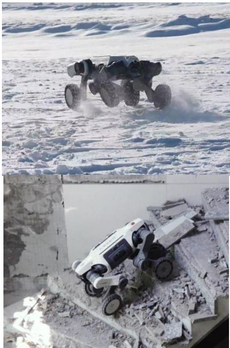

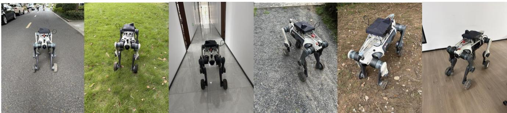  
Figure 5: Illustration of robot data collection and testing.

## A Datasets, Physical Labels, and Implementation Details

## A.1 Physcene–Robot Dataset

Physcene–Robot is a dedicated real-robot interaction dataset collected with DEEPRobotics M20 and Lite3 robots. It is designed to support behavior grounding and evaluation of the ”Action–Executable Physics–Observation” pipeline. Each sequence synchronizes timestamped robot-mounted RGB images and LiDAR scans with robot states, motion responses, and control commands. RGB provides visual observations, while LiDAR supplies metric geometry for supervision, registration, and evaluation. The recorded action-response data capture both executed motion and control inputs. Raw six-field /STEER commands are converted to forward, lateral, and yaw commands through the robot-policy adapter described in Appendix B.

Camera–LiDAR and camera-base calibrations place observations, robot states, and reconstructed terrain in a common coordinate system. We divide continuous recordings into scene-level clips and keep temporally adjacent clips in the same partition.

Future RGB and LiDAR observations serve as training supervision or evaluation ground truth and are excluded from causal inference. Main-paper evaluations in Tables 1– 4 use held-out scenes from this dedicated Physcene–Robot dataset. Figure 5 illustrates the range of robots, terrains, and indoor/outdoor environments represented in our collection. The outdoor environ ments cover snow, gravel, asphalt, grass, mud, and stone-paved surfaces, while the designed indoor scenes include tile, wood flooring, and high-pile carpet. The dataset contains more than 100,000 clips, with a phased public release planned. It complements robot navigation datasets by combining diverse indoor and outdoor terrains with synchronized perception, control, and robot-response measurements. Each clip includes surround-view video, dual-LiDAR geometry, inertial and joint states, odometry, motion state, and sensor calibration.

Representative raw-data inventory. We characterize the recorded sensor streams using one unprocessed 30 s MCAP segment from the collection. As summarized in Table 6, the representative Physcene–Robot 30 s MCAP clip contains 20,756 messages across 12 active streams, stored in 177 indexed chunks. The embedded calibration attachment is marked valid and places the four fisheye cameras and two LiDARs in the common body-FLU reference frame.

Table 6: Representative sensor and control inventory from Physcene–Robot. The 30 s MCAP recording stores calibration as an attachment.
<table><tr><td>Signal group</td><td>ROS 2 type / encoding</td><td>Rate (Hz)</td><td>Messages</td><td>Recorded content</td></tr><tr><td>Fisheye cameras</td><td>CompressedVideo/H.264</td><td>~10</td><td>4×300</td><td>1920×1536 surround-view video</td></tr><tr><td>LiDAR</td><td>PointCloud2/CDR</td><td>~10</td><td>2×300</td><td>x, y, z, intensity, ring, point time</td></tr><tr><td>Inertial sensing</td><td>Imu/CDR</td><td>~200</td><td>5,994</td><td>Orientation, angular velocity, acceleration</td></tr><tr><td>Joint feedback</td><td>JointsData/CDR</td><td>~200</td><td>6,001</td><td>16-joint position, torque, velocity, temperature, status</td></tr><tr><td>LIO odometry</td><td>Odometry/CDR</td><td>~200</td><td>6,000</td><td>6-DoF pose, velocity, covariance</td></tr><tr><td>Motion state</td><td>MotionInfo/CDR</td><td>~20</td><td>600</td><td>Velocity, yaw rate, height, state, gait, payload</td></tr><tr><td>Control input</td><td>Steer/CDR</td><td>~10</td><td>301</td><td>x, y, z, roll, pitch, yaw command</td></tr><tr><td>Satellite navigation</td><td>NavSat/CDR</td><td>~2</td><td>60</td><td>Position, speed, altitude, fix, satellites, DOP</td></tr><tr><td>Calibration</td><td>YAML attachment</td><td></td><td>1</td><td>Camera intrinsics/extrinsics and LiDAR extrinsics</td></tr></table>

## A.2 Splits and Evaluation Controls

We use scene-level train/validation/test partitions: adjacent clips remain in the same partition, and behavior calibration, validation, and final test scenes are disjoint. At test time, the PhyMap–Genesis mapping is frozen. All controlled comparisons share the initial state, action sequence, controller, simulator, duration, and sampling settings unless stated otherwise

Primary comparisons are paired by scene. Where confidence intervals are reported, bootstrap resampling uses scenes as the sampling unit. The in-domain video-condition ablation in Appendix E is reported separately from the held-out evaluations. The planned data and code release includes split manifests, label definitions, sensor calibration, robot/controller settings, Genesis parameters, video-model configurations, and metric implementations.

## B Detailed Method and Implementation

This section expands the architecture, objectives, coordinate conventions, and rollout rules summarized in Section 3 of the main paper.

## B.1 PhyMap Architecture and Executable-Terrain Construction

For view v, the frozen MapAnything backbone extracts four DPT feature levels (Ranftl et al., 2021) $\{ F _ { v } ^ { \ell } \} _ { \ell = 1 } ^ { 4 }$ and a DINOv2 feature (Oquab et al., 2024) $E _ { v }$ . Its geometric prediction forms a five-channel per-pixel descriptor $d _ { v } ( u )$ comprising lognormalized depth, the surface normal obtained from neighboring 3D-point differences, and normalized log confidence. A trainable decoder $h _ { \omega }$ performs top-down multi-scale fusion, local geometry cross-attention, DINO-DPT fusion, and windowed self-attention; a sigmoid maps its per-pixel output to $z _ { v } ( u ) \in [ 0 , 1 ] ^ { 3 }$ . Only ω is trained.

If $y _ { v } ( u )$ is a Terrain32 label, $m ( y ) \in [ 0 , 1 ] ^ { 3 }$ is its physical target from the fixed terrain table, and $w _ { v } ( u )$ combines label, external, and MapAnything-validity masks, the implemented objective is

$$
\mathcal { L } _ { \mathrm { P h y } } = \frac { 1 } { \sum _ { v , u } w _ { v } ( u ) } \sum _ { v , u } w _ { v } ( u ) \left[ \sum _ { d \in \{ f , r , s \} } \rho _ { \mathrm { S L 1 } } \big ( z _ { v } ^ { d } ( u ) - m ^ { d } ( y _ { v } ( u ) ) \big ) \right.\tag{6}
$$

where $\ell _ { v }$ is an auxiliary terrain logit used only for supervision. The deployed v7 checkpoint uses a 384-channel decoder, eight attention heads, $8 \times 8$ windows, and three self-attention blocks.

To construct the executable 2.5D terrain, OpenCV camera coordinates are mapped to Genesis coordinates as $( x _ { \Gamma } , y _ { \Gamma } , z _ { \Gamma } ) =$ $( z _ { \mathrm { c v } } , - x _ { \mathrm { c v } } , - y _ { \mathrm { c v } } )$ . Within each terrain cell, we take a lower height quantile and the median of each physical channel. We retain the four-connected component reachable from the robot spawn region under a maximum adjacent-height change, fill unobserved cells from the nearest retained ground cell, and smooth the resulting height field. This prevents observed walls from being promoted to drivable support.

## B.2 Behavior Calibration Details

Let $F _ { \Gamma }$ denote a Genesis replay using the same initial state, recorded command, controller, and duration as snippet i. For response measures $d _ { j }$ with fixed unit normalizers $\kappa _ { j }$ and weights $\lambda _ { j } .$ the calibration discrepancy is

$$
D _ { i } ( \theta ) = \sum _ { j } \lambda _ { j } \operatorname* { m i n } \biggl ( \frac { d _ { j } ( F _ { \Gamma } ( s _ { i , 0 } , a _ { i } ; \theta ) , s _ { i } ^ { \mathrm { r e a l } } ) } { \kappa _ { j } } , 4 \biggr ) , \qquad \sum _ { j } \lambda _ { j } = 1 .\tag{7}
$$

The terms cover planar trajectory, forward velocity, yaw and yaw rate, vertical vibration/impact, and roll-pitch response. The scene-level optimum $\theta ^ { * }$ is obtained from Eq. (4). The mapping uses $g _ { \phi } ( z ^ { * } ) = \theta ^ { * }$ as an anchor, where $z ^ { * }$ is the representative physical prior of the calibration scene. Monotone endpoint priors complete the interpolant. The normalizers, weights, and mapping remain fixed during test evaluation. This formulation follows response-based real-to-sim calibration and system identification (Chebotar et al., 2019; Ramos et al., 2019; Allevato et al., 2020; Yu et al., 2017; Sobanbabu et al., 2025). The resulting parameters encode behavior-calibrated simulator responses; a behavior optimum need not uniquely identify the underlying material constants.

## B.3 Robot, Camera, and Video-Model Details

The six-field recorded /STEER sample is reduced to forward, lateral, and yaw commands before the affine deployment adapter. The deployed policy produces desired leg positions and wheel velocities. Genesis uses a 0.005-second step. Camera positions are linearly interpolated and rotations are interpolated by quaternion SLERP (Shoemake, 1985) to the video timestamps.

For the visual branch, the frozen Wan VAE encodes rendered RGB control $C _ { j } ^ { \mathrm { { r g b } } }$ and geometric confidence $C _ { j } ^ { q }$ . Each encoding has 48 channels, yielding the 96-channel VACE context. For history-mode chunks, let $V ( r )$ be the set of frontmost map points visible in candidate reference r and $V ( j )$ the corresponding set for target $j .$ Hungarian one-to-one assignment (Kuhn, 1955) maximizes $\begin{array} { r } { \sum _ { j } | V ( \pi ( j ) ) \cap V ( j ) } \end{array}$ | subject to $\pi ( j ) < \tau _ { k }$ . We retain at most seven references; the bootstrap chunk contains none. Let $N _ { \mathrm { h i s t } } ~ \in ~ \{ 1 , 9 \}$ denote the number of RGB history frames ending at $\tau _ { k }$ . Define the clean training latent as $Z =$ $\mathscr { E } \left( { I _ { \tau _ { k } - N _ { \mathrm { h i s t } } + 1 : \tau _ { k } + H } } \right)$ and sample $\epsilon \sim \mathcal { N } ( 0 , I )$ . At flow noise level $\sigma ,$ the scheduler forms $Z _ { \sigma } = ( 1 - \sigma ) Z + \sigma \epsilon$ with target velocity $v ^ { * } = \epsilon - Z$ . The first $m \in \{ 1 , 3 \}$ latent frames encode the history prefix, with $N _ { \mathrm { h i s t } } = 4 ( m - 1 ) + 1$ . They are replaced by lightly perturbed clean latents and assigned timestep zero. Reference latents $Z ^ { \mathrm { r e f } }$ are prepended and also assigned timestep zero. VACE injects control residuals into DiT blocks $\mathcal { L } = \{ 0 , 4 , 8 , 1 2 , 1 6 , 2 0 , 2 4 , 2 8 \}$ while leaving reference tokens unmodified. Define $\widetilde { Z } _ { \sigma } = [ Z ^ { \mathrm { r e f } } , Z _ { \sigma } ]$ and $\widetilde { v } ^ { * } = [ 0 , \epsilon - Z ]$ . With $M _ { m }$ masking the references and conditioned prefix, training minimizes only future-latent error:

$$
\mathcal { L } _ { \mathrm { F M } } ( \psi ) = \mathbb { E } _ { Z , \epsilon , \sigma } \left[ w ( \sigma ) \frac { \left\| ( 1 - M _ { m } ) \odot \left( v _ { \psi } ( \widetilde { Z } _ { \sigma } , \sigma ; U _ { k } ) - \widetilde { v } ^ { * } \right) \right\| _ { 2 } ^ { 2 } } { \| 1 - M _ { m } \| _ { 1 } } \right] .\tag{8}
$$

We train rank-32 LoRA adapters in Wan attention and feed-forward projections, $\begin{array} { r } { W ^ { \prime } = W + ( \alpha / r ) B A } \end{array}$ with $r = \alpha = 3 2$ together with the configured VACE blocks and input projection. Control dropout, random VACE strength, and perturbations of noninitial history latents reduce dependence on perfect teacher-forced controls and histories.

## B.4 Causal Rollout Implementation

For the bootstrap chunk, the only real frame and pose are duplicated to satisfy the two-view minimum of the deployed physical head. Later, the reconstruction uses only recent and sparse keyframes from the frozen generated prefix, and a flow-residual mask suppresses dynamic objects before mapping. Genesis resumes exactly from the simulator checkpoint at each chunk boundary, and every new video chunk is appended without regenerating its prefix.

## C Intrinsic Evaluation of PhyMap

We evaluate normalized friction, roughness, and stiffness with valid-pixel weighting. MAE is the primary metric; RMSE emphasizes larger errors. Bias is the signed mean of prediction minus target and is best near zero. Aggregate scores average the three properties equally, and bold marks the best result. Table 7 compares feature and terrain-loss variants.

Fused features with terrain supervision lead on seven of nine metrics and reduce friction, roughness, and stiffness MAE from 0.03828/0.04549/0.07199 to 0.03546/0.03845/0.05806. DINO with terrain supervision gives the smallest roughness and stiffness Bias.

Table 7: Feature and terrain-loss ablations.
<table><tr><td>DINO Feature</td><td>DPT Feature</td><td>Terrain Loss</td><td colspan="3">Friction</td><td colspan="3">Roughness</td><td colspan="3">Stiffness</td></tr><tr><td></td><td></td><td></td><td>MAE↓</td><td>RMSE↓</td><td>Bias→ 0</td><td>MAE↓</td><td>RMSE↓</td><td>Bias→ 0</td><td>MAE↓</td><td>RMSE↓</td><td>Bias→ 0</td></tr><tr><td>V</td><td></td><td></td><td>0.03939</td><td>0.08407</td><td>-0.01216</td><td>0.04343</td><td>0.08378</td><td>0.00314</td><td>0.06538</td><td>0.13945</td><td>-0.00575</td></tr><tr><td>一</td><td>√</td><td></td><td>0.06787</td><td>0.12288</td><td>-0.01620</td><td>0.08046</td><td>0.11739</td><td>0.00480</td><td>0.12566</td><td>0.19969</td><td>0.00415</td></tr><tr><td>√</td><td></td><td>√</td><td>0.03706</td><td>0.08328</td><td>-0.00955</td><td>0.04122</td><td>0.08117</td><td>0.00114</td><td>0.06128</td><td>0.13697</td><td>-0.00114</td></tr><tr><td></td><td>√</td><td>√</td><td>0.06300</td><td>0.11378</td><td>-0.01350</td><td>0.07317</td><td>0.11280</td><td>0.00224</td><td>0.11811</td><td>0.19259</td><td>-0.01469</td></tr><tr><td>√</td><td>√</td><td></td><td>0.03828</td><td>0.08472</td><td>-0.01154</td><td>0.04549</td><td>0.08386</td><td>0.00979</td><td>0.07199</td><td>0.13925</td><td>-0.01367</td></tr><tr><td>V</td><td>√</td><td>V</td><td>0.03546</td><td>0.08048</td><td>-0.00930</td><td>0.03845</td><td>0.07633</td><td>0.00318</td><td>0.05806</td><td>0.12911</td><td>-0.00691</td></tr></table>

Cross-domain generalization. We train on all domains except $D _ { k }$ and test on $D _ { k } .$ . In Table 8, on-robot data gives the lowest friction and stiffness MAE (0.01798/0.04176), off-road data gives the lowest roughness MAE (0.02634), and web data has the highest errors.

Table 8: Cross-domain generalization.
<table><tr><td rowspan="2">Held-out source</td><td colspan="3">Friction</td><td colspan="3">Roughness</td><td colspan="3">Stiffness</td></tr><tr><td>MAE↓</td><td>RMSE↓</td><td>Bias→ 0</td><td>MAE↓</td><td>RMSE↓</td><td>Bias→ 0</td><td>MAE↓</td><td>RMSE↓</td><td>Bias→ 0</td></tr><tr><td>Indoor</td><td>0.02579</td><td>0.05398</td><td>-0.00124</td><td>0.03789</td><td>0.07827</td><td>0.00386</td><td>0.04900</td><td>0.11268</td><td>-0.00031</td></tr><tr><td>On-robot</td><td>0.01798</td><td>0.03916</td><td>-0.00214</td><td>0.03195</td><td>0.06509</td><td>0.00422</td><td>0.04176</td><td>0.10880</td><td>-0.00875</td></tr><tr><td>Off-road</td><td>0.02920</td><td>0.05527</td><td>-0.00166</td><td>0.02634</td><td>0.05961</td><td>-0.00257</td><td>0.05676</td><td>0.13614</td><td>0.00435</td></tr><tr><td>Web collection</td><td>0.05587</td><td>0.11495</td><td>-0.01973</td><td>0.05027</td><td>0.09069</td><td>0.00694</td><td>0.08374</td><td>0.16547</td><td>-0.00793</td></tr><tr><td>Overall</td><td>0.03419</td><td>0.07601</td><td>-0.00702</td><td>0.03776</td><td>0.07615</td><td>0.00331</td><td>0.05994</td><td>0.13537</td><td>-0.00298</td></tr></table>

Comparison with VLM-based physical-property prediction methods. We compare PhyMap with VLM-based physical-property prediction methods: PUGS (Shuai et al., 2025), PhysGS (Chopra et al., 2026), SiPhy (Le et al., 2026), and Qwen3.8 (Qwen Team, 2026) in Table 9.

Table 9: Comparison with VLM-based physical-property prediction methods.
<table><tr><td>Method</td><td>MAE↓</td><td>RMSE↓</td><td>Bias→ 0</td><td>Pearson↑</td><td>Spearman↑</td><td>Acc@0.10 (%)↑</td><td>FPS↑</td></tr><tr><td>PUGS</td><td>0.1412</td><td>0.2435</td><td>-0.0710</td><td>0.5274</td><td>0.5337</td><td>66.30</td><td>0.029</td></tr><tr><td>PhysGS</td><td>0.0883</td><td>0.1819</td><td>-0.0248</td><td>0.6258</td><td>0.5626</td><td>75.71</td><td>0.054</td></tr><tr><td>SiPhy</td><td>0.0824</td><td>0.1785</td><td>-0.0332</td><td>0.6833</td><td>0.6899</td><td>82.21</td><td>0.029</td></tr><tr><td>Qwen3.8</td><td>0.0799</td><td>0.1746</td><td>-0.0312</td><td>0.6935</td><td>0.6956</td><td>82.66</td><td>0.057</td></tr><tr><td>Ours</td><td>0.0459</td><td>0.0895</td><td>-0.0100</td><td>0.9116</td><td>0.8489</td><td>87.13</td><td>6.231</td></tr></table>

PhyMap leads every accuracy metric and reaches 6.231 FPS versus 0.057 FPS for the fastest baseline. Baselines use semantic recognition followed by a class-to-prior lookup, whereas PhyMap predicts the maps directly. The targets are normalized labelmapped priors. Figure 6 compares predictions across baselines, showing that PhyMap produces maps that more closely match the reference physical priors .In addition, Figure 7 shows representative examples from the four data sources of Physcene– Image: on-robot recordings, public indoor datasets, public off-road datasets, and web videos.

Physcene–Image Dataset Composition Figure 8 summarizes approximately 2.58M unique RGB–mask pairs: 1.5M on-robot (57.98%), 690K from public indoor datasets (26.73%), 44.6K from public off-road datasets (1.73%), and 350K from web videos (13.56%).

The on-robot subset is derived from Physcene–Robot through frame extraction and deduplication, covering street, off-road, indoor, and nighttime scenes. Training, validation, and test scenes are strictly disjoint and follow a 7:2:1 split. The indoor subset combines ScanNet (Dai et al., 2017), CID-SIMS (Zhang et al., 2024), M2DGR (Yin et al., 2021), ScanNet++ (Yeshwanth et al., 2023), OpenLORIS (Shi et al., 2020), and RobotAtHome2 (Ambrosio-Cestero et al., 2023). The off-road subset includes RELLIS-3D (Jiang et al., 2022), GOOSE (Mortimer et al., 2024), WildScenes (Vidanapathirana et al., 2025), and RUGD (Wigness et al., 2019). Additional off-road samples come from GOOSE-Ex (Hagmanns et al., 2025), TartanDrive2 (Sivaprakasam et al., 2024), and FreiburgForest (Valada et al., 2016). These public datasets and web videos broaden terrain, appearance, and capture diversity of the Physcene–Image dataset.

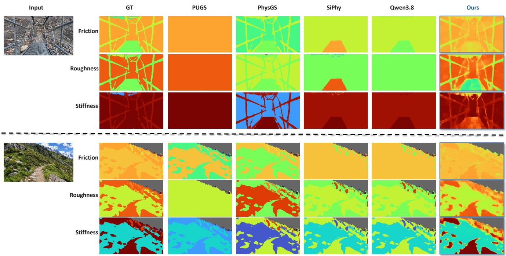

Figure 6: Qualitative comparison with VLM-based physical-property prediction methods.  
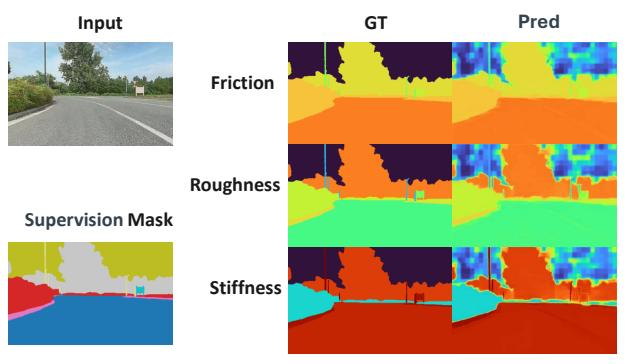

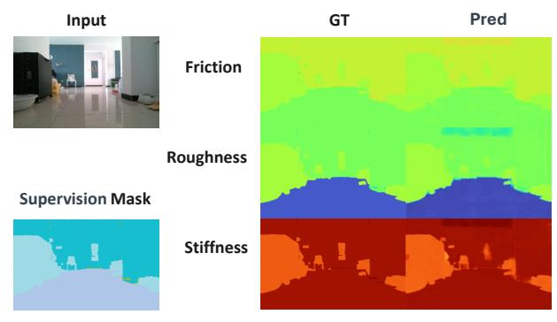

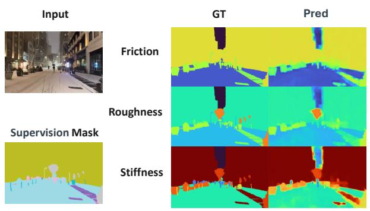

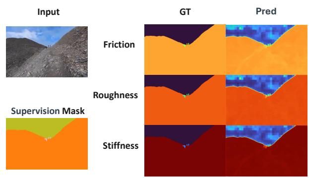  
Figure 7: Qualitative results of the Physcene–Image dataset from four data sources: the on-robot collection, indoor dataset, web collection, and off-road dataset.

## D Additional Executable-Prior Analysis

Friction, roughness, and stiffness respectively control Genesis friction, contact-impedance width, and contact-compliance time. Collision geometry is identical across variants; the roughness channel affects contact response while leaving the collision height field fixed. Friction and roughness vary spatially in all 34 evaluated clips.

The main-paper ablation evaluates the combined physical field. Specifically, the comparison with Uniform PhyMap isolates the effect of spatial variation by replacing each channel with its mean over valid terrain. This comparison therefore preserves

## Physcene-Image Dataset Composition

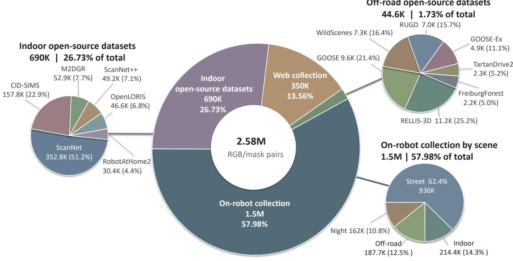  
Figure 8: Composition of the Physcene–Image dataset development.

the mean value of each physical channel, but does not separately quantify the contribution of individual channels or specific material constants. Vertical-motion RMSE is computed between the predicted and recorded vertical displacements, each expressed in its respective initial base frame. Figure 9 further illustrates the resulting terrain-dependent dynamics.

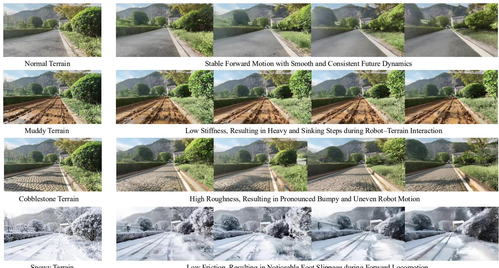  
Low Friction, Resulting in Noticeable Foot Slippage during Forward Locomotion

Figure 9: Qualitative effects of executable physical priors on robot motion. Normal terrain produces stable forward motion. Then low stiffness causes sinking steps on mud, high roughness causes uneven motion on cobblestone, and low friction causes foot slippage on snow.

## E Video Generator Ablation

For our video model, we factorize rendered 3D control and spatial reference frames following Spatia (Zhao et al., 2025), then evaluate action control alone and with both spatial conditions. All variants share the same checkpoint, prompts, trajectories, causal-history prefixes, and initial noise; the unconditioned variant still receives the shared prompt and history.

The controlled in-domain evaluation uses Physcene–Robot scenes and one fixed seed. Metrics are computed on generated future frames after excluding the real history prefix, averaged within scenes and then across scenes. PSNR, SSIM, and DINO similarity are higher-is-better; the remaining metrics are lower-is-better.

Table 10: Video fidelity across inference-time conditioning variants. All values are scene-level means computed from generated outputs on their original scales.
<table><tr><td>3D control</td><td></td><td>Spatial refs. Action control</td><td>PSNR↑</td><td>SSIM↑</td><td>MAE↓</td><td>Grad. err.↓</td><td>Temp. err.↓</td><td>LPIPS↓</td><td></td><td>DINO Sim.↑ Flow EPE↓</td><td>FVD-16↓</td></tr><tr><td></td><td></td><td></td><td>13.629</td><td>0.2629</td><td>0.1572</td><td>0.0347</td><td>0.1353</td><td>0.4062</td><td>0.7882</td><td>8.422</td><td>1153.32</td></tr><tr><td>√</td><td></td><td></td><td>15.523</td><td>0.3062</td><td>0.1191</td><td>0.0317</td><td>0.1321</td><td>0.2537</td><td>0.8333</td><td>6.707</td><td>572.87</td></tr><tr><td>一</td><td>√</td><td></td><td>13.703</td><td>0.2639</td><td>0.1555</td><td>0.0346</td><td>0.1353</td><td>0.3956</td><td>0.7902</td><td>8.445</td><td>1097.23</td></tr><tr><td>V</td><td>√</td><td></td><td>15.672</td><td>0.3098</td><td>0.1167</td><td>0.0315</td><td>0.1307</td><td>0.2465</td><td>0.8462</td><td>6.590</td><td>604.32</td></tr><tr><td>一</td><td></td><td>V</td><td>14.091</td><td>0.2272</td><td>0.1475</td><td>0.0321</td><td>0.1399</td><td>0.3613</td><td>0.6005</td><td>9.844</td><td>1042.64</td></tr><tr><td>√</td><td>√</td><td>√</td><td>16.030</td><td>0.3230</td><td>0.1106</td><td>0.0314</td><td>0.1280</td><td>0.2337</td><td>0.8758</td><td>6.292</td><td>567.39</td></tr></table>

Adding 3D control to the reference-only variant improves PSNR by 1.969 [1.144, 2.905] and SSIM by 0.0459 [0.0284, 0.0657]. Spatial references give smaller gains over control alone (0.149 PSNR and 0.0036 SSIM) and improve most metrics, although FVD-16 increases from 572.87 to 604.32. Combining action control with both spatial conditions performs best across all nine metrics. Thus, 3D control contributes most to fidelity, while the full conditioning combination is strongest overall. This experiment measures frame fidelity and temporal consistency.

## F Generated-Observation Physical Remapping

We compare four inputs to PhyMap at matched timestamps and camera poses: a single frame, generated visual history, real visual history, and ground-truth (GT) geometry. The keyframe-selection rule and physical mapping are fixed before test evaluation. Table 11 reports geometry error in metres, coverage in percent, physical-property ranking, Genesis parameter error, and downstream behavior error. Bold marks the better of the two causal settings, Single Frame and Generated History. The shaded Real History and GT Geometry rows are reference conditions using future real observations and ground-truth geometry, respectively.

Table 11: Physical remapping with different visual inputs.
<table><tr><td>Input to PhyMap</td><td>Geometry error↓</td><td>Coverage↑</td><td>Physics rank↑</td><td>Genesis param. error↓</td><td>Behavior error↓</td></tr><tr><td>Single Frame</td><td>0.045</td><td>34.6</td><td>0.244</td><td>0.029</td><td>1.274</td></tr><tr><td>Generated History</td><td>0.039</td><td>53.2</td><td>0.351</td><td>0.026</td><td>1.269</td></tr><tr><td>Real History</td><td>0.031</td><td>54.3</td><td>1.000</td><td>0.019</td><td>1.221</td></tr><tr><td>GT Geometry</td><td>0.000</td><td>100.0</td><td>0.680</td><td>0.000</td><td>1.240</td></tr></table>

Compared with a single frame, generated history reduces geometry error from 0.045 to 0.039 m, increases coverage from 34.6% to 53.2%, and raises physics rank from 0.244 to 0.351. It also reduces Genesis parameter error from 0.029 to 0.026 and downstream behavior error from 1.274 to 1.269. Real History remains the strongest visual-history reference. GT Geometry provides perfect geometric coverage but is not an upper bound on physical ranking or downstream behavior. The causal comparison shows that generated observations improve geometric coverage and physical ranking for the next map update; the reduction in downstream behavior error is smaller, at 0.005.

## G Causality Audit

Trajectory-conditioned protocol. For every rollout chunk, we record visual inputs, history/reference indices, geometry and pose sources, file hashes, causal cutoffs, and cache dependencies. For the non-oracle causal variants, only real RGB frame 0 initializes the rollout, and future real RGB is used only as evaluation ground truth. Recorded camera poses condition every method, and Genesis is not executed. This protocol evaluates visual-history and geometry updates under an observed trajectory. The evaluation with Genesis-predicted motion is reported separately in Appendix H.

Metrics. Map drift is symmetric Chamfer RMSE in shared world coordinates, measured in metres. Video error is mean 1 − SSIM over one-second windows ending at 4.8 and 9.6 s. The paired Full-GT map supplies the reference, so its map drift is zero by construction. In Table 12, bold marks the best score among non-oracle methods, and shaded rows denote oracle reference conditions.

Table 12 compares static Frame-0 conditioning, generated visual history, geometry updates, their combination, and two oracle reference conditions over 50 scenes. The full model achieves the lowest mean map drift and video error among the four non-oracle methods at both horizons. Relative to Static Frame-0, it reduces map drift by 27.2% at 4.8 s and 42.3% at 9.6 s. Its video error is 0.661 and 0.662 at these horizons, respectively, compared with 0.675 and 0.682 for Geometry Update Only. These results support combining generated visual history with online geometry updates to improve map consistency and video fidelity under observed camera motion.

Both oracle conditions achieve lower video error than the full model at both horizons. GT-History yields 0.653 at 4.8 s and 0.652 at 9.6 s, while Full-GT yields 0.652 and 0.649, respectively. The full model therefore retains a gap to both oracle references despite its advantage over the other non-oracle configurations.

Table 12: Trajectory-conditioned causal rollout on 50 scenes at 4.8 and 9.6 s.
<table><tr><td>Method</td><td>Map drift @4.8s↓</td><td>Map drift @9.6s↓</td><td>Video error @4.8s↓</td><td>Video error @9.6s↓</td></tr><tr><td>Static Frame-0</td><td>2.093</td><td>2.949</td><td>0.683</td><td>0.673</td></tr><tr><td>Visual History Only</td><td>2.092</td><td>2.952</td><td>0.700</td><td>0.703</td></tr><tr><td>Geometry Update Only</td><td>1.535</td><td>1.778</td><td>0.675</td><td>0.682</td></tr><tr><td>Full model (observed poses)</td><td>1.523</td><td>1.702</td><td>0.661</td><td>0.662</td></tr><tr><td>GT-History Oracle</td><td>0.146</td><td>0.189</td><td>0.653</td><td>0.652</td></tr><tr><td>Full-GT Oracle (observed poses)</td><td>0.000</td><td>0.000</td><td>0.652</td><td>0.649</td></tr></table>

## H Strict Genesis-in-the-Loop Long-Horizon Rollout

We evaluate whether updating executable geometry and physical fields from generated observations improves motion prediction over successive Genesis rollouts. Inference starts from the initial real RGB frame and causal robot state and follows a recorded control sequence.

Protocol. For every non-oracle rollout, inference receives exactly the first real RGB frame $I _ { 0 } ,$ the latest causal robot state $s _ { 0 }$ at the initial time, the raw recorded control sequence, and fixed camera, robot, controller, and calibration assets. Future real RGB, LiDAR, robot state, and camera pose are isolated behind the evaluation interface and cannot affect mapping, reference selection, simulation, video generation, or termination. When a two-view initialization is required, the first frame is duplicated rather than reading a future observation.

Each rollout spans four consecutive 2.4 s chunks (9.6 s total). At chunk k, PhyMap reconstructs geometry and physical fields from $I _ { 0 }$ and the method’s own generated history; the updated executable terrain is instantiated in Genesis; Genesis continues the recorded controls from the previous predicted state; the fixed camera extrinsics convert simulated robot states into a camera trajectory; and our trained video prediction model generates the next video chunk. The generated frames become the only new visual observations available to chunk k + 1. Thus the endpoint follows three completed generated-observation map updates followed by further Genesis simulation. Robot pose and velocity, joint state, controller memory and targets, camera follow state, command-filter state, simulator time, and random seeds are serialized across chunk boundaries. Simulation resumes from the predicted state without resets to future ground truth. Evaluation uses initial-frame alignment, with no trajectory-wide alignment or fitted scale correction.

Data split. The evaluation uses 50 independent Physcene–Robot scenes with synchronized command and state streams and three fixed generation seeds per scene. Scene identities, temporal windows, seeds, checkpoints, calibration, and failure handling were frozen before inspecting model outcomes. Comparison of the frozen split manifests verified that the scenes are disjoint from all training, calibration, controller-tuning, and hyperparameter-selection data. Table 13 reports the held-out results.

Baselines. All variants share the initial observation, robot state, controls, controller, video model, sampling configuration, valid-terrain mask, unknown region completion rule, and paired random seeds. Frozen Initial Map keeps the executable map inferred from $I _ { 0 }$ fixed. Online Geometry + Frozen Physics updates geometry from generated history while retaining the initial physical field. Online Geometry Only updates geometry but uses fixed uniform physical parameters. Online Uniform PhyMap updates both geometry and physical predictions but broadcasts each channel’s valid-terrain mean. Full DR-WM retains the complete updated spatial physical field. The primary controlled comparisons are Full DR-WM against Frozen Initial Map, Online Geometry + Frozen Physics, and Online Uniform PhyMap.

Metrics. Base ATE is computed directly from the Genesis base trajectory, and camera rotation error is computed from the camera pose induced by the simulated robot state and fixed rig extrinsics. We additionally report velocity RMSE. Al pose metrics use timestamp synchronization and initial-frame alignment only. Table 13 reports ATE at 4.8 and 9.6 s, camera rotation error at 9.6 s, and velocity RMSE at 9.6 s. Computational failures and physical events are retained as separate outcome categories. Metrics are first averaged over the three seeds within each scene and then averaged over scenes. Bold marks the lowest error in each column.

Table 13: Strict Genesis-in-the-loop motion prediction on 50 held-out scenes.
<table><tr><td>Method</td><td>ATE @4.8s (m)↓</td><td>ATE @9.6s (m)↓</td><td>RotErr @9.6s (°)↓</td><td>Vel. RMSE @9.6s (m/s)↓</td></tr><tr><td>A. Frozen Initial Map</td><td>0.617</td><td>1.345</td><td>16.307</td><td>0.534</td></tr><tr><td>B. Online Geo. + Frozen Physics</td><td>0.608</td><td>1.334</td><td>13.773</td><td>0.425</td></tr><tr><td>C. Online Geometry Only</td><td>0.653</td><td>1.404</td><td>15.781</td><td>0.392</td></tr><tr><td>D. Online Uniform PhyMap</td><td>0.604</td><td>1.267</td><td>14.198</td><td>0.359</td></tr><tr><td>E. Full DR-WM</td><td>0.568</td><td>1.242</td><td>13.096</td><td>0.322</td></tr></table>

Results. Full DR-WM achieves the lowest error in all four columns. Compared with Frozen Initial Map, it reduces ATE from 0.617 to 0.568 m at 4.8 s and from 1.345 to 1.242 m at 9.6 s. At 9.6 s, camera rotation error decreases from 16.307◦ to 13.096◦, and velocity RMSE decreases from 0.534 to 0.322 m/s. These correspond to reductions of 7.7%, 19.7%, and 39.7% in ATE, rotation error, and velocity RMSE at 9.6 s, respectively.

Updating the full physical field also improves on Online Geometry + Frozen Physics: ATE at 9.6 s decreases from 1.334 to 1.242 m, and velocity RMSE decreases from 0.425 to 0.322 m/s. Compared with Online Uniform PhyMap, retaining spatial variation reduces ATE at 9.6 s from 1.267 to 1.242 m and velocity RMSE from 0.359 to 0.322 m/s. The smaller ATE difference in this comparison indicates a modest additional trajectory benefit from spatial variation, alongside a larger relative improvement in velocity prediction. Online Geometry Only has higher ATE than Frozen Initial Map at both horizons, despite lower velocity RMSE. Together, the reported means support updating geometry and spatial physical fields jointly during generated-observation rollouts. On independent test scenes, this supports improved subsequent Genesis motion prediction from generated-observation map updates under recorded controls.