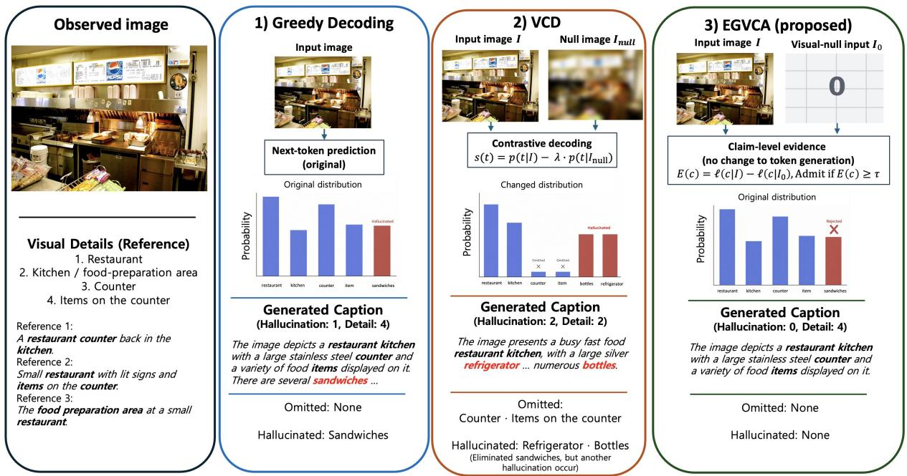
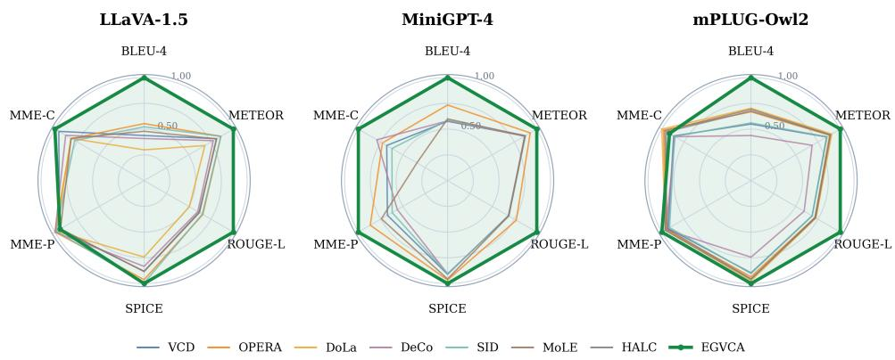
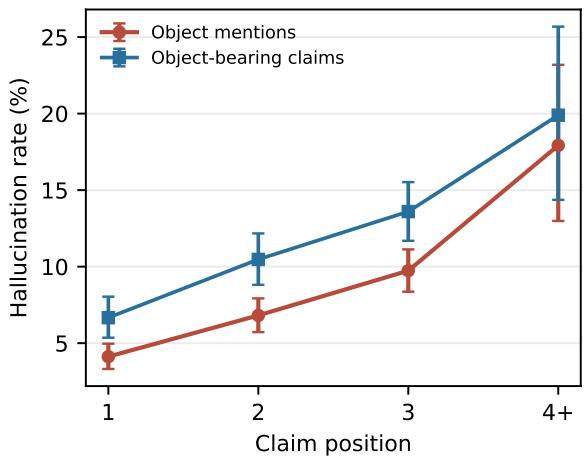

# From Token Correction to Claim Admission: Training-Free Hallucination Mitigation for Large Vision-Language Models

Hyeonggeun Han Independent Researcher hygnhan@gmail.com

Taehyun Cho   
Vector Institute   
Fields Institute   
Seoul National University   
talium@cml.snu.ac.kr

Sangwoo Hong Konkuk University swhong06@konkuk.ac.kr

## Abstract

Large vision-language models often exhibit object hallucination, generating claims that are not supported by the input image. To mitigate this issue, we propose Evidence-Guided Visual Claim Admission (EGVCA), a training-free framework that admits a semantic claim only when it receives sufficient image-dependent support. EGVCA measures this support by comparing the claim likelihood under the observed image and a visual-null input. For cap tioning, it controls semantic expansion without altering token generation. For binary visual question answering, it combines atomic visual support with the image-induced change in the model’s native Yes–No margin. Experiments on CHAIR, POPE, and MME across three LVLM backbones show that EGVCA substantially reduces object hallucination while preserving caption quality. It achieves the highest POPE F1 in eight of nine backbone–sampling settings and improves the native MME total score on all three backbones. These results demonstrate the effectiveness of claim-level admission as a simple alternative to token-level distribution correction.

## 1 Introduction

Large Vision-Language Models (LVLMs) have demonstrated remarkable capabilities in multimodal understanding and generation, enabling a broad range of applications that require interaction with visual environments. Despite this progress, their reliability remains fundamentally challenged by object hallucination (OH), where generated responses contain object-centric information that is inconsistent with the visual input (Li et al., 2023b; Wang et al., 2023, 2026). Such hallucinations can manifest in various forms, including mentioning objects that are not present, describing incorrect attributes or properties of visible objects, or asserting relationships between objects that are not supported by the image. These errors can remain linguistically plausible even when they are visually ungrounded, making them particularly difficult to detect from the generated response alone. As LVLMs are increasingly expected to provide faithful interpretations of visual scenes, mitigating OH is therefore essential for improving their reliability and enabling trustworthy real-world deployment.

Numerous approaches have been proposed to reduce hallucinations through additional training, external supervision, representation intervention, and decoding-time correction. Among them, trainingfree decoding methods have received particular attention because they can be directly applied to pretrained LVLMs without additional training data or parameter updates. A major line of work improves visual grounding by contrasting predictions obtained under different visual or conditional contexts (Leng et al., 2024; Favero et al., 2024), while another exploits internal decoding signals, such as attention patterns, intermediate-layer predictions, or visual-token and layer-wise information, to suppress hallucination-prone outputs (Huang et al., 2024; Wang et al., 2025; Huo et al., 2025; Liang et al., 2025). More recent approaches further suggest that correcting generation selectively according to the visual support of emerging content can avoid unnecessary intervention (Yang et al., 2026). Despite their effectiveness, existing methods primarily mitigate hallucination by modifying token distributions or intervening on particular internal signals during decoding. Such correction can suppress hallucination-prone generation, but modifying the generation process itself may also alter visual information that is already well grounded. As a result, the model may favor safer but less semantically specific responses. We therefore take a different perspective. Rather than directly correcting how a claim is generated, we first ask whether the semantic claim itself has sufficient visual evidence to be admitted into the response. This separation allows hallucination mitigation to focus on unsupported semantic commitments while leaving grounded generation otherwise unchanged.

  
Figure 1: Comparison of greedy decoding, VCD, and EGVCA. Unlike VCD, which modifies next-token predictions, EGVCA uses original-versus-visual-null evidence to reject unsupported claims without altering candidate generation.

Motivated by this perspective, we propose Evidence-Guided Visual Claim Admission (EGVCA), a training-free framework that formulates hallucination mitigation as visual claim admission. As illustrated in Figure 1, EGVCA is based on a simple principle: a visual claim should be incorporated into the response only when its plausibility can be meaningfully attributable to the observed image. We estimate this support by comparing the normalized likelihood of the same claim under the observed image and a visual-null input, implemented as an all-zero preprocessed visual tensor. This counterfactual comparison isolates imagedependent evidence from plausibility induced by linguistic context alone.

Unlike contrastive decoding methods that directly modify the next-token distribution, EGVCA interprets the resulting contrast as evidence for a semantic claim. It then uses this evidence to regulate whether the model commits to that claim, while leaving the underlying candidate generation unchanged. This separation between claim-level evidence estimation and claim admission provides a unified mechanism for suppressing visually unsupported content while retaining supported semantic information. Experiments across three LVLM backbones on CHAIR, POPE, and MME show that EGVCA consistently reduces object hallucination while maintaining competitive generation quality.

## 2 Related Work

Large Vision-Language Models. LVLMs have rapidly advanced by integrating visual encoders with large language models, achieving strong performance across a wide range of multimodal understanding and generation tasks (Li et al., 2023a; Liu et al., 2023; Zhu et al., 2024; Ye et al., 2024; Bai et al., 2023). Recent progress in large-scale multimodal pretraining and visual instruction tuning has further improved their ability to follow naturallanguage instructions and reason over complex visual content. As a result, LVLMs have become a central foundation for general-purpose multimodal systems. Despite these advances, imperfect visual grounding remains a persistent limitation, causing LVLMs to generate semantically plausible content that is inconsistent with the visual input.

Object Hallucination in LVLMs. Object hallucination (OH) refers to the generation of objectcentric content that is not faithfully grounded in the given image (Rohrbach et al., 2018; Li et al., 2023b). It can appear as incorrect object identification as well as erroneous attributes, quantities, or relations associated with visual entities (Wang et al., 2023). Prior studies have linked OH to biased object co-occurrences, strong language priors, insufficient vision-language alignment, and the diminishing influence of visual information during autoregressive generation (Li et al., 2023b; Leng et al., 2024; Favero et al., 2024). To address these issues, various mitigation strategies have been explored, with training-free inference-time methods receiving particular attention for improving visual faithfulness without modifying the underlying LVLM.

Training-Free Decoding for Hallucination Mitigation. Training-free decoding provides an efficient means of mitigating hallucinations without retraining LVLMs. Many approaches derive corrective signals from the predictions or internal computations of a frozen model. VCD contrasts predic tions under the original and distorted visual inputs to suppress language priors, while OPERA penalizes over-trusted attention patterns during decoding (Leng et al., 2024; Huang et al., 2024). DeCo uses visual information preserved in intermediate layers to correct next-token predictions, and MoLE combines predictions from multiple layer-wise experts to improve visual grounding (Wang et al., 2025; Liang et al., 2025). Recent analyses further show that reliance on linguistic context tends to increase as generation proceeds, while visual dependency can weaken during later decoding stages (Min et al., 2025; Anand et al., 2026). This tendency motivates explicit control over the visual support of later gen erated content. The use of such internal signals is also connected to broader research that seeks to understand and control model behavior through interpretable internal features, mechanistic circuits, role-aware information flow, confidence-aware fusion, and evidence-grounded structured representations (Huben et al., 2024; Lee et al., 2026b,a; Yoon et al., 2026; Lee et al., 2025). EGVCA shares the broader goal of deriving informative signals from a frozen model, but differs in how these signals are used. Rather than directly modifying next-token predictions, EGVCA interprets the original-versusnull likelihood contrast as evidence for a semantic claim and uses it to determine whether that claim should be admitted.

## 3 Claim-Level View of Object Hallucination

Given an input image I and a textual instruction x, a pretrained LVLM parameterized by θ generates a response y according to $p _ { \theta } ( y \mid I , x )$ . Rather than viewing hallucination solely as an error at the token level, we consider the semantic commitments expressed in the response. Specifically, we define y as a sequence of semantic claims $y = ( c _ { 1 } , \dots , c _ { T } )$ where each $c _ { t }$ may describe the existence of an object, an attribute of a visible object, or a relation among visual entities. Letting $h _ { t } = ( c _ { 1 } , \ldots , c _ { t - 1 } )$ denote the preceding claims, with $h _ { 1 }$ being empty, we express the response likelihood as

$$
p _ { \theta } ( y \mid I , x ) = \prod _ { t = 1 } ^ { T } p _ { \theta } ( c _ { t } \mid I , x , h _ { t } ) .\tag{1}
$$

Under this formulation, object hallucination arises when the model introduces a semantic commitment that is not sufficiently grounded in the observed image.

A central difficulty is that the likelihood of a claim does not by itself indicate whether the claim is visually grounded. A claim may receive high probability because it is linguistically plausible or favored by the model’s learned priors even when the image provides little evidence for it. We therefore distinguish the overall plausibility of a claim from the extent to which that plausibility increases in the presence of the observed image. To this end, we consider a visual-null counterpart $I _ { 0 }$ of the input image $I ,$ under which task-relevant visual information is removed. This motivates comparing the likelihood of the same claim under I and $I _ { 0 }$ through the log-likelihood contrast

$$
\log p _ { \theta } ( c _ { t } \mid I , x , h _ { t } ) - \log p _ { \theta } ( c _ { t } \mid I _ { 0 } , x , h _ { t } ) .\tag{2}
$$

A positive contrast indicates that the observed image increases the model-assigned likelihood of the claim relative to the visual-null input. This comparison provides a basis for assessing imagedependent evidence beyond the claim’s overall plausibility.

Crucially, we do not formulate this imagedependent likelihood difference as a corrective signal for directly modifying next-token probabilities. Instead, we treat it as evidence for deciding whether a semantic commitment should be admitted into the model response. This shifts the target of intervention from token generation itself to the model’s commitment to semantic content: generation remains unchanged for content that is sufficiently grounded, while visually unsupported commitments can be regulated at the admission stage. We consider this principle in both openended generation and binary visual question answering. Although the form of the response and the corresponding admission mechanism differ between the two settings, both instantiate the same underlying problem of determining whether a semantic commitment is sufficiently attributable to the observed image. Section 4 describes how this likelihood comparison is operationalized as evidence and how claim admission is implemented in each setting.

## 4 Evidence-Guided Visual Claim Admission

Building on the distinction between claim plausibility and image-dependent evidence in Section 3, we propose Evidence-Guided Visual Claim Admission (EGVCA), a training-free framework for regulating semantic commitments in LVLM responses. EGVCA uses the likelihood contrast in $\operatorname { E q } . 2$ to estimate visual evidence and guide claim admission. We first define a claim-level visual evidence score and specify the visual-null input used to compute it. We then describe how this evidence determines the retained response prefix in open-ended generation and adjusts the final Yes–No decision in binary visual question answering.

## 4.1 Image-Attributable Visual Evidence

EGVCA normalizes the claim-level likelihood contrast by token count to reduce its dependence on claim length. Using the preceding context $h _ { t }$ defined in Section 3, we compute the average token log-likelihood of a claim as

$$
\ell _ { \theta } ( c _ { t } \mid I , x , h _ { t } ) = { \frac { \sum _ { j = 1 } ^ { | c _ { t } | } \log p _ { \theta } ( c _ { t , j } \mid I , x , h _ { t } , c _ { t , < j } ) } { | c _ { t } | } }\tag{3}
$$

where $\left| c _ { t } \right|$ is the number of tokens in $c _ { t } , c _ { t , j }$ denotes its j-th token, and $c _ { t , < j }$ denotes its preceding tokens. Averaging places claims of different lengths on a per-token scale. We then define the imageattributable evidence as

$$
E ( c _ { t } ) = \ell _ { \theta } ( c _ { t } \mid I , x , h _ { t } ) - \ell _ { \theta } ( c _ { t } \mid I _ { 0 } , x , h _ { t } ) .\tag{4}
$$

Thus, $E ( c _ { t } )$ is the log-likelihood contrast in Eq. 2 divided by $\left| c _ { t } \right|$

The visual-null input $I _ { 0 }$ is constructed by replacing the backbone-specific preprocessed visual input with a zero-valued tensor of the same shape. This construction removes the image’s scene content without substituting another scene or introducing a randomly generated visual pattern. It therefore provides a deterministic reference for measuring the change in claim likelihood induced by the observed image. Accordingly, we interpret $E ( c _ { t } )$ as evidence relative to this reference, rather than as an absolute measure of visual correctness.

A positive $E ( c _ { t } )$ indicates that the observed image increases the claim’s average token loglikelihood relative to $I _ { 0 }$ . A value near zero indicates little change, whereas a negative value indicates that the claim is less likely under the observed image than under the reference. EGVCA uses this score to evaluate claim admission, without feeding it back into the next-token distribution.

## 4.2 Claim Admission for Open-Ended Generation

For open-ended generation, EGVCA applies evidence-based admission to a candidate response produced by the LVLM’s native decoding strategy. We partition this response into the claim sequence described in Section 3 and evaluate the claims in their original order. Each claim is defined as a sentence-like span separated by terminal punctuation. Admission retains a prefix of this sequence without rewriting individual claims.

The first claim $c _ { 1 }$ is retained without an evidence check to prevent an empty response. Each subsequent claim is evaluated using $E ( c _ { t } )$ conditioned on its preceding context $h _ { t }$ and admitted according to

$$
\mathrm { A d m i t } ( c _ { t } ) = \mathrm { I } \left[ E ( c _ { t } ) \geq \tau \right] , \qquad t \geq 2 ,\tag{5}
$$

where $\operatorname { I } [ \cdot ]$ is the indicator function and $\tau$ is the minimum evidence required to retain an additional claim. This rule uses image-attributable evidence to determine whether the response should extend beyond the claims already retained.

Admission stops at the first claim that fails the criterion. If $c _ { t }$ is the first rejected claim, EGVCA discards it together with all subsequent claims and returns

$$
\hat { y } = ( c _ { 1 } , \dots , c _ { t - 1 } ) .\tag{6}
$$

If no claim is rejected, the full candidate response is retained. Stopping at the first rejection preserves the preceding context under which each retained claim was generated and evaluated. It also avoids retaining later claims that may depend on rejected content. The threshold $\tau$ controls how much of the response is admitted beyond the initial claim. Increasing $\tau$ makes admission stricter, while decreasing it allows a longer prefix to be retained.

## 4.3 Evidence-Guided Claim Admission for Binary VQA

In binary visual question answering, claim admission concerns the proposition expressed by a question q. Answering Yes affirms this proposition, whereas answering No rejects it. EGVCA combines evidence about the question’s visual components with evidence about the complete proposition, then uses the combined score to adjust the model’s final decision.

Component-level evidence measures how strongly the image increases the likelihood of the visual content mentioned in the question. We decompose q into K visual components $a _ { 1 } , \dots , a _ { K }$ , corresponding to objects, attributes, or relations involved in the proposition. Visual components are extracted using a rule-based parser with predefined lexical variants, without requiring a trained semantic parser. Each component is scored under a fixed neutral visual-description context $x _ { \mathrm { n e u } } .$ , which requests visual description without posing a Yes–No question. This context allows us to evaluate the component’s textual content outside the original binary question framing. For each component, we compute

$$
e ( a _ { k } ) = \ell _ { \theta } ( a _ { k } \mid I , x _ { \mathrm { { n e u } } } ) - \ell _ { \theta } ( a _ { k } \mid I _ { 0 } , x _ { \mathrm { { n e u } } } ) ,\tag{7}
$$

using the token-averaged log-likelihood in Eq. 3, with no preceding claim context. When multiple equivalent textual forms are considered for a component, we use the form with the largest evidence score. We aggregate the component scores as

$$
V ( q ) = \frac { 1 } { K } \sum _ { k = 1 } ^ { K } e ( a _ { k } ) .\tag{8}
$$

Averaging reduces the dependence of the aggregate score on the number of components.

Component-level evidence alone does not establish whether the complete proposition is supported. For example, evidence for a dog, a couch, and a sitting action does not necessarily establish that the dog is sitting on the couch. EGVCA therefore includes a second signal that measures how the image changes the model’s preference for affirming the question as a whole. We compute the native Yes–No margin under the observed image as

$$
m _ { I } ( q ) = \log p _ { \theta } ( \mathrm { Y e s } \mid I , q ) - \log p _ { \theta } ( \mathrm { N o } \mid I , q ) ,\tag{9}
$$

and the corresponding margin under the visual-null input as

$$
\begin{array} { r } { m _ { 0 } ( q ) = \log p _ { \theta } ( \mathrm { Y e s } \mid I _ { 0 } , q ) - \log p _ { \theta } ( \mathrm { N o } \mid I _ { 0 } , q ) . } \end{array}\tag{10}
$$

The proposition-level evidence is their difference,

$$
M ( q ) = m _ { I } ( q ) - m _ { 0 } ( q ) .\tag{11}
$$

A positive $M ( q )$ indicates that the observed image shifts the model’s relative preference toward Yes, whereas a negative value indicates a shift toward $\mathrm { N o } .$ . Unlike $V ( q )$ , this score evaluates the image’s effect on the decision for the complete question.

EGVCA combines these complementary signals through an equally weighted joint evidence score,

$$
J ( q ) = { \frac { 1 } { 2 } } V ( q ) + { \frac { 1 } { 2 } } M ( q ) .\tag{12}
$$

Here, $V ( q )$ contributes evidence for the visual components, while $M ( q )$ contributes evidence for affirming the complete proposition. The joint score adjusts the native decision margin through

$$
m ^ { \prime } ( q ) = m _ { I } ( q ) + \lambda ( J ( q ) - \tau ) ,\tag{13}
$$

where $\lambda \geq 0$ controls the strength of the adjustment and τ is the evidence reference level for binary VQA. Evidence above τ increases the margin toward Yes, while evidence below $\tau$ decreases it. Unlike the hard threshold used for open-ended generation, τ is not a standalone admission condition. The final decision depends jointly on the native margin and the evidence adjustment.

The final answer is

$$
\hat { a } = \left\{ \begin{array} { l l } { \mathrm { Y e s } , } & { m ^ { \prime } ( q ) > 0 , } \\ { \mathrm { N o } , } & { m ^ { \prime } ( q ) \leq 0 . } \end{array} \right.\tag{14}
$$

This rule applies the evidence adjustment at the final answer-selection stage, leaving the LVLM probabilities used to compute the scores unchanged. Both response settings therefore use visual evidence to regulate semantic commitment, through prefix admission in open-ended generation and decision-level adjustment in binary VQA.

## 5 Experiments

## 5.1 Experimental Setup

Models. We evaluate EGVCA on three pretrained LVLM backbones, LLaVA-1.5-7B (Liu et al., 2024), MiniGPT-4 with Vicuna-13B (Zhu et al., 2024), and mPLUG-Owl2-7B (Ye et al., 2024). All model parameters remain frozen throughout evaluation.

Table 1: CHAIR-500 comparison across three LVLM backbones.
<table><tr><td rowspan="2">Method</td><td colspan="2">LLaVA-1.5</td><td colspan="2">MiniGPT-4</td><td colspan="2">mPLUG-Owl2</td></tr><tr><td> $\operatorname { C H A I R } _ { S } \downarrow$ </td><td> $\operatorname { C H A I R } _ { I } \downarrow$ </td><td> $\operatorname { C H A I R } _ { S } \downarrow$ </td><td> $\operatorname { C H A I R } _ { I } \downarrow$ </td><td> $\operatorname { C H A I R } _ { S } \downarrow$ </td><td> $\operatorname { C H A I R } _ { I } \downarrow$ </td></tr><tr><td>Greedy</td><td> $2 1 . 9 3 \pm 1 . 7 9$ </td><td> $7 . 0 7 \pm 0 . 5 9$ </td><td> $2 0 . 3 3 \pm 0 . 5 2$ </td><td> $7 . 2 6 \pm 0 . 3 9$ </td><td> $2 1 . 4 7 \pm 1 . 0 0$ </td><td> $7 . 1 2 \pm 0 . 3 9$ </td></tr><tr><td>Beam</td><td> $1 8 . 7 3 \pm 2 . 4 9$ </td><td> $6 . 2 3 \pm 0 . 3 7$ </td><td> $2 0 . 0 0 \pm 1 . 8 8$ </td><td> $7 . 2 0 \pm 0 . 4 8$ </td><td> $1 9 . 2 7 \pm 1 . 5 9$ </td><td> $6 . 6 1 \pm 0 . 3 9$ </td></tr><tr><td>VCD</td><td> $2 3 . 8 7 \pm 0 . 2 5$ </td><td> $7 . 9 1 \pm 0 . 2 7$ </td><td> $2 3 . 7 3 \pm 0 . 9 0$ </td><td> $9 . 0 2 \pm 0 . 0 7$ </td><td> $2 5 . 4 0 \pm 2 . 3 2$ </td><td> $8 . 7 7 \pm 0 . 7 3$ </td></tr><tr><td>OPERA</td><td> $1 8 . 0 0 \pm 1 . 0 2$ </td><td> $\underline { { 6 . 0 2 \pm 0 . 1 9 } }$ </td><td> $1 7 . 8 0 \pm 1 . 5 7$ </td><td> $7 . 0 8 \pm 0 . 3 5$ </td><td> $1 7 . 7 3 \pm 0 . 7 4$ </td><td> $\underline { { 6 . 2 1 \pm 0 . 1 6 } }$ </td></tr><tr><td>DoLa</td><td> $1 7 . 2 7 \pm 1 . 5 1$ </td><td> $\overline { { 8 . 7 2 \pm 2 . 0 8 } }$ </td><td> ${ \underline { { 1 5 . 0 7 } } } \pm 1 . 8 9$ </td><td> $7 . 0 8 \pm 0 . 5 6$ </td><td> $1 8 . 8 7 \pm 1 . 2 3$ </td><td> $\overline { { 6 . 4 4 \pm 0 . 2 3 } }$ </td></tr><tr><td>DeCo</td><td> $\underline { { 1 6 . 2 0 \pm 1 . 3 4 } }$ </td><td> $6 . 1 6 \pm 0 . 6 5$ </td><td> $1 7 . 8 0 \pm 1 . 3 1$ </td><td> $6 . 7 5 \pm 0 . 4 6$ </td><td> $\underline { { 1 7 . 3 3 \pm 1 . 7 9 } }$ </td><td> $7 . 3 3 \pm 1 . 0 7$ </td></tr><tr><td>SID</td><td> $\overline { { 2 2 . 1 3 \pm 0 . 9 8 } }$ </td><td> $6 . 5 0 \pm 0 . 3 1$ </td><td> $2 2 . 9 3 \pm 2 . 6 6$ </td><td> $8 . 6 5 \pm 0 . 8 9$ </td><td> $2 5 . 4 0 \pm 1 . 8 5$ </td><td> $8 . 6 8 \pm 0 . 4 6$ </td></tr><tr><td>MoLE</td><td> $1 8 . 1 3 \pm 1 . 3 1$ </td><td> $6 . 5 1 \pm 0 . 5 9$ </td><td> $1 7 . 8 0 \pm 1 . 2 8$ </td><td> $6 . 5 0 \pm 0 . 2 8$ </td><td> $1 8 . 5 3 \pm 0 . 2 5$ </td><td> $\underline { { 6 . 2 1 \pm 0 . 1 8 } }$ </td></tr><tr><td>HALC</td><td> $2 3 . 0 7 \pm 1 . 7 5$ </td><td> $8 . 5 2 \pm 0 . 6 2$ </td><td> $1 7 . 9 3 \pm 1 . 1 5$ </td><td> $\underline { { 6 . 3 1 \pm 0 . 6 1 } }$ </td><td> $2 0 . 0 0 \pm 1 . 8 4$ </td><td> $\overline { { 6 . 8 3 \pm 0 . 3 3 } }$ </td></tr><tr><td>EGVCA</td><td> ${ \bf 1 0 . 8 7 \pm 1 . 4 3 }$ </td><td> ${ \bf 5 . 7 7 \pm 0 . 6 1 }$ </td><td> ${ \bf 1 } 2 . 7 3 \pm { \bf 0 . 6 6 }$ </td><td> ${ \bf 6 . 1 9 \pm 0 . 1 1 }$ </td><td> ${ \bf 1 } 2 . 6 0 \pm { \bf 1 . 6 1 }$ </td><td> ${ \bf 5 . 6 3 \pm 0 . 7 0 }$ </td></tr></table>

Benchmarks and Evaluation Metrics. We evaluate object hallucination in open-ended generation using CHAIR (Rohrbach et al., 2018) on 500 images sampled from the MS COCO 2014 validation set (Lin et al., 2014) per run, with three independent sampling seeds for all three backbones. We report $\mathrm { C H A I R } _ { S }$ and $\mathrm { C H A I R } _ { I }$ to measure hallucination at the caption and object-mention levels, respectively. Caption quality is assessed using BLEU-4 (Papineni et al., 2002), METEOR (Banerjee and Lavie, 2005), ROUGE-L (Lin, 2004), and SPICE (Anderson et al., 2016) to characterize retained content. For binary VQA, we evaluate the Random, Popular, and Adversarial settings of MS COCO POPE (Li et al., 2023b), reporting accuracy and F1 for object-existence judgments. We additionally report perception, cognition, and total scores on the full MME benchmark (Fu et al., 2025) to assess broader multimodal capabilities.

ting using a predefined parameter sweep and is applied uniformly to all examples, using a held-out validation set. Appendix A.3 reports the local sensitivity around the selected operating points. CHAIR results are reported as the mean and standard deviation over three seeds, while caption-quality results are reported as three-seed means. All experiments were conducted on a single NVIDIA GeForce RTX 5090 GPU with 32 GB of memory.

Baselines. We compare EGVCA with standard greedy decoding, beam search, and the native Yes– No decision, together with seven inference-time methods, VCD (Leng et al., 2024), OPERA (Huang et al., 2024), DoLa (Chuang et al., 2024), DeCo (Wang et al., 2025), SID (Huo et al., 2025), MoLE (Liang et al., 2025), and HALC (Chen et al., 2024). These baselines allow us to compare claim admission with alternative inference-time interventions for improving factuality or mitigating hallucination without updating the evaluated LVLM.

## 5.2 Experimental Results

Open-ended Object Hallucination. Table 1 demonstrates the effectiveness of EGVCA in reducing object hallucination in open-ended generation. EGVCA achieves the lowest CHAIRS in each backbone comparison. On LLaVA-1.5, it obtains a score of 10.87, outperforming DeCo, the strongest baseline on this metric, by 5.33 percentage points. On MiniGPT-4 and mPLUG-Owl2, EGVCA reduces CHAIR from 20.33 to 12.73 and from 21.47 to 12.60, respectively, while also improving CHAIRI. This result implies that a larger proportion of the resulting captions contain no hallucinated object mentions. This outcome aligns with the purpose of claim admission, which determines whether additional semantic content should enter the response. The improvements across all three backbones support the applicability of this principle to different LVLMs without modifying their underlying token-generation rules.

Implementation Details. For open-ended generation, EGVCA applies claim admission to greedy responses with $\tau = 0 . 2 5$ for $\mathrm { L L a V A – 1 } . 5 , \tau = 0 . 3 0$ for MiniGPT-4, and $\tau = 0 . 1 2 5$ for mPLUG-Owl2. For binary VQA, a single calibration parameter pair is selected for each backbone–benchmark set-

Binary Visual Question Answering. Table 2 shows that EGVCA improves object-presence prediction across different backbones and negativesampling settings. EGVCA improves F1 over native predictions and achieves the highest F1 among the evaluated methods in eight of the nine backbone–setting combinations. Applied to

EGVCA 90.43 90.05 87.60 87.47 80.97 81.94 76.80 78.45 76.07 77.92 69.40 73.41 90.37 90.11 87.37 87.42 82.40 83.27  
Table 2: POPE results under Random, Popular, and Adversarial sampling across three LVLM backbones.1
<table><tr><td></td><td colspan="4">LLaVA-1.5</td><td colspan="3">MiniGPT-4</td><td colspan="4">mPLUG-Owl2</td></tr><tr><td></td><td>Random</td><td>Popular</td><td></td><td>Adversarial</td><td>Random</td><td>Popular</td><td>Adversarial</td><td></td><td>Random</td><td>Popular</td><td>Adversarial</td></tr><tr><td>Method</td><td>Acc. F1</td><td>Acc.</td><td>F1 Acc.</td><td>F1</td><td>Acc. F1</td><td>Acc. F1</td><td>Acc.</td><td>F1 Acc.</td><td>F1</td><td>Acc. F1</td><td>Acc. F1</td></tr><tr><td>Native</td><td>87.2085.6985.8384.4083.4782.2574.8372.5671.4069.9469.5068.7088.67</td><td></td><td></td><td></td><td></td><td></td><td></td><td></td><td>88.59</td><td></td><td>84.7785.2480.9082.12</td></tr><tr><td>VCD</td><td>84.23 82.50 82.3780.62 79.33 77.97 58.70 58.74 57.00 57.26 57.60 58.94 83.97 83.3981.1781.30 79.00 79.48</td><td></td><td></td><td></td><td></td><td></td><td></td><td></td><td></td><td></td><td></td></tr><tr><td>OPERA</td><td>86.23 84.42 85.1783.4182.8781.27 74.50 68.71 72.0366.69 69.67 65.00 86.8385.8084.40 83.60 80.80 80.51</td><td></td><td></td><td></td><td></td><td></td><td></td><td></td><td></td><td></td><td></td></tr><tr><td>DoLa</td><td>88.4387.44 86.3785.5283.5783.03</td><td></td><td></td><td></td><td></td><td></td><td></td><td></td><td>-86.67 85.5584.4783.56 81.0780.61</td><td></td><td></td></tr><tr><td>DeCo</td><td>88.53 87.6086.3385.5683.3782.95 52.57 67.78 51.77 67.42 51.83 67.4586.4786.6882.30 83.27 78.0380.04</td><td></td><td></td><td></td><td></td><td></td><td></td><td></td><td></td><td></td><td></td></tr><tr><td>SID</td><td>89.40 89.0586.10 86.1180.4781.4959.07 57.74 58.13 57.0756.57 55.3984.03 83.60 80.70 80.8777.10 77.99</td><td></td><td></td><td></td><td></td><td></td><td></td><td></td><td></td><td></td><td></td></tr><tr><td>MoLE</td><td>88.8788.1186.8786.2783.2083.0555.6721.1255.2320.9555.0321.2586.9385.8984.5083.6981.0080.68</td><td></td><td></td><td></td><td></td><td></td><td></td><td></td><td></td><td></td><td></td></tr><tr><td>HALC</td><td>88.50 87.52 86.43 85.60 83.5783.05</td><td></td><td></td><td></td><td></td><td></td><td></td><td></td><td></td><td></td><td>- 86.53 85.85 83.87 83.51 80.20 80.46</td></tr></table>

  
Figure 2: General capability profiles across three LVLM backbones. BLEU-4, METEOR, ROUGE-L, and SPICE are evaluated on COCO captions, whereas MME-P and MME-C are evaluated on the separate MME benchmark. Each metric is normalized by the best matched result for the corresponding backbone and metric. Greedy and Beam are omitted for clarity.

LLaVA-1.5, EGVCA obtains the best accuracy and F1 in both the Random and Popular settings. On MiniGPT-4, it achieves the highest F1 across all three settings, with Popular F1 increasing from 69.94 to 77.92. On mPLUG-Owl2, EGVCA leads in both accuracy and F1 under every sampling setting. These results extend the evidence for claim admission beyond open-ended descriptions. Because POPE requires a binary response, its F1 improvements demonstrate that the benefit of EGVCA also applies to deciding whether an object-existence claim should be affirmed, beyond controlling how much descriptive content is generated.

General Capability Preservation. Figure 2 jointly summarizes caption quality and MME performance. For captioning, EGVCA achieves the best matched BLEU-4, METEOR, ROUGE-L, and SPICE scores on all three backbones. On LLaVA-1.5, SPICE increases from 21.44 with greedy decoding to 22.19, while EGVCA obtains SPICE scores of 20.45 and 22.55 on MiniGPT-4 and mPLUG-Owl2, respectively. The consistent improvements across all four reference-based metrics indicate that hallucination reduction does not come at the expense of semantic caption quality.

EGVCA also improves MME Total over the native model on all three backbones, with the largest gain of 249.21 points on MiniGPT-4. It obtains the highest cognition score on LLaVA-1.5, the best perception and cognition scores on MiniGPT-4, and the highest perception and total scores on mPLUG-Owl2. Together, these results show that EGVCA preserves broader visual understanding while reducing hallucination.

## 5.3 Ablation and Analysis.

We analyze the key design choices of EGVCA on LLaVA-1.5. Specifically, we examine how the caption admission threshold affects the trade-off between hallucination reduction and semantic quality, assess the contributions of the visual-content and native-margin evidence components to binary decisions, and report the inference efficiency of the resulting framework.

Table 3: Sensitivity of caption admission to τ on LLaVA-1.5. Results are the mean and standard deviation over three CHAIR-500 runs.
<table><tr><td>Setting</td><td> $\operatorname { C H A I R } _ { S } \downarrow$ </td><td> $\operatorname { C H A I R } _ { I } \downarrow$ </td><td>SPICE↑</td></tr><tr><td>Greedy</td><td> $2 1 . 9 3 { \pm } 1 . 7 9$ </td><td>7.07±0.59</td><td>21.44±0.30</td></tr><tr><td>τ = 0</td><td> $2 0 . 4 7 { \pm } 1 . 4 8$ </td><td>6.96±0.56</td><td>21.67±0.25</td></tr><tr><td> $\tau = 0 . 1 2 5$ </td><td> $1 4 . 7 3 { \pm } 1 . 4 7$ </td><td>6.47±0.57</td><td>22.23±0.14</td></tr><tr><td>τ = 0.25 (Ours)</td><td> $1 0 . 8 7 { \pm } 1 . 4 3 $ </td><td>5.77±0.61</td><td>22.19±0.24</td></tr><tr><td>τ = 0.5</td><td> $\underline { { 7 . 4 7 } } \pm 1 . 3 7 $ </td><td>4.56±0.80</td><td>21.73±0.25</td></tr><tr><td> $\tau = 1 . 0$ </td><td> ${ \bf 6 . 4 7 { \pm } 1 . 1 1 }$ </td><td>4.24±0.61</td><td>21.27±0.25</td></tr></table>

Table 4: Binary component ablation on full POPE and MME using LLaVA-1.5.
<table><tr><td>Variant</td><td>POPE F1↑</td><td>MME-P↑</td><td>MME-C↑</td><td>MME Total↑</td></tr><tr><td>Native LVLM</td><td>84.11</td><td>1360.14</td><td>321.79</td><td>1681.92</td></tr><tr><td>w/o M(q)</td><td>81.93</td><td>1371.71</td><td>361.79</td><td>1733.50</td></tr><tr><td>w/o V(q)</td><td>85.33</td><td>1360.32</td><td>321.79</td><td>1682.11</td></tr><tr><td>w/o mI(q)</td><td>84.95</td><td>498.33</td><td>204.29</td><td>702.62</td></tr><tr><td>Full EGVCA</td><td>86.48</td><td>1373.34</td><td>366.79</td><td>1740.13</td></tr></table>

Caption Admission Threshold. Table 3 reports the sensitivity to τ on CHAIR. Increasing τ consistently reduces both CHAIRS and CHAIRI, confirming that the admission threshold directly controls the strictness of semantic expansion. The best SPICE score is obtained at $\tau = 0 . 1 2 5$ , while $\tau = 0 . 2 5$ substantially reduces hallucination with only a negligible SPICE difference (22.19 versus 22.23). We therefore select $\tau = 0 . 2 5$ as the final operating point. Relative to greedy generation, it reduces CHAIR from 21.93 to 10.87 and CHAIR from 7.07 to 5.77, while increasing SPICE from 21.44 to 22.19. More aggressive thresholds further reduce hallucination, but also decrease SPICE, demonstrating a trade-off between hallucination suppression and semantic quality.

Binary Evidence Components. Table 4 separates atomic visual support V (q) from native margin gain M(q). Using V (q) alone substantially improves MME performance but degrades POPE, whereas M(q) alone improves POPE while leaving MME nearly unchanged. This indicates that the two components capture complementary aspects of visual evidence. Using the joint evidence as an independent classifier performs poorly, particularly on MME, showing that counterfactual evidence should calibrate rather than replace the LVLM’s native decision. Combining the native margin with joint evidence in the full admission head achieves the strongest joint result, improving POPE F1 from 84.11 to 86.48 and MME Total from 1681.92 to 1740.13.

Table 5: Inference efficiency on LLaVA-1.5 over CHAIR images.
<table><tr><td>Method</td><td>Tokens/sec.↑</td><td>Peak VRAM (GB)↓</td></tr><tr><td>Greedy</td><td>66.61</td><td>15.27</td></tr><tr><td>Beam</td><td>42.78</td><td>22.35</td></tr><tr><td>VCD</td><td>33.56</td><td>16.37</td></tr><tr><td>OPERA</td><td>5.43</td><td>25.45</td></tr><tr><td>DoLa</td><td>19.69</td><td>26.31</td></tr><tr><td>DeCo</td><td>59.10</td><td>15.75</td></tr><tr><td>SID</td><td>33.49</td><td>16.36</td></tr><tr><td>MoLE</td><td>31.00</td><td>29.26</td></tr><tr><td>HALC</td><td>1.45</td><td>19.54</td></tr><tr><td>EGVCA</td><td>21.90</td><td>15.27</td></tr></table>

Inference Efficiency. Table 5 reports end-toend throughput and peak GPU memory over 200 CHAIR images. EGVCA processes 21.90 finaloutput tokens per second while using 15.27 GB of peak memory. Its throughput exceeds DoLa, OPERA, and HALC, while its memory usage matches greedy decoding. Detailed latency measurements and the EGVCA runtime breakdown are provided in the appendix.

## 6 Conclusion

We presented EGVCA, a training-free framework that admits visual claims according to their evidence under the observed image relative to a visual-null input. Across three LVLM backbones, EGVCA reduces CHAIR hallucination, improves POPE performance, and preserves or improves caption quality and MME performance. These results demonstrate the effectiveness of claim-level admission for controlling visual hallucination.

## Limitations

EGVCA requires additional original and visualnull scoring, resulting in higher inference cost than standard greedy decoding. Our experiments focus on three LVLM backbones and widely used English-language benchmarks. Moreover, because EGVCA mitigates rather than verifies model outputs, residual errors exist in the resulting responses. It should therefore not be treated as a factuality guarantee in high-stakes settings.

## References

Neeraj Anand, Samyak Jha, Udbhav Bamba, and Rahul Rahaman. 2026. Crops: A training-free hallucination mitigation framework for vision-language models. arXiv preprint arXiv:2601.00659.

Peter Anderson, Basura Fernando, Mark Johnson, and Stephen Gould. 2016. SPICE: Semantic propositional image caption evaluation. In European conference on computer vision, pages 382–398. Springer.

Jinze Bai, Shuai Bai, Shusheng Yang, Shijie Wang, Sinan Tan, Peng Wang, Junyang Lin, Chang Zhou, and Jingren Zhou. 2023. Qwen-vl: A versatile visionlanguage model for understanding, localization, text reading, and beyond. Preprint, arXiv:2308.12966.

Satanjeev Banerjee and Alon Lavie. 2005. METEOR: An automatic metric for MT evaluation with improved correlation with human judgments. In Proceedings of the acl workshop on intrinsic and extrinsic evaluation measures for machine translation and/or summarization, pages 65–72.

Zhaorun Chen, Zhuokai Zhao, Hongyin Luo, Huaxiu Yao, Bo Li, and Jiawei Zhou. 2024. HALC: Object hallucination reduction via adaptive focal-contrast decoding. In Proceedings of the 41st International Conference on Machine Learning, volume 235, pages 7824–7846.

Yung-Sung Chuang, Yujia Xie, Hongyin Luo, Yoon Kim, James R. Glass, and Pengcheng He. 2024. Dola: Decoding by contrasting layers improves factuality in large language models. In The Twelfth International Conference on Learning Representations.

Alessandro Favero, Luca Zancato, Matthew Trager, Siddharth Choudhary, Pramuditha Perera, Alessandro Achille, Ashwin Swaminathan, and Stefano Soatto. 2024. Multi-modal hallucination control by visual information grounding. In Proceedings of the IEEE/CVF Conference on Computer Vision and Pattern Recognition (CVPR), pages 14303–14312.

Chaoyou Fu, Peixian Chen, Yunhang Shen, Yulei Qin, Mengdan Zhang, Xu Lin, Jinrui Yang, Xiawu Zheng, Ke Li, Xing Sun, et al. 2025. MME: A comprehensive evaluation benchmark for multimodal large language models. Advances in Neural Information Processing Systems, 38.

Hyeonggeun Han, Sehwan Kim, Hyungjun Joo, Sangwoo Hong, and Jungwoo Lee. 2025. Adjusting initial noise to mitigate memorization in text-to-image diffusion models. Advances in Neural Information Processing Systems, 38:684–711.

Qidong Huang, Xiaoyi Dong, Pan Zhang, Bin Wang, Conghui He, Jiaqi Wang, Dahua Lin, Weiming Zhang, and Nenghai Yu. 2024. Opera: Alleviating hallucination in multi-modal large language models via over-trust penalty and retrospection-allocation. In Proceedings ofthe IEEE/CVF Conference on Computer Vision and Pattern Recognition (CVPR), pages 13418–13427.

Robert Huben, Hoagy Cunningham, Logan Smith, Aidan Ewart, and Lee Sharkey. 2024. Sparse autoencoders find highly interpretable features in language models. In International Conference on Learning Representations, volume 2024, pages 7827–7845.

Fushuo Huo, Wenchao Xu, Zhong Zhang, Haozhao Wang, Zhicheng Chen, and Peilin Zhao. 2025. Selfintrospective decoding: Alleviating hallucinations for large vision-language models. In International Conference on Learning Representations, volume 2025, pages 24272–24295.

Jaewook Lee, Woojin Lee, Oh-Woog Kwon, and Harksoo Kim. 2025. Do large language models have “emotion neurons”? investigating the existence and role. In Findings of the Association for Computational Linguistics: ACL 2025, pages 15617–15639. Association for Computational Linguistics.

Jungseob Lee, Jaehyung Seo, and Heuiseok Lim. 2026a. The hallucination signal is a mean shift: Why simple probes suffice. arXiv preprint arXiv:2608.28930.

Nakyung Lee, Sangwoo Hong, and Jungwoo Lee. 2026b. Mechanistic circuit identification for controllable data generation. arXiv preprint arXiv:2608.24065.

Sicong Leng, Hang Zhang, Guanzheng Chen, Xin Li, Shijian Lu, Chunyan Miao, and Lidong Bing. 2024. Mitigating object hallucinations in large visionlanguage models through visual contrastive decoding. In Proceedings ofthe IEEE/CVF Conference on Computer Vision and Pattern Recognition (CVPR), pages 13872–13882.

Junnan Li, Dongxu Li, Silvio Savarese, and Steven Hoi. 2023a. BLIP-2: Bootstrapping language-image pretraining with frozen image encoders and large language models. In Proceedings of the 40th International Conference on Machine Learning, volume 202, pages 19730–19742.

Yifan Li, Yifan Du, Kun Zhou, Jinpeng Wang, Xin Zhao, and Ji-Rong Wen. 2023b. Evaluating object hallucination in large vision-language models. In Proceedings of the 2023 conference on empirical methods in natural language processing, pages 292– 305.

Tian Liang, Yuetian Du, Jing Huang, Ming Kong, Luyuan Chen, Yadong Li, Siye Chen, and Qiang Zhu. 2025. Mole:decoding by mixture of layer experts alleviates hallucination in large vision-language models. In Proceedings of the AAAI Conference on Artificial Intelligence, volume 39, pages 18684– 18692.

Chin-Yew Lin. 2004. ROUGE: A package for automatic evaluation of summaries. In Text summarization branches out, pages 74–81.

Tsung-Yi Lin, Michael Maire, Serge Belongie, James Hays, Pietro Perona, Deva Ramanan, Piotr Dollár, and C Lawrence Zitnick. 2014. Microsoft COCO: Common objects in context. In European conference on computer vision, pages 740–755. Springer.

Haotian Liu, Chunyuan Li, Yuheng Li, and Yong Jae Lee. 2024. Improved baselines with visual instruction tuning. In Proceedings of the IEEE/CVF Conference on Computer Vision and Pattern Recognition (CVPR), pages 26296–26306.

Haotian Liu, Chunyuan Li, Qingyang Wu, and Yong Jae Lee. 2023. Visual instruction tuning. Advances in neural information processing systems, 36:34892– 34916.

Kyungmin Min, Minbeom Kim, Kang-il Lee, Dongryeol Lee, and Kyomin Jung. 2025. Mitigating hallucinations in large vision-language models via summary-guided decoding. In Findings of the Associationfor Computational Linguistics: NAACL 2025, pages 4183–4198.

Kishore Papineni, Salim Roukos, Todd Ward, and Wei-Jing Zhu. 2002. BLEU: A method for automatic evaluation of machine translation. In Proceedings of the 40th annual meeting of the Association for Computational Linguistics, pages 311–318.

Anna Rohrbach, Lisa Anne Hendricks, Kaylee Burns, Trevor Darrell, and Kate Saenko. 2018. Object hallucination in image captioning. In Proceedings of the 2018 conference on empirical methods in natural language processing, pages 4035–4045.

Chenxi Wang, Xiang Chen, Ningyu Zhang, Bozhong Tian, Haoming Xu, Shumin Deng, and Huajun Chen. 2025. MLLM can see? dynamic correction decoding for hallucination mitigation. In The Thirteenth International Conference on Learning Representations.

Junyang Wang, Yuhang Wang, Guohai Xu, Jing Zhang, Yukai Gu, Haitao Jia, Jiaqi Wang, Haiyang Xu, Ming Yan, Ji Zhang, et al. 2023. Amber: An llm-free multi-dimensional benchmark for mllms hallucination evaluation. arXiv preprint arXiv:2311.07397.

Tianbo Wang, Yuqing Ma, Kewei Liao, Zhange Zhang, Simin Li, Jinyang Guo, and Xianglong Liu. 2026. AFTER: Mitigating the object hallucination of LVLM via adaptive factual-guided activation editing. In The Fourteenth International Conference on Learning Representations.

Lei Yang, Xinze Liu, Dayan Wu, Ding Wang, Hengjie Zhu, Zihao Zhang, Tianzhu Hu, Hanqi Wu, Peng Fu, and Zheng Lin. 2026. Hallucinations leave a grounding signature: Verifier-guided decoding for selective object correction. arXiv preprint arXiv:2607.27823.

Qinghao Ye, Haiyang Xu, Jiabo Ye, Ming Yan, Anwen Hu, Haowei Liu, Qi Qian, Ji Zhang, and Fei Huang. 2024. mplug-owl2: Revolutionizing multi-modal large language model with modality collaboration. In Proceedings ofthe IEEE/CVF Conference on Computer Vision and Pattern Recognition (CVPR), pages 13040–13051.

Yeo-Chan Yoon, Sookyun Kim, and Gyeongmin Kim. 2026. Adaptive orthogonal role-aware transformer for robust instruction alignment. ETRI Journal.

Deyao Zhu, Jun Chen, Xiaoqian Shen, Xiang Li, and Mohamed Elhoseiny. 2024. MiniGPT-4: Enhancing vision-language understanding with advanced large language models. In The Twelfth International Conference on Learning Representations.

  
Figure 3: Object hallucination across claim positions in LLaVA-1.5 Greedy captions. Error bars indicate 95% confidence intervals obtained using image-grouped bootstrap resampling. Positions four and later are pooled.

## A Additional Analyses

## A.1 Hallucination across Claim Positions

Previous studies report that LVLMs increasingly rely on linguistic context as generation proceeds, while their dependence on visual information tends to weaken in later decoding stages (Min et al., 2025; Anand et al., 2026). We examine whether the same tendency appears across semantic claims in our setting. The analysis uses the frozen LLaVA-1.5 Greedy captions from three CHAIR-500 runs, comprising 1,500 captions and 4,989 claims. We include all candidate claims, including those occurring after the first operational rejection.

We report two complementary rates. The objectmention rate is the proportion of recognized COCO object mentions labeled as hallucinated by the CHAIR evaluator. The claim-level rate is the proportion of object-bearing claims that contain at least one hallucinated object. Claims at position four and later are pooled because their individual sample counts are smaller.

As shown in Figure 3, the object-mention hallucination rate increases from 4.12% in the first claim to 6.81% in the second, 9.74% in the third, and 17.92% at position four or later. The proportion of object-bearing claims containing a hallucinated object similarly increases from 6.67% to 10.47%, 13.60%, and 19.90%. These results confirm that later claims are increasingly susceptible to object hallucination in our generated captions, supporting the motivation for controlling the admission of additional semantic content.

## A.2 Visual-Null Construction

We compare EGVCA’s zero tensor with VCD-style diffusion noise, a CLIP-normalized black image, and a randomly shuffled COCO image. Captions are always generated from the original image, and only the reference used for evidence scoring is changed. Since diffusion noise can be sensitive to its configuration (Han et al., 2025), we report it as a separate reference condition. As shown in Table 6, the normalized-black reference behaves similarly to the zero tensor, with slightly lower CHAIR scores but slightly lower SPICE. In contrast, the diffusion-noise reference is worse on both CHAIR metrics and SPICE and the shuffled-image reference produces the highest hallucination rates despite maintaining a comparable SPICE score. We use the zero tensor because it retains the highest semantic quality and does not require a stochastic corruption process.

Table 6: Visual-null ablation on LLaVA-1.5 CHAIR-500. Results are mean ± standard deviation over three seeds.
<table><tr><td>Null reference</td><td> $\operatorname { C H A I R } _ { S } \downarrow$ </td><td> $\mathrm { C H A I R } _ { I } \ \downarrow$ </td><td>SPICE↑</td></tr><tr><td>Zero tensor (EGVCA)</td><td> $1 0 . 8 7 \pm 1 . 4 3$ </td><td> $5 . 7 7 \pm 0 . 6 1$ </td><td> $\mathbf { 2 2 . 1 9 } \pm \mathbf { 0 . 2 4 }$ </td></tr><tr><td>Normalized black</td><td> $\overline { { 1 0 . 5 3 \pm 1 . 2 0 } }$ </td><td> $\mathbf { 5 . 5 9 \pm 0 . 4 5 }$ </td><td> $2 2 . 1 5 \pm 0 . 2 4$ </td></tr><tr><td>VCD diffusion noise</td><td> $1 1 . 1 3 \pm 2 . 0 7$ </td><td> $5 . 9 8 \pm 0 . 8 7$ </td><td> $\overline { { 2 2 . 0 4 \pm 0 . 2 4 } }$ </td></tr><tr><td>Shuffled image</td><td> $1 3 . 0 0 \pm 0 . 8 5$ </td><td> $6 . 6 3 \pm 0 . 3 8$ </td><td> $2 2 . 1 1 \pm 0 . 2 7$ </td></tr></table>

## A.3 Binary Parameter Sensitivity

Tables 7 and 8 present local $3 \times 3$ sensitivity grids over τ and λ. The same decision equation, $m ^ { \prime } ( q ) = m _ { I } ( q ) + \lambda [ J ( q ) - \tau ]$ , is used throughout. On POPE, all displayed settings outperform the native F1 score of 84.11, indicating stable performance around the selected operating point. MME is more sensitive to calibration, but eight of the nine settings remain above the native Total score of 1681.92. In both benchmarks, the selected setting achieves the best result within the reported local neighborhood.

## A.4 Caption Admission Statistics

We additionally inspect the decisions made by the caption admission gate on the LLaVA-1.5 CHAIR-500 runs. Statistics are pooled over seeds 42, 777, and 2024, yielding 1,500 generated captions. The first claim is admitted deterministically. Therefore, the admitted-evidence statistic in Table 9 is computed only over later claims. Admitted claims receive substantially stronger counterfactual evidence than rejected claims.

Table 7: Parameter sensitivity on POPE using LLaVA-1.5. Rows vary τ and columns vary λ. Values are Avg. F1.
<table><tr><td> $\tau \backslash \lambda$ </td><td>1.0</td><td>2.0</td><td>4.0</td></tr><tr><td>0.5</td><td>86.20</td><td>86.42</td><td>85.22</td></tr><tr><td>1.0</td><td>86.14</td><td>86.48</td><td>86.18</td></tr><tr><td>1.5</td><td>85.89</td><td>85.65</td><td>86.07</td></tr></table>

Table 8: Parameter sensitivity on MME using LLaVA-1.5. Rows vary τ and columns vary λ. Values are MME Total.
<table><tr><td> $\tau \backslash \lambda$ </td><td>0.010</td><td>0.025</td><td>0.050</td></tr><tr><td>-2.0</td><td>1685.71</td><td>1737.87</td><td>1706.80</td></tr><tr><td>-1.5</td><td>1684.83</td><td>1740.13</td><td>1724.06</td></tr><tr><td>-1.0</td><td>1678.08</td><td>1728.12</td><td>1737.34</td></tr></table>

Table 9: Claim-admission statistics on LLaVA-1.5 CHAIR-500, pooled over three seeds.
<table><tr><td>Statistic</td><td>Value</td></tr><tr><td>Number of captions</td><td>1,500</td></tr><tr><td>Candidate claims per caption</td><td>3.326</td></tr><tr><td>Admitted claims per caption</td><td>1.462</td></tr><tr><td>Captions stopped at a rejected claim</td><td>92.27%</td></tr><tr><td>Mean first-rejection position</td><td>2.320</td></tr><tr><td>Evidence of admitted post-first claims Evidence of rejected claims</td><td> $0 . 4 8 4 \pm 0 . 2 3 5$   $0 . 0 8 8 \pm 0 . 0 9 3$ </td></tr></table>

## A.5 Inference Efficiency

We measure end-to-end inference efficiency on the same 200 CHAIR images using LLaVA-1.5, batch size one, FP16 inference, and max\_new\_tokens=64. We use three warm-up images followed by one synchronized timing pass for each method. Model-loading time is excluded. Because the methods generate outputs of different lengths, we report both latency per image and finaloutput token throughput. For EGVCA, end-to-end latency includes candidate generation, claim segmentation, original and visual-null claim scoring, and claim admission.

EGVCA requires 1.49× the end-to-end latency of greedy decoding. Its throughput exceeds DoLa, OPERA, and HALC, while its peak memory usage matches that of greedy decoding. The lower final-output token count reflects the shorter captions produced by claim admission. Table 11 further separates the cost of candidate generation from the additional claim-scoring stage.

## A.6 Complete General-Capability Results

Tables 12 and 13 provide the complete numerical results summarized by Figure 2. The dashes in Table 12 denote the omitted MiniGPT-4 results for DoLa and HALC, whose binary outputs were unstable under the matched protocol.

Table 10: Inference efficiency on LLaVA-1.5 over 200 CHAIR images after three warm-up images. Each method is measured in one synchronized pass.
<table><tr><td>Method</td><td>Sec./image↓</td><td>Tokens/sec.↑</td><td>Output tokens</td><td>Peak VRAM (GB)↓</td><td>Relative overhead</td></tr><tr><td>Greedy</td><td>0.953</td><td>66.61</td><td>63.48</td><td>15.27</td><td>1.00×</td></tr><tr><td>Beam</td><td>1.493</td><td>42.78</td><td>63.88</td><td>22.35</td><td>1.57×</td></tr><tr><td>VCD</td><td>1.905</td><td>33.56</td><td>63.91</td><td>16.37</td><td>2.00×</td></tr><tr><td>OPERA</td><td>11.760</td><td>5.43</td><td>63.84</td><td>25.45</td><td>12.34×</td></tr><tr><td>DoLa</td><td>3.244</td><td>19.69</td><td>63.85</td><td>26.31</td><td>3.40×</td></tr><tr><td>DeCo</td><td>1.080</td><td>59.10</td><td>63.85</td><td>15.75</td><td>1.13×</td></tr><tr><td>SID</td><td>1.905</td><td>33.49</td><td>63.80</td><td>16.36</td><td>2.00×</td></tr><tr><td>MoLE</td><td>2.058</td><td>31.00</td><td>63.81</td><td>29.26</td><td>2.16×</td></tr><tr><td>HALC</td><td>43.068</td><td>1.45</td><td>62.30</td><td>19.54</td><td>45.19×</td></tr><tr><td>EGVCA</td><td>1.424</td><td>21.90</td><td>31.18</td><td>15.27</td><td>1.49×</td></tr></table>

Table 11: End-to-end latency breakdown of EGVCA on LLaVA-1.5.
<table><tr><td>Component</td><td>Sec./image↓</td></tr><tr><td>Candidate generation</td><td>0.953060</td></tr><tr><td>Claim segmentation</td><td>0.000018</td></tr><tr><td>Original/null claim scoring</td><td>0.470771</td></tr><tr><td>Admission decision</td><td>0.000006</td></tr><tr><td>End-to-end</td><td>1.423854</td></tr></table>

Table 12: General visual understanding on the full MME benchmark. Perception and cognition scores are reported alongside their total.
<table><tr><td rowspan="2">Method</td><td colspan="3">LLaVA-1.5</td><td colspan="3">MiniGPT-4</td><td colspan="3">mPLUG-Owl2</td></tr><tr><td>Perception</td><td>Cognition</td><td></td><td>Total Perception</td><td>Cognition</td><td></td><td>Total Perception</td><td>Cognition</td><td>Total</td></tr><tr><td>Native</td><td>1360.14</td><td>321.79</td><td>1681.92</td><td>693.94</td><td>196.79</td><td>890.73</td><td>1398.51</td><td>329.64</td><td>1728.15</td></tr><tr><td>VCD</td><td>1381.62</td><td>350.71</td><td>1732.33</td><td>599.77</td><td>170.71</td><td>770.48</td><td>1310.22</td><td>331.43</td><td>1641.65</td></tr><tr><td>OPERA</td><td>1456.40</td><td>299.29</td><td>1755.68</td><td>771.00</td><td>182.86</td><td>953.86</td><td>1344.54</td><td>375.00</td><td>1719.54</td></tr><tr><td>DoLa</td><td>1434.32</td><td>300.71</td><td>1735.04</td><td></td><td></td><td></td><td>1354.54</td><td>382.14</td><td>1736.68</td></tr><tr><td>DeCo</td><td>1453.74</td><td>322.50</td><td>1776.24</td><td>501.13</td><td>198.57</td><td>699.70</td><td>1343.98</td><td>325.71</td><td>1669.69</td></tr><tr><td>SID</td><td>1433.76</td><td>285.36</td><td>1719.11</td><td>552.97</td><td>156.07</td><td>709.04</td><td>1287.26</td><td>327.86</td><td>1615.11</td></tr><tr><td>MoLE</td><td>1364.30</td><td>300.36</td><td>1664.65</td><td>660.29</td><td>86.07</td><td>746.36</td><td>1324.62</td><td>369.29</td><td>1693.91</td></tr><tr><td>HALC</td><td>1440.07</td><td>295.36</td><td>1735.43</td><td></td><td></td><td></td><td>1358.87</td><td>362.14</td><td>1721.01</td></tr><tr><td>EGVCA</td><td>1373.34</td><td>366.79</td><td>1740.13</td><td>889.58</td><td></td><td>250.361139.94</td><td>1409.34</td><td>349.29</td><td>1758.62</td></tr></table>

Table 13: Reference-based caption quality across three LVLM backbones. Results are averaged over three seeds.
<table><tr><td></td><td colspan="4">LLaVA-1.5</td><td colspan="4">MiniGPT-4</td><td colspan="4">mPLUG-Owl2</td></tr><tr><td>Method</td><td>B-4↑</td><td>MET.↑</td><td>R-L↑</td><td>SPICE↑</td><td>B-4↑</td><td>MET.↑</td><td>R-L↑</td><td>SPICE↑</td><td>B-4↑</td><td>MET.↑</td><td>R-L↑</td><td>SPICE↑</td></tr><tr><td>Greedy</td><td>7.89</td><td>23.01</td><td>27.01</td><td>21.44</td><td>7.94</td><td>22.52</td><td>26.37</td><td>19.07</td><td>8.05</td><td>23.26</td><td>27.25</td><td>21.72</td></tr><tr><td>Beam</td><td>8.04</td><td>23.11</td><td>27.55</td><td>21.26</td><td>8.30</td><td>23.09</td><td>26.89</td><td>20.02</td><td>8.48</td><td>23.82</td><td>28.00</td><td>21.90</td></tr><tr><td>VCD</td><td>6.36</td><td>21.92</td><td>25.88</td><td>19.53</td><td>7.17</td><td>22.02</td><td>26.03</td><td>18.61</td><td>6.65</td><td>22.31</td><td>26.37</td><td>20.21</td></tr><tr><td>OPERA</td><td>8.04</td><td>23.19</td><td>27.63</td><td>21.35</td><td>9.14</td><td>23.54</td><td>29.40</td><td>19.74</td><td>8.09</td><td>23.17</td><td>27.59</td><td>21.06</td></tr><tr><td>DoLa</td><td>4.34</td><td>18.35</td><td>21.29</td><td>16.48</td><td>5.08</td><td>17.93</td><td>21.62</td><td>14.99</td><td>8.51</td><td>23.82</td><td>28.03</td><td>21.94</td></tr><tr><td>DeCo</td><td>5.94</td><td>20.88</td><td>25.27</td><td>18.49</td><td>7.22</td><td>21.93</td><td>26.23</td><td>18.50</td><td>5.30</td><td>18.04</td><td>22.93</td><td>16.77</td></tr><tr><td>SID</td><td>6.33</td><td>21.81</td><td>25.78</td><td>19.54</td><td>7.29</td><td>22.21</td><td>26.21</td><td>18.53</td><td>6.79</td><td>22.43</td><td>26.40</td><td>20.35</td></tr><tr><td>MoLE</td><td>6.96</td><td>21.81</td><td>26.06</td><td>19.61</td><td>7.46</td><td>22.07</td><td>26.17</td><td>19.54</td><td>8.39</td><td>23.41</td><td>27.87</td><td>21.52</td></tr><tr><td>HALC</td><td>4.47</td><td>20.06</td><td>23.64</td><td>17.92</td><td>6.49</td><td>21.05</td><td>25.41</td><td>17.86</td><td>8.18</td><td>23.39</td><td>27.61</td><td>21.60</td></tr><tr><td>EGVCA</td><td>14.53</td><td>26.93</td><td>41.96</td><td>22.19</td><td>12.45</td><td>25.41</td><td>38.18</td><td>20.45</td><td>12.11</td><td>26.33</td><td>38.53</td><td>22.55</td></tr></table>