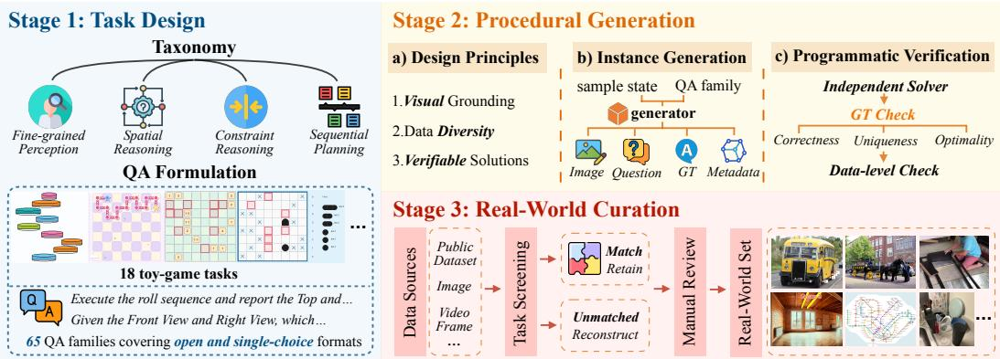
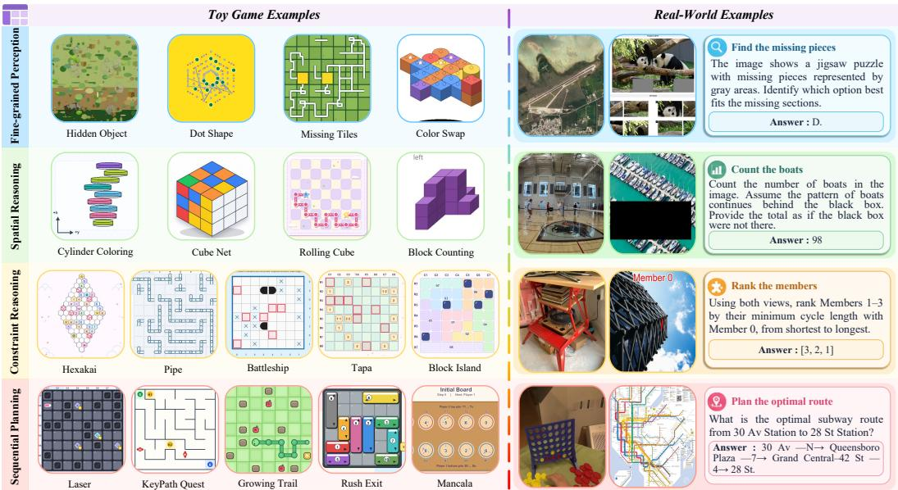
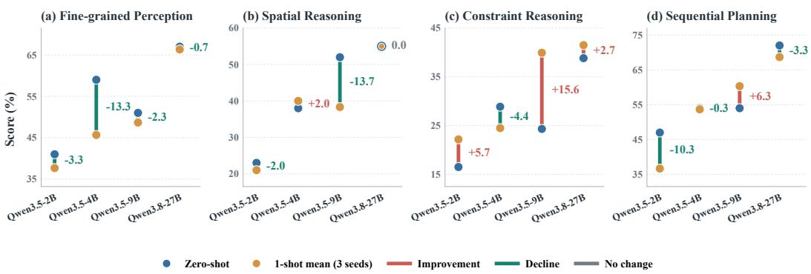
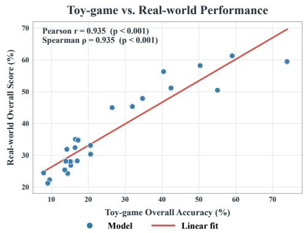
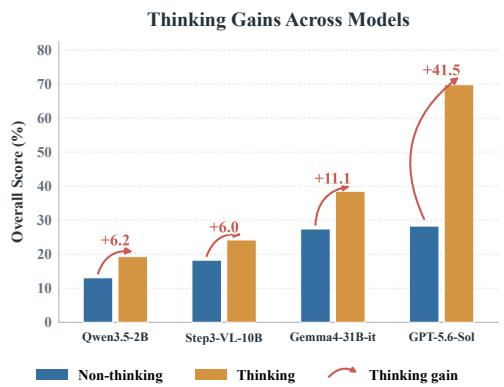
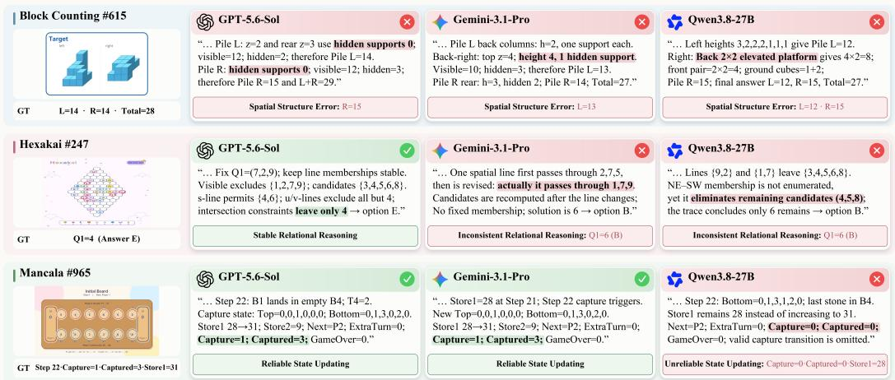
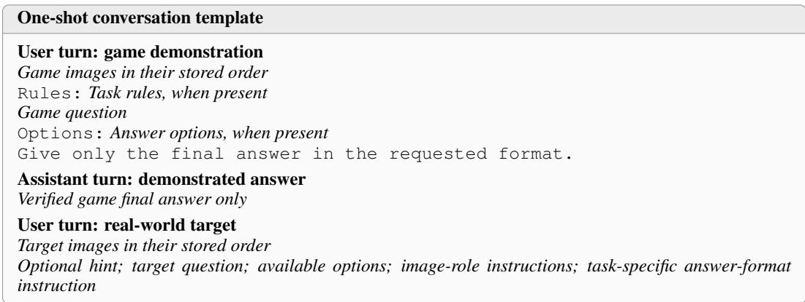

# GAME2REAL-BENCH: DO TOY GAMES REVEAL AND TRANSFER TO REAL-WORLD VISUAL REASONING?

Qingan Liu1∗, Juntong Feng1∗, Yue Zhu1, Yujie Cheng1, Xinzhe Han1 Shuai Hao1, Yunzhi Zhuge1, Haiwen Diao2†, Huchuan Lu1

1Dalian University of Technology, 2Nanyang Technological University

## ABSTRACT

Visual reasoning is an important capability for vision-language models (VLMs) to understand visual evidence, spatial structure, constraints, and state changes. Existing evaluations mainly rely on either real-world data or procedurally generated tasks. Real-world data preserve the complexity of natural scenes, while procedural games provide controllable generation and verifiable solutions. However, it remains unclear whether the abilities measured in toy games correspond to those required in real-world visual reasoning, and whether game examples can provide useful signals for solving real-world tasks. We introduce Game2Real-Bench, a benchmark for studying these connections across four capability groups, including fine-grained perception, spatial reasoning, constraint reasoning, and sequential planning. On the game side, we construct 1,000 independently generated samples from executable task specifications and verify their answers programmatically. On the real-world side, we curate and construct 400 samples from diverse real-world sources. We connect the two settings according to shared reasoning requirements, including visual evidence, spatial operations, constraints, and state transitions, rather than visual similarity. We evaluate 25 representative VLMs across both settings. Performance on game and real-world tasks shows consistent cross-setting trends, with a Pearson correlation of 0.935 and a Spearman correlation of 0.935. We further examine game-to-real transfer through one-shot in-context learning on four models. The effect varies across capabilities and models. Constraint reasoning shows positive gains for several models, while fine-grained perception consistently declines with game demonstrations. These results show that toy games can reflect some reasoning patterns observed in real-world tasks and can provide useful demonstrations in selected settings. To further support model training, we construct Game2Real-Dataset, comprising nearly 24K game samples across 18 tasks and 65 QA families. These samples are generated from executable task specifications and verified programmatically. Our benchmark, dataset, and code are available at https://github.com/QingAnLiu/Game2Real-Bench.

## 1 INTRODUCTION

Recent advances in vision-language models (VLMs) have led to substantial progress in multimodal understanding and reasoning (Bai et al., 2025; Wang et al., 2025; Diao et al., 2026a;c). Beyond recognizing what is present in an image, visual reasoning requires models to understand how objects are related, how constraints interact, and how actions change a scene. These demands arise in everyday tasks, such as interpreting an assembly step, as well as in toy games with explicit rules and controllable states. Games are particularly appealing because their tasks can be generated at scale and their answers verified programmatically (Tong et al., 2026; Xu et al., 2026). Yet their simplified visual environments raise a central question: Do toy games reveal VLMs’ real-world visual reasoning capabilities, and can solved game examples support transfer to real-world tasks?

Existing benchmarks characterize different aspects of visual reasoning. MMMU and MME-RealWorld cover knowledge-intensive problems and real-world scenarios (Yue et al., 2024; Zhang et al., 2025b), while BLINK and BabyVision reveal weaknesses in foundational visual skills despite strong high-level reasoning performance (Fu et al., 2024; Chen et al., 2026). Recent work shows that procedural tasks can support reasoning beyond their original settings: Game-RL improves VLM reasoning through game-based training (Tong et al., 2026), and VBVR-Pro demonstrates transfer to external reasoning benchmarks for visual generation models (Xu et al., 2026). These findings highlight the potential of procedural training, but leave open how game-based assessment relates to real-world reasoning across models and capabilities. A shared evaluation linking tasks by their reasoning requirements is needed to examine this relationship and the usefulness of game examples.

To this end, we introduce Game2Real-Bench, a benchmark linking toy games and real-world visual reasoning across four capabilities: Fine-grained Perception, Spatial Reasoning, Constraint Reasoning, and Sequential Planning. We construct the game evaluation using executable generators and task-specific verifiers, and curate real-world tasks according to shared reasoning requirements rather than visual resemblance (Figure 1). The resulting benchmark combines 1,000 independently generated and programmatically verified toy-game samples with 400 real-world samples derived from images, videos, and multi-view observations. The same pipeline produces Game2Real-Dataset, a separate collection of nearly 24K verified samples spanning 18 toy-game tasks and 65 questionanswer (QA) families, providing a scalable resource for visual reasoning evaluation and training.

Our evaluation of 25 representative VLMs reveals a strong correspondence between game and realworld performance, with model-level Pearson and Spearman correlations of 0.935. Despite their simpler visual environments, game tasks are generally harder and better distinguish models. The benefits of game examples are more selective. In one-shot in-context learning with four models, randomly selected game demonstrations improve constraint reasoning for several models but lower fine-grained perception accuracy for all four, with a slight decline in average overall accuracy. These findings suggest that toy games are informative probes of real-world visual reasoning, while their usefulness as demonstrations depends on the capability and model. We further analyze thinking mode and recurring failures in spatial representation, relational consistency, and state updating.

Our main contributions are summarized as follows:

• We introduce Game2Real-Bench, a 1,400-sample benchmark that aligns toy-game and real-world tasks through shared reasoning requirements across four capabilities, enabling analysis of cross-setting performance correspondence and game-to-real transfer.

• We construct Game2Real-Dataset, comprising nearly 24K programmatically verified samples across 18 toy-game tasks and 65 QA families, together with executable generators and task-specific verifiers to support future research on scalable visual reasoning.

• We evaluate 25 VLMs, revealing strong game–real performance correspondence and selective one-shot transfer, with analyses of thinking mode and reasoning failures.

## 2 RELATED WORK

## 2.1 GAMES AS TESTBEDS FOR VISUAL REASONING

Recent work has increasingly used games and procedural environments as testbeds for multimodal reasoning, benefiting from their explicit rules, controllable states, and verifiable outcomes. In interactive settings, benchmarks such as BALROG, LMGame-Bench, VideoGameBench, and Game-World use diverse games to evaluate perception, planning, memory, and decision making in LLM and VLM agents (Paglieri et al., 2025; Hu et al., 2026; Zhang et al., 2025a; Ouyang et al., 2026). Beyond evaluation, games have also been used to construct reasoning tasks and training supervision. Game-RL synthesizes verifiable multimodal reasoning problems from game mechanics, while Play to Generalize investigates whether reasoning abilities acquired through gameplay transfer to broader multimodal tasks (Tong et al., 2026; Xie et al., 2026b). VBVR-Pro further scales procedural visual reasoning to a broad collection of automatically generated tasks with task-specific verification (Xu et al., 2026). Together, these studies establish games and procedural environments as effective testbeds for multimodal reasoning. However, their relationship to real-world reasoning is typically assessed indirectly, either through in-game performance or aggregate results on external benchmarks. Game2Real-Bench makes this relationship explicit by organizing procedurally generated game tasks and real-world samples around shared reasoning requirements, enabling analysis of cross-setting performance correspondence and game-to-real transfer at the capability level.

  
Figure 1: Multi-stage construction pipeline of Game2Real-Bench. It comprises capability-guided task design, procedural generation and verification, and mechanism-aligned real-world curation.

## 2.2 BENCHMARKS FOR VISUAL REASONING

Recent advances in encoder-based and encoder-free VLMs (Diao et al., 2024; 2025) have improved visual perception, understanding, and multimodal reasoning. To evaluate these capabilities, a wide range of benchmarks have been proposed. General-purpose benchmarks such as MMMU and MME-RealWorld assess multimodal reasoning across knowledge-intensive and complex real-world scenarios (Yue et al., 2024; Zhang et al., 2025b), while vision-centric benchmarks such as BLINK, MMVP, and BabyVision focus more directly on visual perception and reasoning with reduced reliance on external knowledge (Fu et al., 2024; Tong et al., 2024; Chen et al., 2026). Other benchmarks study more structured forms of visual reasoning, including 3D understanding, multi-view reasoning, spatial relations, and logical constraints (Jia et al., 2026; Huang et al., 2026b; Xie et al., 2026a). Recent work has also explored synthetic and procedural tasks for controlled visual reasoning. CLEVR uses synthetic scenes to study compositional visual reasoning (Johnson et al., 2017), while later efforts such as Game-RL, VBVR, and VBVR-Pro extend procedural generation to broader reasoning tasks, games, and training settings (Tong et al., 2026; Wang et al., 2026; Xu et al., 2026). These settings enable precise control over task structure and reliable solution generation at scale. However, it is still not well understood whether the capabilities reflected by procedurally generated games correspond to those required by real-world visual reasoning. Game2Real-Bench studies this relationship by combining game and real-world visual reasoning tasks under a shared capability framework, allowing us to examine both cross-setting performance consistency and game-to-real transfer.

## 3 GAME2REAL-BENCH

We construct Game2Real-Bench in three stages, as illustrated in Figure 1. In Stage 1, we organize the task space around four capability groups and design 18 toy-game tasks with 65 QA families. In Stage 2, we develop executable generators and task-specific verifiers to construct Game2Real-Dataset with 23,893 verified game samples, while independently generating 1,000 samples for the toy-game evaluation set. In Stage 3, we curate 400 real-world samples that require reasoning operations corresponding to those exercised by the toy games. The outputs of Stages 2 and 3 together constitute the complete 1,400-sample Game2Real-Bench. We describe each stage in detail below.

## 3.1 TASK DESIGN

Taxonomy. We organize Game2Real-Bench around four complementary capabilities in visual reasoning and design 18 toy-game tasks accordingly. Fine-grained Perception requires models to identify task-relevant visual evidence from subtle local differences, correspondences, and partial observations. Spatial Reasoning requires models to infer and transform spatial configurations involving relations, orientation, viewpoint, geometry, and 3D structure. Constraint Reasoning requires models to integrate multiple interdependent relations and constraints to derive a globally consistent solution. Sequential Planning requires models to reason over state transitions and select state-dependent actions toward a target goal. Individual tasks may involve multiple capabilities, and each task is assigned to the group that best reflects its primary reasoning demand.

  
Figure 2: Capability-aligned tasks in Game2Real-Bench. Toy-game and real-world tasks span fine-grained perception, spatial reasoning, constraint reasoning, and sequential planning. We present representative QA samples illustrating shared reasoning requirements across the two settings.

Task and QA Formulation. In Game2Real-Bench, a toy-game task defines a structured visual reasoning problem with explicit rules and solution criteria, while its QA families specify the reasoning targets and output formats. These QA families cover fine-grained visual evidence, spatial relations and transformations, constraint-consistent configurations, and action selection over evolving states. Across the 18 tasks, we define 65 QA families in open-ended and multiple-choice formats. A sample is generated from a task configuration and contains one or more visual observations, a question, and a verified answer. The corresponding QA family further specifies any task-specific notation, coordinate system, and output convention, ensuring consistent evaluation across generated samples.

## 3.2 PROCEDURAL GENERATION

Design Principles. Our procedural generation follows three principles. Visual Grounding. Each question is designed so that its answer is determined by the visual content rather than prompt wording. The text specifies the task and rules, while the image provides the instance-specific evidence required to solve it. Diversity. We vary problem structures, spatial layouts, and visual presentations across generated instances while preserving the underlying task rules and reasoning objective, producing diverse instances of the same capability. Verifiability. Each problem follows explicit executable rules, allowing the correct solution to be derived and checked programmatically.

Instance Generation. For each task, we implement a task-specific generator that samples valid problem states from predefined configuration ranges. Given a sampled state and QA family, the generator jointly produces the visual observations, question, and ground-truth answer. Structural parameters control factors such as topology, object configurations, constraints, paths, and state tran sitions, while presentation parameters determine how each state is visually encoded and rendered. We also retain the structured metadata required for verification, analysis, and de-duplication.

Programmatic Verification. Each task is paired with a deterministic solver or verifier tailored to its solution structure. Verification may involve constraint solving, geometric transformation, state simulation, graph search, or transition replay. Given the sampled state, the verifier recomputes the requested result or checks the proposed solution against executable task rules. For tasks requiring uniqueness, alternative valid solutions are explicitly checked; when multiple solutions are permitted, all admissible answers are retained. When optimality is required, the answer is checked against the solver-derived optimum. Verified samples additionally pass shared checks for record completeness, image validity, answer-space consistency, multi-image alignment, and required metadata.

## 3.3 REAL-WORLD CURATION

We construct the real-world evaluation set by curating samples from existing visual reasoning benchmarks and public datasets. Candidate samples are drawn from sources containing real images, videos, multi-view observations, and structured annotations (Fu et al., 2024; Wu et al., 2026; Ji et al., 2025; Yeh et al., 2026; Yang et al., 2026; Feng et al., 2026; Pothiraj et al., 2025; Wang et al., 2021; Xie et al., 2026a). We select samples whose reasoning requirements align with those of the toy-game tasks, including fine-grained visual evidence, spatial structure, relational constraints, and state changes. For benchmark tasks that already meet the target reasoning requirements, we retain their original questions, answers, and evaluation protocols. Otherwise, we construct new evaluation samples from the source media and annotations while preserving the same reasoning requirements. For example, for IKEA Manuals at Work (Liu et al., 2024), we align assembly instructions with real assembly videos and construct multi-image questions from visually distinguishable states before and after an assembly step. All samples in the final set undergo automated consistency checks and manual review, and samples with ambiguous answers or insufficient visual evidence are removed.

## 3.4 BENCHMARK STATISTICS

Game2Real-Dataset. Game2Real-Dataset contains 23,893 verified game samples across four capability groups, 18 toy-game tasks, and 65 QA families. It comprises 20,701 open-ended and 3,192 single-choice samples, with both single-image and multi-image inputs and 36,441 images in total.

Game2Real-Bench. Game2Real-Bench contains 1,400 evaluation samples, including 1,000 toygame samples and 400 real-world samples. The toy-game set is generated independently from Game2Real-Dataset using disjoint random seeds and distinct layout configurations. We further use semantic fingerprints and image hashes to remove potential overlap. The set includes 600 openended and 400 single-choice questions. For the real-world set, we curate 400 samples to provide broad coverage across the four capability groups and their corresponding reasoning requirements. The Game2Real-Bench composition and representative examples are shown in Figure 2.

## 4 EXPERIMENTS

## 4.1 SETUP

Models. We evaluate 25 vision-language models, including 22 open-weight models and three proprietary frontier systems. The open-weight models span 2B to 35B total parameters and cover representative families including Qwen3-VL (Bai et al., 2025), Qwen3.5 (Qwen Team, 2026b), Qwen3.8 (Qwen Team, 2026a), InternVL3.5 (Wang et al., 2025), Gemma4 (Team et al., 2026), GLM-4V (Hong et al., 2025), MiMo-VL (Yue et al., 2025), Ovis2.5 (Lu et al., 2025), NEO (Diao et al., 2026a), NEO-ov (Diao et al., 2026b), SenseNova-U1 (Diao et al., 2026c), and Step3-VL (Huang et al., 2026a). We additionally evaluate three proprietary frontier models GPT-5.6-Sol (OpenAI, 2026), Gemini-3.1-Pro-Preview (Google DeepMind, 2026), and Claude-Opus 4.8 (Anthropic, 2026). Unless otherwise specified, all models use default inference configurations.

Evaluation Protocol. All models are evaluated zero-shot using the same task instructions, source visual inputs, and questions. Open-weight models are evaluated through VLMEvalKit (Duan et al., 2024) using their official checkpoints and model-specific preprocessing, while proprietary models are accessed through their official APIs. No external tools or task-specific solvers are used during inference. For toy-game samples, model outputs are normalized according to each QA family’s answer schema and scored by deterministic evaluators derived from the task rules. For real-world samples, we follow the original evaluation protocol when a source benchmark provides a standard evaluator and apply unified evaluation criteria to reconstructed samples. We report capability-level performance and the overall average score over the corresponding evaluation sets.

Table 1: Scores (%) on Game2Real-Bench, with a 1,000-sample Toy Game set and a 400-sample Real-World set. For each capability, results are reported as Toy Game / Real-World. Toy-game scores are accuracies; real-world scores incorporate SpatiaLQA F1 where applicable. Overall denotes the mean per-sample score over all 1,400 samples. Open-weight models are grouped by total parameter count as large (27–35B), medium (7–12B), and small (2–4B). For MoE models, active parameter counts are retained in the model names. The best Toy Game and Real-World results within each group are highlighted in bold; models are ordered by Overall score.
<table><tr><td>Model</td><td>Fine-grained Perception</td><td>Spatial Reasoning</td><td>Constraint Reasoning</td><td>Sequential Planning</td><td>Overall</td></tr><tr><td colspan="6">▼ Proprietary Models</td></tr><tr><td>GPT-5.6-Sol</td><td>53.9 / 57.0</td><td>69.8 / 49.0</td><td>81.3 / 63.9</td><td>81.4 / 68.0</td><td>69.8</td></tr><tr><td>Gemini-3.1-Pro-Preview</td><td>36.0 / 66.0</td><td>59.0 / 55.0</td><td>56.7 / 51.1</td><td>75.2 / 73.0</td><td>59.6</td></tr><tr><td>Claude-Opus-4.8-thinking</td><td>22.5 / 50.0</td><td>50.5 / 44.0</td><td>62.0 / 46.8</td><td>70.8 / 61.0</td><td>53.7</td></tr><tr><td colspan="6">▼ Large Open-Weight Models</td></tr><tr><td>Qwen3.8-27B</td><td>37.6 / 67.0</td><td>61.3 / 55.0</td><td>39.3 / 38.8</td><td>61.0 / 72.0</td><td>52.6</td></tr><tr><td>Qwen3.5-35B-A3B</td><td>31.5 / 57.0</td><td>42.3 / 53.0</td><td>33.4 / 48.2</td><td>51.5 / 67.0</td><td>45.0</td></tr><tr><td>Qwen3.5-27B</td><td>28.6 / 54.0</td><td>48.6 / 51.0</td><td>34.1 / 36.6</td><td>54.6 / 63.0</td><td>44.9</td></tr><tr><td>Gemma4-31B-it</td><td>24.2 / 57.0</td><td>25.7 / 38.0</td><td>42.3 / 46.5</td><td>40.0 / 50.0</td><td>38.5</td></tr><tr><td>Qwen3-VL-30B-A3B-Instruct</td><td>10.7 / 42.0</td><td>17.6 / 26.0</td><td>16.4 / 26.1</td><td>19.3 / 46.0</td><td>21.8</td></tr><tr><td>InternVL3.5-30B-A3B</td><td>15.7 / 37.0</td><td>16.7 / 26.0</td><td>17.1 / 27.6</td><td>15.9 / 39.0</td><td>21.0</td></tr><tr><td colspan="6">▼ Medium Open-Weight Models</td></tr><tr><td>Qwen3.5-9B</td><td>27.0 / 51.0</td><td>25.2 / 52.0</td><td>24.3 / 24.3</td><td>47.8 / 54.0</td><td>35.7</td></tr><tr><td>Step3-VL-10B</td><td>12.9 / 34.0</td><td>13.5 / 31.0</td><td>21.3 / 26.4</td><td>29.8 / 41.0</td><td>24.2</td></tr><tr><td>Gemma4-12B-it</td><td>16.9 / 48.0</td><td>15.8 / 27.0</td><td>25.6 / 22.3</td><td>21.4 / 24.0</td><td>23.4</td></tr><tr><td>GLM-4.6V-Flash</td><td>16.3 / 31.0</td><td>15.8 / 34.0</td><td>17.1 / 30.0</td><td>19.0 / 44.0</td><td>22.2</td></tr><tr><td>Ovis2.5-9B</td><td>18.5 / 26.0</td><td>15.3 / 23.0</td><td>16.4 / 28.9</td><td>18.0 / 35.0</td><td>20.2</td></tr><tr><td>NEO-ov-9B</td><td>13.5 / 32.0</td><td>20.3 / 26.0</td><td>14.1 / 26.7</td><td>13.9 / 27.0</td><td>18.9</td></tr><tr><td>InternVL3.5-8B</td><td>11.2 / 29.0</td><td>17.6 / 25.0</td><td>13.4 / 26.1</td><td>17.3 / 32.0</td><td>18.8</td></tr><tr><td>SenseNova-U1-8B-MoT</td><td>13.5 / 23.0</td><td>16.7 / 33.0</td><td>12.5 / 15.3</td><td>18.0 / 36.0</td><td>18.5</td></tr><tr><td>Qwen3-VL-8B-Instruct</td><td>13.5 / 33.0</td><td>13.1 / 21.0</td><td>12.8 / 25.5</td><td>15.9 / 33.0</td><td>18.0</td></tr><tr><td>MiMo-VL-7B-RL</td><td>13.5 / 28.0</td><td>13.5 / 15.0</td><td>11.8 / 15.1</td><td>18.3 / 39.0</td><td>17.2</td></tr><tr><td>NEO-9B-SFT</td><td>13.5 / 32.0</td><td>12.6 / 18.0</td><td>11.5 / 21.6</td><td>16.6 / 30.0</td><td>17.0</td></tr><tr><td colspan="6">▼ Small Open-Weight Models</td></tr><tr><td>Qwen3.5-4B</td><td>20.8 / 59.0</td><td>15.8 / 38.0</td><td>23.6 / 28.9</td><td>40.7 / 54.0</td><td>31.7</td></tr><tr><td>Qwen3.5-2B</td><td>11.8 / 41.0</td><td>8.6 / 23.0</td><td>18.7 / 16.5</td><td>15.2 / 47.0</td><td>19.3</td></tr><tr><td>NEO-2B-SFT</td><td>9.0 / 28.0</td><td>9.0 / 21.0</td><td>9.5 / 15.1</td><td>10.2 / 25.0</td><td>13.2</td></tr><tr><td>Qwen3-VL-2B-Instruct</td><td>6.7 / 26.0</td><td>10.4 / 23.0</td><td>8.5 / 23.8</td><td>6.1 / 25.0</td><td>12.6</td></tr><tr><td>InternVL3.5-2B</td><td>10.7 / 26.0</td><td>11.7 / 17.0</td><td>7.9 / 14.8</td><td>7.1 / 27.0</td><td>12.5</td></tr></table>

## 4.2 MAIN RESULTS

Table 1 presents the performance of 25 VLMs on the toy-game and real-world evaluation sets.

Current VLMs remain challenged on Game2Real-Bench. GPT-5.6-Sol achieves the highest overall score at 69.8%, while Gemini-3.1-Pro-Preview and Claude-Opus-4.8 reach 59.6% and 53.7%, respectively. Among open-weight models, Qwen3.8-27B performs best at 52.6%, while 16 of the 22 models score below 30%. These results indicate that Game2Real-Bench remains difficult for current VLMs, with clear room for improvement across both proprietary and open-weight models.

Toy-game tasks are more challenging and provide clearer separation between models. Most models achieve lower performance on the toy-game set than on the real-world set, with the difference being particularly visible among open-weight models. The toy-game evaluation also produces wider gaps between stronger and weaker systems. For example, the best proprietary and open-weight models differ by 16.3, 39.0, and 20.4 points on fine-grained perception, constraint reasoning, and sequential planning, respectively, while these gaps are much smaller on the corresponding real-world tasks. This difference may partly reflect the controlled nature of the toy-game tasks, where models must follow explicit rules and produce solutions that satisfy precisely defined states, constraints, and transitions. Real-world samples provide more familiar visual content and generally yield a more compressed performance range. This contrast highlights the different roles of the two settings. Real-world tasks assess reasoning in natural visual contexts, while toy-game tasks provide finer discrimination among current VLMs under more explicitly specified reasoning requirements.

  
Figure 3: Capability-wise game-to-real transfer with one-shot in-context learning. Compared with zero-shot evaluation, random game demonstrations improve constraint reasoning on average but reduce fine-grained perception accuracy for all four models on the 400 real-world targets.

Performance varies considerably across capabilities, with sequential planning showing the most consistent strength. Sequential planning yields the strongest performance for many models across both evaluation settings, and is the highest-scoring capability for 15 of the 25 models on the toy-game set and 17 on the real-world set. In contrast, the relative difficulty of the other capabilities changes across settings. Fine-grained perception produces the lowest average performance on the toy-game set, but becomes one of the stronger capabilities on real-world tasks. Constraint reasoning shows the opposite pattern more clearly among stronger models, remaining difficult and preserving a visible gap between proprietary and open-weight systems. These results suggest that capability performance is not determined by the reasoning category alone, but also by how the underlying reasoning requirements are instantiated in each visual setting.

## 4.3 FINE-GRAINED ANALYSIS

To better understand the relation between game tasks and real-world visual reasoning, we analyze model-level consistency across the two evaluation settings, game-to-real transfer through one-shot in-context learning, the effect of thinking mode, and representative failure cases.

Game-to-real transfer with one-shot in-context learning. We study whether solved game examples can transfer to real-world visual reasoning through one-shot in-context learning. We evaluate four representative models on the same 400 real-world targets used in the zero-shot setting. We construct a pool of 168 verified samples from Game2Real-Dataset covering 14 game tasks, and ran domly assign one game demonstration to each target while balancing the four capabilities across the full set. We repeat the assignment with three random seeds and use the same demonstration-target pairs for all models. Each demonstration contains the game image and question followed only by it ground-truth final answer. All other evaluation settings remain unchanged.

The effect of game demonstrations varies clearly across both capabilities and models, as shown in Figure 3. Constraint reasoning improves by 4.89 points on average, with Qwen3.5-9B increasing from 24.32% to 39.94%. These tasks require models to abstract visual observations into rules, relations, and valid configurations, so a solved game example may help establish a structured problemsolving context even when the demonstration comes from a different task. Fine-grained perception shows the opposite pattern, decreasing by 4.92 points on average and declining for all four models. These tasks already achieve relatively high zero-shot performance and depend mainly on targetspecific visual evidence, for which an unrelated demonstration provides little additional information and may introduce irrelevant context. The model-level results are also non-uniform. Qwen3.5-9B is the only model with an overall gain of 1.49 points, while Qwen3.8-27B changes by only −0.33 points, suggesting limited sensitivity to a single random demonstration. The 2B and 4B models decrease overall, which may reflect greater difficulty in separating useful contextual cues from unrelated task information. Overall accuracy decreases by 1.34 points on average, indicating that game-to-real transfer is selective and depends on both the reasoning requirement and the model.

  
Figure 4: Game-to-real performance correlation. Model performance across the game and real-world evaluations is strongly correlated.

  
Figure 5: Thinking gains across model scales. Thinking improves overall score across all four models, with larger models benefiting more.

Consistency between game and real-world evaluation. We examine whether the controlled game evaluation preserves the model-level performance differences observed on real-world visual reasoning tasks. This analysis covers all 25 models, with each model treated as one observation. For each model, we pair its overall score on the 1,000 game samples with its independently computed overall score on the 400 real-world samples. We then compute Pearson and Spearman correlations across the 25 model pairs. Pearson correlation measures the linear association between model scores in the two settings, while Spearman correlation measures whether their relative rankings are preserved.

We obtain a Pearson correlation of r = 0.935 and a Spearman correlation of $\rho = 0 . 9 3 5$ , as shown in Figure 4. Both metrics indicate that the two evaluations preserve similar model-level performance patterns. Models with higher scores on the game evaluation generally also achieve higher scores on the real-world evaluation, and their relative ordering remains largely consistent across the two settings. This agreement suggests that, despite differences in visual content and task formulation, the game evaluation captures performance variation that is also reflected in real-world visual reasoning.

Thinking improves performance across model families. We compare thinking and non-thinking configurations for four models from different families, covering both open-weight and proprietary systems. As shown in Figure 5, all four models improve on the full 1,400-sample benchmark. Qwen3.5-2B, Step3-VL-10B, and Gemma4-31B-it gain 6.2, 6.0, and 11.1 percentage points, respectively, while GPT-5.6-Sol gains 41.5 points, increasing from 28.3% to 69.8%. The larger gains of Gemma4-31B-it and GPT-5.6-Sol suggest that additional inference-time computation may be more useful for models with stronger visual reasoning capabilities. Such models may better use the extra reasoning budget to explore alternatives, verify intermediate states, and revise earlier decisions. The smaller gains of the other two models may partly reflect errors in visual understanding or the initial problem representation that additional reasoning steps alone cannot always correct.

Failure Case Analysis. We examine failure cases across all tasks and summarize three recurring error patterns, illustrated by representative examples from Block Counting, Hexakai, and Mancala in Figure 6. Misinterpreting Spatial Structure. Models may form an incorrect spatial representation before reasoning begins. In Block Counting, they fail to recover hidden cubes and column structures from the 2D projection, leading to an incorrect 3D configuration before counting. Inconsistent Relational Reasoning. Models may identify the relevant structure initially but fail to preserve its relations during deduction. In Hexakai, Gemini-3.1-Pro changes constraint-line memberships, while Qwen3.8-27B eliminates candidates without verifying the relations. Unreliable State Updating. Models may follow a sequence correctly for several steps but fail to apply a required state transition. In Mancala, Qwen3.8-27B tracks the board state through most of the trajectory but misses the capture update when its condition is satisfied. These cases illustrate how errors can arise at different stages of visual reasoning, from spatial representation to relation maintenance and state transition.

  
Figure 6: Failure cases on Game2Real-Bench. Model reasoning traces are compared with verified solutions for Block Counting, Hexakai, and Mancala. These cases illustrate three recurring failures: misinterpreting spatial structure, inconsistent relational reasoning, and unreliable state updating.

## 5 LIMITATIONS

Game2Real-Bench focuses on four capability groups and connects toy-game tasks with corresponding real-world visual reasoning settings. Several directions remain for future work. Broader task coverage. The current benchmark includes 18 toy-game tasks and 400 real-world samples. Although these tasks cover diverse reasoning requirements, they do not span the full range of visual reasoning in natural environments. Future extensions can include additional task types and richer visual settings while preserving the game–real alignment principle. Broader transfer settings. Our transfer study focuses on one-shot in-context learning. Game2Real-Dataset provides nearly 24K verified game samples, which can support future studies of multi-shot prompting, supervised fine-tuning, and reinforcement learning for game-to-real transfer. Behavioral correspondence. The correlation between game and real-world performance reflects consistency at the model level, but does not establish that the two settings rely on the same internal reasoning processes. Further analysis can investigate how shared reasoning requirements are represented and used across the two settings.

## 6 CONCLUSION

We introduce Game2Real-Bench, a benchmark that pairs controlled toy-game tasks with real-world visual reasoning tasks to examine whether abilities revealed in toy games are reflected in real-world performance and can transfer across settings. Across 25 VLMs, toy-game and real-world performance is strongly correlated, while toy-game tasks are generally more challenging and provide clearer separation among current models. Capability-level results further show that shared reasoning requirements can exhibit different difficulty profiles when instantiated in the two settings. One-shot game-to-real in-context learning also reveals selective transfer, with constraint reasoning benefiting for several models while fine-grained perception consistently declines. We also study the effects of thinking mode and analyze representative failure cases. These results show that toy games provide an informative setting for probing real-world visual reasoning and cross-setting transfer. Together, Game2Real-Bench and Game2Real-Dataset provide a verifiable evaluation framework and a scalable data resource for advancing the study of game-to-real transfer in visual reasoning.

## REFERENCES

Anthropic. Claude Opus 4.8, 2026. URL https://www.anthropic.com/claude/opus. Official Model Documentation.

Shuai Bai, Yuxuan Cai, Ruizhe Chen, Keqin Chen, Xionghui Chen, Zesen Cheng, Lianghao Deng, Wei Ding, Chang Gao, Chunjiang Ge, et al. Qwen3-vl technical report. arXiv preprint arXiv:2511.21631, 2025.

Liang Chen, Weichu Xie, Yiyan Liang, Hongfeng He, Hans Zhao, Zhibo Yang, Zhiqi Huang, Haoning Wu, Haoyu Lu, Yiping Bao, et al. Babyvision: Visual reasoning beyond language. arXiv preprint arXiv:2601.06521, 2026.

Haiwen Diao, Yufeng Cui, Xiaotong Li, Yueze Wang, Huchuan Lu, and Xinlong Wang. Unveiling encoder-free vision-language models. Advances in Neural Information Processing Systems, 37: 52545–52567, 2024.

Haiwen Diao, Xiaotong Li, Yufeng Cui, Yueze Wang, Haoge Deng, Ting Pan, Wenxuan Wang, Huchuan Lu, and Xinlong Wang. Evev2: Improved baselines for encoder-free vision-language models. arXiv preprint arXiv:2502.06788, 2025.

Haiwen Diao, Mingxuan Li, Silei Wu, Linjun Dai, Xiaohua Wang, Hanming Deng, Lewei Lu, Dahua Lin, and Ziwei Liu. From pixels to words–towards native vision-language primitives at scale. In International Conference on Learning Representations, volume 2026, pp. 109909–109929, 2026a.

Haiwen Diao, Jiahao Wang, Penghao Wu, Yuhao Dong, Yuwei Niu, Yue Zhu, Zhongang Cai, Weichen Fan, Linjun Dai, Silei Wu, et al. From pixels to words–towards native one-vision models at scale. arXiv preprint arXiv:2605.28820, 2026b.

Haiwen Diao, Penghao Wu, Hanming Deng, Jiahao Wang, Shihao Bai, Silei Wu, Weichen Fan, Wenjie Ye, Wenwen Tong, Xiangyu Fan, et al. Sensenova-u1: Unifying multimodal understanding and generation with neo-unify architecture. arXiv preprint arXiv:2605.12500, 2026c.

Haodong Duan, Junming Yang, Yuxuan Qiao, Xinyu Fang, Lin Chen, Yuan Liu, Xiaoyi Dong, Yuhang Zang, Pan Zhang, Jiaqi Wang, et al. Vlmevalkit: An open-source toolkit for evaluating large multi-modality models. In Proceedings of the 32nd ACM international conference on multimedia, pp. 11198–11201, 2024.

Sicheng Feng, Song Wang, Shuyi Ouyang, Lingdong Kong, Zikai Song, Jianke Zhu, Huan Wang, and Xinchao Wang. Reasonmap: Towards fine-grained visual reasoning from transit maps. In Proceedings ofthe IEEE/CVF Conference on Computer Vision and Pattern Recognition, pp. 41077– 41088, 2026.

Xingyu Fu, Yushi Hu, Bangzheng Li, Yu Feng, Haoyu Wang, Xudong Lin, Dan Roth, Noah A Smith, Wei-Chiu Ma, and Ranjay Krishna. Blink: Multimodal large language models can see but not perceive. In European Conference on Computer Vision, pp. 148–166. Springer, 2024.

Google DeepMind. Gemini 3.1 Pro Model Card, 2026. URL https://deepmind.google/ models/model-cards/gemini-3-1-pro/. Model Card.

Wenyi Hong, Wenmeng Yu, Xiaotao Gu, Guo Wang, Guobing Gan, Haomiao Tang, Jiale Cheng, Ji Qi, Junhui Ji, Lihang Pan, et al. Glm-4.5 v and glm-4.1 v-thinking: Towards versatile multimodal reasoning with scalable reinforcement learning. arXiv preprint arXiv:2507.01006, 2025.

Lanxiang Hu, Mingjia Huo, Yuxuan Zhang, Haoyang Yu, Eric P Xing, Ion Stoica, Tajana Rosing, Haojian Jin, and Hao Zhang. lmgame-bench: How good are llms at playing games? In International Conference on Learning Representations, volume 2026, pp. 81308–81356, 2026.

Ailin Huang, Chengyuan Yao, Chunrui Han, Fanqi Wan, Hangyu Guo, Haoran Lv, Hongyu Zhou, Jia Wang, Jian Zhou, Jianjian Sun, et al. Step3-vl-10b technical report. arXiv preprint arXiv:2601.09668, 2026a.

Xinmiao Huang, Qisong He, Zhenglin Huang, Boxuan Wang, Zhuoyun Li, Guangliang Cheng, Yi Dong, and Xiaowei Huang. Spatial-dise: A unified benchmark for evaluating spatial reasoning in vision-language models. In International Conference on Learning Representations, volume 2026, pp. 135833–135865, 2026b.

Drew A Hudson and Christopher D Manning. Gqa: A new dataset for real-world visual reasoning and compositional question answering. In 2019 IEEE/CVF Conference on Computer Vision and Pattern Recognition (CVPR), pp. 6693–6702. IEEE, 2019.

Yuheng Ji, Yipu Wang, Yuyang Liu, Xiaoshuai Hao, Yue Liu, Yuting Zhao, Huaihai Lyu, and Xiaolong Zheng. Visualtrans: A benchmark for real-world visual transformation reasoning. arXiv preprint arXiv:2508.04043, 2025.

Mengdi Jia, Zekun Qi, Shaochen Zhang, Wenyao Zhang, Xinqiang Yu, Jiawei He, He Wang, and Li Yi. Omnispatial: Towards comprehensive spatial reasoning benchmark for vision language models. In International Conference on Learning Representations, volume 2026, pp. 35634– 35670, 2026.

Justin Johnson, Bharath Hariharan, Laurens Van Der Maaten, Li Fei-Fei, C Lawrence Zitnick, and Ross Girshick. Clevr: A diagnostic dataset for compositional language and elementary visual reasoning. In Proceedings of the IEEE conference on computer vision and pattern recognition, pp. 2901–2910, 2017.

Yunong Liu, Cristobal Eyzaguirre, Manling Li, Shubh Khanna, Juan Carlos Niebles, Vineeth Ravi, Saumitra Mishra, Weiyu Liu, and Jiajun Wu. Ikea manuals at work: 4d grounding of assembly instructions on internet videos. 2024.

Shiyin Lu, Yang Li, Yu Xia, Yuwei Hu, Shanshan Zhao, Yanqing Ma, Zhichao Wei, Yinglun Li, Lunhao Duan, Jianshan Zhao, et al. Ovis2. 5 technical report. arXiv preprint arXiv:2508.11737, 2025.

Juhong Min, Jongmin Lee, Jean Ponce, and Minsu Cho. Spair-71k: A large-scale benchmark for semantic correspondence. arXiv preprint arXiv:1908.10543, 2019.

OpenAI. GPT-5.6 System Card, 2026. URL https://deploymentsafety.openai.com/ gpt-5-6. System Card.

Mingyu Ouyang, Siyuan Hu, Kevin Qinghong Lin, Hwee Tou Ng, and Mike Zheng Shou. Gameworld: Towards standardized and verifiable evaluation of multimodal game agents. In European Conference on Computer Vision, pp. 41–59. Springer, 2026.

Davide Paglieri, Bartłomiej Cupiał, Samuel Coward, Ulyana Piterbarg, Maciej Wołczyk, Akbir Khan, Eduardo Pignatelli, Łukasz Kucinski, Lerrel Pinto, Rob Fergus, et al. Balrog: Bench-´ marking agentic llm and vlm reasoning on games. In International Conference on Learning Representations, volume 2025, pp. 96666–96702, 2025.

Atin Pothiraj, Elias Stengel-Eskin, Jaemin Cho, and Mohit Bansal. Capture: Evaluating spatial reasoning in vision language models via occluded object counting. In 2025 IEEE/CVF International Conference on Computer Vision (ICCV), pp. 8001–8010. IEEE, 2025.

Qwen Team. Qwen3.8-27B, 2026a. URL https://huggingface.co/Qwen/Qwen3. 8-27B. Official Model Card.

Qwen Team. Qwen3.5: Towards native multimodal agents, February 2026b. URL https:// qwen.ai/blog?id=qwen3.5.

Gemma Team, Sherif El Abd, Vaibhav Aggarwal, Robin Algayres, Alek Andreev, Olivier Bachem, Ian Ballantyne, Cormac Brick, Victor Carbune, Michelle Casbon, et al. Gemma 4 technical report.˘ arXiv preprint arXiv:2607.02770, 2026.

Jingqi Tong, Jixin Tang, Hangcheng Li, Yurong Mou, Ming Zhang, Jun Zhao, Yanbo Wen, Fan Song, Jiahao Zhan, Yuyang Lu, et al. Game-rl: Synthesizing multimodal verifiable game data to boost vlms’ general reasoning. In International Conference on Learning Representations, volume 2026, pp. 34689–34755, 2026.

Shengbang Tong, Zhuang Liu, Yuexiang Zhai, Yi Ma, Yann LeCun, and Saining Xie. Eyes wide shut? exploring the visual shortcomings of multimodal llms. In 2024 IEEE/CVF Conference on Computer Vision and Pattern Recognition (CVPR), pp. 9568–9578. IEEE, 2024.

Ke-Jyun Wang, Yun-Hsuan Liu, Hung-Ting Su, Jen-Wei Wang, Yu-Siang Wang, Winston Hsu, and Wen-Chin Chen. Ocid-ref: A 3d robotic dataset with embodied language for clutter scene grounding. In Proceedings ofthe 2021 Conference ofthe North American Chapter ofthe Associationfor Computational Linguistics: Human Language Technologies, pp. 5333–5338, 2021.

Maijunxian Wang, Ruisi Wang, Juyi Lin, Ran Ji, Thaddaus Wiedemer, Qingying Gao, Dezhi Luo,¨ Yaoyao Qian, Lianyu Huang, Zelong Hong, et al. A very big video reasoning suite. arXiv preprint arXiv:2602.20159, 2026.

Weiyun Wang, Zhangwei Gao, Lixin Gu, Hengjun Pu, Long Cui, Xingguang Wei, Zhaoyang Liu, Linglin Jing, Shenglong Ye, Jie Shao, et al. Internvl3. 5: Advancing open-source multimodal models in versatility, reasoning, and efficiency. arXiv preprint arXiv:2508.18265, 2025.

Penghao Wu, Yushan Zhang, Haiwen Diao, Bo Li, Lewei Lu, and Ziwei Liu. Visual jigsaw posttraining improves mllms. In International Conference on Learning Representations, volume 2026, pp. 93221–93245, 2026.

Yuechen Xie, Xiaoyan Zhang, Yicheng Shan, Zhu Hao, Rui Tang, Rong Wei, Mingli Song, Yuanyu Wan, and Jie Song. Spatialqa: A benchmark for evaluating spatial logical reasoning in visionlanguage models. In Proceedings of the IEEE/CVF Conference on Computer Vision and Pattern Recognition, pp. 2645–2657, 2026a.

Yunfei Xie, Yinsong Ma, Shiyi Lan, Alan Yuille, Junfei Xiao, and Chen Wei. Play to generalize: Learning to reason through game play. In International Conference on Learning Representations, volume 2026, pp. 17213–17243, 2026b.

Junxiang Xu, Ruisi Wang, Fanyi Pu, Maijunxian Wang, Ran Ji, Tongxi Zhou, Chenyang Gu, Jing Zuo, Hongcan Xiao, Yimeng Geng, et al. Vbvr-pro: A scalable and verifiable suite for native visual reasoning. arXiv preprint arXiv:2608.26105, 2026.

Chen Yang, Guanxin Lin, Youquan He, Peiyao Chen, Guanghe Liu, Yufan Mo, Zhouyuan Xu, Linhao Wang, Guohui Zhang, Zihang Zhang, et al. Thinking in structures: Evaluating spatial intelligence in constraint-governed spaces. arXiv preprint arXiv:2602.07864, 2026.

Chun-Hsiao Yeh, Chenyu Wang, Shengbang Tong, Ta-Ying Cheng, Ruoyu Wang, Tianzhe Chu, Yuexiang Zhai, Yubei Chen, Shenghua Gao, and Yi Ma. Seeing from another perspective: Evaluating multi-view understanding in mllms. In Proceedings of the AAAI Conference on Artificial Intelligence, volume 40, pp. 12000–12008, 2026.

Xiang Yue, Yuansheng Ni, Kai Zhang, Tianyu Zheng, Ruoqi Liu, Ge Zhang, Samuel Stevens, Dongfu Jiang, Weiming Ren, Yuxuan Sun, et al. Mmmu: A massive multi-discipline multimodal understanding and reasoning benchmark for expert agi. In Proceedings of the IEEE/CVF conference on computer vision and pattern recognition, pp. 9556–9567, 2024.

Zihao Yue, Zhenru Lin, Yifan Song, Weikun Wang, Shuhuai Ren, Shuhao Gu, Shicheng Li, Peidian Li, Liang Zhao, Lei Li, et al. Mimo-vl technical report. arXiv preprint arXiv:2506.03569, 2025.

Alex L Zhang, Thomas L Griffiths, Karthik R Narasimhan, and Ofir Press. Videogamebench: Can vision-language models complete popular video games? arXiv preprint arXiv:2505.18134, 2025a.

YiFan Zhang, Huanyu Zhang, Haochen Tian, Chaoyou Fu, Shuangqing Zhang, Junfei Wu, Feng Li, Kun Wang, Qingsong Wen, Zhang Zhang, et al. Mme-realworld: Could your multimodal llm challenge high-resolution real-world scenarios that are difficult for humans? In International Conference on Learning Representations, volume 2025, pp. 89655–89701, 2025b.

## A DETAILED BENCHMARK SPECIFICATION

We describe the game tasks in Game2Real-Bench and the accompanying Game2Real-Dataset, including their taxonomy, sample counts, representative examples, and QA-family coverage.

## A.1 TASK TAXONOMY AND QA FORMULATION

The 18 toy-game tasks are organized into four capability groups: Fine-grained Perception (C1), Spatial Reasoning (C2), Constraint Reasoning (C3), and Sequential Planning (C4). Each task is assigned to the group that best reflects its primary reasoning demand. Solving a task may also involve other capabilities, such as perception during planning or constraint satisfaction in spatial reasoning.

A task defines a game environment with explicit rules and solution criteria, while a QAfamily specifies the reasoning target and output format within that task. For example, Rolling Cube includes questions about the top face, selected faces, or all six faces after the roll sequence, as well as face states at intermediate checkpoints. Each sample instantiates a QA family with one or more visual observations, a question, and a verified answer. Its instructions specify the relevant notation, coor dinate system, and output conventions.

Table 2 summarizes the task coverage and sample counts for Game2Real-Dataset and the toy-game evaluation set of Game2Real-Bench. Game2Real-Dataset contains 23,893 verified samples across 65 QA families, while the independently generated evaluation set contains 1,000 samples: 600 openended and 400 single-choice questions. Both cover all 18 tasks. The Images column counts all visual inputs for each evaluation sample, including reference views, auxiliary observations, and separately provided answer-option images where applicable.

Table 2: Task inventory and sample counts. Dataset columns report QA families and samples in Game2Real-Dataset, while evaluation columns report open-ended and single-choice samples in the toy-game set. Images reports the number of visual inputs per evaluation sample, including separately provided answer candidates.
<table><tr><td rowspan="2">Task</td><td colspan="2">Dataset</td><td colspan="2">Evaluation</td><td rowspan="2">Images</td></tr><tr><td>Families</td><td>Samples</td><td>Open</td><td>Choice</td></tr><tr><td colspan="6">C1: Fine-grained Perception</td></tr><tr><td>Missing Tiles</td><td>3</td><td>518</td><td>45</td><td>18</td><td>1,7</td></tr><tr><td>Hidden Object</td><td>4</td><td>720</td><td>47</td><td>29</td><td>1,2</td></tr><tr><td>Dot Shape</td><td>3</td><td>480</td><td>0</td><td>24</td><td>7</td></tr><tr><td>Color Swap</td><td>4</td><td>600</td><td>0</td><td>15</td><td>7</td></tr><tr><td colspan="6">C2: Spatial Reasoning</td></tr><tr><td>Cube Net</td><td>3</td><td>1,200</td><td>45</td><td>19</td><td>1</td></tr><tr><td>Cylinder Coloring</td><td>1</td><td>720</td><td>0</td><td>24</td><td>8</td></tr><tr><td>Block Counting</td><td>4</td><td>1,079</td><td>29</td><td>29</td><td>1</td></tr><tr><td>Rolling Cube</td><td>4</td><td>1,796</td><td>60</td><td>16</td><td>2</td></tr><tr><td colspan="6">C3: Constraint Reasoning</td></tr><tr><td>Hexakai</td><td>6</td><td>1,680</td><td>37</td><td>27</td><td>1</td></tr><tr><td>Tapa</td><td>4</td><td>2,140</td><td>45</td><td>30</td><td>1</td></tr><tr><td>Battleship</td><td>4</td><td>1,440</td><td>29</td><td>15</td><td>1</td></tr><tr><td>Block Island</td><td>4</td><td>1,560</td><td>35</td><td>32</td><td>1</td></tr><tr><td>Pipe</td><td>3</td><td>1,560</td><td>40</td><td>15</td><td>1</td></tr><tr><td colspan="6">C4: Sequential Planning</td></tr><tr><td>Laser</td><td>4</td><td>1,320</td><td>30</td><td>17</td><td>1</td></tr><tr><td>KeyPath Quest</td><td>3</td><td>2,160</td><td>39</td><td>25</td><td>1</td></tr><tr><td>Growing Trail</td><td>3</td><td>1,920</td><td>46</td><td>18</td><td>1</td></tr><tr><td>Mancala</td><td>4</td><td>1,680</td><td>40</td><td>15</td><td>1</td></tr><tr><td>Rush Exit</td><td>4</td><td>1,320</td><td>33</td><td>32</td><td>1</td></tr><tr><td>Total</td><td>65</td><td>23,893</td><td>600</td><td>400</td><td>一</td></tr></table>

## A.2 TASK DEFINITIONS AND REPRESENTATIVE EXAMPLES

Each task is accompanied by a representative QA from the toy-game set. Questions are shortened for readability, and reference answers are retained. Visual inputs are omitted here; sample IDs identify records containing the complete images and prompts.

## A.2.1 FINE-GRAINED PERCEPTION

Missing Tiles #402   
Task. Complete a missing tile by matching its connectors to neighboring ports, with no extra connections.   
Port letters follow U, R, D, L order.   
Question. Which ports must the tile placed in the yellow gap R2C6 have?   
Answer. R2C6=UL

## Hidden Object

Task. Count the requested animal classes, including recognizable partially occluded instances. Region-restricted queries include only icons entirely inside the region.   
Question. How many sheep and cows are present in the full scene?   
Answer. Sheep=8; Cows=5

## Dot Shape

#151

Task. Match the closed contour formed by the highlighted points, preserving cyclic order and relative geometry. Translation and uniform scaling are allowed; other transformations follow the question. Question. Which option A–F preserves the point identities, cyclic order, and closed edge correspondence? Answer. B

#228

Task. Apply the color mapping simultaneously to the selected pieces, using their original colors and leaving other pieces unchanged.

Question. Swap red with green on every piece; leave other colors unchanged. Which option A–F shows the correct final model?

Answer. B

## A.2.2 SPATIAL REASONING

Cube Net #508   
Task. Fold the cube net while preserving face adjacency and sticker orientation. Read sticker coordinates   
in the reference frame specified by the question.   
Question. On the face opposite the blank 3D face, report R1C1, R2C2, and R3C3 as drawn in the   
unfolded net.   
Answer. R1C1=Green; R2C2=Red; R3C3=Green

## Cylinder Coloring

#177

Task. Infer a missing orthographic view by matching cylinder positions, layers, colors, and diameters across projections. The schematic views retain all cylinders.   
Question. Given the Top View and Right View, which candidate A–F is the correct Front View? Answer. A

## Block Counting

Task. Count the complete cube piles, including required hidden supports but excluding additional fully invisible cubes.

## Rolling Cube

#543

Task. Track each 90◦ roll while preserving physical face identities and sticker orientation. Front denotes the face pointing toward board South.

Question. Report the Top and Front center symbols after steps 3, 7, and 10 of the displayed roll sequence. Answer. Step3Top=Circle; Step3Front=Star; Step7Top=Square; Step7Front=Plus; Step10Top=Square; Step10Front=Star

## A.2.3 CONSTRAINT REASONING

## Hexakai

#627

Task. Complete the hexagonal grid using the displayed token-to-digit legend, with no repeated digit along a straight line in any of the three directions.

Question. Solve the unique puzzle and report the digits at Q1, Q2, Q3, and Q4.

Answer. Q1=8; Q2=2; Q3=4; Q4=1

## Tapa

#666

Task. Satisfy the neighboring shaded-run clues while keeping clue cells white, shaded cells orthogonally connected, and every 2 × 2 block from being fully shaded.

Question. Solve the unique puzzle and report black or white for R2C7, R4C6, R6C3, R8C2, R6C5, R5C8, and R3C8.

Answer. R2C7=white; R4C6=white; R6C3=black; R8C2=black; R6C5=black; R5C8=white; R3C8=white

## Battleship

#709

Task. Place straight ships to satisfy the fleet inventory, row and column totals, revealed clues, and contact restrictions.

Question. List all cells of the unique topmost ship of length 3 in reading order.

Answer. ShipCoordinates=R4C5,R5C5,R6C5

## Block Island

#739

Task. Place one L, I, T, or S tetromino per region. Shaded cells must be edge-connected, with no filled 2 × 2 block; edge-touching tetrominoes across regions must have different types.

Question. Solve the unique board and list all shaded cells in Region01 and Region02 in row-major order. Answer. Region01=R4C3,R4C4,R4C5,R4C6; Region02=R2C6,R2C7,R3C7,R4C7

Pipe

#773

Task. Rotate only dry pipes. Water propagates and newly wet pipes lock after each operation; initially connected pipes are already locked. Each operation applies one, two, or three clockwise quarter-turns. Question. Return the complete minimum plan of three ordered operations that reaches the outlet, using RrCc=xk notation.

Answer. R6C5=x1; R4C4=x3; R3C2=x3

## A.2.4 SEQUENTIAL PLANNING

## Laser

#813

Task. Orient mirrors so the ray visits relays alphabetically and reaches the gem from the required direction. Every submitted mirror must be used.

Question. Return a complete optimal mirror configuration for R5C3, R6C2, R6C3, R7C2, and R7C7.

## KeyPath Quest

Task. Find a route respecting walls and key-before-door dependencies. Collected keys are retained after crossing their matching doors.

Question. Return a globally shortest 46-move U/D/L/R route from S to E, collecting every required key and crossing each matching door legally.

Answer. R D R R D L D L D D L U U U R L D D D D D R U R R R U L L U R U R U R D D R U R D D L D D R

## Growing Trail

#907

Task. Track the moving body: ordinary moves release the tail, while eating fruit retains it. Avoid walls and body cells other than a tail released on that step.

Question. Collect all fruits in any legal order and finish at the yellow goal. Return a globally shortest 10-move U/D/L/R route.

Answer. U U L D L L U U R D

## Mancala

#928

Task. Execute moves under the sowing, capture, extra-turn, and terminal-sweep rules. Termination takes precedence over extra turns; event flags describe the last executed move.

Question. Execute B5 followed by B6. Return the complete board state and event flags after move 2.

Answer. Top=7,3,0,1,8,0; Bottom=3,0,0,7,0,0; Store1=2; Store2=0; Next=P1; Step=2; ExtraTurn=1; Capture=0; Captured=0; GameOver=0

## Rush Exit

#994

Task. Slide vehicles along their fixed axes without overlap. Each command costs one move regardless of distance; only the target can exit, ending execution at its first boundary crossing.

Question. Move target C1 through the left EXIT using a globally shortest plan of five semicolon-separated commands.

Answer. C5 LEFT1; C3 UP3; C5 RIGHT1; C7 UP1; C1 LEFT5

## A.3 QA-FAMILY OVERVIEW

The 65 QA families vary the query scope and requested output within each task. They cover local attributes, aggregate counts, complete configurations, intermediate states, and action sequences. Table 3 summarizes this coverage by task. Some families support both open-ended and single-choice variants, with the exact answer format specified by the sample instructions.

Table 3: QA-family coverage by task. Each row summarizes the query targets represented in Game2Real-Dataset. The number of families per task is reported in Table 2.
<table><tr><td>Task</td><td>QA-family coverage</td></tr><tr><td colspan="2">C1: Fine-grained Perception</td></tr><tr><td>Missing Tiles</td><td>Complete connector patterns; side states; port lists and degrees.</td></tr><tr><td>Hidden Object</td><td>Whole-scene and region-specific counts across target classes.</td></tr><tr><td>Dot Shape Color Swap</td><td>Contour matching; vertex counts; counts by contour layer. Transformed models; full or partial color histograms; changed and un-</td></tr><tr><td></td><td>changed piece counts.</td></tr><tr><td colspan="2">C2: Spatial Reasoning</td></tr><tr><td>Cube Net</td><td>Face identification; complete sticker patterns; selected sticker cells.</td></tr><tr><td>Cylinder Coloring</td><td>Missing-view selection from orthographic projections.</td></tr><tr><td>Block Counting</td><td>Pile totals; occupied columns; hidden supports; height histograms.</td></tr><tr><td>Rolling Cube</td><td>Final top, selected, or all six faces; intermediate checkpoints.</td></tr><tr><td colspan="2">C3: Constraint Reasoning</td></tr><tr><td>Hexakai</td><td>Joint values of one to six queried cells.</td></tr><tr><td>Tapa</td><td>Selected cell states or the complete shaded-cell set.</td></tr><tr><td>Battleship</td><td>Selected cell states or the complete fleet configuration.</td></tr><tr><td>Block Island</td><td>Tetromino placements in selected regions or the complete board.</td></tr><tr><td>Pipe</td><td>Minimum ordered rotation plans; operation counts; wet-cell progression.</td></tr><tr><td colspan="2">C4: Sequential Planning</td></tr><tr><td>Laser</td><td>Selected or complete mirror assignments; candidate selection; trajectory key points.</td></tr><tr><td>KeyPath Quest</td><td>Shortest routes; key-collection order; timed key and door events.</td></tr><tr><td>Growing Trail</td><td>Shortest routes; fruit-collection order and collection steps.</td></tr><tr><td>Mancala</td><td>Final or checkpoint states; event counts and timelines.</td></tr><tr><td>Rush Exit</td><td>Minimum-command plans; command statistics; moved or repeatedly moved vehicles.</td></tr></table>

## B BENCHMARK CONSTRUCTION DETAILS

We detail the construction pipeline through Rolling Cube, focusing on how the generator and verifier track physical faces and their sticker patterns. We then use an IKEA assembly example to show how aligned instructions and video frames become a multi-image question with a reference answer.

## B.1 PROCEDURAL GENERATION

Initial face patterns. The generator samples a $3 \times 3$ sticker grid for each of the six faces. Each grid contains all six symbols in the selected vocabulary, with three symbols appearing twice. During sampling, grids are compared under rotations and reflections to avoid equivalent patterns on separate faces. The evaluation uses geometric symbols; dataset construction also supports digits and letters. We retain the initial layouts and their vocabulary separately from the answers derived after rolling.

Movement sequence and visual inputs. The generator samples a start cell and extends a path through orthogonally adjacent cells. Configuration profiles control the board size, number of rolls, and changes between horizontal and vertical movement. Proposed paths must remain within the board and satisfy the profile’s turn and revisit conditions. Each movement represents a $9 0 ^ { \circ }$ roll, not a translation or an in-place rotation. The instance is rendered into two inputs: a numbered path on the board and a panel containing the six initial face layouts. Their roles and order are stated in the prompt, with the path and face grids preserved in the verification metadata.

Queries and distractors. QA construction selects the requested checkpoint and world-facing side. Full-grid questions in Game2Real-Dataset require the entire oriented pattern; other variants query selected faces, the complete six-face state, or intermediate checkpoints. For a six-option grid question, the distractor pool includes rotations and reflections of the target grid, alternative face states, and local symbol changes. Duplicate grids are removed before options are selected and shuffled. These alternatives distinguish an incorrect face from a correct face with the wrong orientation.

## B.2 TASK-SPECIFIC VERIFICATION

Replaying the cube orientation. The checker reads the initial face grids and ordered moves from the structured state and recomputes the result without consulting the stored answer label. Let x, y, and z point East, North, and upward, respectively. The implementation represents cube orientation by an integer rotation matrix $R _ { k }$ . For each move $d _ { k }$ on the displayed path, we update $R _ { k }$ as

$$
R _ { 0 } = I , \qquad R _ { k } = Q ( d _ { k } ) R _ { k - 1 } .\tag{1}
$$

For East and North rolls, the matrices are

$$
Q ( E ) = \left( { \begin{array} { c c c } { 0 } & { 0 } & { 1 } \\ { 0 } & { 1 } & { 0 } \\ { - 1 } & { 0 } & { 0 } \end{array} } \right) , \qquad Q ( N ) = \left( { \begin{array} { c c c } { 1 } & { 0 } & { 0 } \\ { 0 } & { 0 } & { 1 } \\ { 0 } & { - 1 } & { 0 } \end{array} } \right) ,\tag{2}
$$

with $Q ( W ) = Q ( E ) ^ { \mathsf { T } }$ and $Q ( S ) = Q ( N ) ^ { \mathsf { T } }$ . The checker applies the resulting orientation to the reconstructed sticker state and reads the requested grid using the defined world-face axes. For Top, rows run from board North to South and columns from West to East. Checking a full grid compares all nine positions after the full roll sequence, rather than only the symbol at the face center.

A full-pattern example. We use dataset sample GBT-COT-004927, which asks for the final Top grid after the seven rolls E, N, E, S, E, N, E. Replaying this sequence gives

$$
R _ { 7 } = { \binom { 0 } { 0 } } \quad 0 \quad { \stackrel { - 1 } { 0 } } \quad \quad G _ { \mathrm { T o p } } = { \binom { 6 } { 1 } } \quad 3 \quad 2 ^ { 4 } ) .\tag{3}
$$

The initial East face becomes Top, but its center symbol, 3, alone cannot identify the answer. Options A, B, D, E, and F all share that center and the same symbol counts. Only A matches the recomputed arrangement. Table 4 shows how the checker distinguishes these actual candidate grids.

Table 4: Candidate verification for Rolling Cube. The options are taken from Game2Real-Dataset sample GBT-COT-004927; slashes separate grid rows. Rotations are clockwise relative to the recomputed Top grid. Only A agrees at every position under the specified reading convention.
<table><tr><td>Option</td><td></td><td>Candidate grid</td><td></td><td></td><td></td><td>Relation to target</td><td>Valid</td></tr><tr><td>A</td><td>6 6 4 / </td><td></td><td>1 3 2</td><td>/</td><td>4 2 5</td><td>Exact arrangement</td><td>Yes</td></tr><tr><td>B</td><td>5 2 4 /</td><td></td><td>2 3 3 1 /</td><td></td><td>4 6 6</td><td>180° rotation</td><td>No</td></tr><tr><td>C</td><td>4 5</td><td>4 /</td><td>6</td><td>1</td><td>2 6 53</td><td>Final Bottom grid</td><td>No</td></tr><tr><td>D</td><td>4 2</td><td>5 /</td><td>3 6</td><td>2</td><td>6 1 4</td><td>270° rotation</td><td>No</td></tr><tr><td>E</td><td>4 1</td><td>6 2 /</td><td>3</td><td>6 1</td><td>5 2 4</td><td>90° rotation</td><td>No</td></tr><tr><td>F</td><td>4 6</td><td>2 6</td><td>3</td><td>1</td><td>5 2 4 </td><td>Left-right reflection</td><td>No</td></tr></table>

Answer recomputation from structured state. The validation interface removes declared answer labels and correctness flags before invoking the task checker. Rolling Cube reconstructs its result from initial faces and moves, rather than reading a saved final layout or candidate-validity flag. Each option is parsed into a 3×3 grid and compared with the recomputed Top grid. Acceptance requires exactly one valid option and agreement with the exported answer. The checker reuses the generator’s rotation and layout functions, verifying label-independent state recomputation under the shared simulation implementation.

Auditing the exported question. Release checks address the interface between the state and the question: the two input images must have the correct roles, path markers must be distinguished from direction names, and face names must denote world-facing positions at the requested checkpoint. The stored layout, candidate order, and exported label must agree. For open-ended variants, the reference is also passed through the answer parser and evaluator to check field names and symbol normalization. The parser round trip checks output formatting, while state replay checks consistency with the implemented task dynamics.

Other tasks and collection-level checks. Other tasks use the same separation between generation, answer checking, and export auditing. Object annotations support counting, constraint solvers check complete assignments, and dynamic tasks replay actions with their state-dependent effects. Uniqueness or optimality is checked when the task requires it; Rolling Cube instead specifies a fixed sequence with a determined outcome. Collection-level checks remove benchmark–dataset overlaps using semantic fingerprints and image hashes.

## B.3 REAL-WORLD CURATION AND GAME-TO-REAL ALIGNMENT

Scope of game–real alignment. Game2Real-Bench connects procedural games with real-world questions through shared reasoning requirements. Alignment guides curation and capability-level reporting rather than requiring a one-to-one correspondence between tasks or samples. The two settings retain different visual evidence, rules, and answer spaces. For example, Cube Net and the IKEA assembly questions both relate a two-dimensional specification to a three-dimensional configuration. Their connection concerns spatial interpretation, while cube folding and assemblystate recognition retain distinct operations, input formats, and solution criteria.

Primary annotations and task coverage. Each real-world sample has a primary toy-task annotation recording its designated game–real connection. This annotation is not an exhaustive list of the operations needed to solve the question. Likewise, capability labels identify primary demands rather than mutually exclusive skills: Rolling Cube is grouped under spatial reasoning but also requires sequential state tracking. The primary annotations cover 14 game task types, whereas the full toy-game evaluation retains all 18 tasks. The other four tasks have no retained real-world sample with that primary annotation. Accordingly, the full-suite correlation assesses model-level performance correspondence; it is not an estimate of the predictive value of each individual task link.

Source-specific construction. Table 5 lists the real-world sources. We retain 246 original QA samples and lightly reformulate 72 while preserving their answers. New annotation-derived questions comprise 27 SPair-71k keypoint-matching samples and five IKEA assembly-state samples.

Another 50 SpatiaLQA samples retain the official tasks with restored action-content and precondi tion graphs. The IKEA example illustrates the complete construction process.

Table 5: Real-world sources and construction. Counts refer to retained Game2Real-Bench samples. Original QA is kept where suitable; light reformulation preserves source answers, while annotation-derived QA introduces questions grounded in source annotations.
<table><tr><td>Source</td><td>N</td><td>Construction</td></tr><tr><td>GQA (Hudson &amp; Manning, 2019)</td><td>12</td><td>10 original QA; 2 lightly reformulated.</td></tr><tr><td>OmniSpatial (Jia et al., 2026)</td><td>61</td><td>Original visual and spatial reasoning QA.</td></tr><tr><td>SPair-71k (Min et al., 2019)</td><td>27</td><td>QA derived from keypoint correspondences.</td></tr><tr><td>Visual-Jigsaw (Wu et al., 2026)</td><td>40</td><td>Lightly reformulated completion questions.</td></tr><tr><td>CAPTURe-real (Pothiraj et al., 2025)</td><td>30</td><td>Lightly reformulated counting questions.</td></tr><tr><td>All-Angles-Bench (Yeh et al., 2026)</td><td>20</td><td>Original synchronized-view questions.</td></tr><tr><td>IKEA Manuals at Work (Liu et al., 2024)</td><td>5</td><td>QA derived from aligned diagrams and video.</td></tr><tr><td>SpatiaLQA (Xie et al., 2026a)</td><td>50</td><td>Official tasks with restored dependency graphs.</td></tr><tr><td>SSI-Bench (Yang et al., 2026)</td><td>50</td><td>Original geometric and topological ranking QA.</td></tr><tr><td>VisualTrans (Ji et al., 2025)</td><td>91</td><td>Original transformation questions.</td></tr><tr><td>ReasonMap (Feng et al., 2026)</td><td>14</td><td>Original transit-route questions.</td></tr><tr><td>Total</td><td>400</td><td>100 samples per capability.</td></tr></table>

Locating the assembly step. For IKEA Manuals at Work (Liu et al., 2024), official alignments identify the instruction diagram, source video, and assembly step. We inspect the aligned mate rial for a visible change in part arrangement, connection, or orientation and select distinguishable pre-step and post-step states. The five retained items cover applaro, stig, vesken, laiva, and satsumas. Each question uses one instruction and one video, keeping object identity and background consistent across pre-step distractors and post-step candidates.

Temporal selection and frame extraction. Each item contains four pre-step and four post-step frames, spaced one second apart within each group. For applaro step 00, the two groups start at 191.60 and 256.48 seconds. Table 6 records all eight timestamps and shuffled labels. We sample distinguishable states instead of sampling uniformly over the full action, preserving the exact frame selection for reconstruction from the source video and its aligned assembly step.

Table 6: Frame selection for the IKEA applaro example. Timestamps are measured in seconds from the beginning of the source video. Each group contains four frames; labels identify their shuffled positions after the instruction diagram in the final nine-image input.
<table><tr><td colspan="2">Pre-step frames</td><td colspan="2">Post-step frames</td></tr><tr><td>Time (s)</td><td>Label</td><td>Time (s)</td><td>Label</td></tr><tr><td>191.60</td><td>F2</td><td>256.48</td><td>F8</td></tr><tr><td>192.60</td><td>F7</td><td>257.48</td><td>F1</td></tr><tr><td>193.60</td><td>F5</td><td>258.48</td><td>F3</td></tr><tr><td>194.60</td><td>F6</td><td>259.48</td><td>F4</td></tr></table>

Spatial cropping and input assembly. After decoding the selected frames, we remove the timestamp-bearing lower image band to avoid revealing their temporal order. The eight frames are shuffled and labeled F1–F8, with the instruction placed first. Each question therefore contains nine images: one diagram and eight candidates. Original timestamps, state groups, display positions, and the source-video hash remain in the metadata but are withheld from the model. Image-role instructions identify the diagram and the candidate corresponding to each displayed label.

Question and answer annotation. The question asks for the four frames showing the closest valid post-step 3D state. For applaro, the stored answer is ["F8","F1","F3","F4"], evaluated as an unordered set. Pre-step frames provide distractors from the same scene. Review checks agreement between the diagram and post-step part configurations, and whether the two state groups remain distinguishable after cropping. The partial alignment with Cube Net captures shared 2D-to-3D part correspondence while retaining the assembly task’s distinct operations.

Other annotation-derived questions and review. SPair-71k questions place a red marker at an annotated source keypoint and four labeled markers on the target image. The answer follows from the semantic correspondence. We retain nine samples from each of the articulation, high-scalechange, and high-viewpoint-change subsets. Across sources, automated checks validate fields, image references, labels, and source annotations. All 400 selected samples undergo manual review of their visual evidence, reference answers, and game–real mappings, with source-specific annotations providing the basis for checking each reference answer against its visual inputs.

## C EVALUATION PROTOCOL

We detail the inference configurations, model inputs, and scoring procedures for both evaluation settings. Shared prompt construction preserves task-specific output conventions, while reference answers and evaluator metadata remain separate from the target input supplied to each model.

## C.1 MODEL AND INFERENCE CONFIGURATIONS

Model interfaces. Open-weight models are evaluated through VLMEvalKit adapters, with checkpoint, chat-template, and visual preprocessing settings determined by the corresponding run configuration (Duan et al., 2024). Proprietary models are accessed through API interfaces. Each model receives the source images and shared task prompt, without external tools, reference solutions, or task-specific solvers. Model-specific inference controls are summarized in Appendix D.4.

Thinking-mode generation for Qwen. For Qwen3.5 and Qwen3.8 with thinking enabled, we use a two-stage generation budget of 32k + 512 tokens. The initial stage allows up to 32k generated tokens. If this budget is exhausted without a final answer, we continue the same attempt with an answer-format instruction and up to 512 additional tokens, without reference answers or evaluator feedback. Responses completed within the initial budget are evaluated directly. Both paths use the same answer normalization and scoring procedures.

Controlled in-context evaluation. The one-shot analysis evaluates Qwen3.5-2B, Qwen3.5-4B, Qwen3.5-9B, and Qwen3.8-27B on the same 400 real-world targets. The controlled Qwen runner uses vLLM with native multi-turn conversations and model-specific custom prompts disabled (Table 7). Paired zero-shot and one-shot evaluations retain the same configuration for each model, including the two-stage generation budget when thinking is enabled. The paired runs differ only in demonstration context, not in inference mode.

Table 7: Configuration of the controlled Qwen in-context learning runner. Paired zero-shot and one-shot runs share these inference settings. In thinking mode, the additional answer budget is used only when the initial budget is exhausted without a final answer.
<table><tr><td>Setting</td><td>Value</td><td>Setting</td><td>Value</td></tr><tr><td>Backend</td><td>vLLM</td><td>Temperature</td><td>0</td></tr><tr><td>Sampling</td><td>Disabled</td><td>Context limit</td><td>65,536</td></tr><tr><td>Top-p / top-k</td><td>0.95 / 20</td><td>Presence penalty</td><td>1.5</td></tr><tr><td>Thinking budget</td><td>32k tokens</td><td>Answer budget</td><td>512 tokens</td></tr><tr><td>Custom prompts</td><td>Disabled</td><td>Answer stage</td><td>Conditional</td></tr></table>

## C.2 PROMPTING AND INPUT FORMATTING

Shared input construction. The ImageMixedQA and RealWorldFinal interfaces share one prompt builder. Each input contains the stored image sequence followed by a text block with optional task instructions from the hint field, the question, available options, image-role instructions, and the answer-format suffix. The target’s reference answers, accepted alternatives, and evaluator payloads are reserved for scoring and excluded from the prompt and its image-role descriptions.

Image roles and answer candidates. The prompt distinguishes question and reference images from images that represent answer options. For example, Rolling Cube provides the board and roll sequence separately from the initial cube layout, whereas Cylinder Coloring supplies reference projections followed by candidate views. When candidates are supplied as separate images, the prompt explicitly maps their positions to option letters, preventing an image index from being confused with an answer label. When the options are textual, all supplied views remain question or reference images and are interpreted jointly in the stored order, with their task-specific roles preserved.

Answer-format instructions. The shared suffix requests a direct answer and ends with a questiontype-specific instruction, as shown in the prompt box. Open-ended questions retain their requested schema, including field assignments, action sequences, rankings, and JSON objects. For example,

<table><tr><td>Shared answer instruction</td></tr><tr><td>Answer directly. Do not explain your reasoning.</td></tr><tr><td>For single-choice questions, answer with one option letter only, such as A.</td></tr><tr><td>For multiple-answer questions, answer with all correct option letters separated by commas, such as A,C,E. For open questions, follow the required answer format exactly.</td></tr><tr><td></td></tr><tr><td>Single-choice suffix: This is a single-choice question. Return one option letter only. Open-ended suffix: This is an open question. Return only the requested structured answer.</td></tr></table>

IKEA frame selections remain JSON arrays of frame labels rather than single-choice option letters.   
Output format and model-side thinking mode are configured separately at inference.

One-shot conversation format. A game demonstration is represented as a user turn containing its images and question, followed by an assistant turn containing only its verified final answer. The real-world target is then supplied as a new user turn using the same input construction as in zero-shot evaluation. Demonstrations therefore provide solved examples without additional reasoning traces or target annotations. The three assignments use seeds 11, 23, and 37, with identical demonstration– target pairs across models. Only the demonstration context changes; the target images, question, answer schema, and scoring procedure remain the same across the paired evaluations.

## C.3 TOY-GAME ANSWER NORMALIZATION AND SCORING

Schema-specific normalization. Toy-game predictions are evaluated against the answer schema attached to each sample. For the 400 single-choice questions, the answer is mapped to one of six valid option letters and compared with the reference label. For the 600 open-ended questions, deterministic parsers recover the requested values or actions and pass them to the corresponding task evaluator. Normalization is restricted to representations supported by that schema, such as whitespace, letter case, recognized symbol aliases, and equivalent field separators; it does not infer omitted values, repair an incorrect solution, or alter the submitted sequence of actions.

Structured answers. For field-based outputs, the parser checks the complete set of requested keys and their associated values. Reordering independent field assignments is permitted, while missing fields, duplicate keys, and unexpected fields are rejected. Coordinate collections are normalized where their order is irrelevant, whereas checkpoint order, vector entries, and action sequences retain their prescribed meaning. For example, reversing the order of two named count fields does not change an answer, but reversing two moves can change the resulting state. The open-answer parser must consume the complete submitted answer, so unsupported wrappers and surrounding explanations are not silently ignored during schema validation to obtain a matching answer.

Task-grounded correctness. Attribute, count, and queried-state answers require all requested components to match their verified targets. Tasks admitting alternative solutions are instead checked against their executable rules. For KeyPath Quest and Growing Trail, the evaluator replays the submitted route, verifies legal transitions and goal completion, and checks its length against the stored optimum. Rush Exit similarly checks vehicle movements and the minimum number of commands, rather than the total distance traveled. Laser verifies the submitted mirror configuration through ray simulation, including the relay order, target entry, and optimality conditions specified by the task.

Order-sensitive state updates. Pipe predictions are evaluated as ordered rotation sequences. The evaluator applies each operation to the current state, propagates water, and updates which pipes are locked before considering the next operation. It therefore does not reorder a submitted plan to make an otherwise invalid sequence succeed. Mancala evaluation checks the requested board state and event fields against the replayed transitions, including sowing, captures, extra turns, and terminal sweeping. These checks require both the requested board components and the event flags to agree with the replayed state; a partially correct configuration does not receive credit.

Sample scores. Each toy-game sample receives a binary score. A prediction is correct only when it satisfies the answer schema and all required task conditions, including optimality when requested. A valid alternative solution can therefore receive full credit without matching the stored canonical answer verbatim. Invalid or incomplete answers receive zero, and intermediate agreement is not awarded partial credit. Parser and simulator diagnostics are retained separately for error analysis.

## C.4 REAL-WORLD EVALUATION PROTOCOLS

Reference-independent answer extraction. Real-world responses are first converted to the output type specified by each sample. The extractor removes recognized reasoning blocks and output wrappers, prioritizes explicit final-answer markers, and recovers structured values from JSON or Python-style lists when applicable. For choice and numeric questions, type-specific fallbacks recover a candidate letter or number when no explicit final-answer field is available. This stage uses the response and question-side information, without access to reference answers or accepted alternatives. The extracted prediction is then passed to the appropriate evaluator in Table 8.

Table 8: Scoring rules for the 400 real-world samples. Counts refer to the final selected set. All subsets use binary correctness except SpatiaLQA, which contributes a normalized graph score.
<table><tr><td>Subset or answer type</td><td></td><td>Samples Scoring criterion</td></tr><tr><td>Single-choice subsets</td><td></td><td>236 Exact option-label match.</td></tr><tr><td>GQA short answers</td><td>12</td><td>Normalized short-answer match.</td></tr><tr><td>CAPTURe-real counts</td><td>30</td><td>Exact count correctness.</td></tr><tr><td>VisualTrans and IKEA frame selection</td><td></td><td>Exact selected labels, ignoring order.</td></tr><tr><td>SSI-Bench rankings</td><td>50</td><td>Exact match of the full ranking.</td></tr><tr><td>ReasonMap routes</td><td>14</td><td>Match to an accepted structured route.</td></tr><tr><td>SpatiaLQA dependency graphs</td><td>50</td><td>Mean of content and precondition F1.</td></tr><tr><td>Total</td><td>400</td><td></td></tr></table>

Choice, short-answer, and counting tasks. Single-choice predictions are compared with the reference option label. Short answers are compared after text normalization, and counting questions require the predicted count to match the reference. When a sample contains multiple accepted answers, matching any one of them is sufficient. For the CAPTURe-real subset, this is an adaptation to exact count correctness rather than the original sMAPE metric (Pothiraj et al., 2025). The count remains a discrete target, with no tolerance-based partial credit for approximate answers.

Frame selection and structural ranking. The reconstructed IKEA questions require selecting frames that match the post-step state indicated by an assembly instruction. Their frame labels are compared without regard to order, as are the corresponding multi-frame selections from Visual-Trans. The complete selection must match the reference; missing or additional labels are incorrect. In contrast, SSI-Bench requires an ordered permutation of structural elements. We use its taskwise exact-match criterion, rather than pairwise ordering accuracy (Yang et al., 2026). Output normalization preserves the ranking, including any tie-breaking convention stated in the original question.

Transit-route answers. ReasonMap responses are parsed into ordered route sections containing the line name, departure and arrival stops, and any requested intermediate-stop counts or lists. The evaluator normalizes textual representations and compares the complete route with the accepted reference routes. Section order and the requested stop information are retained during comparison. This produces a binary structured-route score for Game2Real-Bench, rather than reproducing ReasonMap’s full correctness and route-quality evaluation or its graded map score (Feng et al., 2026).

SpatiaLQA step content and dependencies. We adopt SpatiaLQA’s distinction between stepcontent correctness and precondition correctness (Xie et al., 2026a). Each answer represents an execution plan as a graph whose nodes contain action descriptions and whose edges encode prerequisite steps. Predicted and reference steps are aligned through a binary correspondence matrix and a maximum-cardinality one-to-one matching. Content precision and recall count matched, extra, and missing steps. After aligning step identities, precondition precision and recall compare the predicted and reference dependency edges. Changing step identifiers or JSON key order does not change the plan, provided that its action contents and dependencies are preserved.

The benchmark implementation uses rule-based action, object, and contextual matching at a threshold of 0.72, replacing the official GPT-4o-based correspondence stage. Content and precondition F1 scores are then computed from the resulting step alignment. For sample i, the benchmark uses $s _ { i } = ( F _ { c , i } + F _ { p , i } ) / 2$ , where $F _ { c , i }$ and $F _ { p , i }$ denote content and precondition F1, respectively. This averaging defines our benchmark-level aggregation, rather than an additional official SpatiaLQA metric. Predictions with no matched steps receive zero and remain in the evaluation denominator.

Aggregation across tasks and settings. For any evaluation set $s ,$ we report $\mathrm { S c o r e } ( S ) \ =$ $1 0 0 \textstyle | { \boldsymbol { S } } | ^ { - 1 } \sum _ { i \in { \mathcal { S } } } s _ { i }$ Each real-world capability contains 100 samples, so its overall score is also the unweighted mean of the four capability scores. The joint benchmark score instead averages over all 1,400 samples, assigning weights of 1,000/1,400 and 400/1,400 to the toy-game and real-world sets. All selected samples remain in the denominator. This quantity is accuracy for binary-scored subsets and an average normalized score when the SpatiaLQA graph scores are included.

## D DETAILS OF ANALYSIS EXPERIMENTS

We detail the data correspondence and score construction for cross-setting correlation, demonstration selection and prompting for one-shot transfer, and inference controls for thinking-mode evaluation. All analyses retain the benchmark partitions and scoring procedures in Appendix C.

## D.1 CROSS-SETTING CORRELATION

Correspondence between evaluation sets. The two evaluation sets share four capabilities but retain different sample distributions. The toy-game set contains 178 fine-grained perception, 222 spatial reasoning, 305 constraint reasoning, and 295 sequential planning samples; each real-world capability contains 100 samples. Table 9 identifies their correspondence through primary toy-task annotations. These labels describe shared reasoning requirements, rather than paired renderings or one-to-one question matches.

Table 9: Task correspondence and demonstration-pool composition. Toy and Real report evaluation counts; source counts in parentheses sum to Real in each row. Pool reports demonstration counts. Target-side primary task labels define these associations, independently of ICL assignments; zero denotes an absent primary alignment.
<table><tr><td>Toy task</td><td>Toy</td><td>Real</td><td>Real-world sources</td><td>Pool</td></tr><tr><td colspan="5">C1: Fine-grained Perception</td></tr><tr><td>Missing Tiles</td><td>63</td><td>40</td><td>Visual-Jigsaw (40)</td><td>12</td></tr><tr><td>Hidden Object</td><td>76</td><td>21</td><td>OmniSpatial (21)</td><td>12</td></tr><tr><td>Dot Shape</td><td>24</td><td>27</td><td>SPair-71k (27)</td><td>12</td></tr><tr><td>Color Swap</td><td>15</td><td>12</td><td>GQA (12)</td><td>12</td></tr><tr><td colspan="5">C2: Spatial Reasoning</td></tr><tr><td>Cube Net</td><td>64</td><td></td><td>5 IKEA Manuals at Work (5)</td><td>12</td></tr><tr><td>Cylinder Coloring</td><td>24</td><td>13</td><td>All-Angles-Bench (13)</td><td>12</td></tr><tr><td>Block Counting</td><td>58</td><td>30</td><td>CAPTURe-real (30)</td><td>12</td></tr><tr><td>Rolling Cube</td><td>76</td><td>52</td><td>All-Angles-Bench (7); OmniSpatial (10); VisualTrans (35)</td><td>12</td></tr><tr><td colspan="5">C3: Constraint Reasoning</td></tr><tr><td>Hexakai</td><td>64</td><td>0</td><td></td><td>0</td></tr><tr><td>Tapa</td><td>75</td><td>10</td><td>SSI-Bench (10)</td><td>12</td></tr><tr><td>Battleship</td><td>44</td><td>20</td><td>SSI-Bench (20)</td><td>12</td></tr><tr><td>Block Island</td><td>67</td><td>70</td><td>SSI-Bench (20); SpatiaLQA (50)</td><td>12</td></tr><tr><td>Pipe</td><td>55</td><td>0</td><td></td><td>0</td></tr><tr><td colspan="5">C4: Sequential Planning</td></tr><tr><td>Laser</td><td>47</td><td>0</td><td></td><td>0</td></tr><tr><td>KeyPath Quest</td><td>64</td><td>29</td><td>OmniSpatial (15); ReasonMap (14)</td><td>12</td></tr><tr><td>Growing Trail</td><td>64</td><td>31</td><td>VisualTrans (31)</td><td>12</td></tr><tr><td>Mancala</td><td>55</td><td>40</td><td>OmniSpatial (15); VisualTrans (25)</td><td>12</td></tr><tr><td>Rush Exit</td><td>65</td><td>0</td><td></td><td>0</td></tr><tr><td>Total</td><td>1,000</td><td>400</td><td></td><td>168</td></tr></table>

Model-level score pairs. Each of the 25 models in Table 1 contributes one observation. For model $m ,$ let $s _ { m , i }$ denote the sample score returned by the corresponding evaluator, and let G and R denote the complete toy-game and real-world sets. The paired scores are

$$
G _ { m } = \frac { 1 0 0 } { 1 , 0 0 0 } \sum _ { i \in \mathcal { G } } s _ { m , i } , \qquad R _ { m } = \frac { 1 0 0 } { 4 0 0 } \sum _ { i \in \mathcal { R } } s _ { m , i } .\tag{4}
$$

Both are computed within their own evaluation set. In particular, neither axis uses the joint score over all 1,400 samples. All 18 toy tasks contribute to $G _ { m } .$ , including those without a primary real-world alignment in Table 9; the analysis is not restricted to the 14 tasks represented in the demonstration pool.

Writing the capability scores as $G _ { m , c }$ and $R _ { m , c } ,$ the same aggregation can be expressed as

$$
G _ { m } = \frac { 1 7 8 G _ { m , 1 } + 2 2 2 G _ { m , 2 } + 3 0 5 G _ { m , 3 } + 2 9 5 G _ { m , 4 } } { 1 , 0 0 0 } , \qquad R _ { m } = \frac { 1 } { 4 } \sum _ { c = 1 } ^ { 4 } R _ { m , c } .\tag{5}
$$

Thus, an unweighted mean of the four toy-game capability scores would produce a different statistic, whereas the real-world mean is unchanged because its capabilities have equal size. The observations are joined by model identity, so each toy-game score remains paired with the real-world score of the same model, irrespective of the display order in the main results table.

Correlation coefficients. Let M = 25, $\begin{array} { r } { \bar { G } = M ^ { - 1 } \sum _ { m } G _ { m } } \end{array}$ , and $\begin{array} { r } { \bar { R } = M ^ { - 1 } \sum _ { m } R _ { m } } \end{array}$ . Pearson correlation is computed as

$$
r = \frac { \sum _ { m = 1 } ^ { M } ( G _ { m } - \bar { G } ) ( R _ { m } - \bar { R } ) } { \sqrt { \sum _ { m = 1 } ^ { M } ( G _ { m } - \bar { G } ) ^ { 2 } } \sqrt { \sum _ { m = 1 } ^ { M } ( R _ { m } - \bar { R } ) ^ { 2 } } } .\tag{6}
$$

Spearman correlation applies the same calculation to the ranks of the model scores, with ranks determined separately within each evaluation set:

$$
\rho = \operatorname { C o r r } ( \operatorname { r a n k } ( G _ { 1 } , \dots , G _ { M } ) , \operatorname { r a n k } ( R _ { 1 } , \dots , R _ { M } ) ) .\tag{7}
$$

Tied values receive average ranks. The implementation uses SciPy’s pearsonr for score correlation and spearmanr for rank correlation. Applied to Table 10, these functions give r = 0.9345988 and $\rho = 0 . 9 3 4 6 1 5 4$ , both rounded to 0.935 in the main paper. The fitted line in Figure 4 visualizes the trend without entering either correlation calculation.

Table 10: The 25 paired scores used for cross-setting correlation. Values are the stored percentage scores used by the plotting script. Each model appears once; the two blocks are a compact presentation of the same 25-observation analysis.
<table><tr><td>Model</td><td>Toy</td><td>Real</td><td>Model</td><td>Toy</td><td>Real</td></tr><tr><td>GPT-5.6-Sol</td><td>73.90</td><td>59.4750</td><td>Gemma4-12B-it</td><td>20.60</td><td>30.3300</td></tr><tr><td>Gemini-3.1-Pro-Preview</td><td>59.00</td><td>61.2750</td><td>GLM-4.6V-Flash</td><td>17.20</td><td>34.7400</td></tr><tr><td>Claude-Opus-4.8-thinking</td><td>55.00</td><td>50.4500</td><td>Ovis2.5-9B</td><td></td><td>17.00 28.2300</td></tr><tr><td>Qwen3.8-27B</td><td>50.30</td><td>58.2000</td><td>InternVL3.5-8B</td><td></td><td>15.10 28.0250</td></tr><tr><td>Qwen3.5-27B</td><td>42.40</td><td>51.1500</td><td>Qwen3-VL-8B-Instruct</td><td></td><td>13.90 28.1250</td></tr><tr><td>Gemma4-31B-it</td><td>34.70</td><td>47.8700</td><td>MiMo-VL-7B-RL</td><td></td><td>14.4024.2750</td></tr><tr><td>Qwen3.5-35B-A3B</td><td>40.40</td><td>56.3000</td><td>NEO-9B-SFT</td><td></td><td>13.60 25.4000</td></tr><tr><td>Qwen3-VL-30B-A3B-Instruct</td><td>16.50</td><td>35.0250</td><td>Qwen3.5-4B</td><td></td><td>26.4044.9750</td></tr><tr><td>InternVL3.5-30B-A3B</td><td>16.40</td><td>32.4000</td><td>Qwen3.5-2B</td><td></td><td>14.1031.8750</td></tr><tr><td>NEO-ov-9B</td><td>15.30</td><td>27.9250</td><td>NEO-2B-SFT</td><td></td><td>9.50 22.2800</td></tr><tr><td>SenseNova-U1-8B-MoT</td><td>15.20</td><td>26.8250</td><td>Qwen3-VL-2B-Instruct</td><td></td><td>7.90 24.4500</td></tr><tr><td>Qwen3.5-9B</td><td></td><td>31.9045.3250</td><td>InternVL3.5-2B</td><td></td><td>9.00 21.2000</td></tr><tr><td>Step3-VL-10B</td><td></td><td>20.60 33.1000</td><td></td><td></td><td></td></tr></table>

The sample size is 25 models, not 1,400 questions or four capability averages. The coefficients describe agreement in model-level performance across the two settings, without establishing that the models use identical internal reasoning processes to solve their different visual tasks.

## D.2 ROBUSTNESS OF MODEL-LEVEL PERFORMANCE CORRESPONDENCE

Analysis scope and aggregation. We examine whether the model-level association between toygame and real-world performance persists under changes in capability weighting, model coverage, and real-world task composition. These checks complement the primary sample-weighted analysis. For model m, the four capability scores $G _ { m , c }$ and $R _ { m , c }$ give the following averages:

$$
\widetilde { G } _ { m } = \frac { 1 } { 4 } \sum _ { c = 1 } ^ { 4 } G _ { m , c } , \qquad \widetilde { R } _ { m } = \frac { 1 } { 4 } \sum _ { c = 1 } ^ { 4 } R _ { m , c } .\tag{8}
$$

The real-world aggregate is unchanged because each capability contains 100 samples. On the toygame side, equal capability weighting differs from the sample-count weighting used in the primary analysis. Across the 25 models, this alternative aggregation gives Pearson $r = 0 . 9 3 5$ (95% confidence interval: [0.903, 0.974]). Restricting the comparison to the 22 open-weight models gives $r = 0 . 9 6 0 \ ( [ 0 . 9 \dot { 1 } 3 , 0 . 9 8 1 ] )$ , so the strong association also appears within the open-weight comparison. The analyses below retain the same $\widetilde { G } _ { m }$ while varying the real-world aggregate, without modifying the benchmark’s primary scores or the predictions used to compute them.

Real-world aggregation and scoring. For all 22 open-weight models, complete per-sample results reproduce the real-world capability scores in Table 1 within its reported precision, with absolute differences below 0.046 percentage points. Table 11 compares alternative aggregations. Equal weighting of the 11 source means gives $r = 0 . 9 6 4$ . Excluding the 50 SpatiaLQA samples leaves 350 binary-scored samples, with $r = 0 . 9 4 6$ under sample averaging and $r = 0 . 9 3 3$ under equalcapability averaging. Thus, the observed correspondence remains strong both when source weights change and when the continuous graph scores are excluded from the real-world aggregate.

Table 11: Sensitivity to real-world aggregation and answer format. All rows use the same 22 open-weight models and fixed toy-game capability-balanced scores. Sample means weight retained samples equally; capability means weight the four capability means equally. Source means weight the 11 source means equally. Intervals use 10,000 paired model-bootstrap replicates.
<table><tr><td>Real-world aggregate or subset</td><td>Samples</td><td>Pearson r</td><td>95% CI</td></tr><tr><td>All samples, sample mean</td><td>400</td><td>0.960</td><td>[0.913,0.981]</td></tr><tr><td>All sources, source mean</td><td>400</td><td>0.964</td><td>[0.902, 0.987]</td></tr><tr><td>Without SpatiaLQA, sample mean</td><td>350</td><td>0.946</td><td>[0.869, 0.979]</td></tr><tr><td>Without SpatiaLQA, capability mean</td><td>350</td><td>0.933</td><td>[0.837, 0.972]</td></tr><tr><td>Single-choice only, sample mean</td><td>236</td><td>0.939</td><td>[0.860, 0.975]</td></tr><tr><td>Non-single-choice, sample mean</td><td>164</td><td>0.857</td><td>[0.719, 0.929]</td></tr><tr><td>Non-single-choice, capability mean</td><td>164</td><td>0.766</td><td>[0.585, 0.939]</td></tr></table>

Answer format and retained coverage. The single-choice and non-single-choice subsets both retain positive cross-setting associations, although the magnitudes differ. The 164 non-single-choice samples comprise 12 fine-grained perception, 38 spatial reasoning, 100 constraint reasoning, and 14 sequential planning samples. Sample and capability averaging therefore assign different weights to these questions, yielding $r = 0 . 8 5 7$ and $r = 0 . 7 6 6$ , respectively. Moreover, the retained perception samples all come from GQA and the planning samples from ReasonMap. This comparison changes the question mixture while keeping predictions and scoring procedures fixed; it examines sensitivity to answer format and task coverage, rather than comparing different evaluators on the same answers.

Leave-one-source-out analysis. We remove each of the 11 real-world sources in turn and recompute the correlation across the same 22 models. Table 12 reports both sample-weighted and capability-balanced real-world aggregates for every removal. Pearson correlations range from 0.940 to 0.966 under sample averaging and from 0.928 to 0.966 under capability averaging. The association remains high after each individual source is removed, showing that it does not depend on retaining any one source in this real-world evaluation set under either aggregation rule.

Table 12: Leave-one-source-out correlations. Each row removes one real-world source while retaining all 22 models and the same toy-game capability-balanced scores. The two right columns differ only in how the remaining real-world samples are aggregated. The retained predictions and scoring rules are unchanged, allowing comparison under the two real-world aggregation rules.
<table><tr><td>Removed source</td><td>Samples left</td><td>Sample mean r</td><td>Capability mean r</td></tr><tr><td>All-Angles-Bench</td><td>380</td><td>0.961</td><td>0.963</td></tr><tr><td>CAPTURe-real</td><td>370</td><td>0.958</td><td>0.960</td></tr><tr><td>GQA</td><td>388</td><td>0.959</td><td>0.959</td></tr><tr><td>IKEA Manuals at Work</td><td>395</td><td>0.956</td><td>0.956</td></tr><tr><td>OmniSpatial</td><td>339</td><td>0.965</td><td>0.964</td></tr><tr><td>ReasonMap</td><td>386</td><td>0.959</td><td>0.958</td></tr><tr><td>SPair-71k</td><td>373</td><td>0.961</td><td>0.960</td></tr><tr><td>SSI-Bench</td><td>350</td><td>0.966</td><td>0.966</td></tr><tr><td>SpatiaLQA</td><td>350</td><td>0.946</td><td>0.933</td></tr><tr><td>Visual-Jigsaw</td><td>360</td><td>0.940</td><td>0.928</td></tr><tr><td>VisualTrans</td><td>309</td><td>0.949</td><td>0.953</td></tr></table>

Uncertainty estimates. The toy-game capability means use the one-decimal scores reported in Table 1; real-world subset analyses use complete per-sample results. Confidence intervals use 10,000 paired model-bootstrap replicates with seed 20260925, keeping each model’s score vector together across the two settings. These intervals condition on the evaluated questions. An additional bootstrap jointly resamples the 22 models and all 400 real-world samples, with sample resampling stratified by capability. It yields an interval of [0.881, 0.981] over 5,000 replicates. This additional interval keeps the reported toy-game capability scores fixed and includes variation from resampling real-world questions, but not variation from resampling the independently generated toy-game questions.

Relation to the main findings. Together, these checks support the stability of model-level score correspondence across alternative weighting rules, model coverage, and individual source removals. The answer-format results also show that its magnitude varies with the retained task composition. These results describe model-level correspondence, rather than the specificity of individual capability matches. The one-shot experiment separately measures score changes after adding randomly assigned solved game demonstrations to the unchanged real-world target questions.

## D.3 ONE-SHOT GAME-TO-REAL IN-CONTEXT LEARNING

Demonstration pool. We study whether solved examples from a heterogeneous game pool provide useful context for real-world visual reasoning. We use a fixed pool of 168 verified samples from Game2Real-Dataset, with 12 examples from each of the 14 toy tasks represented by the real-world primary task annotations. The pool contains 48 fine-grained perception, 48 spatial reasoning, 36 constraint reasoning, and 36 sequential planning examples (Table 9). The game demonstrations remain separate from the independently generated toy-game evaluation set. Each example retains its task rules, visual observations, question, available options, and verified final answer; intermediate solution traces are not included in the demonstration presented to the model.

Demonstration assignment. We use a common randomized policy to evaluate the shared pool without an additional per-target retrieval or matching method. Because capability labels describe primary but overlapping reasoning requirements, label agreement is not used as a selection criterion; both same-capability and cross-capability pairs are permitted. For each seed $s \in \{ 1 1 , 2 3 , 3 7 \}$ , an assignment $a _ { s } : \mathcal { R }  \mathcal { D }$ selects one example from the fixed pool D for every real-world target. Each of the four demonstration capabilities is used in 100 of the 400 assignments. Writing $c ( d )$ for the capability of demonstration $d ,$ we impose the following balance across the complete target set:

$$
\sum _ { i \in \mathcal { R } } \mathbf { 1 } [ c ( a _ { s } ( i ) ) = c ] = 1 0 0 , \qquad c \in \{ 1 , 2 , 3 , 4 \} .\tag{9}
$$

This global balance controls the overall demonstration mix despite unequal capability-pool sizes, while the mix within each target capability is left to the randomized assignment. It differs from sampling uniformly from all 168 examples. A demonstration may be reused across targets, while each target receives only one demonstration within a particular assignment.

Shared assignments across models. We evaluate Qwen3.5-2B, Qwen3.5-4B, Qwen3.5-9B, and Qwen3.8-27B on the same 400 real-world targets. Each seed specifies one complete demonstration– target assignment, which is reused across all four models. The target images, questions, answer conventions, and evaluators are unchanged across seeds; the seeds vary the demonstration context rather than resampling the target set. Model configurations are held fixed between the paired zero shot and one-shot evaluations, including the budgeted thinking setting when enabled.

Role-aware prompt construction. Each one-shot input is a native conversation: a user turn supplies the game images, rules, question, options when present, and answer instruction; an assistant turn supplies its verified final answer; and a new user turn supplies the real-world target. The target retains the RealWorldFinal prompt from Appendix C.2. Role boundaries therefore separate the solved demonstration from the question awaiting an answer.

  
Figure 7: Conversation structure for one-shot evaluation. Italic text denotes sample-specific content, not additional literal instructions. The demonstration’s final-answer instruction is reproduced verbatim; the target uses the unchanged benchmark prompt.

Image order is retained within each user turn, and the adapter’s system prompt is preserved. Target reference answers and evaluator metadata remain outside the input supplied to the model.

Averaging over assignments. Let $A _ { m , c } ^ { ( 0 ) }$ denote the zero-shot score of model m on real-world capability c, and let $A _ { m , c } ^ { ( 1 , s ) }$ denote the one-shot score under assignment seed s. Here, c groups the real-world targets, irrespective of the capabilities of their assigned demonstrations. We average the three evaluations and compare the resulting score with the same model’s zero-shot baseline:

$$
\bar { A } _ { m , c } ^ { ( 1 ) } = \frac { 1 } { 3 } \sum _ { s \in \{ 1 1 , 2 3 , 3 7 \} } A _ { m , c } ^ { ( 1 , s ) } , \qquad \Delta _ { m , c } = \bar { A } _ { m , c } ^ { ( 1 ) } - A _ { m , c } ^ { ( 0 ) } .\tag{10}
$$

Changes are expressed in percentage points. Overall scores average the four equally sized realworld capabilities. The three assignments are averaged at the score level, rather than combined by voting or best-response selection. Cross-model capability gains likewise average the four modelspecific changes, with the same weight assigned to each model. Thus, $\Delta _ { m , c }$ measures the net effect of the randomized prompting policy on each target capability, providing a baseline for future comparisons with capability-matched selection. It reflects the full demonstration, including game content, formatting cues, and added context, rather than separating their individual contributions.

Results across demonstration assignments. Tables 13 and 14 report all three assignments and their observed variation. The same 400 real-world targets and zero-shot baseline are used for each model; only the assigned game demonstrations vary between the three evaluations.

Table 13: Zero-shot and per-assignment one-shot scores. C1–C4 denote fine-grained perception, spatial reasoning, constraint reasoning, and sequential planning. Overall-400 averages the four equally sized target groups. Scores are percentages. Bold rows report the three-assignment means; the remaining rows show the zero-shot baseline or one-shot scores for seeds 11, 23, and 37.
<table><tr><td>Model</td><td>Setting</td><td>C1</td><td>C2</td><td>C3</td><td>C4</td><td>Overall-400</td></tr><tr><td>Qwen3.5-2B</td><td>Zero-shot</td><td>41.00</td><td>23.00</td><td>16.51</td><td>47.00</td><td>31.88</td></tr><tr><td></td><td>1-shot seed 11</td><td>36.00</td><td>20.00</td><td>22.22</td><td>34.00</td><td>28.05</td></tr><tr><td></td><td>1-shot seed 23</td><td>38.00</td><td>23.00</td><td>22.08</td><td>41.00</td><td>31.02</td></tr><tr><td></td><td>1-shot seed 37</td><td>39.00</td><td>20.00</td><td>22.22</td><td>35.00</td><td>29.06</td></tr><tr><td></td><td>1-shot mean</td><td>37.67</td><td>21.00</td><td>22.17</td><td>36.67</td><td>29.38</td></tr><tr><td>Qwen3.5-4B</td><td>Zero-shot</td><td>59.00</td><td>38.00</td><td>28.87</td><td>54.00</td><td>44.97</td></tr><tr><td></td><td>1-shot seed 11</td><td>41.00</td><td>42.00</td><td>21.21</td><td>52.00</td><td>39.05</td></tr><tr><td></td><td>1-shot seed 23</td><td>46.00</td><td>38.00</td><td>24.42</td><td>54.00</td><td>40.60</td></tr><tr><td></td><td>1-shot seed 37</td><td>50.00</td><td>40.00</td><td>27.84</td><td>55.00</td><td>43.21</td></tr><tr><td></td><td>1-shot mean</td><td>45.67</td><td>40.00</td><td>24.49</td><td>53.67</td><td>40.96</td></tr><tr><td>Qwen3.5-9B</td><td>Zero-shot</td><td>51.00</td><td>52.00</td><td>24.32</td><td>54.00</td><td>45.33</td></tr><tr><td></td><td>1-shot seed 11</td><td>49.00</td><td>45.00</td><td>38.88</td><td>61.00</td><td>48.47</td></tr><tr><td></td><td>1-shot seed 23</td><td>54.00</td><td>36.00</td><td>40.96</td><td>60.00</td><td>47.74</td></tr><tr><td></td><td>1-shot seed 37</td><td>43.00</td><td>34.00</td><td>39.98</td><td>60.00</td><td>44.24</td></tr><tr><td></td><td>1-shot mean</td><td>48.67</td><td>38.33</td><td>39.94</td><td>60.33</td><td>46.82</td></tr><tr><td>Qwen3.8-27B</td><td>Zero-shot</td><td>67.00</td><td>55.00</td><td>38.83</td><td>72.00</td><td>58.21</td></tr><tr><td></td><td>1-shot seed 11</td><td>61.00</td><td>57.00</td><td>41.27</td><td>68.00</td><td>56.82</td></tr><tr><td></td><td>1-shot seed 23</td><td>70.00</td><td>53.00</td><td>42.15</td><td>68.00</td><td>58.29</td></tr><tr><td></td><td>1-shot seed 37</td><td>68.00</td><td>55.00</td><td>41.08</td><td>70.00</td><td>58.52</td></tr><tr><td></td><td>1-shot mean</td><td>66.33</td><td>55.00</td><td>41.50</td><td>68.67</td><td>57.88</td></tr></table>

Table 14: Overall changes and assignment variability. ∆ is relative to the same model’s zero-shot score. SD is the sample standard deviation across the three one-shot scores. Changes and SD are in percentage points. Ranges are observed minima and maxima, not confidence intervals; the last column counts how many of the three assignments improve over the zero-shot baseline.
<table><tr><td>Model</td><td>Mean ∆</td><td>SD</td><td>Observed ∆ range</td><td>Gains / seeds</td></tr><tr><td>Qwen3.5-2B</td><td>-2.50</td><td>1.51</td><td>[-3.83, -0.86]</td><td>0/3</td></tr><tr><td>Qwen3.5-4B</td><td>-4.01</td><td>2.10</td><td>[-5.92, -1.76]</td><td>0/3</td></tr><tr><td>Qwen3.5-9B</td><td>+1.49</td><td>2.26</td><td>[-1.09, +3.14]</td><td>2/3</td></tr><tr><td>Qwen3.8-27B</td><td>-0.33</td><td>0.92</td><td>[−1.39, +0.31]</td><td>2/3</td></tr></table>

Constraint reasoning improves under all three assignments for the 2B, 9B, and 27B models, but declines for the 4B model. Qwen3.5-9B gains 14.56–16.64 points in this capability. Averaging across the four models separately for each assignment gives constraint-reasoning gains of 3.76, 5.27, and 5.65 points for seeds 11, 23, and 37. For each assignment, the corresponding four-model averages for fine-grained perception and Overall-400 remain below their zero-shot baselines.

Overall changes are negative under all three assignments for the 2B and 4B models. The 9B and 27B models each improve in two assignments, although their mean changes have opposite signs (+1.49 and −0.33 points, respectively). For the 27B model, the small overall mean combines a constraintreasoning gain (+2.67) with a planning decline (−3.33). These summaries describe variation across demonstration assignments, with all 400 target questions held fixed in every evaluation.

## D.4 THINKING-MODE CONFIGURATION

Evaluation scope. We compare the main-evaluation and non-thinking configurations of Qwen3.5- 2B, Step3-VL-10B, Gemma4-31B-it, and GPT-5.6-Sol on all 1,400 benchmark samples. Both configurations use the same questions, images, answer formats, and evaluators in zero-shot evaluation, without game demonstrations.

Inference settings. Qwen3.5-2B follows the conditional 32k + 512-token thinking protocol in Appendix C.1. For GPT-5.6-Sol, the non-thinking configuration sets reasoning effort="none", with zero reasoning tokens in the usage records; the main evaluation leaves this field unspecified and uses the API default. Their output limits are 32,768 and 16,384 tokens, respectively, with no additional answer-completion stage. For Gemma4-31B-it, the non-thinking configuration sets enable thinking=False, with greedy decoding and a 4,096-token output limit. The main run leaves the flag unspecified; its recorded wrapper default is also False. For Step3-VL-10B, the non-thinking template prefills an empty <think></think> block, with greedy decoding and a 16,384-token output limit. The main evaluation passes no suppression flag and uses temperature 1.0, top-p = 0.95, top-k = 20, and a 40,960-token output limit; its server-side template was not retained.

Score reporting. Table 15 reports the mean per-sample score over the full benchmark and the gain in percentage points relative to the non-thinking configuration. The gains summarize the complete inference configurations, including their decoding settings and output budgets.

Table 15: Overall scores under different inference settings. Both columns use the full 1,400- sample benchmark. Main evaluation reports the scores from the main experiments; Gain is its difference from Non-thinking in percentage points.
<table><tr><td>Model</td><td>Non-thinking</td><td>Main evaluation</td><td>Gain</td></tr><tr><td>Qwen3.5-2B</td><td>13.07</td><td>19.30</td><td>+6.23</td></tr><tr><td>Step3-VL-10B</td><td>18.25</td><td>24.20</td><td>+5.95</td></tr><tr><td>Gemma4-31B-it</td><td>27.41</td><td>38.50</td><td>+11.09</td></tr><tr><td>GPT-5.6-Sol</td><td>28.27</td><td>69.80</td><td>+41.53</td></tr></table>