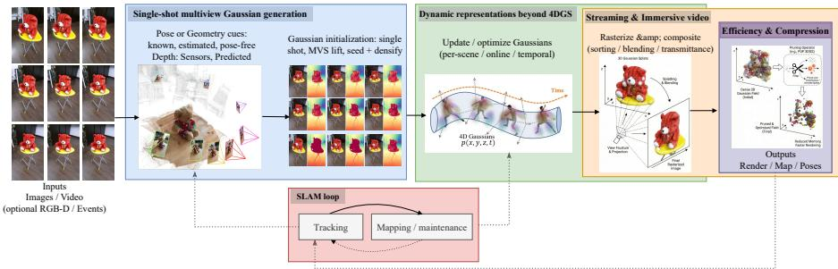
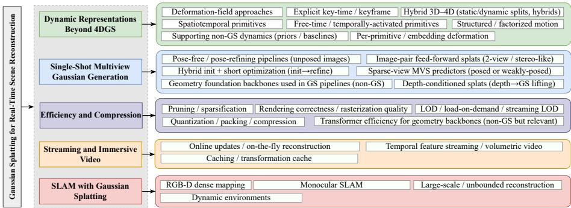
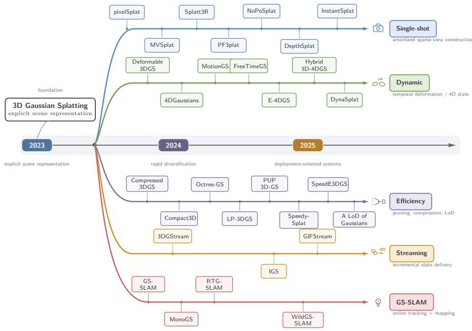

# Gaussian Splatting for Real-Time Scene Reconstruction: Methods, Systems, and Trade-offs

Ashim Dahal, Rabab Abdelfattah, Nick Rahimi

School ofComputing and Computer Engineering, University ofSouthern Mississippi, Hattiesburg, MS, 39401, USA

## Abstract

3D Gaussian Splatting (3DGS) allows for high-quality real-time novel-view synthesis. Since its inception in 2023, its explicit and highly configurable scene representation has been extended toward sparse-view generation, dynamic reconstruction, efficiency and compression, streaming, and simultaneous localization and mapping (SLAM). Although Gaussian Splatting can provide real-time rendering, rendering an existing representation is distinct from constructing, updating, or maintaining the scene itself. In this survey, we synthesize current literature, categorize them and provide a connection of current approaches and tools towards an end-to-end pipeline. Explicitly, we categorize GS scene reconstruction into five overlapping families: single-shot generation, dynamic representations, efficiency and compression, streaming and immersive systems, and Gaussian Splatting SLAM. We distinguish render-only throughput from task-specific scene generation, update, tracking, mapping, and optimization costs, and combine controlled sparse-view benchmarking with native evaluations to identify cross-family quality, latency, memory, and update-cost trade-offs.

Keywords: Gaussian Splatting, 3D Scene Representation, Novel View Synthesis, Neural Rendering, Multi-View Geometry

## 1. Introduction

Kerbl et al. [1] introduced 3D Gaussian Splatting (3DGS) as an explicit scene representation capable of high-quality interactive novel-view rendering. Subsequent work rapidly extended this formulation beyond static per-scene reconstruction. Deformable 3DGS [2] and 4DGaussians [3] introduced temporal deformation and spatiotemporal representations, while later methods explored feed-forward sparse-view generation [4, 5], efficiency and compression, streaming, and Gaussian-based SLAM. These developments increasingly shift the systems bottleneck from rendering an existing representation toward constructing, updating, transmitting, or maintaining the Gaussian scene. This distinction is important for applications such as free-viewpoint video, immersive media, online mapping, and robotics. In these settings, interactive rendering alone is insufficient when scene construction, temporal updates, or map maintenance remain substantially slower than rasterization.

Table 1: Positioning of this survey relative to representative Gaussian Splatting surveys.
<table><tr><td>Survey</td><td>Year</td><td>Primary organization</td><td>Distinctive emphasis</td></tr><tr><td>Wu et al. [6]</td><td>2024</td><td>Reconstruction, editing, downstream applications</td><td>Functional overview of 3DGS developments</td></tr><tr><td>Fei et al. [7]</td><td>2025</td><td>Characteristics and applications</td><td>Theoretical foundations and application taxonomy</td></tr><tr><td>Bao et al. [8]</td><td>2025</td><td>Optimization, applications, extensions</td><td>Technical modules, challenges, and opportunities</td></tr><tr><td>Bagdasarian et al. [9]</td><td>2025</td><td>Compression and compaction</td><td>Representation size and compression efficiency</td></tr><tr><td>Zhu et al. [10]</td><td>2024</td><td>Robotics applications and technical advances</td><td>3DGS for robotic perception and interaction</td></tr><tr><td rowspan="2">Ours</td><td>2023- 2025</td><td>Five reconstruction-pipeline families</td><td>Task-specific runtime,</td></tr><tr><td></td><td></td><td>quantitative evaluation, and deployment trade-offs</td></tr></table>

Several surveys have reviewed 3DGS from broader perspectives. Wu et al. [6] organize the field by 3D reconstruction, editing, and downstream applications; Fei et al. [7] use taxonomies based on characteristics and applications; and Bao et al. [8] examine optimization, applications, extensions, and recurring technical modules. More focused surveys address compression and compaction [9] and robotics [10]. As summarized in Table 1, our focus is different: we organize Gaussian Splatting as a reconstruction pipeline and study which task-specific costs limit real-time deployment.

In this survey, real-time is task specific. We distinguish render-only throughput from scene generation, dynamic or streaming updates, SLAM tracking and mapping, and offline optimization. These quantities are compared only when their unit of work and timing boundary are aligned, as defined in Section 2.7.

We formulate real-time Gaussian scene reconstruction from the pipeline perspective illustrated in Figure 1. We organize the literature into five overlapping families according to the stage containing the dominant contribution: single-shot generation, dynamic representations, efficiency and compression, streaming and immersive systems, and Gaussian Splatting SLAM. This pipeline-centric view exposes where geometry, pose estimation, temporal updates, memory, and rendering costs arise across otherwise different GS systems.

We summarize the scope, organization, and contributions of this survey as follows:

• Pipeline-centric taxonomy: We organize GS research into five overlapping families according to the dominant stage of the reconstruction pipeline, supported by a compact tag schema for structured comparison (Figure 2 and table 3).

• Task-specific real-time framework: We distinguish render-only throughput, scene generation, temporal updates, SLAM tracking and mapping, and offline optimization using explicit units of work and timing boundaries (Sections 2.7, 4.2 and 4.3).

• Quantitative and algorithmic evaluation: We provide a controlled comparison of compatible sparse-view methods and complementary native evaluations across the remaining families, with explicit comparability boundaries and mechanismlevel analysis (Section 6).

  
Figure 1: Overview of a Gaussian Splatting–based reconstruction pipeline. Starting from images/video (optionally RGB-D/events), the system forms pose/geometry cues, initializes Gaussians (one-shot or MVS lifting), updates/optimizes the scene representation (per-scene, online, or temporal), and rasterizes/composites to produce renders, maps, and poses. Shaded containers indicate where the five taxonomy families primarily intervene (single-shot generation, dynamic representations, efficiency/compression, streaming/immersive video, and SLAM with tracking–mapping).

• Cross-family synthesis: We connect algorithmic choices to quality, latency, memory, update cost, and deployment suitability, and identify remaining barriers toward end-to-end real-time systems (Section 6 and Section 7).

## 2. Preliminaries

Figure 1 summarizes the end-to-end Gaussian Splatting reconstruction pipeline and where our five taxonomy families intervene. This section fixes terminology and notation, summarizes the core 3DGS representation and rasterization/compositing used for real-time rendering, and defines the training regimes, input/supervision assumptions, and the real-time criterion used throughout. We conclude with a compact tag schema used to structure the taxonomy and method comparisons.

## 2.1. Scope and Terms

We use Gaussian Splatting to refer to modern 3D Gaussian Splatting (3DGS) [1]: an explicit set of 3D Gaussian primitives parameterized in world space and rendered by fast (typically differentiable) screen-space splatting with rasterization/compositing. Under this scope, the primary object is a Gaussian scene representation (centers, covariances, opacities, and appearance parameters), and the key efficiency advantage comes from rasterizing a finite set of primitives rather than volumetric ray marching. We do not survey NeRFs [11] as a primary topic. We cite NeRF-related work only when necessary for context (e.g., datasets/metrics) or when a method explicitly transfers radiance-field ideas into Gaussian representations.

Finally, we use real-time scene reconstruction in a task-specific sense rather than through a universal FPS threshold. Rendering, scene generation, dynamic or streaming updates, and SLAM are evaluated using their corresponding units of work and timing boundaries, as defined in Section 2.7.

## 2.2. Notations

Table 2 lists the main symbols used in the survey. For dynamic scenes, quantities are indexed by time t and the Gaussian set at time t is denoted $\mathcal { G } _ { t }$ . Unless stated otherwise, each primitive is represented by $( \mu _ { j } , \Sigma _ { j } , \alpha _ { j } , \mathbf { c } _ { j } )$ , where $\mathbf { c } _ { j }$ may be RGB, spherical harmonics coefficients, or learned features depending on the method.

## 2.3. Gaussian Representation

Gaussian Splatting represents a scene as $\mathcal { G } = \{ g _ { j } \} _ { j = 1 } ^ { N }$ , a set of N anisotropic 3D Gaussian primitives in world coordinates. Each $g _ { j }$ is defined by a mean $\mu _ { j } \in \mathbb { R } ^ { 3 }$ , covariance $\Sigma _ { j } \in \mathbb { R } ^ { 3 \times 3 }$ (commonly parameterized via rotation and per-axis scales for stability), opacity $\alpha _ { j } \in [ 0 .$ 1], and appearance parameters $\mathbf { c } _ { j } .$ . This explicit primitive-based representation enables high-throughput rasterization pipelines compared to radiancefield rendering [1].

Methods primarily differ in (i) which parameters are optimized vs. predicted, and (ii) how time is modeled. Static pipelines often optimize all parameters per scene with SfM/MVS/depth-based initialization; dynamic extensions introduce time dependence via explicit per-frame parameters, deformation models, or static/dynamic partitions. Online/SLAM-style systems additionally constrain updates to bounded latency and control representation growth via pruning, keyframes, and local refinement.

Representation complexity and real-time knobs. Runtime and memory are dominated by the number of primitives N and the appearance bandwidth (e.g., SH degree or feature dimensionality). Dynamic/streaming settings add growth over time, so many systems explicitly regulate N and appearance parameters to meet real-time targets.

Representation vs. serialization (file formats). Gaussian scenes may be stored in different encodings (e.g., PLY-like formats or .splat-style binaries). These typically change serialization/layout and attribute encoding (e.g., quantization, SH/features) rather than the underlying representation $\{ ( \mu _ { j } , \Sigma _ { j } , \alpha _ { j } , \mathbf { c } _ { j } ) \} _ { j = 1 } ^ { N }$

Table 2: Notation used throughout the survey.
<table><tr><td>Symbol</td><td>Meaning</td></tr><tr><td> $I _ { i } / I _ { t }$ </td><td>Input image i (or frame at time t).</td></tr><tr><td> $K$ </td><td>Camera intrinsics matrix.</td></tr><tr><td> $T _ { i } = ( R _ { i } , t _ { i } )$ </td><td>Camera pose (extrinsics) for view  $i ;$  rotation  $R _ { i }$  and translation  $t _ { i } .$ </td></tr><tr><td> $\pi ( \cdot )$ </td><td>Camera projection function mapping 3D to image coordinates.</td></tr><tr><td> $\mathbf { u }$ </td><td>Pixel coordinate in the image plane.</td></tr><tr><td> $\mathcal { G } / \mathcal { G } _ { t }$ </td><td>Set of Gaussians for a static scene (or at time t).</td></tr><tr><td> $g _ { j }$ </td><td>The j-th Gaussian primitive in  $\mathcal { G } .$ </td></tr><tr><td> $\mu _ { j } \in \mathbb { R } ^ { 3 }$ </td><td>3D mean (center) of Gaussian  $g _ { j }$  in world coordinates.</td></tr><tr><td> $\Sigma _ { j }$ </td><td>3D covariance of  $\dot { \boldsymbol { g } } _ { j }$  (often parameterized via scale + rotation).</td></tr><tr><td> $\alpha _ { j }$ </td><td>Opacity (or density/weight) parameter of  ${ \dot { g } } _ { j } .$ </td></tr><tr><td> $\mathbf { c } _ { j } / \mathbf { f } _ { j }$ </td><td>Appearance parameters (e.g., color or feature coefficients such as SH).</td></tr><tr><td>î</td><td>Rendered image produced by rasterization/compositing.</td></tr><tr><td> $\hat { D }$ </td><td>Rendered depth (if reported/used by a method).</td></tr><tr><td> $N$ </td><td>Number of Gaussians in the scene representation.</td></tr></table>

## 2.4. Rasterization

Given camera intrinsics K and pose $T = ( R , t )$ , each mean $\mu _ { j }$ projects to

$$
\begin{array} { r } { \hat { \mu } _ { j } = \pi ( K , T ; \mu _ { j } ) \in \mathbb { R } ^ { 2 } , } \end{array}\tag{1}
$$

and its 3D covariance $\Sigma _ { j }$ induces an elliptical screen-space footprint (2D covariance) $\Sigma _ { i } ^ { 2 D }$ . Rendering composites projected splats in approximate front-to-back order using alpha/transmittance blending [1]. Modern implementations use GPU tiled rasterization and sorting so only splats overlapping a pixel/tile are processed, which is central to real-time performance [12]. Approximate visibility/sorting can cause artifacts in dense or dynamic regions [13], motivating improved compositing and hardware/system optimizations [14, 15, 16].

## 2.5. Training

We group common regimes by when optimization/learning happens: per-scene/persequence optimization (offline fitting), amortized feed-forward generation via pretrained models, and dynamic/online settings where temporal modeling and incremental updates impose bounded-latency constraints. Per-scene optimization fits $\{ ( \mu _ { j } , \Sigma _ { j } , \alpha _ { j } , \mathbf { c } _ { j } ) \}$ for a specific sequence [1]; amortized methods predict Gaussians at inference time $( \mathrm { o p - }$ tionally followed by brief test-time refinement) [17, 5, 4, 18]. Dynamic methods often introduce time-dependent parameterizations or deformations and are frequently optimized per sequence [3, 19, 2], while online/SLAM pipelines prioritize training-free or pretrained components at runtime with efficient map maintenance.

## 2.6. Inputs and Supervision

We categorize input modalities as multi-view captures, monocular video, and RGB-D or sensor-augmented streams (e.g., events). Pose assumptions range from known (calibration/SfM) to estimated/refined (tracked or jointly optimized) to posefree. Supervision is often self-supervised via photometric consistency, but many pipelines incorporate pretrained priors (especially depth/MVS) to stabilize geometry and accelerate initialization.

## 2.7. Task-Specific Real-Time Definition

The term real-time is used differently across Gaussian Splatting methods. Rendering, scene generation, streaming updates, and SLAM correspond to different tasks and should therefore not share a single throughput definition. We use approximately 24 FPS only as a reference for interactive playback, not as a universal threshold for reconstruction or scene updates.

Let all latency values be expressed in milliseconds. Render-only throughput is defined as

$$
\mathrm { r F P S } = \frac { 1 0 0 0 } { t _ { \mathrm { r e n d e r } } } ,\tag{2}
$$

where $t _ { \mathrm { r e n d e r } }$ is the time required to render one frame from an existing Gaussian representation. For a reconstruction or update task, the pipeline latency can be written as

Table 3: Master tag schema used across the survey. Core tags are shared across all method families; familyspecific tags are used only in the corresponding matrices.
<table><tr><td colspan="2">Core tags (shared vocabulary)</td></tr><tr><td>Input</td><td>mono-video; sparse-mv; dense-mv; RGB-D; events+RGB</td></tr><tr><td>Pose</td><td>known; estimated/refined; pose-free</td></tr><tr><td>Depth cue</td><td>sensor depth; predicted depth; MVS; none</td></tr><tr><td>Regime</td><td>PerSeq (per-seq. opt.); PreTr (amortized); HybridR (init+refine)</td></tr><tr><td>Temporal scope</td><td>static; dynamic</td></tr><tr><td>Runtime setting</td><td>offline; online; streaming</td></tr><tr><td>Primary output</td><td>rendering/NVS; mapping; poses; immersive video</td></tr><tr><td colspan="2">Dynamic-family tags</td></tr><tr><td>Type</td><td>Def.; KeyT; Struct.; 4DPrim; Hybrid; FreeT</td></tr><tr><td>Dynamics</td><td>non-rigid; articulated; multi-object; occl./disoccl.</td></tr><tr><td>Online</td><td>Yes / No</td></tr><tr><td>RT render</td><td>Yes / No / TBA</td></tr><tr><td colspan="2">Single-shot-family tags</td></tr><tr><td>Input / Pose / Depth / Regime Uses the core tags above (exact column match)</td><td></td></tr><tr><td colspan="2">Efficiency-family tags</td></tr><tr><td>Lever</td><td>Prune; Quant; LoD; Rend; HW; Sys</td></tr><tr><td>Scope</td><td>Static; Dynamic; Both</td></tr><tr><td>Offline preproc.</td><td>Yes / No</td></tr><tr><td>RT</td><td>Yes / No</td></tr></table>

$$
t _ { \mathrm { p i p e } } = t _ { \mathrm { p r e } } + t _ { \mathrm { p o s e } } + t _ { \mathrm { d e p t h / f u s i o n } } + t _ { \mathrm { i n i t } } + t _ { \mathrm { u p d a t e } } + t _ { \mathrm { r e n d e r } } ,\tag{3}
$$

where only stages relevant to the evaluated task are included. The corresponding task throughput is

$$
R _ { \mathcal { T } } = \frac { 1 0 0 0 } { t _ { \mathcal { T } } } .\tag{4}
$$

Accordingly, we report scene throughput for feed-forward reconstruction, update throughput for dynamic and streaming methods, and tracking or mapping throughput for SLAM systems. Offline optimization is reported using training or optimization time rather than scenes per second. These quantities are compared only when the task, unit of work, and timing boundary are aligned.

## 2.8. Summary of Tags

To compare methods consistently across our taxonomy, we annotate each paper using a compact tag set capturing input assumptions, regime, temporal scope, and runtime setting. Table 3 summarizes the master schema and family-specific extensions.

## 3. Methodology

We survey Gaussian Splatting (GS) research toward real-time scene reconstruction using the task-specific definitions in Section 2.7. Our workflow is: (i) collect papers broadly, (ii) apply inclusion criteria aligned with the GS reconstruction pipeline, (iii) assign a pipeline-centric taxonomy with consistent tags, and (iv) interpret reported efficiency using end-to-end-aware conventions.

## 3.1. Literature Collection and Inclusion Criteria

We prioritize recent work (2023–2025) while retaining foundational baselines needed for context (datasets, metrics, and core dynamic/NVS references). Literature was identified primarily through Google Scholar and the proceedings of CVPR, ICCV, ECCV, NeurIPS, and ICLR. Seed queries included Gaussian splatting, Gaussian splatting for SLAM, efficient Gaussian splatting, fast Gaussian splatting, sparse-view Gaussian splatting, and zero-shot Gaussian splatting, together with closely related variants for dynamic reconstruction, streaming, compression, pose-free reconstruction, and realtime reconstruction. Reference lists of relevant papers were also inspected to identify related and foundational work (backward citation snowballing). We include methods whose primary scene representation is an explicit Gaussian-based model (or a direct extension) and that materially affect one or more stages of a GS reconstruction pipeline (initialization/generation, temporal modeling, map maintenance, streaming/delivery, compositing, or tracking-and-mapping). We exclude NeRF-style methods as a primary focus, citing them only when necessary for context or when they explicitly bridge into Gaussian representations. Duplicate versions and works outside the surveyed reconstruction/system scope are excluded; dataset, metric, and foundational papers are retained as supporting references rather than surveyed GS methods. Because the literature search evolved iteratively during preparation of the survey, intermediate retrieval and screening counts were not recorded prospectively and are therefore not reconstructed retrospectively.

## 3.2. Tagging and Taxonomy Assignment

Each paper is annotated using the master tag schema in Table 3 (input/pose/depth cues, regime, temporal scope, runtime setting, and efficiency levers). We assign each method to one primary family based on its dominant contribution, while noting meaningful overlaps when a method intervenes in multiple pipeline stages. The five families in Fig. 2 are constructed to reflect where methods intervene operationally in the endto-end pipeline (Fig. 1), enabling consistent comparison across tables and sections.

## 3.3. Interpreting Performance Claims

To avoid conflating rendering speed with reconstruction throughput, runtime evidence is interpreted according to the task being measured rather than through a universal FPS or SPS quantity. Render-only results, scene generation, dynamic or streaming updates, SLAM, and offline optimization follow the timing boundaries defined in Section 2.7. Results are treated as directly comparable only when the dataset, input protocol, resolution, hardware, unit of work, and timing boundary are sufficiently aligned;

  
Figure 2: Taxonomy of Gaussian Splatting for Real-Time Scene Reconstruction. The diagram categorizes methods into dynamic representations, single-shot generation, efficiency, streaming and immersive video, and SLAM. For a clearer chronological view and additional representative methods from each family, see Figure 3.

otherwise, they are treated as method-specific evidence. When code, pretrained models, or timing scripts are available, we prioritize these artifacts over high-level paper claims for interpreting runtime and memory. For methods evaluated in Section 6, repository configurations, checkpoints, native schedules, and evaluation procedures are used where available to establish the reported operating conditions.

## 4. Datasets and Evaluation Protocols

This section summarizes the datasets, quality metrics, and evaluation protocols used throughout the survey. Runtime comparisons follow the task-specific definitions introduced in Section 2.7.

## 4.1. Datasets and Quality Metrics

Datasets (representative regimes). Although datasets are not the main focus of this survey, they strongly influence what claims are comparable. Across the literature, benchmarks cluster into five recurring regimes. (i) Multi-view dome/studio captures provide calibrated multi-camera observations and controlled dynamics, commonly used for high-fidelity dynamic reconstruction (e.g., Technicolor Light Field [20], Neu3DV [21], Replay [22], NeRSemble [23], PKU-DyMVHumans [24], DiVa-360 [25]). (ii) Monocular/handheld sequences emphasize pose uncertainty, motion blur, and in-the-wild dynamics, often inherited from dynamic NeRF benchmarks (e.g., NSFF Dynamic [26], D-NeRF [27], Nerfies [28], HyperNeRF [29]) and more recent GS/video-generation settings (e.g., Splat4D [30]). (iii) Event+RGB settings target fast motion and low-light where conventional frames degrade, using event streams as additional supervision or cues (e.g., Dynamic EventNeRF [31], E-4DGS [19]). (iv) Outdoor/driving/drone captures evaluate scalability and SLAM-like conditions, often with LiDAR/SLAM pose supervision and dynamic agents (e.g., MTGS [32], DroneSplat [33], Wide-Range-4D [34]). (v) Synthetic/physics-based datasets provide controllable dynamics and/or ground-truth structure for stress-testing temporal modeling (e.g., Deep3D Mask Volume [35], PhysGaia [36], Hybrid 3D-4DGS [37], DynaSplat [38]).

Table 4: Task-specific runtime quantities used in this survey.
<table><tr><td>Task</td><td>Unit of work</td><td>Timing boundary</td><td>Metric</td></tr><tr><td>Rendering</td><td>One rendered frame</td><td>Existing representa- tion to rendered frame</td><td>rFPS</td></tr><tr><td>Scene generation</td><td>One fixed input- view set</td><td>Input views to Gaus- sian representation</td><td>Scene throughput</td></tr><tr><td>Dynamic / stream- ing</td><td>One defined update or transition</td><td>Update input to up- dated representation</td><td>Update through- put</td></tr><tr><td>SLAM tracking</td><td>One input frame</td><td>Frame input to pose estimate</td><td>Tracking FPS</td></tr><tr><td>SLAM mapping</td><td>One map update</td><td>Mapping input to up- dated map</td><td>Mapping through-</td></tr><tr><td>Offline optimization</td><td>One training or op- timization run</td><td>Start to completed model/checkpoint</td><td>put Time / iterations</td></tr></table>

Image fidelity and temporal stability. Most works report standard per-frame fidelity using PSNR, SSIM [39], and LPIPS [40], typically averaged over time for dynamic sequences. To reflect temporal stability, several papers additionally report flow-warped temporal errors or flow-based temporal discrepancy scores [41]. Some works also use video metrics such as FVD [42], although these are less consistently reported.

## 4.2. Task-Specific Runtime Metrics

Runtime is reported according to the task being measured. Render FPS (rFPS) refers only to rendering an existing Gaussian representation. Feed-forward methods use scene throughput, dynamic and streaming methods use update throughput, and SLAM methods use tracking or mapping throughput. Offline optimization is reported using training or optimization time. These quantities are compared only when they measure the same task under the same timing boundary.

## 4.3. Evaluation Protocol

Quantitative comparisons require aligned datasets, input settings, resolution, hardware, and timing boundaries. When these conditions are not aligned, results are treated as method-specific evidence rather than direct comparisons. We therefore report both quality and runtime together with the experimental conditions under which they were measured.

## 5. Taxonomy

We organize Gaussian Splatting work for real-time reconstruction into five pipelinecentric families, defined by the primary stage a method intervenes in (capture/training, representation, rendering, system delivery, or online estimation). Because many methods are multi-faceted, we allow secondary overlaps but assign each paper a single primary family based on its dominant technical contribution.

  
Figure 3: Chronological development of representative Gaussian Splatting methods across the five survey families. Methods are positioned by publication year and primary contribution; the figure is representative rather than exhaustive.

Figure 3 shows the chronological development of representative methods across these families, illustrating how work following 3DGS progressively expanded toward amortized generation, temporal modeling, efficiency, streaming, and online mapping.

Single-shot / amortized Gaussian generation. Feed-forward construction of a usable Gaussian scene from one or few images, often using depth/MVS priors or learned regularizers, optionally followed by brief refinement. Poses may be known, refined, or pose-free, but the defining feature is replacing heavy per-scene iterative fitting with amortized inference from limited views.

Dynamic representations beyond 4DGS. Methods that treat time as a first-class variable in the scene model (e.g., time-conditioned parameters, deformation/warp fields, key-time primitives, canonical-plus-delta factorization) or explicitly mitigate dynamic failure modes such as ghosting, identity swaps, occlusion/disocclusion artifacts, and temporal flicker. The emphasis is modeling temporal change, not merely delivering or replaying content over time.

Efficiency and compression. Works whose central goal is reducing compute, memory, or storage/bandwidth while preserving real-time operation, via levers such as pruning/sparsification, quantization/packing, view-adaptive LoD selection, or system/hardware acceleration. We place a method here when efficiency is the primary objective rather than a side effect.

Table 5: Controlled comparison of single-shot Gaussian reconstruction methods on RealEstate10K [43]. All methods use the same 100 test scenes, two context views, three target views, 256 × 256 resolution, and an NVIDIA A100 GPU. Model-stage scene latency and scene throughput include the encoder and three target decodes, while rFPS reports decoder-only rendering.
<table><tr><td>Method</td><td>PSNR ↑ SSIM ↑ LPIPS ↓</td><td></td><td></td><td>Model-stage latency (ms) ↓ Model-stage</td><td>rFPS ↑ GPU (GiB) ↓</td><td></td><td></td></tr><tr><td>MVSplat [5]</td><td>26.78</td><td>0.881</td><td>0.119</td><td>scene/s ↑ 37.63</td><td>26.57</td><td>871.21</td><td>1.18</td></tr><tr><td>DepthSplat [17]</td><td>27.62</td><td>0.898</td><td>0.106</td><td>65.37</td><td>15.30</td><td>654.68</td><td>2.63</td></tr><tr><td>pixelSplat [4]</td><td>26.40</td><td>0.873</td><td>0.127</td><td>120.57</td><td>8.29</td><td>462.29</td><td>2.77</td></tr></table>

Table 6: Family-specific measurements for additional single-shot and sparse-view methods. These results use different datasets and execution settings than table 5 and are not directly comparable. Runtime refers to the method-specific measured construction or optimization stages.
<table><tr><td>Method</td><td>Dataset / input</td><td>PSNR ↑ SSIM ↑ LPIPS ↓ Runtime</td><td></td><td></td><td></td></tr><tr><td>Splatt3R [44]</td><td>ScanNet++ [45], 2 views</td><td></td><td>一</td><td></td><td>1.10 s construction / export</td></tr><tr><td>InstantSplat [46]T&amp;T Horse [47], 3</td><td>views</td><td>23.30</td><td>0.823</td><td>0.125</td><td>16.01 s initialization + 35.02 s optimization</td></tr></table>

Streaming and immersive video systems. Long-duration capture and interactive freeviewpoint playback under latency/bandwidth constraints, enabled by explicit delivery mechanisms (progressive transmission, caching/tiling/segmenting, rate control, bandwidthaware loading, or continual update protocols). The core contribution is system delivery and interactivity over time, not new temporal scene parameterizations.

SLAM with Gaussian Splatting. Online tracking-and-mapping where camera poses are estimated incrementally and the Gaussian map is updated under bounded latency/compute, typically using keyframes, map maintenance/pruning, robustness to blur/occlusions, and (when relevant) loop-consistency considerations. We place a method here when meeting tracking deadlines and maintaining a bounded-cost map are central to the design.

## 6. Quantitative Evaluation and Synthesis

## 6.1. Single-Shot and Sparse-View Generation

For calibrated sparse-view methods, Gaussian construction can be expressed as depth inference followed by unprojection,

$$
\mu _ { i } ( { \mathbf { u } } ) = \pi ^ { - 1 } \big ( { \mathbf { u } } , \widehat { d } _ { i } ( { \mathbf { u } } ) ; K _ { i } , T _ { i } \big ) , \qquad ( \Sigma _ { i } , \alpha _ { i } , { \mathbf { c } } _ { i } ) = H _ { \boldsymbol { \theta } } ( { \mathbf { f } } _ { i } ( { \mathbf { u } } ) ) .\tag{5}
$$

MVSplat [5] estimates $\hat { d } _ { i }$ from a plane-sweep cost volume,

$$
C _ { i } ( { \mathbf { u } } , d _ { k } ) = \operatorname { A g g } _ { m \neq i }  F _ { i } ( { \mathbf { u } } ) , \mathcal { W } _ { m  i } ( F _ { m } ; d _ { k } )  , \qquad \hat { d } _ { i } = \sum _ { k } \operatorname { s o f t m a x } ( C _ { i } ) _ { k } d _ { k } ,\tag{6}
$$

so geometry is determined primarily by cross-view correspondence. DepthSplat [17] instead augments the multi-view matching representation with pretrained monocular depth features,

$$
\widetilde { C } _ { i } = \Phi _ { \theta } ( C _ { i } , F _ { i } ^ { \mathrm { m o n o } } ) ,\tag{7}
$$

before depth regression and Gaussian unprojection. This additional geometric prior corresponds to the highest PSNR/SSIM and lowest LPIPS in table 5, but also increases model-stage latency and memory relative to MVSplat. pixelSplat [4] avoids committing directly to one depth by predicting $p _ { i } ( d \mid \mathbf { u } )$ and differentiably sampling

$$
d _ { i } \sim p _ { i } ( d \mid { \bf u } ) , \qquad \mu _ { i } ( { \bf u } ) = \pi ^ { - 1 } ( { \bf u } , d _ { i } ; K _ { i } , T _ { i } ) .\tag{8}
$$

Its more flexible treatment of geometric ambiguity is accompanied by the largest construction latency and memory footprint in the controlled experiment. Thus, table 5 shows that the mechanism used to estimate $\mu _ { j }$ directly affects both reconstruction quality and construction cost; in this experiment, augmenting multi-view matching with monocular depth features gives the strongest quality, while the lighter cost-volume formulation gives the lowest latency.

The native methods in table 6 remove the calibrated-pose assumption in different ways. Splatt3R [44] extends MASt3R [48] with a Gaussian prediction head, which can be summarized as

$$
\begin{array} { r } { \left( \mathbf { x } _ { j } , \Delta \mathbf { x } _ { j } , q _ { j } , s _ { j } , \alpha _ { j } , \mathbf { c } _ { j } \right) = H _ { \theta } ( I _ { 1 } , I _ { 2 } ) , \qquad \mu _ { j } = \mathbf { x } _ { j } + \Delta \mathbf { x } _ { j } , } \end{array}\tag{9}
$$

with $\Sigma _ { j }$ obtained from the predicted rotation $q _ { j }$ and scale $s _ { j }$ . The scene is therefore produced directly from an uncalibrated pair without optimizing camera variables. InstantSplat [46] instead uses dense stereo priors to initialize both geometry and cameras and then performs Gaussian Bundle Adjustment,

$$
\operatorname* { m i n } _ { \mathcal { G } , \{ T _ { i } \} } \sum _ { i } \mathcal { L } _ { \mathrm { p h o t o } } \left( I _ { i } , \hat { I } ( \mathcal { G } , T _ { i } ) \right) ,\tag{10}
$$

jointly updating the Gaussian parameters and poses. This distinction is visible quantitatively: Splatt3R requires 1.10 s for measured construction/export, whereas InstantSplat uses 16.01 s for initialization followed by 35.02 s of optimization. Hence the former admits a construction throughput, while the latter is an optimization problem whose runtime depends on the refinement budget. In both cases, the much larger decoderonly rFPS reported in table 5 remains a separate quantity from the cost of constructing ${ \mathcal { G } } .$ . Recent feed-forward generalists broaden this regime to unconstrained input views and unified geometry-to-Gaussian prediction, as exemplified by AnySplat and YoNoSplat [49, 50]. These systems relax capture assumptions, but move additional latency and memory pressure into their learned geometry backbones and cross-view fusion.

Table 7: Native evaluation of dynamic Gaussian representation methods. 4DGaussians and Deformable-3D-Gaussians are evaluated on D-NeRF bouncingballs [27]; MotionGS was evaluated on the DyNeRF flame\_steak sequence [21] using its documented schedule but did not complete. Results use method-specific native evaluation procedures and are not a controlled cross-method benchmark.
<table><tr><td>Method</td><td>Dataset</td><td>Schedule PSNR</td><td></td><td>SSIM ↑</td><td>LPIPS↓</td><td>rFPS ↑</td></tr><tr><td>4DGaussians [3]</td><td>D-NeRF [27]</td><td>20k</td><td>40.81</td><td>0.994</td><td>0.014VGG / 0.006 Alex</td><td>36.03</td></tr><tr><td>Deformable-3D- D-NeRF [27] Gaussians [2]</td><td></td><td>40k</td><td>41.38</td><td>0.996</td><td>0.008</td><td></td></tr><tr><td>MotionGS [52]</td><td>DyNeRF [21]</td><td>20k</td><td></td><td>1</td><td>一</td><td></td></tr></table>

MotionGS exhausted the 80 GB GPU memory at iteration 7,600 and therefore produced no completed checkpoint or final quality result.

## 6.2. Dynamic Representations

Let $q _ { j }$ and $s _ { j }$ denote the rotation and scale parameterization of $\Sigma _ { j }$ . Dynamic deformation can then be written as

$$
( \Delta \mu _ { j } , \Delta q _ { j } , \Delta s _ { j } ) = F _ { \boldsymbol { \theta } } ( \mu _ { j } , t ) , \qquad \mu _ { j } ( t ) = \mu _ { j } + \Delta \mu _ { j } ,\tag{11}
$$

with the predicted rotation and scale determining $\Sigma _ { j } ( t )$ . Deformable-3D-Gaussians [2] uses an MLP deformation field conditioned directly on canonical position and time. 4DGaussians [3] instead obtains the deformation from factorized spatio-temporal features, using a HexPlane-style [51] 4D encoding followed by a lightweight decoder. Thus, the former places motion complexity in the continuous deformation network, whereas the latter shifts part of it into an explicit space–time feature structure. In table 7, both reach similar quality on D-NeRF bouncingballs: 41.38 dB for Deformable-3D-Gaussians and 40.81 dB for 4DGaussians. These values show that both deformation parameterizations can represent the same synthetic motion regime at high fidelity. 4DGaussians additionally renders at 36.03 rFPS in the measured native setup, showing that the deformation representation can remain compatible with interactive rendering after optimization.

MotionGS [52] modifies this formulation by adding explicit motion supervision to the deformation field. Optical flow is decomposed as

$$
F _ { t  t + 1 } ^ { M } = F _ { t  t + 1 } - F _ { t  t + 1 } ^ { C } ,\tag{12}
$$

where $F ^ { C }$ is the component induced by camera motion and $F ^ { M }$ isolates object motion. The predicted 3D Gaussian deformation is projected into Gaussian flow $F ^ { G }$ and constrained by

$$
\mathcal { L } _ { \mathrm { f l o w } } = \| \mathrm { s g } ( F _ { t  t + 1 } ^ { M } ) - F _ { t  t + 1 } ^ { G } \| _ { 1 } .\tag{13}
$$

This changes the optimization problem from learning motion primarily through photometric reconstruction to explicitly matching projected Gaussian motion. This supervision couples deformation accuracy to rendered depth and camera pose: errors in either term perturb $F ^ { C }$ and therefore $F ^ { M }$ . In our native DyNeRF flame\_steak run, the documented 20k schedule exhausted an 80 GB A100 at iteration 7,600 (table 7), showing that the complete motion-guided pipeline can become memory-bound before convergence. Other important dynamic formulations place temporal structure more explicitly: 4D-RotorGS and Ex4DGS encode time directly in the primitive representation, whereas SC-GS uses sparse control points to structure deformation and support motion editing [53, 54, 55]. These alternatives reduce reliance on one unconstrained per-Gaussian warp, but introduce their own temporal-parameter or control-structure costs.

Table 8: Native evaluation of efficiency and compression methods. Results use method-specific training schedules. Methods evaluated on different datasets or native pipelines are not directly ranked against each other. rFPS is omitted when it is not reported by the native evaluation.
<table><tr><td>Method</td><td>Dataset</td><td>Schedule</td><td>PSNR ↑</td><td>SSIM ↑</td><td>LPIPS ↓</td><td>rFPS ↑</td></tr><tr><td>Octree-GS [56]</td><td>N3DV [21]</td><td>40k</td><td>30.42</td><td>0.941</td><td>0.109</td><td></td></tr><tr><td>3D-GS [1]</td><td>N3DV [21]</td><td>30k</td><td>25.01</td><td>0.933</td><td>0.165</td><td>193.46</td></tr><tr><td>PUP 3D-GS [57]</td><td>N3DV [21]</td><td>30k + 5k + 5k</td><td>25.42</td><td>0.930</td><td>0.185</td><td>155.15</td></tr><tr><td>Compact3D [58]</td><td>N3DV [21]</td><td>30k base + 5k fine-tune</td><td>25.08</td><td>0.916</td><td>0.166</td><td></td></tr><tr><td>gsplat [12]</td><td>N3DV [21]</td><td>30k</td><td>21.93</td><td>0.919</td><td>0.208</td><td>119.31</td></tr><tr><td>SpeedE3DGS [59]</td><td>D-NeRF [27]</td><td>30k</td><td>38.59</td><td>0.993</td><td>0.017</td><td>762.25</td></tr></table>

Table 9: Compression results from the shared 30k vanilla 3D-GS baseline on N3DV flame\_steak [21]. PUP 3D-GS and Compact3D use the same trained baseline, allowing a direct comparison of representation size and retained quality.
<table><tr><td>Representation</td><td>Size (MiB) ↓</td><td>Gaussians</td><td>Size reduction ↑</td><td>PSNR ↑</td></tr><tr><td>3D-GS [1]</td><td>75.50</td><td>319,222</td><td></td><td>25.01</td></tr><tr><td>PUP 3D-GS [57]</td><td>7.55</td><td>31,922</td><td>90.00%</td><td>25.42</td></tr><tr><td>Compact3D [58]</td><td>5.54</td><td></td><td>92.66%</td><td>25.08</td></tr></table>

## 6.3. Efficiency and Compression

For a Gaussian scene $\mathcal { G } = \{ g _ { j } \} _ { j = 1 } ^ { N }$ , efficiency is governed by more than the primitive count N. A useful conceptual decomposition is

$$
B ( \mathcal { G } ) \approx N b _ { g } , \qquad t _ { \mathrm { r e n d e r } } \propto c _ { g } N _ { \mathrm { v i s } } + c _ { o } M ,\tag{14}
$$

where $b _ { g }$ is the storage per Gaussian, $N _ { \mathrm { v i s } }$ is the number of Gaussians processed for the current view, and M denotes their accumulated screen-space overlap. The methods in tables 8 and 9 act on different terms of this model: pruning reduces N, quantization reduces $b _ { g } ,$ , LoD reduces $N _ { \mathrm { v i s } }$ , and renderer-level optimization reduces the computational constants $c _ { g }$ and $c _ { o }$ . Their reported “efficiency” gains are therefore not interchangeable.

PUP 3D-GS [57] reduces N using a second-order sensitivity criterion. For spatial Gaussian parameters $\theta _ { j }$ , removing a primitive can be interpreted through the local

reconstruction-loss change

$$
\Delta \mathcal { L } _ { j } \approx \frac { 1 } { 2 } \delta \boldsymbol { \theta } _ { j } ^ { \top } H _ { j } \delta \boldsymbol { \theta } _ { j } ,\tag{15}
$$

where $H _ { j }$ is the local Hessian block associated with the spatial parameters of Gaussian $j ,$ so low-sensitivity Gaussians can be removed before refinement. On the shared baseline in table 9, this removes approximately 90% of the Gaussians and 90% of serialized bytes while PSNR changes only from 25.01 to 25.42 dB. Compact3D [58] instead primarily reduces $b _ { g }$ through vector quantization. If Gaussian attributes are replaced by codebook entries $q _ { z _ { j } }$

$$
\theta _ { j } \approx q _ { z _ { j } } , \qquad z _ { j } \in \{ 1 , \ldots , K \} ,\tag{16}
$$

the storage changes from approximately $O ( N d )$ parameters to a codebook plus N indices. In our shared-baseline measurement this reduces model size from 75.50 to 5.54 MiB, a 92.66% reduction, while retaining 25.08 dB PSNR. Their dominant compression mechanisms act on different terms: PUP primarily reduces N, whereas Compact3D primarily reduces $b _ { g }$ through vector quantization.

The native results in table 8 show why smaller representations do not automatically imply faster rendering. The pruned PUP model contains only about one tenth of the baseline Gaussians, yet its measured rFPS is lower than the vanilla 3D-GS baseline (155.15 versus 193.46). Hence $t _ { \mathrm { r e n d e r } }$ is not determined by N alone; visibility, projected footprint, memory access, and rasterizer implementation remain important. Octree-GS [56] addresses this through view-dependent LoD, selecting only an appropriate subset of a hierarchical Gaussian representation, while GoDe [60] organizes progressive levels of detail for scalable compression and transmission, while gsplat [12] primarily improves the rasterization and training backend rather than changing the scene representation itself. SpeedE3DGS [59] reduces dynamic-scene cost differently again: temporal sensitivity pruning removes weakly contributing Gaussians and GroupFlow shares motion prediction among trajectory clusters, replacing independent per-Gaussian deformation inference with group-level transformations. Its measured 762.25 rFPS demonstrates the potential of this strategy, but the D-NeRF result is not directly comparable with the N3DV rows.

## 6.4. Streaming and Immersive Systems

Streaming methods replace full per-frame reconstruction with a state transition

$$
\mathcal { G } _ { t } = \mathcal { U } _ { \theta } ( \mathcal { G } _ { t - 1 } , I _ { t } ) ,\tag{17}
$$

so practical throughput is governed by the cost of ${ { \mathcal { U } } _ { \theta } }$ rather than rasterization alone. IGS [61] reduces this cost with an anchor-driven motion network: multi-view motion evidence is lifted into 3D and used to predict the motion of the existing Gaussians, while selected key frames are refined to limit temporal error accumulation. 3DGStream [62] instead represents the transition approximately as

$$
G _ { t } = { \mathcal { T } } _ { t } ( G _ { t - 1 } ) \cup { \mathcal { A } } _ { t } ,\tag{18}
$$

where a compact Neural Transformation Cache predicts Gaussian translation and rotation and $\mathcal { A } _ { t }$ adds Gaussians for newly appearing content. Thus, IGS emphasizes learned motion transfer with periodic correction, whereas 3DGStream performs explicit per-frame transformation and structural augmentation.

Table 10: Native evaluation of streaming and immersive Gaussian methods on N3DV flame\_steak [21]. IGS and 3DGStream measure online transition updates, whereas GIFStream uses offline two-frame GOP optimization.
<table><tr><td>Method</td><td colspan="2">Evaluation Schedule unit</td><td>PSNR ↑</td><td colspan="2">Operation Transition/s ↑ rFPS ↑ time ↓</td><td></td><td></td></tr><tr><td>IGS [61]</td><td></td><td>1 transition 100 refinement iter.</td><td>33.72</td><td>7.41 s</td><td>0.116</td><td>126.74</td></tr><tr><td>3DGStream [62]37</td><td>transitions</td><td>15k init.; 150 + 100/update</td><td>27.34 / 28.1812.63</td><td>s/update</td><td>0.079</td><td></td></tr><tr><td>GIFStream [63] 2-frame</td><td>GOP</td><td>30k</td><td>28.90</td><td>2023.62 s/GOP</td><td></td><td>89.75</td></tr></table>

For 3DGStream, PSNR values correspond to stage 1 and stage 2, respectively. GIFStream is an offline optimization result and is therefore not assigned a transition-update rate.

The measurements in table 10 show that this update operator, not rendering, is the dominant systems bottleneck. IGS reaches 126.74 rFPS after the representation is updated, but its measured transition rate is only $0 . 1 1 6 \mathrm { s } ^ { - 1 }$ because the native schedule includes 100 refinement iterations with densification. 3DGStream is slower at 0.079 transitions/s under its 150-stage-1 + 100-stage-2 schedule; the second stage raises mean PSNR from 27.34 to 28.18 dB, showing a direct quality–update-cost trade-off inside the streaming loop. Hence

$$
t _ { \mathrm { s t r e a m } } \approx t _ { \mathrm { m o t i o n } } + t _ { \mathrm { r e f i n e } } + t _ { \mathrm { s t r u c t u r e } } \gg t _ { \mathrm { r e n d e r } } ,\tag{19}
$$

for the measured online systems. Render FPS therefore measures playback capacity, not the rate at which a new dynamic state can be incorporated.

GIFStream [63] shifts the objective from rapid online state transition toward compact transmission of a time-varying Gaussian representation. GIFStream couples reconstruction with compression-aware optimization, which can be summarized as

$$
\mathcal { L } = \mathcal { L } _ { \mathrm { p h o t o } } + \lambda _ { e } \mathcal { L } _ { \mathrm { e n t r o p y } } + \lambda _ { r } \mathcal { L } _ { \mathrm { r e g } } ,\tag{20}
$$

with

$$
\mathcal { L } _ { \mathrm { e n t r o p y } } \approx - \sum _ { t } \log p _ { \theta } \big ( \bar { V } _ { t } \mid \bar { V } _ { < t } \big ) .\tag{21}
$$

It uses a canonical Gaussian space with a deformation field conditioned by time-dependent feature streams and applies temporal and spatial compression. This explains why its result in table 10 should not be converted into transition throughput: the measured 2023.62 s corresponds to offline optimization of a two-frame GOP, while the resulting representation still renders at 89.75 rFPS. Streaming therefore spans two different system problems: minimizing online update latency and minimizing transmitted temporal representation cost. Rate-aware and predictive temporal codecs such as 4DGC and P-4DGS further target this second problem by exploiting inter-frame redundancy in Gaussian streams [64, 65]; their compression gains must therefore be assessed together

Table 11: Native evaluation of Gaussian SLAM systems. MonoGS and RTG-SLAM use Replica office0 [66], while WildGS-SLAM uses a monocular Crowd sequence. Processed-frame throughput is measured over the complete wrapped run and should not be interpreted as a controlled ranking across methods.
<table><tr><td>Method</td><td>Input</td><td>Frames Wrapped</td><td>time (ms/frame) ↓</td><td>↑</td><td>Frames/s Trajectory error (m) ↓</td><td>Model size (MiB)</td></tr><tr><td>MonoGS [67]</td><td>Replica officeO, RGB-D</td><td>12</td><td>2250.57</td><td>0.444</td><td>0.000082</td><td>2.14</td></tr><tr><td>RTG- SLAM [68]</td><td>Replica officeO, RGB-D</td><td>20</td><td>884.60</td><td>1.130</td><td>0.00910</td><td>10.35</td></tr><tr><td>WildGS- SLAM [69]</td><td>Crowd, monocular</td><td>100</td><td>1525.64</td><td>0.655</td><td>0.00665</td><td>9.78</td></tr></table>

MonoGS and RTG-SLAM report ATE on Replica. WildGS-SLAM reports full-trajectory RMSE; its keyframe RMSE is 0.00371 m. The wrapped timing includes preprocessing, pose estimation, mapping/update, rendering, and method-specific finalization stages.

with decoder latency and temporal artifacts.

## 6.5. Gaussian Splatting SLAM

Gaussian SLAM couples camera estimation with Gaussian-map optimization. DyGS-SLAM [70] extends this coupled objective to dynamic-scene localization and Gaussian reconstruction, illustrating why motion handling must be considered part of the online estimation loop rather than only a rendering-stage concern. MonoGS [67] restricts this joint problem to a selected set of keyframes,

$$
{ \mathcal { W } } = W _ { k } \cup W _ { r } , \qquad \operatorname* { m i n } _ { \{ T _ { k } \} , { \mathcal { G } } } \sum _ { k \in { \mathcal { W } } } \left( \lambda _ { \mathrm { p h o } } E _ { \mathrm { p h o } } ^ { k } + \lambda _ { \mathrm { g e o } } E _ { \mathrm { g e o } } ^ { k } \right) + \lambda _ { \mathrm { i s o } } E _ { \mathrm { i s o } } ,\tag{22}
$$

where $W _ { k }$ is the covisible local window and $W _ { r }$ contains sampled past keyframes. Its mapping problem is therefore locally coupled: increasing the keyframe support improves geometric constraint but also increases repeated rendering and optimization. This is consistent with table 11, where the measured short Replica run obtains very low trajectory error but requires 2250.57 ms per processed frame. The result demonstrates low trajectory error on this short native execution, but should not be interpreted as a throughput or accuracy ranking. RTG-SLAM [68] reduces this cost by partitioning the Gaussian map as

$$
\mathcal { G } = \mathcal { G } _ { \mathrm { s t a b l e } } \cup \mathcal { G } _ { \mathrm { u n s t a b l e } } , \qquad \operatorname* { m i n } _ { \mathcal { G } } \mathcal { L } \longrightarrow \operatorname* { m i n } _ { \mathcal { G } _ { \mathrm { u n s t a b l e } } } \mathcal { L } .\tag{23}
$$

Stable Gaussians that already explain previous RGB-D observations are largely frozen, while optimization and rendering concentrate on unstable Gaussians and pixels with new observations or large color/depth residuals. This converts map maintenance from a dense update over N primitives toward an active-set problem with $N _ { \mathrm { a c t i v e } } \ll N .$ . Its 884.60 ms wrapped time and 1.130 frames/s in table 11 are consistent with this design goal, although the value is not directly comparable with MonoGS because the wrapped runs differ in frame count and stage composition. The important systems result is therefore the reduction of the optimization domain, not the numerical FPS ordering. WildGS-SLAM [69] addresses a different failure mode by making the residual itself uncertainty-aware. Its mapping objective effectively weights photometric and geometric errors as

$$
\mathcal { L } _ { \mathrm { m a p } } = \sum _ { \mathbf { u } } \frac { \lambda _ { I } \mathcal { L } _ { I } ( \mathbf { u } ) + \lambda _ { D } \mathcal { L } _ { D } ( \mathbf { u } ) } { \beta ( \mathbf { u } ) ^ { 2 } } + \lambda _ { \mathrm { i s o } } \mathcal { L } _ { \mathrm { i s o } } ,\tag{24}
$$

where larger uncertainty $\beta ( { \mathbf { u } } )$ suppresses observations likely to arise from dynamic distractors. This changes robustness mathematically from treating all pixels as equally valid map constraints to weighted estimation. In table 11, WildGS-SLAM processes the longer monocular Crowd sequence at 1525.64 ms/frame and obtains a full-trajectory RMSE of 0.00665 m (0.00371 m on keyframes). These values cannot be ranked against the Replica RGB-D results, but they show that uncertainty-aware monocular estimation remains computationally substantial even though it operates under a different dynamic monocular input regime. Thus, the three systems reduce different dimensions of the joint SLAM problem: MonoGS restricts observation support, RTG-SLAM restricts active map variables, and WildGS-SLAM restricts the influence of unreliable residuals.

## 6.6. Cross-Family Trade-offs

Across the five families, the main distinction is not the Gaussian renderer but which term dominates the task latency. Using the notation of section 2.7, a cross-family decomposition can be written as

$$
t _ { \mathcal T } = t _ { \mathrm { g e o m } } + t _ { \mathrm { p o s e } } + t _ { \mathrm { d e f o r m / u p d a t e } } + t _ { \mathrm { r e f i n e } } + t _ { \mathrm { r e n d e r } } ,\tag{25}
$$

where only task-relevant terms are active. In single-shot reconstruction, $t _ { \mathrm { g e o m } }$ dominates: table 5 shows that decoder-only rFPS is much larger than scene throughput because Gaussian construction is more expensive than rasterization. Dynamic methods such as 4DGaussians [3] and Deformable-3D-Gaussians [2] shift cost toward temporal deformation and per-sequence optimization. Streaming systems expose the same separation more strongly: in table 10, IGS [61] and 3DGStream [62] render an updated representation quickly, while the transition itself remains orders of magnitude slower. Gaussian SLAM adds tpose $t _ { \mathrm { p o s e } }$ and map maintenance to this loop, making tracking and mapping, rather than rasterization, the dominant full-system cost in table 11.

Efficiency methods operate on a different axis. For $B ( \boldsymbol { G } ) \approx N b _ { g } ,$ , pruning reduces N, quantization reduces $b _ { g } ,$ and LoD reduces the view-dependent active set $N _ { \mathrm { v i s } }$ , but none of these implies a proportional decrease in $t _ { \mathcal { T } }$ . The shared baseline in table 9 makes this explicit: PUP 3D-GS [57] and Compact3D [58] reduce serialized size by approximately 90% and 92.66%, respectively, while the pruned PUP model does not render faster than the vanilla baseline in table 8. Memory is therefore an independent deployment constraint rather than a proxy for speed; the failed MotionGS [52] execution on an 80 GB A100 provides the complementary case where optimization becomes infeasible despite the efficiency of Gaussian rasterization. A useful cross-family operating point is consequently

$$
\begin{array} { r } { \mathcal { P } = ( \boldsymbol { Q } , t _ { \mathcal { T } } , \boldsymbol { B } ( \boldsymbol { G } ) , t _ { \mathrm { r e n d e r } } ) , } \end{array}\tag{26}
$$

and methods should be compared through the resulting trade-off rather than a single universal FPS or SPS value.

These differences lead to distinct deployment regimes. Feed-forward single-shot methods are the strongest fit for rapid initialization and interactive preview because they minimize scene-construction latency, although the controlled results show a direct quality–latency–memory trade-off. Per-sequence dynamic methods are better suited when temporal reconstruction quality is more important than initialization time, since interactive rendering can be achieved after a substantially heavier optimization stage. Compression and LoD methods are most useful when storage, bandwidth, or rendering load is the limiting resource. Streaming methods directly target temporal scene delivery, but the measured update rates show that interactive playback and real-time scene refresh remain different system requirements. Finally, Gaussian SLAM is the natural family for robotics and online mapping because pose estimation and scene reconstruction are coupled, but the wrapped rates in table 11 show that joint tracking–mapping latency remains the principal obstacle to video-rate operation. Thus, “real-time” Gaussian Splatting is not a single operating point: the appropriate method depends on whether the application must optimize reconstruction latency, temporal update latency, map maintenance, memory/bandwidth, or render-only throughput.

## 7. Open Problems and Future Directions

We summarize open problems across the major components of a GS reconstruction pipeline (see Figure 1), focusing on what blocks unified end-to-end real-time systems.

## 7.1. Reporting vs. Reality: Accepted Gaps

Open problems. “Real-time” is often reported at the stage level rather than endto-end, making cross-paper comparisons fragile. Some works report only submodule speed (e.g., VGGT-style lifting [71]), while others report FPS under narrow settings (few views, low resolution) that do not reflect realistic reconstruction workloads [17, 5]. Depth Anything 3 [18] similarly reports per-image throughput, which does not translate to per-scene throughput for multi-frame/view fusion.

Future directions. Standardize task-specific speed–quality reporting with explicit input window size, unit of work, timing boundary, hardware, and included pipeline stages.

## 7.2. Single-Shot Generators: The Deployment Gap

Open problems. Single-shot GS generators combine heavy backbones with multiview fusion and sometimes refinement, making “speed” hard to interpret. Across depth-conditioned lifting (DepthSplat [17]), sparse-view fusion (MVSplat [5]), and learned priors (Splatt3r [44], VGGT-style lifting [71]), runtime often shifts into feature extraction/fusion that is inconsistently included in FPS reports. InstantSplat [46] and pose-free lines [72, 73] further depend on iteration budgets and convergence behavior, while custom CUDA or non-standard rasterization/fusion components (e.g., [12, 16]) can complicate deployment and reproducible timing.

Future directions. (i) Co-design for deployment: prefer architectures that map cleanly to standard inference graphs with predictable memory/batching. (ii) Pruning/LoD asfirst-class: predict compact Gaussians directly (importance-aware outputs) rather than generating dense sets and pruning afterward.

## 7.3. Pruning and Efficiency: An Afterthought

Open problems. Many efficiency levers are applied after dense construction, so expensive lifting/fusion/optimization is still paid at full cost. Pruning methods remove large fractions post hoc [57, 59]; quantization/packing reduce bandwidth/storage [74, 75]; and LoD scales playback [76, 56]. These benefits often arrive only after dense construction, and view-adaptive pruning can introduce popping/flicker without temporal stabilization [77, 78].

Future directions. (i) Sparse by construction: design generators and online updaters that output compact Gaussians natively. (ii) Temporally stable budgets: learn selection/budget policies that avoid popping and flicker under fast camera motion.

## 7.4. Dynamic Streaming: Long-Horizon Stability

Open problems. Long-horizon streaming remains fragile because dynamics introduce identity and lifecycle issues: Gaussians must remain consistent under occlusion/disocclusion, topology change, and re-observation after long gaps. Spawnable/timevarying primitives (e.g., FreeTimeGS [79]) improve flexibility but exacerbate growth control and bookkeeping. System-wise, streaming pipelines must meet bounded update budgets and avoid latency spikes under cache misses or viewpoint jumps [62, 63, 61]; many pipelines still resemble offline optimization with real-time playback rather than truly online capture-to-render reconstruction [3, 2].

Future directions. (i) Lifecycle + map maintenance: explicit birth/death, merge/split, and re-anchoring policies to stabilize identity and bound growth [79]. (ii) Canonical + residual streaming: compact canonical models plus time-dependent deltas [63]. (iii) Cache-robust updates: schedules/caches that degrade gracefully under viewpoint jumps [62, 61].

## 7.5. Rendering: Differentiability

Open problems. Differentiable rasterization enables end-to-end optimization [1], but full gradients increase memory/overhead and complicate bounded-latency streaming or online updates. Faster rasterizers can prioritize throughput, yet approximations in compositing/sorting/visibility may introduce haloing, incorrect occlusion, and temporal flicker, especially in dense/dynamic regions [12, 16]. Recent work on compositing correctness (e.g., volumetrically consistent formulations) suggests some artifacts are rooted in the rendering model itself [15].

Future directions. (i) Train–deploy separation: train with differentiable or surrogate rendering, deploy with faster backends, and control mismatch [12, 16]. (ii) Selective differentiability: keep full gradients only for keyframes or uncertain regions. (iii) Correctness complements efficiency: improved compositing/visibility can reduce artifacts without inflating N [15].

## 7.6. SLAM with Gaussians: The Missing Pieces

Open problems. GS-based SLAM must satisfy tracking deadlines and maintain a map that is both renderable and usable for localization. While recent systems show real-time tracking/mapping [80, 67, 68], long-term consistency (loop closure/relocalization), bounded growth via maintenance, and robustness to dynamicobject corruption remain under-emphasized in in-the-wild settings [69].

Future directions. (i) Loop-consistent Gaussian maps: loop-aware merge/reanchor/de-duplicate updates to preserve render quality and pose consistency. (ii) Maintenancefirst SLAM: pruning, keyframe selection, and local submap management as core components to keep latency stable [68]. (iii) Dynamic-robust mapping: lightweight masking/segmentation and static/dynamic separation to prevent permanent map pollution [69].

## 8. Conclusion

This survey reviewed Gaussian Splatting (GS) for real-time scene reconstruction. Rather than only listing methods, we organized prior work into a pipeline-centric taxonomy and highlighted the trade-offs that determine whether a method is merely realtime in a submodule or deployable end-to-end.

Strengths and value to the field. The main strength of this work is its synthesis across components. We connect design choices (e.g., temporal parameterization vs. stability, pruning/quantization/LoD vs. fidelity, and rasterization choices vs. artifacts) to system-level outcomes such as latency, memory growth, robustness to pose/depth noise, and long-horizon stability. The taxonomy, comparison framework, and failuremode analysis help researchers position new contributions and practitioners reason about capture-to-render pipelines.

Weaknesses and limitations. Our taxonomy necessarily simplifies a fast-moving hybrid space, where many systems combine amortized initialization with refinement or mix static and dynamic representations. Comparability is also limited: papers report speed and memory at different stages (e.g., per-image FPS vs. per-scene throughput), under different input-window sizes and hardware assumptions. Thus, end-to-end conclusions about “real-time” readiness should be read as pipeline-aware guidance rather than a standardized benchmark ranking.

Future work. The main remaining directions are task-specific standardized evaluation, deployment-aware scene generation, sparse-by-construction representations, long-horizon dynamic and streaming maintenance, and robust Gaussian SLAM. Together, these problems shift the focus from fast rasterization toward maintaining quality, bounded latency, and manageable state throughout the reconstruction pipeline.

## CRediT Authorship Contribution Statement

Ashim Dahal: Writing – original draft, Methodology, Formal analysis, Conceptualization; Rabab Abdelfattah: Writing – review & editing, Validation, Supervision; Nick Rahimi: Writing – review & editing, Validation, Supervision.

Acknowledgments. The authors used a large language model (LLM) solely for English grammar, clarity, and LATEX formatting assistance; all technical content, interpretations, opinions, and conclusions are the authors’ responsibility.

## Code and Data Availability

Benchmark and evaluation code will be made publicly available upon acceptance. The datasets used in the evaluation are publicly available from their respective sources.

## References

[1] B. Kerbl, G. Kopanas, T. Leimkühler, G. Drettakis, 3D gaussian splatting for real-time radiance field rendering., ACM Trans. Graph. 42 (4) (2023) 139–1.

[2] Z. Yang, X. Gao, W. Zhou, S. Jiao, Y. Zhang, X. Jin, Deformable 3D gaussians for high-fidelity monocular dynamic scene reconstruction, 2024 IEEE/CVF Conference on Computer Vision and Pattern Recognition (CVPR) (2023) 20331–20341. URL https://api.semanticscholar.org/CorpusID:262466218

[3] G. Wu, T. Yi, J. Fang, L. Xie, X. Zhang, W. Wei, W. Liu, Q. Tian, X. Wang, 4D gaussian splatting for real-time dynamic scene rendering, in: Proceedings of the IEEE/CVF Conference on Computer Vision and Pattern Recognition (CVPR), 2024, pp. 20310–20320.

[4] D. Charatan, S. L. Li, A. Tagliasacchi, V. Sitzmann, PixelSplat: 3D gaussian splats from image pairs for scalable generalizable 3D reconstruction, 2024 IEEE/CVF Conference on Computer Vision and Pattern Recognition (CVPR) (2023) 19457–19467. URL https://api.semanticscholar.org/CorpusID:266362208

[5] D. Y. Chen, H. Xu, C. Zheng, B. Zhuang, M. Pollefeys, A. Geiger, T.-J. Cham, J. Cai, MVSplat: Efficient 3D gaussian splatting from sparse multi-view images, in: European Conference on Computer Vision, 2024. URL https://api.semanticscholar.org/CorpusID:268553970

[6] T. Wu, Y.-J. Yuan, L.-X. Zhang, J. Yang, Y.-P. Cao, L.-Q. Yan, L. Gao, Recent advances in 3D gaussian splatting, Computational Visual Media 10 (2024) 613– 642. doi:10.1007/s41095-024-0436-y.

[7] B. Fei, J. Xu, R. Zhang, Q. Zhou, W. Yang, Y. He, 3D gaussian splatting as a new era: A survey, IEEE Transactions on Visualization and Computer Graphics 31 (8) (2025) 4429–4449. doi:10.1109/TVCG.2024.3397828.

[8] Y. Bao, T. Ding, J. Huo, Y. Liu, Y. Li, W. Li, Y. Gao, J. Luo, 3D gaussian splatting: Survey, technologies, challenges, and opportunities, IEEE Transactions on Circuits and Systems for Video Technology 35 (7) (2025) 6832–6852. doi:10.1109/TCSVT.2025.3538684.

[9] M. T. Bagdasarian, P. Knoll, Y.-H. Li, F. Barthel, A. Hilsmann, P. Eisert, W. Morgenstern, 3DGS.zip: A survey on 3D gaussian splatting compression methods, Computer Graphics Forum 44 (2) (2025) e70078. doi:10.1111/cgf. 70078.

[10] S. Zhu, G. Wang, X. Kong, D. Kong, H. Wang, 3D gaussian splatting in robotics: A survey, arXiv preprint arXiv:2410.12262 (2024).

[11] B. Mildenhall, P. P. Srinivasan, M. Tancik, J. T. Barron, R. Ramamoorthi, R. Ng, NeRF: Representing scenes as neural radiance fields for view synthesis, Communications of the ACM 65 (1) (2021) 99–106.

[12] V. Ye, et al., gsplat: An open-source library for gaussian splatting, Journal of Machine Learning Research (JMLR) (2025).

[13] S. Kheradmand, et al., StochasticSplats: Stochastic rasterization for sorting-free 3D gaussian splatting, in: Proceedings of the IEEE/CVF International Conference on Computer Vision (ICCV), 2025.

[14] Y. Yuan, et al., Efficient differentiable hardware rasterization for 3D gaussian splatting, arXiv preprint arXiv:2505.18764 (2025).

[15] C. Talegaonkar, Y. Belhe, R. Ramamoorthi, N. Antipa, Volumetrically consistent 3D gaussian rasterization, in: Proceedings of the Computer Vision and Pattern Recognition Conference, 2025, pp. 10953–10963.

[16] A. Hanson, A. Tu, G. Lin, V. Singla, M. Zwicker, T. Goldstein, Speedy-Splat: Fast 3D gaussian splatting with sparse pixels and sparse primitives, in: Proceedings of the IEEE/CVF Conference on Computer Vision and Pattern Recognition (CVPR), 2025.

[17] H. Xu, S. Peng, F. Wang, H. Blum, D. Baráth, A. Geiger, M. Pollefeys, Depth-Splat: Connecting gaussian splatting and depth, 2025 IEEE/CVF Conference on Computer Vision and Pattern Recognition (CVPR) (2024) 16453–16463. URL https://api.semanticscholar.org/CorpusID:273403968

[18] H. Lin, S. Chen, J. H. Liew, D. Y. Chen, Z. Li, Y. Zhao, S. Peng, H. Guo, X. Zhou, G. Shi, J. Feng, B. Kang, Depth anything 3: Recovering the visual space from any views, in: International Conference on Learning Representations (ICLR), 2026.

[19] C. Feng, Z. Tang, W. Yu, Y. Pang, Y. Zhao, J. Zhao, L. Yuan, Y. Tian, E-4DGS: High-fidelity dynamic reconstruction from the multi-view event cameras, in: Proceedings of the 33rd ACM International Conference on Multimedia (MM), 2025, pp. 7356–7365. doi:10.1145/3746027.3754777.

[20] N. Sabater, G. Boisson, B. Vandame, P. Kerbiriou, F. Babon, M. Hog, R. Gendrot, T. Langlois, O. Bureller, A. Schubert, V. Allié, Dataset and pipeline for multi-view light-field video, in: 2017 IEEE Conference on Computer Vision and Pattern Recognition Workshops (CVPRW), 2017, pp. 1743–1753. doi: 10.1109/CVPRW.2017.221.

[21] T. Li, M. Slavcheva, M. Zollhoefer, S. Green, C. Lassner, C. Kim, T. Schmidt, S. Lovegrove, M. Goesele, R. Newcombe, et al., Neural 3D video synthesis from multi-view video, in: Proceedings of the IEEE/CVF conference on computer vision and pattern recognition (CVPR), 2022, pp. 5521–5531.

[22] R. Shapovalov, Y. Kleiman, I. Rocco, D. Novotny, A. Vedaldi, C. Chen, F. Kokkinos, B. Graham, N. Neverova, Replay: Multi-modal multi-view acted videos for casual holography, in: Proceedings of the IEEE/CVF International Conference on Computer Vision, 2023, pp. 20338–20348.

[23] T. Kirschstein, S. Qian, S. Giebenhain, T. Walter, M. Nießner, Nersemble: Multiview radiance field reconstruction of human heads, ACM Transactions on Graphics (TOG) 42 (4) (2023) 1–14.

[24] X. Zheng, L. Liao, X. Li, J. Jiao, R. Wang, F. Gao, S. Wang, R. Wang, PKU-DyMVHumans: A multi-view video benchmark for high-fidelity dynamic human modeling, in: Proceedings of the IEEE/CVF Conference on Computer Vision and Pattern Recognition, 2024, pp. 22530–22540.

[25] C.-Y. Lu, P. Zhou, A. Xing, C. Pokhariya, A. Dey, I. N. Shah, R. Mavidipalli, D. Hu, A. I. Comport, K. Chen, et al., DiVa-360: The dynamic visual dataset for immersive neural fields, in: Proceedings of the IEEE/CVF Conference on Computer Vision and Pattern Recognition, 2024, pp. 22466–22476.

[26] Z. Li, S. Niklaus, N. Snavely, O. Wang, Neural scene flow fields for space-time view synthesis of dynamic scenes, 2021 IEEE/CVF Conference on Computer Vision and Pattern Recognition (CVPR) (2020) 6494–6504. URL https://api.semanticscholar.org/CorpusID:227208781

[27] A. Pumarola, E. Corona, G. Pons-Moll, F. Moreno-Noguer, D-NeRF: Neural Radiance Fields for Dynamic Scenes, in: Proceedings of the IEEE/CVF Conference on Computer Vision and Pattern Recognition (CVPR), 2020.

[28] K. Park, U. Sinha, J. T. Barron, S. Bouaziz, D. B. Goldman, S. M. Seitz, R. Martin-Brualla, Nerfies: Deformable neural radiance fields, in: Proceedings of the IEEE/CVF international conference on computer vision, 2021, pp. 5865– 5874.

[29] K. Park, U. Sinha, P. Hedman, J. T. Barron, S. Bouaziz, D. B. Goldman, R. Martin-Brualla, S. M. Seitz, Hypernerf, ACM Transactions on Graphics (TOG) 40 (2021) 1 – 12. URL https://api.semanticscholar.org/CorpusID:235624060

[30] M. Yin, Y. Cao, S. Peng, K. Han, Splat4D: Diffusion-enhanced 4D gaussian splatting for temporally and spatially consistent content creation, in: Proceedings of the Special Interest Group on Computer Graphics and Interactive Techniques Conference Conference Papers, 2025, pp. 1–10.

[31] V. Rudnev, G. Fox, M. Elgharib, C. Theobalt, V. Golyanik, Dynamic EventNeRF: Reconstructing general dynamic scenes from multi-view RGB and event streams, in: CVPR Workshops, 2024. URL https://api.semanticscholar.org/CorpusID:278000390

[32] T. Li, Y. Qiu, Z. Wu, C. Lindström, P. Su, M. Nießner, H. Li, MTGS: Multitraversal gaussian splatting, arXiv preprint arXiv:2503.12552 (2025).

[33] J. Tang, Y. Gao, D. Yang, L. Yan, Y. Yue, Y. Yang, DroneSplat: 3D gaussian splatting for robust 3D reconstruction from in-the-wild drone imagery, 2025 IEEE/CVF Conference on Computer Vision and Pattern Recognition (CVPR) (2025) 833–843. URL https://api.semanticscholar.org/CorpusID:277244362

[34] L. Yang, K. Zhu, J. Tian, B. Zeng, M. Lin, H. Pei, W. Zhang, S. Yan, WideRange4D: Enabling high-quality 4D reconstruction with wide-range movements and scenes, arXiv preprint arXiv:2503.13435 (2025).

[35] K.-E. Lin, L. Xiao, F. Liu, G. Yang, R. Ramamoorthi, Deep 3D Mask Volume for View Synthesis of Dynamic Scenes , in: 2021 IEEE/CVF International Conference on Computer Vision (ICCV), IEEE Computer Society, Los Alamitos, CA, USA, 2021, pp. 1729–1738. doi:10.1109/ICCV48922.2021.00177. URL https://doi.ieeecomputersociety.org/10.1109/ ICCV48922.2021.00177

[36] M. Kim, G. Kim, J. Choi, W. Roh, B. Han, PhysGaia: A physics-aware benchmark with multi-body interactions for dynamic novel view synthesis, in: Proceedings of the IEEE/CVF Conference on Computer Vision and Pattern Recognition (CVPR), 2026, pp. 22604–22614.

[37] S. Oh, Y. Lee, H. Jeon, E. Park, Hybrid 3D-4D gaussian splatting for fast dynamic scene representation, arXiv preprint arXiv:2505.13215 (2025).

[38] J. Deng, P. Shi, Q. Li, J. Guo, DynaSplat: Dynamic-static gaussian splatting with hierarchical motion decomposition for scene reconstruction, in: 2025 IEEE International Conference on Multimedia and Expo (ICME), 2025, pp. 1–6. doi:10.1109/ICME59968.2025.11209216.

[39] Z. Wang, A. C. Bovik, H. R. Sheikh, E. P. Simoncelli, Image quality assessment: From error visibility to structural similarity, IEEE Transactions on Image Processing 13 (4) (2004) 600–612. doi:10.1109/TIP.2003.819861. URL https://www.ece.utexas.edu/\~bevans/courses/ee381k/ lectures/ssim.pdf

[40] R. Zhang, P. Isola, A. A. Efros, E. Shechtman, O. Wang, The unreasonable effectiveness of deep features as a perceptual metric, in: Proceedings of the IEEE Conference on Computer Vision and Pattern Recognition (CVPR), 2018, pp. 586– 595.

[41] M. Chu, Y. Xiao, P. Vajda, M. Zhang, D. J. Fleet, Learning temporal coherence via self-supervision for GAN-based video generation, ACM Transactions on Graphics 39 (4) (2020). doi:10.1145/3386569.3392457.

[42] T. Unterthiner, S. van Steenkiste, K. Kurach, R. Marinier, M. Michalski, S. Gelly, Towards accurate generative models of video: A new metric & challenges, ArXiv (2018). arXiv:1812.01717, doi:10.48550/arXiv.1812.01717. URL https://arxiv.org/abs/1812.01717

[43] T. Zhou, R. Tucker, J. Flynn, G. Fyffe, N. Snavely, Stereo magnification: Learning view synthesis using multiplane images, ACM Transactions on Graphics 37 (4) (2018).

[44] B. Smart, C. Zheng, I. Laina, V. A. Prisacariu, Splatt3R: Zero-shot gaussian splatting from uncalibrated image pairs, arXiv preprint arXiv:2408.13912 (2024).

[45] C. Yeshwanth, Y.-C. Liu, M. Nießner, A. Dai, Scannet++: A high-fidelity dataset of 3D indoor scenes, in: Proceedings of the IEEE/CVF International Conference on Computer Vision, 2023, pp. 12–22.

[46] Z. Fan, W. Cong, K. Wen, K. Wang, J. Zhang, X. Ding, D. Xu, B. Ivanovic, M. Pavone, G. Pavlakos, Z. Wang, Y. Wang, InstantSplat: Sparse-view gaussian splatting in seconds (2025). arXiv:2403.20309. URL https://arxiv.org/abs/2403.20309

[47] A. Knapitsch, J. Park, Q.-Y. Zhou, V. Koltun, Tanks and temples: Benchmarking large-scale scene reconstruction, ACM Transactions on Graphics 36 (4) (2017). doi:10.1145/3072959.3073599.

[48] V. Leroy, Y. Cabon, J. Revaud, Grounding image matching in 3D with MASt3R, in: European conference on computer vision, Springer, 2024, pp. 71–91.

[49] L. Jiang, Y. Mao, L. Xu, T. Lu, K. Ren, Y. Jin, X. Xu, M. Yu, J. Pang, F. Zhao, D. Lin, B. Dai, AnySplat: Feed-forward 3D gaussian splatting from unconstrained views, ACM Transactions on Graphics (TOG) 44 (2025) 1 – 16. URL https://api.semanticscholar.org/CorpusID:278997106

[50] B. Ye, B. Chen, H. Xu, D. Barath, M. Pollefeys, YoNoSplat: You only need one model for feedforward 3D gaussian splatting, in: International Conference on Learning Representations (ICLR), 2026.

[51] A. Cao, J. Johnson, HexPlane: A fast representation for dynamic scenes, 2023 IEEE/CVF Conference on Computer Vision and Pattern Recognition (CVPR) (2023) 130–141. URL https://api.semanticscholar.org/CorpusID:256105095

[52] R. Zhu, Y. Liang, H. Chang, J. Deng, J. Lu, W. Yang, T. Zhang, Y. Zhang, MotionGS: Exploring explicit motion guidance for deformable 3D gaussian splatting, Advances in Neural Information Processing Systems 37 (2024) 101790–101817.

[53] Y. Duan, F. Wei, Q. Dai, Y. He, W. Chen, B. Chen, 4D-Rotor gaussian splatting: towards efficient novel view synthesis for dynamic scenes, in: ACM SIGGRAPH 2024 Conference Papers, 2024, pp. 1–11.

[54] J. Lee, C. Won, H. Jung, I. Bae, H.-G. Jeon, Fully explicit dynamic gaussian splatting, Advances in Neural Information Processing Systems 37 (2024) 5384– 5409.

[55] Y.-H. Huang, Y.-T. Sun, Z. Yang, X. Lyu, Y.-P. Cao, X. Qi, SC-GS: Sparse-Controlled Gaussian Splatting for Editable Dynamic Scenes , in: 2024 IEEE/CVF Conference on Computer Vision and Pattern Recognition (CVPR), IEEE Computer Society, Los Alamitos, CA, USA, 2024, pp. 4220–4230. doi:10.1109/CVPR52733.2024.00404. URL https://doi.ieeecomputersociety.org/10.1109/ CVPR52733.2024.00404

[56] K. Ren, L. Jiang, T. Lu, M. Yu, L. Xu, Z. Ni, B. Dai, Octree-GS: Towards consistent real-time rendering with LOD-structured 3D gaussians, IEEE transactions on pattern analysis and machine intelligence PP (2024). URL https://api.semanticscholar.org/CorpusID:268691629

[57] A. Hanson, A. Tu, V. Singla, M. Jayawardhana, M. Zwicker, T. Goldstein, PUP 3D-GS: Principled uncertainty pruning for 3D gaussian splatting, in: Proceedings of the Computer Vision and Pattern Recognition Conference (CVPR), 2025, pp. 5949–5958. URL https://pup3dgs.github.io/

[58] K. L. Navaneet, K. P. Meibodi, S. A. Koohpayegani, H. Pirsiavash, Compact3D: Compressing gaussian splat radiance field models with vector quantization, in: European Conference on Computer Vision, 2024.

[59] A. Tu, H. Ying, A. Hanson, Y. Lee, T. Goldstein, M. Zwicker, SpeeDe3DGS: Speedy deformable 3D gaussian splatting with temporal pruning and motion grouping, in: Proceedings of the IEEE/CVF Conference on Computer Vision and Pattern Recognition (CVPR), 2026, pp. 26083–26093. URL https://speede3dgs.github.io/

[60] F. D. Sario, R. Renzulli, M. Grangetto, A. Sugimoto, E. Tartaglione, GoDe: Gaussians on demand for progressive level of detail and scalable compression, ArXiv abs/2501.13558 (2025). URL https://api.semanticscholar.org/CorpusID:275820299

[61] J. Yan, R. Peng, Z. Wang, L. Tang, J. Yang, J. Liang, J. Wu, R. Wang, Instant gaussian stream: Fast and generalizable streaming of dynamic scene reconstruction via gaussian splatting, in: Proceedings of the Computer Vision and Pattern Recognition Conference, 2025, pp. 16520–16531.

[62] J. Sun, H. Jiao, G. Li, Z. Zhang, L. Zhao, W. Xing, 3DGStream: On-the-fly training of 3D gaussians for efficient streaming of photo-realistic free-viewpoint [64] Q. Hu, Z. Zheng, H. Zhong, S. Fu, L. Song, X. Zhang, G. Zhai, Y. Wang, 4DGC: Rate-aware 4D gaussian compression for efficient streamable free-viewpoint video, 2025 IEEE/CVF Conference on Computer Vision and Pattern Recognition (CVPR) (2025) 875–885. URL https://api.semanticscholar.org/CorpusID:277271983

videos, in: Proceedings of the IEEE/CVF Conference on Computer Vision and Pattern Recognition, 2024, pp. 20675–20685.

[63] H. Li, S. Li, X. Gao, A. Batuer, L. Yu, Y. Liao, GIFStream: 4D gaussian-based immersive video with feature stream, in: Proceedings of the Computer Vision and Pattern Recognition Conference, 2025, pp. 21761–21770.

[65] H. Wang, H. Zhu, X. Gong, T. He, X. Li, Z. Chen, P-4DGS: Predictive 4D gaussian splatting with 90X compression, ArXiv abs/2510.10030 (2025). URL https://api.semanticscholar.org/CorpusID:282058583

[66] J. Straub, T. Whelan, L. Ma, Y. Chen, E. Wijmans, S. Green, J. J. Engel, R. Mur-Artal, C. Ren, S. Verma, A. Clarkson, M. Yan, B. Budge, Y. Yan, X. Pan, J. Yon, Y. Zou, K. Leon, N. Carter, J. Briales, T. Gillingham, E. Mueggler, L. Pesqueira, M. Savva, D. Batra, H. M. Strasdat, R. D. Nardi, M. Goesele, S. Lovegrove, R. Newcombe, The Replica dataset: A digital replica of indoor spaces, arXiv preprint arXiv:1906.05797 (2019).

[67] H. Matsuki, R. Murai, P. H. Kelly, A. J. Davison, Gaussian splatting SLAM, in: Proceedings of the IEEE/CVF Conference on Computer Vision and Pattern Recognition, 2024, pp. 18039–18048.

[68] Z. Peng, T. Shao, Y. Liu, J. Zhou, Y. Yang, J. Wang, K. Zhou, RTG-SLAM: Realtime 3D reconstruction at scale using gaussian splatting, in: ACM SIGGRAPH 2024 Conference Papers, 2024, pp. 1–11.

[69] J. Zheng, Z. Zhu, V. Bieri, M. Pollefeys, S. Peng, I. Armeni, WildGS-SLAM: Monocular gaussian splatting SLAM in dynamic environments, in: Proceedings of the Computer Vision and Pattern Recognition Conference, 2025, pp. 11461– 11471.

[70] X. Hu, C. Zhang, M. Zhao, Y. Gui, X. Zhang, X. Ji, DyGS-SLAM: Real-time accurate localization and gaussian reconstruction for dynamic scenes, in: Proceedings of the IEEE/CVF International Conference on Computer Vision (ICCV), 2025, pp. 9561–9571.

[71] J. Wang, M. Chen, N. Karaev, A. Vedaldi, C. Rupprecht, D. Novotny, VGGT: Visual geometry grounded transformer, in: Proceedings of the Computer Vision and Pattern Recognition Conference, 2025, pp. 5294–5306.

[72] B. Ye, S. Liu, H. Xu, X. Li, M. Pollefeys, M.-H. Yang, S. Peng, No pose, no problem: Surprisingly simple 3D gaussian splats from sparse unposed images, in: The Thirteenth International Conference on Learning Representations, 2025. URL https://openreview.net/forum?id=P4o9akekdf

[73] S. Hong, J. Jung, H. Shin, J. Han, J. Yang, C. Luo, S. Kim, PF3plat: Pose-free feed-forward 3D gaussian splatting for novel view synthesis, in: Proceedings of the 42nd International Conference on Machine Learning, Vol. 267 of Proceedings of Machine Learning Research, PMLR, 2025, pp. 23662–23681. URL https://proceedings.mlr.press/v267/hong25c.html

[74] S. Niedermayr, J. Stumpfegger, R. Westermann, Compressed 3D gaussian splatting for accelerated novel view synthesis, in: Proceedings of the IEEE/CVF Conference on Computer Vision and Pattern Recognition, 2024, pp. 10349–10358.

[75] P. Papantonakis, G. Kopanas, B. Kerbl, A. Lanvin, G. Drettakis, Reducing the memory footprint of 3D gaussian splatting, Proceedings of the ACM on Computer Graphics and Interactive Techniques 7 (1) (2024) 1–17.

[76] F. Windisch, T. K öhler, L. Radl, M. D’Urso, M. Steiner, D. Schmalstieg, M. Steinberger, A LoD of gaussians: Unified training and rendering for ultra-large-scale reconstruction with external memory, in: Proceedings of ACM SIGGRAPH 2026, SIGGRAPH ’26, ACM, 2026. doi:10.1145/3799902.3811076.

[77] M. M. R. Sanim, Z. Shu, B. Afsharmanesh, A. Mirian, J. Guan, W. Niu, B. Ren, G. Agrawal, Optimizing 3D gaussian splattering for mobile GPUs, in: 2025 IEEE International Conference on Parallel Architectures and Compilation Techniques (PACT), 2025, pp. 359–371. doi:10.1109/PACT65351.2025.00040.

[78] Z. Zhang, T. Song, Y. Lee, L. Yang, C. Peng, R. Chellappa, D. Fan, LP-3DGS: Learning to prune 3D gaussian splatting, in: Advances in Neural Information Processing Systems (NeurIPS), Vol. 37, 2024. doi:10.52202/079017-3891.

[79] Y. Wang, P. Yang, Z. Xu, J. Sun, Z. Zhang, Y. Chen, H. Bao, S. Peng, X. Zhou, FreeTimeGS: Free gaussian primitives at anytime anywhere for dynamic scene reconstruction, in: CVPR, 2025. URL https://zju3dv.github.io/freetimegs

[80] C. Yan, D. Qu, D. Xu, B. Zhao, Z. Wang, D. Wang, X. Li, GS-SLAM: Dense visual SLAM with 3D gaussian splatting, in: Proceedings of the IEEE/CVF Conference on Computer Vision and Pattern Recognition, 2024, pp. 19595–19604.