# HierarchiRetina: A Diabetic Retinopathy Screening and Grading Cascade with Heterogeneous Mixture-of-Experts Lesion Segmentation

Md Asif Uddin, Niloy Farhan, Rafeed Rahman, and Md. Golam Rabiul Alam

Abstract—Clinical screening for diabetic retinopathy proceeds in stages, yet most automated systems grade fundus images with a single black-box network. Three gaps remain: (i) lesions differ widely in size and contrast, but segmenters typically apply the same blocks to all; (ii) ungradable images are usually excluded or treated as an extra class, and lesion-aware graders seldom test whether lesions drive the grade; (iii) staged systems often report each stage only on the images reaching it, leaving propagated errors unmeasured. HierarchiRetina, a screening, segmentation and grading cascade with inspectable stage outputs, addresses each gap. First, HSMoE-AUNet is a U-Net whose skip, bottleneck and decoder blocks are sparse mixtures of heterogeneous experts, with lesion-matched types, counts and losses; SwinHRUNetPP, a dual-encoder vessel segmenter, uses a field-of-view-restricted loss. Second, LG-DRG separates gradability from ordinal severity and lets lesion masks query the image through gated cross-attention. Third, an end-to-end evaluation counts screening misses as errors and traces each error to its stage. Pooled Dice ranged from 0.184 (microaneurysms) to 0.579 (exudates); vessel Dice was 0.731. On 58,689 held-out images from six datasets, end-to-end quadratic weighted kappa was 0.804, with referral sensitivity 0.832 at specificity 0.947, and the screening gate caused 66% of errors. In ablations, the grade ignored the masks, even with the crossattention gate started open. On all 4,105 official DDR test images, six-class accuracy was 85.6%, above the best published six-class result we found (83.8%). Staged screening systems should be evaluated end-to-end, with stage attribution and mask ablation, before clinical deployment.

Index Terms—Diabetic retinopathy, lesion segmentation, mixture of experts, ordinal regression, screening cascade, vessel segmentation.

## I. INTRODUCTION

D IABETIC retinopathy (DR) is a leading cause of pre-ventable vision loss in working-age adults [1]. Fundus ventable vision loss in working-age adults [1]. Fundus photographs are graded on a five-level scale [2], and some cannot be graded at all. Human graders typically decide first whether any retinopathy is present, then look for the lesions that define the grade (microaneurysms, MA; haemorrhages, HE; hard exudates, EX; cotton-wool spots, CWS), and assign a severity level or refer an image that cannot be read. Deep networks reach specialist-level referral accuracy [3], but most are black boxes that map the image to a grade.

## A. Related Work

Recent graders report gains on DDR [4] with ordinal transformers [5], Radon-transform fusion [6] and knowledgeguided attention [7], but their splits, class definitions and handling of ungradable images differ, which hampers comparison. Lesions have entered grading through joint segmentation [8] and learned lesion queries [9], usually within one network.

Retinal segmenters build on U-Net [10] with attention gates [11], the convolutional block attention module (CBAM) [12], the focal Tversky loss [13] and, for vessels, clDice [14]. Sparse mixture-of-experts (MoE) layers with noisy top-k gating [15] add capacity at almost constant compute, but their experts are copies of one block [16].

## B. Research Gaps and Contributions

These studies leave three gaps that matter for a staged system. First, the four lesions differ widely in size, contrast and shape, yet segmenters typically apply the same blocks to all of them, and sparse MoE models replicate one block as their experts. Second, ungradable images are usually excluded or added as an extra class, and lesion-aware graders rarely test whether the trained grade changes when the lesion input is removed. Third, staged systems often report the grader only on the images that reached it, so errors passed from one stage to the next are not measured. HierarchiRetina (Fig. 1) follows the clinical order and addresses each gap. Its contributions are:

1) HSMoE-AUNet and SwinHRUNetPP (Stage II). HSMoE-AUNet (hierarchical sparse mixture-of-experts attention U-Net) is a U-Net whose skip processors, bottleneck and decoder blocks are sparse MoE blocks with experts of different types, from dilated and largekernel convolutions to top-hat and texture experts, so the router selects a processing strategy for each image. Each lesion has its own expert pool, expert counts and loss. SwinHRUNetPP fuses a SwinV2 encoder with a highresolution convolutional neural network (CNN) branch under a field-of-view-restricted loss.

2) LG-DRG (Stage III). The lesion-guided DR grader has separate gradability and rank-consistent ordinal heads, decision thresholds fitted on out-of-fold predictions only, and a zero-initialised cross-attention gate through which the masks query the image. A mask ablation, repeated with the gate started open, tests whether the masks drive the grade.

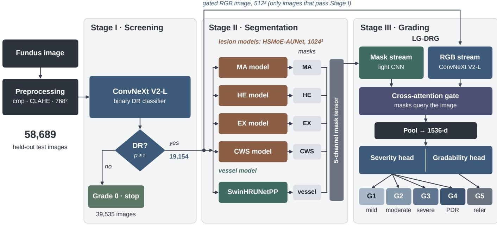  
Fig. 1. HierarchiRetina. Stage I stops 39,535 test images as Grade 0; Stage II segments the 19,154 images that pass, using four HSMoE-AUNet lesion models and SwinHRUNetPP; Stage III (LG-DRG) outputs Grades 1 to 4 or Grade 5 (refer). CLAHE, contrast-limited adaptive histogram equalisation; PDR, proliferative DR.

3) End-to-end evaluation with error attribution. Every screening miss is a final error, every error is assigned to its stage, and the DDR comparison uses matched protocols. The screening gate causes two thirds of all errors.

## II. MATERIALS AND METHODS

## A. Data

Grading. We pooled six public datasets (Fig. 2), with Grades 0 to 4 for no DR to proliferative DR and Grade 5 for ungradable. EyePACS [17], DDR [4] and IDRiD [18] kept their official test partitions. APTOS 2019 [19], which has no public labelled test set, was split 80/10/10 at random, and Messidor-2 [20], [21] and FGADR [22] were each split once, 85/15. The held-out partitions form the test pool (58,689 images), never used for training or for choosing a model or threshold; the remaining 51,445 images form the development pool. The evaluation is therefore held-out rather than external.

Lesions and vessels. Lesion image and mask pairs came from FGADR, MAPLES-DR [23], IDRiD and e-ophtha [24]. After removing near-empty masks (at most 10, 50, 30 and 20 positive pixels for MA, HE, EX and CWS), each pool was split 70/20/10. Vessels came from DRIVE [25], STARE [26], HRF [27] and MAPLES-DR (288 images, split 230/28/30). Because the lesion pools were split independently of the grading partitions, 259 grading-test images were in a lesion training split and 27 in the vessel pool; excluding the affected sources (FGADR, Messidor-2 and, as it cannot be checked by name, IDRiD) changes the headline quadratic weighted kappa (QWK) only from 0.804 to 0.800 (Section III-D).

## B. Stage I: Screening Gate

Stage I separates Grade 0 from Grades 1 to 5 (here, DR), keeping ungradable images positive so that they reach the gradability head. It uses standard components: a square retinal crop with contrast enhancement, a ConvNeXt V2- L [28] with generalised-mean and attention pooling (201.7 M parameters), a combined binary cross-entropy (BCE) and focal loss [29] with Grade 1 over-sampled, exponential-movingaverage (EMA) weights and four-view test-time augmentation. Resolution is set by the smallest lesion: microaneurysms, the only lesion that defines mild DR, span 2 to 3 pixels at $5 1 2 ^ { 2 }$ , so the gate works at $7 6 8 ^ { 2 }$ without augmentations that erase small dots. Its threshold, $\tau = 0 . 2 3 9 2$ , maximises 2 TPR−FPR (true and false positive rates) on validation data.

## C. Stage II: HSMoE-AUNet for Lesions

At $1 0 2 4 ^ { 2 }$ , MA are dark dots about 4 to 6 pixels across, HE larger dark blobs, EX bright and sharp-edged, and CWS pale and diffuse, so a single receptive field is unlikely to suit all four. HSMoE-AUNet (Fig. 3) therefore makes every skip processor, the bottleneck and every decoder block a sparse MoE block, with one model per lesion.

Heterogeneous MoE block. A router pools the block input $x ,$ scores N experts with a two-layer perceptron $( C \to C / 4 \to$ $N$ , Gaussian noise $\sigma = 0 . 0 1$ in training), keeps the two best and normalises their scores $g _ { i }$ with a softmax [15]:

$$
\begin{array} { r } { \mathbf { y } = \mathrm { B N } \Big ( \sum _ { i \in \mathcal { T } ( x ) } g _ { i } ( x ) E _ { i } ( x ) + W _ { s } x \Big ) , } \end{array}\tag{1}
$$

where $\tau ( x )$ holds the two selected experts $E _ { i } , W _ { s }$ is a $1 \times 1$ projection and BN is batch normalisation. All experts are evaluated; only the mixture is sparse. The base pool has a $3 \times 3$ residual convolution for dots and edges, a dilated convolution for the lesion’s surroundings, a depthwise-separable $5 \times 5$ convolution for texture and a $7 \times 7$ large-kernel convolution for large regions. Each lesion model adds the types its target needs (Table I): a multi-scale expert for HE, EX and CWS, a morphological top-hat expert for the bright EX and CWS, a difference-of-Gaussians edge expert for the sharp-edged EX, and soft-region and texture experts for the diffuse CWS. A load-balancing loss $N \sum _ { i } \bar { p _ { i } } f _ { i }$ (weight 0.01 per block), with ${ \bar { p } } _ { i }$ the mean routing probability of expert i and $f _ { i }$ the fraction of images routed to it, keeps all experts in use. Scale-adaptive capacity: deeper blocks and rarer lesions receive more experts.

TABLE I  
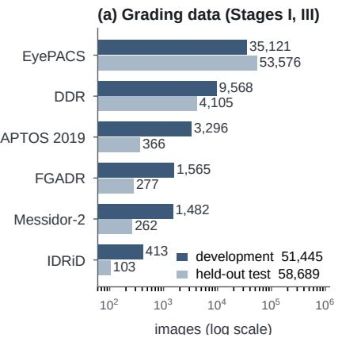

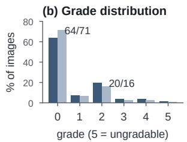

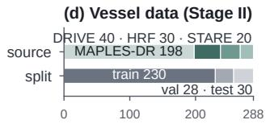

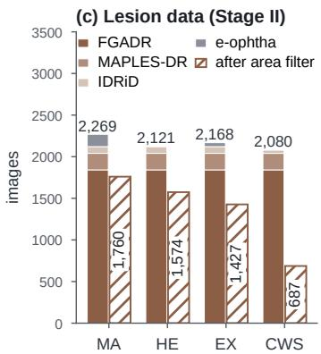  
Fig. 2. Data. (a) Development and test images per grading source (log scale). (b) Grade distribution, development (dark) and test (light). (c) Lesion pools before (solid) and after (hatched) the area filter that removes near-empty masks. (d) Vessel pool and split.

Architecture and loss. A ConvNeXt-S encoder [30] feeds three skip processors (CBAM followed by an MoE block), an MoE bottleneck with 8-head self-attention over 32 × 32 tokens, and three MoE decoder blocks with CBAM; auxiliary heads at $6 4 ^ { 2 }$ and $1 2 8 ^ { 2 }$ add deep supervision. Because weight initialisation ran after the ImageNet weights were loaded, it reset the encoder’s convolution and linear layers; the encoder was in effect trained from scratch, with its stem and first two blocks frozen at initialisation. Each model is trained on whole $1 0 2 4 ^ { 2 }$ images with focal Tversky [13], Dice, BCE and auxiliary losses, plus lesion-specific terms (Table I): boundary terms, optic-disc suppression for EX and CWS, and region coherence for CWS. For CWS, the rarest lesion, these terms are phased in so that they do not dominate before any positives are predicted. On validation data, thresholds of 0.20 (HE) and 0.325 (EX) maximised Dice. For MA, Dice and recall kept rising as the threshold fell, and we used 0.01; for CWS we used 0.40, below the Dice-optimal 0.575, to favour recall.

## D. Stage II: SwinHRUNetPP for Vessels

SwinHRUNetPP (Fig. 4) runs a SwinV2-B encoder [31], whose shifted-window attention relates distant parts of the vessel tree, beside a high-resolution CNN branch that keeps capillary detail. Two fusion modules merge the streams at $1 2 8 ^ { 2 }$ and $6 4 ^ { 2 }$ , and four attention-gated decoder blocks [11] follow. A refinement block then fuses parallel convolutions with dilations 1, 2 and 4 by squeeze-and-excitation [32], and a topology block applies elongated $1 \times 1 5$ and $1 5 \times 1$ kernels that match locally straight vessel segments. Without a field-ofview (FOV) mask, the bright fundus rim is traced as a vessel, so every loss term is computed inside the FOV: 0.25 BCE (positive weight 5.9), 0.35 Dice, 0.30 focal Tversky and 0.10 clDice [14], with deep supervision on three decoder levels.

HSMOE-AUNET PER LESION. EXPERTS: SKIPS (SHALLOW TO DEEP) / BOTTLENECK / DECODER (DEEP TO SHALLOW). ADDED TYPES: MS   
MULTI-SCALE, TH TOP-HAT, DOG DIFFERENCE-OF-GAUSSIANS, SR SOFT   
REGION, TX TEXTURE. FTL: FOCAL TVERSKY LOSS (FALSE-NEGATIVE WEIGHT a, FALSE-POSITIVE WEIGHT b, EXPONENT). EXTRA LOSSES: B BOUNDARY, OD OPTIC DISC, RC REGION COHERENCE. LR: LEARNING RATE.

<table><tr><td></td><td>MA</td><td>HE</td><td>EX</td><td>CWS</td></tr><tr><td>Expert types</td><td>4</td><td>5</td><td>7</td><td>8</td></tr><tr><td>Added types</td><td></td><td>MS</td><td></td><td>MS, TH, DoG MS, TH, SR, TX</td></tr><tr><td>Experts (skips)</td><td>6/8/10</td><td>6/8/10</td><td>7/9/11</td><td>8/10/12</td></tr><tr><td>Experts (bottl.)</td><td>12</td><td>12</td><td>14</td><td>16</td></tr><tr><td>Experts (dec.)</td><td>10/8/6</td><td>10/8/6</td><td>11/9/7</td><td>12/10/8</td></tr><tr><td>Parameters (M)</td><td>218.3</td><td>190.5</td><td>187.8</td><td>192.7</td></tr><tr><td>FTL a/b/exp.</td><td></td><td>0.30/0.70/20.50/0.50/ 413</td><td>0.45/0.55/1</td><td></td></tr><tr><td>Extra loss</td><td></td><td>B</td><td>B, OD</td><td>B, RC, OD</td></tr><tr><td>LR schedule</td><td>plateau</td><td>cos. restart</td><td>cosine</td><td>cos. restart</td></tr><tr><td>Best epoch</td><td>262</td><td>128</td><td>199</td><td>84</td></tr><tr><td>Threshold</td><td>0.01</td><td>0.20</td><td>0.325</td><td>0.40</td></tr></table>

The model (110.2 M parameters, $5 1 2 ^ { 2 }$ input) is thresholded at 0.46, the Youden-optimal validation value.

## E. Stage III: Lesion-Guided DR Grader (LG-DRG)

LG-DRG (Fig. 5) first decides whether an image can be graded and then estimates its severity.

Gated cross-attention. A ConvNeXt V2-L encodes the RGB image (fundus crop, contrast-limited adaptive histogram equalisation on LAB lightness, $5 1 2 ^ { 2 } )$ into $\mathbf { F } _ { \mathrm { i m g } } ^ { \mathrm { ~ \tiny ~  ~ } } \in \mathbb { R } ^ { 1 5 3 6 \times 1 6 \times 1 6 }$ , and a small CNN trained from scratch encodes the five masks into $\mathbf { F } _ { \mathrm { l e s } } \in \mathbb { R } ^ { 1 2 8 \times 1 6 \times 1 6 }$ . The lesion tokens query the image tokens through multi-head attention (MHA):

$$
\mathbf { F } _ { \mathrm { g a t e d } } = \mathbf { F } _ { \mathrm { i m g } } + \gamma W _ { o } \mathrm { M H A } \left( W _ { q } \mathbf { F } _ { \mathrm { l e s } } , W _ { k } \mathbf { F } _ { \mathrm { i m g } } , W _ { v } \mathbf { F } _ { \mathrm { i m g } } \right) ,\tag{2}
$$

with 8 heads and a learned scalar γ that starts at 0. The network thus starts as an image classifier, and the masks act only if training opens the gate, a safeguard against imperfect masks.

Two heads. Ungradability reflects image quality rather than disease severity; placed on the ordinal axis, it would rank above proliferative DR. A gradability head, whose output $p _ { g }$ estimates P(gradable), is trained on all images, and a conditional ordinal regression for neural networks (CORN) head [33] models $p _ { k } \ = \ P ( y \ > \ k | \ y \ > \ k - 1 )$ ) over

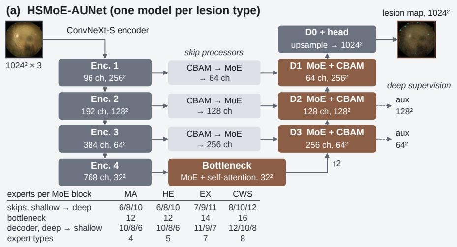

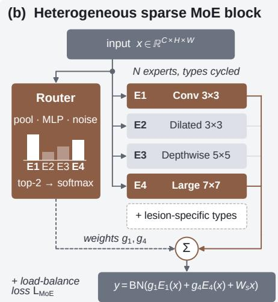

Fig. 3. HSMoE-AUNet. (a) ConvNeXt-S encoder, skip processors (CBAM followed by MoE), MoE bottleneck with self-attention, MoE decoder with CBAM and deep supervision; the inset lists expert counts per lesion. (b) The router scores N heterogeneous experts and mixes the best two. MLP, multilayer perceptron.  
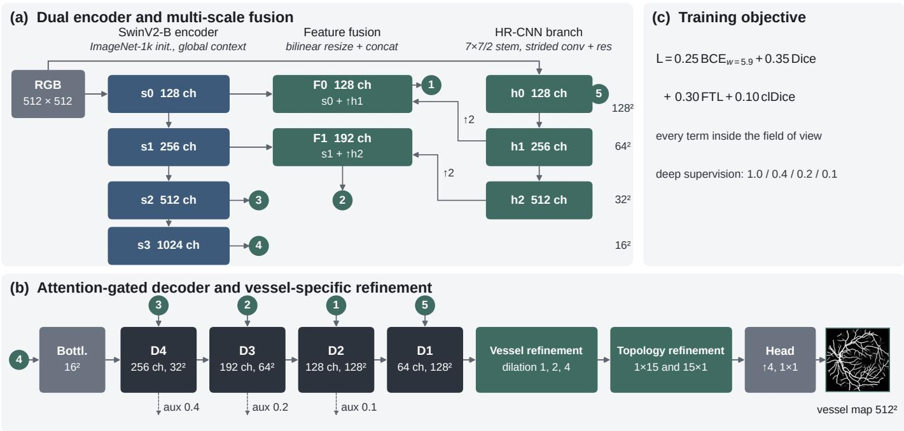  
Fig. 4. SwinHRUNetPP. (a) SwinV2-B encoder and high-resolution CNN branch, fused at $1 2 8 ^ { 2 }$ and $6 4 ^ { 2 } ;$ numbered circles connect (a) to (b). (b) Bottleneck attention-gated decoder, refinement and topology blocks; dashed arrows are auxiliary heads. (c) All loss terms are computed inside the FOV.

Grades 1 to 4 on gradable images. (In our implementation the second and third tasks were also trained on images one grade below the conditioning boundary, so $p _ { 2 }$ and $p _ { 3 }$ are not exact conditionals.) The output is Grade 5 if $p _ { g } ~ < ~ t _ { g }$ and otherwise the rank-consistent grade $\begin{array} { r } { 1 + \sum _ { k } \prod _ { j \leq k } \mathbf { 1 } [ p _ { j } > t _ { j } ] } \end{array}$ All four thresholds were fitted by coordinate ascent on out-offold (OOF) predictions: $t = ( 0 . 3 8 , 0 . 6 0 , 0 . 1 9 )$ and $t _ { g } = 0 . 1 0 .$

Training. Five stratified fold models were trained on the 18,570 development images of Grades 1 to 5 with AdamW [34] (weight decay 0.05, effective batch 64), EMA weights and inverse-frequency sampling, and selected on the macro-averaged area under the receiver operating characteristic curve (ROC AUC). At test time the fold-averaged probabilities are mapped to $( p _ { 1 } , p _ { 2 } , p _ { 3 } , p _ { g } )$ and decoded.

## F. Evaluation Protocol

View B scores all 58,689 test images end-to-end. An image stopped at Stage I receives Grade 0, so a screening miss is a final error, and a healthy image that passes is always misgraded (LG-DRG lacks Grade 0). View A scores the grader alone, on images of true Grades 1 to 5 that reached it. For QWK, true Grade 5 images are dropped and predicted Grade 5 counts as Grade 4; placing Grade 5 on the ordinal axis would raise QWK to 0.814. Referral means Grade 2 or higher or ungradable; vision-threatening DR means true Grade 3 or 4, detected if graded 3 or 4. The mask ablation re-scores the 3,714 fold-0 validation images without masks, with swapped masks and with each channel removed in turn. Confidence intervals (CIs) use 1,000 bootstrap resamples (500 for AUC).

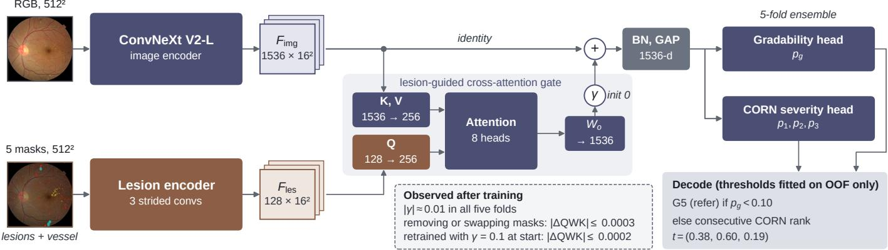

Fig. 5. LG-DRG. RGB and mask streams meet in a residual cross-attention gate scaled by γ (initialised to 0); the pooled vector feeds a gradability head and a CORN severity head with OOF-fitted thresholds. The inset summarises Section III-C. BN, batch normalisation; GAP, global average pooling.  
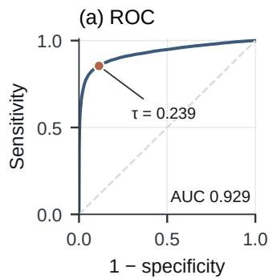

(b) Routing by grade  
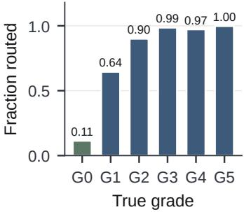  
(d) Gate errors

(c) QWK vs. threshold  
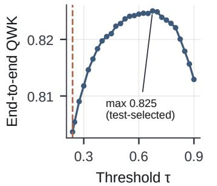

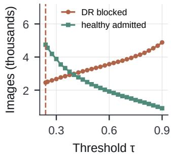  
Fig. 6. Stage I on the test pool. (a) Receiver operating characteristic (ROC) curve with the validation-derived operating point τ. (b) Fraction of each true grade routed onwards. (c) End-to-end QWK against the Stage I threshold; the maximum is test-selected and shown for illustration only. (d) DR cases blocked and healthy eyes admitted at each threshold. Dashed line: τ.

## III. RESULTS

## A. Stage I

The $7 6 8 ^ { 2 }$ gate reached AUC 0.929 (95% CI 0.926 to 0.932) and, at an equal load of 19,154 routed images (Table II), routed 64.5% of mild-DR images, against 0.904 and 52.8% for our earlier $5 1 2 ^ { 2 }$ gate with dot-erasing augmentations, and 0.909 and 53.4% for a seven-model ensemble. Higher resolution with dot-preserving augmentation helped more than ensembling. At τ , sensitivity was 0.854 and specificity 0.887; the gate passed 97.8% of severe and proliferative DR and 345 of 346 ungradable images, and stopped 67.4% of the pool, including 2,459 DR cases, 97% of them mild or moderate (Fig. 6).

## B. Stage II

Exudates were segmented best (Table III; pooled Dice 0.579), haemorrhage masks were conservative (precision 0.685, sensitivity 0.407), and microaneurysms remained the hardest target (Dice 0.184). Every lesion model detected its lesion in 97% to 100% of the test images, all of which contain that lesion. Vessels reached pooled Dice 0.731 and ROC AUC 0.966. Fig. 7 shows one test image of each grade.

## C. Stage III and the Mask Ablation

With argmax decoding, OOF QWK was $0 . 7 7 1 \pm 0 . 0 1 1$ across folds (Table IV). Ungradable images were separated almost perfectly (AUC 0.999), and the OOF-fitted thresholds raised pooled OOF QWK from 0.771 to 0.781.

Mask ablation. In every fold |γ| was about 0.01, and in fold 0 no ablation condition (Table V) changed QWK by more than 0.0003: the cross-attention gate had stayed closed. Because weight decay could have held $\gamma$ near zero, we retrained fold 0 with γ starting at 0.1 and free of weight decay. After 60 epochs γ was still 0.100 (EMA weights), yet the grade remained insensitive to the masks $( | \Delta \mathrm { Q W K } | \leq 0 . 0 0 0 2 )$ , and the model was slightly weaker (QWK 0.744 against 0.773). Weight decay therefore does not explain the result.

## D. End-to-End Cascade

End-to-end, the cascade reached QWK 0.804 (95% CI 0.798 to 0.809) and six-class accuracy 0.814 (Table VI). For referral, sensitivity was 0.832 and specificity 0.947. The grader alone (View A) reached QWK 0.732, and the OOF-fitted thresholds improved on argmax decoding in both views.

Error attribution. Of 10,907 end-to-end errors, 22.5% were DR cases blocked at the screening gate and 43.5% were healthy eyes that passed it. Only 34.0% were grading errors (Fig. 8(b)). Of the 3,543 severity errors on Grades 1 to 4, 88.7% were off by one grade (Fig. 8(c)). Sensitivity for visionthreatening DR was 0.681; 819 of the 950 misses were graded moderate.

## E. Effect of the Gate Threshold

QWK can be recomputed for any gate threshold without new inference. It peaks at 0.825 near 0.675 (Fig. 6(c)), while

TABLE II  
STAGE I ON THE 58,689-IMAGE TEST POOL AT AN EQUAL ROUTING LOAD OF 19,154 IMAGES. G1 ROUTED: FRACTION OF MILD-DR IMAGES ROUTED ONWARDS; FN: FALSE NEGATIVES. †NO LEAKAGE-FREE SET EXISTS TO SET THIS ENSEMBLE’S THRESHOLD; REFERENCE ONLY.
<table><tr><td>Model</td><td>Input</td><td>AUC</td><td>Sens.</td><td>Spec.</td><td>G1 routed</td><td>FN</td></tr><tr><td>SwinV2-L</td><td>384</td><td>0.884</td><td>0.777</td><td>0.855</td><td>0.458</td><td>3,769</td></tr><tr><td>ConvNeXt V2-L (fold models)</td><td>512</td><td>0.889–0.902</td><td>0.789–0.810</td><td>0.860–0.869</td><td>0.493–0.528</td><td>3,209–3,558</td></tr><tr><td>ConvNeXt V2-L</td><td>512</td><td>0.904</td><td>0.809</td><td>0.868</td><td>0.528</td><td>3,214</td></tr><tr><td>Hybrid ensemble (7 models)</td><td>mixed</td><td>0.909</td><td>0.818</td><td>0.872</td><td>0.534</td><td>3,078</td></tr><tr><td>ConvNeXt V2-L (final)</td><td>768</td><td>0.929</td><td>0.854</td><td>0.887</td><td>0.645</td><td>2,459</td></tr><tr><td>+ hybrid, 5× weight†</td><td>mixed</td><td>0.933</td><td>0.862</td><td>0.889</td><td>0.643</td><td>2,336</td></tr></table>

TABLE III

STAGE II ON HELD-OUT TEST SPLITS (NO LESION-FREE TEST IMAGES). PIXEL METRICS POOLED OVER TEST PIXELS (INSIDE THE FOV FOR VESSELS); IMAGE DICE AS MEAN ± SD; LESION LEVEL: CONNECTED COMPONENTS MATCHED AT INTERSECTION OVER UNION (IOU) ≥ 0.3 (≥ 0.2 FOR MA); IMAGE SENS.: FRACTION OF IMAGES WHOSE LESION WAS DETECTED. PR, PRECISION-RECALL.
<table><tr><td></td><td></td><td></td><td colspan="6">Pixel, pooled</td><td>Image</td><td colspan="2">Lesion level</td><td>Image</td></tr><tr><td>Target</td><td>n</td><td>Thr.</td><td>Dice</td><td>IoU</td><td>Sens.</td><td>Prec.</td><td>ROC AUC</td><td>PR AUC</td><td>Dice</td><td>Sens. / Prec.</td><td>F1</td><td>sens.</td></tr><tr><td>Hard exudates</td><td>142</td><td>0.325</td><td>0.579</td><td>0.407</td><td>0.583</td><td>0.574</td><td>0.846</td><td>0.489</td><td> $0 . 4 7 0 \pm 0 . 2 2 1$ </td><td>0.476 / 0.473</td><td>0.475</td><td>1.000</td></tr><tr><td>Haemorrhages</td><td>157</td><td>0.20</td><td>0.510</td><td>0.343</td><td>0.407</td><td>0.685</td><td>0.800</td><td>0.411</td><td> $0 . 4 1 9 \pm 0 . 2 4 5$ </td><td>0.412 / 0.445</td><td>0.428</td><td>1.000</td></tr><tr><td>Cotton-wool spots</td><td>69</td><td>0.40</td><td>0.408</td><td>0.257</td><td>0.521</td><td>0.336</td><td>0.884</td><td>0.328</td><td> $0 . 3 5 3 \pm 0 . 2 6 1$ </td><td>0.421 / 0.306</td><td>0.355</td><td>0.971</td></tr><tr><td>Microaneurysms</td><td>175</td><td>0.01</td><td>0.184</td><td>0.101</td><td>0.137</td><td>0.277</td><td>0.749</td><td>0.072</td><td> $0 . 2 4 2 \pm 0 . 1 6 9$ </td><td>0.405 / 0.248</td><td>0.307</td><td>0.977</td></tr><tr><td>Vessels</td><td>30</td><td>0.46</td><td>0.731</td><td>0.576</td><td>0.915</td><td>0.609</td><td>0.966</td><td>0.852</td><td> $0 . 7 2 7 \pm 0 . 0 4 3$ </td><td></td><td></td><td></td></tr></table>

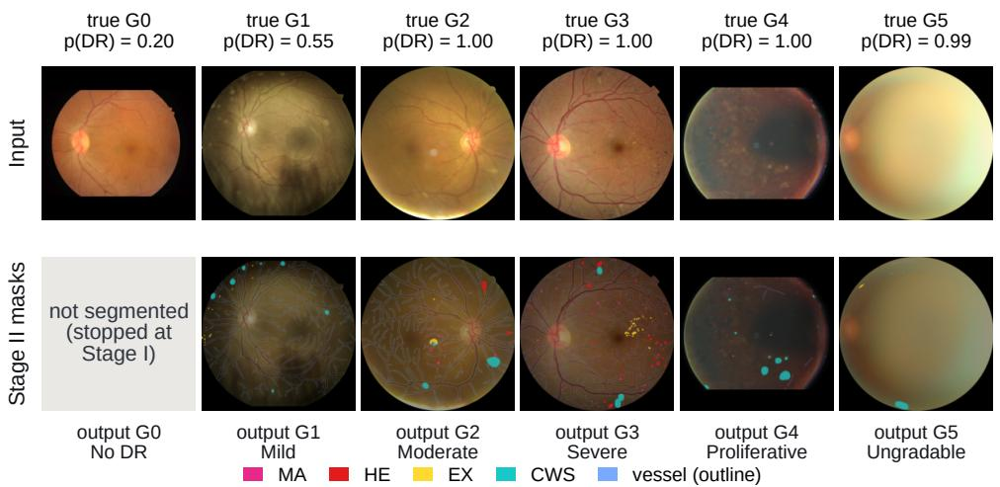  
Fig. 7. One correctly graded test image per true grade: input with Stage I probability (top) and Stage II masks with the final output (bottom; magenta MA, red HE, yellow EX, cyan CWS, blue vessels).

TABLE IV  
STAGE III FIVE-FOLD CROSS-VALIDATION (n = 18,570). G5: GRADE 5 (UNGRADABLE). MEAN AND SD FROM UNROUNDED VALUES.
<table><tr><td></td><td>Macro-AUC</td><td>G5 AUC</td><td>QWK</td><td>Acc.</td><td>Macro-F1</td></tr><tr><td>Fold 0</td><td>0.942</td><td>0.999</td><td>0.771</td><td>0.758</td><td>0.767</td></tr><tr><td>Fold 1</td><td>0.945</td><td>0.998</td><td>0.783</td><td>0.770</td><td>0.768</td></tr><tr><td>Fold 2</td><td>0.938</td><td>0.997</td><td>0.754</td><td>0.745</td><td>0.751</td></tr><tr><td>Fold 3</td><td>0.942</td><td>0.999</td><td>0.779</td><td>0.764</td><td>0.769</td></tr><tr><td>Fold 4</td><td>0.939</td><td>0.999</td><td>0.769</td><td>0.756</td><td>0.763</td></tr><tr><td>Mean</td><td>0.941</td><td>0.999</td><td>0.771</td><td>0.759</td><td>0.764</td></tr><tr><td>SD</td><td>0.003</td><td>0.001</td><td>0.011</td><td>0.009</td><td>0.007</td></tr><tr><td>Pooled, OOF-fitted</td><td></td><td></td><td>0.781</td><td>0.774</td><td></td></tr></table>

blocked DR cases rise from 2,459 to 3,779 (Fig. 6(d)), 94% of the 1,320 extra cases being mild or moderate. QWK rises because every admitted healthy eye is mis-graded, 36% by two or more grades. At 0.675, referral sensitivity would fall from 0.832 to 0.795 and specificity rise from 0.947 to 0.969.  
TABLE V

MASK RELIANCE OF LG-DRG (FOLD 0, $n = 3 , 7 1 4 )$ . ORIGINAL: γ STARTS AT 0, WITH WEIGHT DECAY. RETRAINED: γ STARTS AT 0.1, NO WEIGHT DECAY, ACCUMULATION 8 (NOT 4). DEFAULT 0.5-THRESHOLD DECODE, HENCE THE GAP TO TABLE IV (ARGMAX); ∆ FROM UNROUNDED QWK.

<table><tr><td></td><td colspan="2">Original</td><td colspan="2">Retrained</td></tr><tr><td>Mask input</td><td>QWK</td><td>∆QWK</td><td>QWK</td><td>∆QWK</td></tr><tr><td>Intact</td><td>0.7726</td><td></td><td>0.7444</td><td></td></tr><tr><td>All masks zeroed</td><td>0.7725</td><td>-0.0002</td><td>0.7446</td><td>+0.0002</td></tr><tr><td>Masks from another image</td><td>0.7724</td><td>-0.0003</td><td>0.7444</td><td>0.0000</td></tr><tr><td>Without MA</td><td>0.7726</td><td>0.0000</td><td>0.7444</td><td>0.0000</td></tr><tr><td>Without HE</td><td>0.7726</td><td>0.0000</td><td>0.7444</td><td>0.0000</td></tr><tr><td>Without EX</td><td>0.7726</td><td>0.0000</td><td>0.7444</td><td>0.0000</td></tr><tr><td>Without CWS</td><td>0.7725</td><td>-0.0001</td><td>0.7444</td><td>0.0000</td></tr><tr><td>Without vessel</td><td>0.7725</td><td>-0.0002</td><td>0.7446</td><td>+0.0002</td></tr><tr><td>Macro-AUC, intact</td><td colspan="2">0.9422</td><td colspan="2">0.9359</td></tr><tr><td>Learned γ</td><td colspan="2">|γ| ≈ 0.010 (all folds)</td><td colspan="2">0.100 (EMA)</td></tr></table>

(a) End-to-end, n = 58,689, QWK 0.804  
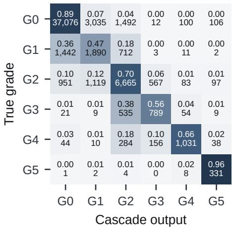

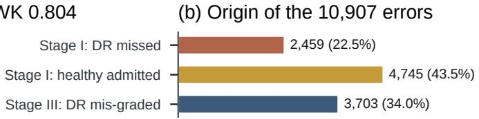

(c) Stage III error distance  
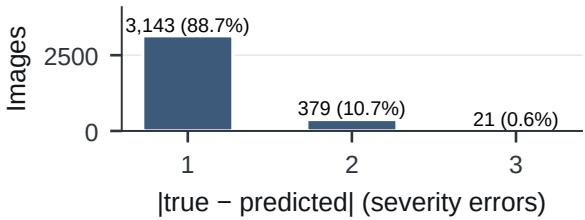  
Fig. 8. Cascade errors. (a) End-to-end confusion matrix (row-normalised, with counts); (b) attribution of the 10,907 errors to stages; (c) distance of the 3,543 severity errors from the reference.

TABLE VI  
CASCADE ON THE TEST POOL. VIEW B: ALL IMAGES. VIEW A: GRADER ONLY, ON IMAGES OF TRUE GRADES 1 TO 5 THAT REACHED IT.
<table><tr><td>View</td><td>n</td><td>QWK (95% CI)</td><td>Acc.</td><td>Macro-F1</td></tr><tr><td>B, OOF-fitted</td><td>158,689</td><td>0.804 (0.798–0.809)</td><td>0.814</td><td>0.659</td></tr><tr><td>B, argmax</td><td>58,689</td><td>0.801</td><td></td><td></td></tr><tr><td>A, OOF-fitted</td><td>114,409</td><td>0.732 (0.722–0.743)</td><td>0.743</td><td></td></tr><tr><td>A, argmax</td><td>14,409</td><td>0.721</td><td>一</td><td></td></tr><tr><td colspan="5">EyePACS, DDR and APTOS 2019 only (no possible Stage II overlap)</td></tr><tr><td>B, OOF-fitted 58,047</td><td></td><td>0.800</td><td>0.815</td><td></td></tr><tr><td>A, OOF-fitted 13,992</td><td></td><td>0.727</td><td></td><td>1</td></tr></table>

TABLE VII

DDR OFFICIAL TEST SPLIT, MATCHED PROTOCOLS. PUBLISHED VALUES AS REPORTED; N/R: NOT REPORTED; ∗UNGRADABLE AS A SIXTH ORDINAL LEVEL.
<table><tr><td>Method</td><td>Protocol</td><td>Acc. (%) QWK</td><td></td></tr><tr><td>FA+KC-Net+R2 [7] Ours</td><td>6-class, grader 6-class, end-to-end</td><td>83.78 85.63</td><td>n/r 0.913*</td></tr><tr><td>FA+KC-Net+R2 [7]</td><td>5-class, grader</td><td>84.49</td><td>0.862</td></tr><tr><td>RadFuse [6]</td><td>5-class, grader</td><td>83.32</td><td>0.855</td></tr><tr><td>Dual-SwinOrd [5]</td><td>5-class, grader</td><td>86.54</td><td>0.904</td></tr><tr><td></td><td></td><td></td><td></td></tr><tr><td>Ours, ungradable → Grade 4 Ours, ungradable dropped (n=3,678) 5-class, end-to-end</td><td>5-class, end-to-end</td><td>85.10</td><td>0.878 0.892</td></tr><tr><td>Ours, ungradable → worst case</td><td>5-class, end-to-end</td><td>84.70</td><td>0.851</td></tr></table>

## F. Protocol-Matched Comparison on DDR

Published DDR results use six classes on all 4,105 test images or five classes on the 3,759 gradable ones (Table VII). On the six-class protocol the cascade reached 85.6% accuracy (95% CI 84.6 to 86.7), above the 83.8% of FA+KC-Net+R2 [7], the best six-class result we found, even though ours is end-to-end; recall was higher in four of the six classes, including Grade 3 (52.1% vs. 39.4%) and Grade 4 (82.2% vs. 67.3%). With our 81 ungradable calls on gradable images mapped to Grade 4, five-class QWK was 0.878, above FA+KC-Net+R2 (0.862) and RadFuse (0.855) [6] but below Dual-SwinOrd (0.904) [5]; the worst-case mapping gave 0.851. Per-dataset end-to-end QWK ranged from 0.785 (EyePACS, 91% of the pool) to 0.925 (APTOS 2019; Table VIII).

## IV. DISCUSSION

Lesion segmentation. HSMoE-AUNet gave usable masks for EX, HE and CWS, and SwinHRUNetPP a usable vessel tree, but MA, only a few pixels across, remained weak (Dice 0.184). With the encoder trained from scratch and no identical-expert baseline, the benefit of heterogeneity itself is not yet isolated.

Gradability and lesion guidance. The gradability head flagged 331 of the 346 ungradable test images (OOF AUC 0.999), with 252 false calls. The grade, however, ignored the masks even when the cross-attention gate stayed open, possibly because the RGB stream already carries the lesion evidence. Interpretability claims for mask-conditioned graders should thus be tested by removing or swapping masks; here the masks support review but do not explain the grade.

Cascade design. With two thirds of the errors at the gate, a perfect grader would remove only a third. QWK thus favours a stricter gate than screening, which likely weighs the extra mild and moderate misses above admitted healthy eyes. We therefore kept the validation-derived τ; end-to-end QWK should be reported with the gate’s operating point and per-stage errors. Most missed vision-threatening cases were graded moderate, which keeps them referable but understates their urgency.

Comparison with published results. The handling of our 81 ungradable calls alone moved five-class DDR QWK from 0.851 to 0.892, nearly the spread of published results (0.855 to 0.904), and our models were not trained on DDR alone. DDR results are therefore comparable only under a stated protocol.

## V. LIMITATIONS AND CONCLUSIONS

Limitations. Test partitions share sources with the training data, EyePACS supplies 91% of the test pool, Grade 5 occurs only in DDR, and most images were graded once, without adjudication [35]. The segmenters were not compared with other architectures on the same splits.

Future directions. The next steps are external, ideally prospective, validation with adjudicated grades [35]; an identical-expert baseline with the pretrained encoder restored, and native-resolution patches for MA; gate and ordinal thresholds refitted, without retraining, to a screening cost that penalises missed referable disease and under-grading; and a re-test of lesion guidance on weaker image evidence, such as handheld-camera images.

TABLE VIII  
PER-DATASET RESULTS. GATE SENSITIVITY AND SPECIFICITY: GRADE 0 VERSUS GRADES 1 TO 5; A, B: VIEW A, VIEW B.
<table><tr><td>Dataset</td><td>n</td><td>DR</td><td>Grade 0</td><td>Gate sens.</td><td>Gate spec.</td><td>DR blocked</td><td>QWKA</td><td>QWKB</td><td>Acc. B</td></tr><tr><td>EyePACS</td><td>53,576</td><td>14,043</td><td>39,533</td><td>0.837</td><td>0.883</td><td>2,288</td><td>0.721</td><td>0.785</td><td>0.812</td></tr><tr><td>DDR</td><td>4,105</td><td>2,225</td><td>1,880</td><td>0.931</td><td>0.969</td><td>154</td><td>0.750</td><td>0.878</td><td>0.856</td></tr><tr><td>APTOS 2019</td><td>366</td><td>167</td><td>199</td><td>0.994</td><td>0.945</td><td>1</td><td>0.745</td><td>0.925</td><td>0.847</td></tr><tr><td>FGADR</td><td>277</td><td>256</td><td>21</td><td>0.996</td><td>0/21</td><td>1</td><td>0.872</td><td>0.810</td><td>0.776</td></tr><tr><td>Messidor-2</td><td>262</td><td>108</td><td>154</td><td>0.889</td><td>0.818</td><td>12</td><td>0.782</td><td>0.843</td><td>0.752</td></tr><tr><td>IDRiD</td><td>103</td><td>69</td><td>34</td><td>0.957</td><td>0.647</td><td>3</td><td>0.747</td><td>0.830</td><td>0.660</td></tr><tr><td>All</td><td>58,689</td><td>16,868</td><td>41,821</td><td>0.854</td><td>0.887</td><td>2,459</td><td>0.732</td><td>0.804</td><td>0.814</td></tr></table>

Conclusions. HierarchiRetina screens, segments and grades fundus images in explicit stages. It reached an end-to-end QWK of 0.804 on 58,689 held-out images and the highest six-class DDR accuracy we found. Most of its errors arose at the screening gate, and its grade did not use the lesion masks; staged systems should therefore be evaluated end-to-end, and their use of lesion inputs verified by ablation.

## DATA AVAILABILITY AND ETHICS

All datasets are public or available on request, and only de-identified images collected under the providers’ approvals were used. Code, trained weights, per-image predictions and a script reproducing all end-to-end results are at https://github. com/asifuddin01/HierarchiRetina.

## REFERENCES

[1] Z. L. Teo et al., “Global prevalence of diabetic retinopathy and projection of burden through 2045: Systematic review and meta-analysis,” Ophthalmology, vol. 128, no. 11, pp. 1580–1591, 2021.

[2] C. P. Wilkinson et al., “Proposed international clinical diabetic retinopathy and diabetic macular edema disease severity scales,” Ophthalmology, vol. 110, no. 9, pp. 1677–1682, 2003.

[3] V. Gulshan et al., “Development and validation of a deep learning algorithm for detection of diabetic retinopathy in retinal fundus photographs,” JAMA, vol. 316, no. 22, pp. 2402–2410, 2016.

[4] T. Li et al., “Diagnostic assessment of deep learning algorithms for diabetic retinopathy screening,” Inf. Sci., vol. 501, pp. 511–522, 2019.

[5] W. Yu, X. Si, and J. Zhong, “Dual-SwinOrd: A dual-head Swin transformer with semantic prior injection for ordinal diabetic retinopathy grading,” Bioengineering, vol. 13, no. 4, p. 374, 2026.

[6] F. Mohsen, S. Belhaouari, and Z. Shah, “Integrating non-linear Radon transformation for diabetic retinopathy grading,” Sci. Rep., vol. 15, p. 30706, 2025.

[7] M. Tian et al., “Fine-grained attention & knowledge-based collaborative network for diabetic retinopathy grading,” Heliyon, vol. 9, no. 7, p. e17217, 2023.

[8] Y. Zhou et al., “Collaborative learning of semi-supervised segmentation and classification for medical images,” in Proc. IEEE/CVF CVPR, 2019, pp. 2079–2088.

[9] R. Sun et al., “Lesion-aware transformers for diabetic retinopathy grading,” in Proc. IEEE/CVF CVPR, 2021, pp. 10 938–10 947.

[10] O. Ronneberger, P. Fischer, and T. Brox, “U-Net: Convolutional networks for biomedical image segmentation,” in Proc. MICCAI, 2015, pp. 234–241.

[11] O. Oktay et al., “Attention U-Net: Learning where to look for the pancreas,” in Proc. MIDL, 2018.

[12] S. Woo et al., “CBAM: Convolutional block attention module,” in Proc. ECCV, 2018, pp. 3–19.

[13] N. Abraham and N. M. Khan, “A novel focal Tversky loss function with improved attention U-Net for lesion segmentation,” in Proc. IEEE ISBI, 2019, pp. 683–687.

[14] S. Shit et al., “clDice: A novel topology-preserving loss function for tubular structure segmentation,” in Proc. IEEE/CVF CVPR, 2021, pp. 16 560–16 569.

[15] N. Shazeer et al., “Outrageously large neural networks: The sparselygated mixture-of-experts layer,” in Proc. ICLR, 2017.

[16] W. Fedus, B. Zoph, and N. Shazeer, “Switch transformers: Scaling to trillion parameter models with simple and efficient sparsity,” J. Mach. Learn. Res., vol. 23, no. 120, pp. 1–39, 2022.

[17] J. Cuadros and G. Bresnick, “EyePACS: An adaptable telemedicine system for diabetic retinopathy screening,” J. Diabetes Sci. Technol., vol. 3, no. 3, pp. 509–516, 2009.

[18] P. Porwal et al., “Indian diabetic retinopathy image dataset (IDRiD): A database for diabetic retinopathy screening research,” Data, vol. 3, no. 3, p. 25, 2018.

[19] Asia Pacific Tele-Ophthalmology Society, “APTOS 2019 blindness detection,” Kaggle competition, 2019. [Online]. Available: https: //www.kaggle.com/c/aptos2019-blindness-detection

[20] E. Decenciere\` et al., “Feedback on a publicly distributed image database: The Messidor database,” Image Anal. Stereol., vol. 33, no. 3, pp. 231– 234, 2014.

[21] M. D. Abramoff\` et al., “Improved automated detection of diabetic retinopathy on a publicly available dataset through integration of deep learning,” Invest. Ophthalmol. Vis. Sci., vol. 57, no. 13, pp. 5200–5206, 2016.

[22] Y. Zhou et al., “A benchmark for studying diabetic retinopathy: Segmentation, grading, and transferability,” IEEE Trans. Med. Imag., vol. 40, no. 3, pp. 818–828, 2021.

[23] G. Lepetit-Aimon et al., “MAPLES-DR: MESSIDOR anatomical and pathological labels for explainable screening of diabetic retinopathy,” Sci. Data, vol. 11, no. 1, p. 914, 2024.

[24] E. Decenciere\` et al., “TeleOphta: Machine learning and image processing methods for teleophthalmology,” IRBM, vol. 34, no. 2, pp. 196–203, 2013.

[25] J. Staal et al., “Ridge-based vessel segmentation in color images of the retina,” IEEE Trans. Med. Imag., vol. 23, no. 4, pp. 501–509, 2004.

[26] A. Hoover, V. Kouznetsova, and M. Goldbaum, “Locating blood vessels in retinal images by piecewise threshold probing of a matched filter response,” IEEE Trans. Med. Imag., vol. 19, no. 3, pp. 203–210, 2000.

[27] A. Budai et al., “Robust vessel segmentation in fundus images,” Int. J. Biomed. Imag., vol. 2013, p. 154860, 2013.

[28] S. Woo et al., “ConvNeXt V2: Co-designing and scaling ConvNets with masked autoencoders,” in Proc. IEEE/CVF CVPR, 2023, pp. 16 133– 16 142.

[29] T.-Y. Lin et al., “Focal loss for dense object detection,” in Proc. IEEE ICCV, 2017, pp. 2980–2988.

[30] Z. Liu et al., “A ConvNet for the 2020s,” in Proc. IEEE/CVF CVPR, 2022, pp. 11 976–11 986.

[31] Z. Liu et al., “Swin transformer V2: Scaling up capacity and resolution,” in Proc. IEEE/CVF CVPR, 2022, pp. 12 009–12 019.

[32] J. Hu, L. Shen, and G. Sun, “Squeeze-and-excitation networks,” in Proc. IEEE/CVF CVPR, 2018, pp. 7132–7141.

[33] X. Shi, W. Cao, and S. Raschka, “Deep neural networks for rankconsistent ordinal regression based on conditional probabilities,” Pattern Anal. Appl., vol. 26, no. 3, pp. 941–955, 2023.

[34] I. Loshchilov and F. Hutter, “Decoupled weight decay regularization,” in Proc. ICLR, 2019.

[35] J. Krause et al., “Grader variability and the importance of reference standards for evaluating machine learning models for diabetic retinopathy,” Ophthalmology, vol. 125, no. 8, pp. 1264–1272, 2018.