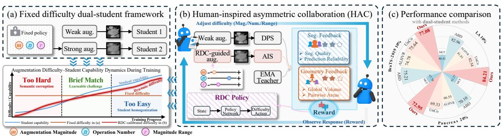
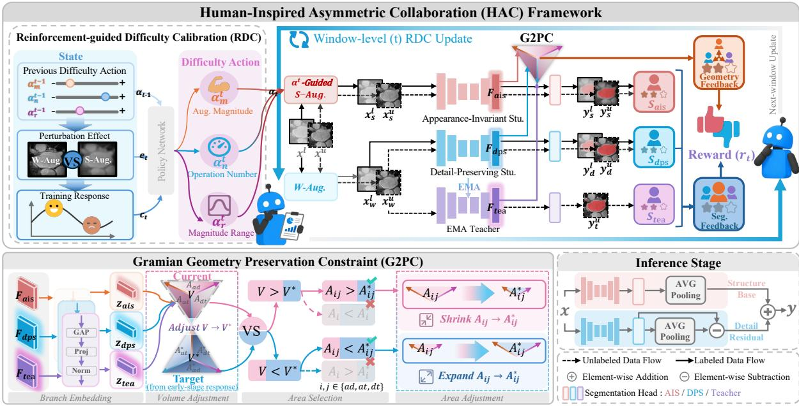
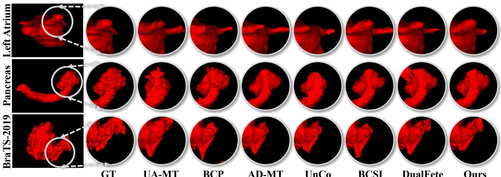
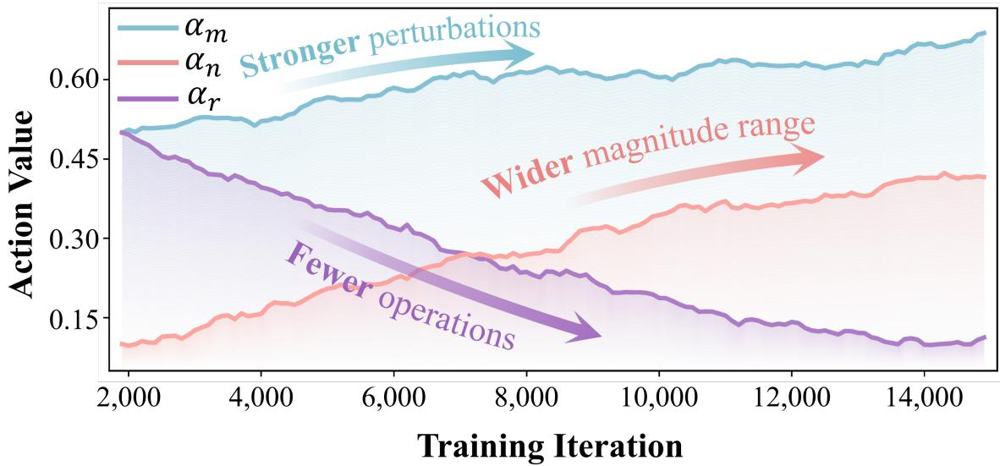
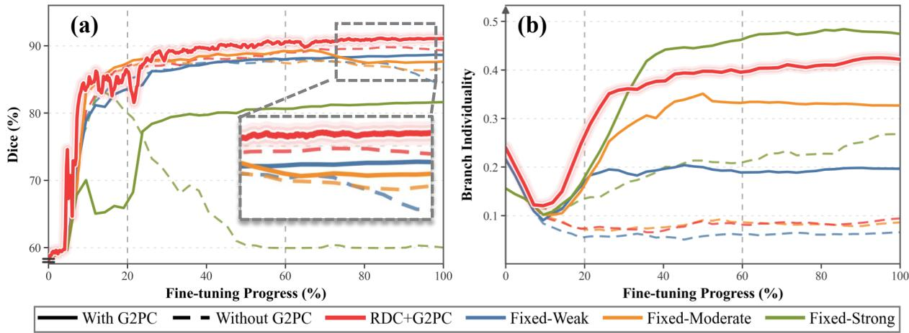
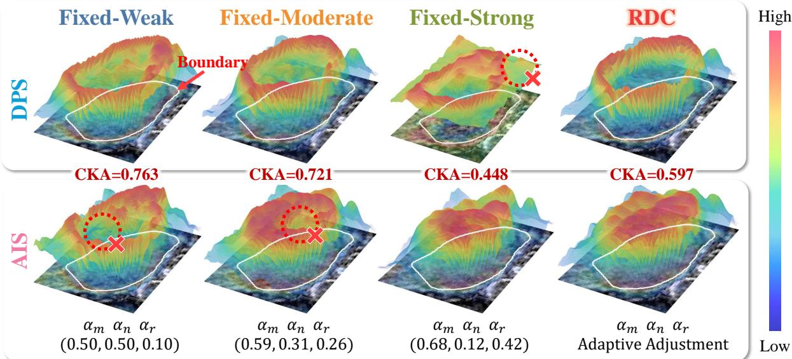
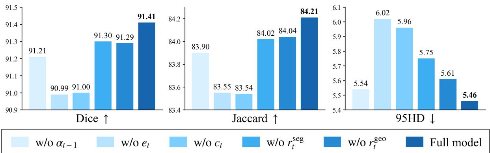
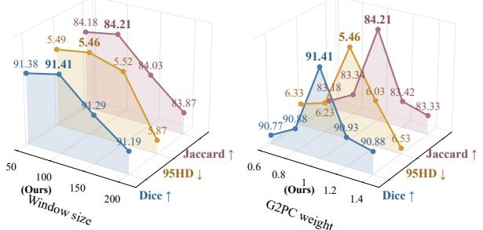
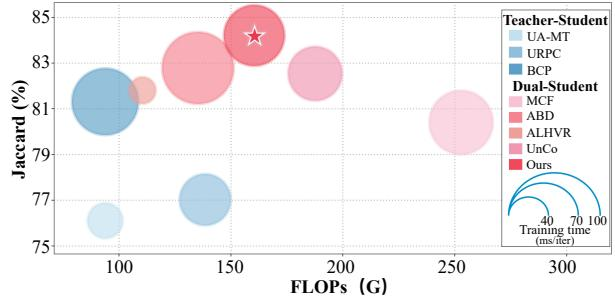

# Human-Inspired Asymmetric Collaboration for Dual-Student Semi-Supervised Medical Image Segmentation

Huiyi Ren Ziming Fang Jiaming Cai Rui Xu Haojie Li

## Abstract

Dual-student learning enriches predictive diversity in SSMIS by introducing a strongly augmented view alongside a weakly augmented view. Insuficient strong augmentation may homogenize the students, whereas excessive augmentation can corrupt anatomical evidence and destabilize collaboration. This challenge echoes feedback-regulated human instruction, where learners receive diferentiated tasks and the task dificulty is continually adjusted according to their evolving responses. Inspired by these, we propose Human-Inspired Asymmetric Collaboration (HAC), a closed-loop dual-student framework that maintains weak– strong learning through adaptive dificulty calibration and geometry preservation. Specifically, Reinforcement-guided Dificulty Calibration (RDC) formulates strong-augmentation control as a window-level reinforcement learning process, using augmentation history, realized perturbations, and training responses to dynamically adjust the augmentation magnitude, operation number, and magnitude range. Meanwhile, the Gramian Geometry Preservation Constraint (G2PC) preserves the early-stage three-branch geometry through global volume and pairwise area constraints, preventing shared supervision from homogenizing the two students. Comprehensive evaluations across LA, Pancreas, and BraTS-2019 validate both the segmentation efectiveness and capability-aware dificulty calibration of HAC. Code will be publicly available upon acceptance.

## Introduction

Accurate medical image segmentation Jiao et al. [2024], Xu et al. [2024a] provides essential anatomical and pathological delineations for clinical diagnosis, treatment planning, and quantitative disease assessment. Despite the strong performance of deep segmentation networks Minaee et al. [2022], Tajbakhsh et al. [2020], their success largely depends on large-scale pixel- or voxellevel annotations. Acquiring such annotations Li et al. [2023] is particularly expensive in medical imaging, as the process requires substantial efort from experienced clinicians and becomes increasingly laborious for volumetric data. Meanwhile, the abundant unlabeled scans produced in clinical practice Cheplygina et al. [2019] remain underutilized. Semi-supervised medical image segmentation (SSMIS) methods Bai et al. [2017], Luo et al. [2021], Xu et al. [2022] therefore ofer a practical solution by learning from a small labeled dataset together with a much larger unlabeled dataset.

The Teacher–Student paradigm Yu et al. [2019], Li et al. [2021] is widely adopted in existing SSMIS methods, where an exponential moving average (EMA) Teacher generates relatively stable pseudo-labels for unlabeled images while a Student is optimized to maintain prediction consistency under input perturbations. However, the confirmation-bias problem identified in pseudo-label learning Arazo et al. [2020], Liu et al. [2024] can arise because a single Student provides limited representational diversity: its prediction errors may be accumulated by the EMA Teacher and subsequently returned as erroneous supervision.

Cross Teaching between CNN and Transformer Luo et al. [2022a] introduces heterogeneous network structures, uncertainty-aware dual-network methods Peiris et al. [2023] diversify predictive views, MC-Net+ Wu et al. [2022] exploits decoder disagreement, and MCF Wang et al.

  
Figure 1: Motivation, core design, and performance of HAC. (a) A fixed augmentation dificulty becomes mismatched with evolving student capabilities. (b) HAC dynamically calibrates augmentation dificulty through a feedback-regulated loop. (c) HAC consistently outperforms representative dual-student methods across three benchmarks in terms of Jaccard.

[2023] performs mutual correction. These asymmetries allow the students to exchange diverse predictions and correct one another, alleviating the limitations of a single Student. The weak– strong view strategy Dong et al. [2025] is a common way to encourage diversity: one student receives a weakly augmented image, whereas the other receives a strongly augmented counterpart. Existing methods increase view diversity through strong augmentations Dong et al. [2025], gradient-saliency-aware CutMix Jiang et al. [2024], bidirectional Copy–Paste Bai et al. [2023], and adaptive spatial displacement Chi et al. [2024]. However, these strategies typically rely on manually specified configurations, including a fixed augmentation magnitude, a fixed number of operations, or a fixed magnitude range. Static augmentation configurations cannot track the students’ evolving capabilities. A fixed policy may exceed their limited perturbation tolerance early in training, obscuring anatomical evidence, match their capabilities only briefly, and later become too easy to sustain pathway diferentiation, ultimately leading to student homogenization (Fig. 1). Therefore, the key challenge is to dynamically calibrate augmentation dificulty according to the training state, maintaining learnable yet discriminative perturbations that foster complementary pathways without compromising shared task semantics.

This challenge finds a close parallel in human instruction, where learning tasks are diferentiated and their dificulty is continually recalibrated in response to learner feedback. Studies of human tutoring Bloom [1984], Wood et al. [1976] show that instructional support should adapt to the learner’s current capability, while the challenge-point framework Guadagnoli and Lee [2004] indicates that learning is maximized when task dificulty matches the learner’s evolving skill level. From this perspective, efective dual-student collaboration requires not only diferentiated learning pathways, but also augmentation dificulty that evolves with student capabilities, so as to sustain meaningful complementarity throughout training.

Motivated by the observation above, we propose Human-Inspired Asymmetric Collaboration (HAC), a closed-loop dual-student framework for SSMIS. HAC first establishes diferentiated learning pathways: the Detail-Preserving Student (DPS) learns from weakly augmented views to retain fine anatomical cues, whereas the Appearance-Invariant Student (AIS) receives strong appearance perturbations to acquire robust semantic representations, with an EMA Teacher serving as a shared semantic anchor. Instead of relying on a fixed strong-augmentation policy, we introduce Reinforcement-guided Dificulty Calibration (RDC), a window-level RL mechanism that conditions its policy on the current training state and updates it using segmentation and geometry feedback to dynamically recalibrate the augmentation magnitude m , operation number n , and magnitude range r for the next training window. To prevent student homogenization, G2PC treats the early-stage Gramian geometry of DPS, AIS, and the Teacher as the target and preserves it through global volume and pairwise area constraints during subsequent training. In this way, HAC closes the loop between asymmetric learning, RL-guided dificulty recalibration, and geometry-preserved branch individuality.

  
Figure 2: Overview of HAC. After warm-up, RDC performs window-level updates to dynamically calibrate strong-augmentation dificulty from the evolving training state and feedback, while G2PC is applied at each iteration to preserve the target branch geometry through global volume and pairwise area constraints. For compactness, a, d, and t denote AIS, DPS, and the Teacher, respectively. During inference, predictions from the two complementary students are fused.

Our contributions are summarized as follows:

• We propose Human-Inspired Asymmetric Collaboration (HAC), a closed-loop dual-student SSMIS framework that couples asymmetric learning pathways with feedback-regulated augmentation dificulty calibration.

• We formulate Reinforcement-guided Dificulty Calibration (RDC), which casts strong augmentation control as a window-level RL process and dynamically adjusts augmentation strength, number of operations, and magnitude range according to the evolving training state.

• We introduce a Gramian Geometry Preservation Constraint (G2PC) that preserves the early-stage Gramian geometry naturally formed among DPS, AIS, and the Teacher, preventing student homogenization while maintaining branch-specific response characteristics.

• Comprehensive experiments across LA, Pancreas, and BraTS-2019 validate the efectiveness of HAC, with extensive quantitative, qualitative, and mechanism analyses further demonstrating that RDC dynamically aligns augmentation dificulty with the students’ evolving capabilities, while G2PC preserves student individuality.

## Related Work

## Semi-Supervised Medical Image Segmentation

The single-student Teacher–Student paradigm Tarvainen and Valpola [2017], Yu et al. [2019], Li et al. [2021], Luo et al. [2022b] is widely used in semi-supervised medical image segmentation. Mean Teacher Tarvainen and Valpola [2017] updates the Teacher through an exponential moving average of the Student, providing temporally smoothed targets for unlabeled data, while UA-MT Yu et al. [2019] and URPC Luo et al. [2022b] further mitigate unreliable supervision through uncertainty-aware learning. However, as the Teacher is recursively updated from the Student, prediction errors may be preserved and progressively reinforced through iterative pseudo-label supervision. To alleviate this limitation, subsequent studies explore multi-branch collaborative learning. MC-Net+ Wu et al. [2022] leverages disagreement among heterogeneous decoders,

MCF Wang et al. [2023] performs mutual correction between networks, and AD-MT Zhao et al. [2024] constructs diverse teaching signals. Nevertheless, most multi-branch methods induce branch diferences through fixed architectural, supervisory, or input asymmetries, which cannot adapt to evolving model states and may become suboptimal as training progresses. HAC therefore dynamically adjusts branch specialization in response to the joint training state.

## Reinforcement Learning for Adaptive Training

Data augmentation is essential for improving model generalization, yet its operation types and magnitudes are often manually specified. Automated augmentation methods therefore search for suitable policies according to downstream task performance. AutoAugment Cubuk et al. [2019] uses reinforcement learning to search for augmentation policies, whereas Population Based Augmentation Ho et al. [2019] learns schedules that evolve during training. Deep-RL augmentation for kidney-tumor segmentation Qin et al. [2020] and adaptive sequence-length augmentation Xu et al. [2024b] extend this idea to medical image segmentation. These methods primarily optimize augmentation policies for a single target model and do not explicitly model how augmentation afects interactions among multiple collaborative branches. To address this limitation, HAC models the evolving joint state of multiple branches.

## Methodology

Given a labeled set $\mathcal { D } _ { l } = \{ ( x _ { i } ^ { l } , y _ { i } ^ { l } ) \} _ { i = 1 } ^ { N }$ and an unlabeled set $\mathcal { D } _ { u } = \{ x _ { j } ^ { u } \} _ { j = 1 } ^ { M }$ with $N \ll M$ , we propose Human-Inspired Asymmetric Collaboration (HAC), a closed-loop dual-student framework that establishes two diferentiated learning pathways, as shown in Fig. 2. The Detail-Preserving Student (DPS) $\mathcal { F } _ { d p s }$ learns from weakly augmented views to retain fine anatomical cues, whereas the Appearance-Invariant Student (AIS) $\mathcal { F } _ { a i s }$ learns from strongly augmented views to acquire robust semantic representations, with an EMA Teacher $\mathcal { F } _ { t e a }$ providing stable pseudo-supervision. To adapt strong-view dificulty to the students’ evolving capabilities, we introduce Reinforcement-guided Dificulty Calibration (RDC), which recalibrates the augmentation configuration at the window level using segmentation and geometry feedback. G2PC preserves early-stage branch individuality to prevent student homogenization, forming a closed optimization loop summarized in Algorithm 1.

## Reinforcement-guided Dificulty Calibration

Although weak–strong augmentation pairs diversify dual-student learning, their fixed configurations cannot adapt to the students’ evolving capabilities. RDC therefore formulates strongaugmentation calibration as a window-level reinforcement learning process with a state–action– feedback loop, dynamically determining the current dificulty from the preceding-window state and using the resulting feedback to recalibrate it for the next window.

State Construction. At the beginning of the t-th scheduling window, RDC constructs an eight-dimensional state $s _ { t }$ from the previous dificulty action $\alpha _ { t - 1 }$ , realized perturbation efect $e _ { t }$ , and model response $c _ { t }$ of the preceding window:

$$
s _ { t } = [ \alpha _ { t - 1 } , e _ { t } , c _ { t } ] , \quad \alpha _ { t - 1 } \in \mathbb { R } ^ { 3 } , ~ e _ { t } \in \mathbb { R } ^ { 2 } , ~ c _ { t } \in \mathbb { R } ^ { 3 } .\tag{1}
$$

① The previous dificulty action $\pmb { \alpha } _ { t - 1 } = [ \alpha _ { m } ^ { t - 1 } , \alpha _ { n } ^ { t - 1 } , \alpha _ { r } ^ { t - 1 } ]$ records the augmentation magnitude, operation number, and magnitude range applied in the preceding window. ② To quantify its realized efect, we compute each sample’s mean weak-to-strong discrepancy $\begin{array} { r } { \delta _ { i } = | \Omega | ^ { - 1 } \sum _ { p \in \Omega } | x _ { w } ^ { i } ( p ) - } \end{array}$ $x _ { s } ^ { i } ( p ) |$ |, and set $e _ { t } = [ \mu _ { \delta } ^ { t - 1 } , \sigma _ { \delta } ^ { t - 1 } ]$ using the mean and standard deviation over the preceding window.

③ The training-response term $c _ { t } = [ d _ { t } , \Delta H _ { t } , \rho _ { t } ]$ comprises the three-branch prediction discrepancy, AIS perturbation tolerance, and current training progress. Let $F _ { d p s } , F _ { a i s }$ , and $F _ { t e a }$ denote their logits, and define $p _ { b } = \mathrm { s o f t m a x } ( F _ { b } )$ for $b \in \mathcal { B } = \{ d p s , a i s , t e a \}$ . Their prediction discrepancy is

Algorithm 1 Modular Training Procedure of HAC   
Require: $\mathcal { F } _ { d p s } , \mathcal { F } _ { a i s } , \mathcal { F } _ { t e a }$ ; policy $\pi _ { \theta } ;$ warm-up length $T _ { 0 }$ and window length K   
1: // Warm-up stage for $T _ { 0 }$ iterations using fixed augmentation   
2: Optimize both students by $\mathcal { L } ,$ warm ▷ [Eq. 11]   
3: Estimate and fix $\mathcal { G } ^ { * } = ( V ^ { * } , \{ A _ { i j } ^ { * } \} )$ ▷ [Eq. 7]   
4: // Fine-tune stage via feedback-regulated stage   
5: for each scheduling window t do   
6: Construct the state st ▷ [Eq. 1]   
7: Sample $\alpha _ { t } \sim \pi _ { \theta } ( \cdot \mid s _ { t } )$ ▷ [Eq. 4]   
8: for each mini-batch in the K-iteration window do   
9: Generate weak and $\alpha _ { t } { - } \mathrm { g } 1$ uided strong views   
10: Compute LG2PC ▷ [Eq. 10]   
11: Update both students by ${ \mathcal L } _ { \mathrm { f i n e } }$ ▷ [Eq. 12]   
12: Update $\mathcal { F } _ { t e a }$ from $\mathcal { F } _ { d p s }$ via EMA   
13: end for   
14: Evaluate the feedback reward $r _ { t }$ ▷ [Eq. 5]   
15: Update θ using $\left( { { s _ { t } } , { \alpha _ { t } } , { r _ { t } } } \right)$   
16: end for   
17: return Students $\mathcal { F } _ { d p s }$ and $\mathcal { F } _ { a i s } ,$ EMA Teacher $\mathcal { F } _ { t e a }$

$$
d _ { t } = \frac { 1 } { 6 } \sum _ { b \neq b ^ { \prime } } D _ { \mathrm { { K L } } } ( p _ { b } | | p _ { b ^ { \prime } } ) .\tag{2}
$$

The six KL divergences are averaged over the samples and voxels of the preceding window. To estimate the perturbation tolerance of AIS, we partition each sample into high- and lowperturbation regions $\Omega _ { i } ^ { h }$ and $\Omega _ { i } ^ { l }$ according to $\left. x _ { w } ^ { i } ( p ) - x _ { s } ^ { i } ( p ) \right.$ , and compute their window-averaged entropy gap:

$$
\begin{array} { r } { \Delta H _ { t } = \mathbb { E } _ { i } \left[ \mathbb { E } _ { p \in \Omega _ { i } ^ { h } } H ( p _ { a i s } ^ { i } ( p ) ) - \mathbb { E } _ { p \in \Omega _ { i } ^ { l } } H ( p _ { a i s } ^ { i } ( p ) ) \right] , } \end{array}\tag{3}
$$

where the inner expectations average the AIS prediction entropy over the high- and low-perturbation regions, while the outer expectation averages the resulting entropy gap over samples in the preceding window. A larger $\Delta H _ { t }$ indicates that AIS becomes substantially more uncertain in strongly perturbed regions, suggesting that the current augmentation dificulty is approaching or exceeding its tolerance. Finally, the normalized training progress is defined as $\rho _ { t } = \tau _ { t } / \tau _ { \operatorname* { m a x } } ,$ where $\tau _ { t }$ is the global iteration at which $s _ { t }$ is constructed and $\tau _ { \mathrm { m a x } }$ is the total number of training iterations.

Dificulty Action Generation. Given the eight-dimensional state $s _ { t } ,$ RDC employs a stochastic policy $\pi _ { \theta }$ to determine the strong-augmentation dificulty for the t-th scheduling window. Following prior reinforcement-learning-based augmentation methods Cheng et al. [2019], Yang et al. [2019], we optimize $\pi _ { \theta }$ using REINFORCE. Specifically, $\pi _ { \theta }$ maps $s _ { t }$ to a distribution over the three-dimensional dificulty action:

$$
\begin{array} { r } { \pmb { \alpha } _ { t } = [ \alpha _ { m } ^ { t } , \alpha _ { n } ^ { t } , \alpha _ { r } ^ { t } ] \sim \pi _ { \theta } ( \cdot \mid s _ { t } ) , } \end{array}\tag{4}
$$

where $\alpha _ { m } ^ { t } , \alpha _ { n } ^ { t }$ , and $\alpha _ { r } ^ { t }$ control the augmentation magnitude, operation number, and magnitude range, respectively. This configuration is held fixed throughout the window to generate strong views for AIS. After window training, segmentation and geometry feedback are converted into a reward to update $\pi _ { \theta }$ , enabling the policy to recalibrate the dificulty for the next window.

Feedback-Guided Policy Update. At the end of window t, RDC evaluates $\pmb { \alpha } _ { t }$ using segmentation and geometry feedback. The former reflects the current segmentation quality and prediction reliability, while the latter measures branch homogenization through G2PC. They are integrated into a window-level reward:

$$
r _ { t } = r _ { t } ^ { \mathrm { s e g } } + \lambda _ { g } r _ { t } ^ { \mathrm { g e o } } ,\tag{5}
$$

where $r _ { t } ^ { \mathrm { s e g } }$ and $r _ { t } ^ { \mathrm { g e o } }$ denote the window-level segmentation and geometry feedback scores, respectively, and $\lambda _ { g }$ balances their contributions. Specifically, $r _ { t } ^ { \mathrm { s e g } }$ is the negative window average of the base training loss and Teacher prediction entropy, while $r _ { t } ^ { \mathrm { g e o } }$ is the negative window average of the G2PC loss. The resulting reward $r _ { t }$ updates $\pi _ { \theta }$ , which generates the dificulty action for the next window from $s _ { t + 1 }$

Through such state–action–feedback loop, RDC dynamically aligns strong-augmentation difficulty with the evolving training state, thereby promoting complementary learning between DPS and AIS.

## Gramian Geometry Preservation Constraint

Shared supervision may gradually homogenize $\mathcal { F } _ { d p s }$ and $\mathcal { F } _ { a i s }$ despite their input asymmetry. To mitigate this tendency, we introduce G2PC to maintain their distinct representations throughout training.

Target Geometry Construction. At the t-th warm-up iteration, $t = 1 , \ldots , T _ { 0 }$ , the decoder feature $F _ { b }$ of branch $\mathcal { F } _ { b } , \ b \in \mathcal { B } = \{ a i s , d p s , t e a \}$ , is transformed by foreground-aware average pooling, a shared projection head, and $\ell _ { 2 }$ normalization into $z _ { b } ^ { ( t ) }$ . The three branch embeddings form $\mathbf { Z } ^ { ( t ) }$ , yielding $G ^ { \backslash } { } ^ { t } ) = \mathbf { Z } ^ { ( t ) } \mathbf { Z } ^ { ( t ) \top }$ and the current Gramian volume $V$ and pairwise areas A:

$$
V ^ { ( t ) } = \sqrt { \operatorname * { d e t } ( G ^ { ( t ) } ) } , \quad A _ { i j } ^ { ( t ) } = \sqrt { G _ { i i } ^ { ( t ) } G _ { j j } ^ { ( t ) } - ( G _ { i j } ^ { ( t ) } ) ^ { 2 } } ,\tag{6}
$$

where $( i , j ) \in \{ ( a i s , d p s ) , ( a i s , t e a ) , ( d p s , t e a ) \}$ . Rather than averaging the embeddings, G2PC averages these geometric measurements over the warm-up iterations:

$$
\begin{array} { r } { V ^ { * } = \frac { 1 } { T _ { 0 } } \sum _ { t = 1 } ^ { T _ { 0 } } V ^ { ( t ) } , \quad A _ { i j } ^ { * } = \frac { 1 } { T _ { 0 } } \sum _ { t = 1 } ^ { T _ { 0 } } A _ { i j } ^ { ( t ) } } \end{array}\tag{7}
$$

Early geometry serves as the reference because it captures data-driven branch characteristics from asymmetric inputs before shared-supervision homogenization. Together, these statistics define $\mathcal { G } ^ { * } = ( V ^ { * } , \{ A _ { i j } ^ { * } \} )$ , which guides the subsequent fine-tuning stage to prevent the two students from becoming homogeneous.

Volume-Guided Area Preservation. G2PC first measures the global deviation as ${ \mathcal { L } } _ { V } =$ $\lvert V - V ^ { * } \rvert$ , and then uses its direction to selectively correct inconsistent pairwise areas:

$$
\mathcal { L } _ { A } = \left\{ \begin{array} { l l } { | A _ { i j } - A _ { i j } ^ { * } | , } & { V > V ^ { * } \ \wedge \ A _ { i j } > A _ { i j } ^ { * } , } \\ { | A _ { i j } - A _ { i j } ^ { * } | , } & { V < V ^ { * } \ \wedge \ A _ { i j } < A _ { i j } ^ { * } , } \\ { 0 , } & { \mathrm { o t h e r w i s e } . } \end{array} \right.\tag{8}
$$

When $V > V ^ { * }$ , only an area above its target is penalized and therefore shrunk; when $V < V ^ { * }$ 2 only an area below its target is penalized and therefore expanded.

Entropy-Adaptive Integration. The three pairwise area deviations may be either broadly distributed or concentrated in a particular branch relation. We use normalized entropy to quantify this dispersion and adaptively balance the two geometric constraints: high entropy favors global volume preservation, whereas low entropy emphasizes localized area correction. For $\delta _ { i j } = A _ { i j } - A _ { i j } ^ { * }$ , let $\begin{array} { r } { \bar { \delta } _ { i j } = | \delta _ { i j } | / { \sum _ { m < n } | \delta _ { m n } | } } \end{array}$ denote the normalized absolute deviation. Its entropy is

$$
H _ { A } = - \frac { 1 } { \log 3 } \sum _ { i < j } \bar { \delta } _ { i j } \log \bar { \delta } _ { i j } .\tag{9}
$$

The final constraint is

$$
\mathcal { L } _ { \mathrm { G 2 P C } } = H _ { A } \mathcal { L } _ { V } + \lambda _ { A } ( 1 - H _ { A } ) \mathcal { L } _ { A } .\tag{10}
$$

Here, $\lambda _ { A }$ balances the two components, and $H _ { A }$ is detached during optimization.

## Training Objective and Inference

Training proceeds in two stages. During warm-up, a fixed augmentation configuration is adopted, and both students are optimized with conventional supervised objectives following Mean Teacher Tar-

<table><tr><td rowspan="3">Method</td><td colspan="2">LA</td><td colspan="4">Pancreas</td><td colspan="2">BraTS-2019</td></tr><tr><td colspan="2">5% labeled data 10% labeled data</td><td colspan="2">10% labeled data</td><td colspan="2">20% labeled data</td><td colspan="2">10% labeled data 20% labeled data</td></tr><tr><td>D ↑ J ↑ H</td><td>D↑ J↑ H</td><td>D↑ J ↑ H</td><td>D 7</td><td>J 个 H</td><td>D↑ J ↑ H</td><td>D ↑</td><td>↑ H J</td></tr><tr><td>VNet</td><td>62.36 53.27 36.41</td><td>80.24 68.82 17.65</td><td></td><td>56.23 41.30 20.19</td><td>71.93 58.59 12.24</td><td>75.25</td><td>65.92 16.94</td><td>80.39 69.10 13.01</td></tr><tr><td>UA-MT</td><td>82.26 70.9813.71</td><td>86.28 76.11 18.71</td><td>66.44 52.02 17.04</td><td></td><td>76.10 62.62 10.84</td><td>81.31 70.38 14.68</td><td></td><td>82.88 72.7011.58</td></tr><tr><td>URPC</td><td>82.48 70.18 14.65</td><td>86.92 77.03 11.13</td><td>73.53</td><td>59.44 22.57</td><td>80.02 67.30 8.51</td><td>81.24</td><td>70.7210.90</td><td>82.14 70.75 10.00</td></tr><tr><td>MC-Net+</td><td>83.59 72.3614.07</td><td>88.96 80.25 7.93</td><td>70.00</td><td>55.66 16.03</td><td>79.37 66.83 8.52</td><td>81.49</td><td>71.84 12.35</td><td>83.7774.01 11.13</td></tr><tr><td>MCF</td><td>87.06 77.83 7.81</td><td>88.71 80.41</td><td>6.32 67.71</td><td>53.83 17.17</td><td>75.00 61.27 11.59</td><td>77.89</td><td>67.70 11.67</td><td>81.95 72.11 11.22</td></tr><tr><td>BCP</td><td>88.02 78.72 7.90</td><td>89.62 81.31</td><td>6.81 73.83</td><td>59.2412.71</td><td>82.91 70.97 6.43</td><td>82.90</td><td>72.75 10.17</td><td>84.36 74.31 9.99</td></tr><tr><td>ABD</td><td>89.49 81.2510.74</td><td>91.09 82.96</td><td>7.07 79.44</td><td>66.83 7.79</td><td>82.99 70.10 6.66</td><td>84.91 75.21 12.02</td><td></td><td>85.95 76.64 9.51</td></tr><tr><td>AD-MT</td><td>89.63 81.28 6.56</td><td>90.55 82.79</td><td>5.81 80.21</td><td>67.51 7.18</td><td>82.61 70.70 4.94</td><td>85.5075.889.32</td><td></td><td>86.31 77.01 8.42</td></tr><tr><td>ALHVR</td><td>87.72 78.25 7.99</td><td>89.95 81.81</td><td>7.65 75.62</td><td>62.72 11.57</td><td>78.99 66.55 8.17</td><td>84.53 74.78 13.00</td><td>85.08</td><td>75.66 8.58</td></tr><tr><td>UnCo</td><td>88.83 80.02 6.99</td><td>90.37 82.54</td><td>6.11 78.53</td><td>65.207.36</td><td>81.4969.33 6.35</td><td>85.09</td><td>75.64 8.63</td><td>85.43 76.33 9.05</td></tr><tr><td>BCSI</td><td>88.8679.85 8.54</td><td>91.07 83.67 5.57</td><td>80.41</td><td>67.70 6.33</td><td>83.24 71.61 4.87</td><td>86.17 77.10 8.43</td><td>86.86</td><td>77.80 7.62</td></tr><tr><td>DualFete</td><td>90.35 82.35 6.42</td><td>91.28 83.81</td><td>5.51 80.06 67.28</td><td>6.91</td><td>83.8672.43 5.19</td><td>85.82 76.77 8.80</td><td>85.37</td><td>76.27 8.63</td></tr><tr><td>Ours</td><td>90.28 82.366.89</td><td>91.41 84.21 5.46</td><td>81.14 68.869.52</td><td></td><td>84.23 72.954.86</td><td>86.2077.087.96</td><td></td><td>87.10 78.26 7.05</td></tr></table>

Table 1: Results on the LA, Pancreas, and BraTS-2019 datasets under diferent labeled-data ratios. D , J , and H denote Dice, Jaccard, and 95HD, respectively. Higher Dice and Jaccard are better, while lower 95HD is better. Best and second-best results are shown in bold and underlined, respectively.

vainen and Valpola [2017] and UA-MT Yu et al. [2019], collectively denoted by $\mathcal { L } _ { \mathrm { b a s e } }$ and comprising cross-entropy and Dice losses:

$$
\mathcal { L } _ { \mathrm { w a r m } } = \mathcal { L } _ { \mathrm { b a s e } } .\tag{11}
$$

The resulting early diferentiated responses are used to construct the fixed target geometry $\mathcal { G } ^ { * }$ During fine-tuning, HAC is optimized under the guidance of G2PC, with the training objective defined as:

$$
\begin{array} { r } { \mathcal { L } _ { \mathrm { f i n e } } = \mathcal { L } _ { \mathrm { b a s e } } + \lambda _ { \mathrm { G } } \mathcal { L } _ { \mathrm { G 2 P C } } . } \end{array}\tag{12}
$$

G2PC is evaluated at every iteration to preserve branch individuality, while RDC recalibrates the strong-augmentation policy at the end of each window. During inference, predictions of DPS and AIS are fused as shown in Fig. 2.

## Experiments

## Experimental Settings

Datasets. Experiments are conducted on LA Xiong et al. [2021], Pancreas Roth et al. [2015], and BraTS-2019 Menze et al. [2015]. Following DualFete Yi et al. [2026] and BCSI Huang et al. [2026], we use their data splits, labeled-subset selections, and preprocessing protocols. ① LA contains 100 cardiac MRI scans split into 80 training and 20 testing cases, with 5% and 10% labeled settings. ② Pancreas contains 82 abdominal CT scans split into 62 training and 20 testing cases, with 10% and 20% labeled settings. ③ BraTS-2019 contains 335 brain MRI scans split into 250 training, 25 validation, and 60 testing cases under the 10% and 20% labeled settings. Implementation Details. Our method is implemented in PyTorch and trained on a single 48-GB NVIDIA A40 GPU. Following prior work, we use V-Net as the backbone and re-run UnCo Zeng et al. [2025] and DualFete Yi et al. [2026] on BraTS-2019 with the same backbone. We use SGD with a learning rate of 0.01, momentum of 0.9, weight decay of 0.0001, and a batch size of 4. Training lasts 15k iterations on LA and Pancreas and 30k on BraTS-2019. Following the staged warm-up practices of BCP Bai et al. [2023] and BCSI Huang et al. [2026], $T _ { 0 }$ is set to 2k iterations for LA and Pancreas and 4k for BraTS-2019, with the initial augmentation configuration fixed as $( \alpha _ { m } , \alpha _ { n } , \alpha _ { r } ) \ = \ ( 0 . 5 , 0 . 5 , 0 . 1 )$ . Input patches are randomly cropped to $1 1 2 \times 1 1 2 \times 8 0$ for LA and $9 6 \times 9 6 \times 9 6$ for the other datasets. Sliding-window inference uses strides of (18, 18, 4) and (16, 16, 16), respectively. We report Dice and Jaccard for regional overlap and the 95th-percentile Hausdorf distance (95HD) for boundary accuracy across all datasets and labeling ratios.

  
Figure 3: Qualitative visualization of segmentation results.

## Comparison with State-of-the-Art Methods

Alongside the V-Net baseline, we compare HAC with 11 representative SSMIS methods: UA-MT Yu et al. [2019]; URPC Luo et al. [2022b] and MC-Net+ Wu et al. [2022]; MCF Wang et al. [2023] and BCP Bai et al. [2023]; ABD Chi et al. [2024]; AD-MT Zhao et al. [2024]; ALHVR Lei et al. [2025]; UnCo Zeng et al. [2025]; and BCSI Huang et al. [2026] and DualFete Yi et al. [2026].

Quantitative comparison. As shown in Table 1, HAC achieves consistently strong performance on both regional and boundary metrics across all three datasets and labeled-data ratios. With 10% labeled LA data, HAC outperforms DualFete by 0.13 percentage points in Dice. On Pancreas with 20% labeled data, it improves Dice and Jaccard by 0.37 and 0.52 points and reduces 95HD by 0.33 over DualFete; on BraTS-2019 with 10% labeled data, it reduces 95HD by 0.47 over BCSI. HAC also achieves the best overall performance on Pancreas with 10% labeled data and BraTS-2019 with 20% labeled data, demonstrating its robustness across imaging modalities, target structures, and annotation ratios.

Qualitative comparison. The qualitative results in Fig. 3 further support the quantitative comparisons. Across the three datasets, HAC better preserves fine-grained anatomical structures, recovers more complete target regions, and suppresses spurious foreground predictions. Enlarged regions reveal more accurate and continuous boundaries, particularly in small, ambiguous regions, consistent with the Dice, Jaccard, and 95HD improvements in Table 1.

## Mechanism Analysis of HAC

Why is adaptive augmentation necessary? No fixed augmentation dificulty remains suitable throughout training (Fig. 5(a)): Fixed-Weak learns rapidly but later saturates, Fixed-Strong impedes early learning, and Fixed-Moderate provides only a suboptimal compromise. Specifically, Fixed-Weak uses the initial augmentation configuration, Fixed-Strong adopts the final policy learned by RDC, and Fixed-Moderate uses the element-wise averages of their three augmentation parameters. The corresponding parameter values are provided in Fig. 6. The feature responses further show that weak augmentation induces highly similar representations, whereas strong augmentation corrupts task-relevant semantics; RDC instead preserves task-relevant information while maintaining distinct student representations (Fig. 6). This advantage arises from its stage-wise calibration of augmentation magnitude, operation number, and magnitude range as shown in Fig. 4.

Figure 4: Training evolution of the RDC policy parameters.  
  
Figure 5: Training dynamics of RDC and G2PC on LA with 10% labeled data. (a) Performance under fixed and adaptive augmentation. (b) Brach individuality measured by cosine distance, with and without G2PC.

Can G2PC preserve student individuality? Although adaptive augmentation diferentiates the student inputs, shared pseudo-supervision can still homogenize their representations. We quantify student homogenization using Centered Kernel Alignment (CKA) between the foreground feature matrices of DPS and AIS, where a higher CKA indicates greater representational similarity Kornblith et al. [2019]. Across fixed weak, moderate, and strong augmentations as well as RDC, this tendency intensifies without G2PC but is consistently suppressed when G2PC is applied (Fig. 5(b)). By preserving the early-stage three-branch Gramian geometry, G2PC complements RDC by ensuring that the adaptively induced pathway diferences remain distinct and meaningful throughout subsequent collaboration. Consequently, DPS emphasizes fine structures and boundaries, whereas AIS captures more complete target regions (Fig. 6).

Figure 6: Feature responses and CKA similarity between DPS and AIS under diferent fixed and adaptive augmentations on LA with 10% labeled data.
<table><tr><td colspan="4">Methods</td><td>DPS</td><td>AIS</td><td>Full</td></tr><tr><td>DPS</td><td>AIS</td><td>G2PC RDC</td><td></td><td>D ↑ H</td><td>D ↑ H</td><td>D ↑ H</td></tr><tr><td>√</td><td>X</td><td>X</td><td>X</td><td>85.7813.04</td><td>1</td><td>一 1</td></tr><tr><td>X</td><td>√</td><td>X</td><td>X</td><td></td><td>88.7912.72</td><td></td></tr><tr><td>√</td><td>√</td><td>X</td><td>X</td><td>88.94 7.81</td><td>89.59 7.91</td><td>89.61 7.80</td></tr><tr><td>√</td><td>↓</td><td>√</td><td>X</td><td>89.24 7.13</td><td>90.44 7.32</td><td>90.51 6.81</td></tr><tr><td>L</td><td>」</td><td>X</td><td>√</td><td>89.35 6.40</td><td>90.58 7.17</td><td>90.56 6.54</td></tr><tr><td>√</td><td>√</td><td>V</td><td>√</td><td>90.01 5.46</td><td>91.32 6.51</td><td>91.41 5.46</td></tr></table>

Table 2: Overall and branch-wise ablation results. A dash indicates an inapplicable result for single-student settings.

<table><tr><td>Volume Area</td><td></td><td>Entropy weight</td><td>D ↑</td><td>J↑</td><td>H</td></tr><tr><td>X</td><td>X</td><td>X</td><td>90.56</td><td>82.87</td><td>6.54</td></tr><tr><td>√</td><td>X</td><td>X</td><td>90.92</td><td>83.41</td><td>5.54</td></tr><tr><td>X</td><td>√</td><td>X</td><td>90.88</td><td>83.34</td><td>5.78</td></tr><tr><td>√</td><td>√</td><td>x</td><td>91.05 </td><td>83.61</td><td>5.52</td></tr><tr><td>√</td><td>√</td><td>√</td><td>91.41</td><td>84.21 5.46</td><td></td></tr></table>

Table 3: Ablation study of G2PC components.

## Ablation and Sensitivity

Since the main comparison covers three datasets and multiple labeled-data ratios, unless otherwise specified, all subsequent analyses are conducted on LA with 10% labeled data to ensure consistent comparison.

Overall component analysis. As shown in Table 2, all components contribute to the final performance. Compared with DPS alone, the dual-student baseline improves Dice by 3.83 percentage points, while reducing 95HD by 4.92 relative to AIS alone, confirming the complementarity of weak- and strong-view learning. Adding either G2PC or RDC improves both branches. With both modules, DPS reduces 95HD from 7.81 to 5.46, while AIS increases Dice from 89.59% to 91.32%. Their fused prediction achieves 91.41% Dice and 5.46 95HD, outperforming the dualstudent baseline by 1.80 percentage points in Dice and by 2.34 in 95HD. These results show that RDC and G2PC jointly reinforce the boundary-oriented role of DPS and the region-oriented role of AIS.

G2PC component analysis. Table 3 further analyzes the internal components of G2PC. Either the global volume or pairwise area constraint improves all three metrics, showing that geometry preservation helps DPS and AIS retain their detail-preserving and appearance-invariant roles. Combining both raises Dice and Jaccard to 91.05% and 83.61%, while reducing 95HD to 5.52. With entropy-based weighting, the complete G2PC achieves the best results of 91.41% Dice, 84.21% Jaccard, and 5.46 95HD, validating the full design for maintaining complementary student specialization.

Figure 7: Ablation study of the state components and reward terms in RDC.  
  
Figure 8: Visualization of the 3D ablation results.

  
Figure 9: Performance–eficiency comparison.

RDC design analysis. For RDC, Fig. 7 evaluates its state and reward designs. Removing any state component degrades performance, confirming that the complete state is necessary for the RL policy to assess the current training condition and make appropriate decisions. In particular, excluding the perturbation efect $e _ { t }$ or training response $c _ { t }$ increases 95HD from 5.46 to 6.02 and 5.96, respectively. Removing either reward term also yields inferior results, whereas their combination achieves the best performance across all metrics.

Hyperparameter sensitivity. For further validation, we vary the RDC window size K and G2PC weight $\lambda _ { G }$ . Fig. 8 demonstrates that $K = 1 0 0$ and $\lambda _ { G } = 1 . 0$ achieve the best performance. Short windows provide insuficient samples for reliable reward estimation, whereas long windows reduce the frequency of feedback and policy updates, both hindering RL optimization. Similarly, a small $\lambda _ { G }$ weakens geometry preservation, while a large value may over-constrain task-oriented learning. The consistent performance across a broad parameter range further supports the robustness of the selected configuration.

Eficiency. Dual-student collaboration introduces additional computation compared with Teacher– Student methods. We consider this trade-of favorable, as Fig. 9 shows that HAC achieves the highest Jaccard among dual-student approaches while requiring fewer FLOPs than MCF and UnCo and a shorter per-iteration training time than ABD.

## Conclusion

We present HAC, a human-inspired asymmetric collaboration framework for SSMIS that establishes diferentiated learning pathways for DPS and AIS. RDC dynamically recalibrates augmentation magnitude, operation number, and magnitude range according to training feedback, while G2PC preserves the early-stage three-branch Gramian geometry to mitigate student homogenization and sustain complementary responses. Experiments on three benchmarks across diverse imaging modalities validate the efectiveness of HAC.

## References

Eric Arazo, Diego Ortego, Paul Albert, Noel E. O’Connor, and Kevin McGuinness. Pseudolabeling and confirmation bias in deep semi-supervised learning. In 2020 International Joint Conference on Neural Networks (IJCNN), pages 1–8. IEEE, 2020. doi: 10.1109/IJCNN48605. 2020.9207304.

Wenjia Bai, Ozan Oktay, Matthew Sinclair, Hideaki Suzuki, Martin Rajchl, Giacomo Tarroni, Ben Glocker, Andrew King, Paul M. Matthews, and Daniel Rueckert. Semi-supervised learning for network-based cardiac MR image segmentation. In Medical Image Computing and Computer-Assisted Intervention–MICCAI 2017, volume 10434 of Lecture Notes in Computer Science, pages 253–260. Springer, 2017. doi: 10.1007/978-3-319-66185-8\_29.

Yunhao Bai, Duowen Chen, Qingli Li, Wei Shen, and Yan Wang. Bidirectional copy-paste for semi-supervised medical image segmentation. In Proceedings of the IEEE/CVF conference on computer vision and pattern recognition, pages 11514–11524, 2023.

Benjamin S Bloom. The 2 sigma problem: The search for methods of group instruction as efective as one-to-one tutoring. Educational researcher, 13(6):4–16, 1984. doi: 10.3102/ 0013189X013006004.

Kaiyang Cheng, Claudia Iriondo, Francesco Calivá, Justin Krogue, Sharmila Majumdar, and Valentina Pedoia. Adversarial policy gradient for deep learning image augmentation. In International Conference on Medical Image Computing and Computer-Assisted Intervention, pages 450–458. Springer, 2019.

Veronika Cheplygina, Marleen de Bruijne, and Josien P. W. Pluim. Not-so-supervised: A survey of semi-supervised, multi-instance, and transfer learning in medical image analysis. Medical Image Analysis, 54:280–296, May 2019. doi: 10.1016/j.media.2019.03.009.

Hanyang Chi, Jian Pang, Bingfeng Zhang, and Weifeng Liu. Adaptive bidirectional displacement for semi-supervised medical image segmentation. In Proceedings of the IEEE/CVF conference on computer vision and pattern recognition, pages 4070–4080, 2024.

Ekin D. Cubuk, Barret Zoph, Dandelion Mane, Vijay Vasudevan, and Quoc V. Le. Autoaugment: Learning augmentation strategies from data. In Proceedings of the IEEE/CVF Conference on Computer Vision and Pattern Recognition, pages 113–123, 2019. doi: 10.1109/CVPR.2019. 00020.

Xinhua Dong, Wenjun Xu, Zhigang Xu, Hongmu Han, Hui Zhang, Juan Mao, and Guangwei Dong. FD-HCL: A fractal-dimension-guided hierarchical contrastive learning dual-student framework for semi-supervised medical segmentation. Fractal and Fractional, 9(12):828, 2025. doi: 10.3390/fractalfract9120828.

Mark A Guadagnoli and Timothy D Lee. Challenge point: a framework for conceptualizing the efects of various practice conditions in motor learning. Journal of motor behavior, 36(2): 212–224, 2004. doi: 10.3200/JMBR.36.2.212-224.

Daniel Ho, Eric Liang, Xi Chen, Ion Stoica, and Pieter Abbeel. Population based augmentation: Eficient learning of augmentation policy schedules. In Proceedings of the 36th International Conference on Machine Learning, volume 97 of Proceedings of Machine Learning Research, pages 2731–2741, 2019.

Kaiwen Huang, Yizhe Zhang, Yi Zhou, Tianyang Xu, and Tao Zhou. Bidirectional channelselective semantic interaction for semi-supervised medical segmentation. arXiv preprint arXiv:2601.05855, 2026.

Yuxuan Jiang, Guobin Zhu, Yi Ding, Zhen Qin, and Minghui Pang. Gradient saliency-aware CutMix for semi-supervised medical image segmentation. In 2024 IEEE International Conference on Multimedia and Expo (ICME), pages 1–6. IEEE, 2024. doi: 10.1109/ICME57554. 2024.10687839.

Rushi Jiao, Yichi Zhang, Le Ding, Bingsen Xue, Jicong Zhang, Rong Cai, and Cheng Jin. Learning with limited annotations: A survey on deep semi-supervised learning for medical image segmentation. Computers in Biology and Medicine, 169:107840, February 2024. doi: 10.1016/j.compbiomed.2023.107840.

Simon Kornblith, Mohammad Norouzi, Honglak Lee, and Geofrey Hinton. Similarity of neural network representations revisited. In Proceedings of the 36th International Conference on Machine Learning, pages 3519–3529, 2019.

Tao Lei, Ziyao Yang, Xingwu Wang, Yi Wang, Xuan Wang, Feiman Sun, and Asoke K Nandi. Adaptive learning of high-value regions for semi-supervised medical image segmentation. In Proceedings of the IEEE/CVF International Conference on Computer Vision, pages 21450– 21459, 2025.

Shumeng Li, Heng Cai, Lei Qi, Qian Yu, Yinghuan Shi, and Yang Gao. PLN: Parasitic-like network for barely supervised medical image segmentation. IEEE Transactions on Medical Imaging, 42(3):582–593, 2023. doi: 10.1109/TMI.2022.3211188.

Xiaomeng Li, Lequan Yu, Hao Chen, Chi-Wing Fu, Lei Xing, and Pheng-Ann Heng. Transformation-consistent self-ensembling model for semi-supervised medical image segmentation. IEEE Transactions on Neural Networks and Learning Systems, 32(2):523–534, 2021. doi: 10.1109/TNNLS.2020.2995319.

Xinyu Liu, Wuyang Li, and Yixuan Yuan. DifRect: Latent difusion label rectification for semisupervised medical image segmentation. In Medical Image Computing and Computer-Assisted Intervention–MICCAI 2024, volume 15012 of Lecture Notes in Computer Science, pages 56–66. Springer, 2024. doi: 10.1007/978-3-031-72390-2\_6.

Xiangde Luo, Jieneng Chen, Tao Song, and Guotai Wang. Semi-supervised medical image segmentation through dual-task consistency. Proceedings of the AAAI Conference on Artificial Intelligence, 35(10):8801–8809, 2021. doi: 10.1609/aaai.v35i10.17066.

Xiangde Luo, Minhao Hu, Tao Song, Guotai Wang, and Shaoting Zhang. Semi-supervised medical image segmentation via cross teaching between CNN and transformer. In Proceedings of the 5th International Conference on Medical Imaging with Deep Learning, volume 172 of Proceedings of Machine Learning Research, pages 820–833. PMLR, 2022a.

Xiangde Luo, Guotai Wang, Wenjun Liao, Jieneng Chen, Tao Song, Yinan Chen, Shichuan Zhang, Dimitris N Metaxas, and Shaoting Zhang. Semi-supervised medical image segmentation via uncertainty rectified pyramid consistency. Medical Image Analysis, 80:102517, 2022b.

Bjoern H. Menze, Andras Jakab, Stefan Bauer, Jayashree Kalpathy-Cramer, et al. The multimodal brain tumor image segmentation benchmark (BRATS). IEEE Transactions on Medical Imaging, 34(10):1993–2024, 2015. doi: 10.1109/TMI.2014.2377694.

Shervin Minaee, Yuri Boykov, Fatih Porikli, Antonio J. Plaza, Nasser Kehtarnavaz, and Demetri Terzopoulos. Image segmentation using deep learning: A survey. IEEE Transactions on Pattern Analysis and Machine Intelligence, 44(7):3523–3542, July 2022. doi: 10.1109/TPAMI. 2021.3059968.

Himashi Peiris, Munawar Hayat, Zhaolin Chen, Gary Egan, and Mehrtash Harandi. Uncertaintyguided dual-views for semi-supervised volumetric medical image segmentation. Nature Machine Intelligence, 5(7):724–738, 2023. doi: 10.1038/s42256-023-00682-w.

Tiexin Qin, Ziyuan Wang, Kelei He, Yinghuan Shi, Yang Gao, and Dinggang Shen. Automatic data augmentation via deep reinforcement learning for efective kidney tumor segmentation. In Proceedings of the IEEE International Conference on Acoustics, Speech and Signal Processing, pages 1419–1423, 2020. doi: 10.1109/ICASSP40776.2020.9053403.

Holger R. Roth, Le Lu, Amal Farag, Hoo-Chang Shin, Jiamin Liu, Evrim B. Turkbey, and Ronald M. Summers. DeepOrgan: Multi-level deep convolutional networks for automated pancreas segmentation. In Medical Image Computing and Computer-Assisted Intervention– MICCAI 2015, volume 9349 of Lecture Notes in Computer Science, pages 556–564. Springer, 2015. doi: 10.1007/978-3-319-24553-9\_68.

Nima Tajbakhsh, Laura Jeyaseelan, Qian Li, Jefrey N. Chiang, Zhihao Wu, and Xiaowei Ding. Embracing imperfect datasets: A review of deep learning solutions for medical image segmentation. Medical Image Analysis, 63:101693, 2020. doi: 10.1016/j.media.2020.101693.

Antti Tarvainen and Harri Valpola. Mean teachers are better role models: Weight-averaged consistency targets improve semi-supervised deep learning results. In Advances in Neural Information Processing Systems, volume 30, 2017.

Yongchao Wang, Bin Xiao, Xiuli Bi, Weisheng Li, and Xinbo Gao. Mcf: Mutual correction framework for semi-supervised medical image segmentation. In Proceedings of the IEEE/CVF conference on computer vision and pattern recognition, pages 15651–15660, 2023.

David Wood, Jerome S Bruner, and Gail Ross. The role of tutoring in problem solving. Journal of child psychology and psychiatry, 17(2):89–100, 1976. doi: 10.1111/j.1469-7610.1976.tb00381.x.

Yicheng Wu, Zongyuan Ge, Donghao Zhang, Minfeng Xu, Lei Zhang, Yong Xia, and Jianfei Cai. Mutual consistency learning for semi-supervised medical image segmentation. Medical image analysis, 81:102530, 2022.

Zhaohan Xiong, Qing Xia, Zhiqiang Hu, Ning Huang, et al. A global benchmark of algorithms for segmenting the left atrium from late gadolinium-enhanced cardiac magnetic resonance imaging. Medical Image Analysis, 67:101832, 2021. doi: 10.1016/j.media.2020.101832.

Yan Xu, Rixiang Quan, Weiting Xu, Yi Huang, Xiaolong Chen, and Fengyuan Liu. Advances in medical image segmentation: A comprehensive review of traditional, deep learning and hybrid approaches. Bioengineering, 11(10):1034, 2024a. doi: 10.3390/bioengineering11101034.

Zhe Xu, Yixin Wang, Donghuan Lu, Lequan Yu, Jiangpeng Yan, Jie Luo, Kai Ma, Yefeng Zheng, and Raymond Kai Yu Tong. All-around real label supervision: Cyclic prototype consistency learning for semi-supervised medical image segmentation. IEEE Journal of Biomedical and Health Informatics, 26(7):3174–3184, 2022. doi: 10.1109/JBHI.2022.3162043.

Zhenghua Xu, Shengxin Wang, Gang Xu, Yunxin Liu, Miao Yu, Hongwei Zhang, Thomas Lukasiewicz, and Junhua Gu. Automatic data augmentation for medical image segmentation using adaptive sequence-length based deep reinforcement learning. Computers in Biology and Medicine, 169:107877, 2024b. doi: 10.1016/j.compbiomed.2023.107877.

Dong Yang, Holger Roth, Ziyue Xu, Fausto Milletari, Ling Zhang, and Daguang Xu. Searching learning strategy with reinforcement learning for 3d medical image segmentation. In International Conference on Medical Image Computing and Computer-Assisted Intervention, pages 3–11. Springer, 2019.

Le Yi, Wei Huang, Lei Zhang, Kefu Zhao, Yan Wang, and Zizhou Wang. Dualfete: revisiting teacher-student interactions from a feedback perspective for semi-supervised medical image segmentation. In Proceedings of the AAAI Conference on Artificial Intelligence, volume 40, pages 27852–27860, 2026.

Lequan Yu, Shujun Wang, Xiaomeng Li, Chi-Wing Fu, and Pheng-Ann Heng. Uncertaintyaware self-ensembling model for semi-supervised 3d left atrium segmentation. In International conference on medical image computing and computer-assisted intervention, pages 605–613. Springer, 2019.

Xiang Zeng, Shengwu Xiong, Jinming Xu, Guangxing Du, and Yi Rong. Uncertainty coestimator for improving semi-supervised medical image segmentation. IEEE Transactions on Medical Imaging, 2025.

Zhen Zhao, Zicheng Wang, Longyue Wang, Dian Yu, Yixuan Yuan, and Luping Zhou. Alternate diverse teaching for semi-supervised medical image segmentation. In European Conference on Computer Vision, pages 227–243. Springer, 2024.