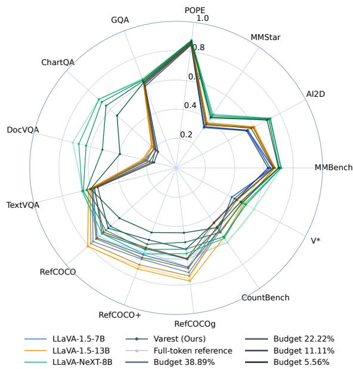
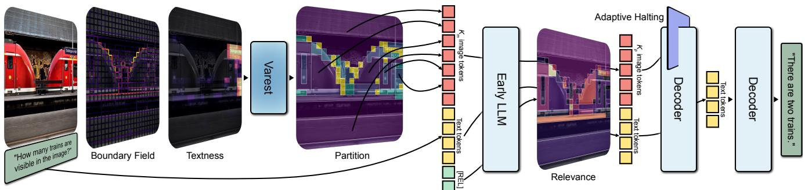
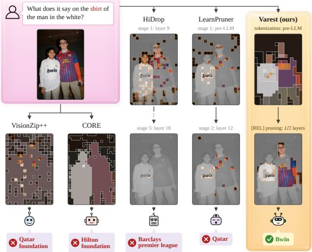
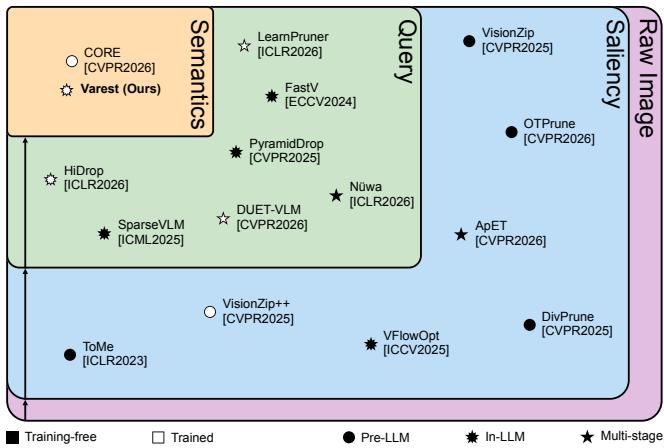
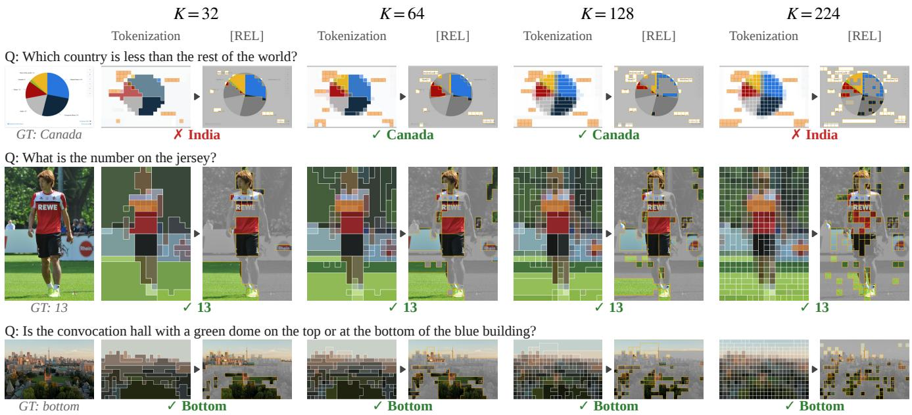
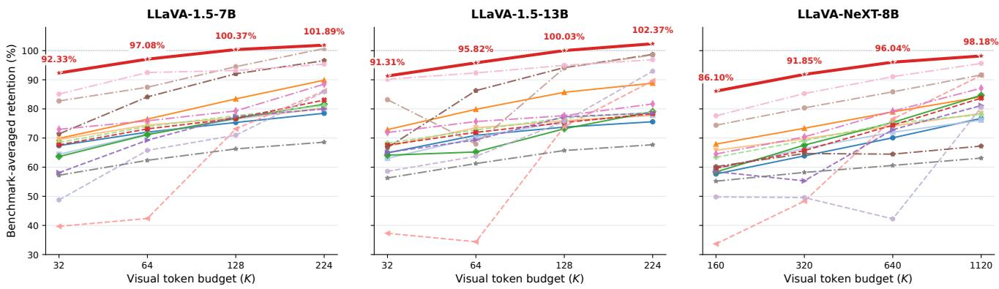
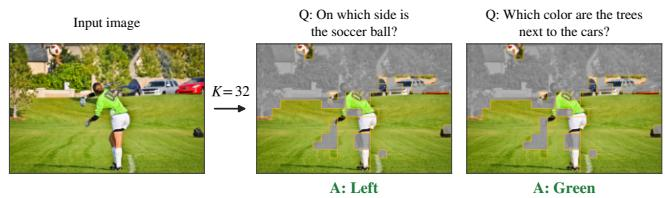
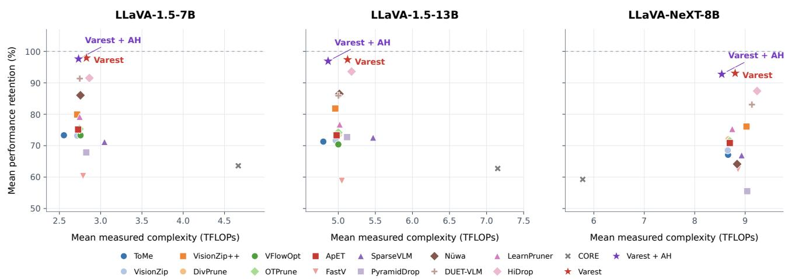

# Just Respect the Semantics: Image-Token Compression via Pre-LLM Semantic Variable-Resolution Tokenization and In-LLM Relevance Pruning

Tianhao Fu †, 1, 4, \* Austin Wang †, 2 Charles Chen †, 1, 5 Roby Aldave-Garza 3 Victor Xie 2 Xiyue Jiao 1 Yucheng Chen 1 Martin Tin 1

† Equal contributions. 1 University of Toronto, Toronto, ON, Canada

2 McGill University, Montreal, QC, Canada 3 University of Waterloo, Waterloo, ON, Canada

4 Vector Institute, Toronto, ON, Canada 5 University Health Network, Toronto, ON, Canada

## Abstract

Image-token compression must reduce computation without hurting the semantics. We introduce Varest, guided by semantic fungibility: tokens within a coherent semantic region can be summarized coarsely, while object boundaries and literal text require finer distinctions. Object and text localizers guide variable-resolution merging, preserving spatial coverage and finer detail at boundaries and text. Learned [REL] registers then prune visual tokens after early decoder processing. Training across budgets enables one checkpoint per backbone. Across three backbones and 13 benchmarks, Varest outperforms 15 baselines in mean performance retention at every evaluated budget, retaining 86.10–92.33% offull-token performance with only 5.56% ofthe original layer-averaged image-token count.

## 1. Introduction

Image-token compression reduces the substantial languagemodel decoder compute imposed by the hundreds or thousands of image tokens in vision-language models (VLMs). An image token may describe a small part of an object, a boundary between objects, or a few characters in a sign. Compressing these tokens requires different decisions.

Prior work has explored merging and pruning using various signals, including feature geometry [1, 4, 7, 10, 20], attention scores [6, 29, 32, 34–36, 38], learned retention utility [30], and object membership [15]. These are natural ways to approach compression, yet they do not respect the semantics. Pruning poses a complementary problem: removing a token hurts semantic coverage, so selection without sufficient reasoning ability through enough decoder processing often discards principal information. Merging across two neighbour objects creates an arbitrary token that loses the semantics of each. Effective compression thus requires deciding both where aggregation can preserve meaningful distinctions and when further access to image tokens can be reduced.

  
Figure 1. Per-benchmark performance of Varest across backbones and token budgets. General VQA benchmarks stay near or above full-token under compression, while text-dense benchmarks benefit most from larger budgets.

We frame this requirement through the property of a set of tokens, semantic fungibility: the set of tokens that form a person is semantically interchangeable with another person’s set from another image because we can summarize them into the abstract concept of a person. We may increase the granularity, if the token budget allows, by splitting the person into head, body, arms, and legs. Each component still has high fungibility. In contrast, a set of tokens that mixes a person and a chair lacks a linked concept and therefore has low fungibility. Text has low fungibility for literal reading, since neighbour characters can contribute different meanings. In this semantic-frequency view, compatible interiors permit heavy merging, while text and semantic transitions require finer distinctions. The principle is simple: wisely partition the image such that the total fungibility of each grouped region’s token set is maximized.

  
Figure 2. Overview of Varest. Object boundaries and textness are passed through the Varest tokenizer with post-projector visual tokens, which are then partitioned into $K _ { m }$ semantic regions and each region is merged into one image token. At layer $L / 2 ,$ , 4 learned [REL] registers (the figure is not to scale) produce a score for each image token and keep the $K _ { p }$ image tokens that are most relevant to LLM reading. Optional adaptive halting removes all remaining image tokens once the information horizon has been detected.

Varest implements this principle by combining pre-LLM semantic-preserved variable-resolution tokenization and in-LLM relevance pruning (Figure 2). Lightweight object and text localizers guide the merging and ensure full coverage through adjusting the semantic granularity. After early decoder layers process these tokens, learned [REL] registers retain a subset for subsequent visual access. End-to-end training across budgets enables one checkpoint per backbone; optional adaptive halting further reduces visual-token propagation.

Our key contributions are as follows:

• We introduce Varest, a semantics-preserving variableresolution tokenizer guided by object boundaries and textness. It allocates finer details to low-fungibility regions while maintaining complete spatial coverage by controlling the semantic granularity according to the token budget.

• We combine this tokenizer with learned decoder-stage selection, preserving broader visual access during early processing and retaining fewer tokens in subsequent layers. Optional adaptive halting can save further compute by dropping all image tokens after the estimated information horizon.

• Across three VLM backbones (LLaVA-1.5-7B [18], LLaVA-1.5-13B [18], and LLaVA-NeXT-8B [16]) and

13 benchmarks, Varest achieves the highest mean performance retention among 15 baselines at every evaluated budget with a similar or lower computational cost.

## 2. Method

Varest allocates visual resolution across the image and visual access across LLM decoder depth, as shown in Figure 2. In Section 2.1, given an image and user prompt, we first partition the image-token grid into regions guided by the object boundaries and textness. Merging within these regions produces $K _ { m }$ image tokens that have different resolutions but preserve full spatial coverage. Early decoder layers process this representation together with the prompt and four [REL] tokens/registers discussed in Section 2.2. At the decoder midpoint, the registers select $K _ { p }$ image tokens for the rest of the LLM. The budget splitting over depth follows $\frac { K _ { m } + K _ { p } } { \gamma } = K$ and $K _ { m } = 4 K _ { p }$ . Optional adaptive halting in Section 2.3, if triggered, can subsequently remove all image tokens at any point after layer 8, even before the midpoint, in which case [REL] pruning will be skipped.

## 2.1. Semantic Variable-Resolution Tokenization

To maximize semantic fungibility, we prefer merging within semantic regions and preserve finer distinctions at transitions. Algorithm 1 provides a schematic. We use a lightweight object localizer to determine the semantic transitions. The semantic granularity that decides whether we further divide a car into fine-grained components like doors is bounded by the token budget. Because the literal reading of text is sensitive to any compression, we use a separate text localizer to pin all text cells at native resolution, if budget allows. The resulting partition ensures every raw token contributes to a region.

Semantic localization. Let $\mathbf { x } _ { i }$ denote the projected image token of grid cell i. The object localizer predicts a boundary strength $B _ { i j }$ between neighbour cells, and the text localizer predicts a textness probability $T _ { i } \in [ 0 , 1 ]$ for each cell. They are distilled from the cosine distance form of DINOv3 [27] features and EasyOCR [12] bounding boxes, respectively. They are trained separately and remain frozen during VLM adaptation and inference.

Algorithm 1 VARiable-RESolution Tokenization (Varest)   
Require: Image I, projected features X, token budget $K _ { m }$   
1: Predict object-boundary and textness fields from I   
2: Split cells into text and non-text groups with threshold $\tau ( r _ { m } )$   
3: Allocate quotas $k + t = K _ { m } ,$ , prioritizing text detail while   
reserving non-text capacity   
4: for $g \in$ {text, nontext} do   
5: Initialize one region per cell in group g   
6: while the number of regions exceeds the group’s quota do   
7: Select the region pair with the lowest mean shared  
boundary strength   
8: Merge the pair into one region   
9: Update its boundary costs with neighbour regions   
10: end while   
11: end for   
12: Order all regions by their first cell   
13: return Mean-pooled region features with position tags

Since their outputs are continuous fields rather than masks, the same evidence can support different granularities. We augment object boundaries with text-border evidence through $B _ { i j } ^ { * } = \operatorname* { m a x } \{ B _ { i j } , \lambda | T _ { i } - T _ { j } | \}$ , with $\lambda = 0 . 2 5$ This discourages merging across text transitions even within an otherwise uniform object.

Allocating the token budget. We divide cells into text and non-text regions using a textness threshold $\tau ( r _ { m } ) =$ $\begin{array} { r } { 1 - \frac { 1 } { 2 } \mathrm { c l i p } ( r _ { m } , 0 , 1 ) } \end{array}$ , where $r _ { m }$ is the merging-stage token retention ratio. From $B ^ { * }$ , we estimate the minimum number of non-text regions $k _ { m i n } .$ Cells with $T _ { i } > \tau ( r _ { m } )$ remain uncompressed if the number of qualified text tokens t is smaller than $K _ { m } - k _ { m i n }$ ; otherwise, we merge them into text regions too to ensure the remaining tokens can then be partitioned into $k = K _ { m } - t \ge k _ { m i n }$ regions using constrained mean-boundary-linkage agglomeration [2]. Larger budgets therefore preserve more local distinctions, whereas smaller budgets summarize broader regions.

Partitioning. Within each region, we start from individual cells and repeatedly merge the neighbour regions with the weakest mean shared boundary. For regions R and $S ,$ the merge cost is

$$
d ( R , S ) = \frac { 1 } { | E ( R , S ) | } \sum _ { ( i , j ) \in E ( R , S ) } B _ { i , j } ^ { * } ,\tag{1}
$$

where $E ( R , S )$ contains the grid edges joining the two regions. Averaging over their shared boundary reduces sensitivity to isolated weak edges. Agglomeration stops when each group reaches its allocated region count. This procedure favours coarse representations within weakly separated content while retaining finer partitions around strong boundaries.

Region representation. Each region becomes one image token by

$$
\mathbf { z } _ { R } = \frac { 1 } { | R | } \sum _ { i \in R } \mathbf { x } _ { i } + \mathrm { M L P } \left( c _ { x } ( R ) , c _ { y } ( R ) , \sqrt { \frac { | R | } { N } } \right) ,\tag{2}
$$

where $N$ is the number of cells in the grid and $( c _ { x } , c _ { y } )$ is the normalized region centroid. The learned position tag supplies the location and extent of the pooled content. Regions are emitted in raster order of their first cell.

For LLaVA-NeXT, we partition the base view and the stitched, unpadded high-resolution view separately, allocating tokens in proportion to their cell counts. The region representation uses coordinates and extent normalized within each view.

## 2.2. [REL] Relevance Pruning

Inspired by PyramidDrop [34], we expose more tokens to the early decoder layers by pruning at the midpoint, keeping the layer-averaged token budget the same. A region may have already contributed information to contextual states even if its token is later removed.

[REL] tokens learn which tokens are still relevant to the LLM reading and prune the others. We place four learned [REL] registers after the user prompt and before the assistant turn. Their causal attention can access both the image and the prompt without accessing the target answer. After the first $L / 2$ layers of an L-layer LLM, let $\mathbf { h } _ { a } ^ { \mathrm { r e l } }$ denote register a’s hidden state and $\mathbf { h } _ { j }$ the state of image token j. A bilinear head computes

$$
{ \bf q } = W _ { q } \left( \frac { 1 } { 4 } \sum _ { a = 1 } ^ { 4 } \mathrm { L N } ( { \bf h } _ { a } ^ { \mathrm { r e l } } ) \right) , s _ { j } = \frac { { \bf q } ^ { \top } W _ { k } \mathrm { L N } ( { \bf h } _ { j } ) } { \sqrt { d _ { \mathrm { r e l } } } } ,\tag{3}
$$

where LN is non-affine LayerNorm, $W _ { q }$ and $W _ { k }$ are learned projections, and $d _ { \mathrm { r e l } } = 2 5 6$

For inference, we retain the $K _ { p }$ highest-scoring image tokens using hard $\tt t o p \mathrm { - k }$ and remove the rest together with the [REL] registers. The pruning operation is implemented as attention masking during training, allowing gradients to flow through. It learns to be prompt-blind (see Section 4.1) even though the end-to-end architecture allows promptconditioned scoring.

## 2.3. Optional Adaptive Halting

Wang et al. [31] show that VLMs have an information horizon: a layer beyond which image tokens contribute little to the output. HiDrop [32] exploits this horizon by removing all image tokens at a fixed layer, which is layer 25 for LLaVA-1.5-7B. Yet the horizon varies across tasks. Our withdrawal study shows that OCR has the latest horizon near the end of the LLM (later than layer 25 on LLaVA-1.5-7B); therefore, a fixed cutoff can retain image tokens unnecessarily for some inputs while removing useful visual evidence too early for others.

  
Figure 3. Visualized comparison of the baselines and Varest on LLaVA-1.5-7B. HiDrop and LearnPruner retain text but lose contextual information, while CORE’s coarse regions lose text. Varest keeps text cells at native resolution and separates the two people with object boundaries.

We thus introduce adaptive halting, an optional, trainingfree mechanism that decides when to drop all remaining image tokens for each input. During prefill, after each decoder layer ℓ, we apply a logit lens [24] to the hidden state ${ \bf h } _ { T } ^ { ( \ell ) }$ at the last prompt position T:

$$
\begin{array} { r l } & { \mathbf { p } _ { \ell } = \mathrm { s o f t m a x } \big ( W _ { U } \mathrm { N o r m } ( \mathbf { h } _ { T } ^ { ( \ell ) } ) \big ) , } \\ & { \hat { y } _ { \ell } = \arg \operatorname* { m a x } _ { v } p _ { \ell } ( v ) , \quad H _ { \ell } = - \displaystyle \sum _ { v } p _ { \ell } ( v ) \log p _ { \ell } ( v ) , } \end{array}\tag{4}
$$

where Norm is the LLM’s final normalization, and $W _ { U }$ is its frozen base vocabulary head, with any LoRA update bypassed. The distribution pℓ estimates the first answer token from the intermediate hidden state. We use prediction stability and confidence as a heuristic. Halting occurs at the first layer satisfying all three conditions:

1. Warm-up: $\ell \geq 8 ,$ , excluding shallow readouts from triggering premature withdrawal.

2. Stability: $\hat { y } _ { \ell - 2 } = \hat { y } _ { \ell - 1 } = \hat { y } _ { \ell }$ , so the top-1 prediction agrees across three consecutive layers.

3. Confidence: $H _ { \ell } \leq 1 \ \mathrm { n a t } .$

Once triggered, we remove all remaining image tokens and [REL] registers before the next decoder layer.

  
Figure 4. Compression signals and stages. Arrows progress toward explicit semantic priors. Varest preserves semantic structure and text detail before pruning inside the LLM.

## 2.4. Training and Budget Control

Joint adaptation. We optimize the registers, scoring head, multimodal projector, spatial tags, and LoRA [9] adapters in the vision and language stacks and vocabulary head using teacher-forced answer cross-entropy, on the VLM’s own tuning dataset. The localizers remain frozen, and no token-relevance labels are required. A straightthrough sigmoid surrogate supplies gradients to the selector [3]. We vary the merging budget during training and sample the pruning count from zero through the realized merging count. This allows one checkpoint per backbone to serve all budgets.

Budget accounting. We measure the image-token budget by the mean number of image tokens entering a decoder layer: $\begin{array} { r } { K \ = \ \frac { 1 } { L } \sum _ { \ell = 1 } ^ { L } K _ { \ell } \ = \ \frac { K _ { m } + K _ { p } } { 2 } } \end{array}$ , where the second equality holds for midpoint pruning without adaptive halting. This count excludes text tokens and the four registers. For LLaVA-1.5, the retained ratio is $r = K / 5 7 6$ . For LLaVA-NeXT, we apply the requested ratio to each image’s native sequence length, so realized integer counts vary with image resolution.

## 3. Related Work

Compression signals. We categorize visual-token compression signals into semantic [15], saliency [1, 4, 7, 20, 35, 36], and query cues [6, 10, 29, 30, 32, 34, 38], as shown in Figure 4. Saliency cues estimate importance or redundancy from the image alone. ToMe [4] merges similar features, while VisionZip [35] retains attention-ranked tokens and aggregates the remaining context. These image-only criteria permit compression before the prompt is processed, but do not explicitly account for object boundaries or the finer detail needed to read text. Query cues use language context to prioritize content needed for a particular question, as in SparseVLM [38]. This directs the budget toward task-relevant evidence. When derived from decoder attention, however, these cues depend on decoder processing, and attention reliability can vary across layers [30]. Semantic cues add explicit content structure to constrain grouping, helping specify which features can be summarized together. Varest combines semantic-guided token allocation within an image with depth-wise budget allocation, using variable-resolution tokenization and learned decoder-stage selection.

  
Figure 5. Visualization of tokenization and [REL] pruning across budgets on LLaVA-1.5-7B. For each K, the left panel shows the tokenization (text tokens in orange) and the right panel shows the tokens kept by [REL]. Text remains identifiable at every budget, while semantic granularity becomes finer as K increases.

Allocating the token budget according to semantics. Within an image, semantic priors guide how a token budget is distributed nonuniformly across regions. CORE [15] guides pooling with object masks and orders the resulting tokens by their centroids, preserving object membership and spatial layout. A limitation of CORE’s object-based pooling is that it does not explicitly allocate finer resolution to text within an object. Varest’s variable-resolution tokenizer addresses this through semantic fungibility, using boundary and textness cues to allocate resolution. It separates detected text from its surrounding object, allowing coarse object summaries alongside finer text representations. Detected text remains at native patch-grid resolution when the budget permits.

Allocating the token budget across decoder depth. Across decoder depth, the complementary question is how long visual tokens remain available. Multi-stage methods [29, 30, 34] use larger budgets early and fewer tokens later, allowing contextual processing before pruning. DUET-VLM [29] and LearnPruner [30] combine this with pre-LLM reduction. Varest follows this depth-wise allocation but differs in selection. LearnPruner learns early patch selection but uses text-to-image attention to prune visual tokens in a middle decoder layer. However, attention does not necessarily reflect a token’s influence on the prediction. In NLP models, Jain and Wallace [13] find that attention weights can correlate poorly with gradient-based importance and that different attention distributions can yield similar predictions. Rather than using attention weights as an importance proxy, Varest learns a relevance score for each semantic region through [REL] registers and a scoring head. This adapts the retention criterion to contextualized, variable-resolution semantic region representations.

## 4. Experiments

We first visually inspect the tokenization and pruning behaviours in Section 4.1. Across three backbones, Section 4.2 evaluates Varest against 15 baselines on MMBench [19], AI2D [14], MMStar [5], POPE [17] (three metrics), GQA [11], ChartQA [22], DocVQA [23], TextVQA [28], RefCOCO/RefCOCO+ [37], Ref-COCOg [21], CountBench [25], and V\* [33]. Adaptive halting is disabled except in Section 4.3, where we test its performance. Section 4.4 analyzes the efficiency, and Section 4.5 isolates the contributions of each component.

Figure 6. Benchmark-averaged performance retention versus layer-averaged image-token budget. 100% denotes uncompressed backbone performance. Varest achieves the highest retention at every evaluated budget across all three backbones, preserving over 85% performance at r = 5.56% on all three VLMs.  
  
Figure 7. [REL] pruning behaviour under different prompts on LLaVA-1.5-7B. Varest keeps nearly the same tokens for two unrelated questions, yet answers both correctly, even when the named object is discarded.

## 4.1. Qualitative Analysis

As shown in Figures 3 and 5, Varest clearly identifies text cells (highlighted in orange) during tokenization. Combined with the context from merged object tokens, this allows LLaVA-1.5-7B to reach the correct answer at very small budgets $\begin{array} { r l r } { ( K } & { { } = } & { 3 2 ) } \end{array}$ Other methods such as HiDrop [32] and LearnPruner [30] are prompt-sensitive and correctly identify the needed text, but at low budgets they lack the object localization to provide the surrounding context.

In our analysis, we find that Varest allocates resolution as needed across token budgets while preserving identifiable semantic information. As shown in Figure 5, even low-resolution tokenizations remain interpretable, with distinct boundaries between objects and other regions. Furthermore, Varest identifies text at every budget and consistently retains the information needed for OCR and other text-based tasks. Notably, Varest answers the bottom question correctly even though the named tokens are not kept by [REL]. Figure 7 confirms that this learned relevance reflects LLM reading, not prompt sensitivity. This implies their information has already been absorbed in the early layers, before pruning, and prompt sensitivity is not necessary.

## 4.2. Quantitative Analysis

We report mean performance retention by normalizing each metric against the corresponding uncompressed backbone and averaging over 15 metrics, with the three POPE variants counted separately. Comparisons use layer-averaged image-token budgets; 100% retention means matching the uncompressed model.

Compression performance. Figure 6 and Table 1 show that Varest achieves the highest mean retention at every evaluated budget across all three backbones. At the smallest token ratio of 5.56%, it retains 86.10–92.33% of uncompressed performance. More importantly, at an 11.11% token ratio, Varest outperforms every baseline evaluated at 22.22% on all three backbones. For example, on LLaVA-1.5-7B, it achieves 97.08% retention at K = 64, exceeding the strongest baseline’s 94.50% at K = 128. At K = 128, both LLaVA-1.5 models reach approximately 100% retention, matching uncompressed performance with 22.22% of the tokens.

Performance across visual tasks. Figure 1 shows that the required budget varies across tasks. General VQA performance remains relatively stable as the budget decreases, whereas document reading, chart understanding, and referring-expression grounding benefit more from larger budgets.

<table><tr><td>K</td><td>ToMe [4] [ICLR2023]</td><td>VisionZip [35] [CVPR2025]</td><td>VisionZip++ [35] [CVPR2025]</td><td>DivPrune [1] [CVPR2025]</td><td>VFlowOpt [36] [ICCV2025]</td><td>OTPrune [7] [CVPR2026]</td><td>ApET [20] [CVPR2026]</td><td>FastV [6] [ECCV2024]</td><td>SparseVLM [38] [ICML2025]</td><td>PyramidDrop [34] [CVPR2025]</td><td>Nüwa [10] [ICLR2026]</td><td>DUET-VLM [29] [CVPR2026]</td><td>LearnPruner [30] [ICLR2026]</td><td>HiDrop [32] [ICLR2026]</td><td>CORE [15] [CVPR2026]</td><td>Varest (Ours)</td></tr><tr><td></td><td></td><td></td><td></td><td></td><td></td><td></td><td></td><td>LLaVA-1.5-7B</td><td></td><td></td><td></td><td></td><td></td><td></td><td></td><td></td></tr><tr><td>224</td><td>78.50%</td><td>80.36%</td><td>89.86%</td><td>80.19%</td><td>81.60%</td><td>81.17%</td><td>83.05%</td><td>86.19%</td><td>79.99%</td><td>85.90%</td><td>96.58%</td><td>100.74%</td><td>88.51%</td><td>95.36%</td><td>68.58%</td><td>101.89%</td></tr><tr><td>128</td><td>75.34%</td><td>76.49%</td><td>83.44%</td><td>76.93%</td><td>76.80%</td><td>77.65%</td><td>76.72%</td><td>73.12%</td><td>77.42%</td><td>70.99%</td><td>92.04%</td><td>94.50%</td><td>79.31%</td><td>93.18%</td><td>66.27%</td><td>100.37%</td></tr><tr><td>64 32</td><td>72.03%</td><td>71.41%</td><td>76.49%</td><td>74.42%</td><td>71.16%</td><td>73.95%</td><td>73.14%</td><td>42.39%</td><td>69.25%</td><td>65.76%</td><td>84.11%</td><td>87.44%</td><td>75.91%</td><td>92.49%</td><td>62.35%</td><td>97.08%</td></tr><tr><td></td><td>67.40%</td><td>64.40%</td><td>69.87%</td><td>69.53%</td><td>63.64%</td><td>68.49%</td><td>67.63%</td><td>39.67%</td><td>58.11%</td><td>48.74%</td><td>71.41%</td><td>82.72%</td><td>72.98%</td><td>85.10%</td><td>57.22%</td><td>92.33%</td></tr><tr><td></td><td></td><td></td><td></td><td></td><td></td><td></td><td></td><td>LLaVA-1.5-13B</td><td></td><td></td><td></td><td></td><td></td><td></td><td></td><td></td></tr><tr><td>224</td><td>75.59%</td><td>77.79%</td><td>88.83%</td><td>77.88%</td><td>79.10%</td><td>78.80%</td><td>78.36%</td><td>89.65%</td><td>78.57%</td><td>92.94%</td><td>98.70%</td><td>98.53%</td><td>81.72%</td><td>96.88%</td><td>67.69%</td><td>102.37%</td></tr><tr><td>128</td><td>73.75%</td><td>75.72%</td><td>85.70%</td><td>75.93%</td><td>73.19%</td><td>76.90%</td><td>75.32%</td><td>73.90%</td><td>77.31%</td><td>75.67%</td><td>94.19%</td><td>94.06%</td><td>77.68%</td><td>94.96%</td><td>65.72%</td><td>100.03%</td></tr><tr><td>64</td><td>70.93%</td><td>70.09%</td><td>79.86%</td><td>73.49%</td><td>65.21%</td><td>72.75%</td><td>71.96%</td><td>34.39%</td><td>69.36%</td><td>63.72%</td><td>86.28%</td><td>67.92%</td><td>75.66%</td><td>92.35%</td><td>61.24%</td><td>95.82%</td></tr><tr><td>32</td><td>64.90%</td><td>63.03%</td><td>72.89%</td><td>67.24%</td><td>64.11%</td><td>68.27%</td><td>67.57%</td><td>37.29%</td><td>65.05%</td><td>58.57%</td><td>66.70%</td><td>83.16%</td><td>71.90%</td><td>90.19%</td><td>56.29%</td><td>91.31%</td></tr><tr><td></td><td></td><td></td><td></td><td></td><td></td><td></td><td></td><td>LLaVA-NeXT-8B</td><td></td><td></td><td></td><td></td><td></td><td></td><td></td><td></td></tr><tr><td>1120</td><td>76.75%</td><td>76.13%</td><td>84.16%</td><td>78.44%</td><td>84.69%</td><td>78.06%</td><td>83.68%</td><td>91.50%</td><td>81.16%</td><td>80.50%</td><td>67.24%</td><td>91.67%</td><td>87.10%</td><td>95.62%</td><td>63.12%</td><td>98.18%</td></tr><tr><td>640</td><td>70.08%</td><td>72.00%</td><td>78.98%</td><td>74.13%</td><td>75.37%</td><td>75.13%</td><td>74.40%</td><td>76.53%</td><td>72.87%</td><td>42.24%</td><td>64.47%</td><td>85.86%</td><td>79.24%</td><td>91.07%</td><td>60.59%</td><td>96.04%</td></tr><tr><td>320</td><td>63.87%</td><td>66.43%</td><td>73.36%</td><td>69.71%</td><td>67.56%</td><td>69.08%</td><td>65.70%</td><td>48.34%</td><td>55.30%</td><td>49.56%</td><td>64.69%</td><td>80.36%</td><td>70.38%</td><td>85.27%</td><td>58.20%</td><td>91.85%</td></tr><tr><td>160</td><td>57.66%</td><td>59.46%</td><td>67.92%</td><td>65.82%</td><td>58.35%</td><td>63.41%</td><td>59.64%</td><td>33.65%</td><td>58.45%</td><td>49.78%</td><td>60.18%</td><td>74.39%</td><td>64.53%</td><td>77.63%</td><td>55.19%</td><td>86.10%</td></tr></table>

Table 1. Benchmark-averaged retention rates. We evaluate the average retention rate with respect to the uncompressed model of each method on 13 benchmarks across VQA, OCR, and grounding. Varest outperforms all 15 baselines at every budget across all three backbones, retaining 86.10–92.33% of baseline performance at the lowest budgets.

  
Figure 8. Performance retention versus measured computation. Each point averages both axes independently over four budgets; higher and further left is better. Varest achieves higher retention with slightly less computation than HiDrop, the strongest baseline by mean retention. Adaptive halting (AH) further reduces computation with a small retention loss.

<table><tr><td>Backbone</td><td>∆ Score</td><td>Trigger Rate</td><td>Skips [REL]</td><td>Tokens Saved</td></tr><tr><td>LLaVA-1.5-7B</td><td>-0.11</td><td>68.8%</td><td>1.3%</td><td>8.2%</td></tr><tr><td>LLaVA-1.5-13B</td><td>-0.16</td><td>82.2%</td><td>20.3%</td><td>10.2%</td></tr><tr><td>LLaVA-NeXT-8B</td><td>-0.24</td><td>84.9%</td><td>3.9%</td><td>6.9%</td></tr></table>

Table 2. Optional halting on three backbones, averaged across benchmarks and budgets. The accuracy costs are relatively small compared to the additional savings.

## 4.3. Adaptive Halting

We enable adaptive halting using the same checkpoints and budgets, without additional training or backbone-specific tuning. Table 2 reports the mean score changes, halting rates, and image-token savings across 13 benchmarks and four budgets. We observe an additional 6.9–10.2% reduction in visual-token propagation, measured by imagetoken counts summed across decoder layers. Mean score losses are 0.11–0.24 points on the benchmarks’ native 0–

100 scales, averaged equally over 13 benchmarks and four budgets.

Halting predominantly follows [REL] pruning on LLaVA-1.5-7B and LLaVA-NeXT-8B, withdrawing the retained tokens from later layers. On LLaVA-1.5-13B, 20.3% of inputs halt before selection runs, including halts at the selection boundary. This earlier withdrawal contributes to its larger savings. We examine the resulting FLOPs and latency in Section 4.4.

## 4.4. Efficiency Analysis

Figure 8 compares performance retention and measured computation, each averaged over four budgets. Across the three backbones, Varest improves retention over HiDrop, the strongest baseline, by 3.79–6.39 percentage points while using 1.0–4.7% fewer FLOPs. Its accuracy advantage therefore persists when accounting for measured computation. Latency heavily depends on the code implementation and is therefore not a reliable metric and not reported.

<table><tr><td colspan="5">LLaVA-1.5-7B</td><td colspan="5">LLaVA-1.5-13B</td><td colspan="5">LLaVA-NeXT-8B</td></tr><tr><td>K</td><td>TextVQA</td><td>DocVQA</td><td>ChartQA</td><td>CountBench</td><td>K</td><td>TextVQA</td><td>DocVQA</td><td>ChartQA</td><td>CountBench</td><td>K</td><td>TextVQA</td><td>DocVQA</td><td>ChartQA</td><td>CountBench</td></tr><tr><td>224</td><td>-0.02</td><td>-0.23</td><td>-0.08</td><td>+0.20</td><td>224</td><td>+0.02</td><td>-0.18</td><td>+0.28</td><td>+0.00</td><td>1120</td><td>-0.26</td><td>-0.11</td><td>-0.76</td><td>-0.21</td></tr><tr><td>128</td><td>-0.66</td><td>-0.78</td><td>+0.04</td><td>-1.22</td><td>128</td><td>-0.17</td><td>-0.41</td><td>-0.04</td><td>-0.61</td><td>640</td><td>-1.07</td><td>+0.08</td><td>+0.96</td><td>-0.61</td></tr><tr><td>64</td><td>-1.28</td><td>-0.72</td><td>-0.04</td><td>-2.03</td><td>64</td><td>–1.25</td><td>-0.99</td><td>+0.04</td><td>+1.43</td><td>320</td><td>-1.38</td><td>+0.21</td><td>+0.04</td><td>–0.61</td></tr><tr><td>32</td><td>-1.39</td><td>-0.67</td><td>-0.04</td><td>-0.40</td><td>32</td><td>–1.21</td><td>-0.69</td><td>+0.56</td><td>+0.00</td><td>160</td><td>–2.24</td><td>+0.81</td><td>+1.60</td><td>+0.41</td></tr></table>

Table 3. Effect of removing the text localizer on selected benchmarks. Entries are changes in native 0–100 scores relative to full Varest at each token budget, with textness set to zero without retraining. The absence of the text localizer damages TextVQA most consistently on all three backbones and DocVQA on LLaVA-1.5. CountBench is extremely damaged on LLaVA-1.5-7B and slightly on LLaVA-NeXT-8B.

<table><tr><td>K</td><td>Varest</td><td>-[REL]</td><td>Random Selection†</td><td>Oracle Selection†</td><td>-Object Localizer†</td><td>-Text Localizer†</td><td>No Localizer†</td></tr><tr><td colspan="8">LLaVA-1.5-7B</td></tr><tr><td>224</td><td>101.89%</td><td>101.80%</td><td>98.83%</td><td>101.97%</td><td>101.36%</td><td>101.69%</td><td>101.35%</td></tr><tr><td>128</td><td>100.37%</td><td>99.61%</td><td>96.99%</td><td>100.72%</td><td>98.97%</td><td>100.13%</td><td>98.21%</td></tr><tr><td>64</td><td>97.08%</td><td>95.45%</td><td>94.36%</td><td>97.60%</td><td>93.31%</td><td>96.53%</td><td>92.67%</td></tr><tr><td>32</td><td>92.33%</td><td>89.18%</td><td>90.14%</td><td>92.81%</td><td>86.02%</td><td>91.77%</td><td>85.55%</td></tr><tr><td colspan="8">LLaVA-1.5-13B</td></tr><tr><td>224</td><td>102.37%</td><td>100.65%</td><td>100.26%</td><td>101.98%</td><td>101.85%</td><td>101.88%</td><td>101.82%</td></tr><tr><td>128</td><td>100.03%</td><td>97.76%</td><td>98.59%</td><td>100.00%</td><td>99.40%</td><td>99.49%</td><td>98.91%</td></tr><tr><td>64</td><td>95.82%</td><td>94.07%</td><td>94.37%</td><td>95.86%</td><td>93.54%</td><td>95.50%</td><td>92.77%</td></tr><tr><td>32</td><td>91.31%</td><td>88.90%</td><td>90.45%</td><td>91.64%</td><td>85.55%</td><td>91.37%</td><td>85.32%</td></tr><tr><td colspan="8">LLaVA-NeXT-8B</td></tr><tr><td>1120</td><td>98.18%</td><td>97.24%</td><td>93.90%</td><td>98.22%</td><td>98.03%</td><td>97.95%</td><td>97.70%</td></tr><tr><td>640</td><td>96.04%</td><td>94.28%</td><td>91.58%</td><td>95.89%</td><td>95.49%</td><td>95.68%</td><td>94.74%</td></tr><tr><td>320</td><td>91.85%</td><td>89.66%</td><td>87.85%</td><td>92.31%</td><td>86.77%</td><td>91.55%</td><td>85.01%</td></tr><tr><td>160</td><td>86.10%</td><td>82.84%</td><td>82.73%</td><td>86.81%</td><td>74.11%</td><td>86.00%</td><td>71.82%</td></tr></table>

Table 4. Retention of Varest variants at matched budgets. † denotes an inference-time ablation of the joint model Varest. Localization and [REL] pruning provide complementary benefits.

Adaptive halting further reduces FLOPs by 3.0–5.1%, with retention losses of 0.30–0.48 percentage points. It provides an additional tradeoff between compute and accuracy. Both settings use the same checkpoint, so this tradeoff can be adjusted at inference without additional training or model storage.

## 4.5. Ablation Studies

Table 4 compares variants at matched layer-averaged token budgets. −[REL] is a separately trained arm with the tokenizer only, where $K _ { m } = K$ and $r _ { m } = r$ . Random and Oracle Selections replace [REL] with random selection and gold-answer attention, respectively, during inference, preserving the joint model’s pruning layer and token counts. −Object Localizer reorders the original boundary strengths according to adjacent CLIP-feature [26] distances; −Text Localizer sets all textness values to zero; and No Localizer combines both interventions.

Semantic guidance. At the smallest budgets, −Object Localizer falls 5.76–11.99 percentage points below the fullmodel reference, and No Localizer falls 5.99–14.28 points below it. These gaps narrow at larger budgets, supporting the importance of semantic boundaries when compression requires larger merged regions.

Text localization. The small aggregate gap for −Text Localizer masks larger changes on individual benchmarks (Table 3). At the smallest budgets, TextVQA drops by 1.21–2.24 native score points across the three backbones. DocVQA also declines at every budget on both LLaVA-1.5 models, but effects on other benchmarks vary. For example, at K = 160 on LLaVA-NeXT-8B, TextVQA loses 2.24 points while DocVQA and ChartQA gain 0.81 and 1.60 points. Averaging over 15 normalized metrics dilutes individual losses and allows increases elsewhere to offset them.

Decoder-stage pruning. The joint model exceeds the separately trained −[REL] variant at every budget, gaining 2.41–3.26 retention points at the smallest budgets. This comparison evaluates the joint design, including training and token allocation across layers. At fixed pruning layers and retained token counts, learned selection also outperforms random selection at every budget on all three backbones. Oracle Selection remains within 0.71 retention points of the main-table Varest reference at every budget, with budget-averaged differences of +0.36, −0.01, and +0.27 points on LLaVA-1.5-7B, LLaVA-1.5-13B, and LLaVA-NeXT-8B, respectively. These small aggregate differences suggest limited headroom for greater prompt sensitivity at the evaluated pruning layers and budgets, although attention-based selection is not a formal upper bound.

## 5. Discussion

Varest uses semantic fungibility to allocate resolution, summarizing compatible regions while reserving finer representations for text and object boundaries. By maintaining full spatial coverage before decoder-stage pruning, it allows early decoder layers to integrate scene context before reducing subsequent visual access. The method remains compatible with FlashAttention [8], since token selection does not require decoder attention weights, although translating computational savings into lower latency also requires an efficient implementation. Adapting Varest to additional VLM families, such as Qwen-VL and InternVL, remains promising future work. More broadly, the same semantic fungibility principle could extend beyond natural images. For example, in medical images, healthy organs are like objects and lesions are like text. Such extensions require domain-specific validation, but have great potential.

Contribution and Acknowledgements. TF led the project and proposed the entire method. TF, AW, and CC contributed to the manuscript, while TF and CC produced the core visualizations. AW implemented and trained CORE, HiDrop, and DUET-VLM. CC implemented and trained LearnPruner and VisionZip/VisionZip++. RA, XJ, and YC implemented the other baselines. VX managed the experiment results and contributed to visualization utilities. CC and MT proposed and developed the efficiency benchmark, VarestBench, as well as its dataset.

We thank Ruihang Zhang and Jun Ma for their advice and feedback on the manuscript; Emile Petit for his help on the visualization experiments; Jean-Sebastien Giroux´ for his suggestions on the paper. In addition, we would like to thank Lambda.ai for their sponsored compute credits.

## References

[1] Saeed Ranjbar Alvar, Gursimran Singh, Mohammad Akbari, and Yong Zhang. DivPrune: Diversity-based visual token pruning for large multimodal models. In CVPR, pages 9392– 9401, 2025. 1, 4, 7

[2] Pablo Arbelaez, Michael Maire, Charless Fowlkes, and Ji-´ tendra Malik. Contour detection and hierarchical image segmentation. IEEE Transactions on Pattern Analysis and Machine Intelligence, 33(5):898–916, 2011. 3

[3] Yoshua Bengio, Nicholas Leonard, and Aaron Courville.´ Estimating or propagating gradients through stochastic neurons for conditional computation. arXiv preprint arXiv:1308.3432, 2013. 4

[4] Daniel Bolya, Cheng-Yang Fu, Xiaoliang Dai, Peizhao Zhang, Christoph Feichtenhofer, and Judy Hoffman. Token merging: Your ViT but faster. In ICLR, 2023. 1, 4, 7

[5] Lin Chen, Jinsong Li, Xiaoyi Dong, Pan Zhang, Yuhang Zang, Zehui Chen, Haodong Duan, Jiaqi Wang, Yu Qiao, Dahua Lin, and Feng Zhao. Are we on the right way for evaluating large vision-language models? In NeurIPS, pages 27056–27087, 2024. 5

[6] Liang Chen, Haozhe Zhao, Tianyu Liu, Shuai Bai, Junyang Lin, Chang Zhou, and Baobao Chang. An image is worth 1/2 tokens after layer 2: Plug-and-play inference acceleration for large vision-language models. In ECCV, 2024. 1, 4, 7

[7] Xiwen Chen, Wenhui Zhu, Gen Li, Xuanzhao Dong, Yujian Xiong, Hao Wang, Peijie Qiu, Qingquan Song, Zhipeng Wang, Shao Tang, Yalin Wang, and Abolfazl Razi. OTPrune: Distribution-aligned visual token pruning via optimal transport. In CVPR, 2026. 1, 4, 7

[8] Tri Dao, Daniel Y. Fu, Stefano Ermon, Atri Rudra, and Christopher Re. FlashAttention: Fast and memory-efficient ´ exact attention with IO-awareness. In Advances in Neural Information Processing Systems, 2022. 8

[9] Edward J. Hu, Yelong Shen, Phillip Wallis, Zeyuan Allen-Zhu, Yuanzhi Li, Shean Wang, Lu Wang, and Weizhu Chen. LoRA: Low-rank adaptation of large language models. In International Conference on Learning Representations, 2022. 4

[10] Yihong Huang, Fei Ma, Yihua Shao, Jingcai Guo, Zitong Yu, Laizhong Cui, and Qi Tian. Nuwa: Mending the spatial¨ integrity torn by VLM token pruning. In ICLR, 2026. 1, 4, 7

[11] Drew A. Hudson and Christopher D. Manning. GQA: A new dataset for real-world visual reasoning and compositional question answering. In CVPR, pages 6700–6709, 2019. 5

[12] Jaided AI. EasyOCR. https://github.com/ JaidedAI/EasyOCR, 2020. Accessed: 2026-10-10. 3

[13] Sarthak Jain and Byron C. Wallace. Attention is not explanation. In Proceedings of the 2019 Conference of the North American Chapter ofthe Associationfor Computational Lin guistics: Human Language Technologies, Volume 1, pages 3543–3556, 2019. 5

[14] Aniruddha Kembhavi, Mike Salvato, Eric Kolve, Minjoon Seo, Hannaneh Hajishirzi, and Ali Farhadi. A diagram is worth a dozen images. In ECCV, pages 235–251, 2016. 5

[15] Jingyu Lei, Gaoang Wang, and Der-Horng Lee. CORE: Compact object-centric representations as a new paradigm for token merging in LVLMs. In CVPR, 2026. 1, 4, 5, 7

[16] Bo Li, Kaichen Zhang, Hao Zhang, Dong Guo, Renru Zhang, Feng Li, Yuanhan Zhang, Ziwei Liu, and Chunyuan Li. LLaVA-NeXT: Stronger LLMs supercharge multimodal capabilities in the wild, 2024. 2

[17] Yifan Li, Yifan Du, Kun Zhou, Jinpeng Wang, Xin Zhao, and Ji-Rong Wen. Evaluating object hallucination in large visionlanguage models. In Proceedings of the 2023 Conference on Empirical Methods in Natural Language Processing, pages 292–305, 2023. 5

[18] Haotian Liu, Chunyuan Li, Yuheng Li, and Yong Jae Lee. Improved baselines with visual instruction tuning. In Proceedings of the IEEE/CVF Conference on Computer Vision and Pattern Recognition (CVPR), pages 26296–26306, 2024. 2

[19] Yuan Liu, Haodong Duan, Yuanhan Zhang, Bo Li, Songyang Zhang, Wangbo Zhao, Yike Yuan, Jiaqi Wang, Conghui He, Ziwei Liu, Kai Chen, and Dahua Lin. MMBench: Is your multi-modal model an all-around player? In ECCV, pages 216–233, 2024. 5

[20] Qiankun Ma, Ziyao Zhang, Haofei Wang, Jie Chen, Zhen Song, and Hairong Zheng. ApET: Approximation-error guided token compression for efficient VLMs. In CVPR, 2026. 1, 4, 7

[21] Junhua Mao, Jonathan Huang, Alexander Toshev, Oana Camburu, Alan L. Yuille, and Kevin Murphy. Generation and comprehension of unambiguous object descriptions. In CVPR, pages 11–20, 2016. 5

[22] Ahmed Masry, Do Xuan Long, Jia Qing Tan, Shafiq Joty, and Enamul Hoque. ChartQA: A benchmark for question answering about charts with visual and logical reasoning. In Findings of the Association for Computational Linguistics: ACL 2022, pages 2263–2279, 2022. 5

[23] Minesh Mathew, Dimosthenis Karatzas, and C. V. Jawahar. DocVQA: A dataset for VQA on document images. In IEEE/CVF Winter Conference on Applications of Computer Vision, pages 2200–2209, 2021. 5

[24] nostalgebraist. interpreting GPT: the logit lens. LessWrong, 2020. 4

[25] Roni Paiss, Ariel Ephrat, Omer Tov, Shiran Zada, Inbar Mosseri, Michal Irani, and Tali Dekel. Teaching CLIP to count to ten. In ICCV, pages 3170–3180, 2023. 5

[26] Alec Radford, Jong Wook Kim, Chris Hallacy, Aditya Ramesh, Gabriel Goh, Sandhini Agarwal, Girish Sastry, Amanda Askell, Pamela Mishkin, Jack Clark, Gretchen Krueger, and Ilya Sutskever. Learning transferable visual models from natural language supervision. In Proceedings of the 38th International Conference on Machine Learning, pages 8748–8763. PMLR, 2021. 8

[27] Oriane Simeoni, Huy V. Vo, Maximilian Seitzer, Federico´ Baldassarre, Maxime Oquab, Cijo Jose, Vasil Khalidov, Marc Szafraniec, Seungeun Yi, Michael Ramamonjisoa,¨ Francisco Massa, Daniel Haziza, Luca Wehrstedt, Jianyuan Wang, Timothee Darcet, Th´ eo Moutakanni, Leonel Sentana,´ Claire Roberts, Andrea Vedaldi, Jamie Tolan, John Brandt, Camille Couprie, Julien Mairal, Herve J´ egou, Patrick La-´ batut, and Piotr Bojanowski. DINOv3, 2025. 3

[28] Amanpreet Singh, Vivek Natarajan, Meet Shah, Yu Jiang, Xinlei Chen, Dhruv Batra, Devi Parikh, and Marcus Rohrbach. Towards VQA models that can read. In CVPR, pages 8317–8326, 2019. 5

[29] Aditya Kumar Singh, Hitesh Kandala, Pratik Prabhanjan Brahma, Zicheng Liu, and Emad Barsoum. DUET-VLM: Dual-stage unified efficient token reduction for VLM training and inference. In CVPR, 2026. 1, 4, 5, 7

[30] Rinyoichi Takezoe, Yaqian Li, Zihao Bo, Anzhou Hou, Mo Guang, and Kaiwen Long. LearnPruner: Rethinking attention-based token pruning in vision language models. In ICLR, 2026. 1, 4, 5, 6, 7

[31] Yahong Wang, Juncheng Wu, Zhangkai Ni, Longzhen Yang, Yihang Liu, Chengmei Yang, Ying Wen, Lianghua He, Xianfeng Tang, Hui Liu, and Yuyin Zhou. When token pruning is worse than random: Understanding visual token information in vllms. In CVPR, 2026. 3

[32] Hao Wu, Yingqi Fan, Jinyang Dai, Junlong Tong, Yunpu Ma, and Xiaoyu Shen. HiDrop: Hierarchical vision token reduction in MLLMs via late injection, concave pyramid pruning, and early exit. In ICLR, 2026. 1, 4, 6, 7

[33] Penghao Wu and Saining Xie. V∗: Guided visual search as a core mechanism in multimodal LLMs. In CVPR, pages 13084–13094, 2024. 5

[34] Long Xing, Qidong Huang, Xiaoyi Dong, Jiajie Lu, Pan Zhang, Yuhang Zang, Yuhang Cao, Conghui He, Jiaqi Wang, Feng Wu, and Dahua Lin. PyramidDrop: Accelerating your large vision-language models via pyramid visual redundancy reduction. In CVPR, 2025. 1, 3, 4, 5, 7

[35] Senqiao Yang, Yukang Chen, Zhuotao Tian, Chengyao Wang, Jingyao Li, Bei Yu, and Jiaya Jia. VisionZip: Longer is better but not necessary in vision language models. In CVPR, pages 19792–19802, 2025. 4, 7

[36] Sihan Yang, Runsen Xu, Chenhang Cui, Tai Wang, Dahua Lin, and Jiangmiao Pang. VFlowOpt: A token pruning framework for LMMs with visual information flow-guided optimization. In ICCV, pages 23924–23934, 2025. 1, 4, 7

[37] Licheng Yu, Patrick Poirson, Shan Yang, Alexander C. Berg, and Tamara L. Berg. Modeling context in referring expressions. In ECCV, pages 69–85, 2016. 5

[38] Yuan Zhang, Chun-Kai Fan, Junpeng Ma, Wenzhao Zheng, Tao Huang, Kuan Cheng, Denis Gudovskiy, Tomoyuk Okuno, Yohei Nakata, Kurt Keutzer, and Shanghang Zhang. SparseVLM: Visual token sparsification for efficient vision language model inference. In International Conference on Machine Learning, 2025. 1, 4, 5, 7