# LAYERCANVAS: INFOGRAPHIC GENERATION IN AI LEARNING ASSISTANTS VIA HYBRID LAYER-SET DIFFUSION

Keshav Gupta1∗ Jeremy Owen2 Christopher Lloyd2 Shaunak Mishra2 Manav Sharma2 1University of California, San Diego 2LinkedIn Inc.

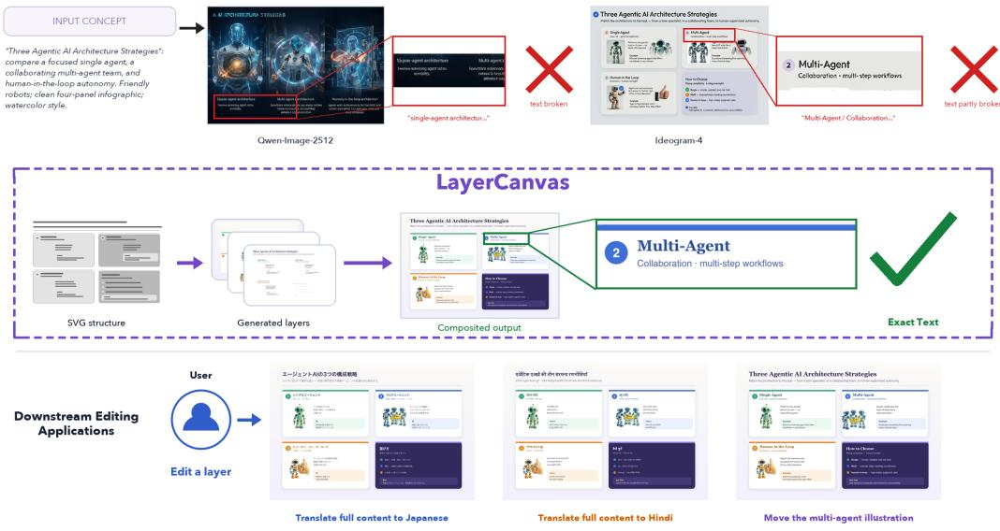  
Figure 1: LayerCanvas generates editable, text-faithful infographics. Current SOTA text-to-image models such as Qwen-Image-2512 (Qwen Team, 2025a) and Ideogram-4 (Ideogram AI, 2026) flatten the graphic and often garble text (top). Given a vector layout, LayerCanvas generates ordered RGB layers and composes them with exact vector text (middle), enabling localization and illustration edits without changing unrelated content (bottom).

## ABSTRACT

Online learning platforms are increasingly deploying AI assistants to provide personalized, on-demand tutoring. These can leverage infographics to communicate complex information and improve the learning experience. However, automating effective infographic generation remains a challenging task, requiring a combination of visual richness with precise typography, structured layouts, and continued editability. Existing representation methods satisfy these goals only in part: Scalable Vector Graphics (SVG) representations preserve geometry, hierarchy, and text but provide limited aesthetic flexibility, while raster diffusion models produce richer appearances by flattening content and layout into a single image. Conditioning a diffusion model on a rasterized SVG does not resolve this conflict because the raster preserves approximate placement but discards element ownership, occlusion relationships, and the structure needed to modify and recompose the result. We introduce LayerCanvas, a hybrid approach that retains SVG as the semantic, structural, and typographic program while using diffusion to aestheticize non-text content. Rather than generating one flattened raster, LayerCanvas partitions SVG

elements into z-ordered sets of mutually non-overlapping elements and processes them through communicating parallel RGB generation streams. The resulting layers are independently editable and deterministically recomposed, while text is rendered from preserved vector metadata. Our approach combines rich visual syn thesis with accurate typography and localized editing. LayerCanvas substantially improves text fidelity over state-of-the-art raster image generators while achieving the highest overall aesthetic quality. We further demonstrate non-destructive content editing, localization, asset reuse, and animation.

## 1 INTRODUCTION

Visual explanations are a fundamental component of modern learning platforms, where instructional content is increasingly presented through a combination of text, diagrams, illustrations, and infographics. Pairing words with pictures improves comprehension and retention relative to text alone (Mayer, 2009; Clark & Paivio, 1991), while infographics can make dense information more accessible and memorable (Bateman et al., 2010; Bhat & Alyahya, 2024). As learning platforms increasingly deliver and adapt instructional materials digitally, there is a growing need to automatically generate visual explanations that are both pedagogically effective and easy to revise as content evolves. Such explanations must communicate through precise labels and clear visual hierarchy while also providing the visual richness expected from modern image generators (Rombach et al., 2022; Podell et al., 2024; Chen et al., 2025). Meeting these requirements is challenging: precision, structure, and editability are naturally supported by representations such as Scalable Vector Graphics (SVG) (W3C SVG Working Group, 2011), whereas visual richness is most readily produced by raster generative models.

This representational contrast has a fundamental tradeoff. Vector graphics make geometry, grouping, text, and rendering order explicit, which makes direct manipulation possible (W3C SVG Working Group, 2011), but automatically generated SVGs (Rodriguez et al., 2025; Wu et al., 2023; Xing et al., 2024; Wu et al., 2024) often appear visually rigid, and stylizing them by hand is costly and difficult to scale. On the other hand, diffusion and flow models provide richer aesthetic priors (Rombach et al., 2022; Saharia et al., 2022; Esser et al., 2024), but synthesizing the artifact as a single raster makes exact typography and local intervention difficult; even state-of-the-art image models render dense, legible text unreliably, motivating specialized text-rendering methods (Liu et al., 2023b; Chen et al., 2023; Tuo et al., 2024). These limitations are especially consequential for learning platforms, which must serve learners worldwide by localizing explanations into different languages and adapting layouts across display formats, from desktop interfaces to mobile screens. Supporting these uses requires text to remain disentangled from imagery and layout components to remain independently adjustable, properties that are lost when the infographic is flattened into a raster. A natural way then is to rasterize the SVG layout and use it as a conditioning signal for a diffusion model, letting the vector structure guide where content goes while diffusion supplies appearance.

Simply rasterizing an SVG for conditioning does not resolve the mismatch: it preserves coarse spatial placement but discards element ownership, occlusion relationships, and the structure needed to recompose the graphic after an edit. This loss of structure cannot be addressed simply by strengthening raster conditioning. A system designed for editable generation should preserve these compositional units throughout synthesis instead of attempting to recover their ownership from pixels afterward.

Motivated by this principle, LayerCanvas combines the structure of SVGs with the visual capabilities of diffusion models. The SVG defines the semantic layout, hierarchy, paint order, and typography. Its non-text elements are partitioned into ordered, non-overlapping layers and generated through communicating parallel RGB streams, which are then alpha-composited according to the SVG z-order. Text nodes are kept outside the diffusion process entirely and rendered directly from their preserved vector metadata (Figure 1). Outputs remain editable, so users can replace text, move or hide groups, change the z-order, reuse illustrations, or specify animation trajectories. This makes the representation well suited to visual authoring workflows where generated content needs to remain editable and reusable, including educational content creation.

Training such a model requires examples that pair SVG with the corresponding rendered layers and final image. To create this paired supervision, we design a custom multi-agent framework, following recent work on agentic pipelines (Jain et al., 2026; Huang et al., 2026). The agents create concepts and SVG layouts, add illustrations, produce text-free targets and masks, and check that each example renders and reconstructs correctly.

Our contributions are:

• A hybrid formulation that separates deterministic SVG structure and typography from diffusion-based aestheticization;

• A multi-agent pipeline that produces and validates paired SVGs, text-free targets, layers, masks, and provenance metadata;

• A rendering-aligned layer representation that supports parallel generation, explicit occlusion modeling, and deterministic z-order composition, yielding over 25% higher placement-exact OCR character accuracy and approximately 27% higher aggregate aesthetic quality than the strongest raster baseline

• Practical workflows for non-destructive editing, localization, asset reuse, and animated visual explanations.

## 2 RELATED WORK

Visual documents and typography. Automatic graphic design combines templates, constraints, retrieval, and learned layouts; neural methods generate sets or sequences of labeled regions, including alignment and overlap structure (Li et al., 2019; Gupta et al., 2021; Inoue et al., 2023). Such representations organize posters, slides, and documents, but do not by themselves resolve illustration appearance, occlusion, or editable object ownership. Programmatic graphics preserve structure, yet hand-authored styling and rigid templates scale poorly to open-ended concepts. Image generators provide richer aesthetics, and text-aware methods introduce character encoders, rendered-glyph conditions, OCR objectives, or localized controls (Chen et al., 2023; Yang et al., 2024b; Tuo et al., 2024). Instead, we retain SVG as the source of truth for geometry and typography, remove text from diffusion targets, and render editable vector text after aestheticization.

Controllable, object-centric, and layered generation. ControlNet and T2I-Adapter condition pretrained diffusion models on spatial signals (Zhang et al., 2023; Mou et al., 2024), while grounded, reference-conditioned, and regional methods add box, entity, exemplar, or prompt-region controls (Li et al., 2023; Ye et al., 2023; Bar-Tal et al., 2023). These approaches improve spatial control but typically produce a single entangled raster or latent field, limiting direct editing after sampling. Object-centric, compositional, and layer-aware models separate entities, concepts, transparency, or foreground/background content (Burgess et al., 2019; Locatello et al., 2020; Avrahami et al., 2023; Zhang & Agrawala, 2024), with recent methods explicitly generating or recovering editable image layers (Yang et al., 2024a; Yin et al., 2025; Wang et al., 2026). In contrast, LayerCanvas uses SVG layer identity as explicit conditioning, packing mutually non-overlapping elements into ordered RGB layer sets. This known layer structure makes output decomposition and local intervention intrinsic to the representation, rather than requiring layers to be recovered post hoc.

Agentic multimodal curation and differentiation. Foundation models have increasingly been used to generate instructions, propose examples, and curate synthetic multimodal supervision (Wang et al., 2023; Liu et al., 2023a; Gadre et al., 2023). More recent agentic pipelines extend this paradigm by coordinating specialized agents for scientific tasks, including translating NeRF papers into executable code and automating the generation of editable scientific figures (Jain et al., 2026; Huang et al., 2026). These systems demonstrate the potential of agentic workflows for generating and iteratively refining structured scientific artifacts. Our pipeline builds on this agentic paradigm by combining specialized generative and validation agents with deterministic SVG parsing, rendering, OCR, overlap analysis, and alpha-composition checks, producing mechanically validated training records.

## 3 PROBLEM SETUP AND METHOD

## 3.1 OVERVIEW

Infographics combine two capabilities that are usually separated. SVGs provide exact layout and typography, whereas diffusion models provide rich raster appearance but collapse the scene into one pixel grid (Podell et al., 2024; Rombach et al., 2022). Conditioning diffusion on a rasterized SVG preserves coarse geometry but loses element boundaries and information about which elements cover others. LayerCanvas instead keeps the SVG as the main scene description and generates its non-text content as an ordered set of editable raster layers.

Figure 2 summarizes the approach. A renderer creates training layers from the SVG, elements that do not overlap are packed into ordered groups, and all groups are denoised in parallel by a frozen image backbone. A trainable adapter identifies each layer and exchanges messages based on SVG overlap and parent-child links. The generated layers are then combined in SVG paint order and exact vector text is added back.

## 3.2 PROBLEM SETUP AND HYBRID OUTPUT

We represent an infographic as an SVG scene

$$
S = ( \mathcal { E } , \mathcal { T } , \mathcal { H } , \mathbf { z } , \mathcal { M } ) ,\tag{1}
$$

where $\mathcal { E } = \{ e _ { i } \} _ { i = 1 } ^ { N }$ contains non-text elements, T stores text and typography, H stores parent-child links, zi is the paint index, and $\mathcal { M }$ contains element type $\tau _ { i } ,$ normalized bounding box $b _ { i } ,$ , and renderer-derived masks. In particular, $A _ { i }$ is the full (amodal) mask of element $e _ { i } ,$ while $V _ { i }$ is the part that remains visible after later elements cover it. Keeping both masks provides training targets for content that becomes visible after deletion, translation, or z-order edits.

The output is a hybrid artifact,

$$
\begin{array} { r } {  { \mathcal { A } } = \left( S , \{ \widehat { L } _ { g } \} _ { g = 1 } ^ { G } , R \right) , \qquad \widehat { I } = \operatorname { O v e r } \left( R _ { \mathrm { t e x t } } ( \varTheta T ) , \operatorname { C o m p } _ { z } ( \widehat { L } _ { 1 } , \dots , \widehat { L } _ { G } ) \right) , } \end{array}\tag{2}
$$

where $\widehat { L } _ { g } = ( \widehat { C } _ { g } , \widehat { \alpha } _ { g } )$ is an editable RGB layer and Comp composes layers in paint order. Diffusion therefore generates the non-text appearance, while the SVG continues to define geometry, ownership, which elements cover others, and exact text.

## 3.3 ORDERED NON-OVERLAPPING LAYER SETS

Assigning one diffusion path to every SVG element preserves ownership but is unnecessarily expensive: many elements never overlap and can share a path without competing for pixels. Unlike pixel-derived layer decomposition (Zhang & Agrawala, 2024), we use the SVG’s explicit element ownership to form ordered groups $\mathcal { G } = \mathsf { \bar { ( } } G _ { 1 } , \mathsf { \bar { \dots } } , G _ { G } )$ of E. Elements within a group have nonoverlapping full masks,

$$
A _ { i } \odot A _ { j } = 0 , \qquad i \neq j , \quad e _ { i } , e _ { j } \in G _ { g } ,\tag{3}
$$

while every overlap respects paint order: if $A _ { i } \odot A _ { j } \ne 0$ and $z _ { i } < z _ { j }$ , then $g ( i ) < g ( j )$ . Consequently, non-overlapping elements may share one generated layer, but an element in front and the element behind it remain separately editable.

We create the groups by processing elements in ascending $( z _ { i } , i )$ order:

$$
g ( i ) = \left\{ 1 , \atop 1 + \operatorname* { m a x } _ { j \in \mathcal { P } _ { i } } g ( j ) , \quad \mathrm { o t h e r w i s e } , \quad \mathcal { P } _ { i } = \{ j : z _ { j } \leq z _ { i } , \ A _ { j } \odot A _ { i } \neq 0 , \ j \mathrm { p r o c e s s e d } \} . \right.\tag{4}
$$

This rule cannot place a front element behind an element that it covers. Group masks are unions, $A _ { g } = \operatorname* { m a x } _ { i \in G _ { g } } A _ { i }$ and $V _ { g } = \operatorname* { m a x } _ { i \in G _ { q } } V _ { i }$ , and each layer path receives its grouped control raster, type, box, paint order, and owned illustration prompt. The number of paths therefore depends on how many layers overlap, rather than the number of SVG elements.

For premultiplied color $P _ { g } = \alpha _ { g } C _ { g }$ , the final raster is obtained by back-to-front alpha composition,

$$
( P ^ { ( g ) } , \alpha ^ { ( g ) } ) = \big ( P _ { g } + ( 1 - \alpha _ { g } ) P ^ { ( g - 1 ) } , \alpha _ { g } + ( 1 - \alpha _ { g } ) \alpha ^ { ( g - 1 ) } \big ) ,\tag{5}
$$

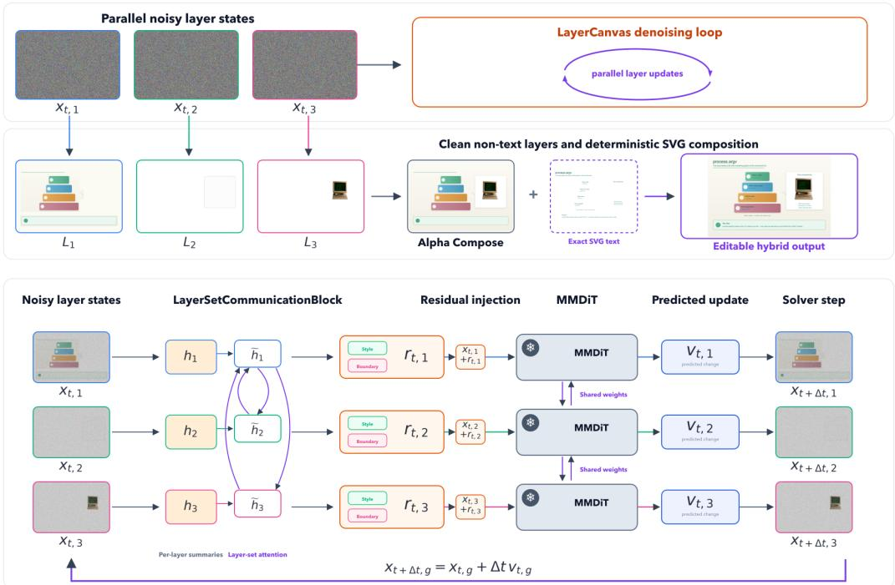  
Figure 2: LayerCanvas layer generation. Top: Parallel denoising produces aligned non-text layers, which are composed in paint order before exact SVG text is restored. Bottom: Layer-set attention produces residuals for shared frozen MMDiT updates, and the solver advances every layer.

starting from a transparent canvas. Paint order controls composition, not generation order: all valid groups are denoised in parallel, and individual layers can later be translated, removed, or reordered without regenerating unrelated groups.

## 3.4 GENERATING COORDINATED LAYERS

LayerCanvas generates all layers together, but separate layers can easily drift toward different colors, lighting, or object identities. Following the continuous interpolation used in flow matching (Lipman et al., 2023), we give them part of the same starting noise and use the same denoising timestep. This encourages a common look while preserving private noise for layer-specific detail. Shared noise cannot make one layer respond to another, however, so the frozen image backbone needs a small trainable adapter. The adapter follows the efficient frozen-backbone conditioning strategy of ControlNet and T2I-Adapter (Zhang et al., 2023; Mou et al., 2024), but operates across an ordered layer set so that each layer is influenced by the other. It answers three questions: which layer is being generated, which other layers matter to it, and whether their effect should be global or limited to a shared boundary.

Identifying each layer. The frozen backbone normally generates one image and has no reason to know whether a batch item represents a background, a foreground illustration, or a later paint-order layer. For group g, the model’s variational autoencoder (VAE) (Kingma & Welling, 2013) converts the grouped control raster into internal features $s _ { g }$ . The trainable grouped layer-control adapter then adds learned identifiers for paint order and the main element type:

$$
q _ { g } = \mathrm { L N } ( s _ { g } ) + E _ { z } [ g ] + E _ { \tau } [ \tau _ { g } ] , \qquad r _ { g } ^ { ( 0 ) } = W _ { 0 } q _ { g } , \quad r _ { g } ^ { ( d ) } = W _ { d } \phi ( W _ { s } q _ { g } ) .\tag{6}
$$

Here, $\operatorname { L N } ( s _ { g } )$ describes the layer’s visual control, $E _ { z } [ g ]$ tells the model where it appears in paint order, and $\breve { E _ { \tau } } [ \tau _ { g } ]$ tells it the main element type. The projections $W _ { 0 }$ and $W _ { d }$ turn this combined description into small adjustments at the transformer input and selected depths. These outputs start at zero, so the adapter initially leaves the pretrained backbone unchanged. The adjustments are added at a small set of backbone depths.

Table 1: Primary comparison on test set. Char and Exact measure placement-exact OCR, while Recall measures text recovered anywhere in the image. Appeal, Typog., and Cov. are VLM scores from 0-5, with Avg denoting their mean. Best synthesis result in each column is bold.
<table><tr><td rowspan="2">Method</td><td colspan="3">Text fidelity</td><td colspan="4">VLM judge (0-5)</td></tr><tr><td>Char</td><td>Exact</td><td>Recall</td><td>Appeal</td><td>Typog.</td><td>Cov.</td><td>Avg</td></tr><tr><td>SVG (LLM-authored)</td><td>0.856</td><td>0.676</td><td>0.964</td><td>2.37</td><td>4.02</td><td>4.90</td><td>3.76</td></tr><tr><td>Qwen-Image-2512 (Qwen Team, 2025a)</td><td>0.080</td><td>0.002</td><td>0.149</td><td>2.69</td><td>1.00</td><td>1.45</td><td>1.71</td></tr><tr><td>Ideogram-4 (Ideogram AI, 2026)</td><td>0.657</td><td>0.360</td><td>0.744</td><td>2.92</td><td>2.29</td><td>3.89</td><td>3.03</td></tr><tr><td>LayerCanvas (Ours)</td><td>0.822</td><td>0.623</td><td>0.942</td><td>2.99</td><td>3.81</td><td>4.75</td><td>3.85</td></tr></table>

Sharing information between layers. Layer identifiers solve ownership, but the backbone still processes every layer independently. Dense communication between every image location would be costly and would ignore the overlap and parent-child links already available in the SVG. Instead, each LayerSetCommunicationBlock builds one compact summary $h _ { g }$ per layer. For a receiving layer g, a sending layer $h ,$ and attention head $^ { a , }$ the block first computes a pairwise score $\ell _ { g h } ^ { a }$ , converts the scores into weights $\pi _ { g h } ^ { a }$ , and uses those weights to combine the sending-layer summaries:

$$
\begin{array} { r l } & { \ell _ { g h } ^ { a } = \frac { \left. W _ { Q } ^ { a } h _ { g } , W _ { K } ^ { a } h _ { h } \right. } { \sqrt { d _ { a } } } + ( w _ { E } ^ { a } ) ^ { \top } E _ { g h } , } \\ & { \pi _ { g h } ^ { a } = \mathrm { s o f t m a x } _ { h } ( \ell _ { g h } ^ { a } ) , } \\ & { \widetilde { h } _ { g } = W _ { O } \mathrm { C o n c a t } _ { a } \left( \displaystyle \sum _ { h } \pi _ { g h } ^ { a } W _ { V } ^ { a } h _ { h } \right) . } \end{array}\tag{7}
$$

The first part of $\ell _ { g h } ^ { a }$ measures similarity between the two layers; the second adds their SVG relationship from $E _ { g h } . ~ \pi _ { g h } ^ { a }$ says how much layer $g$ should listen to layer $h ,$ and $\widetilde { h } _ { g }$ is the resulting information received by layer g after all attention heads are combined. Because the SVG links have directions, a covered background can receive a different message from the element in front of it.

Applying shared information. Not every cross-layer change should affect the same area. A shared palette or lighting choice should act smoothly across a layer, while an overlap correction should stay near the touching edges. We therefore split the received summary $\widetilde { h } _ { g }$ into a style path and a boundary path. Let $x _ { g }$ denote the current spatial features of layer g:

$$
\begin{array} { r l } & { r _ { g } ^ { \mathrm { s t y } } = F _ { \mathrm { s t y } } ( \widetilde { h } _ { g } ) , } \\ & { r _ { g } ^ { \mathrm { b n d } } = F _ { \mathrm { b n d } } ( x _ { g } , \widetilde { h } _ { g } ) , } \\ & { \quad r _ { g } = \sigma ( \gamma _ { g } ^ { \mathrm { s t y } } ) r _ { g } ^ { \mathrm { s t y } } + \sigma ( \gamma _ { g } ^ { \mathrm { b n d } } ) B _ { g } \odot r _ { g } ^ { \mathrm { b n d } } . } \end{array}\tag{8}
$$

The style function turns $\widetilde { h } _ { g }$ into a smooth layer-wide change. The boundary function combines $\widetilde { h } _ { g }$ with the current features $x _ { g } .$ , while $B _ { g }$ keeps its change near layer edges. The learned gates $\gamma _ { g } ^ { \mathrm { s t y } }$ and $\gamma _ { g } ^ { \mathrm { b n d } }$ decide how strongly each path should act. Their weighted sum is the final residual $r _ { g } ,$ , which is added back to layer g at that depth of the frozen MMDiT image backbone. As above, the added outputs start at zero, so communication is introduced gradually during training.

Training and exact text. Training checks each layer, the final combined image, hidden areas and boundaries. These losses check both individual ownership and the assembled image. Typography is excluded from diffusion targets and added back from the retained SVG strings. This guarantees exact editable text rather than asking diffusion to paint glyphs, as in text-aware raster generators (Chen et al., 2023; Tuo et al., 2024). Appendix B.1 gives the full training path, loss and text-composition procedure.

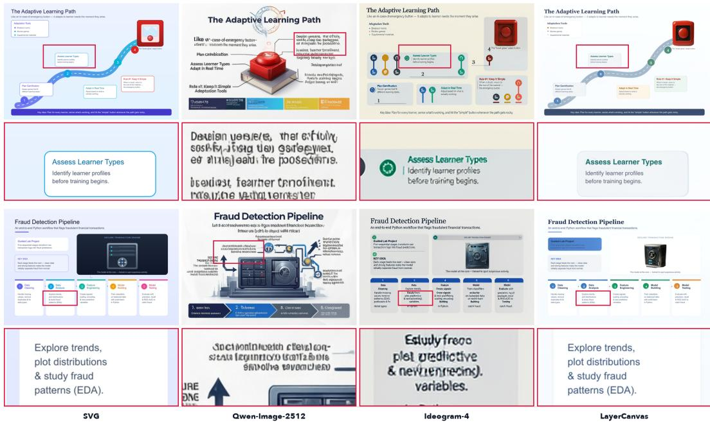  
Figure 3: Qualitative four-way comparison Columns show, left to right, the SVG control, two prompt-only SOTA diffusion baselines (Qwen-Image-2512 Qwen Team (2025a) and Ideogram-4 Ideogram AI (2026)), and LayerCanvas. The corresponding next row shows the zoomed in regions for the highlighted text regions. Prompt-only models produce appealing raster illustrations but garble or invent text and drift from the prescribed layout whereas LayerCanvas keeps the layer layout and composites exact, legible vector text.

## 4 EXPERIMENTS

## 4.1 SETUP

Dataset - We develop InfoLayers, a corpus of 23,960 paired infographic records on a 768 × 512 canvas with a multi-agent pipeline. Each sample pairs a structural SVG with a text-free and a composited target, together with the per-layer supervision our model consumes: amodal and visible masks, paint order, and a hierarchy/overlap graph. Construction and layout statistics are given in Appendix A.

Baselines - We compare four methods on shared held-out layouts. The LLM-authored SVG reference recolors and completes the structural SVG and renders it, giving exact vector text by construction but no learned aestheticization. The two prompt-only open-weight SOTA diffusion baselines, Qwen-Image-2512 (Qwen Team, 2025a) and Ideogram-4 (Ideogram AI, 2026), are each conditioned on the design-concept prompt derived from the input SVG layout; for Ideogram-4 this prompt is constructed from the same SVG layout, with its structural elements serialized into the structured prompt format the model expects. LayerCanvas is our grouped layer-set diffusion model with deterministic exact-SVG text compositing with the MMDiT backbone as Ideogram AI (2026). For evaluation, all methods are placed on a 768×512 canvas.

Metrics - Text fidelity is scored two ways. Placement-exact fidelity uses ground-truth-region OCR Tesseract OCR contributors (2026) at 768×512, and reports character accuracy and exact-match rate. Placement-agnostic fidelity runs full-image OCR at the same resolution and measures word recall, how much of the ground-truth text appears anywhere in the image, so a baseline that renders readable text at the wrong position still gets credit. The two exact-text methods place text from the SVG by construction, so their remaining gap from 1.0 is OCR error rather than real text mistakes. For visual quality we use a VLM as a judge: Claude Opus 4.8 (Anthropic, 2026) scores each design from 0 to 5

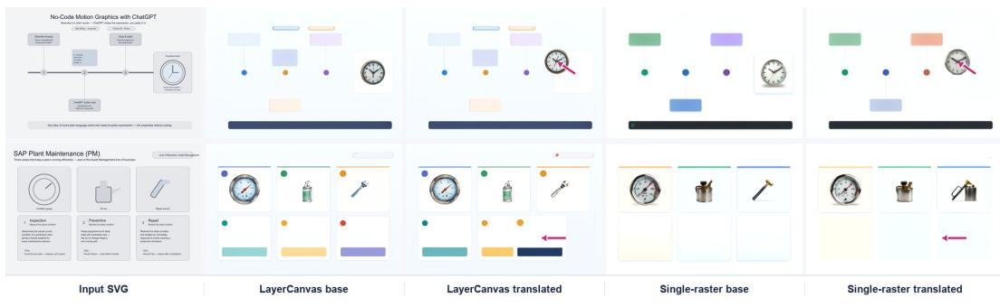  
Figure 4: Representation ablation: Each column shows the source SVG, fixed-noise base generation, and the translated version by perturbing the base SVG for LayerCanvas and the single-raster as control. Red arrows show the shift from the base position in the translated cases. LayerCanvas better preserves object identity and unrelated layout content.

Table 2: Comparison of Different Conditioning Representations on validation set
<table><tr><td>Method</td><td>Char</td><td>Exact</td><td>Recall</td><td>Appeal</td><td>Typog.</td><td>Cov.</td><td>Avg</td></tr><tr><td>Single-raster Conditioning</td><td>0.851</td><td>0.568</td><td>0.783</td><td>2.78</td><td>3.56</td><td>4.32</td><td>3.55</td></tr><tr><td>LayerCanvas</td><td>0.823</td><td>0.530</td><td>0.795</td><td>2.84</td><td>3.76</td><td>4.72</td><td>3.77</td></tr></table>

on illustration appeal, typography, and semantic coverage, and we report Avg, the mean of the three.   
The full evaluation protocol is given in Appendix B.2.

## 4.2 MAIN COMPARISON

Table 1 reports the comparison on the test set (construction in Appendix B). LayerCanvas combines strong visual appeal with text fidelity, outperforming both raster baselines across all text metrics while approaching the exact-text SVG reference. Ideogram-4 Ideogram AI (2026) generates aesthetic looking samples, but it still trails LayerCanvas on text fidelity; Qwen-Image-2512 Qwen Team (2025a) performs poorly on both text placement and recovery. Under the primary Claude judge, LayerCanvas is the strongest learned method across illustration appeal, typography, semantic coverage, and aggregate quality, and slightly exceeds the SVG reference overall. The same learned-method ranking holds under independent Gemini 3.7 Flash (Google DeepMind, 2026) and GPT-5.6 Sol (OpenAI, 2026) judges (Appendix Table 5). Figure 3 shows the same appeal-text trade-off qualitatively. Additional results are in Appendix B.3. Inference compute details for LayerCanvas are in Appendix B.4.2.

## 4.3 REPRESENTATION ABLATION

We compare grouped LayerCanvas with a single-raster conditioning baseline to test whether explicit layer separation improves editability. The baseline conditions the same MMDiT model (Ideogram AI, 2026) directly on the rasterized SVG using T2I-Adapter (Mou et al., 2024). A single stream must learn to render the whole graphic at once, which becomes harder as the layout grows denser. In contrast, each LayerCanvas layer contains non-overlapping elements, making it simpler to learn before the layers are composed. Under fixed noise, LayerCanvas better preserves the moved element and surrounding layout, while the control redraws unrelated content (Figure 4). It also improves text recall and all VLM scores, raising average quality from 3.55 to 3.77 (Table 2).

## 5 DOWNSTREAM APPLICATIONS

Because LayerCanvas preserves SVG structure alongside independently addressable raster layers, a generated design can be adapted without regenerating the whole image. Vector text supports changes to wording, typography, and language, while separate visual layers enable animation, asset reuse, and local element edits such as removing a card or swapping an icon while preserving unaffected content.

Figure 5: Independent animation of one LayerCanvas region. A Text2Video-Zero-inspired imagediffusion trajectory produces an open-to-closed blink. Only the selected eye region changes across the five frames; the surrounding illustration, layout, and vector typography remain fixed.  
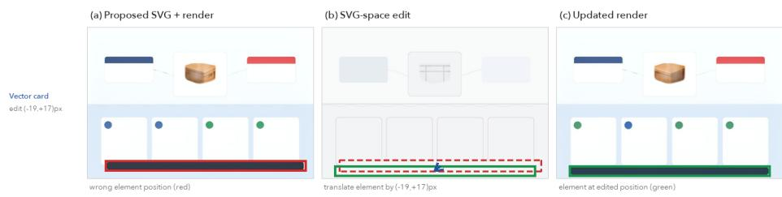  
Figure 6: Closed-loop SVG correction. Each row shows an incorrect SVG and render, the direct SVG edit, and the corrected render. The edited element moves to the requested location while unrelated content remains stable.

Retained grouping and paint order further support layout retargeting, re-theming, and SVG-level corrections while limiting changes to the intended components. Together, these capabilities turn a generated infographic into a reusable authoring artifact. We highlight three below; the rest are detailed in Appendix C.

## 5.1 TEXT EDITING AND LOCALIZATION

End-to-end raster generators must repaint text whenever wording, typography, or language changes. LayerCanvas instead generates only the visual substrate and preserves typography as styled SVG nodes, so copy, style, and locale changes require no diffusion pass and cannot alter the generated artwork (Figure 13).

## 5.2 INDEPENDENT LAYER ANIMATION

We adapt the zero-shot animation principle of Text2Video-Zero (Khachatryan et al., 2023), in which the motion and appearance priors of a pretrained text-to-image diffusion model produce a temporally linked sequence without video-specific training. Whereas a flattened document would expose the complete page to this update, LayerCanvas lets the temporal operation target one named image layer while all other layers remain fixed: every unselected image layer and the full-resolution SVG typography are copied identically into every frame.

## 5.3 SVG-SPACE REFINEMENT AND FAITHFUL DIFFUSION PROPAGATION

An upstream layout proposal may contain a misplaced, mislabeled, or incorrectly styled element. In LayerCanvas, the SVG is a persistent control surface: the element can be corrected directly, and the model propagates that correction to the raster without retraining or redesigning the rest of the document.

## 6 CONCLUSION

We formulate infographic generation as structured aestheticization: a deterministic SVG supplies geometry, hierarchy, typography, while parallel layer-set generation supplies visual appearance. Aligning this representation with the renderer supports many downstream applications like editing

and artifact reuse. Enforcing generalization to more layouts and improving transformations under changed occlusion remain important research directions.

## REFERENCES

Anthropic. Introducing Claude Opus 4.8. https://www.anthropic.com/news/ claude-opus-4-8, May 2026. Product announcement, May 28, 2026.

Omri Avrahami, Kfir Aberman, Ohad Fried, Daniel Cohen-Or, and Dani Lischinski. Break-a-scene: Extracting multiple concepts from a single image. In SIGGRAPH Asia 2023 Conference Papers, 2023. doi: 10.1145/3610548.3618154.

Omer Bar-Tal, Lior Yariv, Yaron Lipman, and Tali Dekel. Multidiffusion: Fusing diffusion paths for controlled image generation. In International Conference on Machine Learning, 2023.

Scott Bateman, Regan L. Mandryk, Carl Gutwin, Aaron Genest, David McDine, and Christopher Brooks. Useful junk? the effects of visual embellishment on comprehension and memorability of charts. In Proceedings of the SIGCHI Conference on Human Factors in Computing Systems (CHI), pp. 2573–2582, 2010.

S. A. Bhat and S. Alyahya. Infographics in educational settings: A literature review. IEEE Access, 12:1633–1649, 2024. doi: 10.1109/ACCESS.2023.3348083.

Christopher P. Burgess, Loic Matthey, Nicholas Watters, Rishabh Kabra, Irina Higgins, Matthew Botvinick, and Alexander Lerchner. Monet: Unsupervised scene decomposition and representation. arXiv preprint, 2019.

Hang Chen, Qian Xiang, Jiaxin Hu, Meilin Ye, Chao Yu, Hao Cheng, and Lei Zhang. Comprehensive exploration of diffusion models in image generation: A survey. Artificial Intelligence Review, 58 (99), 2025. doi: 10.1007/s10462-025-11110-3.

Jingye Chen, Yupan Huang, Tengchao Lv, Lei Cui, Qifeng Chen, and Furu Wei. Textdiffuser: Diffusion models as text painters. In Advances in Neural Information Processing Systems, 2023.

James M. Clark and Allan Paivio. Dual coding theory and education. Educational Psychology Review, 3(3):149–210, 1991.

Patrick Esser, Sumith Kulal, Andreas Blattmann, Rahim Entezari, Jonas Müller, Harry Saini, Yam Levi, Dominik Lorenz, Axel Sauer, Frederic Boesel, Dustin Podell, Tim Dockhorn, Zion English, Kyle Lacey, Alex Goodwin, Yannik Marek, and Robin Rombach. Scaling rectified flow transformers for high-resolution image synthesis. In International Conference on Machine Learning (ICML), 2024.

Samir Yitzhak Gadre, Gabriel Ilharco, Alex Fang, Jonathan Hayase, Georgios Smyrnis, Thao Nguyen, Robert Marten, Mitchell Wortsman, et al. Datacomp: In search of the next generation of multimodal datasets. In Advances in Neural Information Processing Systems, 2023.

Daniel Gatis. rembg: A tool to remove image backgrounds, 2025. URL https://github.com/ danielgatis/rembg. MIT-licensed software.

Google DeepMind. Gemini 3.7 Flash model card. https://deepmind.google/models/ model-cards/gemini-3-7-flash/, August 2026. Published August 13, 2026.

Kamal Gupta, Justin Lazarow, Alessandro Achille, Larry S. Davis, and Vijay Mahadevan. Layouttransformer: Layout generation and completion with self-attention. In IEEE/CVF International Conference on Computer Vision, 2021.

Siyuan Huang, Yifan Zhou, Yutong Gao, Zi Yin, Juyang Bai, Xinxin Liu, Rama Chellappa, Chun Pong Lau, Cheng Peng, Sayan Nag, and Shraman Pramanick. Scifig: Towards automating editable figure generation for scientific papers, 2026.

Ideogram AI. Ideogram 4.0. https://ideogram.ai/blog/ideogram-4.0/, 2026. Technical blog.

Naoto Inoue, Kotaro Kikuchi, Edgar Simo-Serra, Mayu Otani, and Kota Yamaguchi. Layoutdm: Discrete diffusion model for controllable layout generation. In Proceedings of the IEEE/CVF Conference on Computer Vision and Pattern Recognition (CVPR), pp. 10167–10176, 2023.

Seemandhar Jain, Keshav Gupta, Kunal Gupta, and Manmohan Chandraker. Nerfify: A multi-agent framework for turning nerf papers into code. In Proceedings of the IEEE/CVF Conference on Computer Vision and Pattern Recognition (CVPR), pp. 24384–24394, 2026.

Levon Khachatryan, Andranik Movsisyan, Vahram Tadevosyan, Roberto Henschel, Zhangyang Wang, Shant Navasardyan, and Humphrey Shi. Text2video-zero: Text-to-image diffusion models are zero-shot video generators. In Proceedings of the IEEE/CVF International Conference on Computer Vision (ICCV), pp. 15954–15964, 2023. doi: 10.1109/ICCV51070.2023.01462.

Diederik P. Kingma and Max Welling. Auto-encoding variational bayes. arXiv preprint arXiv:1312.6114, 2013.

Dom Lachowicz, Caleb Moore, et al. rsvg-convert: Turn SVG Files into Raster Images. librsvg, 2014. URL https://manpages.ubuntu.com/manpages/trusty/man1/ rsvg-convert.1.html.

Jianan Li, Jimei Yang, Aaron Hertzmann, Jianming Zhang, and Tingfa Xu. Layoutgan: Generating graphic layouts with wireframe discriminators. In International Conference on Learning Representations, 2019.

Yuheng Li, Haotian Liu, Qingyang Wu, Fangzhou Mu, Jianwei Yang, Jianfeng Gao, Chunyuan Li, and Yong Jae Lee. Gligen: Open-set grounded text-to-image generation. In IEEE/CVF Conference on Computer Vision and Pattern Recognition, 2023.

Yaron Lipman, Ricky T. Q. Chen, Heli Ben-Hamu, Maximilian Nickel, and Matt Le. Flow matching for generative modeling. In International Conference on Learning Representations, 2023.

Haotian Liu, Chunyuan Li, Qingyang Wu, and Yong Jae Lee. Visual instruction tuning. In Advances in Neural Information Processing Systems, 2023a.

Rosanne Liu, Dan Garrette, Chitwan Saharia, William Chan, Adam Roberts, Sharan Narang, Irina Blok, RJ Mical, Mohammad Norouzi, and Noah Constant. Character-aware models improve visual text rendering. In Annual Meeting of the Association for Computational Linguistics (ACL), 2023b.

Francesco Locatello, Dirk Weissenborn, Thomas Unterthiner, Aravindh Mahendran, Georg Heigold, Jakob Uszkoreit, Alexey Dosovitskiy, and Thomas Kipf. Object-centric learning with slot attention. In Advances in Neural Information Processing Systems, 2020.

Richard E. Mayer. Multimedia Learning. Cambridge University Press, 2nd edition, 2009.

Chong Mou, Xintao Wang, Liangbin Xie, Yanze Wu, Jian Zhang, Zhongang Qi, and Ying Shan. T2iadapter: Learning adapters to dig out more controllable ability for text-to-image diffusion models. In Proceedings ofthe AAAI Conference on Artificial Intelligence, volume 38, pp. 4296–4304, 2024.

OpenAI. GPT-5.6 Sol model. https://developers.openai.com/api/docs/models/ gpt-5.6-sol, 2026. Model documentation.

Dustin Podell, Zion English, Kyle Lacey, Andreas Blattmann, Tim Dockhorn, Jonas Müller, Joe Penna, and Robin Rombach. Sdxl: Improving latent diffusion models for high-resolution image synthesis. In International Conference on Learning Representations (ICLR), 2024.

Qwen Team. Qwen-Image-2512. https://qwen.ai/blog?id=qwen-image-2512, 2025a. Technical blog.

Qwen Team. Qwen-Image-Edit: Image editing with higher quality and efficiency. https://qwen. ai/blog?id=qwen-image-edit, 2025b. Technical blog.

Juan A. Rodriguez, Abhay Puri, Shubham Agarwal, Issam H. Laradji, Pau Rodriguez, Sai Rajeswar, David Vazquez, Christopher Pal, and Marco Pedersoli. Starvector: Generating scalable vector graphics code from images and text. In IEEE/CVF Conference on Computer Vision and Pattern Recognition (CVPR), 2025.

Robin Rombach, Andreas Blattmann, Dominik Lorenz, Patrick Esser, and Björn Ommer. Highresolution image synthesis with latent diffusion models. In IEEE/CVF Conference on Computer Vision and Pattern Recognition (CVPR), 2022.

Chitwan Saharia, William Chan, Saurabh Saxena, Lala Li, Jay Whang, Emily Denton, Seyed Kamyar Seyed Ghasemipour, Burcu Karagol Ayan, S. Sara Mahdavi, Rapha Gontijo Lopes, Tim Salimans, Jonathan Ho, David J. Fleet, and Mohammad Norouzi. Photorealistic text-to-image diffusion models with deep language understanding. In Advances in Neural Information Processing Systems (NeurIPS), 2022.

Tesseract OCR contributors. Tesseract: Open source OCR engine. https://github.com/ tesseract-ocr/tesseract, 2026. Software repository; accessed September 2, 2026.

Yuxiang Tuo, Wangmeng Xiang, Jun-Yan He, Yifeng Geng, and Xuansong Xie. Anytext: Multilingual visual text generation and editing. In International Conference on Learning Representations, 2024.

Stéfan van der Walt, Johannes L. Schönberger, Juan Nunez-Iglesias, François Boulogne, Joshua D. Warner, Neil Yager, Emmanuelle Gouillart, and Tony Yu. scikit-image: image processing in python. PeerJ, 2:e453, 2014. ISSN 2167-8359. doi: 10.7717/peerj.453. URL http://dx.doi.org/ 10.7717/peerj.453.

W3C SVG Working Group. Scalable Vector Graphics (SVG) 1.1 (Second Edition). W3C Recommendation, 2011. URL https://www.w3.org/TR/SVG11/.

Binhao Wang, Shihao Zhao, Bo Cheng, Qiuyu Ji, Yuhang Ma, Liebucha Wu, Shanyuan Liu, Dawei Leng, and Yuhui Yin. RevealLayer: Disentangling hidden and visible layers via occlusion-aware image decomposition. 2026. URL https://arxiv.org/abs/2605.11818.

Yizhong Wang, Yeganeh Kordi, Swaroop Mishra, Alisa Liu, Noah A. Smith, Daniel Khashabi, and Hannaneh Hajishirzi. Self-instruct: Aligning language models with self-generated instructions. In Annual Meeting ofthe Associationfor Computational Linguistics, 2023.

Ronghuan Wu, Wanchao Su, Kede Ma, and Jing Liao. Iconshop: Text-guided vector icon synthesis with autoregressive transformers. ACM Transactions on Graphics, 2023.

Ronghuan Wu, Wanchao Su, and Jing Liao. Chat2svg: Vector graphics generation with large language models and image diffusion models. arXiv preprint arXiv:2411.16602, 2024.

Ximing Xing, Juncheng Hu, Guotao Liang, Jing Zhang, Dong Xu, and Qian Yu. Empowering llms to understand and generate complex vector graphics. arXiv preprint arXiv:2412.11102, 2024.

Jinrui Yang, Qing Liu, Yijun Li, Soo Ye Kim, Daniil Pakhomov, Mengwei Ren, Jianming Zhang, Zhe Lin, Cihang Xie, and Yuyin Zhou. Generative image layer decomposition with visual effects. 2024a. URL https://arxiv.org/abs/2411.17864.

Yukang Yang, Dongnan Gui, Yuhui Yuan, Weicong Liang, Haisong Ding, Han Hu, and Kai Chen. Glyphcontrol: Glyph conditional control for visual text generation. In Advances in Neural Information Processing Systems, volume 36, 2024b.

Hu Ye, Jun Zhang, Sibo Liu, Xiao Han, and Wei Yang. Ip-adapter: Text compatible image prompt adapter for text-to-image diffusion models. arXiv preprint, 2023.

Shengming Yin, Zekai Zhang, Zecheng Tang, Kaiyuan Gao, Xiao Xu, Kun Yan, Jiahao Li, Yilei Chen, Yuxiang Chen, Heung-Yeung Shum, Lionel M. Ni, Jingren Zhou, Junyang Lin, and Chenfei Wu. Qwen-Image-Layered: Towards inherent editability via layer decomposition. 2025. URL https://arxiv.org/abs/2512.15603.

Lvmin Zhang and Maneesh Agrawala. Transparent image layer diffusion using latent transparency. arXiv preprint, 2024.

Lvmin Zhang, Anyi Rao, and Maneesh Agrawala. Adding conditional control to text-to-image diffusion models. In IEEE/CVF International Conference on Computer Vision, 2023.

## Appendix

## CONTENTS

• Appendix A: Data

– A.1 Concept sourcing and topical scope

– A.2 Multi-agent generation pipeline

– A.3 Layer decomposition, augmentation, and validation

– A.4 Dataset composition, splits, and provenance

– A.5 Dataset analysis: color composition is coupled and learnable

– A.6 Implementation details

• Appendix B: Additional Details and Experiments

– B.1 Additional method details

– B.2 Evaluation details

– B.3 Additional comparisons

– B.4 Systems profile

• Appendix C: Downstream Applications

– C.1 Text editing and localization

– C.2 Animation and progressive reveal

– C.3 Asset reuse and cross-document recomposition

– C.4 Layout retargeting and responsive resize

– C.5 Command-driven interactive editing

– C.6 SVG-space refinement and faithful diffusion propagation

• Appendix D: Limitations, ethics, and broader impact

## A DATA

Training LayerCanvas requires a form of supervision that, to our knowledge, no existing corpus provides: infographics paired at the level of individual, renderer-aligned layers. A usable training record must expose, for a single graphic, (i) a structural program that fixes geometry, hierarchy, paint order, and typography; (ii) an aestheticized, text-free rendering of that program; and (iii) a decomposition of that rendering into ordered, mutually non-overlapping RGBA layers with amodal and visible masks. Public SVG datasets supply programs but no rich appearance, while raster infographic collections supply appearance but discard element ownership, occlusion, and text metadata. We therefore synthesize the corpus with a multi-agent generation pipeline that couples a large language model, which designs and validates editable SVG programs, with a diffusion image editor, which aestheticizes only the non-text visual content. The pipeline is designed so that every artifact LayerCanvas consumes at training time, namely the colorless structural input, the text-free target, the per-layer amodal/visible assets, and the graph of overlap and hierarchy relations, is produced deterministically from an SVG the agent has already checked, rather than recovered from pixels after the fact.

This section describes how concepts are sourced from an educational course catalog (§A.1), how the multi-agent pipeline turns each concept into a validated paired record (§A.2), how those records are decomposed into layers, augmented, and validated (§A.3), the resulting scale, splits, and provenance (§A.4), an analysis of the appearance statistics the pipeline induces (§A.5), and the implementation and compute details needed to reproduce it (§A.6).

## A.1 CONCEPT SOURCING AND TOPICAL SCOPE

We seed generation with concepts drawn from popular online educational courses. Each concept is a short, self-contained instructional idea (for example, “handling missing values in Python,” “the tip-of-the-iceberg model of specialist agents,” or “the Power BI ↔ Excel round-trip”), and it carries the identifier and title of the course it was extracted from. Anchoring the corpus in real course material keeps the distribution of topics, terminology, and visual conventions close to genuine educational infographics (dense labels, step-wise procedures, comparisons, cycles, and metaphorical scenes) rather than to generic stock imagery. The course identifier is retained on every derived record and is used both for provenance and, critically, for constructing leakage-free splits (§A.4).

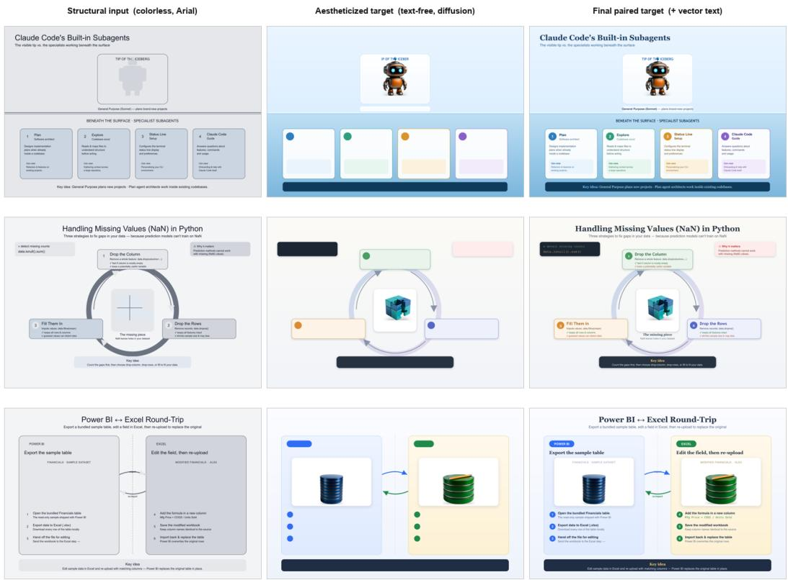  
Figure 7: The paired training record. Each column is one artifact the pipeline emits for the same sample. Left: the structural input, an SVG with color, fonts, and textures stripped and text set in a neutral face, which supplies geometry, hierarchy, and paint order without leaking target appearance. Middle: the aestheticized, text-free target that the diffusion streams are trained to produce; the editable-visual regions have been restyled into rich illustrations while every text region is left blank. Right: the final paired target after the preserved vector text layer is composited on top. Diffusion is never asked to render glyphs.

## A.2 MULTI-AGENT GENERATION PIPELINE

The pipeline proceeds in four stages. A design stage authors a structured, editable SVG program from a concept; an extraction stage renders the structural input and the text-free layout and serializes structured conditioning; an aestheticization stage restyles each editable region with a diffusion image editor; and a composition stage mattes and reinserts the styled illustrations in paint order. All appearance in the final target originates in the SVG program or in the diffusion edits of its tagged regions, never in a free-form raster of the whole scene.

Stage A: structured SVG design (LLM). A design agent, built on a large language model, turns a concept into a complete, standalone SVG on a fixed 1536 × 1024 canvas. Beyond producing an aesthetic educational layout, the agent must mark at least one editable-visual group: a coarse vector placeholder standing in for a tangible, photographable subject (a robot, a database cylinder, a brass scale, a stack of coins). Each such group is emitted with a strict, machine-parseable signature,

$$
\begin{array} { r l } & { \quad < { \mathfrak { g } } _ { \mathrm { \normalfont ~  { d } } } \mathrm { d } \mathrm { = } ^ { \mathfrak { n } } \mathrm { e } { \mathrm { d } } \mathrm { i } \mathrm { t } { \mathrm { \normalfont ~ a } } { \mathrm { b } } _ { \mathrm { 1 } } \mathrm { e } - { \mathfrak { v } } \mathrm { i } \mathrm { s } { \mathrm { u } } \mathrm { a } \mathrm { 1 } - k ^ { \mathfrak { n } } { \mathrm { \normalfont ~  ~ d } \mathrm { a } } \mathrm { t } \hat { \mathrm { a } } - { \mathrm { r } } \mathrm { o } { \mathrm { 1 } } \mathrm { e } = ^ { \mathfrak { n } } \mathrm { e } { \mathrm { d } } \mathrm { i } \mathrm { t } \mathrm { a } { \mathrm { b } } _ { \mathrm { 1 } } \mathrm { e } - { \mathfrak { v } } \mathrm { i } \mathrm { s } { \mathrm { u } } \mathrm { a } \mathrm { 1 } ^ { \mathfrak { n } } \mathrm { \Lambda } } \\ & { \quad \mathrm { d } \mathrm { a } \mathrm { t } \mathrm { a } - { \mathrm { v } } \mathrm { i } \mathrm { s } { \mathrm { u } } \mathrm { a } \mathrm { 1 } - { \mathrm { d } } \mathrm { e } \mathrm { s } \mathrm { c } { \mathrm { = } } ^ { \mathfrak { n } } \cdot \cdot \ \cdot \ \cdot ^ { \mathfrak { n } } \mathrm { d } \mathrm { a } \mathrm { t } \mathrm { a } - { \mathrm { e } } { \mathrm { d } } \mathrm { i } \mathrm { t } - { \mathrm { p } } { \mathrm { r } } \mathrm { o } \mathrm { m } { \mathrm { p } } \mathrm { t } = ^ { \mathfrak { n } } \cdot \ \cdot \ \cdot \ ^ { \mathfrak { n } } > \cdot \ \cdot \ \cdot \cdot < / { \mathrm { q } } > , } \end{array}
$$

where data-edit-prompt is the exact, self-contained instruction later handed to the diffusion editor. To prevent the corpus from collapsing onto a single visual template, the agent is assigned one of fourteen layout archetypes per concept (hero-left, hub-and-spoke, comparison-split, circular-cycle, above-below, quadrant-grid, timeline, and others), rotated deterministically across a batch and treated as an adaptable starting structure rather than a rigid template. The prompt enforces explicit layout discipline (shared alignment gridlines, equal gaps for repeated elements, symmetry matched to the number of editable visuals) and an aesthetic direction tuned for legibility (light airy backgrounds, per-section color coding, a strong title/subtitle/takeaway hierarchy). A guard explicitly forbids screens, dashboards, spreadsheets, and other flat, text-bearing objects from being marked editable, because such subjects photorealize poorly and reintroduce garbled text; those elements remain crisp vector content. The agent operates in a render-and-inspect loop: it rasterizes its SVG, examines the image, and performs at least one revision pass to correct misalignment, uneven spacing, dead space, or low-contrast text before emitting a manifest of its editable groups.

Stage B: structural extraction and conditioning. From the validated SVG we deterministically derive the model’s inputs. The structural input (Fig. 7, left) is produced by “rawifying” the SVG, that is, stripping color, fonts, gradients, and textures, setting text in a neutral face, and rendering to a flat raster, so that it encodes placement, grouping, and paint order without revealing target appearance. We also render a text-free layout in which all recursive text nodes are removed. The record captures the scene as typed metadata: every text run with its content, semantic role (title/heading/label), normalized bounding box, font family, size, weight, and fill; every illustration with its identifier, description, the data-edit-prompt, its bounding box, and its z-index; and a global style block listing the design palette (hex swatches), font families, and mean corner radius. This record is the interface between deterministic structure and diffusion aestheticization used throughout the method.

Stage C: illustration aestheticization (diffusion editor). Each editable-visual crop is rendered in isolation and passed to a diffusion image editor (Qwen-Image-Edit Qwen Team (2025b)) that repaints only that region into a rich illustration on a plain white studio background. A style controller makes the requested look dominant: it strips residual realism adjectives from the agent’s subject description, prepends a leading style directive, and swaps a matching negative prompt, so a single subject can be realized in any of six styles (photoreal, flat2d, soft3d, cartoon, watercolor, isometric) while its identity and composition are preserved. The middle column of Fig. 7 shows the resulting text-free targets, in which the coarse placeholders have become detailed objects but every label region remains blank.

Stage D: matting and z-ordered composition. The styled illustration is cut from its white background with an alpha matte (rembg/u2net (Gatis, 2025)), cleaned to its largest connected component and feathered, fitted to the placeholder’s bounding box, and composited back into the scene at exactly the illustration’s original z-index. Because the surrounding layout is rebuilt from the SVG with the editable groups removed, the realistic render occupies the placeholder footprint without disturbing any text or vector element, and soft contact shadows are added programmatically and kept off text and table regions. The output is the final paired target (Fig. 7, right): the aestheticized, text-free composite with the preserved vector text layer rendered crisply on top.

## A.3 LAYER DECOMPOSITION, AUGMENTATION, AND VALIDATION

Ordered non-overlap layer decomposition. For every sample we additionally emit the amodal layer decomposition. Each top-level layer is rendered in isolation to recover its amodal silhouette (its complete support as if nothing occluded it) and its visible mask (the pixels surviving occlusion by all higher-z layers); their difference is exactly the occluded region. Editable layers take their amodal pixels from the matted realistic render, reconstructed with the same parameters used in composition, so that they agree with the final target. We also record, for every pair of layers whose amodal silhouettes intersect, an overlap edge annotated with the back/front assignment and the covered fraction. These masks and edges are what make the ordered non-overlap layer sets and the graph-biased communication of the method well defined; they are computed deterministically from the renderer, not discovered from pixels.

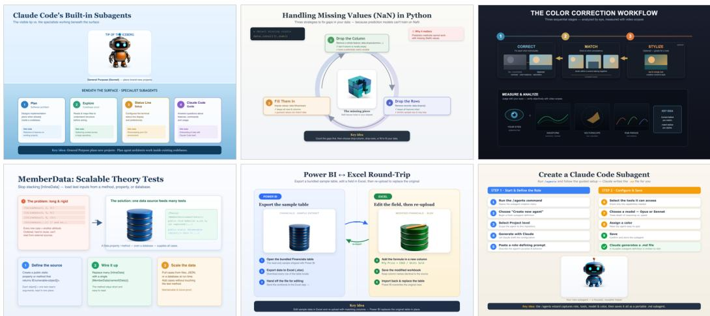  
Figure 8: Representative dataset infographics. The corpus spans diverse layout archetypes (abovebelow iceberg, circular cycle, hero-plus-steps, comparison split, guided procedure, staged timeline), both light and dark themes, and a range of illustration styles, while preserving crisp typography and clean editable-visual footprints in every sample. Text is always rendered from vector metadata, never by the diffusion editor.

Style augmentation via illustration reuse. Because Stage A (LLM design) and Stage B (structural extraction) are the expensive, language-model-dependent parts of the pipeline, we amortize them: given an already-built sample with its per-layer amodal RGBA and its tagged editable-visual illustration, we generate additional (input → target) pairs whose only difference is the visual style of the illustration. The existing target layers and structured conditioning are reused verbatim; only Stage C (re-style the illustration) and Stage D (re-matte, re-compose) are rerun on-GPU. This yields multiple stylistic realizations of the same structural layout at a fraction of the cost, and a densercomposition variant reuses previously generated illustrations inside new, higher-overlap layouts to increase occlusion depth.

Validation and quality control. Records are filtered at several points. The design agent’s own inspect-and-revise loop rejects layouts with misalignment, empty regions, or unreadable text before a sample is emitted. Structural extraction validates that text nodes are fully removed from visual targets and that every illustration crop is isolated with clear margins. Composition validates alpha coverage of the matte and geometric fit within the target footprint, and layer reconstruction is checked against the composite so that within-group elements do not overwrite one another and every cross-group overlap follows SVG paint order. Samples failing these checks are regenerated or dropped.

## A.4 DATASET COMPOSITION, SPLITS, AND PROVENANCE

The merged corpus contains 23,960 paired records, combining an initial generation pass (roughly 8.4K pairs) with the style-augmentation and dense-reuse passes (roughly 15.5K pairs); the passes are merged so that no structural layout appears across the boundary in conflicting roles. Every record carries the full training tuple: the structural input, the text-free and final targets, the per-layer amodal/visible masks, the overlap and hierarchy graph, and the structured conditioning metadata. Illustration styles are distributed roughly evenly across the six style families, and the samples span the fourteen layout archetypes. Figure 8 shows representative final targets.

Leakage-free, course-disjoint splits. Splits are constructed at the granularity of the source course, not the individual sample, so that no concept from a course used for evaluation can also appear in training. Courses are ordered by a fixed hash of their identifier, and a subset-sum procedure selects a set of whole courses summing to 200 samples for the test split and, from the remainder, another 200 for validation; all remaining courses form the training split. Because a course contributes all of its concepts to exactly one split, the evaluation sets measure generalization to unseen courses and topics rather than memorization of a familiar course’s visual style.

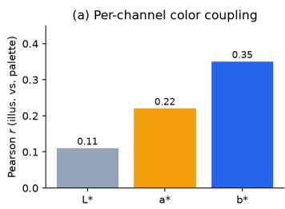

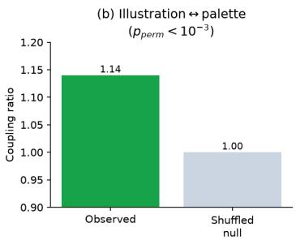

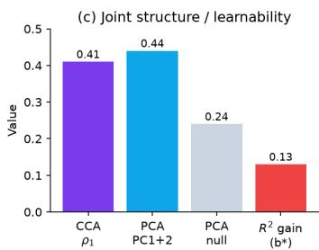  
Figure 9: Cross-element color structure $( n = 1 , 0 0 0 )$ . (a) Per-channel Pearson correlation in CIELAB between mean illustration color and mean palette color; coupling is strongest on the $b ^ { * }$ (blueyellow) axis. (b) Observed illustration↔palette coupling exceeds a shuffled null $( \bar { p } _ { \mathrm { p e r m } } < 1 0 ^ { - 3 } )$ . (c) Joint-structure and learnability summaries: canonical correlation $\rho _ { 1 }$ , variance explained by the first two joint principal components versus a null, and the $R ^ { 2 }$ gain on $b ^ { * }$ from conditioning on the palette. Together these show the dataset induces coordinated, non-random color composition across layers.

Provenance. Each record retains its course identifier and title, the assigned layout archetype, the editable-visual descriptions and edit prompts, the diffusion style and seed, and the compositing parameters, so that any sample can be traced back to its concept and regenerated. Concepts are used as textual seeds for synthesis; the visual content of every target is generated by our own pipeline.

## A.5 DATASET ANALYSIS: COLOR COMPOSITION IS COUPLED AND LEARNABLE

A natural question for a synthesized corpus is whether it contains learnable structure beyond each element in isolation, in particular, whether the colors of different elements within a graphic are related, as they are in human-designed infographics where palette choices are made jointly. We quantify this on a 1,000-sample subset by comparing, within each graphic, the colors of the vector design and the colors of the diffusion-generated illustrations, all in perceptual CIELAB space.

Two findings emerge (Fig. 9). First, the vector side is palette-coherent by construction: text fills are drawn verbatim from the design palette (median $\Delta E \bar { = } 0$ to the nearest palette swatch), confirming that the LLM designs a single coherent color scheme per graphic. Second, and less trivially, the diffusion-generated illustrations are measurably coupled to that vector palette even though the editor sees only a per-illustration subject prompt. Aggregate illustration color and palette color are positively correlated per channel, most strongly on the blue-yellow $( b ^ { * } , r = 0 . 3 5 )$ and red-green $( a ^ { * }$ $r = 0 . 2 2 )$ axes and weakest on lightness $( L ^ { * } , r = 0 . 1 1 ) ;$ ; a permutation test rejects independence $( p _ { \mathrm { p e r m } } < 1 0 ^ { - 3 }$ , observed-to-null coupling ratio 1.14×); and a canonical correlation analysis between illustration and palette color reaches a first correlation of $\rho _ { 1 } = 0 . 4 1$ . The coupling is also learnable: knowing the palette improves prediction of an illustration’s $b ^ { * }$ by $\Delta R ^ { 2 } = + 0 . 1 { \bar { 3 } }$ beyond the style label alone, and the leading two principal components of the joint color representation explain 0.44 of the variance versus 0.24 under a shuffled null.

Mechanistically, this coupling is authorial rather than injected: the same language model writes both the design palette and each illustration’s subject prompt, so color intent leaks through word choice, and it survives the editor’s independent re-styling. This is a desirable property for our setting: it means the corpus rewards a model that coordinates appearance across layers rather than styling each layer in isolation, which is precisely the behavior the correlated, communicating streams of LayerCanvas are designed to capture.

## A.6 IMPLEMENTATION DETAILS

The design agent is driven by a large language model (Claude Opus 4.8 Anthropic (2026)), accessed through a standard chat-completion API, and invoked with a render-and-inspect tool loop that supplies the rasterized SVG back to the model for revision. SVGs are rendered with rsvg-convert (Lachowicz et al., 2014) at the fixed 1536 × 1024 canvas. Illustration aestheticization uses the Qwen-Image-Edit Qwen Team (2025b) diffusion image editor in bfloat16, with classifier-free guidance 5.0, 40 denoising steps, and a fixed seed for reproducibility; crop sizes are snapped to multiples of 32 within [256, 1024]. Standalone asset generation, where needed, uses the Qwen-Image Qwen Team (2025a) text-to-image model. Background removal uses rembg Gatis (2025) with the u2net matting model; a border-connected white-key matte is available as a fast alternative for saturated subjects. Color analysis is performed in CIELAB (via scikit-image (van der Walt et al., 2014)) with k-means dominant-color extraction and permutation, canonical-correlation, and PCA baselines.

The stages have different resource needs, so we separate them. The language-model stage requires only API access and runs on a CPU host, while the GPU stages (aestheticization, matting, composition, and layer rendering) run on NVIDIA H100 and H200 GPUs. Large batches are executed on 8×H100 and 8×H200 nodes. The style-augmentation and dense-reuse passes require no language-model access, since they reuse the previously validated structural layers and only rerun the GPU restyle-andcompose steps.

## B ADDITIONAL DETAILS AND EXPERIMENTS

This section provides the complete method specification followed by supplementary experimental details, comparisons, and analyses.

## B.1 ADDITIONAL METHOD DETAILS

Renderer-derived masks and hidden areas. The offline renderer removes all SVG text nodes and records a text-free target, per-element RGBA assets, element types, normalized boxes, parent-child links, paint order, and masks. For element $e _ { i } ,$ the full (amodal) mask $A _ { i }$ covers its entire area before later elements are painted, while $V _ { i }$ retains only the pixels visible in the final rendering. Their difference $H _ { i } = ( { \bar { A _ { i } } } - V _ { i } ) .$ identifies content hidden by an element in front. Because per-element assets are rendered before composition, $H _ { i }$ contains the element’s true appearance rather than a blank region. This provides a direct training target for content revealed by deletion, translation, or z-order edits. Illustration prompts and text regions are routed to their owning visual elements, although text remains absent from image targets.

Properties of ordered grouping. The rule in Eq. (4) never places an element in the same or an earlier group than an already processed element that it overlaps. Thus every overlap keeps SVG paint order, while Eq. (3) guarantees that elements sharing a generated layer cannot overwrite one another. The groups are not based on meaning or element type: different element types may share a generated layer whenever their full masks do not overlap. The layers are also not generated one at a time; the group index determines composition order but all layers are sampled simultaneously. After a geometric edit, grouping and graph information are recomputed without resampling unaffected layers.

Correlated layer-wise flow matching. Let $\boldsymbol { x } _ { 1 , q } \in \mathbb { R } ^ { K \times D }$ be the packed internal VAE features of the clean target for group g. We combine shared and private Gaussian noise,

$$
\epsilon _ { g } = \sqrt { \rho } \epsilon _ { \mathrm { s h } } + \sqrt { 1 - \rho } \epsilon _ { g } ^ { \mathrm { p r } } , \quad \epsilon _ { \mathrm { s h } } , \epsilon _ { g } ^ { \mathrm { p r } } \sim \mathcal { N } ( 0 , I ) ,\tag{9}
$$

where the shared component encourages a consistent scene-level look and the private component preserves layer-specific variation. The current schedule samples $\rho \sim \mathcal { U } ( 0 . 5 , 1 )$ . Each example uses one common timestep t, so communication always relates layers at the same noise level. The implemented linear path is

$$
x _ { t , g } = ( 1 - t ) \epsilon _ { g } + t x _ { 1 , g } , \qquad u _ { g } = x _ { 1 , g } - \epsilon _ { g } , \qquad t \sim \mathcal { U } ( 0 , 1 ) ,\tag{10}
$$

with primary objective

$$
\mathcal { L } _ { \mathrm { l a y e r } } = \frac { \sum _ { g } m _ { g } \Vert v _ { \theta , g } - u _ { g } \Vert _ { 2 } ^ { 2 } } { \sum _ { g } m _ { g } } , \qquad \widehat { x } _ { 1 , g } = x _ { t , g } + ( 1 - t ) v _ { \theta , g } ,\tag{11}
$$

where $m _ { g }$ ignores empty layer slots added for batching. During generation, these partly shared starting states are updated in parallel. Shared noise only helps align the overall look: without the communication block, the frozen backbone still processes each group independently and cannot react to another layer’s evolving content or boundary. Figure 2 shows the full noise-to-layer path and expands one repeated denoising step.

Communication summaries and graph bias. At a selected backbone depth, each layer is summarized using nine compact feature groups: summary statistics from the full and hidden areas, averages from visible areas and boundary bands, $2 \times 2$ pooled spatial context, type, box, paint order, timestep, local text context, and a global feature average. These values are combined into the group summary $h _ { g } .$ . The graph tensor $\bar { E _ { g h } } \in \mathbb { R } ^ { 4 }$ stores directed back-to-front overlap, front-to-back overlap, parent-to-child links, and child-to-parent links. A learned linear map produces one added bias per attention head, as formalized in Eq. (7); invalid padded groups are masked from both keys and outputs.

Style and boundary paths. The communicated summary $\widetilde { h } _ { g }$ is returned to the image features through the two paths in Eq. (8). The style path predicts a coarse $2 \times 2$ cell grid and enlarges it to provide smooth appearance corrections. The boundary path combines local hidden states with $\widetilde { h } _ { g }$ and is multiplied by a narrow band $B _ { g } ,$ , limiting its effect to silhouettes and cross-layer contacts. Their learned gate biases are initialized to $[ - 2 . 0 , \bar { - } 2 . 5 ]$ , giving initial gate strengths of approximately 0.12 and 0.076. These gates start small but not at zero. The block makes no change at the start of training because the style and boundary output layers start at zero.

Composition and structure losses. The loss for each layer does not by itself check the result after the layers are combined. The composition loss sorts groups by paint order and compares their masked reconstruction with the clean composite. $\mathcal { L } _ { \mathrm { h i d } }$ supervises the hidden area $H _ { g } = \mathbf { \bar { ( } } A _ { g } - V _ { g } ) _ { + }$ , and $\mathcal { L } _ { \mathrm { b n d } }$ matches values and spatial gradients near ancestor boundaries. For every auxiliary term, we first recover the one-step clean estimate ${ \widehat { x } } _ { 1 , g }$ for each group from its noisy state and predicted velocity using Eq. (11). This estimate remains in the packed model representation; training does not decode a full RGB image through the VAE for these losses. Only the composition loss combines the estimated groups: it applies their amodal masks, sorts them by SVG paint order, and compares the result with the corresponding composition of the clean target groups. The remaining auxiliary losses operate directly on individual clean group estimates.

The full objective is

$$
{ \mathcal { L } } = \lambda _ { \mathrm { l a y e r } } { \mathcal { L } } _ { \mathrm { l a y e r } } + \lambda _ { \mathrm { c o m p } } { \mathcal { L } } _ { \mathrm { c o m p } } + \lambda _ { \mathrm { h i d } } { \mathcal { L } } _ { \mathrm { h i d } } + \lambda _ { \mathrm { b n d } } { \mathcal { L } } _ { \mathrm { b n d } }\tag{12}
$$

Exact typography. All SVG text nodes are removed from diffusion targets, and prompts request blank title, label, and caption regions. We retain the Unicode string, role, bounding box, font family and style, alignment, transforms, hierarchy, and owning visual element. During generation, the text-free composite is placed beneath a transparent vector-rendered text layer $R _ { \mathrm { t e x t } } ( { \bar { \mathcal { T } } } )$ , as specified in Eq. (2). Spelling, line breaks, alignment, and font edits therefore require only vector re-rendering, not another diffusion pass.

## B.2 EVALUATION DETAILS

Compared methods. The primary comparison (Table 1) evaluates four methods: (i) SVG (LLMgenerated), a reference in which an LLM (Claude Opus 4.8Anthropic (2026)) recolors and completes the structural SVG, which is then rasterized with rsvg-convertLachowicz et al. (2014); this yields exact vector text by construction but is not a photorealistic synthesizer; (ii) Qwen-Image-2512 (Qwen Team, 2025a), a prompt-only diffusion model conditioned on the design-concept prompt which is itself derived from the same SVG layout (for fairness in evaluation); (iii) Ideogram-4 (Ideogram AI, 2026), a prompt-only open-weights system whose prompt is constructed from the same SVG layout, with its structural elements serialized into the structured prompt format the model expects; and (iv) LayerCanvas, grouped layer-set diffusion followed by exact SVG text compositing. Prompt-only baselines receive the concept prompt reconstructed from each record’s structured conditioning; LayerCanvas additionally consumes the structural layer set.

Generation configuration. Diffusion baselines and LayerCanvas are run at matched prompts and seeds; the editor backbone runs in bf16 with classifier-free guidance 5.0 and 40 denoising steps. LayerCanvas adds text exactly from the source SVG after raster synthesis.

Text-fidelity protocol. Text fidelity is measured two ways. Placement-exact fidelity uses groundtruth-region OCR: for each ground-truth text box (taken from the stored structured conditioning) we crop the corresponding region and OCR it with Tesseract Tesseract OCR contributors (2026). The primary results use a strict 768×512 evaluation canvas. Both exact-text methods are rendered with rsvg-convert Lachowicz et al. (2014) on the same host with Georgia, Helvetica, and Arial available through fontconfig. We report character accuracy (1− normalized edit distance, averaged over regions) and exact-match rate. Placement-agnostic fidelity instead runs locationindependent full-image OCR and reports word recall, the fraction of ground-truth content tokens (length ≥ 3, NFKC-normalized) recovered anywhere in the image; this credits a baseline that renders legible text at the wrong position. For the two exact-text methods the remaining gap from 1.0 reflects OCR error rather than genuine text mistakes, since the text is placed by construction. The two prompt-only baselines behave differently under the two scores: both are near zero on placement-exact OCR because their glyphs are not at the ground-truth boxes, but on word recall Ideogram-4 recovers most text (partially readable yet mislocated) while Qwen-Image-2512 stays low (text is genuinely garbled).

Table 3: Full evaluation, including the craft judge criterion omitted from Table 1. Text fidelity is measured at 768×512 and includes placement-exact ground-truth-region OCR (char / exact) and placement-agnostic full-image word recall (Recall); judge criteria are 0-5, higher better; Avg is the mean of appeal, typography, and coverage. †LLM-authored SVG recolor reference.
<table><tr><td></td><td colspan="3">Text fidelity</td><td colspan="5">VLM judge (0-5)</td></tr><tr><td>Method</td><td>Char</td><td>Exact</td><td>Recall</td><td>Appeal</td><td>Typog.</td><td>Cov.</td><td>Craft</td><td>Avg</td></tr><tr><td>SVG (LLM-authored)†</td><td>0.856</td><td>0.676</td><td>0.964</td><td>2.37</td><td>4.02</td><td>4.90</td><td>3.91</td><td>3.76</td></tr><tr><td>Qwen-Image-2512</td><td>0.080</td><td>0.002</td><td>0.149</td><td>2.69</td><td>1.00</td><td>1.45</td><td>1.51</td><td>1.71</td></tr><tr><td>Ideogram-4</td><td>0.657</td><td>0.360</td><td>0.744</td><td>2.92</td><td>2.29</td><td>3.89</td><td>2.49</td><td>3.03</td></tr><tr><td>LayerCanvas (Ours)</td><td>0.822</td><td>0.623</td><td>0.942</td><td>2.99</td><td>3.81</td><td>4.75</td><td>3.59</td><td>3.85</td></tr></table>

Table 4: OCR resolution sensitivity. Placement-exact character accuracy (Char) and exact-match rate (Exact), together with placement-agnostic word recall (Recall).
<table><tr><td rowspan="2">Method</td><td colspan="3">768×512 OCR</td><td colspan="3">4096-pixel OCR</td></tr><tr><td>Char</td><td>Exact</td><td>Recall</td><td>Char</td><td>Exact</td><td>Recall</td></tr><tr><td>SVG (LLM-authored)†</td><td>0.856</td><td>0.676</td><td>0.964</td><td>0.883</td><td>0.595</td><td>0.814</td></tr><tr><td>Qwen-Image-2512</td><td>0.080</td><td>0.002</td><td>0.149</td><td>0.077</td><td>0.002</td><td>0.150</td></tr><tr><td>Ideogram-4</td><td>0.657</td><td>0.360</td><td>0.744</td><td>0.643</td><td>0.268</td><td>0.727</td></tr><tr><td>LayerCanvas (Ours)</td><td>0.822</td><td>0.623</td><td>0.942</td><td>0.853</td><td>0.543</td><td>0.806</td></tr></table>

Judge protocol. Aesthetic and typographic quality is scored by a VLM judge using the humanpreference variant of our static-quality rubric. The primary judge (Claude Opus 4.8) scores each image on 0-5 across three criteria-illustration appeal, typography quality, semantic coverage plus a holistic overall score that we omit in the reported tables in favor of Avg, the transparent mean of illustration appeal, typography, and semantic coverage. The appeal criterion uses strict, anchored bands so that coarse, flat, or generic illustrations stay in the low range regardless of how clean the surrounding layout is, and richly rendered, detailed artwork is required for the top bands; this keeps the score aligned with what a human would actually prefer without the rubric explicitly naming photorealism. The design concept passed to the judge is reconstructed from the stored structured conditioning, and judgments are disk-cached for reproducibility. We additionally repeat the identical image-rubric judgments with Gemini 3.7 Flash Google DeepMind (2026) and GPT-5.6 Sol OpenAI (2026). All three judges receive the same 768×512 resolution.

Full results. Table 3 reports the judge criteria alongside both text-fidelity metrics.

Across judges, LayerCanvas’s Avg is 3.88 ± 0.08 (population standard deviation), compared with $1 . 9 0 \pm \mathrm { { \bar { 0 } } . 1 { \bar { 3 } } }$ for Qwen and 3.30 ± 0.21 for Ideogram. This slightly exceeds the SVG reference’s $3 . 8 3 \pm 0 . 0 7$ cross-judge mean. Judges differ in absolute calibration but preserve the learned-method ranking.

## B.3 ADDITIONAL COMPARISONS

Figures 10 and 11 provide additional qualitative comparisons, showing that LayerCanvas preserves the source layout and legible text while enriching the illustrations and avoiding the text failures of raster baselines.

  
Figure 10: Additional qualitative comparisons. Columns show the LLM-authored SVG reference, Qwen-Image-2512, Ideogram-4, and LayerCanvas, respectively.

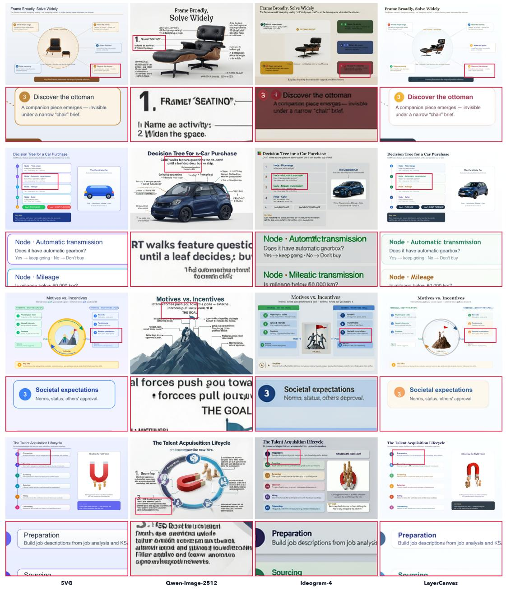  
Figure 11: Additional qualitative comparisons. Columns show the LLM-authored SVG reference, Qwen-Image-2512, Ideogram-4, and LayerCanvas, respectively.

Table 5: Multi-judge robustness at 768×512. Each entry is the mean of illustration appeal, typography quality, and semantic coverage. LayerCanvas is the highest-scoring learned synthesis method under every judge.
<table><tr><td>Judge</td><td>SVG</td><td>Qwen</td><td>Ideogram</td><td>LayerCanvas</td></tr><tr><td>Claude Opus 4.8 Anthropic (2026)</td><td>3.76</td><td>1.71</td><td>3.03</td><td>3.85</td></tr><tr><td>Gemini 3.7 Flash Google DeepMind (2026)</td><td>3.93</td><td>1.99</td><td>3.54</td><td>3.99</td></tr><tr><td>GPT-5.6 Sol OpenAI (2026)</td><td>3.81</td><td>1.99</td><td>3.32</td><td>3.81</td></tr></table>

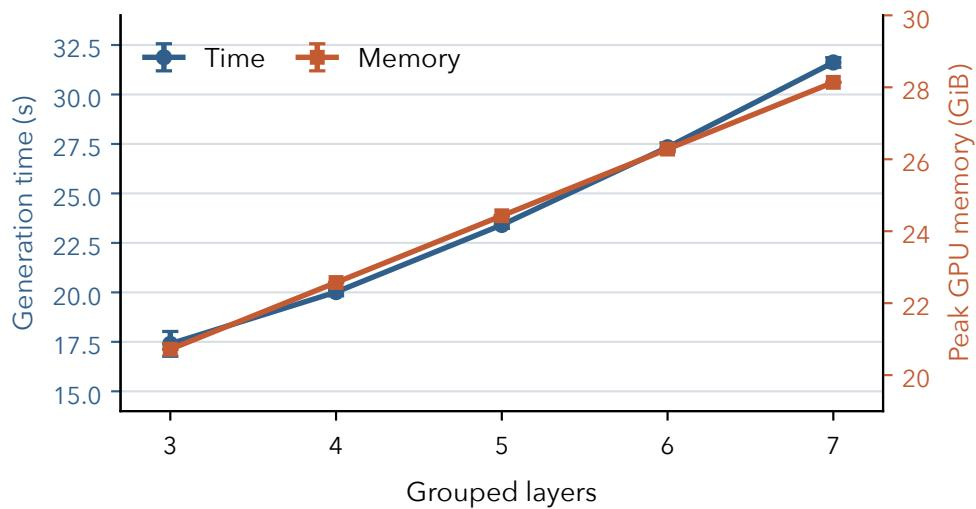  
Figure 12: Diffusion inference compute. Generation time and peak allocated GPU memory on one H200 increase with the number of grouped layers. Each point is the mean of two 20-step generations; error bars show the measured minimum and maximum.

## B.4 SYSTEMS PROFILE

## B.4.1 TRAINING COMPUTE

With full gradient checkpointing, a single-H200 training step takes 10.33 s and uses 30.8 GiB of peak GPU memory. Backward recomputation takes 7.18 s, forward execution 2.29 s, and input preparation 0.83 s. Checkpointing half of the transformer blocks reduces the step time to approximately 9.2 s but raises peak GPU memory to approximately 108 GiB. Quarter and no-checkpointing profiles exceed 133 GiB and run out of memory on a 141 GB H200.

## B.4.2 INFERENCE COMPUTE

Layer generation. A matched single-H200 profile uses two validation examples at each grouped layer count from three through seven. End-to-end generation takes 24.0 s per sample on average and 23.4 s at the median, with a measured range of 16.8-31.9 s over 10 generations. Peak allocated GPU memory rises from 20.7 GiB at three grouped layers to 28.1 GiB at seven. The trend is shown in Figure 12.

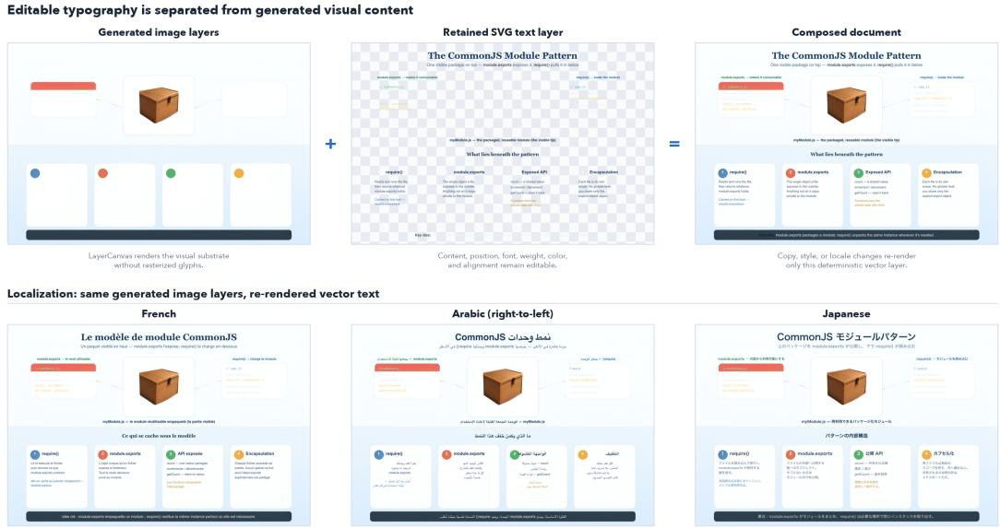  
Figure 13: Editable text representation and localization. A held-out LayerCanvas result is generated without glyphs, while the source SVG text nodes remain a separate editable vector layer. Their composition produces the final document. The lower row localizes the same unchanged generated image layers into French, Arabic, and Japanese by re-rendering only the text layer.

## C DOWNSTREAM APPLICATIONS

This section demonstrates how the hybrid raster-SVG layer-set representation supports deterministic editing and reuse after generation. Each application uses the trained grouped layer-set model or a previously generated output from that model; operations performed only on the persistent structured representation are identified explicitly.

## C.1 TEXT EDITING AND LOCALIZATION

End-to-end raster generators must repaint text whenever wording, typography, or language changes. Because their glyph generation is data-driven, they may also favor the visual conventions of a dominant training language rather than faithfully rendering a requested, less represented script. LayerCanvas instead generates only the visual substrate and preserves typography as styled SVG nodes. Copy, style, and locale changes therefore require no diffusion pass and cannot alter the generated artwork.

Implementation. Each text node retains its Unicode content, position, font family, size, weight, style, anchor, fill color, transforms, and parent ownership. Editing replaces only the requested attributes before the text-only SVG is rasterized and alpha-composited over the unchanged model output. Localization uses a script-appropriate local font and shaping direction; nonlinguistic values such as numbers and code may remain unchanged. Figure 13 shows the same generated layers with text rendered in four languages.

Deterministic behavior. This operation is a property of the representation rather than a learned prediction: the requested node attributes are written directly into SVG and rendered by the vector-text runtime. Thus the rendered language follows the provided Unicode content and selected font rather than a language distribution learned by the image model. The only external requirements are an available font with the requested glyphs and enough space in the retained text box for the new copy. If a translation changes line length substantially, standard SVG layout operations can resize or reflow the text box without regenerating any image layer.

## C.2 INDEPENDENT LAYER ANIMATION

We adapt the zero-shot animation principle of Text2Video-Zero Khachatryan et al. (2023), which shows that the motion and appearance priors of a pretrained text-to-image diffusion model can produce a temporally linked sequence without video-specific training. A flattened document would still expose the complete page to this generative update, allowing unrelated illustrations, layout, and typography to drift. LayerCanvas instead lets the temporal operation target one named image layer while all other layers remain fixed.

Implementation. Following Text2Video-Zero, we derive a short motion trajectory from an image diffusion prior rather than training a video model. The user selects an image layer, optionally together with a bounded subregion, and specifies endpoint states or a motion transform. Intermediate states are produced through latent interpolation or motion-guided warping, decoded only for the selected content, and alpha-composited over the unchanged layer set at each timestep. This final step is specific to our representation: every unselected image layer and the full-resolution SVG typography are copied identically into every frame. In Figure 5, the selected subregion is an eye band covering 6.6% of the canvas.

Discussion. The generative component supplies motion only; spatial isolation comes from the LayerCanvas representation. Pixels outside the selected region and the complete vector-text layer are not predicted at subsequent timesteps, so they remain bit-identical by construction. This converts a global zero-shot image animation method into a local document operation and avoids spending temporal model capacity on content that should not move.

## C.3 ASSET REUSE AND RECOMPOSITION

A flattened image binds every illustration, diagram, and decorative element to its original page. Reusing one of them requires segmentation followed by inpainting or regeneration of the surrounding content. LayerCanvas instead keeps generated visual groups as addressable image layers with their own alpha and paint order, so an element can become a reusable asset after generation.

Implementation. A selected layer is copied with its image content and alpha mask. Standard layer operations then translate or scale it, adjust its appearance within the mask, and assign a new position in the target paint order. Multiple selected layers may be placed onto a new background and combined with newly authored SVG text. These operations act on the saved representation and do not require segmentation, inpainting, or another diffusion pass. Figure 14 shows three layers reused in a new composition.

Discussion. Reuse preserves the generated appearance of an asset while decoupling it from the document in which it first appeared. A collection of generated layers can therefore serve as a project specific asset library: recurring illustrations or diagram components may be placed across related documents while layout and text remain independently editable. The resulting composition is still structured, so the reused layer can be moved, hidden, or replaced again later.

## C.4 LAYOUT RETARGETING AND RESPONSIVE RESIZE

A design may need to appear as a presentation slide, poster, and mobile graphic. Resizing a flattened page either distorts its elements or removes content through cropping. LayerCanvas retains the document as addressable groups, allowing the same generated content to be arranged for a different canvas.

Implementation. Each illustration, diagram, card, and text block carries a bounding box and group assignment. A simple reflow solver packs these groups in reading order, using more columns on wide canvases and a vertical stack on narrow ones. Generated image groups are scaled uniformly, while SVG text can be re-rendered for the new box. The operation changes only layout metadata and recomposition; the image layers are not generated again. Figure 15 shows the same content adapted to slide, poster, and mobile layouts.

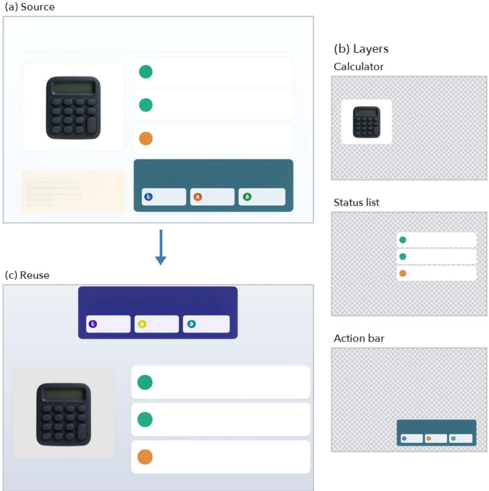  
Figure 14: Asset reuse. Three generated layers are taken from one document and arranged into a new composition. Each layer carries its own alpha, allowing independent repositioning, scaling, restyling, and reordering.

Discussion. Retargeting becomes a document-layout problem rather than an image-generation problem. Groups may be reprioritized, resized, or moved between rows without changing their generated appearance, and the result remains editable after recomposition. More advanced layout objectives or design templates can replace the simple solver without changing the underlying representation.

## C.5 COMMAND-DRIVEN INTERACTIVE EDITING

Interactive authoring is naturally expressed through commands such as “remove this card,” “emphasize this panel,” or “swap this icon.” Prompt-based regeneration may redraw the entire canvas. Named layer groups instead allow the command to be grounded to one element and executed as a local, reversible edit.

Implementation. A lightweight interpreter maps a command to {ACTION, TARGET} using action phrases and aliases for the document’s semantic groups. We support removing, emphasizing, swapping, and adding elements. The executor applies the operation to the targeted SVG group or model-rendered layer. Full-resolution alpha masks define the affected region, allowing the result to be recomposited without resampling unrelated content. Figure 16 shows remove, swap, and add commands applied to selected regions.

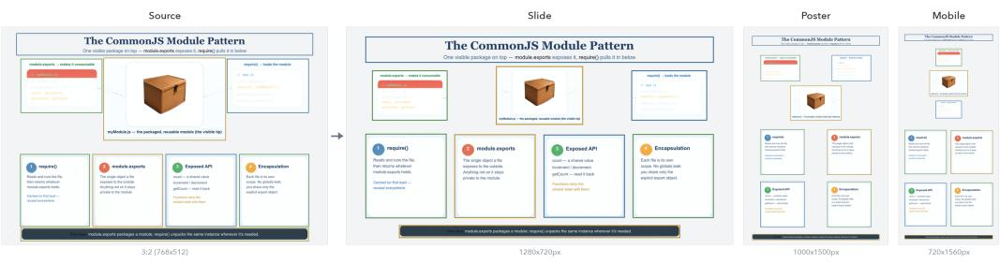  
Figure 15: Layout retargeting. The same generated module illustration, code panels, and explanatory cards are rearranged for slide, poster, and mobile canvases. Image groups preserve their aspect ratios, while text remains separately renderable for each target layout.

Discussion. The language interface does not edit pixels directly. It selects an operation and resolves a semantic target, after which the persistent layer representation defines the exact region and compositing behavior. Commands can therefore be previewed, reversed, or chained without resampling the full document. A learned language parser could replace the lightweight interpreter without changing the underlying editing operations or their locality.

## C.6 SVG-SPACE REFINEMENT AND FAITHFUL DIFFUSION PROPAGATION

An upstream layout proposal may contain a misplaced, mislabeled, or incorrectly styled element. In a raster-only pipeline this often requires a new prompt or manual pixel editing. In LayerCanvas, the SVG is a persistent control surface: the element can be corrected directly, and the model propagates that correction to the raster without retraining or redesigning the rest of the document.

Implementation. We deliberately perturb one SVG element by translating, resizing, recoloring, relabeling, or replacing it. The incorrect and corrected conditions use the same sampling noise so that differences are attributable to the structural edit. Composition uses each group’s full-resolution vector alpha mask rather than an upsampled latent-grid mask. Figure 6 presents the incorrect condition, the SVG edit, and the corrected render as a matched triptych.

Discussion. The structured intermediate remains editable after an initial generation rather than becoming a disposable prompt. A user or upstream layout system can inspect the result, correct the responsible SVG group, and regenerate the affected visual content under the revised condition. Fixed noise helps preserve the remaining appearance, while recomputing masks and overlap relations allows changes in position, scale, or occlusion to propagate consistently.

Editable layers  
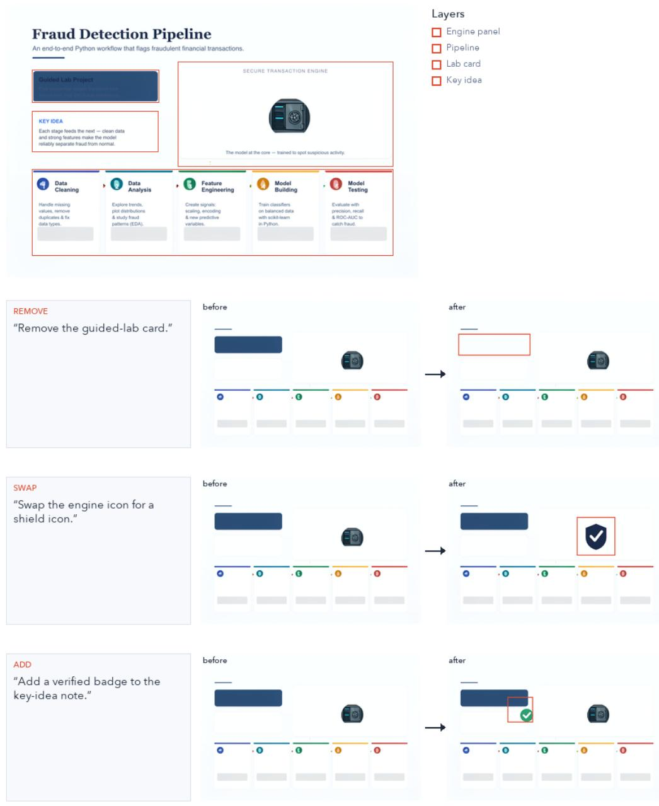  
Figure 16: Command-driven editing. Three natural-language commands are converted to targeted remove, swap, and add operations. Red boxes indicate the edited regions; unselected layers are reused unchanged.

## D LIMITATIONS, ETHICS, AND BROADER IMPACT.

Despite these benefits, LayerCanvas requires a valid source SVG and inherits errors and biases in its content, layout, and training data. Deterministic typography preserves supplied text but does not ensure factuality, accessibility, or culturally appropriate localization, while edits that change occlusion or z-order may affect unintended regions. Responsible deployment therefore requires documented data provenance, license and bias checks, generated-content disclosure, and human review.