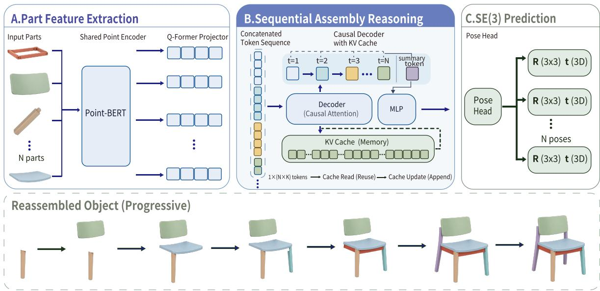
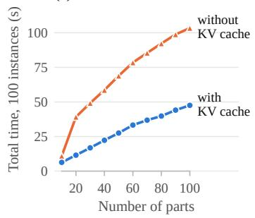
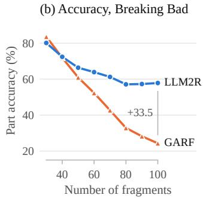
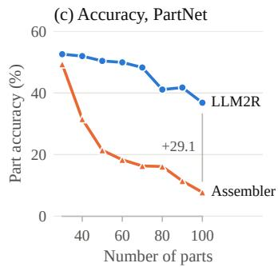
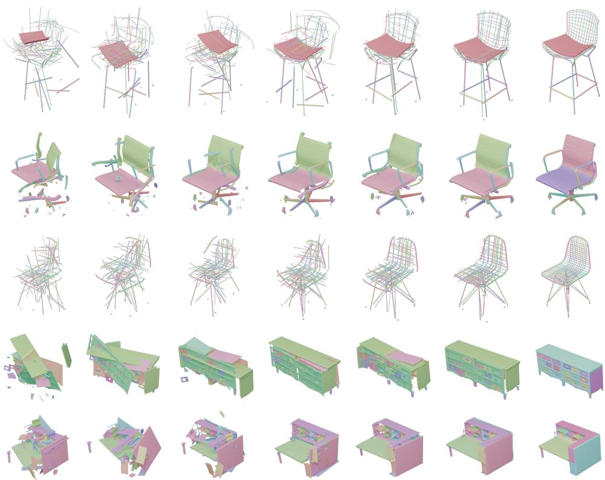

# LLM2R: FROM LARGE LANGUAGE MODELS TO 3D REASSEMBLERS

Zhouhan Zhong1 Qiuhong Shen1 Xingyi Yang2 Jinyi Xu1 Xinchao Wang1,†

1National University of Singapore 2The Hong Kong Polytechnic University

## ABSTRACT

3D part assembly aims to reconstruct a complete shape from a set of unassembled parts by predicting a rigid SE(3) transformation for each part. Because the placement of a part is rarely determined by its own geometry, the task demands reasoning over the entire part set, and existing methods, which rely on pairwise relations or iterative generation and verification, scale poorly to objects with many parts. We present LLM2R, which casts part assembly as sequence modeling with a pretrained decoder-only large language model (LLM): a Point-BERT encoder and a Q-Former compress each part into a block of geometric tokens, the blocks of all parts are concatenated, and a causal LLM adapted with Low-Rank Adaptation (LoRA) processes the sequence in one forward pass. Causal attention, however, lets the hidden states of a part observe only the parts that precede it. LLM2R therefore appends a block of learnable summary tokens after the last part: these tokens follow every part, so their states aggregate the whole assembly at a constant token cost, and a part-aware pose head fuses each part’s states with them before predicting its rotation and translation. One architecture thus handles semantic and geometric assembly and predicts all poses in a single non-autoregressive pass. LLM2R achieves the highest part accuracy and success rate on all three PartNet categories, the best rotation error, translation error, and part accuracy on PartNeXt, and the lowest translation error and fastest inference on Breaking Bad, where only a fracture-specialized method is more accurate. Its advantage grows with the number of parts: at 100 parts it exceeds GARF by 33.5 points in part accuracy on Breaking Bad and Assembler by 29.1 points on PartNet, and it transfers zero-shot to unseen categories with more than 16 points higher part accuracy than the strongest of three baselines.

## 1 INTRODUCTION

When humans are presented with the scattered components of a disassembled object, such as furniture parts, archaeological fragments, or shattered everyday items, they can often infer the target structure and a spatially consistent arrangement of every component from local geometric cues and structural priors. This capacity is a hallmark of spatial intelligence (Lu et al., 2025b), and computationally it manifests as the 3D part assembly problem: given a set of unassembled parts, predict the SE(3) rigid transformation of each part that reconstructs the complete shape. The task is relevant to manufacturing, robotics, archaeology, and restoration, often without a CAD model or template, so a consistent configuration must be inferred from the part geometry alone. What makes it hard is that the placement of a part is rarely determined by the part itself; every pose depends on the whole set.

Existing methods exhibit three persistent limitations (Huang et al., 2020; Zhang et al., 2022; Du et al., 2024; Lee et al., 2024; Wang et al., 2025b). First, most approaches model inter-part relationships through pairwise matching or local compatibility scores, which makes it difficult to capture higher-order constraints and to enforce global consistency across all parts (Lee et al., 2024; 2025; Wu et al., 2023). Second, many methods depend on auxiliary cues such as reference images, CAD templates, or category-specific priors that are unavailable in open-domain settings (Li et al., 2020b; Zhang et al., 2025a; Lu et al., 2025a). Third, they scale poorly with the part count: long-range dependencies among many components are hard to model without long-context support, and the cost of iterative candidate generation and verification grows rapidly (Narayan et al., 2022; Xu et al., 2025; Zhao et al., 2025; Zhang et al., 2024).

Our starting point is that this is a sequence modeling problem of the kind that decoder-only large language models (LLMs) already solve at scale: every output must be consistent with a long context of tokens, and pretrained decoders bring long-context attention, efficient key-value caching, and weights that can be adapted with few trainable parameters. We therefore propose LLM2R, which treats each part as a block of geometric tokens, produced by a Point-BERT encoder (Yu et al., 2022) and a Q-Former (Li et al., 2023), concatenates the blocks of all parts, and processes the sequence with a pretrained decoder-only LLM (Yang et al., 2025a) adapted through Low-Rank Adaptation (LoRA) (Hu et al., 2022). The input is point clouds only, without images, templates, or categoryspecific priors, and the same architecture handles semantic part assembly and geometric fractured reassembly.

A decoder-only LLM is causal, so the hidden states of the i-th part attend to the instruction and to parts 1, . . . , i but not to the parts that follow: a pose read from a part’s own tokens would place the first leg of a chair without having seen the seat or the other legs. Rather than altering the attention mask, so that the pretrained decoder is reused unchanged, LLM2R appends a block of S learnable summary tokens after the last part. These tokens follow every part, so their contextual states are computed with access to the complete assembly, once per object, within the same forward pass, and at a cost that is constant in the number of parts. A part-aware pose head then fuses the hidden state of each part with the summary states and regresses its rotation and translation, so that all poses are predicted in parallel from one pass over the sequence.

We evaluate LLM2R on PartNet (Mo et al., 2019), Breaking Bad (Sellan et al., 2022), and the´ recently released PartNeXt benchmark (Wang et al., 2025a), covering both semantic and geometric assembly, and study zero-shot transfer to unseen categories, scaling with the number of parts, and the contribution of each component. Our contributions are as follows.

• We cast 3D part assembly as causal sequence modeling over geometric part tokens and adapt a pretrained decoder-only LLM to it with LoRA, yielding a single point-cloudonly framework for semantic and geometric assembly that predicts all poses in one nonautoregressive pass.

• We introduce a block of learnable summary tokens and a part–summary fusion head that condition every pose on the whole assembly at a constant token cost without modifying the causal decoder; ablations identify the summary block as the component that matters most for part accuracy.

• LLM2R achieves the best part accuracy on PartNet and PartNeXt and the lowest translation error and inference time on Breaking Bad. Its advantage grows with the part count, reaching 33.5 and 29.1 part-accuracy points over GARF and Assembler at 100 parts, and it transfers zero-shot to unseen categories with more than 16 points higher part accuracy than the strongest of three baselines.

To our knowledge, LLM2R is the first method to adapt a pretrained decoder-only LLM to direct SE(3) pose prediction for 3D part assembly.

## 2 RELATED WORK

3D shape assembly. Semantic part assembly predicts the poses of annotated parts by modeling inter-part relations and refining configurations iteratively (Huang et al., 2020; Narayan et al., 2022); this line has evolved toward sequence-aware formulations (Xu et al., 2025), hierarchical formulations such as 3DHPA (Du et al., 2024) and CFPA (Zhang et al., 2025b), and distribution learning via diffusion-style processes that sample multiple plausible assemblies and support variable part counts (Cheng et al., 2023; Zhao et al., 2025). Geometric fractured reassembly targets unlabeled fragments for which fracture-interface complementarity is central. Benchmarks (Sellan et al., 2022)´ have catalyzed agglomerative denoise-and-verify pipelines (Wang et al., 2025b), SE(3)-equivariant representations (Wu et al., 2023), explicit matching of surface similarity and volumetric complementarity (Lee et al., 2025; 2024), flow- and diffusion-based shape priors (Scarpellini et al., 2024; Lu et al., 2025a; Li et al., 2025; Sun et al., 2025), and generation-assisted formulations such as

CRAG (Jiang et al., 2026). BrickGPT applies autoregressive language modeling to brick-based construction (Pun et al., 2025) rather than to the reassembly of given parts. LLM2R instead processes all parts in a single pass of a long-context LLM and conditions each pose on a learned summary of the whole assembly.

LLMs for point cloud understanding. A growing body of work encodes point clouds into tokens that are concatenated with text so that a decoder-only LLM acquires 3D-oriented dialogue and rea soning capabilities. PointLLM (Xu et al., 2024), Point-Bind (Guo et al., 2023), ShapeLLM (Qi et al., 2024), and ShapeLLM-Omni (Ye et al., 2025) address object-level description, question answering, and interaction, while 3D-LLM (Hong et al., 2023), Chat-3D (Wang et al., 2023), LSceneLLM (Zhi et al., 2025), and MiniGPT-3D (Tang et al., 2024) extend the interface to scenes. These methods generate free-form text; LLM2R instead uses a causal LLM (Yang et al., 2025a) to predict per-part SE(3) transformations and equips it with a summary block so that each prediction can depend on the entire part set.

Pretrained language models for continuous outputs. Decoder-only language models have also been adapted to tasks whose outputs are not text. Frozen pretrained Transformers transfer to sequence tasks in other modalities when only a small fraction of their parameters is trained (Lu et al., 2022); vision-language-action models such as RT-2 (Brohan et al., 2023) and OpenVLA (Kim et al., 2024) fine-tune a pretrained vision-language model to emit robot actions discretized into tokens; and ChatPose (Feng et al., 2024) regresses 3D human pose parameters from the hidden state of a dedicated token. LLM2R follows this line in reusing a pretrained causal decoder with LoRA, but it reads out continuous SE(3) poses for a variable number of parts in one pass, each conditioned on summary states of the whole input sequence.

Auxiliary tokens in Transformers. Content-free tokens that provide extra positions for computation or aggregation appear as global tokens in sparse attention (Zaheer et al., 2020), memory tokens (Burtsev et al., 2020), registers in vision Transformers (Darcet et al., 2024), and latent queries in Perceiver (Jaegle et al., 2021) and the Q-Former of BLIP-2 (Li et al., 2023). The summary block of LLM2R differs in placement and use. It is appended after all inputs of a causal decoder, so its states summarize the complete part sequence, and these states are fused position-wise with each part’s states inside the pose head rather than consumed by a language model.

Point cloud encoders. PointNet and its successors process unordered point sets with shared MLPs, symmetric aggregation, hierarchical grouping, dynamic graphs, point convolutions, or pointcloud self-attention (Qi et al., 2017a;b; Wang et al., 2019; Thomas et al., 2019; Zhao et al., 2021), and self-supervised pretraining by contrastive learning (Xie et al., 2020) or masked point modeling (Yu et al., 2022; Pang et al., 2023) yields transferable representations. We adopt a pretrained Point-BERT encoder and learn a Q-Former that compresses its patch features into a fixed number of tokens in the language model’s embedding space.

## 3 METHOD

LLM2R takes a set of unassembled part point clouds as input and predicts a rigid SE(3) transformation for each part that places it in the assembled shape (Figure 1).

Problem statement. Let $\mathcal { P } = \{ P _ { 1 } , \ldots , P _ { N } \}$ denote N input parts, where $P _ { i } \in \mathbb { R } ^ { n _ { i } \times 3 }$ is the point set of part i expressed in its canonical frame. The goal is to estimate a pose $T _ { i } = ( R _ { i } , \mathbf { t } _ { i } ) \in \dot { \mathrm { S E } } ( 3 )$ for every part such that $R _ { i } P _ { i } + \mathbf { t } _ { i }$ reproduces its placement in the global frame of the assembled object. Rotations are represented as unit quaternions $\mathbf { q } _ { i } \in \mathbb { S } ^ { 3 }$ (scalar first), with $R _ { i } \ = \ R ( { \bf q } _ { i } )$ Canonical frames and pose targets are derived from the part geometry itself (Appendix $\mathbf { A } ) ;$ no images, templates, or semantic labels are used.

## 3.1 GEOMETRIC TOKENIZATION AND SEQUENCE CONSTRUCTION

Part feature encoding. Each part is encoded independently by a pretrained Point-BERT encoder Φ (Yu et al., 2022), which partitions $P _ { i }$ into G local neighborhoods by farthest point sampling and k-nearest-neighbor grouping, embeds each neighborhood with a small point network, and processes the resulting patch tokens with a Transformer. We use its patch-level output, one C-dimensional descriptor per neighborhood, $F _ { i } = \Phi ( P _ { i } ) \in \mathbb { R } ^ { G \times C }$ . The encoder is initialized from masked point modeling on ShapeNet and kept frozen for most of training (Section 4.1); $G = 6 4$ , each neighborhood contains 32 points, and $C = 8 1 9 2$ is the size of the discrete point vocabulary of Point-BERT, whose logits form the patch descriptor.

  
Figure 1: Overview of LLM2R. (A) Each part is encoded by a shared Point-BERT encoder and compressed by a Q-Former into K geometric tokens. (B) The token blocks of all N parts are concatenated and followed by the learnable summary block; a causal decoder processes the sequence in a single forward pass, so the summary positions attend to every part, and the key-value cache of the parts processed so far can be reused when further parts are appended. (C) A pose head fuses each part’s states with the summary states and predicts the rotation R and translation t of every part.

Compression into the LLM embedding space. A Q-Former (Li et al., 2023) compresses the G patch descriptors of a part into K tokens in the hidden dimension d of the language model. The descriptors are first projected and normalized, $\tilde { F } _ { i } ~ = ~ \mathrm { L N } ( W _ { \mathrm { i n } } F _ { i } + \mathbf { b } _ { \mathrm { i n } } ) ~ \in ~ \mathbb { R } ^ { G \times d }$ . A set of K learnable queries $Q ^ { ( 0 ) } \in \mathbb { R } ^ { K \times d }$ is then refined by $N _ { \ell } = 2$ pre-norm layers; each layer applies selfattention among the queries, cross-attention from the queries to $\tilde { F } _ { i }$ , and a feed-forward sublayer, all with residual connections:

$$
Q ^ { ( \ell ) } = \mathrm { Q F o r m e r L a y e r } \big ( Q ^ { ( \ell - 1 ) } , \tilde { F } _ { i } \big ) , \qquad V _ { i } = \mathrm { L N } \big ( Q ^ { ( N _ { \ell } ) } \big ) \in \mathbb { R } ^ { K \times d } .\tag{1}
$$

The queries are shared across parts, so each part is represented by a block of K geometric tokens in a fixed order; we use K = 64 (a per-patch MLP projector is compared in Section 4.4).

Summary tokens. We introduce a block of S learnable summary tokens $S ^ { ( 0 ) } = [ \mathbf { s } _ { 1 } ^ { ( 0 ) } ; \ldots ; \mathbf { s } _ { S } ^ { ( 0 ) } ] \in$ $\mathbb { R } ^ { S \times d }$ , initialized from $\mathcal { N } ( 0 , 0 . 0 2 ^ { 2 } )$ , shared by all objects, trained jointly with the pose head, and appended once per object after the last part. The block carries no geometric content, but its positions follow every part, so that their hidden states can summarize the entire assembly (Section 3.2); we set $S = K = 6 4$ so that the summary block can be fused with a part block position by position (Section 3.3).

Decoder input. The geometric tokens and the summary block are inserted into a chat-formatted instruction, inside the user message immediately after the instruction text. Let $E _ { \mathrm { p r e } }$ and $E _ { \mathrm { p o s t } }$ denote the token embeddings of the chat template before and after the inserted blocks (system message and instruction; end-of-turn token and assistant header). The decoder input is

$$
X = \left[ E _ { \mathrm { p r e } } ; V _ { 1 } ; V _ { 2 } ; \ldots ; V _ { N } ; S ^ { ( 0 ) } ; E _ { \mathrm { p o s t } } \right] \in \mathbb { R } ^ { L \times d } , \qquad L = L _ { \mathrm { p r e } } + N K + S + L _ { \mathrm { p o s t } } .\tag{2}
$$

The index sets $\mathcal { T } _ { i }$ and $\mathcal { T } _ { S }$ of the part and summary blocks are recorded for readout; parts are presented in the dataset order, without any ordering heuristic.

## 3.2 CAUSAL DECODING WITH ASSEMBLY-WIDE SUMMARY STATES

Causal decoder. The sequence X is processed by a pretrained decoder-only LLM $\mathcal { D } _ { \theta } .$

$$
H = { \mathcal { D } } _ { \theta } ( X ) \in \mathbb { R } ^ { L \times d } , \qquad H _ { i } = H [ { \mathcal { Z } } _ { i } ] \in \mathbb { R } ^ { K \times d } , \qquad U = H [ { \mathcal { Z } } _ { S } ] \in \mathbb { R } ^ { S \times d } ,\tag{3}
$$

where $H _ { i } = ( \mathbf { h } _ { i 1 } , \ldots , \mathbf { h } _ { i K } )$ are the final-layer states of the tokens of part i and $U = ( \mathbf { u } _ { 1 } , \dots , \mathbf { u } _ { S } )$ are those of the summary block. The decoder is causal: at every attention layer a token attends only to itself and to preceding positions, with padding positions masked as well. We use the language model of Qwen3.5-0.8B (Yang et al., 2025a), a hybrid decoder with $d = 1 0 2 4$ and 24 layers in which three gated linear-attention layers (Yang et al., 2025b) are followed by one full softmax-attention layer, both causal.

Information flow. The state $\mathbf { h } _ { i j }$ of the $j \mathrm { - t h }$ token of part i depends only on the instruction, the blocks $V _ { 1 } , \dots , V _ { i - 1 }$ , and the first j tokens of $V _ { i } .$ , whereas each summary state $\mathbf { u } _ { j }$ follows all NK geometric tokens and depends on the complete part set:

$$
\mathbf { h } _ { i j } = f _ { \theta } \left( E _ { \mathrm { p r e } } , V _ { 1 : i - 1 } , V _ { i } [ 1 : j ] \right) , \qquad \mathbf { u } _ { j } = f _ { \theta } \left( E _ { \mathrm { p r e } } , V _ { 1 : N } , S ^ { ( 0 ) } [ 1 : j ] \right) .\tag{4}
$$

Reading the pose of part i from $H _ { i }$ alone, as in a last-token readout, would thus condition early parts on a strict prefix of the assembly. The summary block resolves this asymmetry without modifying the attention mask: the whole assembly becomes available to every part through U, which is computed once per object at a cost that is constant in the number of parts. The model is not invariant to the part order, since reordering changes the prefixes seen by the part states and the summary states (Section 4.4).

Parameter-efficient adaptation. The decoder is adapted with LoRA (Hu et al., 2022), which replaces each frozen weight $W _ { 0 }$ of the query, key, value, and output projections by $W _ { 0 } + { \frac { \alpha } { r } } B A$ with trainable low-rank factors $A \in \mathbb { R } ^ { r \times d _ { \mathrm { i n } } }$ and $B \in \mathbb { R } ^ { d _ { \mathrm { o u t } } \times r }$ . The base LLM remains frozen; the trainable parameters are the LoRA factors, the Q-Former, the summary block $S ^ { ( 0 ) }$ ), and the pose head, with the point encoder unfrozen only in a final fine-tuning stage (Section 4.1).

## 3.3 PART-AWARE POSE PREDICTION

Part–summary fusion. For each part i, the head pairs the j-th part state with the j-th summary state, fuses each pair with a shared linear layer, and averages over the block:

$$
\mathbf { f } _ { i j } = \operatorname { G E L U } \big ( W _ { f } [ \mathbf { h } _ { i j } ; \mathbf { u } _ { j } ] + \mathbf { b } _ { f } \big ) , \qquad \mathbf { z } _ { i } = \frac { 1 } { K } \sum _ { j = 1 } ^ { K } \mathbf { f } _ { i j } , \qquad W _ { f } \in \mathbb { R } ^ { d \times 2 d } .\tag{5}
$$

Since $S = K$ , the pairing is one-to-one (summary states missing after context truncation would be replaced by zeros, which does not occur within the context limit used in our experiments), and the pooled feature $\mathbf { z } _ { i }$ is shared by the two pose branches below.

Rotation prediction. Rotation is predicted through a fixed set of $N _ { a } = 3 2$ anchor quaternions $\{ \mathbf { c } _ { m } \} _ { m = 1 } ^ { N _ { a } } .$ (the identity and axis-aligned $9 0 ^ { \circ }$ and $1 8 0 ^ { \circ }$ rotations with both quaternion signs; $\mathsf { A p - }$ pendix B.2). A rotation MLP ? qrot $g _ { \mathrm { r o t } }$ maps $\mathbf { z } _ { i }$ to $N _ { a }$ logits, which are normalized by a softmax and used to form a convex combination of the anchors:

$$
\mathbf { a } _ { i } = g _ { \mathrm { r o t } } ( \mathbf { z } _ { i } ) \in \mathbb { R } ^ { N _ { a } } , \qquad \pi _ { i } = \mathrm { s o f t m a x } ( \mathbf { a } _ { i } ) , \qquad \hat { \mathbf { q } } _ { i } = \frac { \sum _ { m = 1 } ^ { N _ { a } } \pi _ { i m } \mathbf { c } _ { m } } { \left\| \sum _ { m = 1 } ^ { N _ { a } } \pi _ { i m } \mathbf { c } _ { m } \right\| _ { 2 } } .\tag{6}
$$

Because the anchors positively span $\mathbb { R } ^ { 4 }$ , every unit quaternion is reachable after normalization, so Eq. (6) is a continuous parameterization of $\mathrm { S O ( 3 ) }$ rather than a classification over discrete rotations. A second MLP regresses the translation directly, $\hat { \mathbf { t } } _ { i } = g _ { \mathrm { t r a n s } } ( \mathbf { z } _ { i } ) \in \mathbb { R } ^ { 3 } ;$ ; both ${ { g } _ { \mathrm { { r o t } } } }$ and $g _ { \mathrm { t r a n s } }$ are three-layer perceptrons with GELU activations and dropout, and the rotation branch applies layer normalization to its logits before the softmax.

Training objectives. Let $\left( \mathbf { q } _ { i } ^ { \star } , \mathbf { t } _ { i } ^ { \star } \right)$ be the target pose of part i. Since q and −q encode the same rotation, the rotation loss takes the smaller of the two squared distances on the quaternion sphere, and the translation loss is the mean squared coordinate error:

$$
\mathcal { L } _ { \mathrm { p o s e } } = \frac { 1 } { N } \sum _ { i = 1 } ^ { N } \left[ \lambda _ { R } \operatorname* { m i n } _ { \sigma \in \{ - 1 , + 1 \} } \left. \hat { \mathbf { q } } _ { i } - \sigma \mathbf { q } _ { i } ^ { \star } \right. _ { 2 } ^ { 2 } + \lambda _ { t } \frac { 1 } { 3 } \left. \hat { \mathbf { t } } _ { i } - \mathbf { t } _ { i } ^ { \star } \right. _ { 2 } ^ { 2 } \right] .\tag{7}
$$

To supervise the assembled geometry directly, a Chamfer term transforms the part by the predicted and by the target pose and compares the two point sets,

$$
\begin{array} { c } { \displaystyle \mathcal { L } _ { \mathrm { C D } } = \frac { 1 } { N } \sum _ { i = 1 } ^ { N } \mathrm { C D } \big ( \hat { R } _ { i } P _ { i } + \hat { \mathbf { t } } _ { i } , ~ R _ { i } ^ { \star } P _ { i } + { \mathbf { t } } _ { i } ^ { \star } \big ) , } \\ { \displaystyle \mathrm { C D } ( \boldsymbol { \mathcal { X } } , \boldsymbol { \mathcal { Y } } ) = \frac { 1 } { 2 } \Big [ \frac { 1 } { | \mathcal { X } | } \sum _ { \mathbf { x } \in \boldsymbol { \mathcal { X } } } \operatorname* { m i n } _ { \mathbf { y } \in \boldsymbol { \mathcal { Y } } } \big \| \mathbf { x } - \mathbf { y } \big \| _ { 2 } ^ { 2 } + \frac { 1 } { | \mathcal { D } | } \sum _ { \mathbf { y } \in \boldsymbol { \mathcal { Y } } } \operatorname* { m i n } _ { \mathbf { x } \in \boldsymbol { \mathcal { X } } } \big \| \mathbf { y } - \mathbf { x } \big \| _ { 2 } ^ { 2 } \Big ] , } \end{array}\tag{8}
$$

computed on 1,024 random points per part; unlike the quaternion loss, it is invariant to the sign and axis ambiguities of the canonical frames of symmetric parts, because it compares transformed geometry rather than pose parameters.

Interchangeable parts. Objects frequently contain geometrically identical parts, such as the four legs of a chair, whose correspondence to individual pose targets is arbitrary, and fixed assignments bias a regressor toward the mean of the group. We therefore group interchangeable parts by a geometric signature (sorted bounding-box extents and covariance spectrum). A repulsion term then penalizes predicted pairwise distances within a group $\mathcal { G }$ that fall below the target distances,

$$
\mathcal { L } _ { \mathrm { r e p } } = \operatorname* { m e a n } _ { \mathcal { G } } \ \operatorname* { m e a n } _ { a < b \in \mathcal { G } } \ \operatorname* { m a x } \bigl ( 0 , \ \| \mathbf { t } _ { a } ^ { \star } - \mathbf { t } _ { b } ^ { \star } \| _ { 2 } - \| \hat { \mathbf { t } } _ { a } - \hat { \mathbf { t } } _ { b } \| _ { 2 } \bigr ) ^ { 2 } .\tag{9}
$$

The overall objective,

$$
\mathcal { L } = \mathcal { L } _ { \mathrm { p o s e } } + \lambda _ { \mathrm { C D } } \mathcal { L } _ { \mathrm { C D } } + \lambda _ { \mathrm { r e p } } \mathcal { L } _ { \mathrm { r e p } } ,\tag{10}
$$

is computed per object and averaged over the mini-batch; no language-modeling loss is used, so the summary tokens are shaped solely by the pose objectives. At test time the sequence in Eq. (2) is decoded once and all poses are read out in parallel from $\{ H _ { i } \} _ { i = 1 } ^ { N }$ and $U ;$ no pose is fed back and no refinement is performed, so inference costs one forward pass over L tokens. Because the decoder is causal, the key-value cache of the instruction and of the parts processed so far remains valid when further part blocks are appended, so an assembly can also be processed incrementally, re-evaluating only the new part block and the summary block as each part arrives (Section 4.3).

## 4 EXPERIMENTS

## 4.1 EXPERIMENTAL SETUP

Benchmarks and protocols. We evaluate on three benchmarks and, for each, adopt the training and evaluation protocol of the strongest published baseline, so that the reported numbers are directly comparable. Breaking Bad (Sellan et al., 2022) defines components as irregular fragments produced´ by physically simulated fracture and thus poses a geometric reassembly problem without semantic annotation. Following GARF (Li et al., 2025), we train one model on all Breaking Bad subsets and evaluate it on the volume-constrained Everyday (7,872 assemblies) and Artifact (3,697 assemblies) test sets. PartNet (Mo et al., 2019) provides fine-grained semantic parts; following Assembler (Zhao et al., 2025), we train a second model on the Chair, Table, and Lamp categories with the official splits. PartNeXt (Wang et al., 2025a) provides 23,519 textured meshes with fine-grained, hierarchical part annotations; following CRAG (Jiang et al., 2026), we train a third model on its training split of 15,563 shapes and evaluate on 3,903 shapes with 2 to 20 parts, extracting one point set per annotated part (Appendix A).

Table 1: Quantitative comparison on the volume-constrained Breaking Bad dataset (Sellan et al.,´ 2022). RMSE(R) in degrees, RMSE(T) in $\times 1 0 ^ { - 2 }$ , PA in percent, CD in $\times 1 0 ^ { - 3 }$ , IT in seconds per instance. Baseline results follow the protocol of GARF. The best result per column is in bold and the second best is underlined.
<table><tr><td></td><td colspan="5">Everyday</td><td colspan="5">Artifact</td></tr><tr><td>Method</td><td>RMSE(R)↓</td><td>RMSE(T)↓</td><td>PA↑</td><td>CD↓</td><td>IT↓</td><td>RMSE(R)↓</td><td>RMSE(T)↓</td><td>PA↑</td><td>CD↓</td><td>IT↓</td></tr><tr><td>Global (Li et al., 2020a)</td><td>80.50</td><td>14.60</td><td>28.70</td><td>13.00</td><td></td><td></td><td>一</td><td>1</td><td>一</td><td>一</td></tr><tr><td>LSTM (Wu et al., 2020)</td><td>82.70</td><td>15.10</td><td>27.50</td><td>13.30</td><td></td><td></td><td></td><td>一</td><td>1</td><td>一</td></tr><tr><td>DGL (Huang et al., 2020)</td><td>80.30</td><td>13.90</td><td>31.60</td><td>11.80</td><td></td><td></td><td></td><td></td><td></td><td></td></tr><tr><td>Jigsaw (Lu et al., 2023)</td><td>42.19</td><td>6.85</td><td>68.89</td><td>8.22</td><td>0.185</td><td>43.75</td><td>7.91</td><td>65.12</td><td>8.50</td><td>0.171</td></tr><tr><td>PMTR (Lee et al., 2024)</td><td>31.57</td><td>9.95</td><td>70.60</td><td>5.56</td><td></td><td></td><td></td><td></td><td></td><td></td></tr><tr><td>PF++ (Wang et al., 2025b)</td><td>35.61</td><td>6.05</td><td>76.17</td><td>2.78</td><td>0.385</td><td>47.03</td><td>10.63</td><td>57.97</td><td>8.24</td><td>0.379</td></tr><tr><td>GARF (Li et al., 2025)</td><td>6.68</td><td>1.34</td><td>94.77</td><td>0.25</td><td>0.225</td><td>7.67</td><td>1.77</td><td>93.34</td><td>0.81</td><td>0.239</td></tr><tr><td>LLM2R (ours)</td><td>14.35</td><td>0.46</td><td>92.57</td><td>2.43</td><td>0.092</td><td>16.81</td><td>0.53</td><td>90.11</td><td>2.73</td><td>0.094</td></tr></table>

Metrics. On Breaking Bad, we follow GARF (Li et al., 2025) and report the root mean square rotation error RMSE(R) in degrees and translation error RMSE(T), Part Accuracy (PA), the percentage of parts whose Chamfer distance to the ground-truth placement lies below 0.01, and the Chamfer Distance (CD) between the assembled object and the ground-truth shape. On PartNet, we follow Assembler (Zhao et al., 2025) and additionally report Connectivity Accuracy (CA), whether adjacent parts are correctly connected, and Success Rate (SR), the percentage of assemblies in which all parts satisfy the PA criterion. On PartNeXt, we follow CRAG (Jiang et al., 2026), which adopts the metric definitions of GARF, and report the rotation error (RE) in degrees, the translation RMSE, PA, and CD averaged over all test shapes.

Implementation details. The backbone is the Qwen3.5-0.8B language model (24 layers, $d =$ 1024) with LoRA $( r = 3 2 , \alpha = 6 4 )$ on the query, key, value, and output projections of its attention layers; the point encoder is Point-BERT pretrained on ShapeNet (G = 64 neighborhoods of 32 points), and $K = S = 6 4$ We train for 100 epochs (about 10 hours) on 8 NVIDIA H200 GPUs with a batch size of 32, using AdamW (learning rate $1 0 ^ { - 3 } )$ in bfloat16 with a context limit of 8,192 tokens, and select the checkpoint with the lowest validation loss. The point encoder is frozen fo the first 80 epochs, during which the 42.2M trainable parameters comprise the LoRA matrices, the Q-Former, the summary block, and the pose head, and is fine-tuned jointly for the remaining 20 epochs. All loss weights are one, $\lambda _ { R } = \lambda _ { t } = \lambda _ { \mathrm { C D } } = \lambda _ { \mathrm { r e p } } = 1 ;$ the remaining settings are listed in Appendix B.

## 4.2 BENCHMARK COMPARISONS

Breaking Bad. Table 1 compares LLM2R with representative fractured-reassembly methods on the volume-constrained Everyday and Artifact subsets under the protocol of GARF. LLM2R achieves the lowest translation error on both subsets (RMSE(T) of 0.46 and 0.53, against 1.34 and 1.77 for GARF) and the lowest inference time (0.092 s per instance, against 0.225 s for GARF and 0.185 s for Jigsaw), owing to its single non-autoregressive pass. GARF remains ahead on rotation error, PA, and CD: its rotation error is about half that of LLM2R on both subsets, its CD is lower by a factor of ten on Everyday and three on Artifact, and the PA gap is 2.2 and 3.2 points (94.77% and 93.34% against 92.57% and 90.11%). GARF is pretrained on fracture surfaces and specialized to this setting, whereas LLM2R is a unified architecture without fracture-specific priors; it outperforms all remaining methods on every metric. Qualitative comparisons are given in Appendix C.

PartNet. Table 2 reports the comparison on the Chair, Table, and Lamp categories of PartNet under the protocol of Assembler, including the hierarchical methods 3DHPA (Du et al., 2024) and CFPA (Zhang et al., 2025b). LLM2R attains the highest PA on all three categories (2.2, 2.2, and 8.3 points above the strongest baseline) and the highest SR among the methods that report it, with a large margin on Chair (41.40% against 22.59% for Assembler); its CA is the best on Chair and second or third on Table and Lamp. CD is the metric on which the hierarchical methods remain ahead: 3DHPA and CFPA obtain lower CD on every category, and on Table and Lamp LLM2R trails several baselines. This gap recurs on PartNeXt, and we discuss it there.

Table 2: Quantitative comparison on PartNet (Mo et al., 2019) (Chair, Table, and Lamp). CD in $\times 1 0 ^ { - 3 }$ ; PA, CA, and SR in percent. Baseline results follow the protocol of Assembler; the 3DHPA and CFPA rows are taken from the respective papers, which do not report SR. The best result per column is in bold and the second best is underlined.
<table><tr><td></td><td colspan="4">Chair</td><td colspan="4">Table</td><td colspan="4">Lamp</td></tr><tr><td>Method</td><td>CD↓</td><td>PA↑</td><td>CA↑</td><td>SR↑</td><td>CD↓</td><td>PA↑</td><td>CA↑</td><td>SR↑</td><td>CD↓</td><td>PA↑</td><td>CA↑</td><td>SR↑</td></tr><tr><td>DGL (Huang et al., 2020)</td><td>9.60</td><td>37.50</td><td>24.26</td><td>7.60</td><td></td><td></td><td></td><td></td><td>7.82</td><td>32.33</td><td>42.06</td><td>12.38</td></tr><tr><td>RGL (Narayan et al., 2022)</td><td>10.23</td><td>43.82</td><td>25.97</td><td>7.43</td><td></td><td></td><td></td><td></td><td>15.24</td><td>34.19</td><td>47.18</td><td>14.86</td></tr><tr><td>Score-PA (Cheng et al., 2023)</td><td>7.41</td><td>41.74</td><td>28.38</td><td>5.06</td><td>4.54</td><td>51.57</td><td>39.85</td><td>7.53</td><td>8.68</td><td>31.05</td><td>48.12</td><td>8.59</td></tr><tr><td>SPAFormer (Xu et al., 2025)</td><td>7.02</td><td>55.48</td><td>39.16</td><td>13.68</td><td>3.93</td><td>64.14</td><td>61.90</td><td>33.98</td><td>12.80</td><td>36.76</td><td>45.66</td><td>15.54</td></tr><tr><td>Assembler (Żhao et al., 2025)</td><td>9.20</td><td>61.85</td><td>49.82</td><td>22.59</td><td>8.02</td><td>65.04</td><td>56.15</td><td>39.07</td><td>26.88</td><td>44.04</td><td>58.16</td><td>27.88</td></tr><tr><td>3DHPA (Du et al., 2024)</td><td>5.10</td><td>64.13</td><td>49.28</td><td></td><td>2.80</td><td>64.83</td><td>58.45</td><td></td><td>7.00</td><td>38.80</td><td>64.16</td><td></td></tr><tr><td>CFPA (Zhang et al., 2025b)</td><td>4.90</td><td>69.24</td><td>49.20</td><td></td><td>3.30</td><td>68.48</td><td>58.51</td><td></td><td>7.70</td><td>36.35</td><td>63.32</td><td></td></tr><tr><td>LLM2R (ours)</td><td>6.21</td><td>71.42</td><td>53.87</td><td>41.40</td><td>5.47</td><td>70.67</td><td>60.58</td><td>42.09</td><td>17.14</td><td>52.31</td><td>60.83</td><td>30.09</td></tr></table>

Table 3: Quantitative comparison on Part-NeXt (Wang et al., 2025a). RE is the rotation error in degrees, RMSE the translation root mean square error in $\times 1 0 ^ { - 2 }$ , PA in percent, and CD in $\times 1 0 ^ { - 3 }$ . Metric definitions follow GARF (Li et al., 2025); the evaluation setting and the baseline results follow CRAG (Jiang et al., 2026). Best in bold, second best underlined.  
Table 4: Ablation study on the PartNet Chair subset. CD in $\times 1 0 ^ { - 3 } ;$ ; PA, CA, and SR in percent. The best result per column is in bold.
<table><tr><td>Variant</td><td>CD↓</td><td>PA↑</td><td>CA↑</td><td>SR↑</td></tr><tr><td>Full model</td><td>6.21</td><td>71.42</td><td>53.87</td><td>41.40</td></tr><tr><td>w/o summary block</td><td>8.52</td><td>63.71</td><td>53.41</td><td>37.14</td></tr><tr><td>MLP projector</td><td>9.75</td><td>66.53</td><td>52.38</td><td>36.27</td></tr><tr><td>w/o instruction</td><td>8.56</td><td>65.29</td><td>51.93</td><td>34.78</td></tr></table>

<table><tr><td>Method</td><td>RE↓</td><td>RMSE↓</td><td>PA↑</td><td>CD↓</td></tr><tr><td>GARF</td><td>52.52</td><td>10.68</td><td>58.19</td><td>3.10</td></tr><tr><td>RPF</td><td>54.99</td><td>29.54</td><td>46.17</td><td>10.46</td></tr><tr><td>CRAG</td><td>45.12</td><td>9.13</td><td>65.89</td><td>2.40</td></tr><tr><td>Assembler</td><td>85.82</td><td>17.14</td><td>44.18</td><td>27.93</td></tr><tr><td>LLM2R (ours)</td><td>41.12</td><td>5.24</td><td>67.93</td><td>6.37</td></tr></table>

PartNeXt. We further evaluate LLM2R on PartNeXt against four recent baselines: GARF (Li et al., 2025), Rectified Point Flow (RPF) (Sun et al., 2025), CRAG (Jiang et al., 2026), and Assembler (Zhao et al., 2025). As reported in Table 3, LLM2R ranks first on all three pose-centric metrics, with the lowest rotation error (41.12 against 45.12 for CRAG), the lowest translation RMSE (5.24 against 9.13), and the highest PA (67.93% against 65.89%), but trails on CD (6.37 against 2.40 for CRAG and 3.10 for GARF). The two groups of metrics measure different things: RE, RMSE, and PA measure how correctly each part is posed, whereas CD rewards tight surface contact and is dominated by the parts placed far from the surface. We hypothesize that the fracture-oriented pretraining of GARF and the shape prior of CRAG favor locally well-fitted interfaces, which lowers CD even when more parts are misplaced, whereas the few parts that LLM2R misplaces lie far from the surface and inflate CD; the same pattern would explain the CD gap on PartNet.

## 4.3 GENERALIZATION AND SCALABILITY

Zero-shot generalization to unseen categories. To evaluate zero-shot generalization, we train LLM2R, SPAFormer (Xu et al., 2025), 3DHPA (Du et al., 2024), and CFPA (Zhang et al., 2025b) only on Chair, Table, and Lamp, the PartNet protocol of Section 4.1, and test them directly on three unseen categories, Bed, Door, and Storage Furniture, without fine-tuning (Table 5). The baselines generalize poorly: the highest baseline PA is 10.29%, 15.78%, and 9.13% on the three categories (CFPA in each case), whereas LLM2R reaches 31.03%, 32.49%, and 26.35%, at least 16.7 points higher, together with the lowest CD and the lowest RMSE(R) on every category.

Scalability with the number of parts. All poses are obtained from a single forward pass over L tokens (Eq. (2)), and the summary block adds a constant S tokens irrespective of N; with a context limit of 8,192 tokens and K = 64, one sequence accommodates up to about 125 parts. Figure 2 reports inference time and accuracy as a function of the part count, using the models of Section 4.1 without retraining. Figure 2(a) measures the total wall-clock time for 100 PartNet instances per part count when the part blocks are appended to the decoder one at a time. With the key-value cache reused across blocks, the time grows nearly linearly, from 6.33 s at 10 parts (63 ms per instance) to 47.54 s at 100 parts, whereas recomputing the prefix for every block grows superlinearly to 103.37 s. Figures 2(b) and (c) compare PA on test instances with 30 to 100 parts. On Breaking Bad, GARF is more accurate at 30 fragments (83.61% against 80.13%) but degrades to 24.33% at 100 fragments, whereas LLM2R stays above 57% and reaches 57.85% at 100 fragments, 33.5 points higher. On PartNet, LLM2R and Assembler are close at 30 parts (52.57% against 49.34%), but Assembler collapses to 7.78% at 100 parts while LLM2R retains 36.83%, an improvement of 29.1 points.

Table 5: Zero-shot generalization to unseen PartNet categories; all methods are trained on Chair, Table, and Lamp only. CD in $\times 1 0 ^ { - 3 }$ , PA in percent, RMSE(R) in degrees; best per column in bold.
<table><tr><td></td><td colspan="3">Bed</td><td colspan="3">Door</td><td colspan="3">Storage Furniture</td></tr><tr><td>Method</td><td>CD↓</td><td>PA↑</td><td>RMSE(R)↓</td><td>CD↓</td><td>PA↑</td><td>RMSE(R)↓</td><td>CD↓</td><td>PA↑</td><td>RMSE(R)↓</td></tr><tr><td>SPAFormer (Xu et al., 2025)</td><td>50.24</td><td>5.81</td><td>81.04</td><td>49.23</td><td>6.63</td><td>83.56</td><td>48.47</td><td>4.21</td><td>87.12</td></tr><tr><td>3DHPA (Du et al., 2024)</td><td>67.12</td><td>6.27</td><td>75.35</td><td>56.42</td><td>10.96</td><td>72.67</td><td>61.31</td><td>8.13</td><td>69.19</td></tr><tr><td>CFPA (Zhang et al., 2025b)</td><td>34.48</td><td>10.29</td><td>75.93</td><td>26.48</td><td>315.78</td><td>69.02</td><td>47.35</td><td>9.13</td><td>78.26</td></tr><tr><td>LLM2R (ours)</td><td></td><td>18.45 31.03</td><td>40.76</td><td>21.15 32.49</td><td></td><td>53.71</td><td>24.14 26.35</td><td></td><td>55.78</td></tr></table>

  
Figure 2: Scaling with the number of parts, without retraining. (a) Total inference time over 100 PartNet instances per part count, with and without key-value cache reuse; (b) PA on Breaking Bad test instances with 30 to 100 fragments, against GARF; (c) PA on PartNet test instances with 30 to 100 parts, against Assembler.

## 4.4 ABLATION STUDIES

Components. Table 4 ablates the design of LLM2R on the PartNet Chair subset. w/o summary block reads each pose from the last token of its part block, i.e., a plain causal readout; MLP projector replaces the Q-Former with a two-layer MLP applied to each patch descriptor; w/o instruction removes the natural-language content of the prompt while keeping the chat template. Removing the summary block causes the largest drop in PA (−7.7 points) and raises CD by 2.31, whereas CA is almost unchanged, so the summary mainly improves the absolute placement of parts rather than their local connectivity. The MLP projector lowers PA by 4.9 points and raises CD by 3.5, so the learned queries yield a more useful part representation than a direct projection of the neighborhoods. Removing the instruction lowers PA by 6.1 points and SR by 6.6 points, the largest drop in SR. The geometric tokens, the summary block, and the pose head are identical in both variants, so the difference stems from the instruction tokens alone: the pretrained decoder makes use of the instruction when it processes the geometric tokens. This is the most direct evidence in our study that the language pretraining of the backbone, and not only its capacity, contributes to assembly accuracy.

Token budget. Table 6 (left) varies the number of Q-Former queries K with $S = K$ and all other settings unchanged. CD, PA, and SR improve monotonically with K, whereas CA stays within 0.2 points; the gains saturate beyond $K = 6 4 ,$ , as doubling the budget to 128 improves PA by only 0.13 points and CD by 0.08 while doubling the number of geometric tokens.

Table 6: Left: PartNet Chair results for different numbers of geometric tokens per part K $( S = K )$ CD in $\times 1 0 ^ { - 3 }$ , PA, CA, and SR in percent. Right: per-position PA (%) on 20-part Chair instances, n being the position in the input sequence.
<table><tr><td> $K = S$ </td><td>CD↓</td><td>PA↑</td><td>CA↑</td><td>SR↑</td></tr><tr><td>16</td><td>7.24</td><td>68.37</td><td>53.79</td><td>40.56</td></tr><tr><td>32</td><td>6.96</td><td>70.88</td><td>53.70</td><td>41.02</td></tr><tr><td>64</td><td>6.21</td><td>71.42</td><td>53.87</td><td>41.40</td></tr><tr><td>128</td><td>6.13</td><td>71.55</td><td>53.81</td><td>41.67</td></tr></table>

<table><tr><td>n PA</td><td>1 83.4</td><td>2 80.9</td><td>3 73.9</td><td>4 73.2</td><td>5 70.9</td><td>6 69.3</td><td>7 70.6</td><td>8 67.2</td><td>9 67.1</td><td>10 70.2</td></tr><tr><td>n PA</td><td>11 63.6</td><td>12 65.8</td><td>13 62.5</td><td>14 61.7</td><td>15 61.7</td><td>16 61.5</td><td>17 62.3</td><td>18 56.4</td><td>19 58.1</td><td>20 59.6</td></tr></table>

Accuracy along the part sequence. Parts are presented in the dataset order and the model is not permutation invariant (Section 3.2); no predicted pose is fed back into the decoder, so errors cannot accumulate through the predictions, but early parts see a shorter prefix. Table 6 (right) reports the per-position PA of LLM2R on 20-part Chair instances: PA is highest at the first two positions (83.4% and 80.9%), lies between 61.5% and 70.9% from position 5 to 17, and is lowest at positions 18 to 20 (56.4% to 59.6%). The decline is gradual, about 24 points over 20 positions, without a collapse at the tail. The first positions see the shortest prefix yet are the most accurate, so prefix length alone does not explain the trend once the summary states are available; we hypothesize that later position are more often occupied by small or repeated parts whose placement is intrinsically ambiguous.

## 5 CONCLUSION

We have presented LLM2R, which casts 3D part assembly as causal sequence modeling over geometric part tokens with a LoRA-adapted pretrained decoder-only LLM. A learnable summary block appended after all part tokens aggregates the entire assembly within one forward pass, and a part– summary fusion head conditions every pose on this context at a constant token cost, so that one architecture handles semantic and geometric assembly without autoregressive decoding. LLM2R attains the best part accuracy on PartNet and PartNeXt and the lowest translation error and inference time on Breaking Bad, where only the fracture-specialized GARF is more accurate; its advantage over the baselines grows with the number of parts, and it transfers zero-shot to unseen categories. Ablations show that the summary block contributes most to part accuracy and that the decoder makes use of the language instruction, so the pretrained backbone is used for more than its capacity.

Limitations and future work. LLM2R is not invariant to the part order, and the context window of the decoder bounds the number of parts that can be processed at once (about 125 parts at K = 64 with a limit of 8,192 tokens). It regresses a single pose per part, so it cannot express several plausible assemblies, and PCA-derived pose targets are ambiguous up to part symmetries, which the Chamfer objective only partly compensates. Its Chamfer distance lags behind hierarchical and fracture-specialized methods, which we attribute to the few parts it misplaces far from the surface. Order-invariant position encodings, larger backbones, and a lightweight geometric refinement of the predicted poses are natural next steps.

## REPRODUCIBILITY STATEMENT

Section 3 specifies the architecture, including the construction of the summary block, the causal information flow, the part–summary fusion head, the rotation parameterization, and all training objectives. Section 4.1 and Appendix B list all implementation settings, including the Q-Former and pose-head architectures, the LoRA configuration, the optimizer, and the number of trainable parameters. Appendix A describes the construction of assembly instances from PartNeXt, the canonicalframe definition, and the derivation of pose targets. Source code and processed data manifests will be released upon publication.

## REFERENCES

Anthony Brohan, Noah Brown, Justice Carbajal, Yevgen Chebotar, Xi Chen, Krzysztof Choromanski, Tianli Ding, Danny Driess, Avinava Dubey, Chelsea Finn, et al. RT-2: Vision-language-action models transfer web knowledge to robotic control. In Conference on Robot Learning (CoRL), 2023.

Mikhail S. Burtsev, Yuri Kuratov, Anton Peganov, and Grigory V. Sapunov. Memory transformer. arXiv preprint arXiv:2006.11527, 2020.

Junfeng Cheng, Mingdong Wu, Ruiyuan Zhang, Guanqi Zhan, Chao Wu, and Hao Dong. Score-PA: Score-based 3D part assembly. British Machine Vision Conference (BMVC), 2023.

Timothee Darcet, Maxime Oquab, Julien Mairal, and Piotr Bojanowski. Vision transformers need´ registers. In International Conference on Learning Representations (ICLR), 2024.

Bi’an Du, Xiang Gao, Wei Hu, and Renjie Liao. Generative 3D part assembly via part-wholehierarchy message passing. In Proceedings of the IEEE/CVF Conference on Computer Vision and Pattern Recognition, pp. 20850–20859, 2024.

Yao Feng, Jing Lin, Sai Kumar Dwivedi, Yu Sun, Priyanka Patel, and Michael J. Black. ChatPose: Chatting about 3D human pose. In Proceedings ofthe IEEE/CVF Conference on Computer Vision and Pattern Recognition, pp. 2093–2103, 2024.

Ziyu Guo, Renrui Zhang, Xiangyang Zhu, Yiwen Tang, Xianzheng Ma, Jiaming Han, Kexin Chen, Peng Gao, Xianzhi Li, Hongsheng Li, and Pheng-Ann Heng. Point-Bind & Point-LLM: Aligning point cloud with multi-modality for 3D understanding, generation, and instruction following. arXiv preprint arXiv:2309.00615, 2023.

Yining Hong, Haoyu Zhen, Peihao Chen, Shuhong Zheng, Yilun Du, Zhenfang Chen, and Chuang Gan. 3D-LLM: Injecting the 3D world into large language models. Advances in Neural Information Processing Systems, 36:20482–20494, 2023.

Edward J Hu, Yelong Shen, Phillip Wallis, Zeyuan Allen-Zhu, Yuanzhi Li, Shean Wang, Lu Wang, and Weizhu Chen. LoRA: Low-rank adaptation of large language models. In International Conference on Learning Representations (ICLR), 2022.

Jialei Huang, Guanqi Zhan, Qingnan Fan, Kaichun Mo, Lin Shao, Baoquan Chen, Leonidas Guibas, and Hao Dong. Generative 3D part assembly via dynamic graph learning. In Advances in Neural Information Processing Systems (NeurIPS), volume 33, pp. 6315–6326, 2020.

Andrew Jaegle, Felix Gimeno, Andy Brock, Oriol Vinyals, Andrew Zisserman, and Joao Carreira. Perceiver: General perception with iterative attention. In International Conference on Machine Learning (ICML), 2021.

Zeyu Jiang, Sihang Li, Siqi Tan, Chenyang Xu, Juexiao Zhang, Julia Galway-Witham, Xue Wang, Scott A. Williams, Radu Iovita, Chen Feng, and Jing Zhang. CRAG: Can 3D generative models help 3D assembly? arXiv preprint arXiv:2602.22629, 2026.

Moo Jin Kim, Karl Pertsch, Siddharth Karamcheti, Ted Xiao, Ashwin Balakrishna, Suraj Nair, Rafael Rafailov, Ethan Foster, Grace Lam, Pannag Sanketi, Quan Vuong, Thomas Kollar, Benjamin Burchfiel, Russ Tedrake, Dorsa Sadigh, Sergey Levine, Percy Liang, and Chelsea Finn. OpenVLA: An open-source vision-language-action model. In Conference on Robot Learning (CoRL), 2024.

Nahyuk Lee, Juhong Min, Junha Lee, Seungwook Kim, Kanghee Lee, Jaesik Park, and Minsu Cho. 3D geometric shape assembly via efficient point cloud matching. In Proceedings of the 41st International Conference on Machine Learning (ICML), PMLR 235, pp. 26856–26873, 2024.

Nahyuk Lee, Juhong Min, Junhong Lee, Chunghyun Park, and Minsu Cho. Combinative matching for geometric shape assembly. In Proceedings of the IEEE/CVF International Conference on Computer Vision, pp. 9540–9549, 2025.

Jun Li, Chengjie Niu, and Kai Xu. Learning part generation and assembly for structure-aware shape synthesis. In Proceedings of the AAAI Conference on Artificial Intelligence, volume 34, pp. 11362–11369, 2020a.

Junnan Li, Dongxu Li, Silvio Savarese, and Steven Hoi. BLIP-2: Bootstrapping language-image pre-training with frozen image encoders and large language models. In International Conference on Machine Learning, pp. 19730–19742. PMLR, 2023.

Sihang Li, Zeyu Jiang, Grace Chen, Chenyang Xu, Siqi Tan, Xue Wang, Irving Fang, Kristof Zyskowski, Shannon P. McPherron, Radu Iovita, Chen Feng, and Jing Zhang. GARF: Learning generalizable 3D reassembly for real-world fractures. In Proceedings of the IEEE/CVF International Conference on Computer Vision (ICCV), pp. 5711–5721, 2025.

Yichen Li, Kaichun Mo, Lin Shao, Minhyuk Sung, and Leonidas Guibas. Learning 3D part assembly from a single image. In European Conference on Computer Vision, pp. 664–682. Springer, 2020b.

Jiaxin Lu, Yifan Sun, and Qixing Huang. Jigsaw: Learning to assemble multiple fractured objects. In Advances in Neural Information Processing Systems (NeurIPS), volume 36, 2023.

Jiaxin Lu, Gang Hua, and Qixing Huang. Jigsaw++: Imagining complete shape priors for object reassembly. In Proceedings of the IEEE/CVF International Conference on Computer Vision, pp. 6704–6714, 2025a.

Jiaxin Lu, Yongqing Liang, Huijun Han, Jiacheng Hua, Junfeng Jiang, Xin Li, and Qixing Huang. A survey on computational solutions for reconstructing complete objects by reassembling their fractured parts. Computer Graphics Forum, 44(2):e70081, 2025b.

Kevin Lu, Aditya Grover, Pieter Abbeel, and Igor Mordatch. Frozen pretrained transformers as universal computation engines. In Proceedings ofthe AAAI Conference on Artificial Intelligence, volume 36, pp. 7628–7636, 2022.

Kaichun Mo, Shilin Zhu, Angel X Chang, Li Yi, Subarna Tripathi, Leonidas J Guibas, and Hao Su. PartNet: A large-scale benchmark for fine-grained and hierarchical part-level 3D object understanding. In Proceedings of the IEEE/CVF Conference on Computer Vision and Pattern Recognition, pp. 909–918, 2019.

Abhinav Narayan, Rajendra Nagar, and Shanmuganathan Raman. RGL-Net: A recurrent graph learning framework for progressive part assembly. In Proceedings ofthe IEEE/CVF Winter Conference on Applications of Computer Vision, pp. 78–87, 2022.

Yatian Pang, Eng Hock Francis Tay, Li Yuan, and Zhenghua Chen. Masked autoencoders for 3D point cloud self-supervised learning. World Scientific Annual Review ofArtificial Intelligence, 1: 2440001, 2023.

Ava Pun, Kangle Deng, Ruixuan Liu, Deva Ramanan, Changliu Liu, and Jun-Yan Zhu. Generating physically stable and buildable brick structures from text. In Proceedings of the IEEE/CVF International Conference on Computer Vision, 2025.

Charles R Qi, Hao Su, Kaichun Mo, and Leonidas J Guibas. PointNet: Deep learning on point sets for 3D classification and segmentation. In Proceedings of the IEEE conference on computer vision and pattern recognition, pp. 652–660, 2017a.

Charles Ruizhongtai Qi, Li Yi, Hao Su, and Leonidas J Guibas. PointNet++: Deep hierarchical feature learning on point sets in a metric space. Advances in Neural Information Processing Systems, 30, 2017b.

Zekun Qi, Runpei Dong, Shaochen Zhang, Haoran Geng, Chunrui Han, Zheng Ge, Li Yi, and Kaisheng Ma. ShapeLLM: Universal 3D object understanding for embodied interaction. In European Conference on Computer Vision, pp. 214–238. Springer, 2024.

Gianluca Scarpellini, Stefano Fiorini, Francesco Giuliari, Pietro Moreiro, and Alessio Del Bue. DiffAssemble: A unified graph-diffusion model for 2D and 3D reassembly. In Proceedings of the IEEE/CVF Conference on Computer Vision and Pattern Recognition, pp. 28098–28108, 2024.

Silvia Sellan, Yun-Chun Chen, Ziyi Wu, Animesh Garg, and Alec Jacobson. Breaking Bad: A´ dataset for geometric fracture and reassembly. Advances in Neural Information Processing Systems, 35:38885–38898, 2022.

Tao Sun, Liyuan Zhu, Shengyu Huang, Shuran Song, and Iro Armeni. Rectified point flow: Generic point cloud pose estimation. In Advances in Neural Information Processing Systems (NeurIPS), 2025.

Yuan Tang, Xu Han, Xianzhi Li, Qiao Yu, Yixue Hao, Long Hu, and Min Chen. MiniGPT-3D: Efficiently aligning 3D point clouds with large language models using 2D priors. In Proceedings ofthe 32nd ACM International Conference on Multimedia, pp. 6617–6626, 2024.

Hugues Thomas, Charles R Qi, Jean-Emmanuel Deschaud, Beatriz Marcotegui, Franc¸ois Goulette, and Leonidas J Guibas. KPConv: Flexible and deformable convolution for point clouds. In Proceedings of the IEEE/CVF International Conference on Computer Vision, pp. 6411–6420, 2019.

Penghao Wang, Yiyang He, Xin Lv, Yukai Zhou, Lan Xu, Jingyi Yu, and Jiayuan Gu. PartNeXt: A next-generation dataset for fine-grained and hierarchical 3D part understanding. arXiv preprint arXiv:2510.20155, 2025a.

Yue Wang, Yongbin Sun, Ziwei Liu, Sanjay E Sarma, Michael M Bronstein, and Justin M Solomon. Dynamic graph CNN for learning on point clouds. ACM Transactions on Graphics (tog), 38(5): 1–12, 2019.

Zehan Wang, Haifeng Huang, Yang Zhao, Ziang Zhang, and Zhou Zhao. Chat-3D: Dataefficiently tuning large language model for universal dialogue of 3D scenes. arXiv preprint arXiv:2308.08769, 2023.

Zhengqing Wang, Jiacheng Chen, and Yasutaka Furukawa. PuzzleFusion++: Auto-agglomerative 3D fracture assembly by denoise and verify. In International Conference on Learning Representations (ICLR), 2025b.

Ruihai Wu, Chenrui Tie, Yushi Du, Yan Zhao, and Hao Dong. Leveraging SE(3) equivariance for learning 3D geometric shape assembly. In Proceedings of the IEEE/CVF International Conference on Computer Vision, pp. 14311–14320, 2023.

Rundi Wu, Yixin Zhuang, Kai Xu, Hao Zhang, and Baoquan Chen. PQ-NET: A generative part Seq2Seq network for 3D shapes. In Proceedings of the IEEE/CVF Conference on Computer Vision and Pattern Recognition (CVPR), 2020.

Saining Xie, Jiatao Gu, Demi Guo, Charles R Qi, Leonidas Guibas, and Or Litany. PointContrast: Unsupervised pre-training for 3D point cloud understanding. In European Conference on Computer Vision, pp. 574–591. Springer, 2020.

Boshen Xu, Sipeng Zheng, and Qin Jin. SPAFormer: Sequential 3D part assembly with transformers. In 2025 International Conference on 3D Vision (3DV), pp. 1317–1327. IEEE, 2025.

Runsen Xu, Xiaolong Wang, Tai Wang, Yilun Chen, Jiangmiao Pang, and Dahua Lin. PointLLM: Empowering large language models to understand point clouds. In European Conference on Computer Vision, pp. 131–147. Springer, 2024.

An Yang, Anfeng Li, Baosong Yang, Beichen Zhang, Binyuan Hui, Bo Zheng, Bowen Yu, Chang Gao, Chengen Huang, Chenxu Lv, et al. Qwen3 technical report. arXiv preprint arXiv:2505.09388, 2025a.

Songlin Yang, Jan Kautz, and Ali Hatamizadeh. Gated delta networks: Improving Mamba2 with delta rule. In International Conference on Learning Representations (ICLR), 2025b.

Junliang Ye, Zhengyi Wang, Ruowen Zhao, Shenghao Xie, and Jun Zhu. ShapeLLM-Omni: A native multimodal LLM for 3D generation and understanding. arXiv preprint arXiv:2506.01853, 2025.

Xumin Yu, Lulu Tang, Yongming Rao, Tiejun Huang, Jie Zhou, and Jiwen Lu. Point-BERT: Pre-training 3D point cloud transformers with masked point modeling. In Proceedings of the IEEE/CVF Conference on Computer Vision and Pattern Recognition, pp. 19313–19322, 2022.

Manzil Zaheer, Guru Guruganesh, Kumar Avinava Dubey, Joshua Ainslie, Chris Alberti, Santiago Ontanon, Philip Pham, Anirudh Ravula, Qifan Wang, Li Yang, and Amr Ahmed. Big Bird: Transformers for longer sequences. In Advances in Neural Information Processing Systems (NeurIPS), 2020.

Jiahao Zhang, Anoop Cherian, Cristian Rodriguez, Weijian Deng, and Stephen Gould. Manual-PA: Learning 3D part assembly from instruction diagrams. In Proceedings of the IEEE/CVF International Conference on Computer Vision, pp. 6304–6314, 2025a.

Rufeng Zhang, Tao Kong, Weihao Wang, Xuan Han, and Mingyu You. 3D part assembly generation with instance encoded transformer. IEEE Robotics and Automation Letters, 7(4):9051–9058, 2022.

Ruiyuan Zhang, Jiaxiang Liu, Zexi Li, Hao Dong, Jie Fu, and Chao Wu. Scalable geometric fracture assembly via co-creation space among assemblers. In Proceedings of the AAAI Conference on Artificial Intelligence, volume 38, pp. 7269–7277, 2024.

Xinyi Zhang, Bingyang Wei, Ruixuan Yu, and Jian Sun. Coarse-to-fine 3D part assembly via semantic super-parts and symmetry-aware pose estimation. In Advances in Neural Information Processing Systems, 2025b.

Hengshuang Zhao, Li Jiang, Jiaya Jia, Philip HS Torr, and Vladlen Koltun. Point transformer. In Proceedings of the IEEE/CVF International Conference on Computer Vision, pp. 16259–16268, 2021.

Wang Zhao, Yan-Pei Cao, Jiale Xu, Yuejiang Dong, and Ying Shan. Assembler: Scalable 3D part assembly via anchor point diffusion. In Proceedings of the SIGGRAPH Asia 2025 Conference Papers, pp. 1–11, 2025.

Hongyan Zhi, Peihao Chen, Junyan Li, Shuailei Ma, Xinyu Sun, Tianhang Xiang, Yinjie Lei, Mingkui Tan, and Chuang Gan. LSceneLLM: Enhancing large 3D scene understanding using adaptive visual preferences. In Proceedings of the IEEE/CVF Conference on Computer Vision and Pattern Recognition, pp. 3761–3771, 2025.

Appendix overview. This appendix complements the main paper along three dimensions. Appendix A describes the construction of assembly instances, the canonical frames, and the derivation of pose targets. Appendix B lists the implementation settings, including the fixed quaternion anchor set and the evaluation procedure. Appendix C provides additional qualitative results.

## A DATA PROCESSING

## A.1 ASSEMBLY INSTANCES FROM PARTNEXT

PartNeXt provides textured meshes with part masks defined over mesh faces. We adopt the split of CRAG (Jiang et al., 2026), with 15,563 training and 3,903 evaluation shapes that each contain between 2 and 20 parts, and train the PartNeXt model on its training split. For each shape, we read the GLB file, apply the node transformations of the scene graph, and gather the vertices of the faces assigned to each part mask into one point set per part; shapes without usable masks fall back to one part per scene primitive. The point sets of a shape are then normalized jointly, so that the center of the bounding box of the complete object lies at the origin and its longest side has unit length, and each part is stored as a vertex-only OBJ file.

## A.2 CANONICAL FRAMES AND POSE TARGETS

Each part is associated with a canonical reference frame constructed from its own geometry by Principal Component Analysis (PCA), and the learning target of a part is the rigid transformation from this canonical frame to the frame of the assembled object. Given the vertex set of a part in the object frame,

$$
\begin{array} { r } { \gamma = \{ \mathbf { p } _ { k } \} _ { k = 1 } ^ { M } , \qquad \mathbf { p } _ { k } \in \mathbb { R } ^ { 3 } , } \end{array}
$$

we compute its centroid $\begin{array} { r } { \pmb { \mu } = \frac { 1 } { M } \sum _ { k } \mathbf { p } _ { k } } \end{array}$ and the covariance matrix $\begin{array} { r } { \pmb { \Sigma } = \frac { 1 } { M } \sum _ { k } ( \mathbf p _ { k } - \pmb { \mu } ) ( \mathbf p _ { k } - \pmb { \mu } ) ^ { \top } } \end{array}$ The eigendecomposition $\Sigma { \bf v } _ { j } = \lambda _ { j } { \bf v } _ { j }$ with $\lambda _ { 1 } \ \ge \ \lambda _ { 2 } \ \ge \ \lambda _ { 3 } \ \ge \ 0$ yields the principal axes, and the third axis is flipped if necessary so that the frame is right-handed $( \mathrm { d e t } = + 1 )$ . The canonical rotation is then $\mathbf { R } _ { \mathrm { c a n } } = [ \mathbf { v } _ { 1 } , \mathbf { v } _ { 2 } , \mathbf { v } _ { 3 } ] \in \mathrm { S O } ( 3 )$ , and the rigid transformation that maps the part from its canonical frame, in which it is centered at the origin with axes aligned to the principal directions, to its placement in the object is

$$
\mathrm { \bf T } _ { \mathrm { c a n \to o b j } } = \left[ \begin{array} { l l } { \mathrm { \bf R } _ { \mathrm { c a n } } } & { \mu } \\ { \mathbf { 0 } ^ { \top } } & { 1 } \end{array} \right] \in \mathrm { S E } ( 3 ) .
$$

The supervision target of part i is therefore $( R _ { i } ^ { \star } , { \bf t } _ { i } ^ { \star } ) = ( { \bf R } _ { \mathrm { c a n } } , \mu )$ , with $\mathbf { q } _ { i } ^ { \star }$ the unit quaternion of $\mathbf { R } _ { \mathrm { c a n } }$ in scalar-first order and nonnegative scalar part. Parts with fewer than three vertices receive the identity rotation or a frame aligned with the segment joining their two vertices. This reformulation casts pose prediction as recovering the placement of a geometry-consistent canonical part rather than an absolute pose, so that the network can focus on inter-part spatial reasoning. Because the sign of each principal axis and the order of axes with similar eigenvalues are arbitrary, the canonical frame of a symmetric part is ambiguous, which is the source of the rotation-label ambiguity discussed in Section 5 and the motivation for the Chamfer objective.

## A.3 INPUT COORDINATES AND DATA SPLITS

The preprocessing above stores the vertices of every part in the normalized object frame and derives the pose target from those coordinates. Before tokenization, each part is expressed in its canonical frame, i.e., its vertices are centered at the centroid and rotated into the principal axes, so that the network observes only the intrinsic geometry of the part and predicts the transform $\mathbf { T } _ { \mathrm { c a n \to o b j } }$ that returns it to the object frame. The point encoder consumes the vertex set directly; parts with fewer points than required by the grouping are padded by repeating randomly selected points. For PartNet and Breaking Bad, we adopt the official data splits provided by the respective dataset authors and the same canonical-frame construction.

## B IMPLEMENTATION DETAILS

## B.1 MODEL AND TRAINING SETTINGS

Table 7 lists the settings of the main configuration. The point encoder follows the Point-BERT configuration with a 12-layer, 384-dimensional Transformer with 6 heads, a discrete vocabulary of 8,192 point tokens, and $G = 6 4$ neighborhoods of 32 points obtained by farthest point sampling and k-nearest-neighbor grouping; parts with fewer points than required by the grouping are padded by repeating randomly selected points. The encoder is frozen and kept in evaluation mode for the first 80 epochs, so that its normalization statistics do not drift, and is fine-tuned end-to-end for the last 20 epochs. The Q-Former projects each patch descriptor with Linear $( 8 1 9 2  d )$ followed by layer normalization, refines $K \stackrel { = } { = } 6 4$ learnable queries with $N _ { \ell } = 2$ pre-norm layers, each with 8-head self-attention among the queries, 8-head cross-attention to the patch features, and a feed-forward sublayer of width 4d with GELU, and applies a final layer normalization $( d = 1 0 2 4 ) ;$ ; the ablated MLP projector is Linear $( 8 1 9 2 \to d ) \to { \bar { \mathrm { G E L U } } } \to \operatorname { L i n e a r } ( d \to d )$ . The pose head comprises the summary block $S ^ { ( 0 ) } \in \mathbb { R } ^ { 6 4 \times 1 0 2 4 }$ , the fusion layer $\mathrm { L i n e a r } ( 2 d \to d )$ with GELU, and two branches of the form Linear(d → 2048) → GELU → Dropout(0.05) → Linear $\cdot ( 2 0 4 8  2 0 4 8 ) $ ${ \mathrm { G E L U } } \to { \mathrm { L i n e a r } } ( 2 0 4 8 \to \cdot )$ with 32 outputs (followed by layer normalization) for rotation and 3 outputs for translation. LoRA is applied to the query, key, value, and output projections of the six full-attention layers of the backbone (24 adapted modules) with rank 32, scaling 64, and dropout 0.05. The summary block and the pose head are saved and restored together as one module. The instruction consists of a fixed system prompt (“You are a helpful assistant for furniture assembly.”) followed by a short user request for the 6D poses drawn from a pool of paraphrases; no text is generated or supervised.

Table 7: Settings of the main configuration.
<table><tr><td>Component</td><td>Setting</td></tr><tr><td>Language backbone</td><td>Qwen3.5-0.8B language model; 24 layers,  $d = 1 0 2 4 ; 3$  gated linear- attention layers per full-attention layer</td></tr><tr><td>Point encoder</td><td>Point-BERT (ShapeNet pretrained);  $G = 6 4$  groups of 32 points;  $C = 8 1 9 2 ;$  frozen for epochs 1–80, fine-tuned for epochs 81–100</td></tr><tr><td>Projector</td><td>Q-Former: Linear  $( 8 1 9 \bar { 2 }  1 0 2 4 ) + \mathrm { { L N } } , K = 6 4$  learnable queries,  $\bar { N _ { \ell } } = 2$  layers (8-head self-attention, 8-head cross-attention, FFN of</td></tr><tr><td>Tokens</td><td>width 4096)  $K \ : = \ : 6 4$  per part; summary block  $S \ = \ 6 4 ;$  context limit 8,192 tokens</td></tr><tr><td>Pose head</td><td>Fusion  $\mathrm { L i n e a r ( 2 0 4 8 \to 1 0 2 4 ) } \mathrm { + G E L U ; }$  two 3-layer MLPs of width 2,048; dropout 0.05</td></tr><tr><td>Rotation output LoRA</td><td>Softmax mixture of 32 fixed quaternion anchors, normalized  $r = 3 2 , \alpha = 6 4 .$  ,dropout 0.05; q/k/v/o projections of attention layers</td></tr><tr><td>Trainable parameters Optimizer</td><td>42.2M (while the encoder is frozen) AdamW, learning rate  $1 0 ^ { - 3 } , \beta = ( 0 . 9 , 0 . 9 5 )$  , weight decay 0; con-</td></tr><tr><td></td><td>stant schedule</td></tr><tr><td>Precision Checkpoint selection</td><td>bfloat16 mixed precision</td></tr><tr><td>Epochs, batch size, hardware</td><td>Lowest validation loss, evaluated after every epoch 100 epochs; total batch size 32 (4 per GPU); 8 NVIDIA H200 GPUs;</td></tr><tr><td></td><td>about 10 hours</td></tr><tr><td>Loss weights</td><td> $\lambda _ { R } = \lambda _ { t } = \lambda _ { \mathrm { C D } } = \lambda _ { \mathrm { r e p } } = 1$ </td></tr><tr><td>Prompt layout</td><td>Geometric tokens and summary block inside the user message, after the instruction text</td></tr></table>

## B.2 QUATERNION ANCHOR SET

The rotation head mixes $N _ { a } = 3 2$ fixed unit quaternions $\mathbf { c } _ { m } = ( w , x , y , z )$ . Eight anchors are the signed unit basis vectors $\pm ( 1 , 0 , 0 , 0 ) , \pm ( 0 , 1 , 0 , 0 ) , \pm ( 0 , 0 , 1 , 0 )$ , and $\pm ( 0 , 0 , 0 , 1 )$ , i.e., the identity and the $1 8 0 ^ { \circ }$ rotations about the three coordinate axes, each with both quaternion signs. The remaining 24 anchors have exactly two nonzero entries equal to $\pm { \frac { 1 } { \sqrt { 2 } } } \vdots$ those combining the scalar part with one imaginary part represent the $\pm 9 0 ^ { \circ }$ rotations about the coordinate axes, and those combining two imaginary parts represent the $1 8 0 ^ { \circ }$ rotations about the six axis bisectors, again with both signs. The set thus contains 16 distinct rotations of the octahedral group, each represented twice, and positively spans $\mathbb { R } ^ { 4 }$ , so that the normalized convex combination in Eq. (6) can express any rotation.

## B.3 EVALUATION PROCEDURE

For every evaluated part, the evaluation script records the geodesic rotation error between the predicted and the target quaternion, the Euclidean translation error, and the squared Chamfer distance between the part transformed by the predicted and by the target pose, computed on at most 2,048 randomly selected points, together with the indicator of whether this distance falls below the PA threshold of 0.01. Inference time is measured with device synchronization around the model call and divided by the number of evaluated instances. These per-part quantities are aggregated into RMSE(R), RMSE(T), PA (threshold 0.01), and whole-object CD following the protocol of GARF, and into CD, PA, CA, and SR on PartNet following the protocol of Assembler, as described in Section 4.1.

## C ADDITIONAL QUALITATIVE RESULTS

Figures 3–5 show qualitative comparisons produced by the summary-conditioned model. On Breaking Bad (Figure 3), LLM2R is compared with DGL, Jigsaw, PF++, and GARF; on PartNet (Figure 4), with RGL, DGL, Score-PA, SPAFormer, and Assembler on Table, Lamp, and Chair instances; and Figure 5 shows PartNet instances with a large number of parts. The ground truth is shown in the last column of each figure.

Preprint

DGL

Jigsaw

PF++

GARF

Ours

GT

#

Figure 3: Qualitative comparison on Breaking Bad. Columns show DGL, Jigsaw, PF++, GARF, LLM2R (ours), and the ground truth. LLM2R recovers globally coherent assemblies whose fragments are placed close to their ground-truth locations, whereas the baselines more often leave fragments displaced or scattered.

RGL

DGL

Score-PA

SPA-Former

Assembler

Ours

GT

#

Figure 4: Qualitative comparison on PartNet Table, Lamp, and Chair instances. Columns show RGL, DGL, Score-PA, SPAFormer, Assembler, LLM2R (ours), and the ground truth. LLM2R places parts with accurate poses across diverse object structures, producing complete and well-aligned assemblies where several baselines exhibit misaligned or detached parts.

RGL

DGL

Score-PA

SPA-Former

Assembler

Ours

GT

  
Figure 5: Qualitative comparison on PartNet instances with a large number of parts, such as wireframe chairs and storage furniture with many drawers. Columns follow Figure 4. LLM2R produces coherent assemblies in which the many thin and repeated parts are placed consistently, whereas the baselines frequently yield collapsed or misaligned structures.