# Learning Latent Geometry for Spatial Reasoning in Vision-Language Models

Rong Li1,6∗ Shijie Li2∗ Jiangyong Huang3,6 Lingdong Kong4 Jiaming Zhou1 Dongyue Lu4 Zeying Gong1 Baoxiong Jia6†# Junwei Liang1,5# Siyuan Huang6#

1The Hong Kong University of Science and Technology (Guangzhou)

2Agency for Science, A\*STAR 3Peking University

4National University of Singapore 5The Hong Kong University of Science and Technology

6Beijing Institute for General Artificial Intelligence

## Abstract

Vision-language models (VLMs) struggle with metric and multi-view relationships that remain implicit in RGB observations. Geometry foundation models recover this structure from RGB, but existing methods either fuse the estimated features with visual tokens and learn to use them from question answering alone, or align VLM latents with geometry features. Capturing geometry, however, does not ensure its use: zeroing the aligned latents of a released feature-alignment model leaves its accuracy unchanged. We introduce GeoReader, a framework that learns geometric representations for the VLM that reads them. First, we train lightweight Geometric Readers to produce continuous input tokens, supervising them with geometry descriptions decoded by a frozen VLM, so that the Readers express geometry in a form the target model can already read. We then freeze the Readers to preserve this interface while fine-tuning the VLM on spatial QA, with geometry injection conditioned on the question. Geometry descriptions serve only as training targets: at inference, the VLM answers directly from the continuous geometric tokens without generating a geometry chain of thought. With geometry predicted from RGB images, GeoReader reaches 94.3 on MindCube-Tiny with Qwen3-VL-4B and, with a multi-source QA mixture, an average of 72.5 across six additional spatial benchmarks with Qwen3.5-9B. These results suggest that a useful geometric representation is one the receiving model can use, not merely one from which geometry can be reconstructed.

€ Project Page: https://iris0329.github.io/georeader-homepage/ § GitHub Repo: https://github.com/iris0329/GeoReader

## 1 Introduction

Vision-language models (VLMs) have demonstrated increasingly strong capabilities in general multimodal understanding, yet continue to struggle with spatial reasoning, a capability essential to embodied intelligence in the 3D world [25, 32]. A central challenge is inferring and reasoning about 3D structure from 2D observations [33], as required by spatial questions involving camera motion, viewpoint changes, and object distances. Recent advances in geometry foundation models [37, 57] offer a promising opportunity to address this limitation by providing geometry information. How to harness this information for VLM spatial reasoning has therefore become an important question.

Existing approaches to integrating geometry foundation models with VLMs have improved spatial reasoning and can be broadly categorized into two streams. The first introduces geometry as an addi tional input modality [18, 63, 74], fusing features from geometry foundation models with the VLM’s original visual features (Fig. 1a). This provides a direct way to incorporate geometry into existing VLMs, and the VLM learns to use these features from downstream supervision. However, this supervision alone may not teach the VLM to interpret geometry features. The second uses geometry as supervision, typically by aligning VLM latent representations with features from geometry foundation models [12] (Fig. 1b). This encourages the latent space to capture geometry information while preserving the VLM’s input and output interfaces. Nevertheless, capturing geometry does not ensure its use: zeroing the latents of the released first-stage 3DThinker [12] checkpoint leaves MindCube-Tiny [59] accuracy essentially unchanged, and answer tokens barely attend to them (Tab. 8; Fig. 3). Related analyses of latent visual reasoning methods such as LVR [29] and Monet [60] also highlight a disconnect between intermediate representations and answer generation [21, 34, 46, 56, 79]. Despite their differences, neither approach explicitly bridges the gap between geometry representations and language-grounded spatial relations for VLMs. Consequently, the role of geometry information in the model’s reasoning remains uncertain. We bridge this gap by converting geometry into a form that VLMs can both interpret and ground in language.

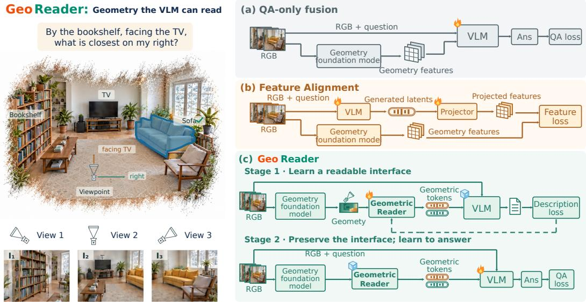  
Figure 1 GeoReader learns geometry in a form the receiving VLM can read. (a) QA-only fusion learns to use geometry through answer supervision. (b) Feature alignment matches VLM-generated representations to external geometry features. (c) GeoReader first trains Geometric Readers through description prediction by a frozen VLM, then freezes the Readers and trains the VLM for QA. All three routes estimate geometry from RGB, which also directly conditions each VLM. Flames and ice cubes mark trainable and frozen modules. The pictured I , I , I are input views; the scene and answer are illustrative. Fig. 2 details the architecture.

We introduce GeoReader, based on the core idea that geometry should first be converted into a form that VLMs can interpret as spatial relationships in language, before VLMs learn to use it for downstream tasks. To this end, a two-stage pipeline separates adapting geometry to the VLM from applying it to spatial QA (Fig. 1c). In Stage 1, we train lightweight Geometric Readers to convert per-view geometric signals into continuous geometric tokens. These tokens and the corresponding images are given to a frozen VLM that predicts geometry descriptions. With the VLM frozen, this supervision trains the Readers to express geometry information in a form that the model can interpret through its existing language capabilities. In Stage 2, we transfer the pretrained Readers to spatial QA, freezing the Readers to preserve their learned mapping while fine-tuning the VLM to use their outputs. Since questions differ in how much they rely on each geometric signal, a geometry injector conditions on the images and question to set each signal’s strength. Geometry descriptions are used only for Stage 1 supervision; at inference, the VLM answers directly using the geometric tokens.

We evaluate GeoReader across seven spatial reasoning benchmarks and three VLM families. With geometry predicted from RGB images, GeoReader achieves 94.3% accuracy on MindCube-Tiny with Qwen3-VL-4B and, with multi-source QA training, an average accuracy of 72.5% across six additional benchmarks with Qwen3.5-9B (Sec. 4.2). Comparisons with vanilla supervised finetuning (SFT) under matched QA data and training settings show gains concentrated on questions requiring metric 3D understanding. Ablations further show the benefits of readability pretraining, freezing the Readers during downstream adaptation, and the geometry injector (Secs. 4.3 and 4.4). Geometry interventions show that the model uses the supplied geometry: in a controlled MindCube-

Tiny experiment with annotation-derived camera geometry, removing geometry content reduces accuracy from 89.2% to 77.2%, while shuffling poses across views reduces it to 63.1%.

Our contributions are summarized as follows:

• We propose explicitly connecting geometry information to spatial relationships expressed in language, separating adapting geometry to the VLM from applying it to spatial reasoning.

• We introduce GeoReader, a two-stage framework that trains lightweight Geometric Readers through language supervision from a frozen VLM, then freezes the Readers and adapts the VLM for spatial QA with question-conditioned geometry injection (Sec. 3).

• We demonstrate the effectiveness of GeoReader across seven spatial reasoning benchmarks and three VLM families, with ablations and geometry interventions supporting both the framework’s design and the model’s use of geometry information (Secs. 4.2–4.5).

## 2 Related Work

Spatial reasoning in vision-language models. SpatialVLM [10], SpaRE [41] and SPAR 7M [70] build synthetic or 3D-grounded spatial QA data. SpatialLadder [31] and HiSpatial [36] organize training from perception toward reasoning, while SenseNova-SI [8] studies scaling spatial data. SpatialQA [7] and ViewSpatial [30] target depth and viewpoint relations; N3D-VLM [62] links 3D object localization to reasoning. These works establish the value of spatial supervision; we study how to present estimated geometry to the answering VLM.

Geometry-augmented VLMs. DUSt3R [61] and MASt3R [28] estimate point maps and correspondences; CUT3R [58] maintains a recurrent scene state. VGGT [57] predicts camera and dense geometry, and Depth Anything V2 [67] and Depth Anything 3 [37] predict depth and any-view geometry. Geometry-augmented VLMs take such 3D structure as input: 3D-LLM [23] and LEO [27] ground language in 3D scenes. LLaVA-3D [78], Video-3D LLM [76] and SR-3D [14] add spatial positions or regions to visual inputs. SpatialRGPT [13], SD-VLM [11] and HiSpatial [36] use relative depth, depth positional encoding and metric point maps, respectively. VLM-3R [18], Spatial-MLLM [63] and VG-LLM [75] fuse visual and 3D features; SpaceMind [74] uses camera-guided fusion, and SpatialStack [71] spreads geometry across LLM layers. These studies vary the geometric source and fusion; we train the interface for the receiving VLM.

Learning geometry representations for reasoning. G2VLM [26] combines reconstruction with spatial understanding, and GAP-MLLM [72] pretrains with sparse point-map and semantic prediction. SpatioLM [64] uses pseudo depth and camera supervision but only RGB at inference; GeoSR [73] finds that fused VGGT tokens are often underused and masks visual tokens during training to force their use, with QA as the only supervision. 3DThinker [12] aligns generated latents with VGGT features, and CoVT [48] learns continuous visual thoughts; LVR [29] and Monet [60] reason with visual latents, and Coconut [22] reasons in a continuous latent space. Unlike these methods, GeoReader supervises its geometric input through description prediction by the frozen VLM, and takes estimated pose and depth, not descriptions, at inference.

## 3 Method

We aim to supply a pretrained VLM with geometric input that meets two separate requirements: the geometric tokens must be readable by the receiving model, and the model must use them for the question at hand. GeoReader addresses them with two training stages (Fig. 2). After the preliminaries (Sec. 3.1), we describe how a Geometric Reader encodes each view as a geometric token (Sec. 3.2), how Stage 1 trains it for readability through the frozen VLM (Sec. 3.3), and how Stage 2 injects these tokens according to the question (Sec. 3.4).

## 3.1 Preliminaries

A VLM with parameters θ encodes the V images $I = \{ I _ { i } \} _ { i = 1 } ^ { V }$ into visual tokens $X _ { 1 } , \ldots , X _ { V }$ embeds the question as text tokens Q, and feeds the sequence of d-dimensional embeddings to

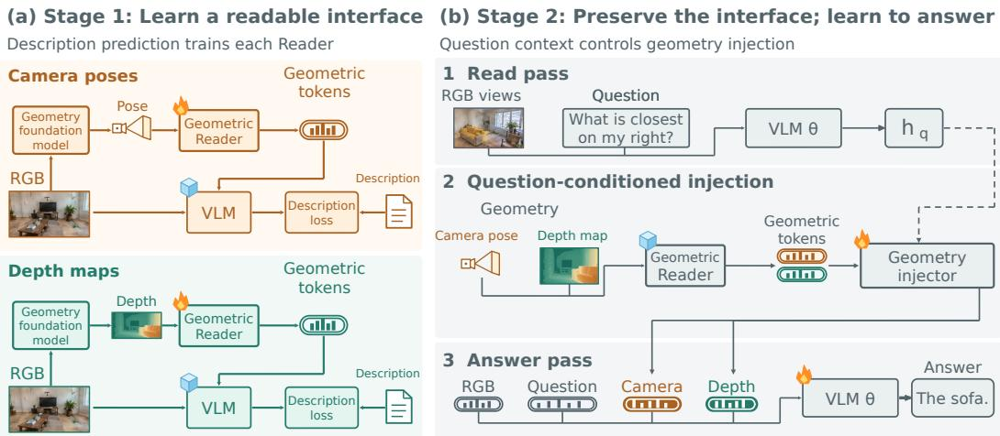  
Figure 2 Overview of GeoReader. Depth Anything 3 [37] predicts camera poses and depth maps from RGB. (a) Stage 1 trains Readers through a frozen VLM’s description loss. (b) With Readers frozen, the injector uses read-pass context $h _ { q }$ to map $Z ^ { m }$ to answer-pass tokens $\widetilde { Z } ^ { m }$ . Flames and ice mark trainable and frozen modules; descriptions train Readers only.

a language model that predicts the answer a with next-token distribution $p _ { \theta }$ . Each view i also has geometric signals $G _ { i } ^ { m } , m \in \mathcal { M }$ , here camera pose relative to view 1 and a depth map; the formulation applies to any per-view signal. We turn $\bar { G ^ { m } }$ into additional tokens of this input sequence.

## 3.2 Geometric Token Encoding

To feed geometry through the VLM’s existing input channel, a lightweight Geometric Reader $E _ { m }$ maps each view of signal m to one continuous input embedding. For view i, it first computes perpatch descriptors $U _ { i } ^ { m } \in \mathbb { R } ^ { N _ { i } ^ { m } \times c _ { m } }$ on the same patch grid as the RGB tokens; each $c _ { m }$ -dimensional descriptor holds the patch position together with pose-related quantities or depth statistics of that patch. A learned query $\mathbf { r } ^ { m }$ then reads only that view’s descriptors:

$$
\begin{array} { r l } & { M _ { i } ^ { m } = \mathrm { M L P } _ { m } \bigl ( \mathrm { L N } ( U _ { i } ^ { m } ) \bigr ) , \qquad Z _ { i } ^ { m } = \mathrm { D e c } _ { m } \bigl ( \mathbf { r } ^ { m } , M _ { i } ^ { m } \bigr ) \in \mathbb { R } ^ { 1 \times d } , } \\ & { \qquad Z ^ { m } = E _ { m } ( G ^ { m } ) = \bigl [ Z _ { 1 } ^ { m } ; \ldots ; Z _ { V } ^ { m } \bigr ] \in \mathbb { R } ^ { V \times d } , } \end{array}\tag{1}
$$

where $\mathrm { D e c } _ { m }$ applies two Transformer decoder blocks with $\mathbf { r } ^ { m }$ cross-attending to $M _ { i } ^ { m }$ , then a linear projection. We call $Z ^ { m }$ geometric tokens: continuous embeddings, one per view in input-view order. The Reader encodes geometry alone; the VLM combines it with RGB through its own attention layers. Each signal has its own Reader, so signals keep their own structure (Sec. A.2.1).

## 3.3 Frozen-VLM Readability Training

QA supervision alone does not specify what the geometry encodes, and feature alignment measures similarity to an external target rather than what the receiving VLM can read (Sec. 1). We instead supervise each Reader through the frozen target VLM: given the images, the geometric tokens and a fixed instruction, the VLM predicts a geometry description $y ^ { m }$ of signal m with teacher forcing. For two ScanNet [16] views, the camera description reads “compared with image $^ { l , }$ the observer in image 2 moves 0.4 meters right and 0.1 meters backward, and turns left by about 23 degrees,” and the depth description lists objects per view, $\mathrm { e . g . }$ , “guitar (left) at $1 . 7$ meters.” The supervised positions $\bar { \mathcal { T } } ^ { m }$ cover geometric content such as distances, directions and angles; template words, predictable without geometry, are excluded. The description loss is

$$
\mathcal { L } _ { \mathrm { r e a d } } ^ { m } = - \frac { 1 } { | \mathcal { T } ^ { m } | } \sum _ { t \in \mathcal { T } ^ { m } } \log p _ { \theta } \big ( \boldsymbol { y } _ { t } ^ { m } \mid I , \boldsymbol { Z } ^ { m } , \boldsymbol { y } _ { < t } ^ { m } \big ) , \qquad \theta \mathrm { f r o z e n } ,\tag{2}
$$

where gradients pass through the frozen VLM to update only $E _ { m }$ . This trains the Reader to produce geometric tokens readable by the VLM, with descriptions used only as training targets.

Pair-supervised readability. Descriptions of a signal such as camera pose relate each view to reference view 1. Group supervision supervises the descriptions of all V views jointly in one example; the description of view i can then be predicted from any view’s tokens, so the loss does not tell the Reader which token should carry that relation. Pair supervision removes this ambiguity by applying Eq. 2 to each reference–target pair: for target view $i \in \{ 2 , \ldots , V \}$ , the Reader encodes only the geometry of views 1 and i, and the frozen VLM predicts view i’s description relative to view 1 from these two views, so only their tokens can explain it. Stage 2 inputs keep all views (Sec. A.1.1).

## 3.4 Question-Conditioned Geometry Injection

Freezing the Readers. Stage 2 supervises answers, which do not explicitly require the Readers to retain the geometric relationships specified by the Stage 1 descriptions. Updating the Readers under this supervision may weaken their ability to express geometry beyond what the training questions need. We therefore freeze the Readers and adapt the VLM to this fixed interface.

Question-conditioned readout. Questions differ in how much they rely on each geometric signal, so we let the question set each signal’s strength. We compute it from the final-layer hidden state of the last valid question token, which attends to all preceding visual and question tokens and thus summarizes the task context. Geometric embeddings, however, enter before layer 1, and one forward pass cannot use its own final-layer state to set earlier inputs. We therefore first run a read pass over only the images and question to obtain this hidden state, $h _ { q } ,$ , before adding geometry.

Geometry injector. A geometry injector turns the frozen Reader outputs into the geometric tokens of the answer pass. For each signal $m ,$ , it maps $Z ^ { m }$ through an adapter $P _ { m }$ , scales the result by a gate computed from $h _ { q }$ with a routing head $R _ { m }$ , and adds it to the slot embeddings $B ^ { m } \in \mathbb { R } ^ { V \times \bar { d } }$ the learned input embeddings of the placeholder tokens at the geometric-token positions:

$$
\widetilde { Z } ^ { m } = B ^ { m } + g _ { m } P _ { m } ( Z ^ { m } ) , \qquad g _ { m } = \mathrm { s i g m o i d } \big ( R _ { m } ( h _ { q } ) \big ) .\tag{3}
$$

The adapter fits the frozen Reader outputs to the VLM, and $g _ { m }$ is the question-dependent strength of signal m. If a signal is missing (e.g., inter-view geometry for one image), $g _ { m } = 0$ and the slot embeddings alone mark it as absent, keeping the layout unchanged.

Training and inference. The answer pass places $\widetilde { Z } ^ { m }$ after the question, so the passes encode

$$
S _ { \mathrm { r e a d } } = \bigl [ X _ { 1 } , \ldots , X _ { V } , Q \bigr ] , \qquad S _ { \mathrm { a n s } } = \bigl [ X _ { 1 } , \ldots , X _ { V } , Q , \{ \widetilde { Z } ^ { m } \} _ { m \in { \cal M } } , a \bigr ] ,\tag{4}
$$

where a is the ground-truth answer in training and is generated at inference. Both passes share the VLM parameters, and we stop gradients through the read pass to save memory and computation. We fine-tune the language model and the geometry injector with next-token cross-entropy on the answer and keep the Readers and the vision encoder frozen. Since the geometric tokens come after the question, $\bar { S _ { \mathrm { a n s } } } ^ { - }$ begins with $S _ { \mathrm { r e a d } } ;$ at inference, the answer pass reuses the read pass’s key–value cache and computes only the geometric tokens and the answer.

## 4 Experiments

We first compare GeoReader with existing models and vanilla SFT (the same QA fine-tuning without geometry; Sec. 4.2). Next, we test Reader training and freezing (Sec. 4.3), then injection designs and whether answers use geometry (Sec. 4.4). Finally, we compare geometric tokens with text descriptions and present qualitative examples (Sec. 4.5).

## 4.1 Experimental Setup

For training, Stage 1 uses about 65K geometry descriptions from 1,550 ScanNet and ScanNet++ training scenes (Sec. A.1.1), and Stage 2 uses about 135K multi-source QA examples for main models and 10K MindCube examples for ablations, none from test sets (Sec. A.1.2). We evaluate on MindCube-Tiny [59], VSI-Bench [66], SPBench [31], CV-Bench [55], SPAR-Bench [70], ViewSpatial [30] and MMSI-Bench [68] (Sec. A.3). Main models are trained and evaluated with geometry predicted from RGB by Depth Anything 3 [37] (DA3; errors in Tab. 9), and ablations use annotated geometry to exclude estimation errors. We build GeoReader on 3B/7B Qwen2.5-VL [49], 4B/8B Qwen3-VL [50] and 4B/9B Qwen3.5 [51] with one recipe: Readers train for 10 epochs with the VLM frozen, and Stage 2 fine-tunes for 2 epochs on the multi-source data or 10 on MindCube at learning rate $2 \times 1 0 ^ { - 5 }$ , with greedy decoding (full training settings in Sec. A.2.3).

Table 1 MindCube-Tiny [59] accuracy (%). Per API or backbone-size block, bold marks the best and gray the runner-up (only with ≥ 3 models; base rows unshaded); †: evaluated by us; sizes in parentheses are total parameters reported by the provider. GeoReader uses DA3 geometry and achieves the highest accuracy in four of the five backbone blocks.
<table><tr><td>Method</td><td>Rot.</td><td>Among</td><td>Around</td><td>Overall ↑</td></tr><tr><td colspan="5">■ API models</td></tr><tr><td>GPT-4.1 [43]</td><td>45.5</td><td>44.2</td><td>47.2</td><td>45.1</td></tr><tr><td>0 Doubao-Seed-1.6 (230B) [5]</td><td>87.0</td><td>35.8</td><td>38.0</td><td>46.1</td></tr><tr><td>Gemini-2.5-Pro [20]</td><td>84.0</td><td>39.7</td><td>56.8</td><td>52.2</td></tr><tr><td>X P MiMo-V2.6-Flash (309B)† [40]</td><td>81.0</td><td>41.3</td><td>64.8</td><td>54.5</td></tr><tr><td>S OpenAI o3 [44]</td><td>86.5</td><td>42.7</td><td>66.0</td><td>56.6</td></tr><tr><td>Q DeepSeek-Flash (thinking, 552B)† [17]</td><td>89.5</td><td>58.3</td><td>75.6</td><td>68.4</td></tr><tr><td colspan="5">Qwen2.5-VL family</td></tr><tr><td>Qwen2.5-VL-3B† [49]</td><td>35.5</td><td>36.2</td><td>45.6</td><td>38.3</td></tr><tr><td>HATCH-3B [42]</td><td>31.0</td><td>50.2</td><td>65.6</td><td>50.2</td></tr><tr><td>SenseNova-SI-3B [8]</td><td></td><td></td><td></td><td>52.6</td></tr><tr><td>DR-MV3D-3B [15]</td><td>43.0</td><td>71.3</td><td>73.6</td><td>66.5</td></tr><tr><td>3DThinker-3B [12]</td><td>55.5</td><td>81.8</td><td>75.2</td><td>75.2</td></tr><tr><td>GeoReader-3B</td><td>40.5</td><td>90.3</td><td>91.6</td><td>81.1</td></tr><tr><td>Qwen2.5-VL-7B† [49]</td><td>35.0</td><td>33.2</td><td>38.4</td><td>34.8</td></tr><tr><td>SenseNova-SI-7B [8]</td><td></td><td></td><td></td><td>54.7</td></tr><tr><td>3DThinker-7B [12]</td><td>55.0</td><td>83.0</td><td>76.0</td><td>76.0</td></tr><tr><td>GeoReader-7B</td><td>90.0</td><td>94.7</td><td>92.4</td><td>93.2</td></tr><tr><td colspan="5">■Qwen3-VL family</td></tr><tr><td>Qwen3-VL-2B† [50]</td><td>29.5</td><td>33.3</td><td>47.2</td><td>35.9</td></tr><tr><td>Spatial-TTT-2B [39]</td><td>55.5</td><td>74.0</td><td>89.8</td><td>76.2</td></tr><tr><td>3DThinker-2B [12]</td><td>53.0</td><td>83.2</td><td>78.4</td><td>76.2</td></tr><tr><td>GeoReader-2B</td><td>59.5</td><td>93.3</td><td>91.6</td><td>86.5</td></tr><tr><td>Qwen3-VL-4B† [50]</td><td>25.0</td><td>25.3</td><td>43.6</td><td>29.6</td></tr><tr><td>3DThinker-4B [12]</td><td>55.0</td><td>81.7</td><td>78.4</td><td>75.8</td></tr><tr><td>GeoReader-4B</td><td>94.5</td><td>96.2</td><td>89.6</td><td>94.3</td></tr><tr><td>Qwen3-VL-8B† [50]</td><td>42.0</td><td>32.3</td><td>51.2</td><td>38.7</td></tr><tr><td>SenseNova-SI-8B [8]</td><td>79.5</td><td>73.2</td><td>70.4</td><td>73.8</td></tr><tr><td>3DThinker-8B [12]</td><td>56.5</td><td>82.5</td><td>78.8</td><td>76.7</td></tr><tr><td>GAMSI-8B [77]</td><td></td><td></td><td></td><td>94.1</td></tr><tr><td>GeoReader-8B</td><td>91.5</td><td>93.3</td><td>95.2</td><td>93.4</td></tr></table>

## 4.2 Main Results

Comparison with existing models. Tabs. 1 and 2 compare GeoReader (DA3 geometry) with existing models. On MindCube-Tiny, GeoReader exceeds 3DThinker at every backbone size. On six more benchmarks, GeoReader with Qwen2.5-VL-3B averages 63.6 versus 60.4 for 3DThinker-3B, and up to 72.5 with Qwen3.5-9B. Over vanilla SFT, geometry helps metric-geometry questions and leaves others unchanged (Tab. 3), with gains up to +14.3 on SPBench-SI relative distance and +13.5 on MMSI camera motion (Sec. A.4.1). Gains thus come from geometry, not QA fine-tuning.

## 4.3 Learning VLM-Readable Geometry

Ablations use Qwen2.5-VL-3B and the 1,050-question MindCube-Tiny test set. Stage 1 alone, without QA training, scores 41.4% (Tab. 6) and QA training alone 54.7% (Tab. 4, Panel A), whereas combining them achieves 89.2%. This shows that both stages are needed.

Table 2 Six-benchmark accuracy (%); Avg. is the mean. Per backbone-size block, bold marks the best and gray the runner-up (only with ≥ 3 models; base rows unshaded); †: evaluated by us; ∗: combined from two sources (Sec. A.3.4). GeoReader has the highest average in every block.
<table><tr><td>Method</td><td>VSI</td><td>SPBench</td><td>CV</td><td>SPAR</td><td>ViewSpatial</td><td>MMSI</td><td>Avg. ↑</td></tr><tr><td colspan="8">Qwen2.5-VL family</td></tr><tr><td>Qwen2.5-VL-3B† [49]</td><td>27.3</td><td>39.5</td><td>70.5</td><td>27.9</td><td>36.1</td><td>25.5</td><td>37.8</td></tr><tr><td>Spatial-MLLM-4B [63]</td><td>47.3</td><td>48.4</td><td>73.8</td><td>35.1</td><td>43.6</td><td>31.5</td><td>46.6</td></tr><tr><td>SpatialLadder-3B [31]</td><td>45.7</td><td>70.6</td><td>73.7</td><td>34.4</td><td>44.2</td><td>29.2</td><td>49.6</td></tr><tr><td>3DThinker-3B [12]</td><td>59.1</td><td>60.2</td><td>78.4</td><td>58.2</td><td>64.7</td><td>41.9</td><td>60.4</td></tr><tr><td>GeoReader-3B</td><td>56.1</td><td>70.0</td><td>83.7</td><td>59.1</td><td>71.4</td><td>41.2</td><td>63.6</td></tr><tr><td>Qwen2.5-VL-7B† [49]</td><td>29.9</td><td>40.8</td><td>77.9</td><td>33.2</td><td>34.7</td><td>26.8</td><td>40.5</td></tr><tr><td>SpaceR-7B [45]</td><td>44.5</td><td>54.0</td><td>75.3</td><td>37.1</td><td>45.5</td><td>28.8</td><td>47.5</td></tr><tr><td>ViLaSR-7B [65]</td><td>45.4</td><td>53.9</td><td>77.1</td><td>37.6</td><td>46.1</td><td>30.2</td><td>48.4</td></tr><tr><td>Video-R1 [19]</td><td>33.4</td><td>42.8</td><td>69.6</td><td>31.5</td><td>36.1</td><td>29.4</td><td>40.5</td></tr><tr><td>3DThinker-7B [12]</td><td>63.7</td><td>68.3</td><td>81.1</td><td>63.3</td><td>68.6</td><td>43.3</td><td>64.7</td></tr><tr><td>GeoReader-7B</td><td>58.0</td><td>72.3</td><td>84.4</td><td>61.4</td><td>75.6</td><td>45.5</td><td>66.2</td></tr><tr><td colspan="8">■ Qwen3-VL family</td></tr><tr><td>Qwen3-VL-4B† [50]</td><td>55.1</td><td>58.2</td><td>84.4</td><td>33.4</td><td>38.6</td><td>27.2</td><td>49.5</td></tr><tr><td>GeoReader-4B</td><td>64.8</td><td>78.9</td><td>85.6</td><td>65.3</td><td>77.4</td><td>43.6</td><td>69.3</td></tr><tr><td>Qwen3-VL-8B† [50]</td><td>55.9</td><td>57.8</td><td>85.4</td><td>38.2</td><td>40.4</td><td>28.9</td><td>51.1</td></tr><tr><td>SenseNova-SI-8B* [8]</td><td>64.8</td><td>65.8</td><td>83.4</td><td>41.1</td><td>51.2</td><td>38.1</td><td>57.4</td></tr><tr><td>GeoReader-8B</td><td>66.2</td><td>76.7</td><td>86.5</td><td>65.7</td><td>78.5</td><td>46.6</td><td>70.0</td></tr><tr><td colspan="8">Qwen3.5 family</td></tr><tr><td>Qwen3.5-4B† [51]</td><td>50.0</td><td>35.5</td><td>84.9</td><td>34.4</td><td>34.5</td><td>28.1</td><td>44.6</td></tr><tr><td>GeoReader-4B</td><td>66.7</td><td>81.5</td><td>81.8</td><td>68.7</td><td>77.7</td><td>45.4</td><td>70.3</td></tr><tr><td>Qwen3.5-9B† [51]</td><td>54.1</td><td>50.7</td><td>85.9</td><td>42.1</td><td>38.2</td><td>32.0</td><td>50.5</td></tr><tr><td>GeoReader-9B</td><td>68.6</td><td>79.5</td><td>87.7</td><td>71.0</td><td>81.3</td><td>47.1</td><td>72.5</td></tr></table>

Table 3 Accuracy (%) of vanilla SFT and GeoReader by question type. Both use Qwen2.5-VL-3B [49] with matched data and settings; the 59 subtasks of the six benchmarks are grouped by whether they require metric geometry (subtask counts in parentheses), weighted by question count. Geometry helps questions requiring metric geometry without hurting the others.
<table><tr><td>Question type</td><td>Questions</td><td>Vanilla</td><td>GeoReader</td><td>Δ</td></tr><tr><td>Object and room size (4)</td><td>1,862</td><td>65.2</td><td>70.0</td><td>+4.8</td></tr><tr><td>Camera motion (4)</td><td>967</td><td>39.3</td><td>43.7</td><td>+4.4</td></tr><tr><td>Distance and depth (19)</td><td>6,613</td><td>56.8</td><td>59.0</td><td>+2.2</td></tr><tr><td>Metric-geometry questions (27)</td><td>9,442</td><td>56.7</td><td>59.6</td><td>+2.9</td></tr><tr><td>All other questions (32)</td><td>13,577</td><td>67.3</td><td>67.5</td><td>+0.3</td></tr></table>

Reader pretraining. Panel A of Tab. 4 compares the two routes of Sec. 1 with ours. Readability pretraining achieves 76.4%, above QA-only training of a random Reader (54.7%) and feature alignment (62.7%; released 3DThinker checkpoint [12], same backbone and questions).

Pair versus group supervision. Panel C of Tab. 5 compares the supervisions of Sec. 3.3 with frozen Readers. Pair supervision, which removes the view ambiguity of group supervision (all views in one example), improves accuracy from 77.8% to 89.2% (Sec. A.4.7).

Freezing the Readers. In Panel A of Tab. 4, we tune the Reader in QA training. Freezing the same pair-supervised Stage 1 Reader (GeoReader, Panel B) improves accuracy from 76.4% to 89.2%. Because QA answers do not require the Reader to keep Stage 1 relationships, we freeze it.

Alternative interfaces. In Panel B of Tab. 4, we test complete direct-injection interfaces as in Panel A. Adapted VLM-3R- and SpaceMind-style fusion on dense VGGT features achieve 86.1%

Table 4 MindCube-Tiny [59] accuracy (%). A: QA-tuned Readers; B: complete interfaces. Readability pretraining leads A; GeoReader leads B with its Reader frozen.
<table><tr><td rowspan=1 colspan=3>Geometric interface              Overall ↑</td></tr><tr><td rowspan=1 colspan=3>■A. Reader pretraining, then tuned in QA</td></tr><tr><td rowspan=1 colspan=3>No Stage 1 (QA loss only)         54.7</td></tr><tr><td rowspan=1 colspan=1>Feat. align. (rel</td><td rowspan=1 colspan=1>eased)</td><td rowspan=1 colspan=1>62.7</td></tr><tr><td rowspan=1 colspan=3>Readability pretraining            76.4</td></tr><tr><td rowspan=1 colspan=3>B. Complete interfaces</td></tr><tr><td rowspan=1 colspan=3>VLM-3R-style (VGGT)            86.1</td></tr><tr><td rowspan=1 colspan=3>SpaceMind-style (VGGT)          81.1</td></tr><tr><td rowspan=1 colspan=3>Per-token additive (pose)           73.8GeoReader (frozen Reader)       89.2</td></tr></table>

Table 6 Accuracy (%) per stage. Stage 1 alone is not enough; both are needed.

Table 5 MindCube-Tiny [59] accuracy (%), generated tokens and latency (s) with annotated geometry; Text-CoT generates descriptions before the answer. Pairsupervised GeoReader is most accurate, with as few generated tokens as vanilla SFT.
<table><tr><td>Recipe</td><td>Acc. ↑</td><td>Tokens</td><td>Latency (s) ↓</td></tr><tr><td>A. No geometry</td><td></td><td></td><td></td></tr><tr><td>Vanilla SFT</td><td>68.6</td><td>16.2</td><td>0.5</td></tr><tr><td colspan="4">■B. Text geometry</td></tr><tr><td>Joint description + QA SFT</td><td>67.0</td><td>16.3</td><td>0.5</td></tr><tr><td>Generated Text-CoT</td><td>72.9</td><td>119.3</td><td>2.5</td></tr><tr><td>Descriptions in prompt</td><td>81.0</td><td>16.3</td><td>0.5</td></tr><tr><td colspan="4">C. Continuous geometry</td></tr><tr><td>GeoReader (group)</td><td>77.8</td><td>16.2</td><td>0.5</td></tr><tr><td>GeoReader (pair)</td><td>89.2</td><td>16.2</td><td>0.5</td></tr></table>

Table 8 Accuracy (%) per geometry intervention. Only GeoReader drops markedly.

Table 7 Accuracy (%) per injection design. The geometry injector scores highest.
<table><tr><td>Configuration</td><td>QA↑</td></tr><tr><td>Vanilla SFT</td><td>68.6</td></tr><tr><td>Stage 1 only</td><td>41.4</td></tr><tr><td>Stage 1 + Stage 2</td><td>89.2</td></tr></table>

<table><tr><td>Injection design</td><td>QA↑</td></tr><tr><td>Direct</td><td>78.6</td></tr><tr><td>Learned fixed scaling</td><td>68.5</td></tr><tr><td>Geometry injector</td><td>89.2</td></tr></table>

<table><tr><td colspan="2">Geometry GeoReader Feat. align.</td></tr><tr><td>Shuffled</td><td>63.1 61.5</td></tr><tr><td>Zero</td><td>77.2 62.9</td></tr><tr><td>Correct</td><td>89.2 62.7</td></tr></table>

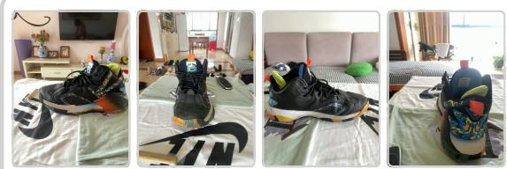  
Question (abridged). From image 2, what is to the right of the black sneaker?  
Options. A. TV; B. dining table; C. light purple sofa; D. curtains/windows.  
GeoReader: C 3DThinker: C

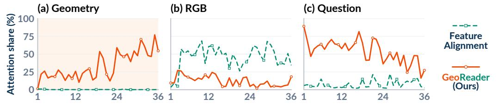  
Figure 3 Answer-token attention share (%) per layer on a MindCube-Tiny [59] question for geometry, RGB and question tokens (Sec. A.5.1). GeoReader’s answer tokens attend more to geometric tokens than feature alignment (3DThinker [12]) does to its latents.

and 81.1% (Sec. A.4.5), and adding annotated pose descriptors to image-token embeddings 73.8%, below GeoReader’s 89.2% on the same geometry. This suggests that Readers suit the VLM better.

## 4.4 Using Geometry for the Question

Injection design. In Tab. 7, we replace the geometry injector with direct injection (78.6%) or a learned fixed scale (68.5%); neither matches the full injector (89.2%; Sec. A.2.2).

Geometry interventions. With the checkpoint, RGB and questions fixed, zeroing GeoReader’s geometric residual, which keeps the slot embeddings, lowers accuracy from 89.2% to 77.2%, and shuffling poses across views drops it to 63.1% (Tab. 8; Sec. A.4.6). Its answers thus depend on both the geometric content and its match to the views. In contrast, for feature alignment (Feat. align.), zeroing the latents of the same released checkpoint or swapping them across questions keeps accuracy near 62.7% (62.9% and 61.5%), indicating that its answers barely depend on the latents, even though they are trained to match VGGT [57] features.

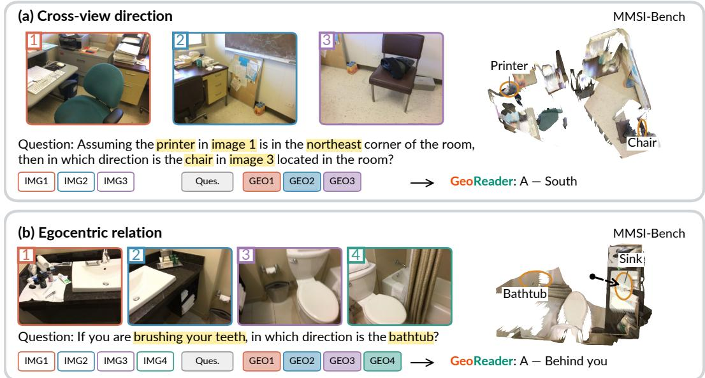  
Figure 4 Two MMSI-Bench [68] questions GeoReader answers correctly with DA3 [37] geometry. Right: predicted-depth point clouds, queried objects circled.

Answer-token attention. On a MindCube-Tiny question that both models answer correctly, we find that GeoReader’s answer tokens attend more to geometric tokens across layers than 3DThinker’s attend to its latents (Fig. 3; Sec. A.5.1), consistent with the interventions.

## 4.5 Interface Trade-ofs and Qualitative Analysis

Text versus continuous geometry. As extra SFT targets, descriptions score 67.0%, below vanilla SFT (68.6%; Tab. 5). Generating them at inference yields 72.9% and supplying them in the prompt 81.0%, whereas GeoReader, using them only as Reader targets, achieves 89.2%. Descriptions thus help more as Reader supervision than as text. With precomputed geometry, GeoReader generates 16.2 tokens in 0.5 s, versus 119.3 and 2.5 s when generating them (Sec. A.4.7).

Qualitative examples. Both questions in Fig. 4 relate objects in different views (printer/chair in views 1/3; sink/bathtub in views 1/4). Secs. A.5.2 and A.5.3 give more successes and failures.

## 5 Conclusion

We presented GeoReader, which converts geometry into a form that a frozen VLM can read before the VLM learns to use it. Geometric Readers learn through geometry-description prediction by the frozen VLM, then stay frozen while the VLM and a question-conditioned geometry injector learn spatial QA; descriptions serve only as training targets. Zeroing the aligned latents of a released feature-alignment model leaves its accuracy unchanged, whereas removing GeoReader’s geometry lowers it. With geometry predicted from RGB, GeoReader reaches 94.3 on MindCube-Tiny with Qwen3-VL-4B and a six-benchmark average of 72.5 with Qwen3.5-9B. Capturing geometry does not ensure its use; the representation that helps most is the one the receiving model can read.

## AI Use Statement

We used generative AI tools to assist with implementing training code, generating training data and figures, and manuscript organization and editing. The authors manually reviewed the AI-assisted training code and the generated training data. The authors take responsibility for the final content of this work, including its text, claims, code, data, and figures.

## Reproducibility Statement

Sec. 3 describes the model and training objectives, and Sec. A.2.1 details the Geometric Reader architecture. The training-data composition and split boundaries are described in Sec. A.1.2, and geometry sources in Sec. A.1.3. Training settings are provided in Sec. A.2.3, and the injection designs and text-geometry recipes in Secs. A.2.2 and A.4.7. Sec. A.3 and Sec. A.4.6 document evaluation settings and geometry-content interventions, respectively.

## Ethics Statement

This work uses publicly available datasets under their respective licenses or terms (Sec. A.6). Predicted geometry and answers can be wrong, e.g., under reference-frame confusion. Benchmark performance does not establish reliability for safety-critical applications such as navigation or robotic control; such use requires application-specific validation and safeguards.

## References

[1] Henrik Aanæs, Rasmus Ramsbøl Jensen, George Vogiatzis, Engin Tola, and Anders Bjorholm Dahl. Large-Scale Data for Multiple-View Stereopsis. International Journal of Computer Vision, 120(2):153–168, 2016. doi: 10.1007/s11263-016-0902-9.

[2] Siddhant Bansal, Zhifan Zhu, Shashank Tripathi, Jiahe Zhao, Michael J. Black, and Dima Damen. Towards in-the-wild Egocentric 3D Hand-Object Pose Estimation. In European Conference on Computer Vision, 2026. URL https://eccv.ecva.net/virtual/2026/poster/3943.

[3] Gilad Baruch, Zhuoyuan Chen, Afshin Dehghan, Tal Dimry, Yuri Feigin, Peter Fu, Thomas Gebauer, Brandon Joffe, Daniel Kurz, Arik Schwartz, and Elad Shulman. ARKitScenes: A Diverse Real-World Dataset for 3D Indoor Scene Understanding Using Mobile RGB-D Data. In Proceedings ofthe Neural Information Processing Systems Track on Datasets and Benchmarks, volume 1, 2021. URL https://datasets-benchmarks-proceedings.neurips.cc/paper\_files/ paper/2021/file/66f041e16a60928b05a7e228a89c3799-Paper-round1.pdf.

[4] Garrick Brazil, Abhinav Kumar, Julian Straub, Nikhila Ravi, Justin Johnson, and Georgia Gkioxari. Omni3D: A Large Benchmark and Model for 3D Object Detection in the Wild. In Proceedings of the IEEE/CVF Conference on Computer Vision and Pattern Recognition, pp. 13154–13164, 2023. URL https://openaccess.thecvf.com/content/CVPR2023/papers/ Brazil\_Omni3D\_A\_Large\_Benchmark\_and\_Model\_for\_3D\_Object\_Detection\_CVPR\_ 2023\_paper.pdf.

[5] ByteDance Seed. Introduction to Techniques Used in Seed1.6, 2025. URL https://seed. bytedance.com/en/blog/introduction-to-techniques-used-in-seed1-6.

[6] Holger Caesar, Varun Bankiti, Alex H. Lang, Sourabh Vora, Venice Erin Liong, Qiang Xu, Anush Krishnan, Yu Pan, Giancarlo Baldan, and Oscar Beijbom. nuScenes: A Multimodal Dataset for Autonomous Driving. In Proceedings of the IEEE/CVF Conference on Computer Vision and Pattern Recognition, pp. 11621– 11631, 2020. URL http://openaccess.thecvf.com/content\_CVPR\_2020/papers/Caesar\_ nuScenes\_A\_Multimodal\_Dataset\_for\_Autonomous\_Driving\_CVPR\_2020\_paper.pdf.

[7] Wenxiao Cai, Iaroslav Ponomarenko, Jianhao Yuan, Xiaoqi Li, Wankou Yang, Hao Dong, and Bo Zhao. Spatialbot: Precise spatial understanding with vision language models. In 2025 IEEE International Conference on Robotics and Automation (ICRA), pp. 9490–9498.

IEEE, 2025. doi: 10.1109/ICRA55743.2025.11128671. URL https://doi.org/10.1109/ ICRA55743.2025.11128671.

[8] Zhongang Cai, Ruisi Wang, Chenyang Gu, Fanyi Pu, Junxiang Xu, Yubo Wang, Wanqi Yin, Zhitao Yang, Chen Wei, Qingping Sun, Tongxi Zhou, Jiaqi Li, Hui En Pang, Oscar Qian, Yukun Wei, Zhiqian Lin, Xuanke Shi, Kewang Deng, Xiaoyang Han, Zukai Chen, Xiangyu Fan, Hanming Deng, Lewei Lu, Liang Pan, Bo Li, Ziwei Liu, Quan Wang, Dahua Lin, and Lei Yang. Scaling Spatial Intelligence with Multimodal Foundation Models. In Proceedings of the IEEE/CVF Conference on Computer Vision and Pattern Recognition (CVPR), pp. 7879–7890, June 2026. URL https://openaccess.thecvf.com/content/CVPR2026/papers/Cai\_Scaling\_Spatial\_ Intelligence\_with\_Multimodal\_Foundation\_Models\_CVPR\_2026\_paper.pdf.

[9] Angel Chang, Angela Dai, Thomas Funkhouser, Maciej Halber, Matthias Nießner, Manolis Savva, Shuran Song, Andy Zeng, and Yinda Zhang. Matterport3D: Learning from RGB-D Data in Indoor Environments. In Proceedings of the International Conference on 3D Vision, pp. 667–676, 2017. doi: 10.1109/3DV.2017.00081.

[10] Boyuan Chen, Zhuo Xu, Sean Kirmani, Brian Ichter, Dorsa Sadigh, Leonidas Guibas, and Fei Xia. SpatialVLM: Endowing Vision-Language Models with Spatial Reasoning Capabilities. In Proceedings of the IEEE/CVF Conference on Computer Vision and Pattern Recognition (CVPR), pp. 14455–14465, June 2024. URL https://openaccess.thecvf.com/content/ CVPR2024/papers/Chen\_SpatialVLM\_Endowing\_Vision-Language\_Models\_with\_ Spatial\_Reasoning\_Capabilities\_CVPR\_2024\_paper.pdf.

[11] Pingyi Chen, Yujing Lou, Shen Cao, Jinhui Guo, Lubin Fan, Yue Wu, Lin Yang, Lizhuang Ma, and Jieping Ye. SD-VLM: Spatial Measuring and Understanding with Depth-Encoded Vision-Language Models. In Advances in Neural Information Processing Systems, volume 38, pp. 33938–33968. Curran Associates, Inc., 2025. doi: 10. 52202/085713-1140. URL https://proceedings.neurips.cc/paper\_files/paper/2025/file/ 30bc3a3a44c9d2e3f32e6dd1cd18f552-Paper-Conference.pdf.

[12] Zhangquan Chen, Manyuan Zhang, Xinlei Yu, Xufang Luo, Mingze Sun, Zihao Pan, Xiang An, Yan Feng, Peng Pei, Xunliang Cai, and Ruqi Huang. Think with 3D: Geometric Imagination Grounded Spatial Reasoning from Limited Views. In Proceedings of the IEEE/CVF Conference on Computer Vision and Pattern Recognition (CVPR), pp. 2613–2624, June 2026. URL https://openaccess.thecvf.com/content/CVPR2026/papers/Chen\_Think\_ with\_3D\_Geometric\_Imagination\_Grounded\_Spatial\_Reasoning\_from\_Limited\_CVPR\_ 2026\_paper.pdf.

[13] An-Chieh Cheng, Hongxu Yin, Yang Fu, Qiushan Guo, Ruihan Yang, Jan Kautz, Xiaolong Wang, and Sifei Liu. SpatialRGPT: Grounded Spatial Reasoning in Vision-Language Models. In Advances in Neural Information Processing Systems, volume 37, pp. 135062–135093. Curran Associates, Inc., 2024. doi: 10. 52202/079017-4293. URL https://proceedings.neurips.cc/paper\_files/paper/2024/file/ f38cb4cf9a5eaa92b3cfa481832719c6-Paper-Conference.pdf.

[14] An-Chieh Cheng, Yang Fu, Yukang Chen, Zhijian Liu, Xiaolong Li, Subhashree Radhakrishnan, Song Han, Yao Lu, Jan Kautz, Pavlo Molchanov, Hongxu Yin, Xiaolong Wang, and Sifei Liu. 3D Aware Region Prompted Vision Language Model. In International Conference on Learning Representations, volume 2026, pp. 123286–123308, 2026. URL https://proceedings.iclr.cc/paper\_files/paper/2026/file/ c86d3f43371270c70ed94e024852895d-Paper-Conference.pdf.

[15] Jiho Choi, Seonho Lee, Seojeong Park, and Hyunjung Shim. Dense Reward for Multi-View 3D Reasoning with Global Maps and Local Views. In European Conference on Computer Vision (ECCV), 2026. URL https://eccv.ecva.net/virtual/2026/poster/5231.

[16] Angela Dai, Angel X. Chang, Manolis Savva, Maciej Halber, Thomas Funkhouser, and Matthias Nießner. ScanNet: Richly-Annotated 3D Reconstructions of Indoor Scenes. In Proceedings of the IEEE Conference on Computer Vision and Pattern Recognition, pp. 5828–5839,

2017. URL http://openaccess.thecvf.com/content\_cvpr\_2017/papers/Dai\_ScanNet\_ Richly-Annotated\_3D\_CVPR\_2017\_paper.pdf.

[17] DeepSeek-AI. DeepSeek-V4.1-Flash: Pushing the Limits of KV Cache Compression. arXiv preprint arXiv:2609.19969, 2026. URL https://arxiv.org/abs/2609.19969.

[18] Zhiwen Fan, Jian Zhang, Renjie Li, Junge Zhang, Runjin Chen, Hezhen Hu, Kevin Wang, Peihao Wang, Huaizhi Qu, Shijie Zhou, Dilin Wang, Zhicheng Yan, Hongyu Xu, Justin Theiss, Tianlong Chen, Jiachen Li, Zhengzhong Tu, Zhangyang Wang, and Rakesh Ranjan. VLM-3R: Vision-Language Models Augmented with Instruction-Aligned 3D Reconstruction. In Proceedings of the IEEE/CVF Conference on Computer Vision and Pattern Recognition (CVPR), pp. 31054–31065, June 2026. URL https://openaccess.thecvf.com/ content/CVPR2026/papers/Fan\_VLM-3R\_Vision-Language\_Models\_Augmented\_ with\_Instruction-Aligned\_3D\_Reconstruction\_CVPR\_2026\_paper.pdf.

[19] Kaituo Feng, Kaixiong Gong, Bohao Li, Zonghao Guo, Yibing Wang, Tianshuo Peng, Junfei Wu, Xiaoying Zhang, Benyou Wang, and Xiangyu Yue. Video-R1: Reinforcing Video Reasoning in MLLMs. In Advances in Neural Information Processing Systems, volume 38, pp. 99114–99137. Curran Associates, Inc., 2025. doi: 10. 52202/085713-3310. URL https://proceedings.neurips.cc/paper\_files/paper/2025/file/ 8eb3976840e08b80dda9667562574246-Paper-Conference.pdf.

[20] Gemini Team. Gemini 2.5: Pushing the Frontier with Advanced Reasoning, Multimodality, Long Context, and Next Generation Agentic Capabilities. arXiv preprint arXiv:2507.06261, 2025. URL https://arxiv.org/abs/2507.06261.

[21] Jiawei Guo, Yu Chen, Xiang Wang, Shuai Li, Xinpei Zhao, Huaxing Liu, Shuai Dong, Feifei Zhai, and Yu Zhou. Beyond Visual Memory: Mechanistic Diagnostics of Latent Visual Reasoning. arXiv preprint arXiv:2606.01287, 2026.

[22] Shibo Hao, Sainbayar Sukhbaatar, DiJia Su, Xian Li, Zhiting Hu, Jason Weston, and Yuandong Tian. Training Large Language Models to Reason in a Continuous Latent Space. In Second Conference on Language Modeling, 2025. URL https://arxiv.org/abs/2412.06769.

[23] Yining Hong, Haoyu Zhen, Peihao Chen, Shuhong Zheng, Yilun Du, Zhenfang Chen, and Chuang Gan. 3D-LLM: Injecting the 3D World into Large Language Models. In Advances in Neural Information Processing Systems, volume 36, pp. 20482–20494. Curran Associates, Inc., 2023. doi: 10.52202/075280-0900. URL https://proceedings.neurips.cc/paper\_files/ paper/2023/file/413885e70482b95dcbeeddc1daf39177-Paper-Conference.pdf.

[24] Ryan Hoque, Peide Huang, David J. Yoon, Mouli Sivapurapu, and Jian Zhang. EgoDex: Learning Dexterous Manipulation from Large-Scale Egocentric Video. In International Conference on Learning Representations, 2026. URL https://proceedings.iclr.cc/paper\_files/paper/ 2026/file/07fcc6e2b89439d3ee5ab60939aaa6a0-Paper-Conference.pdf.

[25] Tianshuai Hu, Yangyi Zhong, Zeying Gong, Lingdong Kong, Xiaodong Mei, Guoyang Zhao, Xiaolu Liu, Song Wang, Rong Li, and Junwei Liang. Token-Wise Latent Streaming from Slow Reasoners to Fast Planners for Dynamic Vision Language Navigation. arXiv preprint arXiv:2607.16806, 2026.

[26] Wenbo Hu, Jingli Lin, Yilin Long, Yunlong Ran, Lihan Jiang, Yifan Wang, Chenming Zhu, Runsen Xu, Tai Wang, and Jiangmiao Pang. G2VLM: Geometry grounded vision language model with unified 3d reconstruction and spatial reasoning. In Proceedings of the IEEE/CVF Conference on Computer Vision and Pattern Recognition (CVPR), pp. 9535–9546, June 2026. URL https://openaccess.thecvf.com/content/CVPR2026/papers/Hu\_G2VLM\_ Geometry\_Grounded\_Vision\_Language\_Model\_with\_Unified\_3D\_Reconstruction\_ CVPR\_2026\_paper.pdf.

[27] Jiangyong Huang, Silong Yong, Xiaojian Ma, Xiongkun Linghu, Puhao Li, Yan Wang, Qing Li, Song-Chun Zhu, Baoxiong Jia, and Siyuan Huang. An Embodied Generalist Agent in 3D World. In Proceedings of the 41st International Conference on Machine Learning,

volume 235 of Proceedings of Machine Learning Research, pp. 20413–20451. PMLR, 21– 27 Jul 2024. URL https://raw.githubusercontent.com/mlresearch/v235/main/assets/ huang24ae/huang24ae.pdf.

[28] Vincent Leroy, Yohann Cabon, and Jerome Revaud. Grounding Image Matching in 3D with MASt3R. In Computer Vision – ECCV 2024, pp. 71–91. Springer, 2024. doi: 10.1007/978-3-031-73220-1 5. URL https://www.ecva.net/papers/eccv\_2024/papers\_ ECCV/papers/09080.pdf.

[29] Bangzheng Li, Ximeng Sun, Jiang Liu, Ze Wang, Jialian Wu, Xiaodong Yu, Hao Chen, Emad Barsoum, Muhao Chen, and Zicheng Liu. Latent Visual Reasoning. In International Conference on Learning Representations, 2026. URL https://proceedings.iclr.cc/paper\_files/ paper/2026/file/efa0939caa8a906fd0a61a9c60e46e8b-Paper-Conference.pdf.

[30] Dingming Li, Hongxing Li, Zixuan Wang, Yuchen Yan, Hang Zhang, Siqi Chen, Guiyang Hou, Shengpei Jiang, Wenqi Zhang, Yongliang Shen, Weiming Lu, and Yueting Zhuang. ViewSpatial-Bench: Evaluating Multi-perspective Spatial Localization in Vision-Language Models. In European Conference on Computer Vision, 2026. URL https://eccv.ecva.net/ virtual/2026/poster/3165.

[31] Hongxing Li, Dingming Li, Zixuan Wang, Yuchen Yan, Hang Wu, Wenqi Zhang, Yongliang Shen, Weiming Lu, Jun Xiao, and Yueting Zhuang. SpatialLadder: Progressive Training for Spatial Reasoning in Vision-Language Models. In International Conference on Learning Representations, volume 2026, pp. 76566– 76592, 2026. URL https://proceedings.iclr.cc/paper\_files/paper/2026/file/ 7bc3fe234454107149fa9d44faacaa64-Paper-Conference.pdf.

[32] Rong Li, Shijie Li, Lingdong Kong, Xulei Yang, and Junwei Liang. SeeGround: See and Ground for Zero-Shot Open-Vocabulary 3D Visual Grounding. In Proceedings of the IEEE/CVF Conference on Computer Vision and Pattern Recognition (CVPR), pp. 3707–3717, June 2025. URL https://openaccess.thecvf.com/content/CVPR2025/ html/Li\_SeeGround\_See\_and\_Ground\_for\_Zero-Shot\_Open-Vocabulary\_3D\_Visual\_ Grounding\_CVPR\_2025\_paper.html.

[33] Shijie Li, Zhongyao Cheng, Rong Li, Shuai Li, Juergen Gall, Xun Xu, and Xulei Yang. Global-Aware Monocular Semantic Scene Completion with State Space Models. In Proceedings of the IEEE/CVF International Conference on Computer Vision (ICCV), pp. 25550–25559, October 2025. URL https://openaccess.thecvf.com/content/ICCV2025/ html/Li\_Global-Aware\_Monocular\_Semantic\_Scene\_Completion\_with\_State\_Space\_ Models\_ICCV\_2025\_paper.html.

[34] You Li, Chi Chen, Yanghao Li, Fanhu Zeng, Kaiyu Huang, Jinan Xu, and Maosong Sun. Imagination Helps Visual Reasoning, But Not Yet in Latent Space. In Forty-third International Conference on Machine Learning, 2026. URL https://arxiv.org/abs/2602.22766.

[35] Yunheng Li, Guohong Mu, Hao Li, Shengsheng Qian, Dingwen Zhang, Qibin Hou, and Ming-Ming Cheng. Annotations as Rollouts: Efficient and Scalable Reinforcement Learning for Video MLLMs. arXiv preprint arXiv:2608.20492, 2026. URL https://arxiv.org/abs/2608. 20492.

[36] Huizhi Liang, Yichao Shen, Yu Deng, Sicheng Xu, Zhiyuan Feng, Tong Zhang, Yaobo Liang, and Jiaolong Yang. HiSpatial: Taming Hierarchical 3D Spatial Understanding in Vision-Language Models. In Proceedings of the IEEE/CVF Conference on Computer Vision and Pattern Recognition (CVPR), pp. 2502–2514, June 2026. URL https://openaccess. thecvf.com/content/CVPR2026/papers/Liang\_HiSpatial\_Taming\_Hierarchical\_3D\_ Spatial\_Understanding\_in\_Vision-Language\_Models\_CVPR\_2026\_paper.pdf.

[37] Haotong Lin, Sili Chen, Jun Hao Liew, Donny Y. Chen, Zhenyu Li, Yang Zhao, Sida Peng, Hengkai Guo, Xiaowei Zhou, Guang Shi, Jiashi Feng, and Bingyi Kang. Depth Anything 3: Recovering the Visual Space from Any Views. In International Conference on Learning Representations, volume 2026, pp. 141261–141285, 2026. URL https://proceedings.iclr.cc/paper\_files/paper/2026/file/ e4cd50120b6d7e8daf1749d6bbaa889-Paper-Conference.pdf.

[38] Tsung-Yi Lin, Michael Maire, Serge Belongie, James Hays, Pietro Perona, Deva Ramanan, Piotr Dollar, and C. Lawrence Zitnick. Microsoft COCO: Common Objects in Context. In´ Computer Vision – ECCV 2014, pp. 740–755, 2014. doi: 10.1007/978-3-319-10602-1 48. URL https://doi.org/10.1007/978-3-319-10602-1\_48.

[39] Fangfu Liu, Diankun Wu, Jiawei Chi, Yimo Cai, Yi-Hsin Hung, Xumin Yu, Hao Li, Han Hu, Yongming Rao, and Yueqi Duan. Spatial-TTT: Streaming Visual-based Spatial Intelligence with Test-Time Training. In European Conference on Computer Vision, 2026. URL https: //eccv.ecva.net/virtual/2026/poster/5426.

[40] LLM-Core Xiaomi. MiMo-V2.6: Scaling Reinforcement Learning Towards Self-Improvement. Technical report, LLM-Core Xiaomi, 2026. URL https://huggingface.co/ XiaomiMiMo/MiMo-V2.6-Flash-RL/resolve/main/MiMo\_V2\_6\_technical\_report.pdf.

[41] Michael Ogezi and Freda Shi. SpaRE: Enhancing Spatial Reasoning in Vision-Language Models with Synthetic Data. arXiv preprint arXiv:2504.20648, 2025. URL https://arxiv.org/abs/ 2504.20648.

[42] Masanari Oi, Koki Maeda, Ryuto Koike, Daisuke Oba, Nakamasa Inoue, and Naoaki Okazaki. From Correspondence to Actions: Human-Like Multi-Image Spatial Reasoning in Multimodal Large Language Models. In Forty-third International Conference on Machine Learning, 2026. URL https://stjohn2007.github.io/HATCH\_project/.

[43] OpenAI. Introducing GPT-4.1 in the API, 2025. URL https://openai.com/index/gpt-4-1/.

[44] OpenAI. OpenAI o3 and o4-mini System Card, 2025. URL https://cdn.openai.com/pdf/ 2221c875-02dc-4789-800b-e7758f3722c1/o3-and-o4-mini-system-card.pdf.

[45] Kun Ouyang, Yuanxin Liu, Haoning Wu, Yi Liu, Hao Zhou, Jie Zhou, Fandong Meng, and Xu Sun. SpaceR: Reinforcing MLLMs in Video Spatial Reasoning. arXiv preprint arXiv:2504.01805, 2025.

[46] Suhyeong Park, Junha Jung, and Jaewoo Kang. Reason Through the Latent! Making Latent Visual Reasoning Necessary. arXiv preprint arXiv:2609.06746, 2026.

[47] Jordi Pont-Tuset, Federico Perazzi, Sergi Caelles, Pablo Arbelaez, Alexander Sorkine-´ Hornung, and Luc Van Gool. The 2017 DAVIS Challenge on Video Object Segmentation. arXiv preprint arXiv:1704.00675, 2017.

[48] Yiming Qin, Bomin Wei, Jiaxin Ge, Konstantinos Kallidromitis, Stephanie Fu, Trevor Darrell, and XuDong Wang. Chain-of-Visual-Thought: Teaching VLMs to See and Think Better with Continuous Visual Tokens. In European Conference on Computer Vision, 2026. URL https: //eccv.ecva.net/virtual/2026/poster/4447.

[49] Qwen Team. Qwen2.5-VL Technical Report. arXiv preprint arXiv:2502.13923, 2025.

[50] Qwen Team. Qwen3-VL Technical Report. arXiv preprint arXiv:2511.21631, 2025.

[51] Qwen Team. Qwen3.5: Towards native multimodal agents, February 2026. URL https:// qwen.ai/blog?id=qwen3.5.

[52] Fatemeh Shiri, Xiao-Yu Guo, Mona Golestan Far, Xin Yu, Gholamreza Haffari, and Yuan-Fang Li. An Empirical Analysis on Spatial Reasoning Capabilities of Large Multimodal Models. In Proceedings of the 2024 Conference on Empirical Methods in Natural Language Processing, pp. 21440–21455, 2024. URL https://aclanthology.org/2024.emnlp-main.1195.pdf.

[53] Shuran Song, Samuel P. Lichtenberg, and Jianxiong Xiao. SUN RGB-D: A RGB-D Scene Understanding Benchmark Suite. In Proceedings of the IEEE Conference on Computer Vision and Pattern Recognition, pp. 567–576, 2015. URL http://www.cv-foundation.org/openaccess/content\_cvpr\_2015/papers/Song\_SUN\_ RGB-D\_A\_2015\_CVPR\_paper.pdf.

[54] Team AgiBot-World. AgiBot World Colosseo: A Large-scale Manipulation Platform for Scalable and Intelligent Embodied Systems. arXiv preprint arXiv:2503.06669, 2025.

[55] Shengbang Tong, Ellis Brown, Penghao Wu, Sanghyun Woo, Manoj Middepogu, Sai Charitha Akula, Jihan Yang, Shusheng Yang, Adithya Iyer, Xichen Pan, Austin Wang, Rob Fergus, Yann LeCun, and Saining Xie. Cambrian-1: A Fully Open, Vision-Centric Exploration of Multimodal LLMs. In Advances in Neural Information Processing Systems, volume 37, pp. 87310–87356. Curran Associates, Inc., 2024. doi: 10. 52202/079017-2771. URL https://proceedings.neurips.cc/paper\_files/paper/2024/file/ 9ee3a664ccfeabc0da16ac6f1f1cfe59-Paper-Conference.pdf.

[56] Andre G. Viveiros, Nuno Gonc¸alves, Andr´ e F. T. Martins, and Matthias Lindemann. What’s´ Holding Back Latent Visual Reasoning? arXiv preprint arXiv:2605.18445, 2026.

[57] Jianyuan Wang, Minghao Chen, Nikita Karaev, Andrea Vedaldi, Christian Rupprecht, and David Novotny. VGGT: Visual Geometry Grounded Transformer. In Proceedings of the IEEE/CVF Conference on Computer Vision and Pattern Recognition (CVPR), pp. 5294–5306, June 2025. URL https://openaccess.thecvf.com/content/CVPR2025/papers/Wang\_ VGGT\_Visual\_Geometry\_Grounded\_Transformer\_CVPR\_2025\_paper.pdf.

[58] Qianqian Wang, Yifei Zhang, Aleksander Holynski, Alexei A. Efros, and Angjoo Kanazawa. Continuous 3D Perception Model with Persistent State. In Proceedings of the IEEE/CVF Conference on Computer Vision and Pattern Recognition (CVPR), pp. 10510–10522, June 2025. URL https://openaccess.thecvf.com/content/CVPR2025/papers/Wang\_ Continuous\_3D\_Perception\_Model\_with\_Persistent\_State\_CVPR\_2025\_paper.pdf.

[59] Qineng Wang, Baiqiao Yin, Pingyue Zhang, Jianshu Zhang, Kangrui Wang, Zihan Wang, Jieyu Zhang, Keshigeyan Chandrasegaran, Han Liu, Ranjay Krishna, Saining Xie, Jiajun Wu, Li Fei-Fei, and Manling Li. MindCube: Spatial Mental Modeling from Limited Views. In International Conference on Learning Representations, volume 2026, pp. 82559–82622, 2026. URL https://proceedings.iclr.cc/paper\_files/paper/2026/file/ 858de961874816f894285ec02e50c7fe-Paper-Conference.pdf.

[60] Qixun Wang, Yang Shi, Yifei Wang, Yuanxing Zhang, Pengfei Wan, Kun Gai, Xianghua Ying, and Yisen Wang. Monet: Reasoning in Latent Visual Space Beyond Image and Language. In Proceedings of the IEEE/CVF Conference on Computer Vision and Pattern Recognition (CVPR), pp. 12030–12040, 2026. URL https: //openaccess.thecvf.com/content/CVPR2026/papers/Wang\_Monet\_Reasoning\_in\_ Latent\_Visual\_Space\_Beyond\_Image\_and\_Language\_CVPR\_2026\_paper.pdf.

[61] Shuzhe Wang, Vincent Leroy, Yohann Cabon, Boris Chidlovskii, and Jerome Revaud. DUSt3R: Geometric 3D Vision Made Easy. In Proceedings of the IEEE/CVF Conference on Computer Vision and Pattern Recognition (CVPR), pp. 20697–20709, June 2024. URL https://openaccess.thecvf.com/content/CVPR2024/papers/Wang\_ DUSt3R\_Geometric\_3D\_Vision\_Made\_Easy\_CVPR\_2024\_paper.pdf.

[62] Yuxin Wang, Lei Ke, Boqiang Zhang, Tianyuan Qu, Hanxun Yu, Zhenpeng Huang, Meng Yu, Dan Xu, and Dong Yu. N3D-VLM: Native 3D Grounding Enables Accurate Spatial Reasoning in Vision-Language Models. arXiv preprint arXiv:2512.16561, 2025. URL https://arxiv.org/ abs/2512.16561.

[63] Diankun Wu, Fangfu Liu, Yi-Hsin Hung, and Yueqi Duan. Spatial-MLLM: Boosting MLLM Capabilities in Visual-based Spatial Intelligence. In Advances in Neural Information Processing Systems, volume 38, pp. 13569–13597. Curran Associates, Inc., 2025. doi: 10.52202/085713-0457. URL https://proceedings.neurips.cc/paper\_files/paper/2025/ file/142b166c8b18b43774c4f0e0c1e9948e-Paper-Conference.pdf.

[64] Jing Wu, Jianhua Wu, Jiayi Guan, Jiahong Chen, Jinghui Lu, Hangjun Ye, Bingzhao Gao, and Long Chen. SpatioLM: Towards general physical spatial intelligence in vision-language models. arXiv preprint arXiv:2608.01899, 2026. URL https://arxiv.org/abs/2608.01899.

[65] Junfei Wu, Jian Guan, Kaituo Feng, Qiang Liu, Shu Wu, Liang Wang, Wei Wu, and Tieniu Tan. Reinforcing Spatial Reasoning in Vision-Language Models with Interwoven Thinking and Visual Drawing. In Advances in Neural Information Processing Systems, volume 38, pp. 143297–143330. Curran Associates, Inc., 2025. doi: 10.

52202/085713-4797. URL https://proceedings.neurips.cc/paper\_files/paper/2025/file/ d2f2ca2c305e1a9c29bf00a676f0a500-Paper-Conference.pdf.

[66] Jihan Yang, Shusheng Yang, Anjali W. Gupta, Rilyn Han, Li Fei-Fei, and Saining Xie. Thinking in Space: How Multimodal Large Language Models See, Remember, and Recall Spaces. In Proceedings of the IEEE/CVF Conference on Computer Vision and Pattern Recognition (CVPR), pp. 10632–10643, June 2025. URL https://openaccess.thecvf.com/content/CVPR2025/papers/Yang\_Thinking\_in\_Space\_ How\_Multimodal\_Large\_Language\_Models\_See\_Remember\_CVPR\_2025\_paper.pdf.

[67] Lihe Yang, Bingyi Kang, Zilong Huang, Zhen Zhao, Xiaogang Xu, Jiashi Feng, and Hengshuang Zhao. Depth Anything V2. In Advances in Neural Information Processing Systems, volume 37, pp. 21875–21911. Curran Associates, Inc., 2024. doi: 10. 52202/079017-0688. URL https://proceedings.neurips.cc/paper\_files/paper/2024/file/ 26cfdcd8fe6fd75cc53e92963a656c58-Paper-Conference.pdf.

[68] Sihan Yang, Runsen Xu, Yiman Xie, Sizhe Yang, Mo Li, Jingli Lin, Chenming Zhu, Xiaochen Chen, Haodong Duan, Xiangyu Yue, Dahua Lin, Tai Wang, and Jiangmiao Pang. MMSI-Bench: A Benchmark for Multi-Image Spatial Intelligence. In International Conference on Learning Representations, volume 2026, pp. 157051–157088, 2026. URL https://proceedings.iclr.cc/paper\_files/paper/2026/file/ fe5d4bd3e2af823701b5d8f70a3c7602-Paper-Conference.pdf.

[69] Chandan Yeshwanth, Yueh-Cheng Liu, Matthias Nießner, and Angela Dai. Scan-Net++: A High-Fidelity Dataset of 3D Indoor Scenes. In Proceedings of the IEEE/CVF International Conference on Computer Vision, pp. 12–22, 2023. URL https://openaccess.thecvf.com/content/ICCV2023/papers/Yeshwanth\_ScanNet\_ A\_High-Fidelity\_Dataset\_of\_3D\_Indoor\_Scenes\_ICCV\_2023\_paper.pdf.

[70] Jiahui Zhang, Yurui Chen, Yanpeng Zhou, Yueming Xu, Ze Huang, Jilin Mei, Junhui Chen, Yu-Jie Yuan, Xinyue Cai, Guowei Huang, Xingyue Quan, Hang Xu, and Li Zhang. From Flatland to Space: Teaching Vision-Language Models to Perceive and Reason in 3D. In Advances in Neural Information Processing Systems, volume 38. Curran Associates, Inc., 2025. doi: 10. 52202/085713-5180. URL https://proceedings.neurips.cc/paper\_files/paper/2025/file/ e3a0db7c0a191854c176af1d20cdec80-Paper-Datasets\_and\_Benchmarks\_Track.pdf.

[71] Jiang Zhang, Shijie Zhou, Bangya Liu, Achuta Kadambi, and Zhiwen Fan. SpatialStack: Layered Geometry-Language Fusion for 3D VLM Spatial Reasoning. In Proceedings of the IEEE/CVF Conference on Computer Vision and Pattern Recognition (CVPR), pp. 38678–38688, June 2026. URL https://openaccess.thecvf.com/content/CVPR2026/ papers/Zhang\_SpatialStack\_Layered\_Geometry-Language\_Fusion\_for\_3D\_VLM\_ Spatial\_Reasoning\_CVPR\_2026\_paper.pdf.

[72] Jiaxin Zhang, Junjun Jiang, Haijie Li, Youyu Chen, Kui Jiang, and Dave Zhenyu Chen. GAP-MLLM: Geometry-aligned pre-training for activating 3d spatial perception in multimodal large language models. In European Conference on Computer Vision, 2026. URL https://eccv. ecva.net/virtual/2026/poster/3455.

[73] Shihua Zhang, Qiuhong Shen, Shizun Wang, Tianbo Pan, and Xinchao Wang. Make Geometry Matter for Spatial Reasoning. In European Conference on Computer Vision, 2026. URL https://eccv.ecva.net/virtual/2026/poster/3231.

[74] Ruosen Zhao, Zhikang Zhang, Jialei Xu, Jiahao Chang, Dong Chen, Lingyun Li, Weijian Sun, and Zizhuang Wei. SpaceMind: Camera-Guided Modality Fusion for Spatial Reasoning in Vision-Language Models. In Proceedings of the IEEE/CVF Conference on Computer Vision and Pattern Recognition (CVPR), pp. 16811–16822, June 2026. URL https://openaccess.thecvf.com/content/CVPR2026/papers/Zhao\_SpaceMind\_ Camera-Guided\_Modality\_Fusion\_for\_Spatial\_Reasoning\_in\_Vision-Language\_ Models\_CVPR\_2026\_paper.pdf.

[75] Duo Zheng, Shijia Huang, Yanyang Li, and Liwei Wang. Learning from Videos for 3D World: Enhancing MLLMs with 3D Vision Geometry Priors. In Advances in Neural Information

Processing Systems, volume 38, pp. 20560–20586. Curran Associates, Inc., 2025. doi: 10. 52202/085713-0693. URL https://proceedings.neurips.cc/paper\_files/paper/2025/file/ 1d8dc55c1f6cf124af840ce1d92d1896-Paper-Conference.pdf.

[76] Duo Zheng, Shijia Huang, and Liwei Wang. Video-3D LLM: Learning Position-Aware Video Representation for 3D Scene Understanding. In Proceedings of the IEEE/CVF Conference on Computer Vision and Pattern Recognition (CVPR), pp. 8995–9006, June 2025. URL https://openaccess.thecvf.com/content/CVPR2025/papers/Zheng\_Video-3D\_ LLM\_Learning\_Position-Aware\_Video\_Representation\_for\_3D\_Scene\_Understanding\_ CVPR\_2025\_paper.pdf.

[77] Yufei Zheng, Xuhan Zhu, Zide Liu, Chunpeng Zhou, Chenfeng Wang, Yongchao Xu, Yunnan Wang, Jiawei Liu, Pengfei Yu, Wei Zhai, Yang Cao, and Zheng-Jun Zha. Dual-Pathway Geometry-Aware MLLM for Spatial Intelligence, 2026. URL https://arxiv.org/abs/2605. 25334.

[78] Chenming Zhu, Tai Wang, Wenwei Zhang, Jiangmiao Pang, and Xihui Liu. LLaVA-3D: A Simple yet Effective Pathway to Empowering LMMs with 3D Capabilities. In Proceedings of the IEEE/CVF International Conference on Computer Vision (ICCV), pp. 4295–4305, October 2025. URL https://openaccess.thecvf.com/content/ICCV2025/papers/Zhu\_ LLaVA-3D\_A\_Simple\_yet\_Efective\_Pathway\_to\_Empowering\_LMMs\_with\_ICCV\_ 2025\_paper.pdf.

[79] Dongyao Zhu, Zhen Wang, Xi Xiao, Han Jiang, Saeed Vahidian, Wei-Lun Chao, Tanya Berger-Wolf, Yu Su, Raju Vatsavai, and Jianyang Gu. Leveraging Latent Visual Reasoning in Silence. arXiv preprint arXiv:2605.18641, 2026.

## Contents

A.1 Training Data and Geometry Sources 18   
A.1.1 Stage 1: Geometry-Description Data 19   
A.1.2 Stage 2: QA Data and Test-Set Exclusion . . . 20   
A.1.3 Geometry Sources . 21   
A.2 Model and Training Details 21   
A.2.1 Geometric Reader Architecture 21   
A.2.2 Injection Design and Computation 23   
A.2.3 Training Settings 23   
A.3 Evaluation Protocols and Result Sources 24   
A.3.1 Benchmark Inputs and Metrics . 24   
A.3.2 Local-Model Evaluation and Scoring . . 24   
A.3.3 API-Model Evaluation 24   
A.3.4 Sources of Baseline Results . . 25   
A.4 Additional Experiments 25   
A.4.1 Geometry versus Vanilla SFT on Six Benchmarks . . . 25   
A.4.2 MindCube-Tiny Results with Qwen3.5 25   
A.4.3 Predicted versus Annotated Geometry 27   
A.4.4 Reader Pretraining . 27   
A.4.5 Alternative Interfaces 28   
A.4.6 Geometry Interventions . 28   
A.4.7 Text-Geometry Recipes and Inference Cost . 29   
A.5 Qualitative Analysis 29   
A.5.1 Answer-Token Attention 29   
A.5.2 Additional Qualitative Results 29   
A.5.3 Failure Cases 30   
A.6 Public Resources 34   
A.6.1 Public Datasets . . 34   
A.6.2 Public Implementations and Models . 34

## A Appendix

## A.1 Training Data and Geometry Sources

This section describes the data and geometry used in Sec. 4.1. Sec. A.1.1 covers the Stage 1 description data (window corpus and MindCube pairs), Sec. A.1.2 the Stage 2 QA data and test-set exclusion, and Sec. A.1.3 the predicted and annotated geometry.

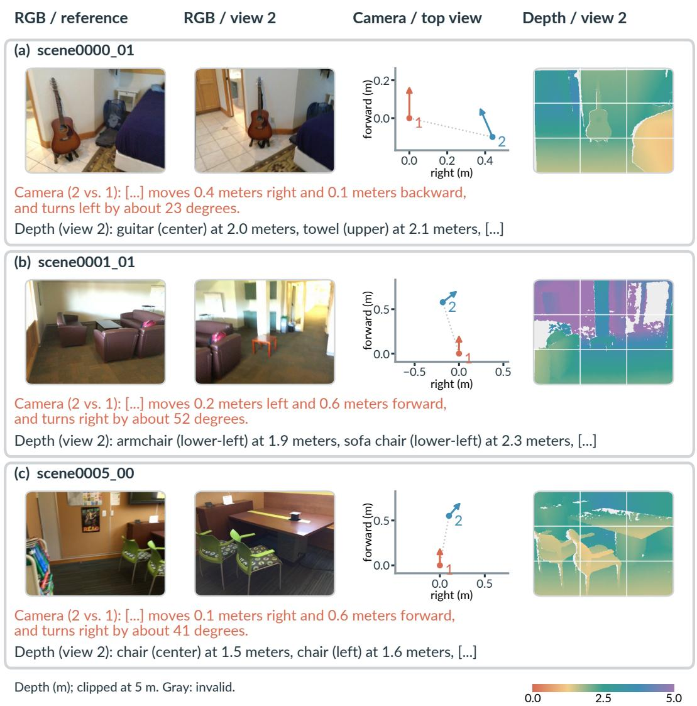  
Figure 5 Three Stage 1 training examples from ScanNet [16]: RGB pairs, camera poses in the first camera’s reference frame, and view 2 depth with nine-grid regions. Description excerpts preserve original wording and values; [. . . ] marks omissions. Depth colors are clipped at 5 m; gray is invalid.

## A.1.1 Stage 1: Geometry-Description Data

Window corpus. The window-based Stage 1 corpus is built from training scenes in ScanNet [16] and ScanNet++ [69]. It contains approximately 29.5K Camera and 35.4K Depth description records, drawn from a shared pool of 1,550 scenes. The two signals share the same windows. Camera windows contain 2, 4, 8, 16 or 32 views; Depth windows additionally include single images.

Camera targets are constructed from annotated camera poses and describe planar translation in meters and heading changes relative to the first view. For each window, we adopt the first camera’s coordinate frame as the reference world frame and transform all camera poses into it. The first camera therefore has identity pose and lies at the origin; the x and z axes point right and forward relative to that view. Depth targets describe object positions using a 3 × 3 image grid (upper-left, upper, upper-right, left, center, right, lower-left, lower, and lower-right), together with distances in meters. We retain up to five object entries per view from projected instance geometry and annotations. Single-view windows are omitted from Camera training; windows without any retained object entries are omitted from Depth training. Scenes in the evaluation benchmarks are excluded before sampling windows. Fig. 5 shows three windows with their geometry and description excerpts. The nine-grid regions define the textual position labels; distinct from the finer geometry patch grid.

(a) RGB sources  
(b) Source proportions  
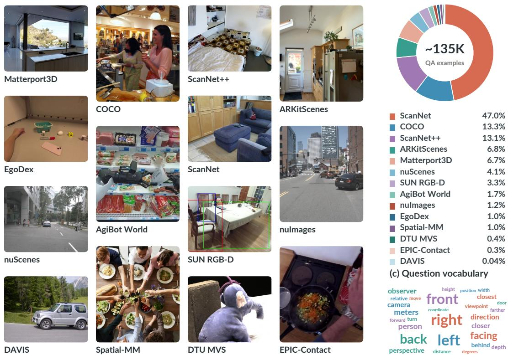  
Figure 6 The approximately 135K-example Stage 2 QA collection. Left: cropped RGB examples; image sizes do not encode frequency. Right: QA shares by RGB source and selected spatial terms sized by question-stem frequency. All 14 RGB sources are shown.

MindCube pairs. The description construction for MindCube [59] is separate from the window corpus. It uses 2,072 training image groups, yielding 3,375 reference–target pairs for pair-supervised Camera Reader pretraining (Eq. 2); Sec. A.4.7 gives the per-epoch example counts. A four-view group yields three independent pairs (1, 2), (1, 3) and (1, 4), not all six possible pairs. Each pair retains only its two images, the corresponding camera geometry and one relative-pose description, with the reference coordinate frame and source camera geometry preserved; pairs repeated across source groups are retained. The excluded views and their geometry are absent from a pair’s forward pass, rather than merely excluded from the loss, and different pairs share model weights but no attention context. Both group and pair supervision compute the loss only at geometric-content positions (Sec. 3.3). Pairs use training groups only; QA inputs keep all views.

## A.1.2 Stage 2: QA Data and Test-Set Exclusion

The multi-source QA collection has approximately 135K examples and is separate from the 10K MindCube QA set used in the MindCube ablations. These files combine training questions from VSI-style tasks [66], SpatialLadder [31], SPAR [70], ViewSpatial [30], Spatial-MM [52], MMSI [68], and CV-Bench-style distance tasks [55]. The RGB images come primarily from Scan-Net [16], COCO [38], ScanNet++ [69], ARKitScenes [3], Matterport3D [9], and nuScenes [6]. We exclude official benchmark test questions and answers from Stage 2 training. Sources with published training partitions are drawn from those partitions; separately generated questions use the source training pools. Stage 1 and Stage 2 training scenes do not overlap with evaluation-benchmark scenes. Fig. 6 shows example inputs and the QA share of all 14 RGB sources.

Table 9 Depth Anything 3 [37] geometry errors on training and evaluation images with ground truth. Rows group images by RGB source; A and B each sample up to 200 questions per source and metric from Stage 2 training and evaluation, respectively. Depth errors (AbsRel: mean absolute relative error; $\delta _ { 1 } \colon$ share of pixels within a factor of 1.25 of ground truth) use valid ground-truth pixels without scale alignment. Pose errors are relative to the earliest image in each question with valid ground-truth pose; only subsequent valid images are scored: rotation error in degrees and camera-position error in meters, without scale alignment. SUN RGB-D [53] images are single views without pose (–). Matterport3D [9], nuScenes [6] and Omni3D [4] images are omitted because they lack pixel-aligned metric ground truth. Errors are low on indoor scans and highest on SUN RGB-D.
<table><tr><td rowspan=1 colspan=1>RGB source    Benchmarks                   AbsRel (%) ↓   δ1 (%) ↑  Rot. (°) ↓   Trans. (m) ↓</td></tr><tr><td rowspan=1 colspan=1>A. Training images</td></tr><tr><td rowspan=1 colspan=1>ScanNet                                              3.3         98.7       2.9         0.13</td></tr><tr><td rowspan=1 colspan=1>ScanNet++                                           4.6         97.4       4.3         0.27</td></tr><tr><td rowspan=1 colspan=1>ARKitScenes                                         5.7         96.3       2.7         0.15</td></tr><tr><td rowspan=1 colspan=1>SUN RGB-D                                         26.1         89.3         -            一</td></tr><tr><td rowspan=1 colspan=1>B. Evaluation images</td></tr><tr><td rowspan=1 colspan=1>VSI, SPBench, ViewSpatial,ScanNet        SPAR, MMSI                      5.9         97.4       2.8         0.11</td></tr><tr><td rowspan=1 colspan=1>ScanNet++     VSI, SPAR                         8.8         92.3       2.7         0.18</td></tr><tr><td rowspan=1 colspan=1>ARKitScenes   VSI                                8.0         94.1       3.0         0.18</td></tr></table>

## A.1.3 Geometry Sources

Predicted geometry. For predicted geometry, we use the Depth Anything 3 [37] DA3NESTED-GIANT-LARGE-1.1 checkpoint to estimate camera poses and depth maps from RGB alone; main models use it for both training and evaluation. Tab. 9 reports the errors of these predictions on training and evaluation images whose RGB sources provide metric ground truth. Each cell reports the mean over questions, after averaging over valid images or image pairs within a question. Depth and pose were sampled independently. In the evaluation block, the ScanNet pose and ScanNet++ pose values use 175 and 195 valid questions, respectively, after excluding questions with invalid native poses. The ScanNet depth sample is restricted to scenes with locally available sensor data. ARKitScenes training depth is scored only on the pixels covered by official depth after RGB–depth camera registration (16% of the RGB grid on average).

Annotated geometry. For ablations, we derive annotated geometry from the grounded cognitive maps provided by MindCube [59]. We extract only each view’s two-dimensional grid position and discrete facing direction, without using object annotations, reasoning chains, or QA answers to construct the geometric inputs. Views are matched to the ordered input images, and their positions and orientations are expressed relative to the first view. One grid cell defines one input unit; relative height, pitch, and roll are set to zero. Intrinsics follow a fixed normalized convention $( f _ { x } / W =$ $f _ { y } \mathbf { \bar { / } } H \stackrel { . } { = } 1 , c _ { x } / W = c _ { y } / H = 0 . 5 )$ , rather than camera calibration. These inputs keep geometryestimation errors out of the ablations; benchmark comparisons use DA3 geometry.

## A.2 Model and Training Details

This section details the model and its training. Sec. A.2.1 describes the Geometric Reader (Sec. 3.2); Sec. A.2.2 describes the geometry injector, its alternatives in Tab. 7 and the two-pass computation (Sec. 3.4); and Sec. A.2.3 gives the training settings of the main models and the MindCube ablations.

## A.2.1 Geometric Reader Architecture

Fig. 7 summarizes the per-view Reader and its Qwen2.5-VL-3B [49] configuration.

Per-view encoding. For view i and geometric signal $m ,$ let $U _ { i } ^ { m } \in \mathbb { R } ^ { N _ { i } ^ { m } \times c _ { m } }$ contain the patch descriptors derived from the raw signal $\bar { G ^ { m } }$ . The descriptor width $c _ { m }$ is 20 for camera and 5 for depth. The Reader forms memory $M _ { i } ^ { \smile } = \mathrm { M L P } _ { m } ( \mathrm { L N } ( U _ { i } ^ { \bar { m } } ) )$ , where $\mathrm { M L P } _ { m }$ is the two-layer descriptor

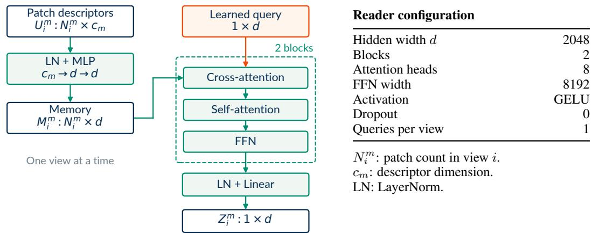  
Figure 7 Architecture of a Geometric Reader. A descriptor MLP builds memory, read by a learned query through two attention blocks. Each signal’s Reader shares weights across views, without cross-view attention. Outputs feed the Stage 2 geometry injector, one geometric token per view.

Table 10 Camera descriptor components (20 dimensions per geometry patch). View 1 defines the reference frame; intrinsics are normalized by the processed image dimensions.
<table><tr><td>Component</td><td>Dim.</td><td>Meaning / encoding</td></tr><tr><td>Image position</td><td>2</td><td>Normalized patch-center coordinates  $( u , v ) .$ </td></tr><tr><td>World ray</td><td>3</td><td>Unit viewing ray in the source world frame.</td></tr><tr><td>Reference ray</td><td>3</td><td>The same ray expressed in the reference-view frame.</td></tr><tr><td>Planar displacement</td><td>2</td><td>Camera-center displacement  $( \Delta x , \Delta z )$  relative to the reference view, in source units.</td></tr><tr><td>Viewing direction</td><td>3</td><td>Camera forward direction in the reference-view frame.</td></tr><tr><td>Intrinsics</td><td>4</td><td> $( f _ { x } / W , f _ { y } / H , c _ { x } / W , c _ { y } / H )$  ; W, H are the processed image width and height.</td></tr><tr><td>View index</td><td>1</td><td> $( i - 1 ) \bar { / } 3 1$  , using a fixed maximum of 32 views.</td></tr><tr><td>Reference flag</td><td>1</td><td>1 for view 1; 0 for other views.</td></tr><tr><td>Temporal position</td><td>1</td><td>Normalized temporal patch center; 0.5 for a still image.</td></tr></table>

Table 11 Depth descriptor components (5 dimensions per geometry patch). Depth is measured in meters; the center value is log-transformed, and valid fraction records patch coverage.
<table><tr><td>Component</td><td>Dim.</td><td>Meaning / encoding</td></tr><tr><td>Image position</td><td>2</td><td>Normalized patch-center coordinates  $( u , v ) .$ </td></tr><tr><td>View index</td><td>1</td><td> $( i - 1 ) / 3 1$  , using a fixed maximum of 32 views.</td></tr><tr><td>Center depth</td><td>1</td><td> $\log ( 1 + z )$  for valid center depth z; 0 otherwise.</td></tr><tr><td>Valid fraction</td><td>1</td><td>Fraction of pixels with depth greater than 0.01 m within the patch.</td></tr></table>

MLP, its linear maps act independently on the last dimension, and $M _ { i } ^ { m } \in \mathbb { R } ^ { N _ { i } ^ { m } \times d } .$ . A learned 1 × d query, shared across views, is updated by two cross-attention–self-attention–feed-forward blocks. Cross-attention uses normalized queries and memory for its query and key projections, and the unnormalized memory for its value projection. Self-attention and the feed-forward network use pre-LayerNorm; all three sublayers have residual connections. Self-attention operates on the query set within a view, not across views. Final LayerNorm and a linear $d $ d projection give $Z _ { i } ^ { m }$ . The Qwen2.5-VL-3B configuration uses $d = 2 0 4 8 .$ , eight attention heads, an 8192-wide GELU feedforward layer, and zero dropout. The descriptor MLP has widths $c _ { m }  2 0 4 8  2 0 4 8$ Each signal’s Reader uses the same block structure with independent weights. During Stage 1, a learnable scalar output gate multiplies the Reader outputs before they enter the frozen VLM.

Geometry descriptors. Tabs. 10 and 11 list the 20-dimensional pose-derived and fivedimensional depth-derived inputs, respectively. View i = 1 is the reference view. Displacements retain the units of their geometry source; annotated grid units are not interpreted as meters. Depth is resized by nearest-neighbor interpolation to the processed image grid; values above 0.01 meters are valid, and invalid center depth is encoded as zero. For this backbone, a geometry patch covers $\mathbf { a \ 2 \times 2 }$ group of 14-pixel visual patches. Camera and depth descriptors share the spatial grid and ordering of the merged RGB tokens, so $N _ { i } ^ { m }$ equals the number of merged RGB tokens of view i.

View isolation. Variable patch counts are padded to the largest count within an example, with padded keys excluded from cross-attention. The implementation treats views as separate batch items inside the Reader, yielding [V, 1, d] before flattening to $[ 1 , V , d ]$ in view order. Reference-relative descriptors still encode cross-view relations, although the aggregation never attends across views.

Output interface. For four views, the Reader outputs four embeddings $Z _ { 1 } ^ { m } , \dots , Z _ { 4 } ^ { m } \in \mathbb { R } ^ { 1 \times 2 0 4 8 }$ one per view; in general, each available signal supplies V embeddings, independently of the number of image patches. Stage 2 uses these raw outputs, taken before the Stage 1 output gate, and the injection designs apply their own scaling or adapter and gate (Sec. A.2.2).

## A.2.2 Injection Design and Computation

Question-conditioned injector. GeoReader follows Sec. 3.4: its adapter $P _ { m }$ is a tokenwise 2048 × 2048 affine map with zero-initialized weights and bias, and its routing head $R _ { m }$ applies LayerNorm, a 2048 → 256 linear map, GELU, and a 256 → 1 linear map before the sigmoid. The final map is zero-initialized, giving an initial gate of 0.5 for available geometry.

Alternative designs (Tab. 7). Tab. 7 replaces the whole injector with two simpler designs, using annotated geometry and the same frozen pair-supervised Reader. For the geometric signal evaluated here, let $\breve { Z ^ { m } } \in \mathbb { R } ^ { \breve { V } \times d }$ denote the Reader’s raw output, with one token per view and $d = 2 0 4 8 .$ Direct injection inserts these outputs unchanged. Fixed scaling multiplies them by a single trainable scalar, shared across examples and views, initialized to 1 and with no sigmoid or normalization. All three designs bypass the Reader’s Stage 1 output gate (Sec. A.2.1). On all 1,050 MindCube-Tiny questions, direct injection, fixed scaling and the injector answer 825, 719 and 937 correctly.

Sequence and computation. For a four-view example with camera pose and depth, write $X _ { i }$ for the RGB token block of view $i , Q _ { 1 } , \ldots , Q _ { K _ { c } }$ for the $K _ { q }$ question tokens, and $\widetilde { Z } _ { i } ^ { \mathrm { c a m } }$ and $\widetilde { Z } _ { i } ^ { \mathrm { d e p } }$ for the camera and depth geometric tokens of view i. Omitting chat-template delimiters, GeoReader uses the two sequences

Read: $[ X _ { 1 } ] [ X _ { 2 } ] [ X _ { 3 } ] [ X _ { 4 } ] [ Q _ { 1 } ] \cdot \cdot \cdot [ Q _ { K _ { q } } ] ,$

Answer:

$$
[ X _ { 1 } ] [ X _ { 2 } ] [ X _ { 3 } ] [ X _ { 4 } ] [ Q _ { 1 } ] \cdot \cdot \cdot [ Q _ { K _ { q } } ] [ \widetilde { Z } _ { 1 } ^ { \mathrm { c a m } } ] \cdot \cdot \cdot [ \widetilde { Z } _ { 4 } ^ { \mathrm { c a m } } ] [ \widetilde { Z } _ { 1 } ^ { \mathrm { d e p } } ] \cdot \cdot \cdot [ \widetilde { Z } _ { 4 } ^ { \mathrm { d e p } } ] .
$$

For V views and $| { \mathcal { M } } |$ signals, these sequences contain $\textstyle \sum _ { i } N _ { \mathrm { r g b } , i } + K _ { q }$ and $\begin{array} { r } { \sum _ { i } N _ { \mathrm { r g b } , i } + K _ { q } + } \end{array}$ $| { \mathcal { M } } | V $ embeddings, respectively, where $N _ { \mathrm { r g b } , i }$ is the number of merged RGB tokens of view $i ,$ excluding template delimiters; each embedding has width 2048. Both training passes use all 36 layers of the Qwen2.5-VL-3B language model with causal attention. The read pass contains no geometry or answer tokens and extracts the detached layer-36 hidden state at the last valid question token as $h _ { q } .$ . That state can see the preceding RGB and question tokens. The answer pass inserts the geometric embeddings before layer 1; geometric positions can attend to the preceding RGB, question and geometric positions, while question positions cannot attend to the subsequent geometry. Answer tokens follow the prompt and can attend to all preceding inputs. Teacher forcing appends the answer sequence and applies QA loss at answer prediction positions; at inference, each next token is predicted from the last position’s final-layer hidden state. Direct injection and fixed scaling run a single pass, whereas at inference GeoReader reuses the read-pass KV cache (Sec. A.4.7).

## A.2.3 Training Settings

Shared settings. All runs use AdamW in bf16. Stage 2 fine-tunes the language model and the geometry injector with learning rate $2 \times 1 0 ^ { - 5 }$ , 100 warm-up steps, linear decay, weight decay 0.01 and image-area bounds of 3,136–150,528 pixels, and freezes the Readers and the visual encoder.

Stage 1 Readers. For every backbone, the Geometric Readers are trained in the same way: with the VLM frozen, for 10 epochs on four GPUs, with per-GPU batch size 1, gradient accumulation 1 and learning rate $1 0 ^ { - 4 }$ , on the Stage 1 data of Sec. A.1.1.

Main models. The GeoReader models in Tab. 2, built on 3B/7B Qwen2.5-VL [49], 4B/8B Qwen3-VL [50] and 4B/9B Qwen3.5 [51], are trained on the approximately 135K-example QA collection (Sec. A.1.2) for 2 epochs on four GPUs, with per-GPU batch size 1 and gradient accumulation 2 (effective batch size 8; other settings as above).

MindCube ablations. Our QA-trained ablations in Tabs. 4–8 start from Qwen2.5-VL-3B [49] and use the same 10K MindCube [59] QA examples for 10 epochs (100,000 optimizer steps), each on one GPU with batch size 1 and no gradient accumulation. Variants differ only in the compared component; e.g., fixed scaling in Tab. 7 trains a shared scalar in place of the geometry injector.

## A.3 Evaluation Protocols and Result Sources

This section describes how the reported results are obtained. Sec. A.3.1 defines the benchmarks and their scoring, Secs. A.3.2 and A.3.3 describe how we evaluate local and API models, and Sec. A.3.4 gives the sources of literature results in Tabs. 1 and 2.

## A.3.1 Benchmark Inputs and Metrics

MindCube-Tiny. We follow the MindCube-Tiny benchmark [59]. The rotation, among, and around subsets contain 200, 600, and 250 questions, respectively. For our evaluations, subtask scores and overall accuracy are computed from the same 1,050 per-question predictions of each model; overall accuracy is weighted by the three subset sizes.

Six benchmarks. Our evaluations of base models and GeoReader use the full test sets: 5,130 VSI-Bench [66], 1,328 SPBench [31], 2,638 CV-Bench [55], 7,211 SPAR-Bench [70], 5,712 ViewSpatial [30] and 1,000 MMSI-Bench [68] questions. For VSI-Bench, 32 uniformly sampled frames per video are supplied as ordered images. Each benchmark uses its official scoring (SPBench: equalweight mean of SI and MV), and Avg. in Tab. 2 averages the six unrounded scores.

## A.3.2 Local-Model Evaluation and Scoring

Generation. We run the Qwen base models (Qwen2.5-VL-3B/7B [49], Qwen3-VL-2B/4B/8B [50] and Qwen3.5-0.8B/2B/4B/9B [51]) and GeoReader locally with native preprocessing, greedy decoding with at most 1,024 new tokens, and image-area bounds of 3,136–150,528 pixels. All Qwen3.5 models run in non-thinking mode.

Answer extraction. For multiple-choice questions, we take the option letter inside the answer tag, then one following “Answer:”, and then a leading option letter; for numerical questions, we take the first number in the response. Unextractable answers count as incorrect on all benchmarks.

## A.3.3 API-Model Evaluation

The two API models we evaluate, DeepSeek-Flash and MiMo-V2.6-Flash, use their own image processing and are evaluated unadapted in September 2026 on all 1,050 MindCube-Tiny questions, with original images in dataset order, the official raw-QA instruction, and the answer extraction in Sec. A.3.2. Their 65,536-token limits include reasoning and final output.

DeepSeek-V4.1-Flash [17]. It appears as DeepSeek-Flash in Tab. 1. We request deepseek-flash with high reasoning effort and original image detail. Thinking mode ignores temperature. Four responses hit the limit; five unextractable answers count as incorrect.

MiMo-V2.6-Flash [40]. We request mimo-v2.6-flash with deep thinking on; it has no image-detail option. No response reaches the limit; 26 unextractable answers count as incorrect.

Model sizes. Sizes in parentheses in Tab. 1 are total parameters reported by the provider. Doubao-Seed-1.6 has 230B total and 23B active [5], DeepSeek-V4.1-Flash 552B total, and MiMo-V2.6-Flash 309B total and 15B active parameters [40].

## A.3.4 Sources of Baseline Results

Tab. 1. We evaluated the Qwen base models [49–51], DeepSeek-Flash [17] in thinking mode, MiMo-V2.6-Flash [40] and all GeoReader rows. The SenseNova-SI [8] results for Qwen2.5-VL-3B and 7B come from the official 3B and 7B model cards (version 1.1), and the 3DThinker [12] results with Qwen3-VL-2B/4B/8B use the two-stage (S1+S2) rows in Tab. 1 of its CVPR 2026 supplementary material. The other rows use the results reported in the cited papers.

Tab. 2. We evaluated the Qwen base models marked † and all GeoReader rows. For Spatial-Ladder [31], the VSI-Bench, CV-Bench, SPAR-Bench, ViewSpatial and MMSI-Bench scores come from Tabs. 1–2 of its ICLR 2026 paper; that paper reports SPBench-SI and SPBench-MV separately, so its combined SPBench score comes from Tab. 2 of 3DThinker [12]. For ViLaSR [65], the VSI-Bench, SPAR-Bench and MMSI-Bench scores come from Tab. 1 of its NeurIPS 2025 paper and the other three from 3DThinker Tab. 2. The Spatial-MLLM [63], SpaceR [45], Video-R1 [19] and 3DThinker rows come entirely from 3DThinker Tab. 2. The SenseNova-SI-8B [8] row combines VSI-Bench, MMSI-Bench and ViewSpatial from the official Qwen3-VL-8B version 1.1 model card with CV-Bench, SPAR-Bench and SPBench-SI/MV from GAMSI [77] Tab. 1 (release unspecified); its SPBench-SI/MV scores (60.4/71.1) and six-benchmark average are combined as in Sec. A.3.1. Literature results keep their source evaluation settings.

## A.4 Additional Experiments

These experiments follow the order of Secs. 4.2–4.5. Secs. A.4.1 and A.4.2 extend the main result with a subtask comparison against vanilla SFT and with Qwen3.5 on MindCube-Tiny; Sec. A.4.3 compares predicted and annotated geometry; Secs. A.4.4 and A.4.5 detail the Reader-pretraining and alternative-interface comparisons; Sec. A.4.6 describes the geometry interventions; and Sec. A.4.7 covers the text-geometry recipes and inference cost.

## A.4.1 Geometry versus Vanilla SFT on Six Benchmarks

We compare GeoReader-3B from Tab. 2 with vanilla SFT, the same QA fine-tuning without geometric inputs, to separate the effect of geometry from that of QA fine-tuning. Both use Qwen2.5- VL-3B [49] with the same QA data, training settings and evaluation protocol; GeoReader also reads DA3-predicted geometry through its frozen Readers.

Each benchmark mixes questions that depend on 3D geometry with questions that do not, so we split the 59 native subtasks of the six benchmarks into those requiring metric geometry (object and room size, camera motion, and distance and depth) and the others (direction, relation and other; 2D, counting and order), grouped by the quantity asked about. Camera motion covers questions about the camera’s own motion or viewpoint change (MMSI camera motion and camera–camera position, SPAR camera-motion and view-change inference); the size and distance-and-depth types cover subtasks named by those quantities; 2D, counting and order covers 2D relations, counting and appearance order; the remaining subtasks form direction, relation and other. Question-type scores pool subtasks across benchmarks and weight each subtask by its number of questions, whereas benchmark totals follow each benchmark’s own averaging (e.g., SPBench averages its SI and MV splits equally), so question-type scores are not directly comparable with the totals in Tab. 2.

On the 27 subtasks requiring metric geometry, geometric inputs raise accuracy from 56.7 to 59.6, and every question type improves: object and room size (+4.8), camera motion (+4.4) and distance and depth (+2.2) (Tabs. 3 and 12). Individual subtasks gain much more, including +14.3 on SPBench-SI relative distance, +13.5 on MMSI camera motion, +7.8 on SPAR camera-motion inference and +7.4 on VSI-Bench object size; the subtasks in Panel C of Tab. 12 span 1, 2, 3, 8 and 32 input images or sampled frames per question. On the other 32 subtasks, accuracy is unchanged (67.3 versus 67.5), and neither question type decreases. Geometric inputs thus improve accuracy on geometrydependent questions without lowering it on the others.

## A.4.2 MindCube-Tiny Results with Qwen3.5

Tab. 1 covers the Qwen2.5-VL and Qwen3-VL backbones; Tab. 13 reports MindCube-Tiny results for Qwen3.5-4B [51], with Video-ORA-4B [35] and smaller Qwen3.5 base models (evaluated as in Sec. A.3) for reference. GeoReader raises Overall from 47.8 for its base model to 82.2, above Video-ORA-4B (48.6), while the Qwen3.5 base models reach 33.6–47.8. The gains come from Among (43.2 to 93.5) and Around (59.2 to 92.4), whereas Rotation drops from 47.5 to 35.5; Qwen3.5-4B is the only backbone where GeoReader lowers Rotation (Tab. 1).

Table 12 Subtask-level accuracy (%) of vanilla SFT and GeoReader. Both models use Qwen2.5- VL-3B [49] with the same QA data and training settings. A and B split all 59 native subtasks of the six benchmarks by whether the question requires metric geometry (number of subtasks in parentheses), with accuracies weighted by question count. C lists every subtask in A whose gain is at least 2 points. Images: input RGB images or sampled video frames (ranges indicate mixed input sizes); Questions: number of questions. ∆ is computed before rounding. Gains concentrate on metric 3D subtasks, and the other subtasks are unchanged.
<table><tr><td>Question type</td><td>Images</td><td>Questions</td><td>Vanilla</td><td>GeoReader</td><td>∆</td></tr><tr><td colspan="6">A. Questions requiring metric geometry</td></tr><tr><td>Object and room size (4)</td><td>1-32</td><td>1,862</td><td>65.2</td><td>70.0</td><td>+4.8</td></tr><tr><td>Camera motion (4)</td><td>2</td><td>967</td><td>39.3</td><td>43.7</td><td>+4.4</td></tr><tr><td>Distance and depth (19)</td><td>1-32</td><td>6,613</td><td>56.8</td><td>59.0</td><td>+2.2</td></tr><tr><td>Metric-geometry questions (27)</td><td>1-32</td><td>9,442</td><td>56.7</td><td>59.6</td><td>+2.9</td></tr><tr><td colspan="6">B. Other questions</td></tr><tr><td>Direction, relation and other (27)</td><td>1-32</td><td>10,886</td><td>65.5</td><td>65.6</td><td>+0.1</td></tr><tr><td>2D, counting and order (5)</td><td>1-32</td><td>2,691</td><td>74.3</td><td>75.1</td><td>+0.8</td></tr><tr><td>All other questions (32)</td><td>1-32</td><td>13,577</td><td>67.3</td><td>67.5</td><td>+0.3</td></tr><tr><td colspan="6"> C. Metric-geometry subtasks with gains of at least 2 points</td></tr><tr><td>Benchmark Subtask</td><td>Images</td><td>Questions</td><td>Vanilla</td><td>GeoReader</td><td>∆</td></tr><tr><td>Object size</td><td></td><td>953</td><td>64.5</td><td>71.9</td><td>+7.4</td></tr><tr><td>Room size VSI-Bench</td><td></td><td>288</td><td>55.4</td><td>62.0</td><td>+6.7</td></tr><tr><td>Absolute distance</td><td>32</td><td>834</td><td>38.4</td><td>41.8</td><td>+3.4</td></tr><tr><td>Relative distance</td><td>32 18</td><td>710</td><td>47.9</td><td>50.6</td><td>+2.7</td></tr><tr><td></td><td>Relative distance</td><td>91</td><td>69.2</td><td>83.5</td><td>+14.3</td></tr><tr><td>SPBench</td><td>Object size</td><td>158</td><td>69.3</td><td>72.9</td><td>+3.6</td></tr><tr><td>Absolute distance</td><td>8 2</td><td>30</td><td>38.0</td><td>40.3</td><td>+2.3</td></tr><tr><td>MMSI Camera motion</td><td></td><td>74</td><td>43.2</td><td>56.8</td><td>+13.5</td></tr><tr><td></td><td>Object-object distance</td><td>363</td><td>48.1</td><td>54.2</td><td>+6.0</td></tr><tr><td>Distance inference</td><td></td><td>340</td><td>73.2</td><td>77.6</td><td>+4.4</td></tr><tr><td>Object-camera distance</td><td>1</td><td>393</td><td>64.6</td><td>68.2</td><td>+3.7</td></tr><tr><td>Object-camera depth</td><td>1</td><td>360</td><td>69.6</td><td>71.9</td><td>+2.3</td></tr><tr><td>Camera-motion inference</td><td>I233</td><td>400</td><td>49.8</td><td>57.5</td><td>+7.8</td></tr><tr><td>Distance inference</td><td></td><td>336</td><td>63.4</td><td>69.3</td><td>+6.0</td></tr><tr><td>Object-object distance</td><td></td><td>297</td><td>38.3</td><td>41.0</td><td>+2.7</td></tr><tr><td>CV-Bench</td><td>Depth</td><td>1</td><td>600 86.5</td><td>88.8</td><td>+2.3</td></tr></table>

Table 13 MindCube-Tiny [59] accuracy (%) with Qwen3.5 backbones. Base models are evaluated by us, Video-ORA [35] uses its published result, bold marks the best Overall, and GeoReader uses Depth Anything 3 [37] geometry. GeoReader improves over its Qwen3.5-4B [51] base model.
<table><tr><td>Model</td><td>Rot.</td><td>Among</td><td>Around</td><td>Overall ↑</td></tr><tr><td>Qwen3.5-0.8B [51]</td><td>25.0</td><td>31.8</td><td>44.8</td><td>33.6</td></tr><tr><td>Qwen3.5-2B [51]</td><td>40.5</td><td>31.8</td><td>51.2</td><td>38.1</td></tr><tr><td>Qwen3.5-4B [51]</td><td>47.5</td><td>43.2</td><td>59.2</td><td>47.8</td></tr><tr><td>Video-ORA-4B [35]</td><td>37.0</td><td>49.8</td><td>54.8</td><td>48.6</td></tr><tr><td>GeoReader (Qwen3.5-4B)</td><td>35.5</td><td>93.5</td><td>92.4</td><td>82.2</td></tr></table>

Table 14 MindCube-Tiny [59] accuracy (%) with DA3 [37] geometry across recipes; Tab. 5 gives the annotated-geometry results. Pairsupervised GeoReader remains the best recipe.
<table><tr><td>Training and inference recipe</td><td>DA3</td></tr><tr><td>Joint description + QA SFT</td><td>64.7</td></tr><tr><td>Generated Text-CoT</td><td>66.7</td></tr><tr><td>Descriptions in prompt</td><td>79.2</td></tr><tr><td>GeoReader (group)</td><td>68.9</td></tr><tr><td>GeoReader (pair)</td><td>81.1</td></tr></table>

Table 15 MindCube-Tiny [59] accuracy (%) of pair-supervised GeoReader with annotated or Depth Anything 3 [37] geometry. Bold marks the better source, which differs by backbone.
<table><tr><td>Backbone</td><td>Annotated</td><td>DA3</td></tr><tr><td>Qwen2.5-VL-3B</td><td>89.2</td><td>81.1</td></tr><tr><td>Qwen2.5-VL-7B</td><td>85.6</td><td>93.2</td></tr><tr><td>Qwen3-VL-2B</td><td>77.0</td><td>86.5</td></tr><tr><td>Qwen3-VL-4B</td><td>92.3</td><td>94.3</td></tr><tr><td>Qwen3-VL-8B</td><td>92.5</td><td>93.4</td></tr><tr><td>Qwen3.5-4B</td><td>83.4</td><td>82.2</td></tr></table>

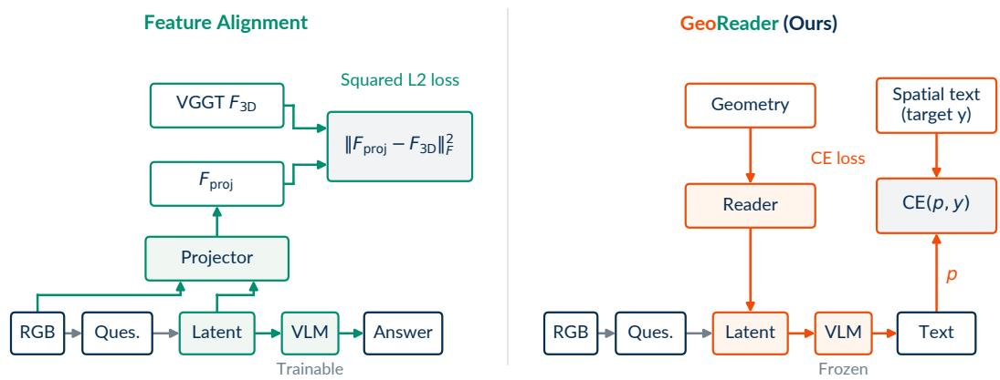  
Figure 8 Geometry supervision in feature alignment and in GeoReader. 3DThinker [12] aligns the latents of a trainable VLM with VGGT [57] features; GeoReader trains the Reader through a frozen VLM using geometry-description cross-entropy. Only geometry-supervision paths are shown; 3DThinker’s text loss is omitted. Ques. is the text prompt given to the VLM.

## A.4.3 Predicted versus Annotated Geometry

Our ablations use annotated geometry to exclude estimation errors, whereas the main models use DA3-predicted geometry. This comparison asks how switching to predicted geometry changes accuracy and whether the ablation conclusions still hold. Each configuration applies one source (Sec. A.1.3) to description targets, Reader training, QA training and evaluation.

With Qwen2.5-VL-3B and pair supervision, DA3 lowers accuracy from 89.2% to 81.1%, still above vanilla SFT (68.6%; Tabs. 5 and 14). Across the six backbones in Tab. 15, DA3 exceeds annotated geometry on four (by 0.9–9.5 points) and trails it on two (by 1.2–8.1 points). Neither source is better on all backbones, although DA3 is 1.8 points higher on average.

With DA3 geometry (Tab. 14), the recipes rank as with annotated geometry (Tab. 5): pair supervision 81.1%, descriptions in the prompt 79.2%, group supervision 68.9%, generated Text-CoT 66.7% and joint description + QA SFT 64.7%. The ablation conclusions drawn with annotated geometry therefore also hold with geometry predicted from RGB.

## A.4.4 Reader Pretraining

Stage results (Tab. 6). The Stage 1-only reference skips QA training: the frozen VLM receives the Stage 1 geometric tokens, injected with a fixed scale of 0.25. Vanilla SFT uses the same 10K QA examples, and the full recipe uses pair-supervised annotated geometry.

Feature alignment (Tab. 4, Panel A). The feature-alignment row uses the released first-stage 3DThinker [12] checkpoint on Qwen2.5-VL-3B [49] (Sec. A.4.6); its 62.7% is computed from the released per-question answers on the same 1,050 questions.

Comparison with feature alignment. Fig. 8 contrasts the geometry-supervision interfaces of 3DThinker [12] and GeoReader. In 3DThinker, RGB features and VLM-generated latents jointly enter a projector supervised by VGGT [57] features; VGGT features are training targets, not additional inference inputs. GeoReader instead learns geometric inputs using geometry-description supervision through the frozen target VLM, then freezes the Reader for QA. The figure contrasts these learning targets and input pathways side by side.

## A.4.5 Alternative Interfaces

Shared setting. The Panel B alternatives in Tab. 4 follow the MindCube ablation setting of Sec. A.2.3 with answer-only supervision. The two adapted fusion rows use pre-extracted finallayer VGGT [57] features from the input RGB images: one camera token and 1,369 patch tokens per view, each 2,048-dimensional; the four register tokens are excluded. The VGGT and Qwen visual encoders are frozen, while the full language model and fusion module are trained with QA answer loss. Both fusion modules use per-frame cross-attention with a 512-dimensional attention space and eight heads. They modify the Qwen image embeddings before one LLM pass, without adding geometric tokens to the input or using a Geometric Reader.

VLM-3R-style adaptation. Following the spatial–visual fusion idea of VLM-3R [18], each frame’s Qwen image embeddings query that frame’s VGGT camera and patch features. A learned output projection maps the attended features back to the Qwen hidden dimension, and its zeroinitialized residual is added to the corresponding image embeddings. We adopt only the fusion mechanism; the original VLM-3R system uses CUT3R [58] features.

SpaceMind-style adaptation. Inspired by the camera-guided fusion of SpaceMind [74], we retain the same per-frame visual queries and VGGT features but use the camera feature to adjust patch keys and values, weight patch values by learned importance, and apply a camera-conditioned channel-wise gate to the fused residual before adding it to the Qwen image embeddings. Its output projection is zero-initialized, so the residual starts at zero.

Per-token additive fusion. This row uses the same annotated pose input as GeoReader: the 20- dimensional descriptor of each image token passes through a zero-initialized linear map to the Qwen hidden dimension and is added to its embedding. It adds no geometric tokens and uses one LLM pass, whereas the Reader of GeoReader encodes the same descriptors into one token per view.

## A.4.6 Geometry Interventions

GeoReader. Tab. 8 uses the pair-supervised MindCube checkpoint from Tab. 5, with identical weights, questions, images and decoding settings across conditions. Correct geometry yields 937/1, 050 correct answers. Zero restores each geometric token to its slot embedding after the Reader, adapter and gate have been evaluated; it keeps the two-pass computation and yields 811/1, 050. Shuffled applies a within-example permutation with no fixed points (seed 42) to the raw extrinsics and intrinsics, leaving the RGB order unchanged; the original feature builder then regenerates frame identifiers and the reference frame from the newly ordered poses. This condition tests pose-to-view mismatch under the model’s normal feature construction, including its first-view reference convention, and yields 663/1, 050. No condition has answer-parsing failures.

Feature alignment (Feat. align.). We use the released 3DThinker [12] checkpoint described in Sec. A.5.1, which is the model after its first training stage; the 75.2% in Tab. 1 is the published result after both stages, whose checkpoint is not released. Correct uses the released per-question answers on all 1,050 questions (658 correct, 62.7%). Zero replaces the input embedding at every latentgeneration step with a zero vector while keeping the released visible prefix, then decodes greedily (660 correct, 62.9%). Shuffled replaces its latents with those generated for another question, using a fixed one-to-one assignment in which the two questions come from different scenes and have different correct options (646 correct, 61.5%). Unlike GeoReader’s within-question pose shuffle, it swaps latents across questions. Invalid answers count as wrong in both interventions.

## A.4.7 Text-Geometry Recipes and Inference Cost

All six recipes in Tab. 5 use the MindCube ablation setting of Sec. A.2.3 with annotated geometry.

Training. Joint description + QA SFT adds 2,072 whole-group description examples per epoch to the QA data. GeoReader (group) and GeoReader (pair) train their Readers on 2,072 and 3,375 Stage 1 examples per epoch, respectively; reference–target pairs follow Sec. A.1.1.

Inference. Generated Text-CoT receives the images and the original question and generates descriptions before the answer. Descriptions in prompt and GeoReader additionally receive the corresponding geometry, as text and as geometric tokens, respectively. Generation is limited to 128 tokens for direct answers and to 512 tokens for Generated Text-CoT, including the answer.

Cost. Tab. 5 reports generated tokens and latency for its six recipes, measured on the same NVIDIA H200 with batch size 1. After five excluded warm-up examples per model, we average over all 1,050 test questions. Token counts include formatting, control and end-of-sequence tokens but not input tokens. Timing includes image loading, input processing, all VLM passes, generation and decoding; model loading and offline geometry construction are excluded. For GeoReader, latency includes both passes, with the answer pass reusing the read pass’s key–value cache (Sec. 3.4). The SFT baselines use standard generation, and GeoReader a custom greedy decoding loop.

## A.5 Qualitative Analysis

This section examines individual questions: answer-token attention of GeoReader and feature alignment (Sec. A.5.1), additional correct examples (Sec. A.5.2), and failure cases (Sec. A.5.3).

## A.5.1 Answer-Token Attention

We show one example from each MindCube-Tiny [59] category: Among, Around, and Rotation (Fig. 9). For each category, we use the first image-matched entry in our evaluation list, selected before extracting attention and without filtering by correctness or attention magnitude. The Among example, the black-sneaker question, is also used in Fig. 3.

We use the pair-supervised Camera-only GeoReader checkpoint and the released jankin123/3DThinker-Mindcube checkpoint of 3DThinker [12] (training step 74,000; source revision c9469e01b719), the model released after its first training stage. The latter serves as our representative of feature alignment. Both backbones have 36 language-model layers, 16 query heads, and 2,048-dimensional hidden states. GeoReader first reads the RGB and question prefix, then injects one geometric token per input view after the question before answer generation. 3DThinker processes RGB and question tokens followed by generated latents, intermediate text, and the answer. We retain each model’s native preprocessing and generation procedure.

During each model’s greedy generation, we record eager causal attention at the positions predict ing the final answer body, excluding answer tags, and average over query heads and these positions within each layer. Keys are grouped into Geometry, RGB, Question, CoT, and Other. Other con tains instruction and chat templates, boundaries, and preceding answer tokens. Within each layer, attention shares are normalized over Geometry, RGB, Question, and CoT, excluding Other. CoT remains in the denominator for 3DThinker, although its panel is omitted; GeoReader has no CoT body. All 36 layers are retained without smoothing. GeoReader’s geometry mass refers to complete geometric tokens, including their slot embeddings and geometric residuals.

Both models answer all three examples correctly. Averaged over layers, the geometry share of GeoReader’s answer positions is 33.8%, 27.7% and 32.3% for Among, Around and Rotation (Fig. 9), versus 0.2%, 0.4% and 0.4% for 3DThinker’s latents.

## A.5.2 Additional Qualitative Results

Fig. 4. The two MMSI-Bench [68] examples use the Camera+Depth checkpoint at epoch 1, step 6,335; questions and predictions are from saved evaluation records. Manually marked visible object regions are backprojected with predicted depth and intrinsics, omitting surface connections across depth discontinuities. Orange outlines mark these regions; the bathroom arrow shows the facing direction the question imagines. IMG, Ques. and GEO are image, question and per-view geometry groups. GEO blocks are schematic; the checkpoint uses one pose and one depth token per view.

Figs. 10 and 11. Panels (a) and (c) of both figures come from MindCube-Tiny [59] and panel (b) from CV-Bench [55]; all use DA3 geometry (Sec. A.4.3). In Fig. 10a, the question states that view 2 is turned 90◦ right and view 3 180◦; the predicted poses turn them by 98◦ and 177◦. View 3 thus faces away from view 1, and GeoReader answers with the window seen in view 3. This contrasts with Fig. 11a, where predicted turns of 50◦ and 124◦ lead to a wrong answer. In Fig. 10b, the predicted median depth is 2.4 m in the table box and 6.7 m in the bookcase box, and GeoReader correctly chooses the closer table, the reference answer.

## A.5.3 Failure Cases

Fig. 11 shows three questions that GeoReader answers incorrectly with predicted geometry, which is wrong in panels (a) and (b) and roughly correct in panel (c).

(1) Camera-pose estimation errors. Panel (a) asks what lies to the right when facing the direction of view 1. The question states that view 2 is turned 90◦ right and view 3 180◦, but the predicted poses turn them by only 50◦ and 124◦. View 3 thus becomes the view closest to the right of view 1, and GeoReader names the study table and black chair seen in view 3 instead of the window seen in view 2. The two pose plots show the annotated and predicted view directions.

(2) Depth estimation errors. Panel (b) asks whether the car or the trailer is closer to the camera; the benchmark answer is the trailer. Over the central 40% of each box, the predicted median depth is 21.1 m (car) and 25.1 m (trailer). GeoReader follows this reversed order and chooses the car.

(3) Reference-frame confusion. Panel (c) asks what is behind the viewer at view 2; the reference answer is the fridge. The predicted pose turns view 2 by 76◦ from view 1, close to the quarter turn between adjacent views in this setup. GeoReader nevertheless answers “light blue bedding and pillows,” the reference answer for the same question at view 1 (cf. Fig. 10c).

3DThinker: A

GeoReader (Ours)

## Among

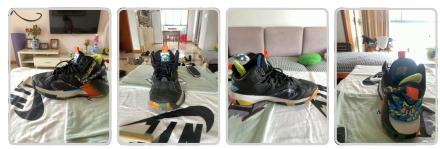

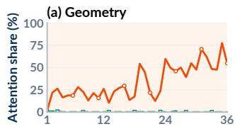

## Around

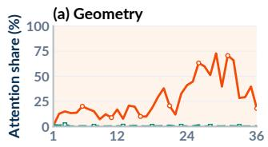

## Rotation

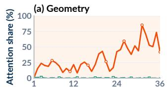  
Options. A. Yes B. No.

Question. Based on these four images (image 1, 2, 3, and 4) showing the black sneaker from diferent viewpoints (front, left, back, and right), with each camera aligned with room walls and partially capturing the surroundings: From the viewpoint presented in image 2, what is to the right of the black sneaker?

Options. A. TV B. Wooden dining table C. Light purple sofa D. Brown curtains and windows

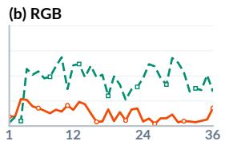

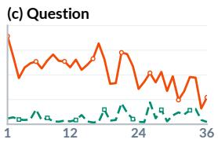

Feature Alignment

GeoReader (Ours)

Question. Based on these three images (image 1, 2, and 3) showing the same scene from diferent viewpoints (back, left, and right): From the viewpoint presented in image 2, is there a large blue recycling bin behind the small blue recycling bin?

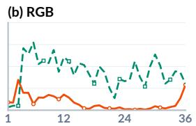

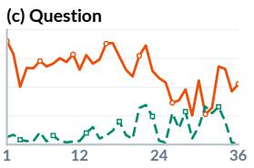

– – – – – Feature Alignment

Question. These three images (image 1, 2, and 3) show the same scene from three diferent viewpoints. The image 2 was taken after turning the camera 90 degrees to the right (clockwise) from the position of image 1. For image 3, the camera was turned another 90 degrees right, so it’s basically facing the opposite direction of image 1. Based on these three images: If I am standing at the same spot and facing the same direction as shown in image 3, then I turn 180 degrees around, what is to my right?

Options. A. Door B. Two chairs C. Chair and white board GeoReader: A 3DThinker: A

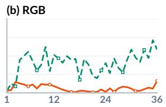

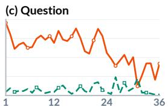  
Figure 9 Answer-token attention across layers on three MindCube-Tiny [59] categories. Both models answer every question correctly; Sec. A.5.1 defines the statistics. In all three cases, answer tokens attend more to geometry in GeoReader than to latents under feature alignment.

Feature Alignment

GeoReader (Ours)

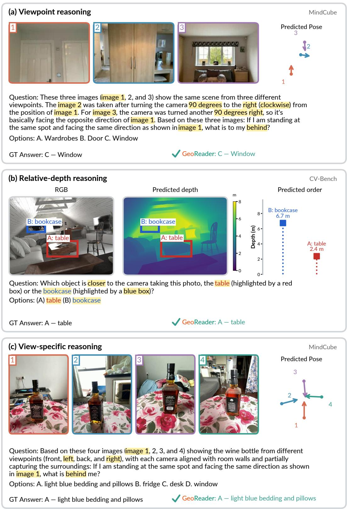  
Figure 10 Selected correct responses with Depth Anything 3 [37] geometry. Camera arrows show poses; depth plots show box-region medians at schematic horizontal positions. Each case includes the question, options, reference answer, and GeoReader response (Sec. A.5.2).

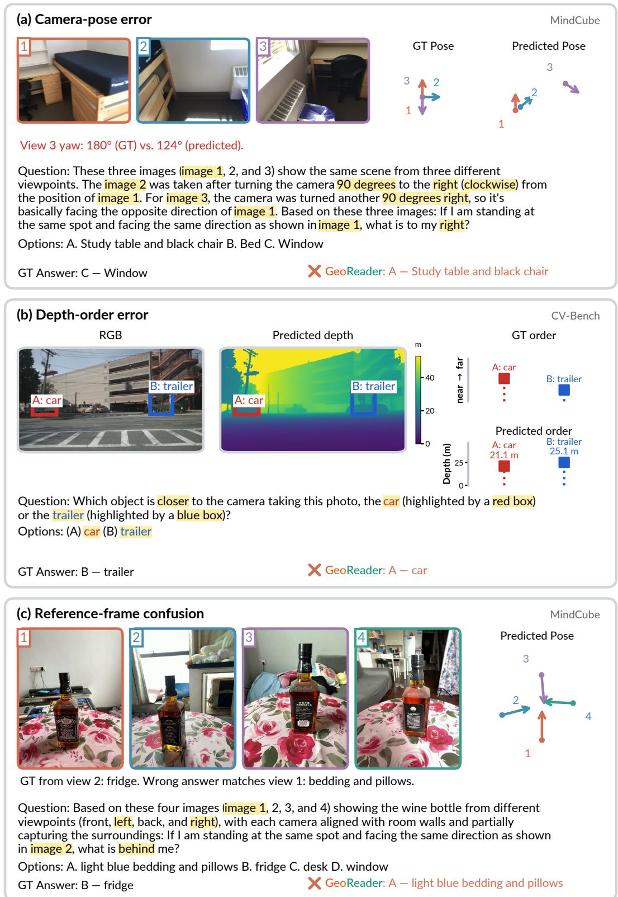  
Figure 11 Selected failure cases: (a) a wrong response alongside a pose error; (b) reversed predicted depth order for the car/trailer regions; (c) a response matching an alternative reference view. GT pose is annotation-derived; GT order is ordinal. Horizontal depth-plot positions are schematic.

## A.6 Public Resources

We acknowledge the public data, models and code used in this work. The dataset list covers all 14 RGB sources in our approximately 135K-example training collection, together with MindCube. QA construction and the remaining evaluation benchmarks are described in Secs. A.1.2 and A.3.1. Sec. A.6.1 lists the datasets and Sec. A.6.2 the implementations and models, with their licenses.

## A.6.1 Public Datasets

• ScanNet [16]1 ScanNet Terms of Use   
• ScanNet++ [69]2 ScanNet++ Terms of Use   
• COCO images [38]3 Image-specific licenses   
• ARKitScenes [3]4 Apple dataset license   
• Matterport3D [9]5 Matterport3D Terms of Use   
• nuScenes [6]6 nuScenes Terms of Use   
• Spatial-MM [52]7 Not specified   
• AgiBot World [54]8 CC BY-NC-SA 4.0   
• nuImages [6]9 nuImages Terms of Use   
• EgoDex [24]10 CC BY-NC-ND   
• EPIC-Contact [2]11 CC BY-NC 4.0   
• DTU MVS $[ 1 ] ^ { 1 2 }$ Not specified   
• DAVIS images [47]13 Source-video terms   
• SUN RGB-D [53]14 Constituent-dataset terms   
• MindCube [59]15 MIT License

## A.6.2 Public Implementations and Models

Our code builds on 3DThinker [12]. VLM-3R [18] and SpaceMind [74] inform the adapted fusion designs in Sec. A.4.5. Code and checkpoint licenses are listed separately where they differ.

• 3DThinker $[ 1 2 ] ^ { 1 6 }$ Apache License 2.0   
• VLM-3R [18]17 Apache License 2.0   
• SpaceMind [74]18 Apache License 2.0   
• MindCube evaluation code $[ 5 9 ] ^ { 1 9 }$ MIT License   
• Depth Anything 3 [37]20 Apache License 2.0   
• Depth Anything 3 Nested $[ 3 7 ] ^ { 2 1 }$ CC BY-NC 4.0   
$\mathrm { V G G T } [ 5 7 ] ^ { 2 2 }$ VGGT License   
$\bullet \mathrm { ~ Q w e n } 2 . 5 \mathrm { - } \mathrm { V L - } 3 \mathrm { B - I n s t r u c t } [ 4 9 ] ^ { 2 3 }$ Qwen Research License   
$\bullet \mathrm { ~ Q w e n } 2 . 5 \mathrm { - } \mathrm { V L - 7 B - I n s t r u c t } [ 4 9 ] ^ { 2 4 }$ Apache License 2.0   
$\bullet \mathrm { \ Q w e n 3 - V L - 2 B - I n s t r u c t } \ [ 5 0 ] ^ { 2 5 }$ Apache License 2.0   
$\bullet \mathrm { \ Q w e n 3 - V L - 4 B - I n s t r u c t } \ [ 5 0 ] ^ { 2 6 }$ Apache License 2.0   
• Qwen3-VL-8B-Instruct $[ 5 0 ] ^ { 2 7 }$ Apache License 2.0   
$\bullet \mathrm { ~ Q w e n } 3 . 5 \mathrm { - } 0 . 8 \mathbf { B } [ 5 1 ] ^ { 2 8 }$ Apache License 2.0   
$\bullet \mathrm { \ Q w e n } 3 . 5 { \cdot } 2 \mathbf { B } [ 5 1 ] ^ { 2 9 }$ Apache License 2.0   
$\mathbf { \mathrm { ^ 2 w e n 3 . 5 - 4 B \ [ 5 1 ] ^ { 3 0 } } }$ Apache License 2.0   
$\bullet \mathrm { { \ Q w e n } } 3 . 5 { \cdot } 9 \mathbf { B } \ [ 5 1 ] ^ { 3 1 }$ . Apache License 2.0