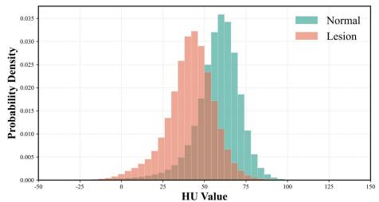
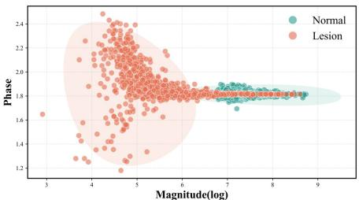
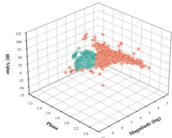
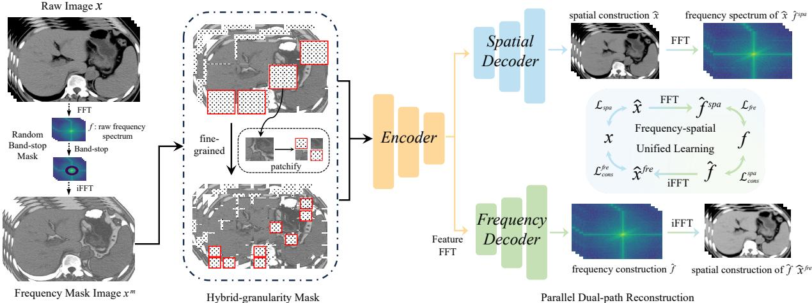
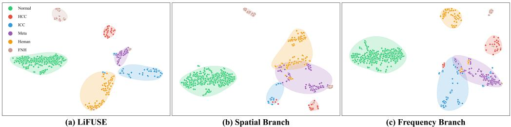
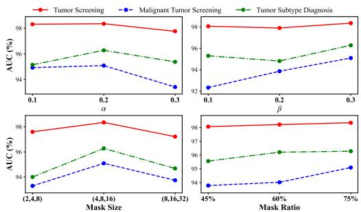

# LiFUSE: Frequency-Spatial Unified Self-Supervised Pretraining for Liver Disease Analysis on Non-contrast CT

Hao Zhang1,2,3,∗, Yi Huang2,3,B, Wei Liu2,3, Yuan Gao2,3, Zeju Li1, Xu Han4, Yu Shi5, Ling Zhang2,3, Ke Yan2,3

1College of Biomedical Engineering, Fudan University

2DAMO Academy, Alibaba Group

3Hupan Lab, HangZhou

4Department of Hepatobiliary and Pancreatic Surgery, First Afiliated Hospital of Zhejiang University 5Department of Radiology, Shengjing Hospital of China Medical University

∗This work was done during H. Zhang’s internship at Alibaba DAMO Academy

BCorresponding author: hy456523@alibaba-inc.com

Given the growing global burden of liver tumors and difuse liver diseases, non-contrast computed tomography (NCCT) is increasingly used for opportunistic screening because of its low cost and favorable safety profile. However, downstream tasks such as tumor detection and fine-grained disease diagnosis remain challenging due to NCCT’s inherently low tissue contrast, lack of hemodynamic enhancement, and complex anatomical background. These limitations make subtle, heterogeneous, and multifocal hepatic lesions dificult to identify. Although large-scale self-supervised pretraining can learn robust representations from unlabeled NCCT scans, conventional voxel-wise reconstruction does not fully exploit the complementary information available in NCCT. Under weak NCCT contrast, low-level intensity patterns become less informative for pathology recognition, limiting the capture of lesion-specific discriminative features. In this paper, we propose the Liver Frequency-Spatial Unified Self-Supervised Pretraining (LiFUSE). The frequency branch applies random band-stop masking and spectrum reconstruction to encourage the model to capture subtle diferences between lesions and surrounding tissues, while the spatial branch performs hybrid-granularity masked volumetric reconstruction to accommodate lesions of diverse sizes and morphologies. Finally, a cross-domain consistency scheme couples the spatial and frequency branches, yielding more discriminative representations for hepatic structures and lesions. Extensive experiments on three clinically relevant tasks across internal cohorts and a public target-domain transfer setting show that LiFUSE consistently outperforms strong baselines. These results suggest that unified frequency-spatial learning can improve liver disease analysis on NCCT, highlighting its potential for large-scale screening.

Date: October 14, 2026

Accepted at the 2026 IEEE International Conference on Bioinformatics and Biomedicine (IEEE BIBM 2026).

DAMO FUTURE S

## 1 Introduction

The liver, the largest solid organ in the human body, plays essential roles in metabolism, detoxification, bile production, and nutrient synthesis and storage. However, the global burden of liver tumors and difuse liver diseases continues to increase. In 2022, liver cancer was the third leading cause of cancer-related death worldwide (Bray et al., 2024; Wang et al., 2023). Furthermore, metabolic dysfunction-associated steatotic liver disease afects nearly 30% of the global population and can progress to fibrosis, cirrhosis, and hepatocellular carcinoma, posing a long-term and often irreversible health threat (Israelsen et al., 2024). This growing clinical burden highlights the need for efective screening and diagnosis of major hepatic tumors and difuse liver diseases, so that timely intervention can be provided and patient outcomes can be improved.

Computed tomography (CT), particularly dynamic contrast-enhanced CT, is widely used for diagnosing liver diseases. However, it requires iodinated contrast agents and often involves multiphase acquisitions, which may cause adverse reactions and increase radiation exposure (Yao et al., 2022). Recently, non-contrast CT (NCCT) has gained attention as a safer and lower-cost alternative for opportunistic large-scale screening (Cao et al., 2023; Hu et al., 2025a,b). Despite these advantages, liver disease analysis on NCCT remains challenging because the modality provides limited soft-tissue contrast, especially for early-stage or subtle abnormalities that show little contrast against the surrounding parenchyma. Moreover, the marked heterogeneity of liver diseases and their frequent multifocal presentation further complicate NCCT-based analysis, as lesions with diverse morphologies and dispersed locations can be easily overlooked or misinterpreted under weak contrast.

  
(a) spatial domain analysis

  
(b) frequency domain analysis

  
(c) dual domain analysis  
Figure 1 Comparative analysis of spatial vs. frequency domain statistics for NCCT liver lesion identification. Spatial (HU) and frequency (magnitude/phase) statistics both fail to separate normal parenchyma from lesions due to high inter-class overlap, underscoring the necessity of joint frequency-spatial modeling for robust lesion discrimination.

Recently, large-scale self-supervised pretraining has shown strong potential for learning generalizable and discriminative representations from CT images. For example, MAE3D (Wald et al., 2025) revisits and optimizes MAE-based pretraining within the nnU-Net framework, demonstrating the feasibility of its architectural design for medical imaging tasks. MiM (Zhuang et al., 2025) learns discriminative representations from hierarchical visual tokens at multiple scales. However, voxel-wise reconstruction methods are less efective for NCCT, because their focus on spatial intensity and texture patterns alone is insuficient to overcome the modality’s inherently low contrast. In contrast, frequency-domain analysis can expose structural and pathological patterns that are less apparent in the spatial domain. These patterns may reflect lesion-specific diferences in edge sharpness, internal heterogeneity, and tissue microstructure (Wang et al., 2024). For instance, MFM (Xie et al., 2023) encourages the encoder to preserve frequency information in image embeddings through frequency consistency learning. These observations suggest that frequency information may provide complementary cues beyond spatial reconstruction for low-contrast NCCT analysis.

Although frequency-domain methods have shown potential in medical imaging, our analysis suggests that relying on either the spatial or the frequency domain alone is insuficient. Fig. 1 visualizes the distributions of representative statistics in the spatial and frequency domains. In the spatial domain, normal tissue and lesions exhibit substantial overlap in HU distributions, and they also remain dificult to distinguish in the frequency domain when using magnitude or phase alone. Jointly leveraging spatial and frequency information may provide a more discriminative representation space for lesion identification. Although recent studies have emphasized preserving and reconstructing both spatial and frequency information (Chu et al., 2025; Jiao et al., 2024), they typically treat the two domains as separate pathways. The lack of explicit cross-domain coupling and joint optimization limits the efective use of complementary information from the two domains, thereby hindering fine-grained representation learning for NCCT liver lesions.

As shown in Fig. 2, we propose LiFUSE, a frequency-spatial unified self-supervised pretraining framework for liver disease analysis on NCCT. LiFUSE consists of three key components: (1) frequency-spatial hybridgranularity masking; (2) parallel dual-path reconstruction; and (3) frequency-spatial unified learning. It is pretrained on large-scale unlabeled NCCT scans and then fine-tuned on labeled data for downstream clinical tasks, including liver tumor screening, tumor subtype classification, and difuse liver disease diagnosis. Extensive experiments on internal NCCT datasets and a public target-domain steatosis cohort after supervised fine-tuning demonstrate consistent improvements across diverse clinical scenarios. LiFUSE consistently outperforms state-of-the-art supervised and self-supervised methods, suggesting the efectiveness of unified dual-domain modeling for NCCT liver analysis.

  
Figure 2 Overview of the proposed LiFUSE framework for NCCT liver analysis. To fully exploit complementary information under NCCT, LiFUSE employs: (1) Frequency-spatial hybrid-granularity masking to preserve spectral and frequency integrity while adapting to diverse lesion scales; (2) Parallel dual-path reconstruction with a shared encoder and domain-specific decoders; and (3) Frequency-spatial unified learning that enforces cycle-like cross-domain consistency.

The main contributions of this work are outlined below:

• We propose LiFUSE, a frequency-spatial unified self-supervised pretraining framework tailored for liver disease analysis on NCCT.

• A unified hybrid-granularity masking scheme operates synergistically across frequency and spatial domains, combining multi-scale spectral modulation with scale-aware spatial masking to accommodate diverse lesion morphologies while preserving cross-domain consistency.

• We introduce a cross-domain consistency learning scheme based on parallel dual-path reconstruction and FFT/iFFT-based constraints to couple spatial and frequency representations.

• Extensive experiments on three clinically relevant tasks across internal cohorts and a public targetdomain transfer setting show that LiFUSE consistently outperforms state-of-the-art supervised and self-supervised methods.

## 2 Methodology

In this section, we present the LiFUSE architecture for NCCT pretraining. We provide an overview of LiFUSE in Fig. 2, including the frequency-spatial hybrid-granularity mask (Sec. 2.1), the parallel dual-path reconstruction (Sec. 2.2), and the frequency-spatial unified learning (Sec. 2.3).

## 2.1 Frequency-Spatial Hybrid-Granularity Mask

In our masking pipeline, we adopt a two-stage masking strategy: frequency-domain band-stop masking followed by spatial patch-wise masking. This ordering preserves the original spectral structure before spatial masking is introduced, thereby avoiding spectral distortion caused by patch removal in the spatial domain. Given an input 3D NCCT volume $\boldsymbol { x } \in \overset { \sim } \mathrm { \mathbb { R } } ^ { \mathit { \Pi } _ { H \times W \times D } }$ , we apply the 3D fast Fourier transform (FFT) F(·) to obtain its frequency spectrum $f \in \mathbb { C } ^ { H \times W \times D }$

$$
f ( \xi , \eta , \zeta ) = \mathcal { F } ( x ) ( \xi , \eta , \zeta ) = \sum _ { h = 0 } ^ { H - 1 } \sum _ { w = 0 } ^ { W - 1 } \sum _ { d = 0 } ^ { D - 1 } x ( h , w , d ) e ^ { - i 2 \pi \left( \frac { \xi h } { H } + \frac { \eta w } { W } + \frac { \zeta d } { D } \right) } ,\tag{1}
$$

Random band-stop masking is then applied to $f$ to suppress a contiguous spectral band while preserving the remaining low- and high-frequency components. This design allows the model to observe diverse partially corrupted frequency patterns during pretraining, reducing its reliance on any fixed spectral range and encouraging more robust frequency representation learning. Specifically, we sample a pair of normalized cutof radii $( r _ { l } , r _ { h } )$ under the constraint $0 \leq r _ { l } < r _ { h } \leq 1$ , where both radii are normalized by the maximum radial extent of the 3D frequency volume. A binary mask $M _ { f } \in \{ 0 , 1 \} ^ { H \times W \times D }$ is defined as

$$
M _ { f } ( \xi , \eta , \zeta ) = 1 - \mathbf { 1 } \big [ r _ { l } \leq \rho ( \xi , \eta , \zeta ) \leq r _ { h } \big ] , \quad f ^ { m } = M _ { f } \odot f .\tag{2}
$$

where frequency components whose normalized radial distance falls within $[ r _ { l } , r _ { h } ]$ are removed. Here, $\rho ( \xi , \eta , \zeta )$ denotes the normalized Euclidean distance from the frequency coordinate $( \xi , \eta , \zeta )$ to the spectrum center, and $\mathbf { 1 } [ \cdot ]$ denotes the indicator function, which equals 1 when the condition inside the brackets is satisfied and 0 otherwise. The element-wise product ⊙ yields the masked spectrum $f ^ { m }$

Subsequently, the masked spectrum $f ^ { m }$ is mapped back to the spatial domain via the inverse FFT $\mathcal { F } ^ { - 1 } ( \cdot )$ yielding $\boldsymbol { x } ^ { m }$ . To account for the diverse sizes and morphologies of liver lesions, we adopt a hybrid-granularity masking strategy. We first crop a large sub-volume from $\boldsymbol { x } ^ { m }$ , denoted as the scale-1 volume $\bar { x _ { 1 } ^ { m } } \in \mathbb { R } ^ { \breve { H } _ { 1 } \times W _ { 1 } \times D _ { 1 } ^ { \breve { 1 } } }$ It is then evenly partitioned into $2 \times 2 \times 2$ non-overlapping cubic patches, each of size $\begin{array} { r } { \big ( \frac { H _ { 1 } } { 2 } , \frac { W _ { 1 } } { 2 } , \frac { D _ { 1 } } { 2 } \big ) } \end{array}$ , which serve as the scale-2 tokens. Following previous MAE-based methods (Wald et al., 2025), a high masking ratio $\mu$ is first applied at scale-1; then, using the same ratio $\mu ,$ scale-2 cubes $x _ { 2 } ^ { m }$ are masked by sampling only from the regions already masked in the scale-1 volume. Finally, the hybrid-granularity masked volumes $\{ x _ { 1 } ^ { m } , x _ { 2 } ^ { m } \}$ are fed into the parallel dual-path reconstruction module for joint reconstruction.

## 2.2 Parallel Dual-Path Reconstruction

To jointly optimize spatial and frequency representations and enable cross-domain coupling, we introduce a parallel dual-path reconstruction pipeline with a spatial branch and a frequency branch. The two branches share an encoder $f _ { E } ( \cdot ; \theta )$ to extract a common representation basis for both domains. Two task-specific decoders are then built on top of the shared encoder. The spatial decoder $f _ { S D } ( \cdot ; \theta )$ performs voxel-wise reconstruction to preserve appearance cues, focusing on intensity distributions as well as boundary and morphological continuity. In parallel, the frequency decoder $f _ { F D } ( \cdot ; \theta )$ reconstructs the complex spectrum, thereby preserving spectral information that may capture fine-grained cues attenuated in the spatial domain. Before passing the shared encoder features to $f _ { F D } ( \cdot ; \theta )$ , we apply the FFT $\mathcal F ( \cdot )$ following Eq. 1 to transform them into the frequency domain, consistent with Jiao et al. (2024). Although these features are no longer raw image intensities, they remain spatially organized responses induced by the NCCT input and still encode lesion-related structural and textural patterns captured by the shared encoder. Therefore, applying FFT at the feature level is not intended to recover the original image spectrum, but to explicitly characterize the spectral structure of the learned representations. This provides the frequency branch with access to complementary global and multi-scale patterns that may be less explicit in voxel-wise spatial reconstruction, while preserving a common representation basis shared with the spatial branch. Each decoder is followed by a lightweight reconstruction head to produce the corresponding outputs xˆ and ${ \hat { f } } .$

For the spatial branch, we use a mean squared error (MSE) reconstruction loss $\mathcal { L } _ { r e c } ( x , \hat { x } )$ over the masked region M to measure the discrepancy between the original volume x and its reconstruction xˆ. We further introduce a cross-granularity consistency loss $\mathcal { L } _ { r e c } ^ { c o n s }$ to align the two-scale reconstructions $\hat { x } _ { 1 } ^ { m }$ and $\hat { x } _ { 2 } ^ { m }$ over their shared masked region $M _ { 1 2 }$ . The cross-granularity consistency loss is defined as:

$$
\mathcal { L } _ { r e c } ^ { c o n s } ( \hat { x } _ { 1 } ^ { m } , \hat { x } _ { 2 } ^ { m } ) = \frac { 1 } { \left| \Omega ( M _ { 1 2 } ) \right| } \sum \left( \hat { x } _ { 1 } ^ { m } - \hat { x } _ { 2 } ^ { m } \right) ^ { 2 } ,\tag{3}
$$

$$
\begin{array} { r } { \mathcal { L } _ { s p a } = \mathcal { L } _ { r e c } + \alpha \mathcal { L } _ { r e c } ^ { c o n s } , } \end{array}\tag{4}
$$

In the frequency branch, LiFUSE learns discriminative representations by reconstructing the complex spectrum, thereby preserving both magnitude and phase information. Previous studies on frequency-domain learning behavior have shown that neural networks tend to fit lower-frequency components earlier than higher-frequency ones during training (Xu et al., 2022). To better emphasize frequency components that are harder to fit, we adopt the focal frequency loss $\mathcal { L } _ { f r e }$ (Jiang et al., 2021), which adaptively reweights diferent frequency components and is defined as:

$$
\mathcal { L } _ { f r e } ( f , \hat { f } ) = \frac { 1 } { H W D } \sum _ { \xi = 0 } ^ { H - 1 } \sum _ { \eta = 0 } ^ { W - 1 } \sum _ { \zeta = 0 } ^ { D - 1 } \omega ( \xi , \eta , \zeta ) \cdot \Big \vert f ( \xi , \eta , \zeta ) - \hat { f } ( \xi , \eta , \zeta ) \Big \vert ^ { 2 } ,\tag{5}
$$

where $\omega ( \xi , \eta , \zeta )$ denotes a spectral weight matrix that emphasizes hard-to-reconstruct frequency components, and $\hat { f } ( \xi , \eta , \zeta )$ denotes the reconstructed frequency spectrum. They are defined as follows:

$$
\omega ( \xi , \eta , \zeta ) = \Big | f ( \xi , \eta , \zeta ) - \hat { f } ( \xi , \eta , \zeta ) \Big | ^ { \sigma } ,\tag{6}
$$

$$
f ( \xi , \eta , \zeta ) = R ( \xi , \eta , \zeta ) + i I ( \xi , \eta , \zeta ) = A e ^ { i \phi } .\tag{7}
$$

Here, $\sigma$ is a scaling factor that controls the flexibility of the weighting term and is set to 1 by default. Note that the frequency spectrum can be equivalently represented either in polar form (magnitude and phase) or in Cartesian form (real and imaginary parts). Specifically, for a complex spectrum $f ( \xi , \eta , \zeta )$ , the magnitude and phase can be uniquely derived from the real and imaginary parts as $A = \sqrt { R ^ { 2 } + I ^ { 2 } }$ and $\phi = \mathrm { a t a n 2 } ( I , R )$ Therefore, reconstructing the real part R and the imaginary part I is equivalent to reconstructing the complete spectral information, including both magnitude and phase.

## 2.3 Frequency-Spatial Unified Learning

To overcome the limitation of prior methods that treat the spatial and frequency domains as separate pathways without explicit coupling, we propose a frequency-spatial unified learning scheme, as illustrated in Fig. 2. Specifically, the FFT $\mathcal F ( \cdot )$ is applied to the spatial prediction $\hat { x }$ and the inverse FFT $\mathcal { F } ^ { - 1 } ( \cdot )$ is applied to the frequency prediction ${ \hat { f } } ,$ yielding their cross-domain counterparts ${ \hat { f } } ^ { s p a }$ and $\hat { x } ^ { f r e }$ , respectively. We then enforce consistency between these transformed outputs and the original spatial volume or frequency spectrum through the following objectives:

$$
\mathcal { L } _ { c o n s } ^ { s p a } = \mathcal { L } _ { f r e } \big ( f , \hat { f } ^ { s p a } \big ) , \mathcal { L } _ { c o n s } ^ { f r e } = \frac { 1 } { | \Omega ( M ) | } \sum \big ( x - \hat { x } ^ { f r e } \big ) ^ { 2 } ,\tag{8}
$$

where $\mathcal { L } _ { c o n s } ^ { s p a }$ encourages the spatial prediction xˆ to preserve frequency-domain consistency with the original spectrum, and $\mathcal { L } _ { c o n s } ^ { f r e }$ encourages the frequency prediction $\hat { f }$ to remain consistent with the spatial appearance of the original volume. Finally, the overall loss is defined as

$$
\mathcal { L } = \mathcal { L } _ { s p a } + \mathcal { L } _ { f r e } + \beta ( \mathcal { L } _ { c o n s } ^ { s p a } + \mathcal { L } _ { c o n s } ^ { f r e } ) .\tag{9}
$$

where $\beta ,$ similar to $\alpha ,$ is a trade-of coeficient.

## 3 Experiments

## 3.1 Datasets

We retrospectively collected an NCCT liver dataset from the First Afiliated Hospital of Zhejiang University and Shengjing Hospital of China Medical University between 2016 and 2022. The dataset comprises 7,598 unlabeled NCCT scans for self-supervised pretraining, together with expert-annotated subsets for downstream tasks. These labeled subsets support three evaluation settings: liver tumor screening and subtype classification, internal difuse liver disease diagnosis, and cross-dataset steatosis transfer after target-domain fine-tuning. All downstream labels were established from routine clinical diagnosis based on radiological reports, pathological confirmation, and corresponding clinical records. The labeled subsets were reviewed by experienced clinicians, and disagreements were resolved by consensus to ensure label quality. Normal cases were defined as having no radiological evidence of focal hepatic lesions or difuse liver disease. The unlabeled pretraining set and all labeled downstream subsets were constructed in a patient-wise independent manner, with no overlap among pretraining, fine-tuning, validation, and test cases. For each downstream task, labeled cases were stratified into fine-tuning, validation, and test subsets, as detailed below.

• Liver tumor screening and subtype diagnosis: This subset contains 1,529 NCCT scans, comprising 917 cases for fine-tuning (106 hepatocellular carcinoma (HCC), 46 intrahepatic cholangiocarcinoma (ICC), 77 metastases (Meta), 128 hemangiomas (Heman), 20 focal nodular hyperplasia (FNH), and 540 normal), 305 cases for validation (35 HCC, 15 ICC, 26 Meta, 42 Heman, 7 FNH, and 180 normal), and 307 cases for testing (35 HCC, 15 ICC, 26 Meta, 42 Heman, 9 FNH, and 180 normal). For malignant tumor screening, HCC, ICC, and Meta are categorized as malignant tumors, whereas Heman and FNH are categorized as benign tumors.

Table 1 Fine-tuning performance comparison for liver tumor screening and subtype diagnosis on the internal test set.
<table><tr><td rowspan="2">Model</td><td colspan="3">Tumor Screening</td><td colspan="3">Malignant Screening</td><td colspan="6">Tumor Subtype Diagnosis</td></tr><tr><td>AUC</td><td>Sens</td><td>Spec</td><td>AUC</td><td>Sens</td><td>Spec</td><td>HCC</td><td>ICC</td><td>Meta</td><td>Heman</td><td>FNH</td><td>AVG</td></tr><tr><td> $\mathrm { \ n n U - N e t ^ { \dag } }$ </td><td>96.77</td><td>89.78</td><td>93.55</td><td>91.64</td><td>89.02</td><td>85.95</td><td>92.23</td><td>99.73</td><td>95.49</td><td>97.97</td><td>88.10</td><td>94.70</td></tr><tr><td> $\mathrm { U N E T R ^ { \dag } }$ </td><td>96.53</td><td>93.01</td><td>90.78</td><td>83.76</td><td>73.17</td><td>89.26</td><td>89.49</td><td>99.41</td><td>90.96</td><td>97.91</td><td>87.68</td><td>93.09</td></tr><tr><td>U-Mamba†</td><td>95.83</td><td>91.40</td><td>93.55</td><td>92.16</td><td>86.59</td><td>89.26</td><td>82.48</td><td>94.65</td><td>91.26</td><td>97.01</td><td>81.98</td><td>89.48</td></tr><tr><td>MAE3D‡</td><td>97.82</td><td>93.01</td><td>90.32</td><td>93.49</td><td>92.56</td><td>89.16</td><td>91.89</td><td>99.59</td><td>97.89</td><td>96.81</td><td>85.87</td><td>94.41</td></tr><tr><td>MiM‡</td><td>97.53</td><td>91.40</td><td>92.63</td><td>94.21</td><td>92.68</td><td>90.91</td><td>92.56</td><td>99.62</td><td>97.10</td><td>97.11</td><td>83.53</td><td>93.98</td></tr><tr><td> $\mathrm { M F M ^ { \ S } }$ </td><td>97.83</td><td>90.86</td><td>95.85</td><td>93.78</td><td>90.24</td><td>88.43</td><td>95.14</td><td>99.66</td><td>96.83</td><td>97.50</td><td>85.85</td><td>95.00</td></tr><tr><td> $\mathrm { U S F M } ^ { \circ }$ </td><td>97.84</td><td>93.01</td><td>88.48</td><td>92.84</td><td>89.02</td><td>92.56</td><td>92.07</td><td>99.57</td><td>97.46</td><td>97.42</td><td>85.59</td><td>94.42</td></tr><tr><td> $\mathrm { \ F r e p a } ^ { \diamond }$ </td><td>97.81</td><td>94.16</td><td>92.17</td><td>92.94</td><td>87.80</td><td>91.74</td><td>94.74</td><td>99.73</td><td>96.10</td><td>97.37</td><td>82.91</td><td>94.17</td></tr><tr><td>LiFUSE</td><td>98.35</td><td>94.62</td><td>93.09</td><td>95.09</td><td>96.34</td><td>90.08</td><td>96.52</td><td>99.66</td><td>97.84</td><td>98.57</td><td>88.80</td><td>96.28</td></tr></table>

† supervised methods; ‡ spatial-domain SSL methods; § frequency-domain SSL methods; ⋄ dual-domain SSL methods.

Table 2 Fine-tuning performance comparison for difuse liver diseases diagnosis on internal and public test sets.
<table><tr><td rowspan="2">Model</td><td colspan="3">Steatosis Diagnosis</td><td colspan="3">Cirrhosis Diagnosis</td><td colspan="3">UNIFESP Diagnosis</td></tr><tr><td>AUC</td><td>Sens</td><td>Spec</td><td>AUC</td><td>Sens</td><td>Spec</td><td>AUC</td><td>Sens</td><td>Spec</td></tr><tr><td>nnU-Net†</td><td>94.36</td><td>86.96</td><td>84.27</td><td>90.56</td><td>82.35</td><td>87.13</td><td>83.80</td><td>76.32</td><td>68.42</td></tr><tr><td>UNETR†</td><td>93.77</td><td>89.13</td><td>80.90</td><td>91.09</td><td>85.29</td><td>91.09</td><td>81.02</td><td>68.42</td><td>78.95</td></tr><tr><td>U-Mamba†</td><td>95.60</td><td>86.96</td><td>93.26</td><td>94.21</td><td>85.29</td><td>93.07</td><td>86.57</td><td>78.95</td><td>78.95</td></tr><tr><td>MAE3D‡</td><td>93.92</td><td>89.13</td><td>88.76</td><td>96.07</td><td>91.18</td><td>92.08</td><td>87.53</td><td>76.32</td><td>84.21</td></tr><tr><td>MiM‡</td><td>94.65</td><td>84.78</td><td>89.89</td><td>94.12</td><td>82.35</td><td>93.07</td><td>90.16</td><td>84.21</td><td>89.47</td></tr><tr><td> $\mathrm { M F M ^ { \ S } }$ </td><td>97.22</td><td>91.30</td><td>91.01</td><td>94.21</td><td>88.24</td><td>94.06</td><td>89.47</td><td>84.21</td><td>84.21</td></tr><tr><td> $\mathrm { U S F M } ^ { \circ }$ </td><td>95.21</td><td>86.96</td><td>86.52</td><td>94.09</td><td>85.29</td><td>91.09</td><td>87.95</td><td>73.68</td><td>89.47</td></tr><tr><td> $\mathrm { \ F r e p a } ^ { \diamond }$ </td><td>92.67</td><td>84.48</td><td>80.90</td><td>91.93</td><td>82.35</td><td>92.08</td><td>89.61</td><td>81.58</td><td>84.21</td></tr><tr><td>LiFUSE</td><td>98.14</td><td>91.30</td><td>92.13</td><td>96.76</td><td>88.24</td><td>97.03</td><td>91.55</td><td>89.47</td><td>94.74</td></tr></table>

• Diffuse liver disease diagnosis: This subset contains 525 internal NCCT scans, comprising 293 cases for fine-tuning (77 steatosis, 54 cirrhosis, and 162 normal), 97 cases for validation (25 steatosis, 18 cirrhosis, and 54 normal), and 135 cases for testing (46 steatosis, 34 cirrhosis, and 55 normal).

• Public target-domain transfer cohort: To evaluate cross-dataset transfer after target-domain fine-tuning, we used the public UNIFESP1 steatosis NCCT dataset, which comprised 170 cases for target-domain fine-tuning (115 steatosis and 55 normal), 57 cases for validation (38 steatosis and 19 normal), and 57 cases for testing (38 steatosis and 19 normal).

## 3.2 Implementation Details

LiFUSE is pretrained on 7,598 unlabeled NCCT scans and subsequently fine-tuned on task-specific labeled datasets. For pretraining, we adopt nnU-Net as the encoder-decoder backbone following prior work (Wald et al., 2025), due to its strong adaptability to medical imaging tasks. A lightweight reconstruction head is attached to each decoder. To mitigate information leakage from masked regions in CNN-based pretraining, we incorporate the sparse convolutions, sparse normalization, mask tokens, and densification convolutions proposed in Tian et al. (2023). For fine-tuning, the encoder is initialized with the pretrained weights, and its output features are fed into a three-layer MLP classification head appended to the encoder. The learning rate is linearly warmed up to $1 \times 1 0 ^ { - 3 }$ during the first 10k steps. We use mask sizes of (4, 8, 16), with a masking ratio µ of 75%, and set the loss weights to α=0.2 and β=0.3. For a fair comparison, all self-supervised baselines were retrained from scratch on the same 7,598 unlabeled NCCT scans. We replaced their backbones with the same nnU-Net architecture and applied identical nnU-Net preprocessing, training configurations, and downstream fine-tuning protocols as LiFUSE. The supervised baselines were reproduced using their publicly available implementations and evaluated on the same data splits.

Table 3 Ablation study on individual loss functions for liver tumor screening and subtype diagnosis on internal test set.
<table><tr><td colspan="4">Loss</td><td colspan="3">Tumor Screening</td><td colspan="3">Malignant Screening</td><td colspan="3">Tumor Subtype Diagnosis</td></tr><tr><td>Lspa</td><td>Lfre</td><td>Lfons</td><td>Lcons spa</td><td>AUC</td><td>Sens</td><td>Spec</td><td>AUC</td><td>Sens</td><td>Spec</td><td>Malig</td><td>Benign</td><td>AVG</td></tr><tr><td>√</td><td></td><td></td><td></td><td>96.75</td><td>94.09</td><td>90.32</td><td>92.34</td><td>93.90</td><td>89.26</td><td>97.42</td><td>91.44</td><td>95.03</td></tr><tr><td></td><td>√</td><td></td><td></td><td>97.60</td><td>91.40</td><td>90.78</td><td>93.29</td><td>92.68</td><td>90.08</td><td>96.37</td><td>90.45</td><td>94.00</td></tr><tr><td>√</td><td></td><td>√</td><td></td><td>97.20</td><td>91.94</td><td>92.63</td><td>93.17</td><td>90.91</td><td>87.36</td><td>96.65</td><td>91.73</td><td>94.69</td></tr><tr><td></td><td>√</td><td></td><td>√</td><td>97.97</td><td>92.47</td><td>89.40</td><td>93.63</td><td>87.80</td><td>93.93</td><td>97.36</td><td>90.55</td><td>94.64</td></tr><tr><td>√</td><td>√</td><td></td><td></td><td>97.10</td><td>92.47</td><td>92.63</td><td>94.00</td><td>95.12</td><td>88.43</td><td>97.11</td><td>94.31</td><td>95.99</td></tr><tr><td>√</td><td>√</td><td>√</td><td>√</td><td>98.35</td><td>94.62</td><td>93.09</td><td>95.09</td><td>96.34</td><td>90.08</td><td>98.01</td><td>93.69</td><td>96.28</td></tr></table>

  
Figure 3 Comparative visualization of the t-SNE embedding of five tumor subtypes and normal liver tissue in the feature space. While single-domain embeddings show severe inter-class overlap among all six classes, LiFUSE’s unified learning yields distinctly separable clusters with reduced intra-class variance.

Performance is evaluated using three metrics: area under the receiver operating characteristic curve (AUC), sensitivity (Sens), and specificity (Spec). For each binary task, the operating threshold used to compute test-set sensitivity and specificity is selected on the validation set by maximizing the Youden index (Song et al., 2025). The validation set is also used for checkpoint and hyperparameter selection, whereas the test set is reserved exclusively for final evaluation. The same protocol is applied to all methods. For tumor subtype classification, AUC is computed in a one-vs-rest manner for each lesion subtype and then averaged across classes to assess fine-grained discriminative performance.

## 3.3 Experimental Results

We compare LiFUSE with eight state-of-the-art methods on six downstream tasks. The compared methods include three supervised methods† (nnU-Net (Isensee et al., 2021), Swin UNETR (Hatamizadeh et al., 2021), and U-Mamba (Ma et al., 2024)), two spatial-domain SSL methods‡ (MAE3D (Wald et al., 2025) and MiM (Zhuang et al., 2025)), one frequency-domain SSL method§ (MFM (Xie et al., 2023)), and two dual-domain SSL methods⋄ (USFM (Jiao et al., 2024) and Frepa (Chu et al., 2025)). For fair comparison, all SSL methods follow the same pretraining-then-fine-tuning paradigm as LiFUSE, while the supervised methods are trained from scratch on the same labeled fine-tuning subsets using identical data splits. The overall results are reported in Table 1 and Table 2. Bold indicates the best result, and underline indicates the second-best result.

As shown in Table 1, LiFUSE consistently achieves the best performance among all compared methods on both liver tumor screening and subtype classification tasks on the internal test set. In particular, it improves AUC by 0.51% for tumor screening and 1.28% for fine-grained subtype classification over the best competing method. These results suggest that frequency-spatial unified learning provides more discriminative representations than single-domain methods and existing dual-domain alternatives.

LiFUSE also transfers efectively to the public UNIFESP cohort after target-domain fine-tuning. On the public UNIFESP target-domain test set (Table 2), LiFUSE achieves a 1.39% AUC improvement over the best baseline, demonstrating the transferability of the pretrained representation under supervised target-domain adaptation. This experiment assesses target-domain fine-tuning performance rather than adaptation-free external generalization. Together with the internal difuse liver disease results, it suggests that the learned representations remain useful across datasets under task-specific fine-tuning.

Table 4 Analysis of masking order on tumor screening and subtype diagnosis tasks. S→F: spatial masking followed by frequency masking. F→S: frequency masking followed by spatial masking.
<table><tr><td rowspan="2">Order</td><td colspan="3">Tumor Screening</td><td colspan="3">Malignant Screening</td><td colspan="6">Tumor Subtype Diagnosis</td></tr><tr><td>AUC</td><td>Sens</td><td>Spec</td><td>AUC</td><td>Sens</td><td>Spec</td><td>HCC</td><td>ICC</td><td>Meta</td><td>Heman</td><td>FNH</td><td>AVG</td></tr><tr><td>S→F</td><td>98.18</td><td>90.86</td><td>93.09</td><td>92.96</td><td>90.24</td><td>89.26</td><td>93.38</td><td>99.71</td><td>97.52</td><td>98.90</td><td>87.89</td><td>95.48</td></tr><tr><td>F→S</td><td>98.35</td><td>94.62</td><td>93.09</td><td>95.09</td><td>96.34</td><td>90.08</td><td>96.52</td><td>99.66</td><td>97.84</td><td>98.57</td><td>88.80</td><td>96.28</td></tr></table>

## 3.4 Ablation Study

To evaluate the contributions of the key components in LiFUSE, we conduct six ablation studies on liver tumor screening and subtype classification. As shown in Table 3, each component contributes positively to the final performance of LiFUSE. Compared with the variants using only the spatial branch or only the frequency branch (rows 3 and 4), LiFUSE achieves AUC improvements of 1.15% and 0.38% on tumor screening, respectively, demonstrating the benefit of jointly modeling complementary spatial and frequency information. Further introducing the cross-domain coupling constraints leads to an additional 1.25% AUC gain over the variant without unified learning (row 5), indicating that explicit cross-domain consistency further improves representation learning and yields the best overall performance in the ablation study.

Fig. 3 visualizes the five liver tumor subtypes and the normal liver tissue in diferent feature spaces. Compared with Fig. 3(b) and Fig. 3(c), LiFUSE exhibits the most distinct clustering pattern, characterized by compact intra-class clustering and clear inter-class separation. This suggests that the unified frequency-spatial representation is more discriminative than the single-domain representations. In particular, LiFUSE shows noticeably better separation between clinically confusable categories such as ICC and Meta (Lee et al., 2009). In contrast, the spatial and frequency branches show substantial overlap among several categories, suggesting that single-domain features may be insuficient to capture complementary texture and structural cues, leading to less distinct inter-class boundaries.

## 3.5 Analysis of Masking Order

To investigate the efect of masking order on cross-domain information preservation, we reverse the order of frequency and spatial masking in LiFUSE and compare the resulting models under identical training settings (Table 4). The results show that F→S consistently performs better than S→F on screening tasks, mainly reflected by higher sensitivity at comparable specificity. Moreover, F→S also yields a modest improvement in tumor subtype diagnosis, increasing the average AUC from 95.48% to 96.28%. This performance diference likely arises from the strong coupling between spatial and frequency representations: spatial masking disrupts local intensity continuity and correspondingly distorts the global frequency spectrum. By applying frequencydomain band-stop masking first, F→S better preserves the original spectral structure for reconstruction, thereby providing a more reliable structural prior before spatial patching introduces localized perturbations. In contrast, reversing this order requires frequency reconstruction from an already distorted spectrum, making cross-domain representation learning less efective.

## 3.6 Analysis of Hyper-parameters

To evaluate the sensitivity of LiFUSE to hyperparameter choices, we analyze four key hyperparameters on liver tumor screening, malignant tumor screening, and subtype diagnosis tasks (Fig. 4). The cross-granularity consistency weight α performs best at 0.2, yielding a 1.13% gain in subtype diagnosis over α=0.3. This suggests that overly small α may provide insuficient multi-scale regularization, whereas overly large α may impose excessive constraints on the spatial branch. The frequency-spatial unified learning weight β shows a clear upward trend, with $\beta { = } 0 . 3$ achieving the

Figure 4 Hyper-parameter sensitivity analysis of LiFUSE on liver tumor screening and subtype diagnosis tasks.

best performance and improving malignant screening by 2.76% compared with β=0.1. This suggests that stronger cross-domain coupling is beneficial for modeling subtle malignant patterns that may be less explicit in single-domain representations. For hybrid-granularity mask sizes, the medium configuration (4, 8, 16) outperforms both the smaller (2, 4, 8) and larger (8, 16, 32) settings by 0.75% and 1.13% in tumor screening, respectively, suggesting a better balance between contextual coverage and fine-grained detail preservation. Finally, the masking ratio $\mu { = } 7 5 \%$ yields the best results in malignant screening and outperforms $\mu { = } 4 5 \%$ suggesting that a relatively high masking ratio encourages the model to rely more on global contextual reasoning rather than local continuity alone, while still maintaining competitive performance at $\mu { = } 6 0 \%$ Collectively, these results support the robustness of LiFUSE and justify our default configuration (α=0.2, $\beta { = } 0 . 3 .$ mask size = (4, 8, 16), and µ=75%).

## 4 Discussion and Conclusion

In this work, we propose LiFUSE, a frequency-spatial unified self-supervised pretraining framework for liver disease analysis on NCCT. By coupling frequency-domain spectral masking with spatial-domain patch masking under cross-domain consistency constraints, LiFUSE better exploits complementary information in NCCT and learns more robust and transferable liver representations. Extensive evaluations on internal cohorts and supervised transfer to a public target-domain cohort show that LiFUSE consistently outperforms strong supervised and self-supervised baselines across six downstream tasks, suggesting its potential for large-scale opportunistic liver screening. In future work, we plan to extend LiFUSE by incorporating multi-modal auxiliary information, such as clinical reports and laboratory biomarkers, and by adapting the framework to other solid organs where low-contrast NCCT similarly challenges conventional self-supervised learning.

## References

Freddie Bray, Mathieu Laversanne, Hyuna Sung, Jacques Ferlay, Rebecca L. Siegel, Isabelle Soerjomataram, and Ahmedin Jemal. Global cancer statistics 2022: GLOBOCAN estimates of incidence and mortality worldwide for 36 cancers in 185 countries. CA: A Cancer Journal for Clinicians, 74(3):229–263, 2024.

Kai Cao, Yingda Xia, Jiawen Yao, Xu Han, Lukas Lambert, Tingting Zhang, Wei Tang, Gang Jin, Hui Jiang, Xu Fang, et al. Large-scale pancreatic cancer detection via non-contrast CT and deep learning. Nature Medicine, 29(12): 3033–3043, 2023

Yuetan Chu, Yilan Zhang, Zhongyi Han, Changchun Yang, Longxi Zhou, Gongning Luo, Chao Huang, and Xin Gao. Improving representation of high-frequency components for medical visual foundation models. IEEE Transactions on Medical Imaging, 2025.

Ali Hatamizadeh, Vishwesh Nath, Yucheng Tang, Dong Yang, Holger R. Roth, and Daguang Xu. Swin UNETR: Swin transformers for semantic segmentation of brain tumors in MRI images. In Brainlesion: Glioma, Multiple Sclerosis, Stroke and Traumatic Brain Injuries – MICCAI 2021 Workshop, pages 272–284. Springer, 2021.

Can Hu, Yingda Xia, Zhilin Zheng, Mengxuan Cao, Guoliang Zheng, Shangqi Chen, Jiancheng Sun, Wujie Chen, Qi Zheng, Siwei Pan, et al. AI-based large-scale screening of gastric cancer from non-contrast CT imaging. Nature Medicine, 31(9):3011–3019, 2025a.

Yujian Hu, Yilang Xiang, Yan-Jie Zhou, Yangyan He, Dehai Lang, Shifeng Yang, Xiaolong Du, Chunlan Deng, Youyao Xu, Gaofeng Wang, et al. AI-based diagnosis of acute aortic syndrome from non-contrast CT. Nature Medicine, 31 (11):3832–3844, 2025b.

Fabian Isensee, Paul F. Jaeger, Simon A. A. Kohl, Jens Petersen, and Klaus H. Maier-Hein. nnU-Net: A self-configuring method for deep learning-based biomedical image segmentation. Nature Methods, 18(2):203–211, 2021.

Mads Israelsen, Sven Francque, Emmanuel A. Tsochatzis, and Aleksander Krag. Steatotic liver disease. The Lancet, 404(10464):1761–1778, 2024.

Liming Jiang, Bo Dai, Wayne Wu, and Chen Change Loy. Focal frequency loss for image reconstruction and synthesis. In Proceedings of the IEEE/CVF International Conference on Computer Vision (ICCV), pages 13919–13929, 2021.

Jing Jiao, Jin Zhou, Xiaokang Li, Menghua Xia, Yi Huang, Lihong Huang, Na Wang, Xiaofan Zhang, Shichong Zhou, Yuanyuan Wang, et al. USFM: A universal ultrasound foundation model generalized to tasks and organs towards label-eficient image analysis. Medical Image Analysis, 96:103202, 2024.

Yoon Jin Lee, Se Hyung Kim, Jae Young Lee, Min A. Kim, Jeong Min Lee, Joon Koo Han, and Byung Ihn Choi. Diferential CT features of intraductal biliary metastasis and double primary intraductal polypoid cholangiocarcinoma in patients with a history of extrabiliary malignancy. American Journal of Roentgenology, 193(4):1061–1069, 2009.

Jun Ma, Feifei Li, and Bo Wang. U-Mamba: Enhancing long-range dependency for biomedical image segmentation. arXiv preprint arXiv:2401.04722, 2024.

Kyungchul Song, Yu-Jin Kwon, Eunju Lee, Hye Sun Lee, Young Hoon Youn, Su Jung Baik, Hyun Joo Shin, and Hyun Wook Chae. Optimal cutofs of Fatty Liver Index and Hepatic Steatosis Index in diagnosing pediatric metabolic dysfunction-associated steatotic liver disease. Clinical Gastroenterology and Hepatology, 2025.

Keyu Tian, Yi Jiang, Chen Lin, Liwei Wang, Zehuan Yuan, et al. Designing BERT for convolutional networks: Sparse and hierarchical masked modeling. In International Conference on Learning Representations (ICLR), 2023.

Tassilo Wald, Constantin Ulrich, Stanislav Lukyanenko, Andrei Goncharov, Alberto Paderno, Maximilian Miller, Leander Maerkisch, Paul Jaeger, and Klaus Maier-Hein. Revisiting MAE pre-training for 3D medical image segmentation. In Proceedings of the IEEE/CVF Conference on Computer Vision and Pattern Recognition (CVPR), pages 5186–5196, 2025.

Chenhang Wang, Yujian Jin, Jiayi Liang, Yuhan Yang, Shanling Nie, and Yang Hai. Modif-SegUNet: Innovatively advancing liver cancer diagnosis and treatment through eficient and meaningful segmentation of 3D medical images. In Proceedings of the IEEE International Conference on Bioinformatics and Biomedicine (BIBM), pages 4966–4968, 2023.

Wenxuan Wang, Jing Wang, Chen Chen, Jianbo Jiao, Yuanxiu Cai, Shanshan Song, and Jiangyun Li. FreMIM: Fourier transform meets masked image modeling for medical image segmentation. In Proceedings of the IEEE/CVF Winter Conference on Applications of Computer Vision (WACV), pages 7860–7870, 2024.

Jiahao Xie, Wei Li, Xiaohang Zhan, Ziwei Liu, Yew-Soon Ong, and Chen Change Loy. Masked frequency modeling for self-supervised visual pre-training. In International Conference on Learning Representations (ICLR), 2023.

Yifan Xu, Zhijie Zhang, Mengdan Zhang, Kekai Sheng, Ke Li, Weiming Dong, Liqing Zhang, Changsheng Xu, and Xing Sun. Evo-ViT: Slow-fast token evolution for dynamic vision transformer. In Proceedings of the AAAI Conference on Artificial Intelligence, volume 36, pages 2964–2972, 2022.

Jiawen Yao, Xianghua Ye, Yingda Xia, Jian Zhou, Yu Shi, Ke Yan, Fang Wang, Lili Lin, Haogang Yu, Xian-Sheng Hua, et al. Efective opportunistic esophageal cancer screening using non-contrast CT imaging. In Medical Image Computing and Computer Assisted Intervention – MICCAI 2022, pages 344–354. Springer, 2022.

Jiaxin Zhuang, Linshan Wu, Qiong Wang, Peng Fei, Varut Vardhanabhuti, Lin Luo, and Hao Chen. MiM: Mask in mask self-supervised pre-training for 3D medical image analysis. IEEE Transactions on Medical Imaging, 2025.