# LinMorph: Learning to Morph Weights for Eficient Video DiT Linearization

Lingyi Long1, Congyue Zhao1, Xiaoou Li1, Yanmin Qian1,2, Tao Huang1,2†

1Shanghai Jiao Tong University 2VUI Labs Research

†Correspondence: t.huang@sjtu.edu.cn.

## Abstract

Post-hoc linearization is an attractive way to accelerate pretrained Video Difusion Transformers (Video DiTs), yet existing methods largely treat the quality loss induced by attention replacement as a recovery problem. We show that a more fundamental bottleneck lies upstream: initialization. Random initialization discards pretrained knowledge, whereas manual weight reuse transfers it through rigid and incomplete source–target correspondences. We introduce LinMorph, which recasts Video DiT linearization as a learnable softmax-to-linear weight transformation problem. Instead of copying predefined counterparts, LinMorph learns a cross-parameter morphism that lets each target Gated DeltaNet (GDN) parameter draw jointly from pretrained query, key, value, and output projections, including for parameters with no direct softmax counterpart. A single morphism is shared across layers and learned through local teacher alignment, while producing layer-specific initializations from their respective pretrained weights. The resulting weights are then materialized as independent GDN modules for progressive distillation and joint recovery. Since the morphism operates in weight space rather than token space, it can be learned on short, low-resolution clips and directly reused at larger video scales. Across pretrained Video DiTs, LinMorph enables markedly faster recovery and better final generation quality than random initialization and heuristic weight reuse. Results show that eficient linearization depends not only on how a converted model is recovered, but critically on how pretrained knowledge is transferred before recovery.

## Project and Code

Project page Code repository Model checkpoints

https://lonelyling.github.io/LinMorph/ https://github.com/lonelyling/LinMorph https://huggingface.co/Lonelly/LinMorph

## Contents

1 Introduction 3   
2 LinMorph: Softmax-to-Linear Weight Morphism 4   
2.1 Cross-Parameter Weight Transformation 4   
2.2 Shared Morphism Optimization 6   
2.3 Progressive Conversion and Recovery 6   
3 Understanding the Learned Weight Morphism   
3.1 Learned Cross-Parameter Structure   
3.2 Functional Fidelity of the Initialization 8   
4 Experiments 8   
4.1 Experimental Setup . 8   
4.2 Initialization Quality and Recovery Eficiency 8   
4.3 Generation Quality 9   
4.4 Progressive versus One-Shot Recovery 10   
4.5 Inference Eficiency 11   
4.6 Transformation Design 11   
5 Conclusion 12   
References 13   
A Related Work 15   
B Implementation Details of LinMorph 16   
B.1 Notation and Parameter Conventions 16   
B.2 Target Operator, Shapes, and Initialization 17   
B.3 Auxiliary Parameter Construction 18   
B.4 Mapping Optimization and Parameter Accounti 19   
B.5 Progressive Replacement and Recovery Details 20   
C Experimental Protocols and Additional Results 21   
C.1 Recovery Protocols and Checkpoint Accounting 21   
C.2 Evaluation Metrics and Statistical Scope 22   
C.3 Progressive Recovery: Complete Prediction Diagnostics 23   
C.4 Additional Functional Diagnostics 24   
C.5 Cross-Layer Sharing and Generalization 26   
C.6 Benchmark Protocols and Reference Sources 27   
C.7 Runtime Measurement Details . 28   
C.8 Qualitative Comparisons 30

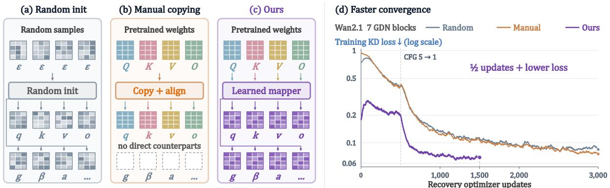

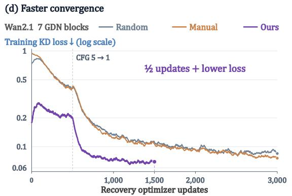  
Figure 1. Comparisons of diferent weight initialization methods. (a) Random initialization discards pretrained knowledge, while (b) manual copying relies on partial one-to-one correspondences. (c) Our LinMorph learns a cross-parameter transformation that initializes both matched and target-specific linearattention parameters. (d) The resulting initialization yields substantially faster recovery and lower KD loss.

## 1 Introduction

Video difusion transformers (Video DiTs) [1–4] have recently emerged as a dominant paradigm for high-quality video generation, benefiting from the scalability and expressive capacity of Transformer architectures [5]. However, their computational cost grows rapidly with the number of spatio-temporal tokens, making full softmax attention increasingly expensive for high-resolution and long-duration video generation. Linear attention provides a promising alternative by reducing the quadratic complexity of token interaction to linear or near-linear complexity [6–8]. Yet, training a linear-attention Video DiT from scratch is itself prohibitively expensive. A more practical route is therefore to linearize an existing pretrained Video DiT by replacing its softmax attention modules with eficient linear counterparts, followed by a short recovery stage to restore generation quality [9–11]. This post-hoc linearization paradigm enables eficient video generation while preserving the value of expensive pretrained models.

Despite its appeal, post-hoc linearization faces an overlooked initialization problem. Existing approaches typically either initialize the new linear attention from scratch and rely on recovery training to reconstruct the lost functionality [12], or manually copy seemingly corresponding softmax projections into the target operator [12, 13]. The former discards knowledge already encoded in the pretrained attention weights, while the latter relies on rigid and often incomplete source–target correspondences. This limitation becomes particularly pronounced for modern recurrent linear attention operators, whose parameterizations contain components with no direct softmax counterpart. Consequently, a substantial dificulty of Video DiT linearization may arise before recovery begins: from how the replacement module is initialized.

This observation suggests a diferent formulation. Rather than asking which pretrained softmax weights should be copied to which linear-attention parameters, we ask how pretrained softmax weights should be transformed into an efective linear-attention initialization. From this perspective, manual copying is only a highly constrained transformation with a predefined one-to-one correspondence. A learned transformation can instead exploit information jointly distributed across multiple pretrained projections and construct parameters even when no explicit counterpart exists in the source attention.

Building on this idea, we propose LinMorph, a parameter-eficient weight-morphing framework for post-hoc Video DiT linearization. LinMorph learns a source-conditioned transformation shared across layers: each layer provides its own pretrained softmax weights, while the same learned rule constructs its linear-attention initialization. The transformation is fitted through local teacher alignment in a compact shared parameter space, after which the generated weights are materialized as independent replacement modules and optimized by progressive distillation and joint recovery. Because the morphism acts on model weights rather than video tokens, it can be learned from short, low-resolution clips and reused to initialize recovery at larger video scales. Figure 1 contrasts LinMorph with random initialization and manual weight reuse.

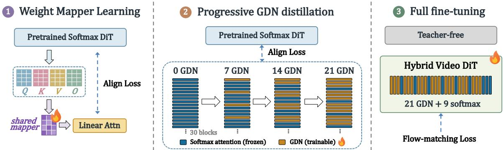  
Figure 2. Overview of LinMorph. A shared weight morphism is first learned from the frozen softmax teacher and used to generate GDN initialization weights. After materialization, the mapper is discarded and the GDN modules are progressively introduced and recovered by prediction distillation. The resulting hybrid Video DiT is finally fine-tuned end-to-end without the teacher.

Experiments on pretrained Video DiTs show that LinMorph provides a substantially stronger starting point than both random initialization and heuristic weight reuse, leading to faster recovery and better final generation quality. The learned morphism also transfers across video resolutions and durations without mapper refitting, allowing the initialization to be learned at a cheaper video scale and reused for more expensive recovery. These results highlight a complementary axis for eficient Video DiT linearization: beyond designing a better attention operator or recovery objective, it is equally important to determine how pretrained softmax knowledge is transferred into the new parameterization.

## 2 LinMorph: Softmax-to-Linear Weight Morphism

LinMorph learns a source-conditioned transformation shared across layers to initialize Gated DeltaNet (GDN) replacements in pretrained Video DiTs [14]. Each layer supplies its own softmax weights, while the shared rule constructs its GDN initialization. Figure 2 summarizes three stages: local mapper fitting, progressive distillation of the materialized replacements, and teacher-free joint fine-tuning.

## 2.1 Cross-Parameter Weight Transformation

For layer ℓ, let $\Theta _ { \mathrm { s o f t } } ^ { ( \ell ) }$ denote the pretrained softmax-attention parameters and $\widetilde { \Theta } _ { \mathrm { l i n } } ^ { ( \ell ) }$ the initialization of its GDN replacement. LinMorph applies a weight morphism shared across participating layers,

$$
\begin{array} { r } { \widetilde { \Theta } _ { \mathrm { l i n } } ^ { ( \ell ) } = \mathcal { T } _ { \phi , \psi } \left( \Theta _ { \mathrm { s o f t } } ^ { ( \ell ) } \right) , } \end{array}\tag{1}
$$

where $\phi$ parameterizes a source-conditioned base transformation and ψ a residual correction. The transformation parameters are shared, but the resulting initializations are layer-specific because each layer provides diferent pretrained source weights. LinMorph therefore shares the transformation rule, rather than the weights of the resulting GDN modules. Here, “morphism”

refers to a learned cross-architecture weight transformation, not an exact function-preserving mapping between softmax attention and GDN. Figure 3 illustrates the shared mapper for an individual target parameter.

Cross-parameter mixing. Rather than prescribing a oneto-one source–target correspondence, LinMorph allows each target parameter to draw information jointly from all pretrained softmax projections. Let ${ \bf W } _ { s } ^ { ( \ell ) } { \bf \bar { \Phi } } \in \mathbb { R } ^ { \bar { D } \times D } , s \in \bar { \mathcal { S } } =$ $\{ Q , K , V , O \}$ , denote the four source projections. Given shapealigned source matrices $\{ \mathbf { Z } _ { s } \} _ { s \in { \mathcal { S } } } .$ , we define

$$
\mathcal { M } _ { j } \left( \{ \mathbf { Z } _ { s } \} _ { s \in \mathcal { S } } \right) = \sum _ { s \in \mathcal { S } } \alpha _ { j , s } \mathbf { Z } _ { s } ,\tag{2}
$$

where $\alpha _ { j , s }$ are learned unconstrained coeficients shared across layers. Each target parameter $j$ thus learns not only which pretrained projections are useful, but also how their information should be combined.

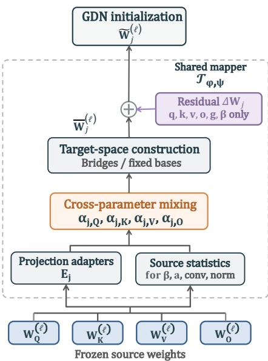

Dimension and parameter alignment. Softmax attention and GDN need not have matching internal dimensions. We introduce target-specific adapters $\mathbf { E } _ { j }$ for the attentionchannel dimension, together with hidden-width bridges $\mathbf { B } _ { \mathrm { u p } }$ and $\mathbf { B } _ { \mathrm { d o w n } }$ between the pretrained DiT width $D$ and the GDN width $D _ { g }$ . For the main GDN projections, the sourceconditioned mixtures are

$$
\mathbf { W } _ { j , \mathrm { m i x } } ^ { ( \ell ) } = \mathcal { M } _ { j } \left( \{ \mathbf { E } _ { j } \mathbf { W } _ { s } ^ { ( \ell ) } \} _ { s \in \mathcal { S } } \right) , ~ j \in \{ q , k , v , g \} ,
$$

Figure 3. Shared weight mapper. Shown for a target parameter j. Alignment and construction are targetdependent; residual correction applies only to $q , k , v , o , g , \beta .$

(3)

$$
\mathbf { W } _ { o , \operatorname* { m i x } } ^ { ( \ell ) } = \mathcal { M } _ { o } \left( \{ \mathbf { W } _ { s } ^ { ( \ell ) } \mathbf { E } _ { o } \} _ { s \in \mathcal { S } } \right) ,\tag{4}
$$

from which the base target weights are constructed as

$$
\overline { { \mathbf { W } } } _ { j } ^ { ( \ell ) } = \mathbf { W } _ { j , \mathrm { m i x } } ^ { ( \ell ) } \mathbf { B } _ { \mathrm { d o w n } } , \quad j \in \{ q , k , v , g \} , \qquad \overline { { \mathbf { W } } } _ { o } ^ { ( \ell ) } = \mathbf { B } _ { \mathrm { u p } } \mathbf { W } _ { o , \mathrm { m i x } } ^ { ( \ell ) } .\tag{5}
$$

The bridges connect the GDN replacement to the surrounding DiT while preserving the external hidden width. GDN additionally contains parameters without direct softmax counterparts, including update and decay projections, short convolutions, and normalization parameters. We construct these parameters from compact source-conditioned statistics of the pretrained projections and apply the same learned cross-parameter mixing principle. This allows pretrained information to contribute even when an explicit source–target correspondence does not exist. Detailed constructions are provided in Appendix B.3.

Residual correction. The source-conditioned transformation provides a structured base initialization, but need not fully account for the parameterization gap between softmax attention and GDN. We therefore augment each generated weight with a shared residual in the native target space,

$$
\widetilde { \mathbf { W } } _ { j } ^ { ( \ell ) } = \overline { { \mathbf { W } } } _ { j } ^ { ( \ell ) } + \Delta \mathbf { W } _ { j } , \qquad j \in \{ q , k , v , o , g , \beta \} ,\tag{6}
$$

where $\widetilde { \mathbf { W } } _ { j } ^ { ( \ell ) }$ denotes the final weight used to initialize the replacement before recovery. The mixing coeficients, adapters, bridges, and residual corrections are shared across participating layers, while the source-conditioned term preserves layer-specific information.

With matching dimensions, identity adapters and bridges, zero residuals, and a one-hot source mixture, LinMorph reduces to direct one-to-one weight copying. Manual reuse can therefore be viewed as a restricted special case of the proposed transformation, whereas LinMorph learns how pretrained information should be reassigned to the target parameterization.

## 2.2 Shared Morphism Optimization

Local teacher alignment. We optimize the shared morphism by locally matching each mapped GDN replacement to its corresponding pretrained softmax block. Given a noisy video latent $\mathbf { z } _ { t }$ and text condition $c ,$ a frozen teacher forward pass provides, for each participating layer $\ell ,$ the block input $\mathbf { X } _ { T } ^ { ( \ell ) }$ , the attention output ${ \bf A } _ { T } ^ { ( \ell ) }$ , and the complete block output $\mathbf { Y } _ { T } ^ { \left( \ell \right) }$

For each layer, we then replay the block using the mapped GDN initialization $\widetilde { \Theta } _ { \mathrm { l i n } } ^ { ( \ell ) }$ , while fixing its input to the teacher activation $\mathbf { X } _ { T } ^ { ( \ell ) }$ . This produces $\widehat { \mathbf { A } } ^ { ( \ell ) }$ and $\widehat { \mathbf { Y } } ^ { ( \ell ) }$ for the mapped attention module and the full block, respectively. All non-attention components remain frozen, while gradients are propagated through them to the shared morphism. Using the teacher activation independently at every layer isolates the local conversion error and prevents mismatches from preceding replacements from accumulating during mapper optimization.

We match both the attention output and its efect on the surrounding block:

$$
\mathcal { L } _ { \mathrm { m a p } } = \frac { 1 } { | \mathcal { B } | } \sum _ { \ell \in \mathcal { B } } \left[ \mathcal { D } \left( \widehat { \mathbf { A } } ^ { ( \ell ) } , \mathbf { A } _ { T } ^ { ( \ell ) } \right) + \mathcal { D } \left( \widehat { \mathbf { Y } } ^ { ( \ell ) } , \mathbf { Y } _ { T } ^ { ( \ell ) } \right) \right] ,\tag{7}
$$

where $\mathcal { D } ( \cdot , \cdot )$ denotes element-wise mean squared error. The first term directly aligns the replacement operator, while the second measures whether the mapped attention remains compatible with the surrounding pretrained block.

Two-stage optimization. We first optimize the source-conditioned base transformation $\phi$ with the residual correction fixed to zero. We then freeze $\phi$ and optimize only $\psi$ under the same alignment objective. This decomposition first captures the reusable transformation structure shared across layers, and then corrects the remaining mismatch directly in the native GDN parameter space.

Materialization. After optimization, we evaluate $\mathcal { T } _ { \phi ^ { \star } , \psi ^ { \star } }$ once on the pretrained parameters of each participating layer and materialize the resulting $\widetilde { \Theta } _ { \mathrm { l i n } } ^ { ( \ell ) }$ as independent GDN parameters. The shared mapper is then discarded; the materialized modules are no longer tied across layers and can be optimized independently during subsequent recovery.

Because the morphism is shared across layers and operates in weight space, mapper fitting optimizes a much smaller parameter set than directly recovering all converted GDN modules. Moreover, its parameterization depends on model dimensions rather than video token count at a fixed architecture. We therefore fit the morphism using short, low-resolution clips and reuse the resulting initialization for recovery at larger video scales; this cross-scale behavior is examined in Appendix C.4.1.

## 2.3 Progressive Conversion and Recovery

Progressive distillation. The materialized LinMorph weights provide the starting point for converting the pretrained Video DiT. Rather than replacing many softmax blocks at once, we progressively increase the number of GDN replacements, $\mathrm { e . g . , 0 \to 7 \to 1 4 \to 2 1 }$ for Wan2.1, as illustrated in Figure 2. At each stage, newly introduced GDN modules are initialized by LinMorph, while previously converted modules inherit their recovered weights. The converted modules and their bridges are then adapted by matching the velocity prediction of the frozen softmax teacher,

$$
\begin{array} { r } { \mathcal { L } _ { \mathrm { K D } } = \mathrm { M A E } \left( \mathbf { v } _ { \theta } ( \mathbf { z } _ { t } , t , c ) , \mathbf { v } _ { T } ( \mathbf { z } _ { t } , t , c ) \right) . } \end{array}\tag{8}
$$

Progressive conversion limits the architectural change introduced at each stage, allowing the mapped initialization to be adapted before further softmax blocks are replaced.

Teacher-free joint fine-tuning. Once the target replacement ratio is reached, we remove teacher supervision and jointly fine-tune the entire hybrid Video DiT with flow-matching objective,

$$
\mathcal { L } _ { \mathrm { F M } } = \mathbb { E } \left[ w ( t ) \mathrm { M S E } \left( \mathbf { v } _ { \theta } ( \mathbf { z } _ { t } , t , c ) , \boldsymbol { \epsilon } - \mathbf { z } _ { 0 } \right) \right] .\tag{9}
$$

This final stage allows the softmax and GDN blocks to co-adapt under the original generative objective, producing the recovered hybrid model used for inference.

## 3 Understanding the Learned Weight Morphism

We isolate the learned morphism before downstream recovery to understand why it provides an efective initialization. We first examine the cross-parameter structure discovered by LinMorph, then evaluate the functional fidelity of the resulting initialization.

## 3.1 Learned Cross-Parameter Structure

LinMorph does not simply recover the namesake correspondences used by manual weight copying. Figure 4 visualizes the learned source-mixing coeficients $\alpha _ { j , s }$ . While the query and key targets retain strong contributions from their corresponding source projections, they also draw nonnegligible information from other pretrained weights: cross-projection terms account for 6.08% and 12.20% of their absolute coeficient mass, respectively. For target parameters without a direct softmax counterpart, the learned assignments are even more distinctive. For example, $\mathbf { W } _ { O }$ contributes 82.16% of the absolute coeficient mass for the update projection $\beta .$ These patterns suggest that the useful softmax-to-linear correspondence is neither strictly one-to-one nor determined by parameter names.

We further test whether these learned correspondences are functionally meaningful rather than incidental. Without any additional optimization, we intervene on the fitted mapper while keeping all other parameters fixed. Restricting q, k, v, o to their namesake source projections increases block NMSE by 5.66%. More strikingly, cyclically permuting the learned source assignments for GDN-specific parameters increases block NMSE by 171.44%, despite preserving the norms of their coeficient vectors. The paired 95% bootstrap intervals are [5.34, 5.99]% and [162.73, 180.64]%.

Together, these results show that LinMorph learns structured cross-parameter relationships that are important for functional alignment.

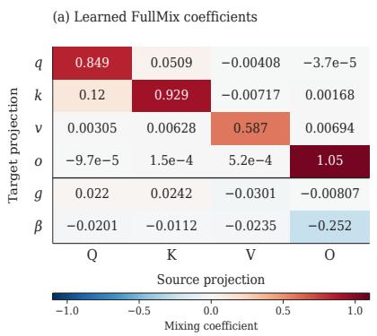

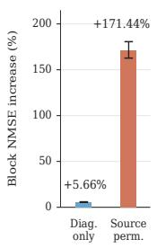  
Figure 4. Learned cross-parameter structure. Left: source-mixing coeficients. Right: block-NMSE degradation after restricting or permuting the learned source assignments.

The benefit therefore comes not merely from reusing pretrained weights, but from learning how information distributed across diferent softmax projections should be reassigned to the target linear-attention parameterization.

## 3.2 Functional Fidelity of the Initialization

We next evaluate the mapped initialization before any downstream recovery. As shown in Table 1, the base morphism already achieves high teacher-forced block fidelity. Residual refinement further improves both attention- and block-level alignment, reducing block NMSE from 0.01360 to 0.01239 and increasing block cosine similarity from 0.99321 to 0.99381.

Table 1. Pre-recovery initialization fidelity. Evaluated on 64 HQ videos, 30 blocks, and five difusion timesteps.
<table><tr><td>Initialization</td><td>Block NMSE ↓ Block Cos. ↑</td></tr><tr><td>Random</td><td>0.09483 0.96211</td></tr><tr><td>Manual copying</td><td>0.09446 0.96209</td></tr><tr><td>Base</td><td>0.01360 0.99321</td></tr><tr><td>Base + residual</td><td>0.01239 0.99381</td></tr></table>

These results are measured before progressive

distillation or joint fine-tuning, showing that the learned weight transformation itself places the GDN replacement close to the pretrained softmax block in function space. The residual correction then captures the remaining mismatch in the target parameterization. Additional analyses of cross-scale reuse and cross-layer sharing are provided in Appendices C.4.1 and C.5, respectively.

## 4 Experiments

## 4.1 Experimental Setup

Backbones and data. Our primary backbone is the 30-block Wan2.1-T2V-1.3B [4], for which we replace 14 or 21 softmax-attention blocks with GDN. To test cross-backbone applicability, we additionally replace six blocks of Wan2.2-TI2V-5B [15] in text-to-video mode. All initialization ablations within each backbone use the same target architecture and recovery recipe. Wan2.1 uses our curated high-quality internet-video set (HQ videos) for mapper fitting and recovery, while Wan2.2 recovery uses OpenVid [16]. The Wan2.2 experiment uses a separately fitted shared-mapper variant; its details are provided in Appendix C.

Evaluation. We evaluate functional fidelity with normalized mean squared error (NMSE) and cosine similarity at both block and final-output levels. Teacher-forced metrics isolate individual replacements on teacher hidden states, whereas depth-rollout metrics propagate student representations through the DiT and measure the composed model. All initialization and recoveryschedule ablations use the same fixed HQ evaluation subset. Generation quality is evaluated with VBench [17] and VBench-2.0 [18]. Detailed training settings, metric definitions, evaluation subsets, and checkpoint accounting are provided in Appendix C.

## 4.2 Initialization Quality and Recovery Eficiency

We isolate the efect of initialization by holding the target architecture and recovery recipe fixed, and compare LinMorph with random initialization and dimension-aligned manual copying. Table 2 reports functional fidelity, while Figures 1(d) and 6 show the recovery dynamics on Wan2.1 and Wan2.2, respectively.

On Wan2.1 with seven GDN blocks, LinMorph reduces depth-rollout block NMSE by 61.4% over manual copying and 65.5% over random initialization after 1,500 updates, while lowering final-output NMSE to 0.01013. It also outperforms random initialization trained for twice as many updates (0.01682 at 3,000 updates), showing that a stronger initialization improves both intermediate alignment and end-to-end prediction while substantially reducing recovery efort. Consistent with these fidelity gains, Figure 1(d) shows that LinMorph reaches a lower training KD loss in 1,500 updates than either baseline in 3,000 updates.

Table 2. Controlled initialization ablation on two Video DiT backbones. Within each backbone, all methods use the same target architecture, recovery recipe, and evaluation protocol.
<table><tr><td colspan="2">Wan2.1: 7 GDN blocks</td></tr><tr><td>Init. Upd. NMSE ↓</td><td>Block Block Output Output Cos. ↑ NMSE↓ Cos. ↑</td></tr><tr><td>Random 1,500 0.1522 Manual 1,500 0.1359 Random 3,000 0.1168</td><td>0.9315 0.0250 0.9873 0.9379 0.0230 0.9884 0.9449 0.0168 0.9915</td></tr><tr><td colspan="2">Manual 3,000 0.0905 0.9565 0.0137 0.9931</td></tr><tr><td>LinMorph 1,500 0.0525 0.9738 0.0101 0.9949</td></tr></table>

<table><tr><td colspan="3">Wan2.2: 6 GDN blocks</td></tr><tr><td>Init.</td><td>Block Block Output Upd. NMSE↓ Cos. ↑ NMSE↓</td><td>Output Cos. ↑</td></tr><tr><td>Random 1,250 Manual 1,250 Random 2,500 Manual 2,500</td><td>0.2886 0.8545 0.2673 0.8637 0.2148 0.8917 0.1872 0.9049</td><td>0.0357 0.9820 0.0320 0.9839 0.0258 0.9870 0.0222 0.9889</td></tr><tr><td colspan="3">LinMorph 1,250 0.1476 0.9257 0.0235 0.9882</td></tr></table>

Wan2.2: higher block fidelity with half the recovery updates. The benefit extends to Wan2.2 with six replacements. Figure 6 shows that LinMorph substantially reduces the early recovery loss relative to manual copying and random initialization. At the same 1,250-update budget, LinMorph achieves lower block and final-output NMSE than both baselines. Moreover, after only 1,250 updates, LinMorph reaches a block NMSE of 0.14755, outperforming manual copying and random initialization trained for 2,500 updates, which obtain 0.18718 and 0.21479, respectively. Thus, the learned initialization achieves stronger block alignment with half as many recovery updates. Across both backbones, these results demonstrate the efectiveness of learning how pretrained weights should be transferred before recovery.

## 4.3 Generation Quality

Overall quality across two benchmarks. We evaluate the recovered models on VBench [17] and VBench-2.0 [18], covering perceptual and temporal quality as well as intrinsic video faithfulness. Table 3 consolidates the full-suite total scores for both conversion depths. Each LinMorph row uses the same checkpoint across the two benchmarks: microstep 8,000 for 14 GDN blocks and microstep 40,000 for 21 GDN blocks.

The references include the source backbone, CogVideoX-based generation and representationalignment models, and recent Wan-based acceleration methods. These provide complementary context for generation quality; the matched initialization ablations in Section 4.2 isolate the benefit of learned weight transfer.

After 4,000 optimizer updates of final full-model fine-tuning, the 14-GDN model achieves 82.16 on VBench and 55.11 on VBench-2.0. Its VBench total is within 0.33 points of the reported Wan2.1-1.3B reference, while both totals exceed the reported CogVideoX-2B and VideoREPA-2B results. At a higher conversion ratio of $2 1 / 3 0 = 7 0 \%$ , LinMorph obtains 81.85∗ and 52.13, respectively, retaining a VBench total above 81 despite replacing most attention blocks.

Dimension-wise comparison with LinVideo. LinVideo [10] provides a direct post-training linearization reference on the same Wan2.1-1.3B backbone. Table 4 compares our 21-GDN model with its 16-block conversion using all eight dimensions reported in its main Wan2.1-1.3B comparison. This panel jointly covers frame appearance, motion, temporal consistency, and semantic alignment, allowing us to examine where quality is retained after conversion.

LinMorph has higher reported scores on seven of eight dimensions while converting five additional blocks. The largest gains are in aesthetic quality (+4.49 points), scene (+3.32), and imaging quality (+2.97), accompanied by higher motion smoothness, dynamic degree, and subject/background consistency. These results highlight the perceptual and temporal quality of the recovered 21-GDN model. Sampling settings and reference sources for both tables are detailed in Appendix C.6.

Table 3. Overall generation quality on VBench and VBench-2.0. Scores are on a 0–100 scale; higher is better. LinMorph uses 50-step sampling. † denotes an approximate score read from the $4 8 0 \times 8 3 2$ panel of Figure 5 in Ghafoorian et al. [9]. Reference provenance and evaluation details are provided in Appendix C.6.
<table><tr><td>Model</td><td>VB1↑</td><td>VB2 ↑</td><td>Model</td><td>VB1↑</td><td>VB2 ↑</td></tr><tr><td colspan="6">General video-generation models</td></tr><tr><td> ${ \mathrm { W a n } } 2 . 1 { \cdot } 1 . 3 { \mathrm { B } } ^ { a }$ </td><td>82.49</td><td>56.02</td><td> $\mathrm { C o g V i d e o X – 1 . 5 – 5 B ^ { c } }$ </td><td>82.01</td><td>53.40</td></tr><tr><td> $\mathbf { M o A l i g n - 2 B } ^ { b }$ </td><td>81.30</td><td>55.90</td><td> $\mathrm { C o g V i d e o X } { - 2 \mathrm { B } ^ { b } }$ </td><td>80.60</td><td>54.90</td></tr><tr><td> $\mathrm { V i d e o R E P A } { - 2 \mathrm { B } ^ { b } }$ </td><td>80.50</td><td>55.00</td><td> $\mathrm { V i d e o C r a f t e r } 2 ^ { d }$ </td><td>80.44</td><td>一</td></tr><tr><td colspan="6">Efficient video-generation models</td></tr><tr><td> $\mathsf { W a n - D M D } ( 2 \mathsf { s t e p s } ) ^ { a }$ </td><td>83.28</td><td>56.67</td><td> $\mathrm { P y r a m i d a l W a n . D M D . P T } ^ { \star , a }$ </td><td>82.72</td><td>51.75</td></tr><tr><td> $\mathsf { W a n – A d v } ( 2 \mathsf { s t e p s } ) ^ { a }$ </td><td>82.35</td><td>54.82</td><td> $\mathrm { S n a p G e n – V } ( 4 ~ \mathrm { s t e p s } ) ^ { c }$ </td><td>81.14</td><td></td></tr><tr><td>Wan-Adv  $( 1 \mathsf { s t e p } ) ^ { a }$ </td><td>80.28</td><td>50.36</td><td>LTX-Videoc</td><td>80.00</td><td></td></tr><tr><td>Open-Sora  $\mathrm { V } 1 . \bar { 2 } ^ { c }$ </td><td>79.76</td><td></td><td> ${ \mathrm { W a n } } { \mathrm { - D M D } } ( 1 { \mathrm { ~ s t e p } } ) ^ { a }$ </td><td>79.45</td><td>53.17</td></tr><tr><td colspan="6">Linear-complexity video-generation models</td></tr><tr><td>Attention  $S \mathrm { u r g e r y } ( 1 5 { \times } \mathrm { R } 2 ) ^ { e }$ </td><td>83.21</td><td>55.10</td><td>M4Vc</td><td>81.91</td><td></td></tr><tr><td> $\mathrm { H L A } { - } 3 \mathrm { F } { - } \mathrm { R } 1 { - } 1 0 ^ { e }$ </td><td>81.42</td><td></td><td>Attention Surgery  $( 2 0 \times \mathsf { R } 4 ) ^ { e , \dagger }$ </td><td>≈81.1</td><td></td></tr><tr><td>LinMorph-14</td><td>82.16</td><td>55.11</td><td>LinMorph-21</td><td>81.85*</td><td>52.13</td></tr></table>

Table 4. Dimension-wise VBench comparison with LinVideo. All eight dimensions in the Wan2.1-1.3B panel of Huang et al. [10] are included. Scores are multiplied by 100; higher is better. Bold marks the higher score in each row. LinVideo converts 16/30 blocks; LinMorph converts 21/30.
<table><tr><td>Dimension</td><td>LinVideo</td><td>LinMorph (21 GDN)</td><td> $\Delta$ </td></tr><tr><td>Imaging quality</td><td>66.07</td><td>69.04</td><td>+2.97</td></tr><tr><td>Aesthetic quality</td><td>59.41</td><td>63.90</td><td>+4.49</td></tr><tr><td>Motion smoothness</td><td>98.19</td><td>98.58</td><td>+0.39</td></tr><tr><td>Dynamic degree</td><td>59.67</td><td>60.56</td><td>+0.89</td></tr><tr><td>Background consistency</td><td>96.72</td><td>97.16</td><td>+0.44</td></tr><tr><td>Subject consistency</td><td>95.12</td><td>95.48</td><td>+0.36</td></tr><tr><td>Scene</td><td>39.18</td><td>42.50</td><td>+3.32</td></tr><tr><td>Overall consistency</td><td>26.52</td><td>24.13</td><td>-2.39</td></tr></table>

∆: LinMorph minus LinVideo, in score points. LinVideo uses unaugmented prompts and CFG five; LinMorph uses Wan-enhanced prompts and CFG six. This panel excludes temporal flickering and is unafected by the prompt correction marked in Table 3.

Qualitative comparisons appear in Figure 8 (Appendix C.8).

## 4.4 Progressive versus One-Shot Recovery

Progressive distillation and final joint fine-tuning serve complementary roles. Distillation adapts the inserted modules while retaining the pretrained backbone; joint fine-tuning then unfreezes the full DiT to adapt inter-block representations and the final denoising prediction together. We first test block alignment at the end of distillation, before this full-model adaptation.

We compare direct insertion of 21 GDN blocks with $0  7  1 4  2 1$ progressive conversion, using the same mapped initialization bank and 4,500 total recovery updates. The progressive schedule uses 1,500 updates per stage and inherits previously recovered modules; the direct schedule trains all 21 replacements for 4,500 updates.

Table 5. Block alignment after 21-GDN distillation. Both schedules use the same mapped initialization bank and 4,500 total optimizer updates. Metrics use student depth rollout, before final teacher-free full-model fine-tuning. Complete prediction diagnostics appear in Appendix C.3.
<table><tr><td>Schedule</td><td>Total updates</td><td>Block NMSE↓</td><td>Block Cos. ↑</td></tr><tr><td>One-shot 0 → 21</td><td>4,500</td><td>0.18406</td><td>0.90358</td></tr><tr><td>Progressive  $0  7  1 4  2 1$ </td><td>4,500</td><td>0.17931</td><td>0.90728</td></tr></table>

Progressive recovery reduces depth-rollout block NMSE by 2.58% and improves block cosine similarity from 0.90358 to 0.90728. This supports progressive insertion as a way to improve intermediate alignment before joint adaptation. The final teacher-free stage is designed to accommodate the representation changes introduced across blocks, allowing retained and replaced components to adapt together under the generation objective. Appendix C.3 reports the complete pre-fine-tuning diagnostics, including final-prediction metrics.

## 4.5 Inference Eficiency

Larger gains as video length increases. We benchmark the 21-GDN hybrid against pretrained Wan2.1 with FlashAttention-2 [19], using BF16 and batch size one on an A800-80GB. Figure 5 reports attention-module, full-backbone, and end-to-end generation speedups using the original FLA implementation. At 480 × 832, attention-module speedup increases from 2.02× at 321 frames to 3.91× at 641 frames. The full DiT reaches 1.48× speedup at 321 frames and 1.76× at 481 frames, showing that the operator-level gains translate into backbone acceleration.

End-to-end acceleration. At 321 frames, full generation decreases from 1,604.7 to 1,094.0 seconds, a 1.47× speedup. This measurement includes text encoding, denoising, and VAE decoding, demonstrating a practical reduction in generation latency beyond the replaced attention modules. Absolute latencies, resource use, and the measurement protocol are provided in Appendix C.7.

## 4.6 Transformation Design

We compare manual copying and five learned mappings under a common teacher, target architecture, and evaluation protocol, with equal fitting budgets for the learned variants. PreMix/PostMix denotes source-weight mixing before/after dimensional expansion; residual refinement adds a full-rank correction in native target space. Table 6 shows that residual refinement improves every learned variant

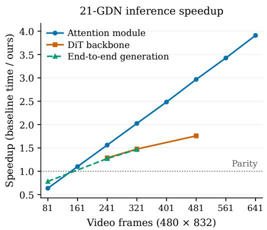  
Figure 5. 21-GDN inference speedup. Attention/backbone: median and IQR over three paired rounds; end-to-end: one pair. Protocol: Appendix C.7.

across all four metrics. FullMix achieves the best block fidelity, while PostHeadMix achieves the best output fidelity, both with residual refinement.

Table 6. Comparison of weight-transformation designs. Entries report results without / with residual refinement. Block metrics use teacher-forced inputs; output metrics evaluate the cascade of all 30 mapped modules. Evaluation uses 64 videos and five difusion timesteps. Bold marks the best result in each metric.
<table><tr><td>Transformation</td><td>Block NMSE↓</td><td>Block Cos. ↑</td><td>Output NMSE↓</td><td>Output Cos. ↑</td></tr><tr><td>Manual</td><td>0.1002 / -</td><td>0.9614/-</td><td>4.1482 / -</td><td>0.2395 / -</td></tr><tr><td>FullMix</td><td>0.0177 / 0.0161</td><td>0.9912 / 0.9920</td><td>0.7810 / 0.6390</td><td>0.6456 / 0.7051</td></tr><tr><td>PreHeadMix</td><td>0.0221 / 0.0207</td><td>0.9890 / 0.9897</td><td>1.5084 / 1.2746</td><td>0.5176 / 0.5745</td></tr><tr><td>PostHeadMix</td><td>0.0175 / 0.0162</td><td>0.9913 / 0.9919</td><td>0.7376 / 0.6166</td><td>0.6625 / 0.7135</td></tr><tr><td>PreChannelMix</td><td>0.0183 / 0.0166</td><td>0.9908 / 0.9917</td><td>0.9758 / 0.6926</td><td>0.6071 / 0.6893</td></tr><tr><td>PostChannelMix</td><td>0.0207 / 0.0181</td><td>0.9897 / 0.9910</td><td>1.4928 / 0.8154</td><td>0.4759 / 0.6536</td></tr></table>

## 5 Conclusion

We presented LinMorph, a framework that treats post-hoc Video DiT linearization as a learnable weight transformation problem rather than solely a recovery problem. Instead of random initialization or rigid manual copying, LinMorph learns cross-parameter correspondences that transfer pretrained softmax knowledge into GDN parameters, including those without direct source counterparts. A single source-conditioned morphism is shared across layers while producing layer-specific initializations. Operating in weight space, it can be fitted on short, low-resolution clips and reused at larger video scales without refitting. Experiments on two Wan backbones demonstrate improved initialization fidelity and faster recovery, while the resulting hybrid models achieve strong generation quality and accelerate long-video inference. These findings establish learned initialization as a complementary axis for eficient linearization: how pretrained knowledge is transferred before recovery matters alongside how the converted model is subsequently optimized.

## AI use statement

Generative AI tools were used to assist with literature discovery and synthesis, methodological and experimental feedback, software and plotting support, interpretation and presentation of experimental results, and manuscript organization, translation, and language editing. All AIassisted code, analyses, citations, claims, and text are subject to author review and verification against the implementation, experimental records, and original sources. The authors take responsibility for the final content of this work, including material produced with the aid of generative AI.

## Ethics statement

This work studies the eficient adaptation and inference of pretrained video difusion models. The resulting generators may inherit biases and misuse risks from their pretrained backbones, including the creation of misleading or non-consensual media. Responsible deployment should include appropriate content safeguards and clear identification of synthetic media. Our experiments use pretrained models, existing datasets, and a curated set of high-quality internet videos. The use and any redistribution of these resources should respect applicable licenses, copyright, privacy, and consent requirements.

## Reproducibility statement

Section 2 describes the shared weight morphism and its training objectives. Appendix B specifies target-parameter construction, dimensional alignment, initialization, optimization, and progressive replacement. Appendix C documents backbone-specific recovery settings, baseline initialization recipes, and checkpoint accounting. Functional evaluation metrics and statistical scope are provided in Appendix C.2; generation settings and benchmark reference sources are detailed in Appendix C.6. Appendix C.7 reports the timing environment, measurement scopes, warmup procedures, and aggregation protocol.

## References

[1] Xin Ma, Yaohui Wang, Xinyuan Chen, Gengyun Jia, Ziwei Liu, Yuan-Fang Li, Cunjian Chen, and Yu Qiao. Latte: Latent difusion transformer for video generation. Transactions on Machine Learning Research, 2025. ISSN 2835-8856. URL https://openreview.net/forum?id=ntGPYNUF3t.

[2] Zhuoyi Yang, Jiayan Teng, Wendi Zheng, Ming Ding, Shiyu Huang, Jiazheng Xu, Yuanming Yang, Wenyi Hong, Xiaohan Zhang, Guanyu Feng, Da Yin, Yuxuan Zhang, Weihan Wang, Yean Cheng, Bin Xu, Xiaotao Gu, Yuxiao Dong, and Jie Tang. Cogvideox: Text-to-video difusion models with an expert transformer. In The Thirteenth International Conference on Learning Representations, 2025. URL https://openreview.net/forum?id=LQzN6TRFg9.

[3] Weijie Kong, Qi Tian, Zijian Zhang, Rox Min, Zuozhuo Dai, Jin Zhou, Jiangfeng Xiong, Xin Li, Bo Wu, Jianwei Zhang, et al. HunyuanVideo: A systematic framework for large video generative models. arXiv preprint arXiv:2412.03603, 2024.

[4] Team Wan. Wan: Open and advanced large-scale video generative models. arXiv preprint arXiv:2503.20314, 2025.

[5] William Peebles and Saining Xie. Scalable difusion models with transformers. In Proceedings of the IEEE/CVF International Conference on Computer Vision, pages 4195–4205, 2023.

[6] Angelos Katharopoulos, Apoorv Vyas, Nikolaos Pappas, and François Fleuret. Transformers are RNNs: Fast autoregressive transformers with linear attention. In Proceedings of the 37th International Conference on Machine Learning, volume 119 of Proceedings of Machine Learning Research, pages 5156–5165, 2020.

[7] Songlin Yang, Bailin Wang, Yikang Shen, Rameswar Panda, and Yoon Kim. Gated linear attention transformers with hardware-eficient training. In Proceedings of the 41st International Conference on Machine Learning, volume 235 of Proceedings of Machine Learning Research, pages 56501–56523, 2024.

[8] Songlin Yang, Bailin Wang, Yu Zhang, Yikang Shen, and Yoon Kim. Parallelizing linear transformers with the delta rule over sequence length. In Advances in Neural Information Processing Systems, 2024.

[9] Mohsen Ghafoorian, Denis Korzhenkov, and Amirhossein Habibian. Attention surgery: An eficient recipe to linearize your video difusion transformer. In Proceedings of the IEEE/CVF Conference on Computer Vision and Pattern Recognition, pages 32915–32925, 2026.

[10] Yushi Huang, Xingtong Ge, Ruihao Gong, Chengtao Lv, and Jun Zhang. LinVideo: A post-training framework towards O(n) attention in eficient video generation. In Proceedings of the IEEE/CVF Conference on Computer Vision and Pattern Recognition, pages 23398–23408, 2026.

[11] Mohsen Ghafoorian and Amirhossein Habibian. ReHyAt: Recurrent hybrid attention for video difusion transformers. In Proceedings of the IEEE/CVF Conference on Computer Vision and Pattern Recognition, pages 40674–40684, 2026.

[12] Jiahao Wang, Ning Kang, Lewei Yao, Mengzhao Chen, Chengyue Wu, Songyang Zhang, Shuchen Xue, Yong Liu, Taiqiang Wu, Xihui Liu, Kaipeng Zhang, Shifeng Zhang, Wenqi Shao, Zhenguo Li, and Ping Luo. LiT: Delving into a simple linear difusion transformer for image generation. In Proceedings of the IEEE/CVF International Conference on Computer Vision, pages 16068–16078, 2025.

[13] Jungo Kasai, Hao Peng, Yizhe Zhang, Dani Yogatama, Gabriel Ilharco, Nikolaos Pappas, Yi Mao, Weizhu Chen, and Noah A. Smith. Finetuning pretrained transformers into RNNs. In Proceedings of the 2021 Conference on Empirical Methods in Natural Language Processing, pages 10630–10643, 2021. doi: 10.18653/v1/2021.emnlp-main.830. URL https://aclanthology.org/2021.emnlp-main.830/.

[14] Songlin Yang, Jan Kautz, and Ali Hatamizadeh. Gated delta networks: Improving mamba2 with delta rule. In The Thirteenth International Conference on Learning Representations, 2025. URL https://openreview.net/forum?id=r8H7xhYPwz.

[15] Team Wan. Wan2.2: Oficial models and code. GitHub repository, 2025. URL https://github.com/W an-Video/Wan2.2.

[16] Kepan Nan, Rui Xie, Penghao Zhou, Tiehan Fan, Zhenheng Yang, Zhijie Chen, Xiang Li, Jian Yang, and Ying Tai. OpenVid-1M: A large-scale high-quality dataset for text-to-video generation. In The Thirteenth International Conference on Learning Representations, 2025. URL https://openreview.net/f orum?id=j7kdXSrISM.

[17] Ziqi Huang, Yinan He, Jiashuo Yu, Fan Zhang, Chenyang Si, Yuming Jiang, Yuanhan Zhang, Tianxing Wu, Qingyang Jin, Nattapol Chanpaisit, Yaohui Wang, Xinyuan Chen, Limin Wang, Dahua Lin, Yu Qiao, and Ziwei Liu. VBench: Comprehensive benchmark suite for video generative models. In Proceedings of the IEEE/CVF Conference on Computer Vision and Pattern Recognition, pages 21807– 21818, 2024. URL https://openaccess.thecvf.com/content/CVPR2024/html/Huang\_VBench\_Compr ehensive\_Benchmark\_Suite\_for\_Video\_Generative\_Models\_CVPR\_2024\_paper.html.

[18] Dian Zheng, Ziqi Huang, Hongbo Liu, Kai Zou, Yinan He, Fan Zhang, Lulu Gu, Yuanhan Zhang, Jingwen He, Wei-Shi Zheng, Yu Qiao, and Ziwei Liu. VBench-2.0: Advancing video generation benchmark suite for intrinsic faithfulness. arXiv preprint arXiv:2503.21755, 2025. URL https: //arxiv.org/abs/2503.21755.

[19] Tri Dao. FlashAttention-2: Faster attention with better parallelism and work partitioning. In The Twelfth International Conference on Learning Representations, 2024. URL https://arxiv.org/abs/2307 .08691.

[20] Imanol Schlag, Kazuki Irie, and Jürgen Schmidhuber. Linear transformers are secretly fast weight programmers. In Proceedings of the 38th International Conference on Machine Learning, volume 139 of Proceedings of Machine Learning Research, pages 9355–9366, 2021.

[21] Hongjie Wang, Chih-Yao Ma, Yen-Cheng Liu, Ji Hou, Tao Xu, Jialiang Wang, Felix Juefei-Xu, Yaqiao Luo, Peizhao Zhang, Tingbo Hou, Peter Vajda, Niraj K. Jha, and Xiaoliang Dai. LinGen: Towards high-resolution minute-length text-to-video generation with linear computational complexity. In Proceedings of the IEEE/CVF Conference on Computer Vision and Pattern Recognition, 2025.

[22] Junsong Chen, Yuyang Zhao, Jincheng YU, Ruihang Chu, Junyu Chen, Shuai Yang, Xianbang Wang, Yicheng Pan, Daquan Zhou, Huan Ling, Haozhe Liu, Hongwei Yi, Hao Zhang, Muyang Li, Yukang Chen, Han Cai, Sanja Fidler, Ping Luo, Song Han, and Enze Xie. SANA-video: Eficient video generation with block linear difusion transformer. In The Fourteenth International Conference on Learning Representations, 2026. URL https://openreview.net/forum?id=mzAchylAtf.

[23] Songhua Liu, Zhenxiong Tan, and Xinchao Wang. CLEAR: Conv-like linearization revs pre-trained difusion transformers up. In Advances in Neural Information Processing Systems, 2025. URL https: //papers.nips.cc/paper\_files/paper/2025/hash/e36da7acd188c6655792270b38830124-Abstrac t-Conference.html.

[24] Philipp Becker, Abhinav Mehrotra, Ruchika Chavhan, Malcolm Chadwick, Luca Morreale, Mehdi Noroozi, Alberto Gil C. P. Ramos, and Sourav Bhattacharya. EDiT: Eficient difusion transformers with linear compressed attention. In Proceedings ofthe IEEE/CVF International Conference on Computer Vision, pages 19608–19616, 2025.

[25] Tianqi Chen, Ian J. Goodfellow, and Jonathon Shlens. Net2Net: Accelerating learning via knowledge transfer. In Yoshua Bengio and Yann LeCun, editors, 4th International Conference on Learning Representations, ICLR 2016, San Juan, Puerto Rico, May 2–4, 2016, Conference Track Proceedings, 2016. URL https://arxiv.org/abs/1511.05641.

[26] Tao Wei, Changhu Wang, Yong Rui, and Chang Wen Chen. Network morphism. In Proceedings of the 33rd International Conference on Machine Learning, volume 48 of Proceedings of Machine Learning Research, pages 564–572, 2016.

[27] Mutian He and Philip N. Garner. Joint fine-tuning and conversion of pretrained speech and language models towards linear complexity. In International Conference on Learning Representations, 2025.

[28] Fu Feng, Yucheng Xie, Jing Wang, and Xin Geng. WAVE: Weight templates for adaptive initialization of variable-sized models. In Proceedings of the IEEE/CVF Conference on Computer Vision and Pattern Recognition, pages 4819–4828, 2025.

[29] Jiaze Xu, Shiyu Xia, Jiaqi Lv, and Xin Geng. Unlocking pre-trained weights: Parameter inheritance for zero-shot initialization. In Proceedings of the IEEE/CVF Conference on Computer Vision and Pattern Recognition, pages 34502–34511, 2026.

[30] Denis Korzhenkov, Adil Karjauv, Animesh Karnewar, Mohsen Ghafoorian, and Amirhossein Habibian. PyramidalWan: On making pretrained video model pyramidal for eficient inference. In Proceedings of the IEEE/CVF Conference on Computer Vision and Pattern Recognition, 2026. URL https://openacce ss.thecvf.com/content/CVPR2026/papers/Korzhenkov\_PyramidalWan\_On\_Making\_Pretrained\_V ideo\_Model\_Pyramidal\_for\_Eficient\_Inference\_CVPR\_2026\_paper.pdf.

[31] Aritra Bhowmik, Denis Korzhenkov, Cees G. M. Snoek, Amirhossein Habibian, and Mohsen Ghafoorian. MoAlign: Motion-centric representation alignment for video difusion models. In International Conference on Learning Representations, 2026. URL https://openreview.net/forum?id=OR0ySm4l9h.

[32] Haoxin Chen, Yong Zhang, Xiaodong Cun, Menghan Xia, Xintao Wang, Chao Weng, and Ying Shan. VideoCrafter2: Overcoming data limitations for high-quality video difusion models. In Proceedings of the IEEE/CVF Conference on Computer Vision and Pattern Recognition, pages 7310–7320, 2024. URL https://openaccess.thecvf.com/content/CVPR2024/html/Chen\_VideoCrafter2\_Overcoming\_Data \_Limitations\_for\_High-Quality\_Video\_Diffusion\_Models\_CVPR\_2024\_paper.html.

[33] Zangwei Zheng, Xiangyu Peng, Tianji Yang, Chenhui Shen, Shenggui Li, Hongxin Liu, Yukun Zhou, Tianyi Li, and Yang You. Open-Sora: Democratizing eficient video production for all. arXiv preprint arXiv:2412.20404, 2024. URL https://arxiv.org/abs/2412.20404.

[34] Yoav HaCohen, Nisan Chiprut, Benny Brazowski, Daniel Shalem, Dudu Moshe, Eitan Richardson, Eran Levin, Guy Shiran, Nir Zabari, Ori Gordon, Poriya Panet, Sapir Weissbuch, Victor Kulikov, Yaki Bitterman, Zeev Melumian, and Ofir Bibi. LTX-Video: Realtime video latent difusion. arXiv preprint arXiv:2501.00103, 2024. URL https://arxiv.org/abs/2501.00103.

[35] Yushu Wu, Zhixing Zhang, Yanyu Li, Yanwu Xu, Anil Kag, Yang Sui, Huseyin Coskun, Ke Ma, Aleksei Lebedev, Ju Hu, Dimitris N. Metaxas, Yanzhi Wang, Sergey Tulyakov, and Jian Ren. SnapGen-V: Generating a five-second video within five seconds on a mobile device. In Proceedings of the IEEE/CVF Conference on Computer Vision and Pattern Recognition, pages 2479–2490, 2025. doi: 10.1109/CVPR52734.2025.00237.

[36] Jiancheng Huang, Gengwei Zhang, Zequn Jie, Siyu Jiao, Yinlong Qian, Ling Chen, Yunchao Wei, and Lin Ma. M4V: Multimodal mamba for eficient text-to-video generation. In Proceedings of the IEEE/CVF Conference on Computer Vision and Pattern Recognition, pages 36747–36757, 2026. URL https://openaccess.thecvf.com/content/CVPR2026/html/Huang\_M4V\_Multimodal\_Mamba\_for\_E ficient\_Text-to-Video\_Generation\_CVPR\_2026\_paper.html.

[37] Hanno Ackermann, Hong Cai, Mohsen Ghafoorian, and Amirhossein Habibian. HLA: Hadamard linear attention. arXiv preprint arXiv:2602.12128, 2026. URL https://arxiv.org/abs/2602.12128.

## A Related Work

Video difusion transformers. Difusion Transformers (DiTs) replace the convolutional backbone of difusion models with Transformer blocks and exhibit favorable scaling behavior for visual generation [5]. This paradigm has been extended to video generation by modeling videos as sequences of spatio-temporal latent tokens. Early works such as Latte investigate factorized spatial– temporal Transformer designs [1], while recent large-scale systems, including CogVideoX [2], HunyuanVideo [3], and Wan [4], demonstrate the strong generation quality enabled by scaling Video DiTs. However, increasing the spatial resolution or video duration rapidly enlarges the token sequence, making quadratic self-attention a major computational and memory bottleneck.

Our work builds on pretrained Video DiTs and focuses on reducing this cost without repeating their expensive pretraining.

Eficient attention and Video DiT linearization. Linear attention reduces the quadratic tokeninteraction cost by rearranging kernelized attention computation [6]. Subsequent recurrent formulations improve its expressiveness through data-dependent gating [7], delta-rule memory updates [8, 20], or their combination [14]. These operators introduce state-update, decay, and gating parameters that do not have direct counterparts in conventional softmax attention.

Eficient attention has also been explored in difusion models. LinGen [21] and SANA-Video [22] construct video generators around linear-complexity backbones, but require dedicated model training. For pretrained image DiTs, CLEAR [23], EDiT [24], and LiT [12] study architectural replacement and distillation recipes for eficient attention. More closely related to our setting, Attention Surgery [9], LinVideo [10], and ReHyAt [11] convert pretrained Video DiTs through hy brid attention, selective layer replacement, attention distillation, and subsequent recovery. These methods primarily improve which attention operator or layer to replace and how the converted model should be recovered. LinMorph is complementary: it addresses how the parameters of the replacement operator should be initialized before recovery.

Cross-architecture parameter transfer. A related line of research transfers knowledge between neural networks through their parameters. Net2Net [25] and network morphism [26] construct function-preserving transformations when changing network depth, width, or kernel size. Transformer-to-RNN conversion instead replaces pretrained attention with a recurrent alternative and recovers the converted model through fine-tuning [13], while cross-architecture layer-wise distillation transfers intermediate behavior between structurally diferent models [27]. Recent parameter-prediction methods further learn weight templates or projections for initializing networks of diferent configurations [28, 29]. These lines of work study function-preserving network changes, recurrent conversion, cross-architecture distillation, and initialization across model configurations. Our focus is a shared, source-conditioned initialization rule for softmaxto-GDN conversion. It uses pretrained projections to initialize both corresponding parameters and unmatched components such as gates, decays, and update projections, before recovering the converted model.

## B Implementation Details of LinMorph

## B.1 Notation and Parameter Conventions

All projection weights use the output-by-input convention: $\mathbf { W } \in \mathbb { R } ^ { d _ { \mathrm { o u t } } \times d _ { \mathrm { i n } } }$ acts as $\mathbf { X W } ^ { \top }$ on row-token inputs. Uppercase source subscripts $Q , K , V , O$ distinguish pretrained projections from lowercase target subscripts $q , k , v , o , g , a , \beta$ . The subscript T identifies teacher activations, while matrix transposition is denoted by ⊤. An overbar denotes a source-conditioned base weight before residual correction, and a tilde denotes the resulting initialization after residual correction. Hats denote outputs of the mapped replacement during local alignment. The subscript mix denotes the source mixture before hidden-width alignment. These distinctions apply during mapper fitting; after materialization, the target parameters are independently optimized and need not remain representable by the original shared mapper.

Table 7. Notation used throughout the manuscript.
<table><tr><td>Symbol</td><td>Meaning</td></tr><tr><td>l</td><td>Transformer block index.</td></tr><tr><td> $s , s , S$   $j , b , i$ </td><td>Source index, source set  $\{ Q , K , V , O \}$  , and its size  $S = 4 .$  Target-parameter index, mixing-group index, and channel index.</td></tr><tr><td> $t , \sigma _ { t } , c$ </td><td>Diffusion scheduler timestep, corresponding noise level, and text condition.</td></tr><tr><td> $D , H _ { s } , d _ { s }$   $D _ { g } , H , d _ { k } , d _ { v }$ </td><td>Teacher width, head count, and head width, with  $D = H _ { s } d _ { s }$  GDN hidden width, recurrent head count, and per-head key/value widths.</td></tr><tr><td> $C _ { j } , G _ { j }$ </td><td>Attention-channel count and mixing-group count for target  $j .$ </td></tr><tr><td> $\alpha _ { j , b , s }$   $\alpha _ { j , b }$ </td><td>Scalar coefficient for source s in target group  $( j , b )$  The corresponding S-dimensional coefficient vector.</td></tr><tr><td> $\phi , \psi$   $\widetilde { \mathbf { \Omega } } _ { \mathbf { \overline { { { e } } } } } ( \ell )$ </td><td>Shared base-mapping parameters and shared residual parameters.</td></tr><tr><td>ΘGDN  $\Theta _ { \mathfrak { r } } ^ { ( \ell ) }$ </td><td>Generated native GDN initialization, excluding hidden-width bridges.</td></tr><tr><td> $\mathbf { \Lambda } _ { \boldsymbol { \Theta } } ^ { \mathrm { ~ \tiny ~ 1 1 1 } }$  Θlin</td><td>Generated complete replacement parameters, including both bridges. Materialized initialization produced by the fitted mapper.</td></tr><tr><td> $\phantom { } B , \mathcal { R } _ { m }$ </td><td>Layers used for local mapping loss and layers replaced at recovery</td></tr><tr><td> $m , m _ { \star }$ </td><td>stage m. Progressive replacement stage and chosen final replacement stage</td></tr><tr><td> $\theta _ { m } , \theta$ </td><td>(2 or 3).</td></tr><tr><td></td><td>Student model parameters during progressive stage m and final joint recovery.</td></tr><tr><td> $v _ { T } , v _ { \theta _ { m } }$ </td><td>Frozen teacher and stage-m student velocity predictions.</td></tr></table>

## B.2 Target Operator, Shapes, and Initialization

The full-model configuration uses a 30-block Wan2.1-T2V-1.3B teacher with $D = 1 5 3 6 , H _ { s } = 1 2$ source heads, and source head width $d _ { s } = 1 2 8$ . The target GDN uses $D _ { g } = 3 0 7 2 , H = 2 4 _ { \ B }$ $d _ { k } = 2 5 6$ , and $d _ { v } = 5 1 2$ . Consequently, the query/key channel count is $C _ { k } = 6 1 4 4$ and the value/gate channel count is $C _ { v } = 1 2 2 8 8 ;$ neither should be confused with the internal hidden width $D _ { g }$ . Each replacement performs a forward causal scan over the flattened video-token sequence, with short convolutions, ℓ2-normalized queries and keys, sigmoid update gates, learned decay, and gated output normalization. The state is reset for each attention evaluation. Only the teacher’s four projection matrices supply source weights: teacher projection biases, query/key normalization, and rotary embeddings are not transferred by the mapping. The external block interface, cross-attention, feed-forward network, and residual/modulation structure are retained.

The $ { \boldsymbol { q } } ,  { \boldsymbol { k } } ,  { \boldsymbol { v } } ,  { \boldsymbol { o } }$ mixtures initially select their namesake sources; the $g$ and $\beta$ mixtures and the auxiliary ofsets initially vanish. Dense channel adapters start with head-aware repetition for $ { \boldsymbol { q } } ,  { \boldsymbol { k } } ,  { \boldsymbol { v } } ,  { \boldsymbol { g } }$ and corresponding averaging for $^ { O , }$ and are subsequently learned without structural constraints. More explicitly, target head h initially draws from source head $h _ { s } ( h ) = 1 + \lfloor ( h -$ $1 ) / r _ { H } ]$ , where $r _ { H } = H / H _ { s }$ and $h = 1 , \ldots , H$ . Its $d _ { s }$ -wide source channels are repeated $d _ { k } / d _ { s }$ or $d _ { v } / d _ { s }$ times. The output adapter averages the $r _ { H } ( d _ { v } / d _ { s } )$ repeated copies.

For $r _ { D } = D _ { g } / D$ , the hidden bridges initially satisfy

$$
\mathbf { B } _ { \mathrm { u p } } = \left[ \begin{array} { l } { \mathbf { I } _ { D } } \\ { \vdots } \\ { \mathbf { I } _ { D } } \end{array} \right] , \qquad \mathbf { B } _ { \mathrm { d o w n } } = \frac { 1 } { r _ { D } } \mathbf { B } _ { \mathrm { u p } } ^ { \top } , \qquad \mathbf { B } _ { \mathrm { d o w n } } \mathbf { B } _ { \mathrm { u p } } = \mathbf { I } _ { D } .\tag{10}
$$

The identity relation describes their initialization only; both bridges are learned. It does not imply equivalence between softmax and GDN.

Mixing order and group counts. The verified full-model recipe expands each source before mixing. For FullMix, a source-shared linear adapter commutes with the scalar source mixture, $\begin{array} { r } { \mathbf { e . g . } , \sum _ { s } \alpha _ { s } \mathbf { E W } _ { s } = \mathbf { E } \sum _ { s } \alpha _ { s } \mathbf { W } _ { s } } \end{array}$ . This equivalence does not generally extend to group-dependent coeficients. For the main projections, post-expansion HeadMix has $H ( d _ { k } / d _ { s } ) = 4 8$ groups for each of $q ,$ k and $H ( d _ { v } / d _ { s } ) = 9 6$ groups for each of $v , g , o $ . With $S = 4$ sources, a target with $C _ { j }$ attention channels and $G _ { j }$ groups uses $S , S G _ { j }$ , or $S C _ { j }$ coeficients in FullMix, HeadMix, or ChannelMix, respectively. The schematic therefore uses mixing-group labels rather than identifying $G _ { j }$ with the $H = 2 4$ recurrent heads.

## B.3 Auxiliary Parameter Construction

Inventory of transformed parameters. LinMorph constructs the query, key, value, and output projection weights $( \mathbf { W } _ { q } , \mathbf { W } _ { k } , \mathbf { W } _ { v } , \mathbf { W } _ { o } )$ , the output-gate projection $\mathbf { W } _ { g } .$ , the update-gate projection $\mathbf { W } _ { \beta } .$ , and the decay projection ${ \mathbf W } _ { a }$ . It also constructs the per-head decay parameters $A _ { \mathrm { l o g } }$ and dt bias, the three short-convolution kernels applied to the query, key, and value streams, and the learned scale of the output normalization. The hidden-width alignment bridges are handled separately from these native GDN parameters.

The projections $\boldsymbol { q } , \boldsymbol { k } , \boldsymbol { v } , o , g$ are generated through the shape-aligned matrix mixing described in the main text. Although $g$ has no namesake softmax counterpart, its projection is constructed from the same four pretrained source matrices. The update and decay projections use head-pooled source weights, while the remaining parameters use reduced source-weight statistics. We detail these constructions below and summarize their native shapes, source reductions, and fixed bases in Table 8.

We omit layer superscripts here. Reshape each stored source projection as ${ \bf W } _ { s } [ h , u , i ] _ { : }$ , with source head $h ,$ , within-head channel $u ,$ and input channel i. Define the row-pooled matrix and three RMS profiles:

$$
\begin{array} { r l r } & { } & { U _ { s } [ h , u ] = \displaystyle \frac { 1 } { d _ { s } } \sum _ { u } W _ { s } [ h , u , i ] , } \\ & { } & \\ & { } & { r _ { s } ^ { \mathrm { h e a l } } [ h ] = \mathrm { s t d } _ { h } \left( \sqrt { \frac { 1 } { d _ { s } D } \sum _ { u , i } W _ { s } [ h , u , i ] ^ { 2 } } \right) , } \\ & { } & \\ & { } & { r _ { s } ^ { \mathrm { c h a n e l } } [ h , u ] = \mathrm { s t d } _ { h , u } \left( \sqrt { \displaystyle \frac { 1 } { D } \sum _ { i } W _ { s } [ h , u , i ] ^ { 2 } } \right) , } \\ & { } & \\ & { } & { r _ { s } ^ { \mathrm { n o r m } } [ u ] = \mathrm { s t d } _ { u } \left( \sqrt { \frac { 1 } { H _ { s } D } \sum _ { h , i } W _ { s } [ h , u , i ] ^ { 2 } } \right) . } \end{array}\tag{11}
$$

Here $\mathrm { s t d } _ { \mathcal { I } }$ denotes centering and division by the centered RMS over index set $\mathcal { T } ,$ not the sample standard deviation:

$$
\mathrm { s t d } _ { \mathcal { T } } ( x ) = \frac { x - \mathrm { m e a n } _ { \mathcal { T } } x } { \mathrm { m a x } \Big ( \sqrt { \mathrm { m e a n } _ { \mathbb { Z } } ( x - \mathrm { m e a n } _ { \mathcal { T } } x ) ^ { 2 } } , 1 0 ^ { - 6 } \Big ) } .\tag{12}
$$

Each source is standardized independently. $U _ { s }$ is a plain arithmetic mean and is not standardized.

Table 8. Auxiliary mappings in FullMix. Shapes use stored-weight conventions. The convolution channel count $C _ { j }$ is $C _ { k }$ for $q ,$ k and $C _ { v }$ for $v ;$ K is the short-convolution kernel length.
<table><tr><td>Target</td><td>Native shape</td><td>Source reduction</td><td>Fixed base</td></tr><tr><td>Decay projection a</td><td> $\overline { { H \times D _ { g } } }$ </td><td> $\overline { { U _ { s } } }$ </td><td> $\overline { { \mathrm { Z e r o } } }$ </td></tr><tr><td>Update projection  $\beta$ </td><td> $H \times D _ { g }$ </td><td> $U _ { s }$ </td><td>Zero</td></tr><tr><td> $A _ { \log } ,$  dt bias</td><td>H</td><td> $r _ { s } ^ { \mathrm { h e a d } }$ </td><td>Native initialization</td></tr><tr><td>Short-conv weights</td><td> $C _ { j } \times 1 \times K$ </td><td> $r _ { s } ^ { \mathrm { c h a n n e l } }$ </td><td>Identity kernel</td></tr><tr><td>Output-norm scale</td><td> $d _ { v }$ </td><td> $r _ { s } ^ { \mathrm { n o r m } }$ </td><td>Ones</td></tr></table>

In FullMix, each auxiliary target has its own four-source coeficient vector. The construction for every target consists of reduction, source mixing, deterministic head/channel repetition, and addition to a fixed base. Head-indexed quantities use the source-head assignment $h _ { s } ( h ) =$ $1 + \lfloor ( h - 1 ) / r _ { H } \rfloor$ . Within-head channel profiles are repeated to the target head width. Table 8 gives the target-specific rules.

For example, FullMix constructs the a and $\beta$ projection bases as

$$
\overline { { \mathbf { W } } } _ { j } [ h , : ] = \left( \sum _ { s \in S } \alpha _ { j , s } U _ { s } [ h _ { s } ( h ) , : ] \right) \mathbf { B } _ { \mathrm { d o w n } } , \qquad j \in \{ a , \beta \} .\tag{13}
$$

Both have shape $H \times D _ { g }$ and zero fixed base. Here $\overline { { \mathbf { W } } } _ { a }$ is the source-conditioned decay projection. The $\beta$ projection additionally receives the native residual in Equation $6 ; a$ does not. For FullMix convolutions, the mixed channel profile is added to every kernel tap. The base kernel has a one at the last causal tap and zeros elsewhere. This describes the kernel initialization, not an identity of the entire nonlinear convolution module. The short convolutions use kernel size $K = 4$ , no bias, and SiLU activation.

Finer-grained auxiliary variants. Auxiliary axes do not always admit the same grouping as a main projection. For HeadMix, $a , A _ { \log } ,$ and the dt bias use a global mixture plus a per-target-head mixture. Convolutions use per-tap global mixtures plus per-tap, per-target-head mixtures. The $\beta$ projection has a per-target-head mixture, whereas the output-norm scale has only a global mixture because it has no separate head axis. For ChannelMix, a uses a mixture per teacher input channel, while $\beta , A _ { \mathrm { l o g } }$ , and the dt bias use per-target-head mixtures. Convolutions use mixtures indexed by kernel tap and teacher output channel, shared across its repeated target channels; the output norm uses mixtures per teacher within-head channel, likewise shared across repeated slots. All these mixture parameters are shared across participating layers.

## B.4 Mapping Optimization and Parameter Accounting

The teacher and native GDN template are frozen during mapping; diferentiation through the mapped block updates only the transformation. The base step trains mixtures, channel adapters, bridges, and auxiliary mappings without a residual. The second step freezes the complete base and trains only native-shape residuals for $q , k , v , o , g , \beta .$ . Both use Equation 7, with no relative-error normalization or additional mapping regularizer. The default mapping configuration includes all 30 layers in each update. A long-video configuration instead uses cyclic, rank-strided layer minibatches; this is a deterministic schedule, not independent random layer sampling. Timesteps are sampled from the scheduler’s discrete training grid; uniform grid-index sampling need not be uniform in noise level.

Table 9. Parameter-count comparison for the specified architecture. Mapping rows count the parameters trainable in each separate fitting step. Progressive recovery trains all selected GDN modules and their bridges. Full-DiT fine-tuning additionally updates the remaining model components. Counts are not measurements of wall-clock time.
<table><tr><td>Parameter set</td><td>Parameters (M)</td></tr><tr><td>Shared base mapper</td><td>84.93</td></tr><tr><td>Shared residual refinement (base frozen)</td><td>151.07</td></tr><tr><td>Single native GDN (reference)</td><td>151.24</td></tr><tr><td>Single GDN with bridges (reference)</td><td>160.68</td></tr><tr><td>7 GDN modules with bridges</td><td>1,124.75</td></tr><tr><td>14 GDN modules with bridges</td><td>2,249.50</td></tr><tr><td>21 GDN modules with bridges</td><td>3,374.25</td></tr></table>

An optional low-rank correction replaces $\Delta \mathbf { W } _ { j }$ with $\mathbf { U } _ { j } \mathbf { V } _ { j } ^ { \top }$ , where $\mathbf { U } _ { j } \in \mathbb { R } ^ { d _ { \mathrm { o u t } , j } \times r }$ and $\mathbf { V } _ { j } \in$ $\mathbb { R } ^ { d _ { \mathrm { i n } , j } \times r }$ . One factor is Gaussian-initialized with standard deviation 0.02 and the other is zero; there is no additional $1 / r$ scaling. As with full corrections, these factors are shared across layers.

Parameter counts must include more than source-mixture coeficients. In the specified FullMix configuration, the five dense channel adapters contain 75,497,472 parameters, the two bridges contain 9,437,184, and the main/auxiliary mixtures contain 52, totaling 84,934,708 trainable base parameters. The subsequent full-residual step trains 151,068,672 parameters while freezing the base. The combined transformation contains 236,003,380 learned parameters and is shared across depth; it is not a per-layer mapping of that size. Only one of the two parameter subsets is trainable in each fitting step. For comparison, one native GDN module contains 151,241,264 parameters; its two bridges bring the complete replacement to 160,678,448. The base mapper is therefore 43.8% smaller than a single native GDN, or 47.1% smaller than a complete replacement with bridges. The residual-only fitting step is approximately the size of one native GDN; it is not a second jointly trained copy of the base mapper. Table 9 compares the parameters optimized in each mapping or progressive-recovery phase.

For clarity, the combined stored base and residual parameters total 236.00M, which exceeds a single replacement’s parameter count. The single-module comparison above refers to the base mapper and the separate residual-fitting step, not to their combined stored size. The shared mapping nevertheless remains substantially smaller than multi-module or full-model recovery. Materialization removes online source mixing and weight generation, but does not remove the native GDN parameters $\mathrm { o r } ,$ in the default runtime, the hidden-width bridges.

## B.5 Progressive Replacement and Recovery Details

With zero-based block indices, the nested replacement sets are

$$
\begin{array} { r l } & { \mathcal { R } _ { 0 } = \emptyset , } \\ & { \mathcal { R } _ { 1 } = \{ 0 , 4 , 8 , 1 2 , 1 6 , 2 0 , 2 4 \} , } \\ & { \mathcal { R } _ { 2 } = \{ 0 , 1 , 4 , 5 , 8 , 9 , 1 2 , 1 3 , 1 6 , 1 7 , 2 0 , 2 1 , 2 4 , 2 5 \} , } \\ & { \mathcal { R } _ { 3 } = \{ 0 , 1 , 2 , 4 , 5 , 6 , 8 , 9 , 1 0 , 1 2 , 1 3 , 1 4 , 1 6 , 1 7 , 1 8 , } \\ & { \qquad 2 0 , 2 1 , 2 2 , 2 4 , 2 5 , 2 6 \} . } \end{array}\tag{14}
$$

For stage m, a layer in $\mathcal { R } _ { m - 1 }$ inherits its preceding checkpoint, whereas a layer in $\mathcal { R } _ { m } \backslash \mathcal { R } _ { m - 1 }$ receives the corresponding materialized initialization. All replacement attention modules at layers in $\mathcal { R } _ { m } .$ , including their bridges, are trainable during that stage; the remaining student components are frozen. The teacher is always the original softmax model.

Prediction distillation uses an elementwise L1 loss with unit coeficient, without a task-loss term, trajectory loss, or scheduler loss weighting. Teacher and student use the same conditioning and classifier-free guidance (CFG) schedule. For the seven-block stage and the one-shot recovery baseline, CFG is set to five for the first 500 optimizer updates and to one thereafter. The subsequent fourteen- and twenty-one-block stages use CFG one throughout.One teacher prediction is evaluated for each sampled noisy input; no multi-step teacher trajectory is required. After replacement reaches $\mathcal { R } _ { m _ { \star } }$ , the final teacher-free phase trains the entire hybrid DiT, including its retained softmax blocks, while freezing the VAE and text encoder. The 14-GDN setting uses $m _ { \star } = 2$ and $4 { , } 0 0 0$ updates in this final phase; the 21-GDN setting uses $m _ { \star } = 3$ . The 4,000-update count is not the total mapping-plus-recovery budget.

Compute and scope. For fixed head dimensions, each replaced recurrent attention operator has linear sequence-length scaling and a fixed-size recurrent state. The retained softmax layers mean that the full hybrid backbone is not asymptotically linear in sequence length. Training-memory use and wall-clock speed also depend on kernel realization, projections, intermediate activations, and retained modules; they should be measured separately. Comparisons of initialization quality should report mapping cost, recovery updates, and end-to-end conversion cost, and distinguish equal-recovery-budget comparisons from equal-total-budget comparisons.

## C Experimental Protocols and Additional Results

## C.1 Recovery Protocols and Checkpoint Accounting

Backbone-specific recovery objectives. The Wan2.1 initialization ablation uses teacherprediction L1 distillation without a task loss. Its matched historical CFG schedule uses scale five for the first 500 updates and scale one thereafter. All three initialization arms follow this schedule. The Wan2.2 ablation instead uses

$$
\mathcal { L } _ { \mathrm { W a n 2 . 2 } } = w ( t ) \left[ \mathrm { M S E } ( v _ { S } , v ^ { \star } ) + 0 . 0 5 \mathrm { M S E } ( v _ { S } , \mathrm { s g } ( v _ { T } ) ) \right] ,\tag{15}
$$

where $v ^ { \star }$ is the flow-matching target, $w ( t )$ is the scheduler’s training weight, and sg denotes a detached teacher output. Wan2.2 recovery uses OpenVid clips at $8 1 \times 7 3 6 \times 1 2 8 0$ , with CFG one; functional evaluation uses HQ videos at $8 1 \times 4 8 0 \times 8 3 2$ . Within each backbone, all arms update the same selected GDN modules and their bridges while freezing the remaining DiT, VAE, and text encoder.

Manual initialization. The manual baseline applies deterministic dimension alignment to the pretrained query, key, value, and output projections, using the backbone-specific subhead/repetition construction. It initializes the $g , \beta ,$ , and a projection matrices to zero and the raw short-convolution kernels with a unit last tap. Other decay and normalization parameters retain their seeded base initialization. Zero $\beta$ logits imply a sigmoid value of 0.5, not a zero update gate. The random baseline uses native seeded initialization of the target replacement. The comparisons evaluate complete initialization recipes, rather than isolating the act of copying $Q , K , V , O$ alone.

Mapper variants. Wan2.1 uses the dense-adapter FullMix morphism with a separately fitted fullmatrix residual correction described in Section 2.1. Wan2.2 uses a separately trained shared foursource mapper with repetition-based dimension alignment and rank-eight additive corrections. Both variants construct layer-specific target weights from a transformation shared across source layers; each backbone uses a mapper fitted to its own source weights and target dimensions.

Table 10. Recovery settings for the initialization ablations. These are not the mapper-fitting or final teacher-free fine-tuning settings.
<table><tr><td>Setting</td><td>Wan2.1</td><td>Wan2.2</td></tr><tr><td>Source backbone</td><td>T2V-1.3B</td><td>TI2V-5B, T2V mode</td></tr><tr><td>Replacement blocks</td><td>{0, 4, 8, 12, 16, 20, 24}</td><td> $\{ 0 , 5 , 1 0 , 1 5 , 2 0 , 2 5 \}$ </td></tr><tr><td>Recovery data</td><td>HQ videos</td><td>OpenVid</td></tr><tr><td>Training clip shape</td><td> $8 1 \times 4 8 0 \times 8 3 2$ </td><td> $8 1 \times 7 3 6 \times 1 2 8 0$ </td></tr><tr><td>Training devices</td><td>8 GPUs</td><td>8 GPUs</td></tr><tr><td>Per-device batch</td><td>1</td><td>1</td></tr><tr><td>Gradient accumulation</td><td>2</td><td>4</td></tr><tr><td>Effective batch</td><td>16</td><td>32</td></tr><tr><td>Learning rate</td><td> $5 \times 1 0 ^ { - 6 }$ </td><td> $5 \times 1 0 ^ { - 6 }$ </td></tr><tr><td>Warmup updates</td><td>500</td><td>500</td></tr><tr><td>Training seed</td><td>20260731</td><td>20260731</td></tr><tr><td>Evaluation seed</td><td>20260921</td><td>20260922</td></tr></table>

Progressive and direct schedules. The progressive model uses 1,500 updates at each of seven, fourteen, and twenty-one GDN blocks. Its last checkpoint is named after 3,000 last-stage microsteps, but its total recovery budget is $3 { \times } 3 , 0 0 0 / 2 = 4 { , } 5 0 0$ updates. The direct model uses $9 , 0 0 0 / 2 = 4 { , } 5 0 0$ updates at twenty-one blocks. The seven-block stage and the start of direct recovery both use CFG five for 500 updates, followed by CFG one. The later fourteen- and twenty-one- block progressive stages use CFG one throughout and restart the 500-update learning-rate warmup. Optimizer/scheduler restarts and the number of trainable modules are therefore part of the whole-recipe comparison. Total optimizer updates are matched; per-layer exposure and total training FLOPs difer because the number of replacements changes by stage.

Checkpoint accounting. Ablation budgets throughout the main paper count optimizer updates rather than microsteps. The 14-GDN generation model is evaluated after 4,000 optimizer updates of teacher-free full-model fine-tuning following mapping and progressive distillation. The 21-GDN quality and eficiency evaluations use the same final-recovery checkpoint at microstep 40,000, corresponding to 20,000 optimizer updates with gradient accumulation factor two. These counts refer to the final recovery stage and exclude mapper fitting and preceding progressive-distillation stages.

## C.1.1 Additional Recovery Curves

Figure 6 compares the training dynamics of the three initialization recipes on Wan2.2 with six GDN replacements.

## C.2 Evaluation Metrics and Statistical Scope

We measure functional fidelity using normalized mean squared error (NMSE) and cosine similarity,

$$
\begin{array} { r l } & { \displaystyle \mathrm { N M S E } ( { \mathbf y } _ { S } , { \mathbf y } _ { T } ) = \frac { \| { \mathbf y } _ { S } - { \mathbf y } _ { T } \| _ { F } ^ { 2 } } { \operatorname* { m a x } ( \| { \mathbf y } _ { T } \| _ { F } ^ { 2 } , 1 0 ^ { - 1 2 } ) } , } \\ & { \displaystyle \mathrm { C o s } ( { \mathbf y } _ { S } , { \mathbf y } _ { T } ) = \frac { \left. \mathrm { v e c } ( { \mathbf y } _ { S } ) , \mathrm { v e c } ( { \mathbf y } _ { T } ) \right. } { \operatorname* { m a x } ( \| { \mathbf y } _ { S } \| _ { F } , 1 0 ^ { - 1 2 } ) \operatorname* { m a x } ( \| { \mathbf y } _ { T } \| _ { F } , 1 0 ^ { - 1 2 } ) } . } \end{array}\tag{16}
$$

Metrics are computed per example and then averaged.

)   #  
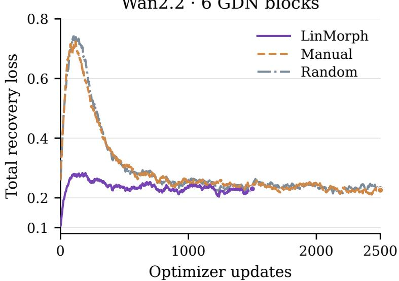  
Figure 6. Wan2.2 recovery with six GDN blocks. Total training recovery loss with EMA-100 smoothing. All methods use the same backbone-specific recovery objective.

Teacher-forced evaluation measures individual replacements using the corresponding teacher hidden states as input. Depth-rollout evaluation instead propagates student hidden states through a complete DiT forward pass and measures both replaced-block outputs and the final velocity prediction.

Initialization and recovery-schedule ablations use a fixed 64-video HQ subset at $8 1 \times 4 8 0 \times 8 3 2$ and difusion timesteps {100, 300, 500, 700, 900}. The 64-video evaluation subset uses indices 8192–8255. Within each ablation suite, record keys comprising video index, timestep, block index, and evaluation scope match across candidates. For K replaced blocks, attention and depthrollout block metrics each average $6 4 \times 5 \times K$ records; final output metrics average $6 4 \times 5 = 3 2 0$ records. These are single-forward comparisons at sampled noise levels, not difusion-trajectory or generated-video measurements.

Mapper fitting uses a configured training prefix of 8,192 videos. The fixed evaluation indices lie outside that prefix, but the loader’s decode-failure resampling may draw outside it, and exclusion from subsequent Wan2.1 recovery data is not enforced. Wan2.2 recovery uses OpenVid and evaluation uses HQ videos; cross-manifest source-video deduplication has not been performed. We accordingly describe these as fixed-subset functional comparisons.

Each configuration uses one training run. Mapper-intervention intervals are obtained by averaging paired diferences over timesteps and layers within each of eight videos, then bootstrapping video clusters 10,000 times. The statistic is the ratio of mean intervention NMSE to mean unmodified NMSE, minus one. Intervals describe video-sample variation for a fixed trained mapper.

## C.3 Progressive Recovery: Complete Prediction Diagnostics

The measurements in Table 11 are taken immediately after prediction distillation, before teacherfree joint fine-tuning. Progressive conversion improves block alignment, while the one-shot model has lower final-output NMSE at this stage. Final joint fine-tuning optimizes the entire DiT under the flow-matching objective so that intermediate representations and the denoising output can adapt together. The schedule comparison here covers the distillation stage; a matched post-fine-tuning schedule comparison is not included.

Table 11. Complete diagnostics before final joint fine-tuning. Both 21-GDN models use 4,500 distillation updates. Block metrics measure depth-rollout outputs at replaced layers; output metrics measure the final DiT velocity prediction on the same fixed evaluation inputs.
<table><tr><td>Schedule</td><td>Block NMSE↓</td><td>Block Cos. ↑</td><td>Output NMSE↓</td><td>Output Cos. ↑</td></tr><tr><td>One-shot</td><td>0.18406</td><td>0.90358</td><td>0.03415</td><td>0.98260</td></tr><tr><td>Progressive</td><td>0.17931</td><td>0.90728</td><td>0.03868</td><td>0.98026</td></tr><tr><td></td><td></td><td></td><td></td><td></td></tr></table>

Table 12. Teacher-forced attention diagnostics for initialization. Rows shared with Table 2 use the same checkpoints. An additional 1,500-update LinMorph checkpoint is included for Wan2.2. A norm ratio close to zero indicates an attenuated student attention output; low NMSE alone need not imply good directional agreement.
<table><tr><td>Backbone</td><td>Initialization</td><td>Updates</td><td>Attn. NMSE ↓</td><td>Attn. Cos. ↑</td><td>Norm ratio</td></tr><tr><td>Wan2.1</td><td>LinMorph</td><td>1500</td><td>0.43849</td><td>0.75766</td><td>0.86764</td></tr><tr><td>Wan2.1</td><td>Manual</td><td>1500</td><td>1.02142</td><td>0.26047</td><td>0.36950</td></tr><tr><td>Wan2.1</td><td>Random</td><td>1500</td><td>1.10699</td><td>0.08895</td><td>0.26422</td></tr><tr><td>Wan2.1</td><td>Random</td><td>3000</td><td>1.09900</td><td>0.15997</td><td>0.39579</td></tr><tr><td>Wan2.2</td><td>LinMorph</td><td>1250</td><td>0.96955</td><td>0.48265</td><td>0.92147</td></tr><tr><td>Wan2.2</td><td>LinMorph</td><td>1500</td><td>1.00650</td><td>0.47709</td><td>0.94721</td></tr><tr><td>Wan2.2</td><td>Manual</td><td>1250</td><td>0.94925</td><td>0.25321</td><td>0.28571</td></tr><tr><td>Wan2.2</td><td>Manual</td><td>2500</td><td>0.95883</td><td>0.31231</td><td>0.44852</td></tr><tr><td>Wan2.2</td><td>Random</td><td>1250</td><td>1.03219</td><td>0.06895</td><td>0.22032</td></tr><tr><td>Wan2.2</td><td>Random</td><td>2500</td><td>1.11141</td><td>0.13078</td><td>0.39946</td></tr></table>

## C.4 Additional Functional Diagnostics

Independent training runs and hardware platforms. The pre-recovery initialization results in Table 1 and the transformation-design ablation in Section 4.6 come from two independently executed training and evaluation runs. The former uses NVIDIA A800 GPUs, whereas the latter uses MetaX GPUs. Both runs follow the same training and evaluation recipe for the corresponding configurations, but their mapper parameters are fitted separately. Accordingly, matching configuration names across these experiments refer to the same method specification, not to an identical trained checkpoint. Each table reports measurements from its own run rather than an average across hardware platforms.

Pre-recovery fidelity protocol. Table 1 evaluates 64 QWorld videos from the HQ evaluation data at $1 7 \times 2 5 6 \times 4 4 8$ , using five difusion timesteps and all 30 source blocks. Random initialization, manual copying, the base morphism, and the residual-refined morphism receive identical cached video frames, text conditions, and noise seeds. All measurements are obtained before downstream recovery.

Table 12 reports teacher-forced attention metrics omitted from the main initialization table. They need not rank models identically to depth-rollout or final-output metrics. For example, Wan2.2 manual initialization at 1,250 updates obtains slightly lower attention NMSE than LinMorph, but has much lower cosine similarity and output norm ratio. An attenuated prediction can reduce squared error without reproducing the teacher’s direction. This motivates reporting cosine similarity alongside NMSE and evaluating the composed model.

Table 13. Reuse across video shapes without mapper refitting. Both variants are fitted at $1 7 \times 2 5 6 \times 4 4 8 ;$ each is then evaluated at both sizes. Each row averages 9,600 teacher-forced local comparisons (64 videos, five timesteps, 30 blocks). Residual denotes the separately fitted native-shape correction, not post-transfer optimization.
<table><tr><td></td><td>Mapper</td><td>Attention NMSE↓</td><td>Attention Cos. ↑</td><td>Block NMSE↓</td><td>Block Cos. ↑</td></tr><tr><td>Evaluation size</td><td></td><td>0.29951</td><td>0.83543</td><td>0.01242</td><td>0.99379</td></tr><tr><td> $1 7 \times 2 5 6 \times 4 4 8$   $1 7 \times 2 5 6 \times 4 4 8$ </td><td>Base Base + residual</td><td>0.27237</td><td>0.85161</td><td>0.01121</td><td>0.99439</td></tr><tr><td> $8 1 \times 4 8 0 \times 8 3 2$ </td><td>Base</td><td>0.34784</td><td>0.80592</td><td>0.01549</td><td>0.99231</td></tr><tr><td> $8 1 \times 4 8 0 \times 8 3 2$ </td><td> $\mathrm { B a s e } + \mathrm { r e s i d u a l }$ </td><td>0.32078</td><td>0.82269</td><td>0.01418</td><td>0.99296</td></tr><tr><td></td><td></td><td></td><td></td><td></td><td></td></tr></table>

Degenerate fixed-copy sanity check. The zero-recovery mapping-analysis baseline initializes unmatched output gate parameters to zero. Its attention output is zero (NMSE one and cosine zero), while the surrounding block retains its residual stream. Removing all unmatched routes from the fitted mapper also produces zero attention output. We therefore use route removal and source permutation with the other learned components retained to test the fitted mapper’s source assignments in Section 3.1. Coeficient magnitudes visualize the mixing rule, whereas these interventions test its functional efect.

## C.4.1 Cross-Scale Reuse of the Morphism

Because the morphism operates on model weights rather than video tokens, its parameterization does not depend on video length or spatial resolution at a fixed architecture. This allows the same fitted morphism to be reused at larger video scales.

The cross-scale results in Table 13 use the original OpenVid evaluation subset, whereas Table 1 reports the QWorld evaluation. The small-scale measurements in these two tables therefore refer to diferent evaluation inputs.

Both the base and residual-refined mappers are fitted at $1 7 \times 2 5 6 \times 4 4 8$ and evaluated at this scale and at $8 1 \times 4 8 0 \times 8 3 2 .$ , without further optimization. The evaluations use the same 64 video indices, five timesteps, and 30 source blocks, yielding 9,600 teacher-forced local comparisons per setting. Each replacement receives the teacher’s incoming hidden state, so these measurements isolate local functional alignment.

Table 13 shows that residual refinement improves both attention- and block-level alignment at both scales. At the fitting scale, it reduces block NMSE from 0.01242 to 0.01121. At the larger scale, it reduces block NMSE from 0.01549 to 0.01418 and increases block cosine similarity from 0.99231 to 0.99296. The corresponding attention NMSE decreases from 0.34784 to 0.32078. These improvements are obtained by reusing the same fitted transformation and correction, rather than optimizing them again at the larger scale.

Figure 7 complements the aggregate results with block-NMSE profiles across all 30 layers. Together, the table and layerwise profiles characterize how the learned initialization transfers across video scales.

Mapping cost. The successful low-resolution FullMix base and residual runs each use 4,096 updates on four A800-80GB GPUs, batch one per device and no gradient accumulation. Successful launcher-to-shutdown logs imply approximately 5.87 elapsed hours, or 23.48 GPU-hours, for

$$
\mathrm { \_ { \mathrm { ~ \cdots ~ } } \mathrm { \textmu ~ F u l l M i x ~ b a s e } \mathrm { \quad } \mathrm { \_ { \mathrm { ~  ~ } } \mathrm { \textmu ~ F u l l M i x + n a t i v e { \mathrm { - } } s h a p e ~ c o r r e c t i o n } } }
$$

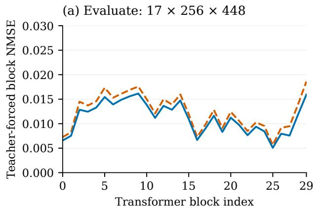

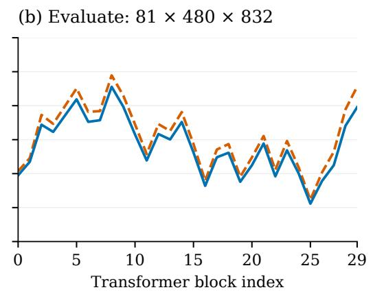  
Figure 7. Layerwise local alignment across video sizes. The same low-resolution-trained base and residual-refined mappers are evaluated at two video sizes. Block indices are zero-based; all 30 source layers participated in mapper fitting. Lines connect measured layers and are not uncertainty estimates.

Table 14. Cross-layer sharing and generalization. Block NMSE and cosine are averaged over five evenly spaced evaluation blocks (0, 6, 12, 18, and 24). For the one-layer setting, five separate mappers are each trained on one corresponding block; for the six-layer setting, five separate mappers are trained on consecutive groups [0, 5], [6, 11], [12, 17], [18, 23], and [24, 29]. Each mapper is evaluated at all five evaluation blocks. The table then reports the equal-weight mean across the five mappers. The 30-layer setting trains one mapper on all layers and evaluates it at the same five blocks.

<table><tr><td>Layers sharing a mapper</td><td>Block NMSE↓</td><td>Block Cos. ↑</td></tr><tr><td>1 layer (independent mappers)</td><td>0.20388</td><td>0.94327</td></tr><tr><td>6 layers (group-shared mappers)</td><td>0.20734</td><td>0.94558</td></tr><tr><td>30 layers (one shared mapper)</td><td>0.01560</td><td>0.99221</td></tr></table>

both steps together; this includes startup, I/O, and checkpointing, but excludes unsuccessful earlier attempts. The stored base and residual together contain 236.00M parameters; the two fitting steps update 84.93M and 151.07M, respectively. These shared fitting costs are reported separately from recovery-update budgets. A larger-video fitting run uses layer minibatching and activation checkpointing, so its elapsed time is not used as a matched-cost comparison. The reported recovery-update reductions do not include mapper fitting.

## C.5 Cross-Layer Sharing and Generalization

LinMorph uses a single transformation shared across participating layers, rather than fitting an independent mapper for each replacement. This design assumes that softmax-to-linear conversion contains reusable structure across depth, even though each layer provides diferent pretrained source weights. We examine this assumption by comparing mappings shared over one, six, and all 30 layers under the same data and fitting objective.

As shown in Table 14, the 30-layer shared mapper achieves substantially better average alignment than the one-layer and six-layer settings. Although both localized settings fit their corresponding blocks slightly better, their alignment degrades on held-out anchors, so the local fit gains do not persist in the cross-layer average. This pattern suggests that learning across the full depth captures more reusable structure than fitting mappers to individual layers or local groups, supporting a full-depth shared mapper as our default strategy.

## C.6 Benchmark Protocols and Reference Sources

Sampling and checkpoint consistency. The LinMorph quality evaluations generate 81 frames at 480 × 832 and 16 fps, using the oficial Wan UniPC sampling configuration with 50 steps, CFG six, and flow shift eight. Both benchmarks use microstep 8,000 for the 14-GDN model and microstep 40,000 for the 21-GDN model, corresponding to 4,000 and 20,000 final-recovery optimizer updates, respectively.

VBench contains 944 unique prompts with five samples per prompt, for 4,720 staged videos, and uses the prescribed temporal-flickering filter. The 14-GDN run completes all 16 dimensions with no missing videos. VBench-2.0 uses oficial Wan-augmented prompts checked against original metadata, three samples per ordinary prompt and twenty for diversity, for 3,860 videos per model. Both configurations complete all 18 dimensions without recorded evaluation errors. Table 3 reports the respective full-suite aggregates; the eight-dimension panel is not used to reconstruct a VBench total.

Prompt correction for the starred 21-GDN total. For temporal flickering, 73 prompts retain the original Wan-enhanced filtered videos. The phone-booth and Petra prompts instead use the oficial original positive prompts, with independently generated candidates and the unchanged oficial RAFT acceptance procedure. The resulting aggregate is recorded as a generation-variant result and marked with ∗ in Table 3. The eight dimensions in Table 4 exclude temporal flickering and are unafected by this correction. The 14-GDN evaluation uses the standard prompt policy.

Aggregate reference sources. The source-backbone and eficient-inference reference scores come from Table 3 of Korzhenkov et al. [30], including the two- and one-step Wan-Adv/Wan-DMD configurations and the selected PyramidalWan-DMD-PT⋆ model with a 2–2–1 sampling schedule. These recent Wan-based methods provide context for alternative routes to eficient generation. Their sampling schedules difer from our 50-step attention-converted models, as indicated in the table.

CogVideoX-2B, VideoREPA-2B, and MoAlign-2B use the jointly reported VBench and VBench-2.0 evaluations in Table 3 of Bhowmik et al. [31]; VideoREPA is their reimplementation. All published scores retain their reported precision. The table presents selected reference systems rather than a matched-training- or matched-inference-budget comparison.

LinVideo comparison. The dimension-wise reference is the LinVideo row in the Wan2.1-1.3B section of Table 1 of Huang et al. [10], corresponding to 16 converted attention blocks. We include all eight reported dimensions: imaging and aesthetic quality, motion smoothness and dynamic degree, background and subject consistency, scene, and overall consistency. Both systems use Wan2.1-1.3B and 480p video at 16 fps. LinVideo reports unaugmented prompts and CFG five, whereas LinMorph uses Wan-enhanced prompts and CFG six. The comparison describes the evaluated generation systems; the controlled ablation in Section 4.2 separately tests initialization.

Reference provenance. Table 3 consolidates full-suite VBench and VBench-2.0 scores reported across several recent works. Because these systems difer in model size, training data, sampling schedule, and inference budget, the table is intended to provide broad generation-quality context rather than a strictly matched comparison.

Table 15. Full-generation latency and peak allocated memory. All runs use 480 × 832, batch one, BF16, 50 denoising steps, and CFG six. Each latency is one timed generation after one excluded first generation. Memory is PyTorch peak allocated memory in GiB, not total board memory.
<table><tr><td>Frames</td><td>Wan (s)</td><td>21 GDN (s)</td><td>Speedup</td><td>Wan (GiB)</td><td>21 GDN (GiB)</td></tr><tr><td>81</td><td>166.9</td><td>213.2</td><td>0.78×</td><td>15.50</td><td>28.40</td></tr><tr><td>241</td><td>959.0</td><td>753.7</td><td>1.27×</td><td>18.42</td><td>44.61</td></tr><tr><td>321</td><td>1604.7</td><td>1094.0</td><td>1.47×</td><td>19.87</td><td>52.72</td></tr></table>

Superscript a denotes scores taken from Table 3 of Korzhenkov et al. [30]. This source provides the reported results for Wan2.1-1.3B, Wan-Adv, Wan-DMD, and PyramidalWan-DMD-PT. We retain the sampling configurations associated with the reported scores, including the published PyramidalWan-DMD-PT⋆ variant with a 2–2–1 sampling schedule.

Superscript b denotes scores reported in Table 3 of Bhowmik et al. [31]. These include CogVideoX-2B, MoAlign-2B, and the VideoREPA-2B result reproduced in that work.

Superscript c denotes benchmark scores reported or collected by Ghafoorian et al. [9] under the evaluation protocol used in that work. In Table 3, this source is used for CogVideoX-1.5- 5B, Open-Sora V1.2, LTX-Video, SnapGen-V, and M4V. For original method descriptions, see VideoCrafter2 [32], Open-Sora [33], LTX-Video [34], SnapGen-V [35], and M4V [36]. The superscripts in Table 3 identify the sources of the benchmark scores, rather than the original method papers.

Superscript d denotes the VideoCrafter2 VBench score from the oficial VBench leaderboard [17]; no comparable full-suite VBench-2.0 score is available in the sources used here.

Superscript e identifies results sourced from the corresponding method papers. The HLA-3F-R1-10 result is from Ackermann et al. [37]. For Attention Surgery, we use the published CVPR version of Ghafoorian et al. [9]. The 15 × R2 VBench and VBench-2.0 scores are taken from its Tables 1 and 4, respectively. The 20 × R4 VBench score marked with † is approximately read from the 480 × 832 panel of its Figure 5 and reported to one decimal place. HLA uses Hadamard linear attention, M4V uses a Mamba/SSM backbone, and Attention Surgery uses hybrid linear–softmax attention. These methods provide related linear-attention, state-space, and hybrid video-generation references.

Finally, all LinMorph scores are obtained from our own evaluation. The ∗ marker on LinMorph-21 denotes the temporal-flickering prompt correction described above; it is unrelated to the ⋆ used in the published PyramidalWan-DMD-PT model name.

## C.7 Runtime Measurement Details

Implementation and scopes. Each measurement uses one NVIDIA A800-SXM4-80GB, BF16, and batch size one. The environment uses PyTorch 2.6.0 with CUDA 12.6, Triton 3.2.0, FlashAttention 2.6.3, and FLA 0.3.2; TF32 is disabled. The attention-module benchmark measures the trained layer-zero module, including projections, gates, convolutions, recurrence, normalization, and input/output bridges, on identical seeded synthetic hidden states. It is not a recurrence-kernelonly measurement. The backbone benchmark measures one denoiser forward on synthetic latents and conditioning, excluding text encoding and VAE decoding; each timed call contains one conditioning branch, not a full CFG sampling step. Full-generation timing includes text encoding, all denoising steps, tiled VAE decoding, and conversion to PIL frames, but excludes model loading and MP4 encoding. It uses one fixed prompt and seed 42, with 50 steps, CFG six, and separate conditional/unconditional forwards.

Repetitions and aggregation. Module and backbone runs exclude an initial first call, perform five additional warmup calls, then time twenty calls per model in each of three paired rounds. Baseline and student are paired on the same physical GPU. Each round forms the ratio of median baseline to median student latency; the plotted point is the median of these three ratios and the band is their interquartile range. Full-generation runs exclude an initial complete generation and time one further generation per shape and model. These full-generation points have one timed sample each. Peak allocated memory includes resident model and input allocations; it is not incremental attention workspace or total GPU-board memory.

Resource accounting and runtime configuration. Empty-card utilization/memory checks and memory-ledger guards passed. Host/container PID-namespace mapping did not establish exclusive ownership. All reported results use the original FLA implementation. The 21-GDN denoiser contains 4,594,869,808 parameters; the pretrained baseline contains 1,418,996,800. At 321 frames, peak allocated full-generation memory is 52.72 and 19.87 GiB, respectively. The latency comparison measures attention replacement, while mapped initialization controls the training starting point. At short sequences, projection and recurrent overhead can dominate; the table and scaling figure include these points as well as longer videos. The nine retained softmax blocks preserve a quadratic component in the hybrid’s total computation. Generation-quality measurements use 81 frames; longer inputs are used for the runtime scaling study.

## C.8 Qualitative Comparisons

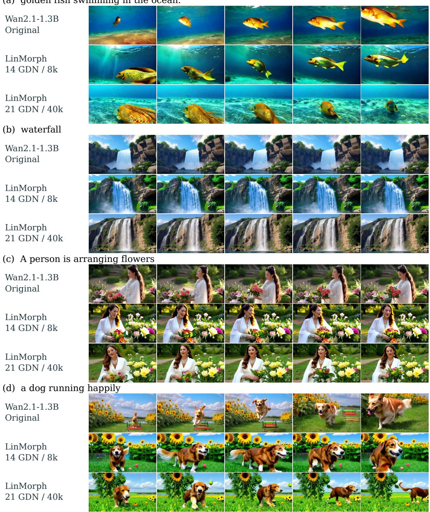  
Figure 8. Qualitative comparison on four selected prompts. Rows within each group show Wan2.1-1.3B, LinMorph-14, and LinMorph-21 using identical enhanced prompts, seeds, and sampling settings. Columns show matched timestamps; 8k and 40k denote fine-tuning microsteps.