# LoopWAM: Closed-Loop Generalist Policy Improvement from Deployment Rollouts

Wenxuan Guo1,2,3,\* Yingping Liang2,\* Zhaoguo Wang1,\* Ziyuan Li1 Angyuan Ma1

Zhenyu Wu3 Chengkun Wang3 Bingyao Yu1 Ze Chen2 Borui Zhang1,3

Xiuwei Xu3,† Meng Zhang2,† Erjin Zhou2 Jiwen Lu1,†

1Tsinghua University 2Dexmal 3Loopeva

\* Core Contributors † Corresponding Authors

## Abstract

Scaling expert demonstrations alone does not enable generalist robot policies to improve from deployment. Real-world rollouts contain successes, suboptimal behavior, and failures: imitating every recorded action can reinforce poor behavior, while filtering out failures discards evidence of physical interactions and their consequences. We introduce LoopWAM, a closed-loop world-action model that learns directly from this full quality spectrum, using rollouts from both itself and other deployed policies. Source-dependent noise sampling unifies behavior learning and action-conditioned world modeling, while quality steering and quality-weighted supervision retain full video supervision across qualities and regulate action imitation. Video and action tokens interact throughout parallel denoising, allowing learned consequences to inform action generation directly. On RoboChallenge Table30-V2, three deployment-and-training rounds raise success from 23.67% to 43.33%, a 19.7- percentage-point gain, with a final score of 56.80. LoopWAM also achieves 94.5% average success on RoboTwin 2.0 and 49.5% overall success on RoboCasa365 without additional embodied pretraining, obtaining the best overall results among the compared methods across all three benchmarks. On challenging shirt folding task, two rounds of deployment-driven improvement after single-task post-training raise success from 13.20% to 55.56%. These results demonstrate closed-loop improvement from mixed-quality experience under both multi-task learning and single-task post-training. Project Page

## 1. Introduction

Scaling human-collected robot data has expanded the capabilities of generalist manipulation policies (O’Neill et al., 2024), but demonstration scaling alone does not close the loop between deployment and continual improvement. Deployment exposes states, interactions, and failure modes beyond curated demonstrations, providing new experience for an embodied data flywheel. Real-world reinforcement learning (RL) (Xu et al., 2026) can improve policy performance during deployment, but may narrow the model’s predictive distribution and often struggles to learn multi-task generalist policies. Although distilling a generalist policy from multiple RL specialists (Xiao et al., 2025) can address this issue, the generalist’s supervision comes from curated successful rollouts rather than the full interaction history. Therefore, we aim to study direct generalist improvement from the full mixture of successful, suboptimal, and failed deployment rollouts. The challenge is to use this experience productively: imitating every recorded action risks absorbing undesirable behavior, while retaining only high-quality trajectories discards informative interactions and their outcomes.

Recent VLA and world-action models address important pieces of this problem. On the VLA side, $\pi _ { 0 . 6 }$ (Physical Intelligence, 2025) uses advantage-conditioned learning to incorporate autonomous experience and interventions, while $\pi _ { 0 . 7 }$ (Physical Intelligence, 2026) uses quality, speed, and mistake metadata to absorb mixed-quality data and distill specialist capabilities into a generalist. These VLA methods use steering during training to model behavior distributions across data qualities and specify a desirable mode at inference for smooth execution, but rely on VLM-based language–vision–action representations without an explicit objective for learning the physical dynamics reflected in action– video transitions. Consequently, suboptimal and failed rollouts provide behavior targets but do not directly supervise learning of their physical consequences. World modeling ofers a more elegant solution: WAMs (Li et al., 2026; Pai et al., 2025; Ye et al., 2026b) couple predictive visual representations with action generation, while action-conditioned world models (ACWMs) (Gao et al., 2026; Guo et al., 2025) predict future observations conditioned on actions. Combining the two allows ACWM to learn action consequences from data of diferent qualities, while WAM learns appropriate actions from expert demonstrations. $\tau _ { 0 } { - } \mathsf { W } \mathsf { M }$ (Zhou et al., 2026) trains separate WAM and ACWM, routing failure and recovery data to ACWM training and use ACWM as selector for policy improvement. FACT (Peng et al., 2026) implements the two roles within a shared model, but retains sequential action–consequence generation. It only supports success/failure supervision split, with failure consequences influencing the policy implicitly through shared representations. These approaches expose a remaining design challenge in learning from mixed-quality deployment experience: VLA steering lacks natural action–video dependency modeling, while consequence-aware WAMs still exploit rollout data indirectly through an ACWM interface—a simulator for action selection or a subsequent consequence-prediction stage that influences the policy through shared representations. Can a single WAM directly learn from mixed-quality deployment rollouts, with all qualities supervising the model and learned consequences participating directly in action generation?

We introduce LoopWAM, a closed-loop World-Action Model that updates a generalist directly from mixed-quality deployment rollouts. Our core idea is to let one WAM directly absorb rollouts across the full quality spectrum and learn from each. To achieve this, we first use source-dependent noise sampling to unify WAM behavior learning and ACWM consequence learning within a single model and generation stage. Video and action noise levels are sampled independently, allowing low-noise rollout actions to guide prediction of their observed consequences. Within this unified model, quality steering represents behaviors of diferent qualities and selects the highest-quality condition at deployment. To control how strongly each behavior is imitated, we further apply quality-weighted supervision, reducing imitation of suboptimal actions and masking failed-action targets while retaining video supervision across all qualities. Together, these mechanisms let every trajectory supervise the joint model according to its behavioral quality and observed transitions. Video and action tokens interact bidirectionally throughout one parallel denoising process, allowing learned future representations to participate in action formation without a separate consequence-evaluation stage. We close the loop by repeatedly collecting rollouts and retraining the generalist on demonstrations and accumulated experience before redeployment. On RoboChallenge Table30-V2 (RoboChallenge Dexmal Team, 2026), three rounds raise overall success from 23.67% to 28.00%, 37.67%, and 43.33%, a 19.7-percentage-point improvement, with a final score of 56.80, ranking first in both success and score among the compared entries (Table 1). LoopWAM achieves 94.5% average success on RoboTwin 2.0 (Chen et al., 2025), exceeding the reported 87.5% of FACT and 93.6% of LingBot-VA 2.0, and 49.5% on the 50-task RoboCasa365 evaluation (Nasiriany et al., 2026), above ABot-M0.6’s 46.6% (Tables 2–3). We further evaluate deploymentdriven self-improvement after single-task post-training on challenging shirt folding, which involves deformable objects and multiple coordinated steps. Two deployment-and-training rounds raise success from 13.20% to 55.56% (Section 4.4). These results establish that directly learning from mixed-quality rollouts with parallel world–action denoising can deliver leading benchmark performance and repeated deployment improvement in both multi-task and single-task settings.

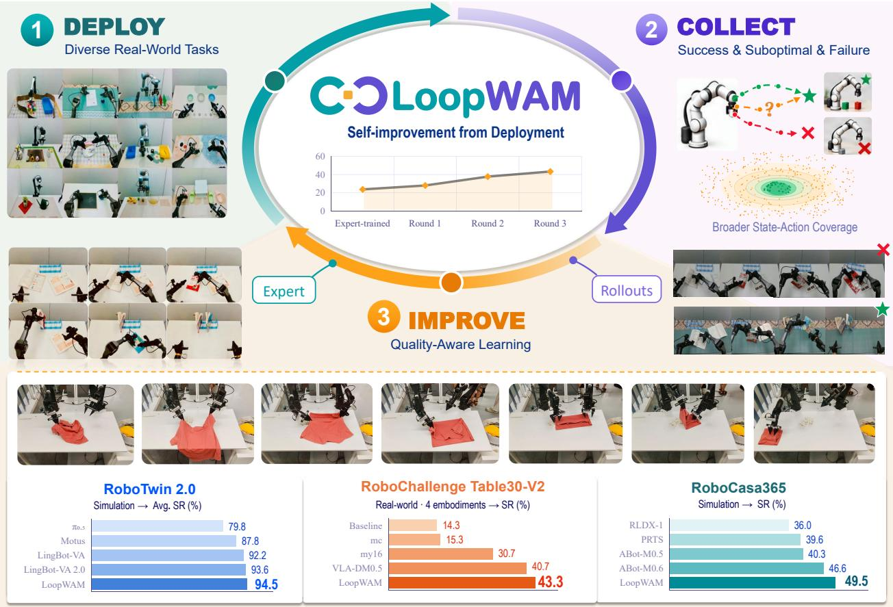  
Figure 1: LoopWAM learns from deployment. Mixed-quality rollouts return to training through quality steering, source-dependent noise sampling, and quality-weighted supervision. Center: closed-loop self-improvement on RoboChallenge Table30-V2, where three rounds of deployment and retraining increase overall success from 23.67% to 43.33%. Bottom: benchmark comparisons.

## 2. Related Work

Robot Manipulation Policies. Robot manipulation policies increasingly combine scalable imitation learning with pretrained representations. ACT (Zhao et al., 2023) and Difusion Policy (Chi et al., 2025) learn action sequences from demonstrations, while RT-2 (Zitkovich et al., 2023) and OpenVLA (Kim et al., 2024) transfer vision-language priors to language-conditioned control. Flow-based policies such as $\pi _ { 0 }$ (Black et al., 2024) and $\pi _ { 0 . 5 }$ (Physical Intelligence et al., 2025) further scale continuous action generation and generalization. Open X-Embodiment (O’Neill et al., 2024) and DROID (Khazatsky et al., 2024) expand training coverage across embodiments and environments. Beyond ofline demonstrations, DAgger (Ross et al., 2011) addresses policy-induced distribution shift by collecting expert labels on visited states. LoopWAM studies learning from the recorded observations and actions of deployment rollouts, using trajectory quality to guide policy updates while retaining world supervision from unsuccessful interactions.

World Action Models. Video-based robot policies use predictive visual representations to support control. mimic-video (Pai et al., 2025) conditions an action decoder on representations from a pretrained video model. DreamZero (Ye et al., 2026b) jointly generates video and actions, while LingBot-VA (Li et al., 2026) organizes visual prediction and action decoding within a causal autoregressive framework. LingBot-VA 2.0 (Zhang et al., 2026a) further develops native video-action pretraining with a controloriented tokenizer. Eficiency-oriented designs include Fast-WAM (Yuan et al., 2026), which retains video co-training but removes future-video generation at inference, and GigaWorld-Policy (Ye et al., 2026a), which learns action-conditioned visual dynamics while allowing action-only inference. Being-H0.7 (Luo et al., 2026) instead uses future observations to supervise latent representations. These studies establish several ways for predictive supervision to support action learning. LoopWAM focuses on closing the deployment–training loop: mixed-quality rollouts broaden world-model training, while joint video–action modeling, quality steering, and weighted action supervision connect consequence awareness with high-quality behavior.

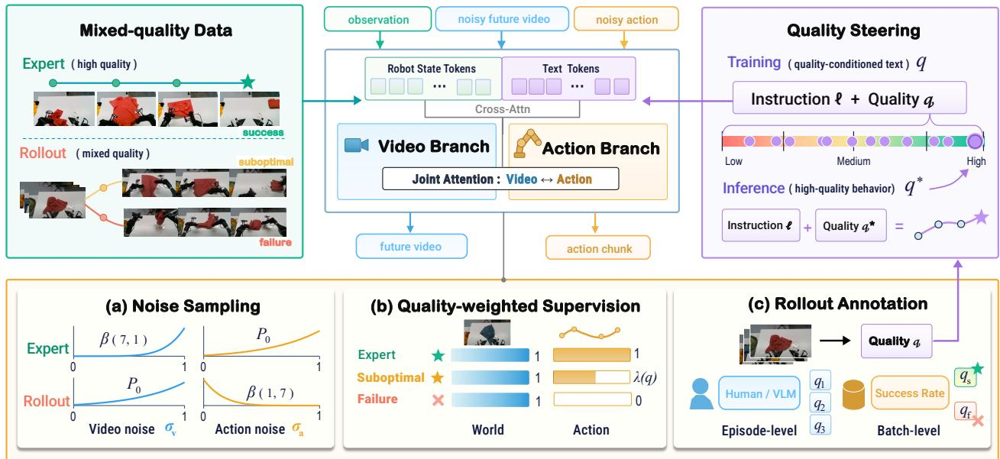  
Figure 2: Overview of LoopWAM. LoopWAM is structured as a Mixture-of-Transformer (MoT) architecture, where bidirectional attention enables feature interaction between the video and action branches. Training combines quality-conditioned instructions, source-dependent noise sampling, and qualityweighted action supervision. Expert trajectories supervise both modalities, while lower-quality rollouts retain full world supervision and contribute to action imitation according to their quality. The trained model is deployed using the expert score $q ^ { \star }$ , and recorded experience returns to the next training round.

## 3. Method

LoopWAM learns a world–action model that can be updated with experience collected during deployment. The framework couples video and action generation within a shared denoising process, then uses trajectory quality to distinguish how deployment data supervise world modeling and control. Figure 2 summarizes the architecture and training procedure. We first introduce joint world–action modeling, followed by quality-aware learning from mixed trajectories and the deployment–learning loop.

## 3.1. Joint World–Action Modeling

We consider language-conditioned manipulation with visual observation $o _ { t } ,$ , robot state $s _ { t } ,$ , and instruction ℓ. The prediction targets are an action chunk $A _ { t } = \left( a _ { t } , \ldots , a _ { t + H - 1 } \right)$ and the corresponding future observations $V _ { t } ,$ sampled over the same horizon. A pretrained video VAE maps $( o _ { t } , V _ { t } )$ to an observation latent $z _ { o }$ and future latents $Z _ { t }$ . LoopWAM models their joint distribution

$$
p _ { \theta } ( A _ { t } , Z _ { t } \mid o _ { t } , s _ { t } , \ell , q ) ,\tag{1}
$$

where $q$ is a numerical score of trajectory quality, as detailed in Section 3.2. This unified formulation enables a single model to learn action generation and visual dynamics from paired action–observation

sequences (Zhu et al., 2025).

We instantiate this formulation with a dual-stream difusion transformer whose video backbone is initialized from Wan2.2-TI2V-5B (Wan et al., 2025). The video and action streams have separate token projections, transformer parameters, and prediction heads, with joint attention connecting the streams at every layer. To train them with flow matching (Lipman et al., 2023), we independently perturb each target $X _ { m } ,$ , where $X _ { v } = Z _ { t }$ and $X _ { a } = A _ { t } \mathrm { . }$

$$
X _ { m } ^ { \sigma _ { m } } = ( 1 - \sigma _ { m } ) X _ { m } + \sigma _ { m } \epsilon _ { m } , \qquad \epsilon _ { m } \sim \mathcal { N } ( 0 , I ) , \quad m \in \{ v , a \} .\tag{2}
$$

The joint network predicts velocity fields $( v _ { \theta } ^ { v } , v _ { \theta } ^ { a } )$ with targets $u _ { m } = \epsilon _ { m } - X _ { m }$ . Each stream receives noise level $\sigma _ { m }$ , with 0 denoting clean data and 1 pure noise; the observation latent $z _ { o }$ remains clean.

The attention structure couples the two predictions throughout denoising. Denote observation, futurevideo, and action tokens by $O , V ,$ and A, respectively. Their block mask, with queries indexing rows and keys indexing columns, is

$$
M _ { ( O , V , A ) } = \left( \begin{array} { l l l } { { 1 } } & { { 0 } } & { { 0 } } \\ { { 1 } } & { { 1 } } & { { 1 } } \\ { { 1 } } & { { 1 } } & { { 1 } } \end{array} \right) , \nonumber\tag{3}
$$

where 1 permits attention. Observation tokens attend only within the initial frame. Both streams cross-attend to the quality-conditioned instruction; robot-state tokens additionally condition the action stream. Together with the training scheme in Section 3.2, this architecture supports learning both embodied world representations and awareness of action consequences. Dense video supervision on expert and mixed-quality rollouts broadens the interactions from which these representations are learned. Through bidirectional attention, the world-prediction loss also trains features used for action generation. This training couples learning how tasks can be completed with learning how particular actions afect their outcomes, encouraging consistency between video and action generation.

## 3.2. Quality-Aware Learning from Mixed Trajectories

Our training corpus combines expert demonstrations $\mathcal { D } _ { E }$ with rollout data $\mathcal { D } _ { R }$ of arbitrary quality, including successful, suboptimal, and failed executions. These rollouts substantially broaden the state– action–outcome distribution beyond expert paths, providing world-model supervision even when their actions are undesirable imitation targets. Each trajectory is assigned a source indicator $d \in \{ E , R \}$ every training segment extracted from that trajectory uses the same indicator. We combine sourcedependent noise sampling, quality conditioning, and selective action supervision to learn from this broader experience while favoring high-quality behavior.

Source-dependent noise sampling. Jointly predicting video and actions in a WAM does not by itself ensure that the predicted futures reflect the consequences of the generated actions. To improve consistency between video and action generation and make world predictions more useful for control, we aim to strengthen action-conditioned world modeling (ACWM) within the same unified model. We therefore use source-dependent noise sampling to make recorded rollout actions accessible when predicting their observed consequences, while retaining joint video–action generation in a single training stage. Specifically, we select diferent noise distributions for expert and rollout segments, while drawing video and action noise levels independently within each segment:

$$
\begin{array} { l l } { { d = E : } } & { { \sigma _ { v } \sim \mathrm { B e t a } ( 7 , 1 ) , } } & { { \sigma _ { a } \sim \mathcal { P } _ { 0 } , } } \\ { { \ } } & { { d = R : } } & { { \sigma _ { v } \sim \mathcal { P } _ { 0 } , } } \\ { { \ } } & { { \sigma _ { a } \sim \mathrm { B e t a } ( 1 , 7 ) . } } \end{array}\tag{4}
$$

Here $\mathcal { P } _ { 0 }$ is the base noise distribution obtained by sampling $u \ \sim \ \mathcal { U } ( 0 , 1 )$ and setting $\sigma ~ = ~ \phi _ { \kappa } ( u ) ~ =$ $\kappa u / [ 1 + ( \kappa - 1 ) u ]$ , with $\kappa = 5$ . The Beta distributions (Johnson et al., 1995) are applied directly to σ. For expert data, high video noise emphasizes recovering expert futures from strongly corrupted inputs, alongside action generation over the base noise distribution. For rollouts, low action noise preserves much of the recorded motion while the video stream predicts its visual consequences. Training across these executions broadens the action–outcome distribution seen by the world model, including transitions in which the task remains incomplete or an interaction fails. Joint attention then connects this consequence-learning signal to the representations used for action generation.

Quality steering. Within this unified training scheme, each trajectory is assigned a numerical quality score q, which is shared by all training segments extracted from it. We encode quality as a sufix to the instruction, $\ell _ { q } = [ \ell ; 0 \mathrm { u a l i t y } \colon q ]$ , and use its text embeddings to condition both video and action streams. We support two trajectory annotation schemes: (1) Episode-level annotation, where human annotators or a vision-language model (VLM) score each trajectory individually for fine-grained quality estimation; and (2) coarse-level annotation, where a single human-provided score is assigned to all rollouts from a policy checkpoint based on its overall success rate and motion smoothness. Under coarse annotation, successful trajectories receive the checkpoint score while failed trajectories receive the minimum score, requiring only one annotation per checkpoint. Both schemes represent rollout quality using numerical scores. For expert demonstrations, we assign an expert score $q ^ { \star }$ that is higher than the maximum rollout quality score. The quality-conditioned instruction allows diferent behaviors under the same task instruction to be represented within one model. During deployment, we condition on $q = q ^ { \star }$ to steer sampling toward expert-quality behavior.

Quality-weighted supervision. Given these noise levels and quality scores, we retain video prediction on all trajectory qualities and modulate action supervision with a nondecreasing weight $\lambda ( q ) \in [ 0 , 1 ]$ Expert trajectories receive full action supervision with $\lambda ( q ^ { \star } ) = 1$ , while failed trajectories use $\lambda ( q ) = 0$ and receive no action supervision. For sample i and modality m, define the denoising loss

$$
\ell _ { m , i } = \omega ( \sigma _ { m , i } ) \left. v _ { \theta , i } ^ { m } - ( \epsilon _ { m , i } - X _ { m , i } ) \right. _ { \mathrm { v a l i d } } ^ { 2 } ,\tag{5}
$$

where the norm denotes mean squared error over valid target elements and ω is the common timestep weighting function. The clean observation latent is excluded from video supervision, and padded targets are masked in both modalities. For a minibatch of B segments, the complete objective is

$$
{ \mathcal { L } } _ { \mathrm { L o o p W A M } } = \underbrace { { \frac { 1 } { B } } \sum _ { i = 1 } ^ { B } \ell _ { v , i } } _ { \mathrm { w o r l d s u p e r v i s i o n } } + \underbrace { { \frac { \sum _ { i = 1 } ^ { B } \lambda ( q _ { i } ) \ell _ { a , i } } { \operatorname* { m a x } { \left( 1 , \sum _ { i = 1 } ^ { B } \lambda ( q _ { i } ) \right) } } } } _ { \mathrm { q u a l i t y - w e i g h t e d a c t i o n s u p e r v i s i o n } } .\tag{6}
$$

The source indicator determines corruption, whereas quality controls the behavior condition and action weight. In particular, $\lambda ( q ) = 0$ removes direct imitation of a trajectory’s actions while preserving worldmodel gradients through the jointly attended video and action representations. Quality steering and weighted supervision thus allow broader transition learning while concentrating action imitation on more desirable behavior. The data preprocessing are specified in Appendix A.

## 3.3. Closed-Loop Self-Improvement

The deployed policy uses the high-quality action marginal of the joint model:

$$
\pi _ { \boldsymbol { \theta } } ( A _ { t } \mathbin { | } o _ { t } , s _ { t } , \ell ; q ^ { \star } ) = \int p _ { \boldsymbol { \theta } } ( A _ { t } , Z _ { t } \mathbin { | } o _ { t } , s _ { t } , \ell , q ^ { \star } ) \mathrm { d } Z _ { t } .\tag{7}
$$

In practice, we sample this marginal by jointly denoising video and actions from Gaussian noise, holding the current observation latent fixed. Starting from an expert-trained model, we collect and score deployment rollouts, then update the model on expert demonstrations and all accumulated rollouts using

Equation 6. Each updated model is redeployed with the expert score $q ^ { \star }$ to continue the deployment– learning loop.

More broadly, LoopWAM’s self-improvement updates can use rollouts from arbitrary deployed policies, even poorly performing ones. The joint architecture and quality-aware objective accommodate their varying trajectory qualities, so each trajectory contributes according to its observed transitions and behavioral quality. This extends self-improvement to learning from deployment experience collected by other policies as well as LoopWAM itself. We validate this broader setting on RoboTwin 2.0 and RoboCasa365 (Section 4.3).

## 4. Experiments

## 4.1. Implementation Details

We initialize the video backbone, text encoder, and video VAE from Wan2.2-TI2V-5B (Wan et al., 2025), and use an action DiT with a hidden dimension of 1024. Each training segment pairs a 64-step action chunk with nine RGB frames sampled at intervals of eight control steps, including the initial observation. Multi-camera views are stitched into a single image, and actions and robot states are normalized using expert-data statistics. Training follows the quality-conditioned joint objective in Section 3.2, and deployment uses the expert score $q ^ { \star }$ . Table30-V2 uses relative joint targets and absolute gripper commands. Additional training, preprocessing, and subtask-segmentation details are provided in Appendix A.

## 4.2. Benchmark Experimental Setup

We evaluate LoopWAM on the real-robot benchmark RoboChallenge Table30-V2 and two simulation benchmarks, RoboTwin 2.0 and RoboCasa365. RoboChallenge evaluates closed-loop self-improvement using LoopWAM’s own real-robot deployments. The two simulation benchmarks additionally test learning from diferent deployed policies by augmenting expert demonstrations with rollouts from both expert-trained LoopWAM and others. Across these settings, successful, suboptimal, and failed rollouts expand the state–action–outcome distribution beyond expert demonstrations.

## RoboChallenge Table30-V2.

RoboChallenge Table30-V2 (RoboChallenge Dexmal Team, 2026) is a standardized real-robot benchmark comprising 30 tabletop manipulation tasks across four embodiments: ALOHA, DOS-W1, ARX5, and UR5. Its tasks test capabilities including tool use, precise manipulation, and coordinated bimanual control. We follow the oficial multi-task evaluation protocol and report overall performance across embodiments. Starting from one expert-trained multi-task LoopWAM per embodiment, we conduct three successive rounds of closed-loop self-improvement. In each deployment round, we run each model on its assigned tasks and collect about 100 rollout trajectories per task. These trajectories are quality-annotated and combined with expert demonstrations and rollout trajectories from all previous deployment rounds for further training.

## RoboTwin 2.0.

RoboTwin 2.0 (Chen et al., 2025) comprises 50 bimanual manipulation tasks evaluated in clean and domain-randomized scenes. Following the multi-task setup of LingBot-VA (Li et al., 2026), we use 2,500 expert demonstrations from clean scenes and 25,000 from heavily randomized scenes. We augment these demonstrations with rollouts generated by expert-trained LoopWAM, X-VLA (Zheng et al., 2025), and $\pi _ { 0 . 5 }$ (Physical Intelligence et al., 2025). For each task, each policy contributes 20 clean and 130 randomized rollouts, yielding 22,500 trajectories across all 50 tasks and the three policies. The combined rollout corpus has approximately the same total duration as the expert corpus. Rollout collection and evaluation use diferent random seeds to avoid data leakage. Rollout quality is annotated using the coarse-level numerical scores in Section 3.2.

Table 1: Performance on RoboChallenge Table30-V2. We report per-embodiment success rates (SR, %) and overall performance across four robot embodiments. Baselines are sorted by overall SR. Bold denotes the best performance, while blue and light blue highlight LoopWAM and the runner-up, respectively.
<table><tr><td>Method</td><td colspan="2">ALOHA</td><td colspan="2">DOS-W1</td><td colspan="2">ARX5</td><td colspan="2">UR5</td><td colspan="2">Overall</td></tr><tr><td></td><td>Score</td><td>SR</td><td>Score</td><td>SR</td><td>Score</td><td>SR</td><td>Score</td><td>SR</td><td>Score</td><td>SR</td></tr><tr><td>debuggers_vla</td><td>5.40</td><td>0.00</td><td>5.15</td><td>2.00</td><td>53.21</td><td>34.29</td><td>27.83</td><td>23.33</td><td>18.72</td><td>11.00</td></tr><tr><td>WO</td><td>12.25</td><td>2.00</td><td>4.40</td><td>0.00</td><td>48.64</td><td>30.00</td><td>49.50</td><td>43.33</td><td>21.85</td><td>12.00</td></tr><tr><td>test_01</td><td>6.25</td><td>1.00</td><td>8.95</td><td>3.00</td><td>49.50</td><td>28.57</td><td>61.17</td><td>43.33</td><td>22.73</td><td>12.33</td></tr><tr><td>holobrain</td><td>11.75</td><td>3.00</td><td>13.30</td><td>6.00</td><td>53.64</td><td>30.00</td><td>70.67</td><td>43.33</td><td>27.93</td><td>14.33</td></tr><tr><td>Baseline Model</td><td>21.55</td><td>6.00</td><td>17.35</td><td>6.00</td><td>60.14</td><td>32.86</td><td>44.83</td><td>26.67</td><td>31.48</td><td>14.33</td></tr><tr><td>MagicBot</td><td>4.70</td><td>0.00</td><td>6.85</td><td>5.00</td><td>47.57</td><td>32.86</td><td>58.67</td><td>53.33</td><td>20.82</td><td>14.67</td></tr><tr><td>mc</td><td>10.60</td><td>7.00</td><td>2.00</td><td>0.00</td><td>73.64</td><td>47.14</td><td>22.50</td><td>20.00</td><td>23.63</td><td>15.33</td></tr><tr><td>JVO</td><td>12.70</td><td>5.00</td><td>17.80</td><td>16.00</td><td>49.64</td><td>20.00</td><td>58.33</td><td>43.33</td><td>27.58</td><td>16.00</td></tr><tr><td>my16</td><td>18.95</td><td>13.00</td><td>36.60</td><td>27.00</td><td>73.29</td><td>54.29</td><td>56.50</td><td>46.67</td><td>41.27</td><td>30.67</td></tr><tr><td>VLA-DM0.5</td><td>26.50</td><td>18.00</td><td>55.45</td><td>42.00</td><td>79.07</td><td>58.57</td><td>86.50</td><td>70.00</td><td>54.42</td><td>40.67</td></tr><tr><td>LoopWAM (expert-trained)</td><td>23.05</td><td>8.00</td><td>46.35</td><td>38.00</td><td>37.00</td><td>24.29</td><td>43.33</td><td>26.67</td><td>36.10</td><td>23.67</td></tr><tr><td>LoopWAM</td><td>38.65</td><td>26.00</td><td>54.90</td><td>42.00</td><td>76.21</td><td>55.71</td><td>78.33</td><td>76.67</td><td>56.80</td><td>43.33</td></tr></table>

## RoboCasa365.

RoboCasa365 (Nasiriany et al., 2026) is a large-scale simulation framework for household manipulation in diverse kitchen environments. We evaluate on its 50-task benchmark, which includes atomic and composite manipulation tasks. Training combines expert demonstrations with rollouts generated by expert-trained LoopWAM and RLDX-1 (Kim et al., 2026), with the combined rollout duration approximately matching that of the expert data. Both expert and rollout data follow the Human300 training split: the 16 Composite-Unseen tasks are excluded from training and evaluated zero-shot. As in RoboTwin 2.0, training and evaluation data use diferent random seeds.

## 4.3. Benchmark Results

## RoboChallenge Table30-V2.

Table 1 compares expert-trained and final LoopWAM with leading entries from the oficial leaderboard (RoboChallenge, 2026). After three deployment-and-training rounds, LoopWAM attains an overall score of 56.80 and 43.33% success, exceeding VLA-DM0.5 by 2.38 score points and 2.67 percentage points in success, and ranking first on both metrics among the compared methods. Appendix B includes a leaderboard snapshot. Section 4.4 analyzes the successive deployment updates that produce this improvement over expert-only training.

## RoboTwin 2.0.

LoopWAM achieves 94.58% success in clean scenes and 94.42% under domain randomization, averaging 94.50% (Table 2). Without additional embodied pretraining, it improves over AHA-WAM by 1.70 percentage points and surpasses the pretrained LingBot-VA 2.0 by 0.90 points on average. Together, these results show that joint learning from expert demonstrations and diverse deployment rollouts yields a competitive multi-task policy under both evaluation settings.

Table 2: Performance on RoboTwin 2.0. We report success rates (SR, %) under clean and randomized evaluation settings. Embodied PT. denotes additional embodied-data pretraining before benchmark training. LoopWAM is trained with the mixed expert–rollout corpus described in Section 4.2. Blue and light blue highlight LoopWAM and the runner-up, respectively.
<table><tr><td>Method</td><td>Embodied PT.</td><td>Clean</td><td>Rand.</td><td>Average</td></tr><tr><td>π0 (Black et al., 2024)</td><td>√</td><td>65.9</td><td>58.4</td><td>62.2</td></tr><tr><td>X-VLA (Zheng et al., 2025)</td><td>√</td><td>72.9</td><td>72.8</td><td>72.9</td></tr><tr><td>π0.5 (Physical Intelligence et al., 2025)</td><td>√</td><td>82.7</td><td>76.8</td><td>79.8</td></tr><tr><td>ABot-Mo (Yang et al., 2026)</td><td>V</td><td>81.2</td><td>80.4</td><td>80.8</td></tr><tr><td>Motus (from Wan2.2) (Bi et al., 2025)</td><td>x</td><td>77.6</td><td>77.0</td><td>77.3</td></tr><tr><td>Motus (Bi et al., 2025)</td><td>√</td><td>88.7</td><td>87.0</td><td>87.8</td></tr><tr><td>LingBot-VA (Li et al., 2026)</td><td>√</td><td>92.9</td><td>91.5</td><td>92.2</td></tr><tr><td>Fast-WAM (Yuan et al., 2026)</td><td>x</td><td>91.9</td><td>91.8</td><td>91.8</td></tr><tr><td>AHA-WAM (Cai et al., 2026)</td><td>x</td><td>93.4</td><td>92.2</td><td>92.8</td></tr><tr><td>LingBot-VA 2.0 (Zhang et al., 2026a)</td><td>√</td><td>93.8</td><td>93.4</td><td>93.6</td></tr><tr><td>LoopWAM</td><td>x</td><td>94.6</td><td>94.4</td><td>94.5</td></tr></table>

Table 3: Performance on RoboCasa365. We report success rates (SR, %) across three evaluation splits. Baseline results are obtained from the oficial leaderboard. Embodied PT. follows the definition in Table 2. Blue and light blue highlight LoopWAM and the runner-up, respectively.
<table><tr><td>Method</td><td>Embodied PT.</td><td>Atomic Seen</td><td>Composite Seen</td><td>Composite Unseen</td><td>Overall</td></tr><tr><td>Diffusion Policy (Chi et al., 2025)</td><td>x</td><td>15.7</td><td>0.2</td><td>1.3</td><td>6.1</td></tr><tr><td>π0 (Black et al., 2024)</td><td>√</td><td>34.6</td><td>6.1</td><td>1.1</td><td>14.8</td></tr><tr><td>π0.5 (Physical Intelligence et al., 2025)</td><td>√</td><td>39.6</td><td>7.1</td><td>1.2</td><td>16.9</td></tr><tr><td>GigaWorld-Policy 0.1 (Ye et al., 2026a)</td><td>√</td><td>44.4</td><td>11.8</td><td>2.9</td><td>20.7</td></tr><tr><td>GR00T N1.6 (NVIDIA et al., 2025)</td><td>V</td><td>51.1</td><td>9.4</td><td>1.7</td><td>21.9</td></tr><tr><td>GR0OT N1.5 (NVIDIA et al., 2025)</td><td>√</td><td>50.7</td><td>14.8</td><td>2.7</td><td>23.9</td></tr><tr><td>RLDX-1 (Kim et al., 2026)</td><td>V</td><td>67.6</td><td>27.9</td><td>8.5</td><td>36.0</td></tr><tr><td>PRTS (Zhang et al., 2026b)</td><td>√</td><td>66.3</td><td>30.3</td><td>18.8</td><td>39.6</td></tr><tr><td>ABot-M0.5 (Chen et al., 2026)</td><td>√</td><td>75.6</td><td>37.7</td><td>3.3</td><td>40.3</td></tr><tr><td>ABot-M0.6 (Yang et al., 2026)</td><td>√</td><td>79.4</td><td>48.3</td><td>7.9</td><td>46.6</td></tr><tr><td>LoopWAM</td><td>x</td><td>79.7</td><td>50.3</td><td>14.9</td><td>49.5</td></tr></table>

## RoboCasa365.

LoopWAM achieves 79.7%, 50.3%, and 14.9% success on Atomic-Seen, Composite-Seen, and Composite-Unseen, respectively, yielding 49.5% overall success across the 50 tasks (Table 3). It exceeds ABot-M0.6 by 2.9 percentage points overall without additional embodied pretraining. The improvement extends to held-out composite tasks, demonstrating transfer to task compositions absent from both expert and rollout training data.

## 4.4. Closed-Loop Improvement from Deployment

We examine deployment-driven improvement in two real-robot settings: multi-task learning and singletask post-training (Figure 3). Both follow the update procedure in Section 3.3: the current policy collects rollouts, which are quality-annotated and combined with expert demonstrations and accumulated deployment trajectories for the next update.

Multi-task deployment. As in Section 4.2, we train multi-task models for ALOHA, DOS-W1, ARX5, and UR5, covering the 30 Table30-V2 tasks. Starting from expert-trained checkpoints, each model undergoes three rounds of deployment and training using experience from its assigned tasks. Overall success increases from 23.67% to 28.00%, 37.67%, and 43.33%, while the scores rise from 36.10 to 42.63, 51.65, and 56.80. Both aggregate metrics improve at every iteration, yielding a 19.7-percentagepoint success gain over the initial deployment. This demonstrates that LoopWAM can use its own deployment experience to improve policies trained across multiple tasks.

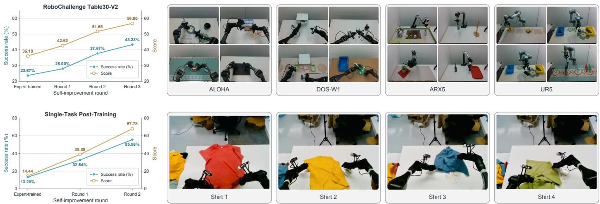  
Figure 3: Closed-loop improvement from real-robot deployment. Top: three deployment-and-training iterations on RoboChallenge Table30-V2, covering 30 tasks across four robot embodiments. Bottom: two deployment-and-training iterations on shirt folding after task-specific expert post-training of the DOS-W1 model. Each plot reports success rate and score over successive improvement rounds.

Table 4: Ablation study on RoboTwin 2.0. We evaluate quality steering with diferent annotation schemes and assess the efect of quality-weighted rollout action supervision (Act.).
<table><tr><td>Steering</td><td>Act. Clean</td><td>Rand.</td><td>Avg.</td></tr><tr><td>None</td><td>x 73.5</td><td>71.1</td><td>72.3</td></tr><tr><td>Extra-coarse</td><td>x 92.2</td><td>93.3</td><td>92.8</td></tr><tr><td>Extra-coarse</td><td>√ 93.9</td><td>93.3</td><td>93.6</td></tr><tr><td>Coarse</td><td>x 93.2</td><td>92.2</td><td>92.7</td></tr><tr><td>Coarse (ours)</td><td>✓ 94.6</td><td>94.4</td><td>94.5</td></tr></table>

Single-task post-training. We further evaluate shirt folding, a challenging deformable-object manipulation task that requires multiple coordinated steps. We initialize from the DOS-W1 multi-task model trained on Table30-V2 and post-train it on newly collected expert demonstrations of shirt folding. The resulting task-specific expert-trained checkpoint serves as the starting point for two rounds of deployment and self-improvement. Success rises from 13.20% to 32.54% and 55.56%, while the scores increase from 14.44 to 38.89 and 67.78. These gains show that deployment feedback remains useful after adapting a multi-task model to a challenging individual task, supporting closed-loop improvement under both training regimes.

## 4.5. Ablation Study

We use the RoboTwin 2.0 setup in Section 4.2, varying only quality steering and rollout action supervision; expert action supervision and video supervision remain unchanged.

Table 4 compares no steering, extra-coarse annotation, and our coarse-level annotation (Section 3.2).

Extra-coarse annotation distinguishes rollouts from all policies solely by success or failure: all failed rollouts are assigned Quality: low, all successful rollouts are assigned Quality: medium, and expert demonstrations are assigned Quality: high. In our coarse-level scheme, successful rollouts from the same policy are assigned a shared numerical score, which can difer across policies according to their overall success rates across tasks and manually assessed motion smoothness. Failed rollouts are assigned the minimum score, while expert demonstrations are assigned $q ^ { \star }$ , above the rollout score range. The ablation results reveal three key findings: (1) Quality steering is key to learning from mixed-quality deployment rollouts, enabling the model to distinguish trajectories of diferent quality. (2) Even extracoarse labels remain efective, demonstrating that fine-grained annotation is not required to benefit from steering. (3) Quality-aware rollout action supervision further improves overall performance under both annotation schemes.

## 5. Conclusion

We presented LoopWAM for improving generalist world-action policies directly from deployment experience. The key is to learn physical consequences from trajectories across the quality spectrum while controlling how their actions supervise behavior. Source-dependent noise sampling, quality steering, and quality-weighted supervision implement this distinction within joint video–action denoising, allowing consequence representations to participate directly in action generation. The same formulation accepts rollouts from both LoopWAM and other deployed policies. Experiments show the best overall results: a score of 56.80 and 43.33% success on RoboChallenge Table30-V2, 94.5% average success on RoboTwin 2.0, and 49.5% overall success on RoboCasa365. Repeated real-robot deployment raises Table30-V2 success by 19.7 percentage points over three rounds and improves shirt-folding success from 13.20% to 55.56% over two rounds after single-task post-training. These findings support using mixed-quality interaction history as a training resource for continued improvement of both multi-task policies and policies adapted to individual tasks.

## References

Hongzhe Bi, Hengkai Tan, Shenghao Xie, Zeyuan Wang, Shuhe Huang, Haitian Liu, Ruowen Zhao, Yao Feng, Chendong Xiang, Yinze Rong, et al. Motus: A Unified Latent Action World Model. arXiv preprint arXiv:2512.13030, 2025. 9

Kevin Black, Noah Brown, Danny Driess, Adnan Esmail, Michael Equi, Chelsea Finn, Niccolo Fusai, Lachy Groom, Karol Hausman, Brian Ichter, et al. π0: A Vision-Language-Action Flow Model for General Robot Control. arXiv preprint arXiv:2410.24164, 2024. 3, 9

Jisong Cai, Long Ling, Shiwei Chu, Zhongshan Liu, Jiayue Kang, Zhixuan Liang, Wenjie Xu, Yinan Mao, Weinan Zhang, Xiaokang Yang, Ru Ying, Ran Zheng, and Yao Mu. AHA-WAM: Asynchronous Horizon-Adaptive World-Action Modeling with Observation-Guided Context Routing. arXiv preprint arXiv:2606.09811, 2026. 9

Ronghan Chen, Yandan Yang, Zuojin Tang, Dongjie Huo, Tong Lin, Haoning Wu, Haoyun Liu, Yuzhi Chen, Lulu Zheng, Botai Yuan, et al. ABot-M0.5: Unified Mobility-and-Manipulation World Action Model. arXiv preprint arXiv:2607.00678, 2026. 9

Tianxing Chen, Zanxin Chen, Baijun Chen, Zijian Cai, Yibin Liu, Zixuan Li, Qiwei Liang, Xianliang Lin, Yiheng Ge, Zhenyu Gu, et al. RoboTwin 2.0: A Scalable Data Generator and Benchmark with Strong Domain Randomization for Robust Bimanual Robotic Manipulation. arXiv preprint arXiv:2506.18088, 2025. 2, 7

Cheng Chi, Zhenjia Xu, Siyuan Feng, Eric Cousineau, Yilun Du, Benjamin Burchfiel, Russ Tedrake, and Shuran Song. Difusion Policy: Visuomotor Policy Learning via Action Difusion. IJRR, 2025. 3, 9

Shenyuan Gao, William Liang, Kaiyuan Zheng, Ayaan Malik, Seonghyeon Ye, Sihyun Yu, Wei-Cheng Tseng, Yuzhu Dong, Kaichun Mo, Chen-Hsuan Lin, et al. Dreamdojo: A generalist robot world model from large-scale human videos. arXiv preprint arXiv:2602.06949, 2026. 2

Yanjiang Guo, Lucy Xiaoyang Shi, Jianyu Chen, and Chelsea Finn. Ctrl-world: A controllable generative world model for robot manipulation. arXiv preprint arXiv:2510.10125, 2025. 2

Norman L. Johnson, Samuel Kotz, and Narayanaswamy Balakrishnan. Continuous Univariate Distributions, volume 2. John Wiley & Sons, 2nd edition, 1995. ISBN 9780471584940. 5

Alexander Khazatsky, Karl Pertsch, Suraj Nair, Ashwin Balakrishna, Sudeep Dasari, Siddharth Karamcheti, Soroush Nasiriany, Mohan Kumar Srirama, Lawrence Yunliang Chen, Kirsty Ellis, et al. DROID: A Large-Scale In-the-Wild Robot Manipulation Dataset. arXiv preprint arXiv:2403.12945, 2024. 3

Dongyoung Kim, Huiwon Jang, Myungkyu Koo, Suhyeok Jang, Taeyoung Kim, Beomjun Kim, Byungjun Yoon, Changsung Jang, Daewon Choi, Dongsu Han, et al. RLDX-1 Technical Report. arXiv preprint arXiv:2605.03269, 2026. URL https://arxiv.org/abs/2605.03269. 8, 9

Moo Jin Kim, Karl Pertsch, Siddharth Karamcheti, Ted Xiao, Ashwin Balakrishna, Suraj Nair, Rafael Rafailov, Ethan Foster, Grace Lam, Pannag Sanketi, et al. OpenVLA: An Open-Source Vision-Language-Action Model. arXiv preprint arXiv:2406.09246, 2024. 3

Lin Li, Qihang Zhang, Yiming Luo, Shuai Yang, Ruilin Wang, Fei Han, Mingrui Yu, Zelin Gao, Nan Xue, Xing Zhu, et al. Causal world modeling for robot control. arXiv preprint arXiv:2601.21998, 2026. 2, 3, 7, 9

Yaron Lipman, Ricky T. Q. Chen, Heli Ben-Hamu, Maximilian Nickel, and Matt Le. Flow Matching for Generative Modeling. In International Conference on Learning Representations, 2023. URL https: //arxiv.org/abs/2210.02747. 5

Hao Luo, Wanpeng Zhang, Yicheng Feng, Sipeng Zheng, Haiweng Xu, Chaoyi Xu, Ziheng Xi, Yuhui Fu, and Zongqing Lu. Being-H0.7: A Latent World-Action Model from Egocentric Videos. arXiv preprint arXiv:2605.00078, 2026. URL https://arxiv.org/abs/2605.00078. 4

Soroush Nasiriany, Sepehr Nasiriany, Abhiram Maddukuri, and Yuke Zhu. RoboCasa365: A Large-Scale Simulation Framework for Training and Benchmarking Generalist Robots. arXiv preprint arXiv:2603.04356, 2026. 2, 8

NVIDIA, Johan Bjorck, Fernando Castañeda, Nikita Cherniadev, Xingye Da, Runyu Ding, Linxi Fan, Yu Fang, Dieter Fox, Fengyuan Hu, et al. GR00T N1: An Open Foundation Model for Generalist Humanoid Robots. arXiv preprint arXiv:2503.14734, 2025. 9

Abby O’Neill, Abdul Rehman, Abhiram Maddukuri, Abhishek Gupta, Abhishek Padalkar, Abraham Lee, Acorn Pooley, Agrim Gupta, Ajay Mandlekar, Ajinkya Jain, et al. Open X-Embodiment: Robotic Learning Datasets and RT-X Models. In 2024 IEEE International Conference on Robotics and Automation (ICRA), pages 6892–6903. IEEE, 2024. 1, 3

Jonas Pai, Liam Achenbach, Victoriano Montesinos, Benedek Forrai, Oier Mees, and Elvis Nava. mimic-video: Video-Action Models for Generalizable Robot Control Beyond VLAs. arXiv preprint arXiv:2512.15692, 2025. 2, 3

Quanquan Peng, Yutong Liang, Rui Yan, Nicklas Hansen, and Xiaolong Wang. FACT: Failure-Aware Causal Training for World-Action Models. arXiv preprint arXiv:2608.10232, 2026. 2

Physical Intelligence. π0.6: A VLA That Learns From Experience. arXiv preprint arXiv:2511.14759, 2025. 2

Physical Intelligence. $\pi _ { 0 . 7 } \colon$ A Steerable Generalist Robotic Foundation Model with Emergent Capabilities. arXiv preprint arXiv:2604.15483, 2026. 2

Physical Intelligence, Kevin Black, Noah Brown, James Darpinian, Karan Dhabalia, Danny Driess, Adnan Esmail, Michael Equi, Chelsea Finn, Niccolo Fusai, et al. $\pi _ { 0 . 5 } \colon$ A Vision-Language-Action Model with Open-World Generalization. arXiv preprint arXiv:2504.16054, 2025. 3, 7, 9

RoboChallenge. RoboChallenge Table30-V2 Leaderboard, 2026. URL https://robochallenge.cn/ leaderboard?selectBenchmark=table30\_v2&currentPage=1&pageSize=30. Accessed September 22, 2026. 8

RoboChallenge Dexmal Team. Table30 V2: Evaluating Generalized Models by Real Robots at Scale. Technical report, Dexmal, 2026. URL https://robochallenge.ai/robochallenge\_techreport\_V2.pdf. 2, 7

Stephane Ross, Geofrey Gordon, and Drew Bagnell. A Reduction of Imitation Learning and Structured Prediction to No-Regret Online Learning. In Proceedings of the Fourteenth International Conference on Artificial Intelligence and Statistics, volume 15, pages 627–635. PMLR, 2011. URL https: //proceedings.mlr.press/v15/ross11a.html. 3

Team Wan, Ang Wang, Baole Ai, Bin Wen, Chaojie Mao, Chen-Wei Xie, Di Chen, Feiwu Yu, Haiming Zhao, Jianxiao Yang, et al. Wan: Open and advanced large-scale video generative models. arXiv preprint arXiv:2503.20314, 2025. 5, 7

Wenli Xiao, Haotian Lin, Andy Peng, Haoru Xue, Tairan He, Yuqi Xie, Fengyuan Hu, Jimmy Wu, Zhengyi Luo, Linxi Fan, Guanya Shi, and Yuke Zhu. Self-Improving Vision-Language-Action Models with Data Generation via Residual RL. arXiv preprint arXiv:2511.00091, 2025. 1

Charles Xu, Jost Tobias Springenberg, Michael Equi, Ali Amin, Adnan Esmail, Sergey Levine, and Liyiming Ke. RL Token: Bootstrapping Online RL with Vision-Language-Action Models. arXiv preprint arXiv:2604.23073, 2026. URL https://arxiv.org/abs/2604.23073. 1

Yandan Yang, Shuang Zeng, Tong Lin, Xinyuan Chang, Dekang Qi, Junjin Xiao, Haoyun Liu, Ronghan Chen, Yuzhi Chen, Dongjie Huo, et al. ABot-M0: VLA Foundation Model for Robotic Manipulation with Action Manifold Learning. arXiv preprint arXiv:2602.11236, 2026. 9

Angen Ye, Boyuan Wang, Chaojun Ni, Guan Huang, Guosheng Zhao, Hao Li, Hengtao Li, Jie Li, Jindi Lv, Jingyu Liu, et al. GigaWorld-Policy: An Eficient Action-Centered World–Action Model. arXiv preprint arXiv:2603.17240, 2026a. 4, 9

Seonghyeon Ye, Yunhao Ge, Kaiyuan Zheng, Shenyuan Gao, Sihyun Yu, George Kurian, Suneel Indupuru, You Liang Tan, Chuning Zhu, Jiannan Xiang, et al. World action models are zero-shot policies. arXiv preprint arXiv:2602.15922, 2026b. 2, 3

Tianyuan Yuan, Zibin Dong, Yicheng Liu, and Hang Zhao. Fast-WAM: Do World Action Models Need Test-time Future Imagination? arXiv preprint arXiv:2603.16666, 2026. 3, 9

Qihang Zhang, Lin Li, Luyao Zhang, Shuai Yang, Yiming Luo, Shuaiting Li, Ruilin Wang, Junke Wang, Jiahao Shao, Gangwei Xu, et al. Native Video-Action Pretraining for Generalizable Robot Control. arXiv preprint arXiv:2607.08639, 2026a. URL https://arxiv.org/abs/2607.08639. 3, 9

Yang Zhang, Jiangyuan Zhao, Chenyou Fan, Fangzheng Yan, Tian Li, Haitong Tang, Sen Fu, Xuan’er Wu, Qizhen Weng, Weinan Zhang, Xiu Li, Chi Zhang, Chenjia Bai, and Xuelong Li. PRTS: A Primitive Reasoning and Tasking System via Contrastive Representations. arXiv preprint arXiv:2604.27472, 2026b. 9

Tony Z Zhao, Vikash Kumar, Sergey Levine, and Chelsea Finn. Learning Fine-Grained Bimanual Manipulation with Low-Cost Hardware. arXiv preprint arXiv:2304.13705, 2023. 3

Jinliang Zheng, Jianxiong Li, Zhihao Wang, Dongxiu Liu, Xirui Kang, Yuchun Feng, Yinan Zheng, Jiayin Zou, Yilun Chen, Jia Zeng, et al. X-VLA: Soft-Prompted Transformer as Scalable Cross-Embodiment Vision-Language-Action Model. arXiv preprint arXiv:2510.10274, 2025. 7, 9

Pengfei Zhou, Shengcong Chen, Di Chen, Jiaxu Wang, Rongjun Jin, Bingwen Zhu, Yike Pan, Songen Gu, Kuanning Wang, Shufeng Nan, Xingyu Qiu, Chenhao Qiu, Pu Yang, Yunuo Cai, Jianxiong Gao, Yifan Li, Yanwei Fu, Xiangyu Yue, Zhi Chen, and Jianlan Luo. τ0-WM: A Unified Video-Action World Model for Robotic Manipulation. arXiv preprint arXiv:2606.01027, 2026. 2

Chuning Zhu, Raymond Yu, Siyuan Feng, Benjamin Burchfiel, Paarth Shah, and Abhishek Gupta. Unified World Models: Coupling Video and Action Difusion for Pretraining on Large Robotic Datasets, 2025. URL https://arxiv.org/abs/2504.02792. 5

Brianna Zitkovich, Tianhe Yu, Sichun Xu, Peng Xu, Ted Xiao, Fei Xia, Jialin Wu, Paul Wohlhart, Stefan Welker, Ayzaan Wahid, et al. RT-2: Vision-Language-Action Models Transfer Web Knowledge to Robotic Control. In Conference on Robot Learning, pages 2165–2183. PMLR, 2023. 3

## A. Training and Data Processing Details

## A.1. Trajectory-Quality Annotations

We use two numerical quality scales according to annotation granularity. Episode-level annotation uses a 1–12 scale, with rollout scores in [1, 10] and expert demonstrations assigned $q ^ { \star } = 1 2$ . Coarse-level annotation uses a 1–5 scale, with rollout scores in {1, 2, 3, 4} and expert demonstrations assigned $q ^ { \star } = 5 .$ In all settings, every failed trajectory receives $q = 1$ . Expert demonstrations are treated as optimal reference trajectories and assigned scores above the rollout range; the same expert score is used at deployment. Each score is assigned to a complete trajectory and inherited by all training segments extracted from it.

RoboChallenge Table30-V2. We use human episode-level annotations from the oficial RoboChallenge platform. Platform operators already rate each rollout on a 1–10 scale according to task completion, with successful trajectories typically receiving scores of at least 8.5. We directly use these platform ratings as rollout quality scores, except that all failed trajectories are assigned $q = 1$ . Expert demonstrations receive $q ^ { \star } = 1 2$

Single-task shirt-folding post-training. We likewise use human episode-level annotation. After each rollout, the data collector assesses task completion before resetting the scene and assigns a score on a 1–10 scale, following the same completion-based scoring approach as RoboChallenge. Failed trajectories receive $q = 1$ , and task-specific expert demonstrations receive $q ^ { \star } = 1 2$

RoboTwin 2.0. We apply coarse-level annotation separately to rollouts from expert-trained LoopWAM, X-VLA, and $\pi _ { 0 . 5 }$ . For each policy, we compute its overall rollout success rate across all tasks and manually inspect approximately 0.7% of its trajectories for motion smoothness and action accuracy. These two assessments determine a single shared score for all successful trajectories from that policy across tasks; every failed trajectory receives $q = 1$ . Expert-trained LoopWAM achieves approximately 90% success during rollout collection and produces relatively smooth trajectories, so its successful rollouts receive $q = 4$ . X-VLA and $\pi _ { 0 . 5 }$ each achieve less than 50% success and produce less smooth trajectories, so their successful rollouts receive $q = 3$ . Expert demonstrations receive $q ^ { \star } = 5$

RoboCasa365. We use the same coarse-level protocol, assessing each source policy through its overall rollout success rate across tasks and manual inspection of approximately 0.7% of its trajectories for motion smoothness and action accuracy. We obtain two expert-trained LoopWAM policies using 64- step and 32-step action chunks, denoted Policy 1 and Policy 2, respectively, and also collect rollouts from RLDX-1. Following the same scoring criteria as RoboTwin, all successful rollouts from Policy 1 share $q = 3$ , those from Policy 2 share $q = 4$ , and those from RLDX-1 share $q = 2 .$ All failed rollouts receive $q = 1$ , and expert demonstrations receive $q ^ { \star } = 5$

## A.2. Training Details

Temporal alignment and robot representations. The training configurations use an action horizon of $H \ : = \ : 6 4$ and a visual stride of eight control steps, yielding nine RGB frames including the initial observation. Camera views are stitched into a single image, and robot states and actions are normalized using expert-data statistics. For Table30-V2, joint targets are represented relative to the joint state at the beginning of each action chunk, whereas gripper commands remain absolute. Only the joint components are converted back to absolute targets at execution; the gripper components are not diferenced. To reduce redundant stationary data, the real-world pipeline checks unnormalized state sequences with an absolute tolerance of $1 0 ^ { - 3 }$ and resamples nearly static windows up to three times. Windows starting within the final 20 seconds of expert episodes are exempt from this filtering to retain terminal behavior. Padding is excluded from the denoising losses.

Noise schedules and loss weighting. The base noise sampler uses $\phi _ { 5 } ( u ) = 5 u / ( 1 + 4 u )$ for $u \sim \mathcal { U } ( 0 , 1 )$

Table 5: Table30-V2 subtask instructions, listed in execution order.
<table><tr><td>Task</td><td>Robot</td><td>Ordered subtask instructions</td></tr><tr><td>Press the button</td><td>ARX5</td><td>1. Press the pink button.</td></tr><tr><td></td><td></td><td>2. Press the blue button.</td></tr><tr><td></td><td></td><td>3. Press the green button.</td></tr><tr><td></td><td></td><td>4. Press the yellow button, then retract the gripper.</td></tr><tr><td>Water the flowers</td><td>ARX5</td><td>1. Pick up the watering can and water the potted plant.</td></tr><tr><td></td><td></td><td>2. The watering is finished, put the watering can down.</td></tr><tr><td>Shred paper</td><td>UR5</td><td>1. Put the paper into the shredder.</td></tr><tr><td></td><td></td><td>2. Retract gripper.</td></tr><tr><td>Stamp positioning</td><td>ALOHA</td><td>1. Pick up the stamp.</td></tr><tr><td></td><td></td><td>2. Dip into the ink.</td></tr><tr><td></td><td></td><td>3. Stamp the signature area and return.</td></tr></table>

Samples drawn from the Beta distributions in Equation 4 are clipped to $[ 1 0 ^ { - 4 } , 1 - 1 0 ^ { - 4 } ]$ without a further time shift. Both modalities use the same scheduler weighting function in Equation 5:

$$
\begin{array} { l } { { g ( \sigma ) = \displaystyle \exp \left[ - 2 ( \sigma - \frac { 1 } { 2 } ) ^ { 2 } \right] - e ^ { - 1 / 2 } , } } \\ { { \displaystyle \omega ( \sigma ) = \frac { g ( \sigma ) } { C + 1 0 ^ { - 1 0 } } , \qquad C = \frac { 1 } { T } \sum _ { j = 0 } ^ { T - 1 } g ( \phi _ { 5 } ( 1 - j / T ) ) , \quad T = 1 0 0 0 . } } \end{array}\tag{8}
$$

This normalization is shared by expert and rollout samples. For K inference steps, the schedule is $\sigma _ { k } = \phi _ { 5 } ( 1 - k / K ) , k = 0 , \ldots , K$ . Each modality follows the Euler update $X _ { m } ^ { k + 1 } = X _ { m } ^ { k } + ( \sigma _ { k + 1 } - \sigma _ { k } ) v _ { \theta } ^ { m }$ with the vector fields evaluated jointly and the initial observation latent fixed throughout sampling.

## A.3. Table30-V2 Subtask Segmentation

We use Qwen2.5-VL-7B for subtask segmentation, switching between stage-specific language instructions during online robot execution. Table 5 lists the resulting ordered prompts. The four illustrated tasks are button pressing, plant watering, paper shredding, and stamp positioning. The remaining tasks retain their original full-task instructions.

## A.4. Subtask Switching Examples

Figures 4–7 show one trajectory for each of the four tasks. The first image is the stitched policy input at the start of execution; each subsequent image is captured when the active subtask prompt changes. The associated text gives the instruction used for the new stage.

## B. RoboChallenge Table30-V2 Leaderboard

Figure 8 presents the oficial RoboChallenge Table30-V2 leaderboard at the time of evaluation. Loop-WAM ranks first, achieving an overall score of 56.80 and a success rate of 43.33%.

## C. Failure Recovery and Iterative Execution

Real-world robot manipulation often involves uncertainty caused by imperfect perception, inaccurate execution, and complex object interaction dynamics.

To analyze the ability of LoopWAM to support iterative execution, Figure 9 presents qualitative examples where an initial attempt does not complete the desired task.

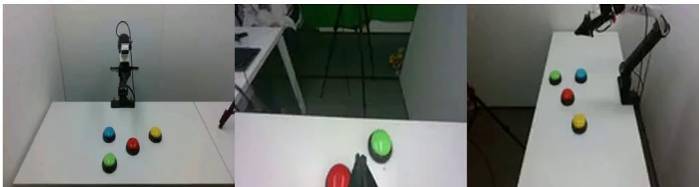

Stage 1. Press the pink button.  
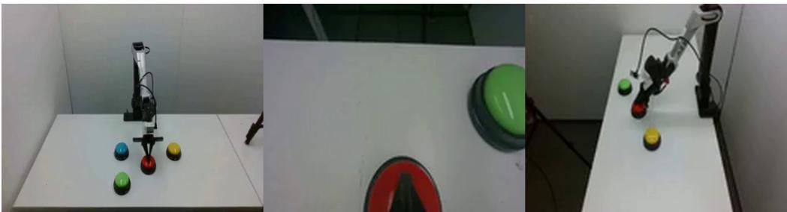  
Stage 2. Press the blue button.

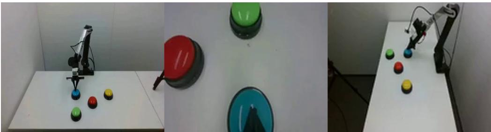

Stage 3. Press the green button.  
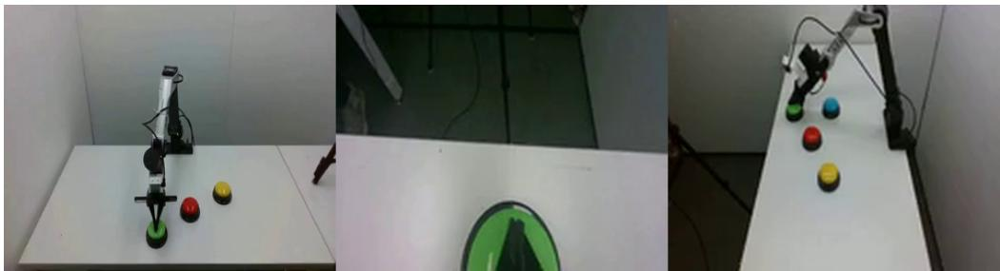  
Stage 4. Press the yellow button, then retract the gripper.  
Figure 4: Button pressing (ARX5). Subtask segmentation example. The initial observation (Stage 1) and subsequent stage observations are shown in order, each paired with its subtask instruction.

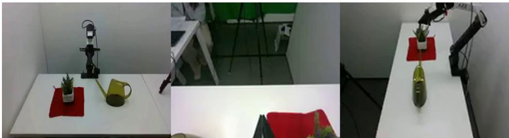

Stage 1. Pick up the watering can and water the potted plant.  
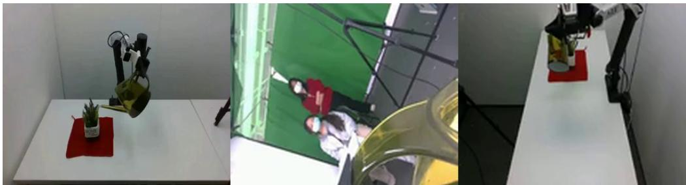  
Stage 2. The watering is finished, put the watering can down.

Figure 5: Plant watering (ARX5). Subtask segmentation example. The initial observation (Stage 1) and subsequent stage observations are shown in order, each paired with its subtask instruction.  
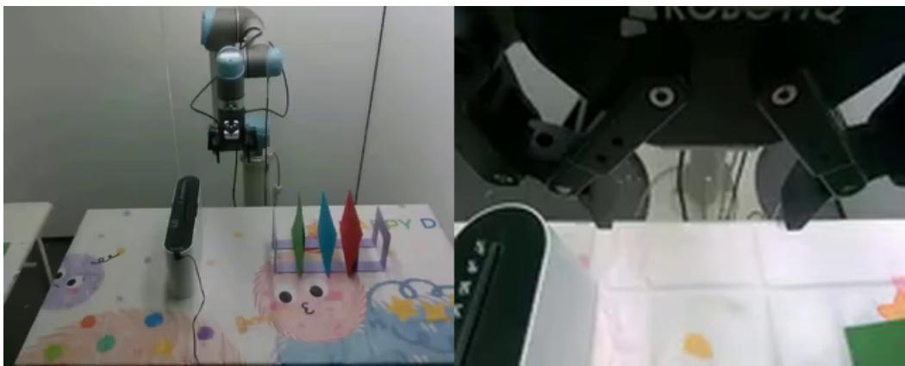

Stage 1. Put the paper into the shredder.  
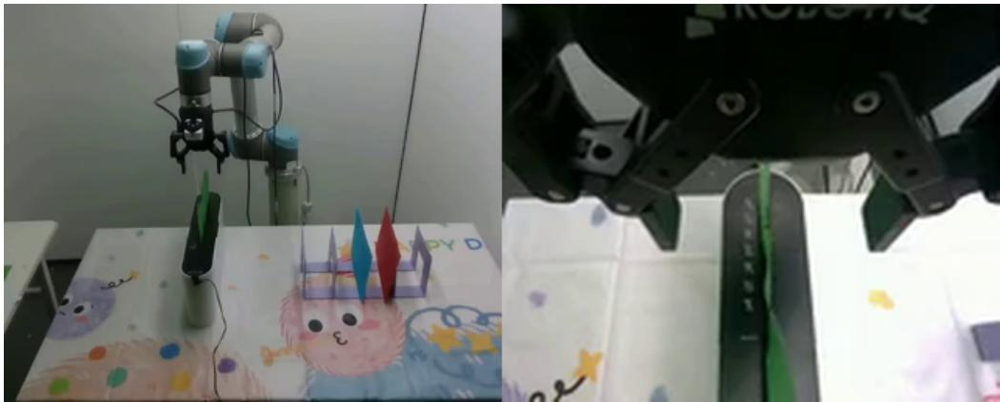  
Stage 2. Retract gripper.  
Figure 6: Paper shredding (UR5). Subtask segmentation example. The initial observation (Stage 1) and subsequent stage observations are shown in order, each paired with its subtask instruction.

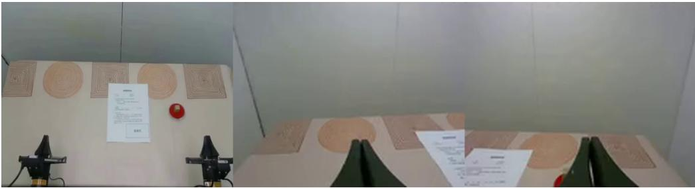  
Stage 1. Pick up the stamp.

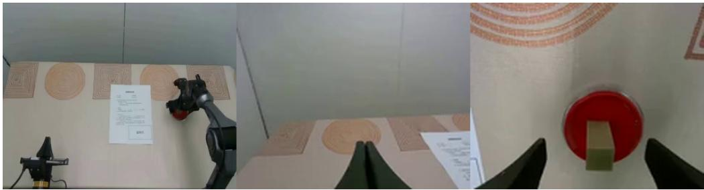

Stage 2. Dip into the ink.  
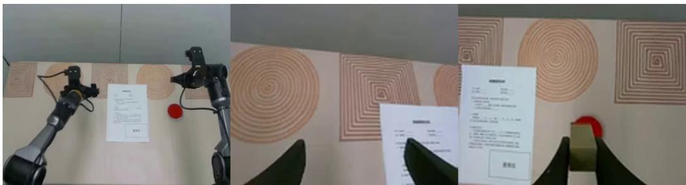  
Stage 3. Stamp the signature area and return.  
Figure 7: Stamp positioning (ALOHA). Subtask segmentation example. The initial observation (Stage 1) and subsequent stage observations are shown in order, each paired with its subtask instruction.

After observing the resulting environment state, the model generates subsequent corrective behaviors that improve the execution outcome. These examples highlight the importance of modeling future states and environment transitions beyond predicting isolated actions.

## D. Qualitative Future Observation Prediction

As a learned robot world model, LoopWAM predicts future visual observations conditioned on the current robot state and interaction history.

To further examine the learned visual dynamics, Figure 10 compares predicted future frames with ground-truth observations from robot executions.

The predictions capture major aspects of scene evolution, including robot motion, object movement, and manipulation progress. Although generated observations may difer from the ground-truth images in fine visual details, they preserve the temporal structure of the interaction process.

## E. Representative Robot Platforms and Tasks

LoopWAM is evaluated across multiple robot platforms with diferent embodiments, sensing configurations, and manipulation spaces.

To demonstrate the diversity of learned robot behaviors, we provide additional qualitative examples from ARX, ALOHA, UR5, and W1 platforms. The examples cover object manipulation, coordinated control, fine-grained interaction, and long-horizon tasks.

Figure 11 shows representative tasks on the ARX platform. Figure 12 presents examples from the ALOHA platform, which includes coordinated manipulation behaviors. Figure 13 demonstrates singlearm manipulation tasks on the UR5 platform. Finally, Figure 14 presents representative long-horizon tasks from the W1 platform.

<table><tr><td colspan="2">RoboChallenge</td><td>Beta Home</td><td>Challenges Runs</td><td>Leaderboard</td><td>Competition</td><td>News</td><td>Eval Your Policy</td><td>Log In</td></tr><tr><td>Rank</td><td>Model/User</td><td></td><td></td><td>Model Info</td><td>Is multitask</td><td></td><td>Score </td><td>Success Rate</td></tr><tr><td>0</td><td>LoopWAM/LoopWAM</td><td></td><td></td><td></td><td>√</td><td>56.80</td><td></td><td>43.33%</td></tr><tr><td>9</td><td>VLA-DM0.5/KDDI Research </td><td></td><td></td><td>$</td><td>√</td><td>54.42</td><td></td><td>40.67%</td></tr><tr><td>点</td><td>my16/Tymtbo</td><td></td><td></td><td></td><td>√</td><td>41.27</td><td></td><td>30.67%</td></tr><tr><td>4</td><td>ambase/AVerse001</td><td></td><td></td><td></td><td>√</td><td>30.07</td><td></td><td>20.00%</td></tr><tr><td>5</td><td>JV0/JIIOV</td><td></td><td></td><td></td><td>√</td><td>27.58</td><td></td><td>16.00%</td></tr><tr><td>6</td><td>mc/mcBrains</td><td></td><td></td><td>$</td><td>√</td><td>23.63</td><td></td><td>15.33%</td></tr><tr><td>7</td><td>MagicBot/MagicBot</td><td></td><td></td><td></td><td>√</td><td>20.82</td><td></td><td>14.67%</td></tr><tr><td>8</td><td>Baseline Model/RoboChallenge</td><td></td><td></td><td></td><td>√</td><td>31.48</td><td></td><td>14.33%</td></tr><tr><td>9</td><td>holobrain/HRL</td><td></td><td></td><td></td><td>√</td><td>27.93</td><td></td><td>14.33%</td></tr><tr><td>10</td><td>test_01/VLA</td><td></td><td></td><td></td><td>√</td><td>22.73</td><td></td><td>12.33%</td></tr><tr><td>11</td><td>WO/WMA</td><td></td><td></td><td></td><td>√</td><td>21.85</td><td></td><td>12.00%</td></tr><tr><td>12</td><td>debuggers_vla/debuggers</td><td></td><td></td><td></td><td>√</td><td>18.72</td><td></td><td>11.00%</td></tr><tr><td>13</td><td>hcp-e/HCP-E</td><td></td><td></td><td>  ()</td><td>√</td><td>19.20</td><td></td><td>10.33%</td></tr><tr><td>14</td><td>Astraeus_V1.5/Yuze Xuan </td><td></td><td></td><td> (</td><td>√</td><td>13.87</td><td></td><td>8.67%</td></tr><tr><td>15</td><td>USTB-Linketic/Zhenyang Wei</td><td></td><td></td><td>  ()</td><td>√</td><td>14.90</td><td></td><td>7.33%</td></tr><tr><td>16</td><td>vict/victory team </td><td></td><td></td><td>(</td><td>√</td><td>12.72</td><td></td><td>7.33%</td></tr><tr><td>17</td><td>Astraeus_V1.7/Yuze Xuan</td><td></td><td></td><td>  ()</td><td>√</td><td>11.83</td><td></td><td>7.00%</td></tr><tr><td>18</td><td>ARX5-multitask/Hua Xue </td><td></td><td></td><td> (</td><td>√</td><td></td><td>13.00</td><td>6.67%</td></tr><tr><td>19</td><td>EgoVLA/Yuhao Chen</td><td></td><td></td><td>  ()</td><td>√</td><td>19.37</td><td></td><td>6.33%</td></tr><tr><td>20</td><td>Astraeus_V1.6/Yuze Xuan</td><td></td><td></td><td>(</td><td>√</td><td></td><td>11.57</td><td>6.33%</td></tr><tr><td>21</td><td>MultiVLA/Vertex</td><td></td><td></td><td>  ()</td><td>√</td><td>12.85</td><td></td><td>6.00%</td></tr><tr><td>22</td><td>RoboRush/RoboRush</td><td></td><td></td><td>()</td><td>√</td><td></td><td>12.33</td><td>6.00%</td></tr><tr><td>23</td><td>UR5-multitask/Hua Xue </td><td></td><td></td><td>  ()</td><td>√</td><td>7.95</td><td></td><td>6.00%</td></tr><tr><td>24</td><td>metrics/Metrics</td><td></td><td></td><td> ()</td><td>√</td><td></td><td>16.12</td><td>5.67%</td></tr><tr><td>25</td><td>xyz/xyz</td><td></td><td></td><td> 4价</td><td>√</td><td></td><td>8.83</td><td>5.33%</td></tr><tr><td>26</td><td>AVP/Any-01</td><td></td><td></td><td>()</td><td>√</td><td></td><td>9.58</td><td>5.00%</td></tr><tr><td>27</td><td>smartVLA/smartVLA</td><td></td><td></td><td>&lt;</td><td>√</td><td>7.25</td><td></td><td>4.00%</td></tr></table>

Figure 8: RoboChallenge Table30-V2 leaderboard. LoopWAM ranks first with an overall score of 56.80 and a success rate of 43.33%, using a multi-task policy for each embodiment.

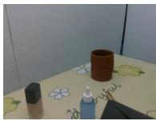  
Tidy up the makeup table

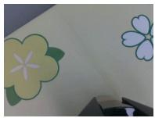  
The first attempt

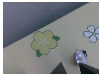  
Pick up success but fall down

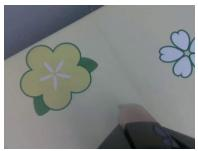  
The sceond attempt

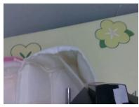  
Sucess!

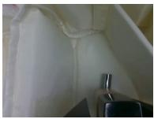  
Sucess!

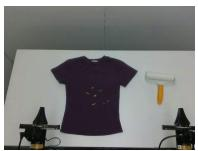  
Lint roller remove dirt

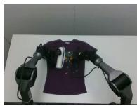  
The first attempt

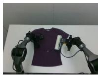  
Incomplete cleaning

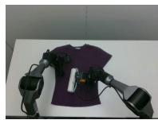  
The sceond attempt

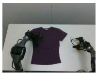  
Incomplete cleaning

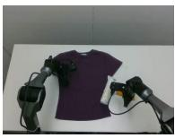  
Sucess!

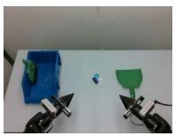  
Sweep the trash

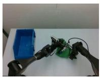  
The first attempt

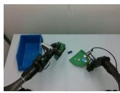  
Debris rolls back out

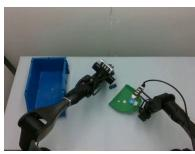  
The sceond attempt

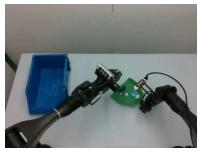  
The third attempt

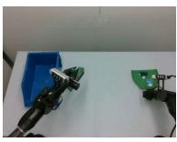  
Sucess!

Figure 9: Qualitative examples of iterative execution and failure recovery. The first attempt may fail due to execution uncertainty, incomplete interaction, or object displacement. Subsequent attempts generate corrective behaviors and achieve successful task completion.

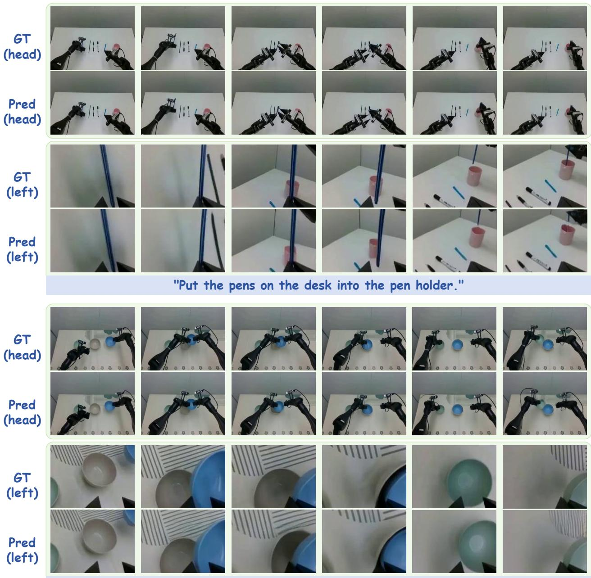  
"Put the blue bowl into the beige bowl, and put the green bowl into the blue bowl."

Figure 10: Qualitative comparison between predicted future observations from LoopWAM and groundtruth robot executions. The model captures the temporal evolution of robot-object interactions and predicts plausible future visual states.

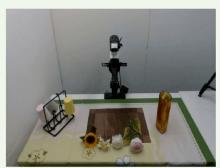

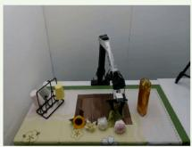

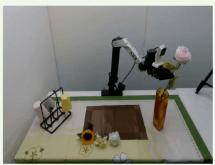

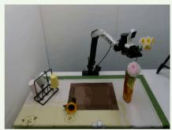  
"Put the 4 flowers into the vase."

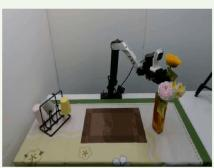

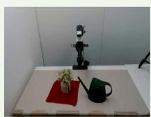

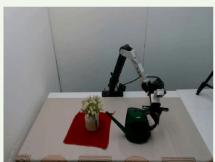

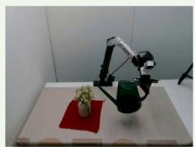  
"Water the potted plants."

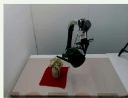

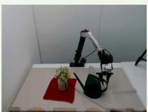

Figure 11: Representative tasks on the ARX robot platform. The examples illustrate diverse manipulation scenarios used for evaluating LoopWAM across diferent robot embodiments.

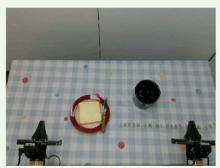

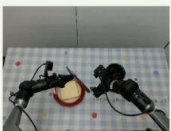

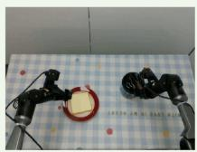  
"Spread the bread with jam."

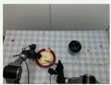

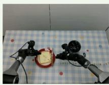

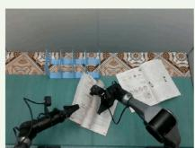

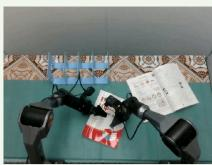

  
"Place the books back onto the bookshelf."

  
"Bundle the objects together using the cloth on the table."

  
"Stamp the signature area on the paper."

Figure 12: Representative tasks on the ALOHA robot platform. The examples include coordinated manipulation and object interaction requiring temporally consistent control.

  
"Place the stationery in the yellow box and the electronics in the blue box."

  
"Put the paper into the shredder."

Figure 13: Representative tasks on the UR5 robot platform. The examples demonstrate single-arm manipulation in structured environments.

  
"Place the ball from the desk onto the small tray, and then move the small tray onto the large tray."

  
"Tie a knot with the string on the table."

  
"Sweep the trash on the table into the dustpan."

  
"Open the drawer, put the bottle opener inside, and close the drawer."

Figure 14: Representative long-horizon tasks on the W1 robot platform. The examples demonstrate sequential manipulation behaviors in complex environments.