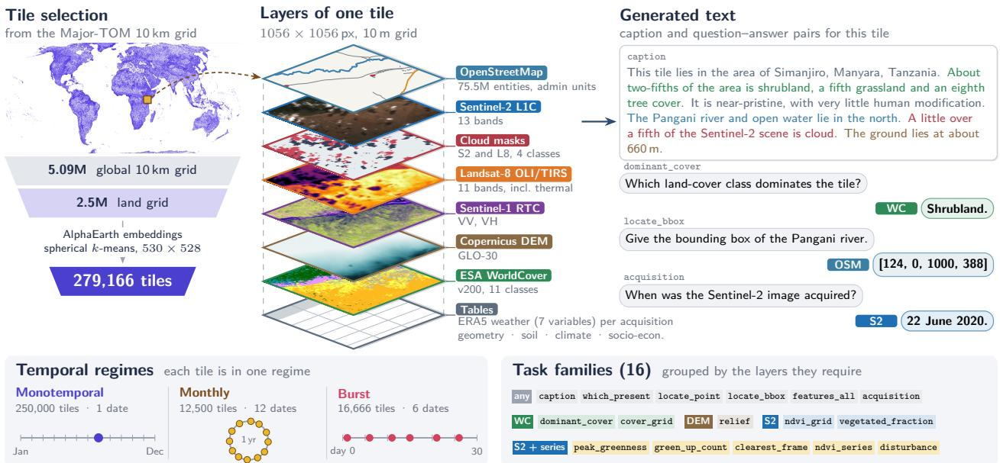
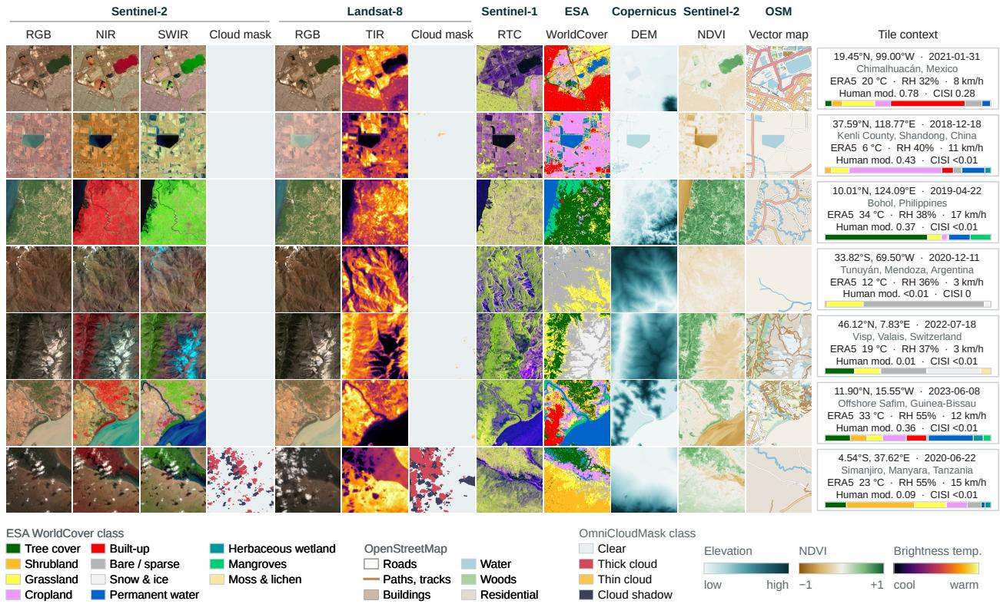
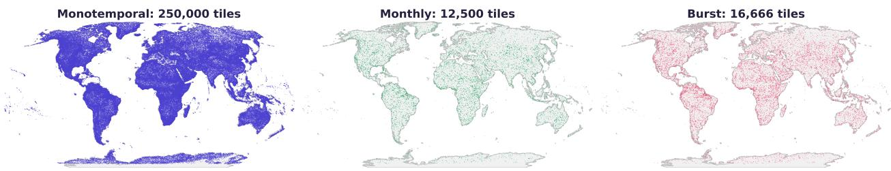
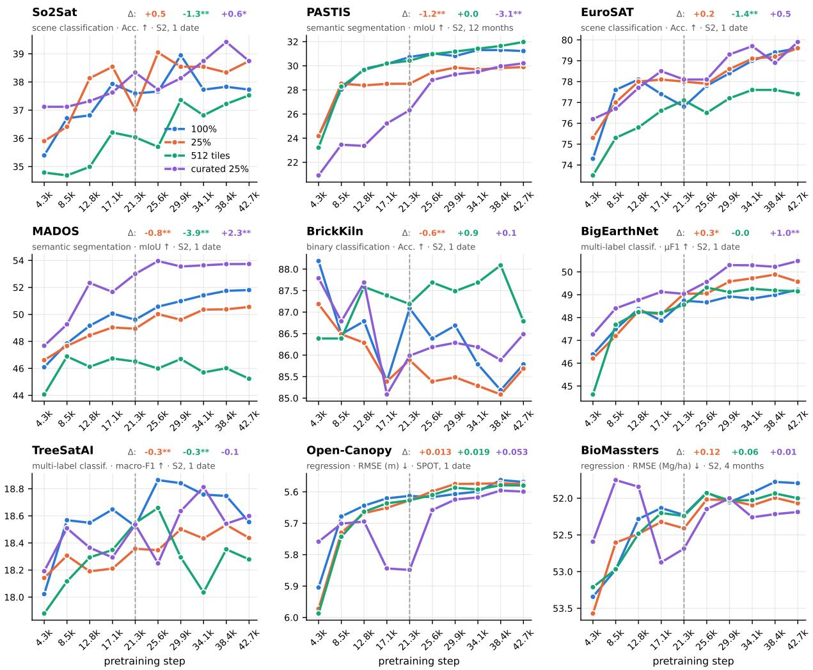

# MAJORTOM:ELLIOT PRETRAIN A MULTI-SENSOR, MULTI-TEMPORAL PRETRAINING DATASET FOR EARTH OBSERVATION

A PREPRINT

Carmen Oliver Huidobro1 Mikolaj Czerkawski2 Kevin Monsalvez-Pozo

carmen.oliver-huidobro@uv.es miko@asterisk.coop kevin.monsalvez@uv.es

Cesar Aybar2 Gustau Camps-Valls1 Oscar J. Pellicer-Valero1 cesar@asterisk.coop gustau.camps@uv.es oscar.pellicer@uv.es

1 Image and Signal Processing (ISP) Group Universitat de València, Valencia, Spain Asterisk Labs, London, United Kingdom

## ABSTRACT

Pretraining generalist Earth observation foundation models requires data that combine several sensors, varied temporal sampling and, increasingly, text, yet open datasets rarely provide all three in one consistent, easily accessible form. We introduce MajorTOM:Elliot Pretrain, a collection of 279,166 tiles of 10 km drawn from the Major-TOM grid by clustering AlphaEarth embeddings. Each tile stacks Sentinel-2 L1C, Landsat-8/9, Sentinel-1 RTC, Copernicus DEM and ESA WorldCover on a shared 1056 × 1056-pixel, 10 m grid, complemented by cloud masks, OpenStreetMap entities and ERA5 weather. The tiles are partitioned into three temporal regimes, Monotemporal (250,000 tiles, one acquisition), Monthly (12,500 tiles, twelve acquisitions spread over the annual cycle) and Burst (16,666 tiles, six acquisitions within 30 days), and are released as 6.3 TB of Cloud Optimized GeoTIFFs indexed by TACO v3 Parquet metadata, a standard that allows cloud streaming, efficient data access, and filtering before any pixel is read. A companion library derives sensor-tagged fact sheets, captions and 16 families of vision-language tasks from these layers at load time. We test our design choices in short pretraining runs of OlmoEarth-Base. First, a 25% subset of Major-TOM Core-S2L2A curated with AlphaEarth embeddings matches or exceeds the full corpus on 8 of 9 benchmarks. Second, on Elliot-Pretrain, adding Landsat-8/9 improves or matches Sentinel-2-only pretraining on every benchmark. Third, using DEM and WorldCover as prediction targets during pretraining further improves 8 of 9 benchmarks, while giving the same maps to the encoder as inputs degrades 5 of 9. Fourth, Sentinel-1 helps on 7 of 9 benchmarks, particularly on benchmarks with radar inputs. Fifth, rule-based captions match a small language model at no cost. The dataset is openly available at https://source.coop/major-tom/elliot-pretrain.

Keywords Earth observation · foundation models · self-supervised pretraining · multimodal dataset · multitemporal · Sentinel-2 · vision-language · Major-TOM

## 1 Introduction

Earth observation satellites generate petabytes of unlabeled imagery every year, making self-supervised geospatial foundation models (GFMs) the natural path to scalable EO intelligence. However, AI-ready EO data has become a bottleneck for the development of GFMs for scientific and operational applications Santoro et al. [2026]. Existing open pretraining datasets [Francis and Czerkawski, 2024, Wang et al., 2023, Blumenstiel et al., 2025] provide scale and, in several cases, more than one sensor, but they usually lack two things that GFM pretraining also needs. First, a temporal structure that serves different training objectives at once: static global coverage, seasonal cycles and rapid event dynamics, whereas most datasets apply one temporal sampling to every location. Second, an access format that is modular and efficient, where sensors are stored independently and combined on demand, and samples can be filtered before any pixel is read.

  
Figure 1: Overview of MajorTOM:Elliot-Pretrain. The 279,166 tiles are selected from the land grid of the Major-TOM 10 km grid by spherical k-means clustering of AlphaEarth embeddings (map: Monotemporal tiles). Each tile holds co-registered rasters on a 1056 × 1056-pixel, 10 m grid, its OpenStreetMap entities and administrative units, and tables with ERA5 weather at each acquisition, acquisition geometry and environmental and socio-economic variables. The example is a savanna tile in Simanjiro, Tanzania, shown with its cloud mask and OSM geometry. Each tile belongs to one of three temporal regimes. Captions and the 16 task families are generated from the tile’s layers at load time, and a task is generated only if its layers are given to the model. The caption and answers are abridged; text colours give the layer each fact comes from.

MajorTOM:Elliot Pretrain provides both, and adds a third: text generated from the data itself. A companion library, majortom-elliot-tasks, builds for every tile afact sheet, with each fact tagged by the sensor it comes from, and derives captions and 16 families of vision-language tasks from it at load time (Section 2.3). Because the text comes from the same tiles, it needs no alignment step, unlike the question-answering corpora behind recent remote sensing multimodal large language models (RS-MLLMs) such as Earth-OneVision Cai et al. [2026], which are assembled independently of any pretraining dataset.

We argue that MajorTOM:Elliot Pretrain improves on existing open EO pretraining resources of similar size along three axes.

1. Coverage: multimodality and temporality are extended jointly, rather than one at the expense of the other, through the explicit Monotemporal / Monthly / Burst regimes, with modality-tagged fact sheets from which vision-language tasks and captions are generated on the same tile grid.

2. Semantic diversity: Elliot-Pretrain uses embedding-based diversity (AlphaEarth [Brown et al., 2025] + spherical k-means) to select a diverse, semantically meaningful subset of the Major-TOM dataset Francis and Czerkawski [2024].

3. Access efficiency: the three temporal regimes are released as TACO v3 Pellicer-Valero et al. [2026], Aybar et al. [2025], Asterisk Labs [2026] subdatasets with an identical layout, in which every sensor is a separate layer on a uniform 1056 × 1056 Cloud Optimized GeoTIFF (COG) grid, so that filtering, joining sensors and constructing training batches cost the same regardless of how many modalities, timesteps or layers a sample draws on.

We use the collection in two short pretraining experiments with OlmoEarth Base and in a caption study. A 25% subset of Major-TOM Core-S2L2A selected with AlphaEarth embeddings, the selection principle behind Elliot-Pretrain, matches or exceeds the full corpus on 8 of 9 benchmarks; on Elliot-Pretrain, adding Landsat-8/9 and using DEM and WorldCover as decoder targets improves most benchmarks, whereas giving those maps to the encoder as inputs hurts. Finally, the proposed rule-based caption template matches small language model-generated captions.

Section 1.1 reviews prior EO pretraining datasets. Section 2 describes how the dataset is built, its layers, its storage format and the experimental setup. Section 3 reports dataset statistics, the two pretraining experiments and the caption study. Section 4 discusses intended use and limitations, Section 5 concludes, and Section 6 explains how to access the data. The Appendix gives further details on the construction, the metadata and the experiments.

## 1.1 Related Work

Building ML-ready pretraining corpora from EO archives is non-trivial: each sensor arrives in its own projection, resolution, and file format, and combining them into aligned, batchable tensors requires substantial engineering effort. A growing set of open datasets has taken on that work and their design choices (which sensors to include, how to store them, and how to select locations) directly shape what a model trained on them can learn. Table 1 summarises how current datasets compare.

Table 1: Comparison of large-scale EO pretraining datasets. ✓ present; ✗ absent; ✓⋆ partial coverage; † described for TerraMind Jakubik et al. [2025] but not part of the public TerraMesh release.
<table><tr><td></td><td>Major- TOM</td><td>SSL4EO- S12</td><td>Satlas Pretrain</td><td>Terra Mesh</td><td>Elliot- Pretrain (ours)</td></tr><tr><td colspan="6">Modalities</td></tr><tr><td>S2 L2A</td><td>√</td><td>√</td><td>X</td><td>√</td><td>X</td></tr><tr><td>S2 L1C</td><td>√</td><td>√</td><td>√</td><td>√</td><td>√</td></tr><tr><td>S1 GRD</td><td>x</td><td>√</td><td>√</td><td>√</td><td>X</td></tr><tr><td>S1 RTC</td><td>√*</td><td>X</td><td>X</td><td>√</td><td>√</td></tr><tr><td>Landsat (L8/9)</td><td>X</td><td>x</td><td>√</td><td>X</td><td>√</td></tr><tr><td>NAIP</td><td>X</td><td>x</td><td>√</td><td>X</td><td>X</td></tr><tr><td>DEM</td><td>√*</td><td>X</td><td>x</td><td>√</td><td>√</td></tr><tr><td>NDVI</td><td>X</td><td>x</td><td>X</td><td>√</td><td>X</td></tr><tr><td>LULC/WorldCover</td><td>X</td><td>x</td><td>X</td><td>√</td><td>√</td></tr><tr><td>OSM context</td><td>X</td><td>X</td><td>x</td><td>X</td><td>√</td></tr><tr><td>Text captions</td><td>X</td><td>X</td><td>X</td><td>√†</td><td>√</td></tr><tr><td>Text Tasks</td><td>x</td><td>x</td><td>x</td><td>X</td><td>√</td></tr><tr><td colspan="6">Scale</td></tr><tr><td>Tiles / locations</td><td>2.2M</td><td>251k</td><td>856k</td><td>~9M</td><td>279k</td></tr><tr><td>Storage</td><td>63 TB</td><td>1.5 TB</td><td>&gt; 30 TB</td><td>16 TB</td><td>6.3 TB</td></tr><tr><td>Storage &amp; access Format</td><td>GeoTIFF</td><td>GeoTIFF</td><td>PNG tiles, 7 label</td><td>Zarr/ xarray</td><td>Parquet + COGs</td></tr><tr><td>Temporal structure Mode</td><td>Single</td><td>4 seasons</td><td>Time</td><td>Matched pair</td><td>Mono / Monthly /</td></tr></table>

In Francis and Czerkawski [2024], the authors released Major-TOM, one of the largest open ML-ready Sentinel-2 collections: 2.2M patches on a uniform 10 km grid, with partial Sentinel-1 RTC and Copernicus DEM companions, totalling more than 60 TB. Its bottleneck is I/O, not spatial coverage: each spectral band is stored as an independent GeoTIFF blob in its own Parquet column with one row per row group. SatlasPretrain Bastani et al. [2023] is widely used and genuinely effective, spanning Sentinel-2, Sentinel-1, Landsat 8/9, and NAIP imagery with 302M labels across 137 categories. Those labels, however, are split across seven different per-task formats, so using it as an unlabeled multi-sensor corpus means reconciling seven representations before a single aligned batch can be built.

SSL4EO-S12 [Wang et al., 2023] and TerraMesh [Blumenstiel et al., 2025] target multimodal and multitemporal self-supervised pretraining. SSL4EO-S12 samples 251,079 locations worldwide and provides four seasonal acquisitions of co-located Sentinel-1 GRD, Sentinel-2 L1C, and Sentinel-2 L2A imagery, distributed as plain per-product GeoTIFF files with no unified index. TerraMesh is substantially larger, merging SSL4EO-S12 v1.1 with a filtered subset of Major-TOM into approximately 9 million co-registered samples across nine modalities (Sentinel-1 GRD/RTC, Sentinel-2 L1C/L2A, NDVI, Copernicus DEM, ESRI LULC, and natural-language captions created by LLaVA-Next Li et al. [2024] and Overture Maps data Marimo et al. [2025]). It applies one temporal strategy uniformly across all locations, with S1/S2 pairs matched to within roughly one week of each other. It is the pretraining corpus behind TerraMind Jakubik et al. [2025]. PhilEO [Dionelis et al., 2025] pretrains on the full 23 TB Major-TOM Core-S2L2A, on FastTOM, a 2 TB land-only subset of it, and on the 0.5 TB PhilEO Globe. The largest corpus helps only when model size grows with it, and the seasonally structured PhilEO Globe, with four acquisitions per location, outperforms both Major-TOM and FastTOM on land-cover mapping. This suggests that temporal structure can matter more than raw scale, and that the benefit of scale depends on model size.

On the language side, SkyScript [Wang et al., 2024] turns 2.6M OpenStreetMap (OSM) OpenStreetMap contributors [2024] tags into rule-based captions, and OSMDA [Ailuro et al., 2026] prompts a VLM to caption OSM-rendered map tiles, alongside broader web-scraped RS caption datasets (RS5M/GeoRSCLIP, GAIA). These are flat image-text collections distributed independently of any multi-sensor pretraining corpus. TerraMesh takes a step toward closing this gap by including captions [Blumenstiel et al., 2025], but its temporal structure is uniform across all locations and its Zarr-based storage couples pixel retrieval to full archive loads, preventing the metadata-first filtering that TACO’s separated Parquet index enables. MajorTOM:Elliot Pretrain instead generates language from the dataset’s own metadata, across heterogeneous temporal regimes and with facts tagged by modality, so that captions and tasks follow any multi-sensor batch without coordinate reconciliation: a layout optimized for GFM adaptation to VLMs.

## 2 Materials and Methods

## 2.1 Dataset Overview

MajorTOM:Elliot Pretrain is a multi-sensor, multi-temporal Earth observation pretraining dataset built on the Major-TOM 10 km global grid [Francis and Czerkawski, 2024], distributed through Source Cooperative at source.coop/major-tom/elliot-pretrain under CC-BY-SA 4.0 (except its OpenStreetMap files and the facts/ folder, which are ODbL-1.0) (see Fig.1). It is a single collection of three TACO v3 subdatasets (Monotemporal, Monthly and Burst). Each tile folder holds its sensor, cloud-mask, OpenStreetMap and administrative layers, and per-image metadata such as ERA5 weather. A top-level facts/ folder of precomputed fact sheets lets captions and tasks be generated without reading pixels. The three subdatasets share a single tile identifier space and a common 1056 × 1056-pixel, 10 m spatial grid.

The 279,166 tiles are drawn from the land grid: the ≈2.5 million global-grid locations where Sentinel-2 imagery exists, selected for semantic diversity as described in Section 2.2.

This dataset holds five modalities: Sentinel-2 L1C Drusch et al. [2012], Landsat-8/9 OLI-TIRS Roy et al. [2014], Copernicus DEM GLO-30 [European Space Agency and Airbus, 2021], ESA WorldCover v200 Zanaga et al. [2022] and Sentinel-1 RTC (VV and VH) Torres et al. [2012] across the selected 279,166 tiles (see Fig. 2).

Table 2: The three subdatasets, one per temporal regime. Each of the 279,166 selected tiles belongs to exactly one regime. Acquisitions are per sensor.
<table><tr><td>Regime</td><td>Tiles</td><td>Share</td><td>Acquisitions per tile</td><td>Selection of dates</td></tr><tr><td>Monotemporal</td><td>250,000</td><td>89.6%</td><td>1</td><td>least cloudy available</td></tr><tr><td>Monthly</td><td>12,500</td><td>4.5%</td><td>12</td><td>greedy, maximal circular day-of-year spread</td></tr><tr><td>Burst</td><td>16,666</td><td>6.0%</td><td>6</td><td>greedy spread within the best 30-day window</td></tr><tr><td>Total</td><td>279,166</td><td>100%</td><td></td><td></td></tr></table>

## 2.2 Tile selection and temporal regimes

The land grid: ≈2.5 million tiles of the global 10 km grid for which Sentinel-2 imagery exists, is obtained by retaining only global-grid tiles that returned at least one valid acquisition. This is the candidate pool, i.e. every location that could in principle be included, not the released collection. The land grid carries only scalar metadata (identifier, CRS,

## ELLIOT-Pretrain

250,000 10 km tiles · Sentinel-2 L1C, Landsat-8, Sentinel-1 RTC, Copernicus DEM, WorldCover, OmniCloudMask, OpenStreetMap, ERA5 · 1056×1056 px @ 10 m

  
Figure 2: Example tiles across seven landscape types (one per row), with all co-registered layers and the per-tile context. Sentinel-2 L1C: RGB, true colour (bands B4, B3, B2); NIR, false-colour near-infrared (B8, B4, B3), in which vegetation appears red; SWIR, false-colour shortwave infrared (B12, B8, B4); cloud mask, OmniCloudMask classes. Landsat-8: RGB, true colour (B4, B3, B2); TIR, thermal infrared (band 10), a brightness temperature; cloud mask as above. Sentinel-1 RTC: radiometrically terrain-corrected backscatter in dB, with VV (red), VH (green) and VV−VH (blue) as radar polarisations. Other layers: WorldCover, ESA land-cover map; DEM, Copernicus GLO-30 digital elevation model; NDVI, normalised difference vegetation index of Sentinel-2, (B8 − B4)/(B8 + B4); vector map, OpenStreetMap features of the tile. Thermal, radar and elevation colours are stretched per tile, and class colours are given in the legends. Tile context: tile-centre latitude and longitude, Sentinel-2 acquisition date and place; ERA5 (ECMWF reanalysis) 2 m air temperature, relative humidity (RH) and 10 m wind speed at that date; Global Human Modification index (Human mod., 0 to 1); Critical Infrastructure Spatial Index (CISI); and the share of each WorldCover class in the tile (coloured bar).

centroid, grouping codes) and no pixels; it is defined by Sentinel-2’s orbital acquisition plan rather than an external land mask.

From this pool, 279,166 tiles are selected for semantic diversity rather than geographic coverage: two tiles count as similar only if a vision foundation model’s embeddings of their imagery are similar, independent of ground distance. More specifically, every land-grid tile is embedded with AlphaEarth Foundations [Brown et al., 2025], chosen because it is a state-of-the-art GFM with publicly available embeddings (64-d, spatially averaged and renormalised to unit norm), and a two-level spherical k-means hierarchy over the ≈2.5M embeddings selects 279,840 representative tiles, one per fine cluster, in minutes rather than the hours a flat k-means at that scale would require (Appendix D). Intersecting these candidates against tiles present in both the Sentinel-2 and Landsat-8/9 tables removes 674 high-latitude tiles lacking L8 coverage, leaving 279,166 tiles that are randomly split with a fixed seed into Monotemporal, Monthly, and Burst at the proportions in Table 2. Monotemporal receives by far the largest share of the selected tiles because each additional acquisition of the same location is highly redundant with the previous ones, so temporal tiles add little new signal per byte and per training step, whereas Monthly and Burst are kept at a smaller size because many downstream tasks require temporal inputs and the model must learn what time means.

Temporal selection differs by regime. Monotemporal reuses each tile’s Major-TOM image identifier if one already exists, for compatibility with prior pretraining runs, and otherwise takes the least-cloudy available acquisition. Sentinel-2 and Landsat-8/9 dates are chosen independently with no cross-sensor alignment enforced. Monthly and Burst are both driven by Sentinel-2 acquisition dates, chosen greedily to maximise temporal spread: circularly across the full year for Monthly’s 12 slots and linearly within an automatically selected 30-day window for Burst’s 6, with Landsat-8/9 matched to each date through a four-level cascade of progressively relaxed temporal tolerance and cloud-free score threshold (Appendix D). A small number of tiles have no usable Landsat-8/9 acquisition: 26 of 12,500 Monthly tiles (all twelve images, 23 of them south of 60° S, where WRS-2 is intrinsically gapped), 18 of 250,000 Monotemporal tiles and 3 of 16,666 Burst tiles (13 images). These are marked as nodata.

## 2.3 Layers

Every tile holds the same set of layers on one shared 1056 × 1056-pixel, 10 m grid: four sensor images (Sentinel-2, Landsat-8/9, Sentinel-1, and the static DEM and WorldCover maps), and context layers (cloud masks, ERA5 weather and OpenStreetMap) that are not sensor images but share the tile’s grid and folder. Two rules apply to all sensor layers. First, each sensor fills the acquisition slots of the tile’s regime (one in Monotemporal, 12 in Monthly, 6 in Burst) with a single image per slot, typically the least cloudy one available. Second, if a sensor has no acquisition for a slot, the image is still stored, filled with the nodata value, so that every tile has the same layout.

Optical: Sentinel-2 and Landsat-8/9. Sentinel-2 L1C has bands at three native resolutions (10, 20 and 60 m). The 20 and 60 m bands are brought to 10 m by integer pixel replication, without interpolation, and all 13 bands are stored in one COG, scaled by 10,000 following the ESA convention. Landsat-8/9 combines 9 optical (OLI) and 2 thermal (TIRS) bands in one 11-band COG; because the two groups have different noise floors, they receive different bit-depth trims (Appendix C). 807 Monotemporal Landsat frames are OLI-only products whose thermal bands 10 and 11 are zero. Landsat-8/9 gaps are more common than Sentinel-2 gaps, mainly at high latitude, where the WRS-2 grid leaves areas that Sentinel-2’s wider swath covers.

Radar: Sentinel-1. Sentinel-1 RTC is stored as two bands, VV and VH, in linear power $( \gamma ^ { 0 }$ , float32, mantissa truncated to 12 bits), with one image per Sentinel-2 acquisition. For each Sentinel-2 image the VV+VH pass closest in time is selected, without temporal interpolation; HH+HV passes are excluded. The source, the Planetary Computer sentinel-1-rtc product (CC-BY-4.0), is already on the tile grid, so an image is resampled only if the UTM zone of the pass differs from the tile’s. A residual offset to Sentinel-2 of about 1 to 1.5 pixels remains and is not corrected (Appendices E and I). If no VV+VH pass exists, mainly in polar regions, where Sentinel-1 acquires HH+HV, and over open sea, the image is stored as nodata (0). Over the three regimes, 93.2% of samples have valid Sentinel-1 in at least 90% of the pixels of every image, and 6.6% have none. Per-sample fields (s1:valid\_fraction, s1:valid\_fraction\_min, s1:frames\_with\_data) allow filtering, and per-image fields record the pass date, its gap to the Sentinel-2 date and its orbit (Table 10).

Static layers: DEM and WorldCover. Copernicus DEM GLO-30 is the only layer that is genuinely interpolated: it is resampled bilinearly from its native 30 m grid to 10 m. ESA WorldCover is categorical, so horizontal differencing is disabled and no bit-depth trim is applied. Both layers are stored once per tile, since they do not change over time.

Cloud masks and weather. Every Sentinel-2 and Landsat-8/9 image has an OmniCloudMask cloud and shadow mask (clear, thick cloud, thin cloud, shadow), stored as a 10 m PNG, with its class fractions in the per-image tables. Hourly ERA5 Soci et al. [2024] meteorology (2 m temperature and dew point, humidity, precipitation, cloud cover and 10 m wind, at a spatial resolution of 0.25◦) is read at the hour nearest each acquisition and stored as columns of the per-image tables (ml:era5\_\*), so it has no raster of its own.

OpenStreetMap. OpenStreetMap is stored as vector data. Each tile has an osm.parquet of features (75.5 million entities in total) and an admin.parquet of administrative units (1.55 million in total), both GeoParquet files in the tile’s UTM CRS. Each feature has its OSM identifier, category, name and local name, area or length clipped to the tile, Wikidata and Wikipedia links and its full tags (Table 10), and per-tile counts are kept in the sample table. The OSM data is used in two steps. The extraction keeps all features above a small size limit, so that tasks such as small-object detection can use ordinary features like a restaurant or a bus stop. When the task library builds a tile’s fact sheet, a second, stricter selection keeps only the named features a description should mention (Appendix E).

Text. The collection does not store captions. It stores the data needed to produce them, and a code library (majortom-elliot-tasks, MIT licence Image and Signal Processing Group, Universitat de València [2026]) builds text from the layers when it is needed, so the wording changes at every epoch. For each tile the library assembles a fact sheet of everything measured: spectral indicators from Sentinel-2 and Landsat-8/9, relief and land cover, named OpenStreetMap features, cloud fractions, ERA5 weather and Sentinel-1 backscatter, plus time-series facts for Monthly and Burst tiles. Every fact is tagged with the sensor that supports it, so facts from a sensor the model is not given are dropped. From the sheet the library generates 16 families of vision-language tasks (captioning, grounding, grids, numbers and time-series questions), each scored from 0 to 1 by a rule for its answer shape; captions are written by a rule-based template that uses no language model. Appendix F lists the task families and describes the scoring and the template.

## 2.4 Storage format and access

MajorTOM:Elliot Pretrain is built around three design choices that apply uniformly across all subdatasets and that together determine how training batches are constructed.

Layer modularity. Every sensor and context layer is stored in its own subfolder of the tile (DATA/<tile>/s2/, l8/, s1/, dem/, lc/, cloud\_s2/, cloud\_l8/), with its own children\_\_<layer>.parquet metadata table. A tile is identified by its folder index within a regime, and majortom:code\_10km gives its grid code. Because every COG is already aligned to the same geotransform, layers combine into pixel-aligned tensors with no reprojection. A user downloads only the regimes and layers they need, and a new layer can be added as a further subfolder and metadata table alongside the existing ones.

Format and access. Pixel payloads are stored as Cloud-Optimised GeoTIFFs (COGs), which support HTTP range requests so that a reader retrieves only the bytes it needs. All COGs are resampled to a shared 1056 × 1056-pixel, 10 m grid, whose side is divisible by the common ViT patch sizes and by the 3 × 3 internal tiling (Appendix A). Pixel payloads are stored separately from the Parquet metadata, which follows the TACO v3 layout, so any Parquet-capable engine can filter on metadata, cloud cover, temporal regime, etc. before a single pixel is read. The taco.ml reader decodes each sample into arrays on demand. Internally, COGs use ZSTD compression with 352 × 352-pixel tiles, sized for GPU-native decompression via nvCOMP. Full compression parameters per sensor are given in Section C.

Temporal and contextual design. MajorTOM:Elliot Pretrain partitions its 279,166 locations into three sub-datasets targeting different training signals: Monotemporal for broad static pretraining, Monthly for seasonal and phenological dynamics, and Burst for short-timescale events (see Table 2). Each location appears in exactly one regime, so the three sub-datasets together define a training curriculum without overlap. Each tile also carries the context layers Section 2.3. A task library turns these row-aligned layers into fact sheets and vision-language tasks at load time, making language-grounded pretraining a native feature of the dataset rather than a separately distributed resource.

## 2.4.1 File Layout and Size

MajorTOM:Elliot Pretrain is organized into three regimes (Table 3). In each one a tile is a folder DATA/<tile>/, named by an integer index, whose subfolders hold one file per acquisition: data.tif in Monotemporal and img\_NN.tif (Monthly, Burst) for the rasters, with the elevation and land-cover layers stored once as main.tif. Cloud masks are PNGs, sensors are stored as rasters, and each tile has two OSM tables. The collection occupies 6.27 TB (3.08 TB Monotemporal, 1.84 TB the Monthly and 1.35 TB the Burst) plus the facts/ folder. A Sentinel-2 image takes 5.7 MB on average (against 29 MB uncompressed, 5×), Landsat-8/9 2.3 MB (21×), Sentinel-1 4.1 MB, the elevation and land-cover rasters 73 and 44 KB, and a cloud mask 3–8 KB. The per-tile OSM and administrative tables average 77 and 14 KB. Averages are over 300 random Monotemporal tiles. The metadata tables are plain Parquet files with 10,000 rows per row group; the join key is internal:parent\_id: image rows point to their layer-folder row in children.parquet, whose internal:parent\_id is the tile.

## 2.5 Experimental Setup

Data. Experiment 1 pretrains on Core-S2L2A, the Major-TOM Sentinel-2 L2A collection (2,184,259 tiles after filtering), and Experiment 2 on Elliot-Pretrain (279,166 tiles: 250,000 monotemporal, 12,500 monthly and 16,666 burst), whose Sentinel-2 data is L1C. Each corpus is normalized with its own per-band statistics.

Pretraining. We choose OlmoEarth, one of the best EO encoders in the literature, with open weights, recipes and code, available in several model sizes. We pretrain OlmoEarth Base from scratch with the official v1.2 recipe [Allen Institute for AI, 2025, 2026]: latent masked image modelling with a patch-discrimination loss and an InfoNCE term, AdamW (learning rate 10−4, weight decay 0.02), global batch 512, token budget 2250, a cosine schedule with warmup over 1.2% of the run, and fixed seed. The model has 88.8M parameters with Sentinel-2 as its only modality; the Experiment 2 models, which add modalities as encoder inputs or decoder targets, have 92.0M to 101.4M (Table 13). Only the data, the modalities, the temporal partition and the number of steps change between runs. One epoch is 488 steps over the 250,000 monotemporal tiles and 4,266 steps over Core-S2L2A, which represent 0.07% and 0.64% of the official 667,200 steps. We use short schedules to run many experiments at low cost, and conclusions are limited to this regime. The ten-epoch runs of Appendix 3.2 (42,660 steps) reach 6.4% of the official training regime.

Table 3: Directory layout of the collection. The three sub-datasets monotemporal/, monthly/ and burst/ share it; only the file names inside a tile’s layer folders differ. Monotemporal stores one acquisition per layer, Monthly and Burst one file per acquisition, with NN running over 00–11 (Monthly) or 00–05 (Burst). Static layers (DEM, land cover) are stored once.
<table><tr><td>Path</td><td>Monotemporal</td><td>Monthly / Burst</td><td>Content</td></tr><tr><td>&lt;regime&gt;/</td><td colspan="3"></td></tr><tr><td>COLLECTION.json</td><td colspan="3">TACO collection description, column descriptions, band and radiometry contract</td></tr><tr><td>METADATA/</td><td colspan="3"></td></tr><tr><td>sample.parquet</td><td colspan="3">One row per tile: grid codes, tile-level context, geometry, OSM counts, WorldCover and DEM statistics, cloud and Sentinel-1 summaries</td></tr><tr><td>children.parquet</td><td colspan="3">One row per top-level entry of a tile (layer folders, osm . parquet, admin.parquet)</td></tr><tr><td>children__&lt;layer&gt;.parquet</td><td colspan="3">One row per file (s2, 18, s1, cloud_s2, cloud_18, dem, 1c): dates, product, scores, geometry, ERA5, mask class fractions, Sentinel-1 pass</td></tr><tr><td>DATA/&lt;tile&gt;/</td><td></td><td></td><td></td></tr><tr><td>s2/,18/</td><td>data.tif</td><td>img_NN.tif</td><td>Sentinel-2 L1C (13 bands), Landsat-8/9 (11 bands)</td></tr><tr><td>s1/</td><td>data.tif</td><td>img_NN.tif</td><td>Sentinel-1 RTC, VV and VH</td></tr><tr><td>cloud_s2/, cloud_18/</td><td>data.png</td><td>img_NN.png</td><td>Cloud and shadow masks</td></tr><tr><td>dem/,1c/</td><td>data.tif</td><td>main.tif</td><td>DEM and WorldCover (1 band, static)</td></tr><tr><td>osm.parquet, admin.parquet</td><td colspan="3">OpenStreetMap entities and administrative units</td></tr><tr><td>facts/&lt;regime&gt;/</td><td colspan="3"></td></tr><tr><td>facts-NNNNNN.parquet</td><td colspan="3">Precomputed per-tile facts (plain Parquet, ODbL-1.0)</td></tr></table>

Evaluation. After pretraining, the encoder is frozen. Each benchmark input is standardized with the benchmark’s own per-band mean and standard deviation. On the pooled features we fit a k-nearest-neighbour (KNN) classifier (EuroSAT, So2Sat, BrickKiln, BigEarthNet, TreeSatAI) or a linear probe (segmentation and regression), and report the test score of the probe after its 50 training epochs (the validation score is computed once, at the end, so no epoch is selected; the KNN classifier has no epochs). The metrics are accuracy (EuroSAT, So2Sat, BrickKiln), micro-F1 (BigEarthNet), macro-F1 (TreeSatAI), mIoU (PASTIS, MADOS) and RMSE (Open-Canopy in m, BioMassters in Mg ha−1, lower is better). We use nine benchmarks to evaluate Experiment 1 (Section 3.2, Fig. 4) and Experiment 2 (Section 3.3, Fig. 5). Models with a Sentinel-1 pathway are scored on the Sentinel-1+Sentinel-2 version of the benchmark if one exists. Each configuration is pretrained once. For the ten-epoch runs, each checkpoint is evaluated with three probe seeds (3622, 8956, 30991) and averaged. This measures probe noise only, because the encoder is fixed. Full details are in Appendix K and Appendix O.

Captions. The library writes captions with a template (Section 2.3; examples in Section G). We ask how good they are and what a language model would add. We compare four ways of writing a caption from the same fact sheet. One uses a template, a program with fixed rules and no language model. Three use a language model (LLM) that receives the fact sheet: GPT-6-luna (small), GPT-6.1-sol (large), and GPT-6.1-sol with the image in addition.

  
Figure 3: Tile locations spread across the earth for the three temporal regimes

## 3 Results

This section first describes the released collection through its statistics (Section 3.1): tile counts and geographic spread, acquisition dates, cloud cover, Sentinel-1 coverage and OpenStreetMap context. It then uses the collection for two pretraining experiments and a caption study. Experiment 1 asks how the size and curation of the pretraining data affect downstream accuracy (Appendix 3.2). Experiment 2 asks whether additional sensors (part a) and the Monthly and Burst temporal partitions (part b) help (Appendix 3.3). The caption study compares template captions with captions written by language models (Appendix 3.4). The pretraining experiments use short schedules and one run per configuration, and evaluate frozen encoders on nine downstream benchmarks (Section 2.5).

## 3.1 Dataset Statistics

Fig. 3, Tab. 4 and the text below summarise the released collection, computed from its TACO metadata. The collection holds 279,166 tiles and 499,996 Sentinel-2 images in the three regimes together (250,000 + 150,000 + 99,996), with one Landsat-8/9 and one Sentinel-1 image per Sentinel-2 image. Tiles are spread over all land masses (Fig. 3; of the Monotemporal tiles, 33.4% lie between 30° and 60° N, 27.0% between the equator and 30° N, 20.1% between 30° S and the equator, 3.9% between 60° S and 30° S, and 15.6% poleward of 60° in either hemisphere, which includes Antarctica and Greenland.

Acquisition dates. Monotemporal images are dominated by 2019–2024 (93% of the images), because the single acquisition is the Major-TOM image if one exists and the least cloudy available otherwise. Monthly spans 2015–2026 and Burst 2017–2025, since the date selection of both regimes is free to pick any year of the archive (Section 2.2). The Monthly regime covers the annual cycle. The median over tiles of the smallest circular day-of-year gap between two selected acquisitions is 22 days, against 30.4 days for twelve perfectly even dates, and the median largest gap is 46 days. For 843 tiles (6.7%) the largest gap exceeds 130 days, which happens where the archive has no usable acquisition for part of the year.

Cloud cover. Monotemporal images are selected to be clear: by the CloudScore+ clear score, 100% of the Sentinel-2 images have a cloudiness (one minus the score) below 0.1, and by the OmniCloudMask masks 90.3% have a cloud fraction below 0.1. Monthly and Burst keep cloudy acquisitions on purpose, because the selection maximises temporal spread rather than clarity (Tab. 4): the 90th percentile of the cloudiness (one minus the CloudScore+ clear score) of the Sentinel-2 images is 0.87 for Monthly and 0.28 for Burst. The per-pixel four-class masks allow users to filter or weight these acquisitions.

Sentinel-1. In all three regimes 93.2% of the samples have valid Sentinel-1 in at least 90% of the pixels of every image, and 6.6% have none. The median gap between a Sentinel-1 pass and its Sentinel-2 image is 2.4 days in Monotemporal, 2.4 days in Monthly and 2.0 days in Burst, and 58%, 57% and 65% of the valid images lie within three days. The tail differs between regimes: the 90th percentile is 5.9 days in Burst and 39 days in Monthly, but 162 days in Monotemporal, so users who need close temporal alignment should filter on s1:gap\_days.

OpenStreetMap context. Over the three regimes the collection holds 75.5 million OSM entities (67.8M, 3.4M and 4.3M in Monotemporal, Monthly and Burst; 23.3M of the Monotemporal entities carry a name) and 1.55 million administrative units. 82% of the tiles contain at least one named entity, with a median of three per tile.

Table 4: Statistics of the released regimes. Cloudiness bins are the share of images with cloudiness (1 − clear score) in <0.1 / 0.1–0.3 / 0.3–0.7 / 0.7–0.9 / >0.9.
<table><tr><td></td><td>Monotemporal</td><td>Monthly</td><td>Burst</td></tr><tr><td>Tiles</td><td>250,000</td><td>12,500</td><td>16,666</td></tr><tr><td>Images per sensor</td><td>250,000</td><td>150,000</td><td>99,996</td></tr><tr><td>Sentinel-2 acquisition years</td><td>2015-2026</td><td>2015-2026</td><td>2017-2025</td></tr><tr><td>Cloud fraction (masks), median</td><td>0.00</td><td>0.19</td><td>0.07</td></tr><tr><td>Sentinel-2 cloudiness bins (%)</td><td>100 / 0 / 0 / 0 / 0</td><td>74 / 6 / 8 / 3 / 10</td><td>85 / 5 / 5 / 1 / 3</td></tr><tr><td>Landsat-8 cloudiness bins (%)</td><td>94 /3 /3 / 0 / 0</td><td>69 / 8 / 10 / 4 / 9</td><td>75 / 11 / 11 / 3 / 0</td></tr><tr><td>Landsat-8 images without data</td><td>18</td><td>312</td><td>13</td></tr><tr><td>Sentinel-1 valid (≥90% pixels)</td><td>93.2%</td><td>93.1%</td><td>93.2%</td></tr><tr><td>Sentinel-1 gap, median / P90 (days)</td><td>2.4 / 162</td><td>2.4 / 39</td><td>2.0 / 5.9</td></tr><tr><td>OSM entities (M)</td><td>67.8</td><td>3.4</td><td>4.3</td></tr><tr><td>Administrative units (M)</td><td>1.39</td><td>0.07</td><td>0.09</td></tr><tr><td>Tiles poleward of 60°</td><td>15.6%</td><td>15.9%</td><td>15.4%</td></tr></table>

## 3.2 Experiment 1: Pretraining data size and curation

We ask whether more data, or better-curated data, helps to pretrain a GFM under the same pretraining regime. The curated subset is selected on the same principle as Elliot-Pretrain, hierarchical k-means clustering of AlphaEarth embeddings (Sections 2.2 and K), so this experiment is the evidence for that design choice, tested on a corpus whose full, unselected pool is available for comparison. We compare four sets drawn from Core-S2L2A: the full corpus, a random 25% subset, the AlphaEarth-curated 25% subset and 512 random tiles. Then we pretrain OlmoEarth for ten full-corpus epochs (42,660 steps) and evaluate every 4,266 steps. Training was done in two parts: five epochs (21,330 steps) with their own cosine schedule, then five more, resumed from the step-21,330 checkpoint with the schedule recomputed over all 42,660 steps. Therefore, at step 21.3K the learning rate jumps back up to the midpoint of a cosine and decays again. Figure 4 shows the scores at every checkpoint. To support the comparisons we run a paired t-test over the ten checkpoints, comparing two runs at the same checkpoint, and report the mean difference with its 95% confidence interval (CI) in Table 16; the number above each panel is this mean difference to the 100% run, with ∗ for $p < 0 . 0 5$ and ∗∗ for $p < 0 . 0 1$ . The curated 25% subset is significantly better than the full corpus on MADOS (+2.32 points, $\operatorname { C I } \left[ + 1 . 7 8 , + 2 . 8 7 \right] )$ , BigEarthNet (+0.99, [+0.71, +1.28]) and So2Sat (+0.59, [+0.02, +1.17]). It is indistinguishable from it (CI includes zero) on EuroSAT, BrickKiln, TreeSatAI, Open-Canopy and BioMassters, and worse only on PASTIS (−3.15, [−4.46, −1.83]). It is therefore competitive with or better than 100% on 8 of 9 benchmarks. At the last checkpoint the extreme gaps are +1.93 in MADOS and −1.01 in PASTIS. Compared directly with the random 25% subset (last column of Table 16), the curated subset is better on MADOS (+3.09, [+2.35, +3.83]), BigEarthNet (+0.68), BrickKiln (+0.62) and TreeSatAI (+0.13), level on So2Sat, EuroSAT and the two regression tasks, and worse on PASTIS (−1.98, [−3.46, −0.49]). The advantage over random selection is real on four benchmarks but not uniform. The 512-tile run is significantly worse than 100% on MADOS (−3.93), EuroSAT (−1.38), So2Sat (−1.30) and TreeSatAI (−0.33), with a final-checkpoint gap of up to 6.57 points in MADOS, but level on BigEarthNet (−0.02), PASTIS (+0.04) and BrickKiln (+0.89, [−0.04, +1.83]). Those tasks may be less sensitive to scale. These intervals are over checkpoints of runs that were each pretrained once and no correction is made for multiple comparisons, so they describe the training trajectory and not the variation between pretraining seeds (Appendix N).

Regression tasks (Open-Canopy, BioMassters) show near-zero differences across all conditions (every CI includes zero), and training steps seem to matter much more than which tiles were used. We observe that with more data, the frozen features separate BrickKiln slightly worse as training goes on. With 512 tiles they get slightly better. The fall is mostly in the first 17k steps. The curated subset favors rare landscape types and drops many near duplicate typical scenes. PASTIS is crop parcels in France, so it may rely on exactly those typical agricultural scenes, which could explain a slower start on PASTIS, and the high performance of MADOS. Nevertheless, this experiment would benefit from a more expensive longer pretraining comparison as it is still about 6.4% of the official OlmoEarth step count.

## 3.3 Experiment 2: Sensors and temporal partitions

We ask how useful additional sensors and time series are across diverse benchmarks. The experiment has two parts, (a) and (b), both shown in Figure 5. Every model is OlmoEarth Base pretrained on its own pool of tiles and scored at step 488: one epoch for the Monotemporal pool, about 8.7 epochs for monthly+burst, and 95% and 90% of one epoch for mono+monthly and mono+monthly+burst.

  
Figure 4: OlmoEarth Base on Core-S2L2A: downstream scores at matched optimizer steps for the full corpus (100%), a random 25% subset, a curated 25% subset and 512 random tiles, all trained for ten epochs (42,660 steps) in two parts; the dashed line marks step 21,330, where training was resumed with a restarted learning-rate schedule. The vertical axes of the two RMSE panels (Open-Canopy, BioMassters) are inverted so that up is better in every panel.

(a) Sensor ladder, monotemporal tiles only. All models in (a) are trained on the 250,000 monotemporal Elliot-Pretrain tiles (one acquisition per tile, T = 1) for 488 steps. Starting from Sentinel-2 alone, we add Landsat-8/9, Copernicus DEM, ESA WorldCover and Sentinel-1 cumulatively. Sentinel-2, Landsat-8/9 and Sentinel-1 are encoder inputs (enc). DEM and WorldCover are decoder-only (dec), as in OlmoEarth: the encoder never sees them and the decoder only predicts them from the visible Sentinel-2 and Landsat-8/9 patches, so they act as auxiliary targets that are not needed at test time. We also test the opposite choice, giving DEM and WorldCover to the encoder as extra input (enc).

(b) Temporal partitions. The reference in (b) is the S2+L8+DEM(dec)+WC(dec) model of (a), trained on monotem poral tiles only. We keep the model and the sensors and change only the tile pool: monthly+burst uses only the 12,500 monthly and 16,666 burst tiles, with no monotemporal tile (29,166 tiles, repeated until 488 steps); mono+monthly adds the monthly tiles to the monotemporal ones (262,500 tiles, 512 steps per epoch); mono+monthly+burst uses all three (279,166 tiles, 545 steps per epoch). All models in (b) are scored at step 488, so they receive the same number of updates as the reference. Temporal samples are padded to 12 timesteps and share the token budget, so a sample trades spatial extent for sequence length; in the two mixed pools a monotemporal tile has one real timestep and eleven padded ones.

Table 5: Caption quality on 100 stratified MajorTOM:Elliot Pretrain tiles. All captioners start from the same per-tile fact sheet. A blind judge (Claude Opus 5.5) saw the tile’s image, the fact sheet and the four captions in random order. It scored each caption on five axes (0–10), listed its factual errors, and ranked the four. Values are means over tiles, with bootstrap 95% confidence intervals in brackets. Costs are the measured API cost of these 100 captions (OpenRouter), scaled linearly. Best value per row in bold.
<table><tr><td></td><td>Rule-based template (no LLM)</td><td>Small LLM (GPT-6-luna) fact sheet</td><td>Large LLM (GPT-6.1-sol) fact sheet</td><td>Large LLM (GPT-6.1-sol) fact sheet + image</td></tr><tr><td>Accuracy</td><td>8.74 [8.51, 8.95]</td><td>8.73 [8.54, 8.92]</td><td>9.39 [9.27, 9.51]</td><td>9.32 [9.19, 9.45]</td></tr><tr><td>Coverage</td><td>8.11 [7.91, 8.29]</td><td>6.81 [6.65, 6.96]</td><td>8.73 [8.60, 8.86]</td><td>8.45 [8.31, 8.59]</td></tr><tr><td>Salience</td><td>6.66 [6.51, 6.80]</td><td>6.92 [6.77, 7.06]</td><td>7.84 [7.71, 7.97]</td><td>7.96 [7.84, 8.07]</td></tr><tr><td>Spatial</td><td>6.92 [6.54, 7.30]</td><td>6.45 [6.09, 6.78]</td><td>7.42 [7.03, 7.81]</td><td>7.45 [7.09, 7.82]</td></tr><tr><td>Fluency</td><td>5.86 [5.72, 6.01]</td><td>7.38 [7.24, 7.51]</td><td>7.87 [7.80, 7.94]</td><td>8.02 [7.95, 8.09]</td></tr><tr><td>Mean of 5</td><td>7.26 [7.10, 7.41]</td><td>7.26 [7.13, 7.39]</td><td>8.25 [8.12, 8.38]</td><td>8.24 [8.12, 8.35]</td></tr><tr><td>Errors per tile ↓</td><td>0.65</td><td>0.72</td><td>0.40</td><td>0.41</td></tr><tr><td>Mean rank (1–4) ↓</td><td>3.32</td><td>3.49</td><td>1.55</td><td>1.64</td></tr><tr><td>Ranked first</td><td>3%</td><td>2%</td><td>49%</td><td>46%</td></tr><tr><td>Cost per 1,000 captions</td><td>$0</td><td>$0.43</td><td>$6.34</td><td>$9.36</td></tr><tr><td>Cost, all 279k ELLIOT tiles</td><td>$0</td><td>$119</td><td>$1,769</td><td>$2,612</td></tr></table>

Results (a). Figure 5 and Appendix O give the results. Adding Landsat-8/9 alone already brings much of the gain: it improves 7 of the 9 benchmarks, ties on 2 and loses on none relative to Sentinel-2 only. Adding DEM and WorldCover as decoder-only targets on top of Landsat-8/9 improves 8 of 9 benchmarks, most on PASTIS (+15%), and loses only on So2Sat (−2%). Giving them to the encoder instead is worse on 5 of 9, most on So2Sat (−14%). This supports treating DEM and WorldCover as decoder only targets for this benchmark suite, and shows that how a modality is added matters. The ladder is not monotone: the S2+L8+DEM model is worse than both of its neighbours on So2Sat, PASTIS, MADOS and Open-Canopy.

Sentinel-1, together with L8, DEM and WorldCover, helps on 7 of 9 benchmarks, most on TreeSatAI (+11%) and BioMassters (+7%), ties on 1 and loses on So2Sat (−5%). It gives more consistent results than S2+L8+DEM(enc)+WC(enc), although So2Sat shows that it can also hurt, possibly on benchmarks scored with optical input only.

The multiclass segmentation benchmarks PASTIS (19 classes) and MADOS (15 classes) are the most sensitive. They gain from Landsat-8/9 (+9% and +5%) and from decoder-only DEM and WorldCover (+15% and +7%), lose when those layers go to the encoder (−12% and −11%), and are the most affected by the temporal partitions. The scenelevel classification benchmarks (EuroSAT, BrickKiln, BigEarthNet, TreeSatAI) and the two regression benchmarks (Open-Canopy, BioMassters) change by 2 to 4% on average.

Results (b). Relative to the monotemporal reference, every temporal partition lowers the score on most benchmarks (panel b). The largest losses are on PASTIS (−23% for monthly+burst, −45% for mono+monthly, −41% for mono+monthly+burst) and MADOS (−2%, −23%, −18%). BigEarthNet (−2% to −10%) and BioMassters (−1% to −6%) fall less, and the other benchmarks stay within about 6% of the reference. The only gain is +2% on EuroSAT with monthly+burst. Monthly+burst, the only pool without monotemporal tiles, loses least on most benchmarks. This does not show that time series carry less information: samples are padded to 12 timesteps, they share the token budget, and OlmoEarth encodes the absolute acquisition date of each step. The temporal part needs more tests, for example pretraining with the years of the monthly timestamps rebased to one common year (the 12 acquisitions of a tile come from different years).

## 3.4 Captions: template versus LLM

We compare the template with the three LLM captioners of Section 2.5, all writing from the same fact sheet. We took 100 stratified tiles and compared the four methods blind. Claude Opus 5.5 judged each caption, with the image and the fact sheet as reference, on five axes, each scored from 0 to 10 (accuracy, coverage, salience, spatial description and fluency), and counted the factual errors. We report the five scores, their mean and the errors per tile in Table 5. The table also lists the API cost of the captions, as a reference for users who want to generate them with an LLM. The cost is the estimated price of writing captions for all 279,166 tiles.

(a) Adding modalities to the monotemporal S2-only mode
<table><tr><td rowspan=1 colspan=1>T=1</td><td rowspan=1 colspan=1>T=12</td><td rowspan=1 colspan=4>T=1       T=1       T=1      T=1</td><td></td><td></td><td></td></tr><tr><td rowspan=1 colspan=1>30.4</td><td rowspan=1 colspan=1>26.0</td><td rowspan=1 colspan=1>69.0</td><td rowspan=1 colspan=1>37.6</td><td rowspan=1 colspan=1>81.6</td><td rowspan=1 colspan=1>41.1</td><td rowspan=1 colspan=1>17.1</td><td rowspan=1 colspan=1>6.22</td><td rowspan=1 colspan=1>55.13</td></tr><tr><td rowspan=1 colspan=1>+3</td><td rowspan=1 colspan=1>+9</td><td rowspan=1 colspan=1>+2</td><td rowspan=1 colspan=1>+5</td><td rowspan=1 colspan=1>+6</td><td rowspan=1 colspan=1>+3</td><td rowspan=1 colspan=1>0</td><td rowspan=1 colspan=1>0</td><td rowspan=1 colspan=1>+2</td></tr><tr><td rowspan=1 colspan=1>-4</td><td rowspan=1 colspan=1>-3</td><td rowspan=1 colspan=1>+1</td><td rowspan=1 colspan=1>-3</td><td rowspan=1 colspan=1>+3</td><td rowspan=1 colspan=1>0</td><td rowspan=1 colspan=1>0</td><td rowspan=1 colspan=1>-2</td><td rowspan=1 colspan=1>0</td></tr><tr><td rowspan=1 colspan=1>-2</td><td rowspan=1 colspan=1>+15</td><td rowspan=1 colspan=1>+4</td><td rowspan=1 colspan=1>+7</td><td rowspan=1 colspan=1>+7</td><td rowspan=1 colspan=1>+5</td><td rowspan=1 colspan=1>+4</td><td rowspan=1 colspan=1>+2</td><td rowspan=1 colspan=1>+4</td></tr><tr><td rowspan=1 colspan=1>-14</td><td rowspan=1 colspan=1>-12</td><td rowspan=1 colspan=1>+1</td><td rowspan=1 colspan=1>-11</td><td rowspan=1 colspan=1>0</td><td rowspan=1 colspan=1>-1</td><td rowspan=1 colspan=1>+1</td><td rowspan=1 colspan=1>-4</td><td rowspan=1 colspan=1>0</td></tr><tr><td rowspan=1 colspan=1>-3</td><td rowspan=1 colspan=1>0</td><td rowspan=1 colspan=1>-3</td><td rowspan=1 colspan=1>-4</td><td rowspan=1 colspan=1>+2</td><td rowspan=1 colspan=1>0</td><td rowspan=1 colspan=1>+10</td><td rowspan=1 colspan=1>-2</td><td rowspan=1 colspan=1>+6</td></tr><tr><td rowspan=1 colspan=1>-1</td><td rowspan=1 colspan=1>-1</td><td rowspan=1 colspan=1>-5</td><td rowspan=1 colspan=1>-5</td><td rowspan=1 colspan=1>+3</td><td rowspan=1 colspan=1>+1</td><td rowspan=1 colspan=1>+7</td><td rowspan=1 colspan=1>-2</td><td rowspan=1 colspan=1>+5</td></tr><tr><td rowspan=1 colspan=1>-5</td><td rowspan=1 colspan=1>+4</td><td rowspan=1 colspan=1>+2</td><td rowspan=1 colspan=1>+2</td><td rowspan=1 colspan=1>+5</td><td rowspan=1 colspan=1>+1</td><td rowspan=1 colspan=1>+11</td><td rowspan=1 colspan=1>0</td><td rowspan=1 colspan=1>+7</td></tr></table>

(b) Other temporal partitions of the S2 + L8 + DEM (dec) + WC (dec) mode
<table><tr><td rowspan=1 colspan=1>monotemporal (score)</td><td rowspan=1 colspan=1>29.9</td><td rowspan=1 colspan=1>29.9</td><td rowspan=1 colspan=1>71.6</td><td rowspan=1 colspan=1>40.2</td><td rowspan=1 colspan=1>86.9</td><td rowspan=1 colspan=1>43.4</td><td rowspan=1 colspan=1>17.7</td><td rowspan=1 colspan=1>6.10</td><td rowspan=1 colspan=1>52.81</td></tr><tr><td rowspan=1 colspan=1>monthly + burst</td><td rowspan=1 colspan=1>-5</td><td rowspan=1 colspan=1>-23</td><td rowspan=1 colspan=1>+2</td><td rowspan=1 colspan=1>-2</td><td rowspan=1 colspan=1>-5</td><td rowspan=1 colspan=1>-2</td><td rowspan=1 colspan=1>-3</td><td rowspan=1 colspan=1>-2</td><td rowspan=1 colspan=1>-1</td></tr><tr><td rowspan=2 colspan=1>mono + monthlymono + monthly + burst</td><td rowspan=1 colspan=1>-2</td><td rowspan=1 colspan=1>-45</td><td rowspan=1 colspan=1>-4</td><td rowspan=1 colspan=1>-23</td><td rowspan=1 colspan=1>-2</td><td rowspan=1 colspan=1>-10</td><td rowspan=1 colspan=1>-4</td><td rowspan=1 colspan=1>-5</td><td rowspan=1 colspan=1>-6</td></tr><tr><td rowspan=1 colspan=1>-1</td><td rowspan=1 colspan=1>-41</td><td rowspan=1 colspan=1>-3</td><td rowspan=1 colspan=1>-18</td><td rowspan=1 colspan=1>-2</td><td rowspan=1 colspan=1>-9</td><td rowspan=1 colspan=1>-6</td><td rowspan=1 colspan=1>-5</td><td rowspan=1 colspan=1>-5</td></tr></table>

Figure 5: Change in downstream score at step 488 (OlmoEarth Base, Elliot-Pretrain, frozen encoder) relative to (a) the S2-only model and (b) the monotemporal S2+L8+DEM+WC model. Positive is better; RMSE tasks are sign-flipped. Note that dec = decoder-only target: the encoder never sees it and the decoder predicts it from the visible Sentinel-2 and Landsat patches; enc = encoder input: DEM and WorldCover are given to the encoder like extra sensor bands. Under each column: number of time steps T given to the model. Diamond = the model has a Sentinel-1 pathway and this cell is scored with Sentinel-1 + Sentinel-2 input (PASTIS, TreeSatAI, BioMassters); all other cells use optical input. The reference is the S2-only model in (a) and the monotemporal S2+L8+DEM(dec)+WC(dec) model in (b), each scored on its own optical input.

Table 5 shows the results. The template, which is free, ties with the small LLM (mean score 7.26 for both), with a similar number of errors per tile (0.65 against 0.72), so the small LLM adds nothing over it. The large LLM is better by about one point (8.25) and with fewer errors (0.40 per tile). Adding the image to the large LLM does not change the scores on average (8.24 against 8.25). Since the difference between them is not great, we use the template in the library, so that captions are free and reproducible. Because the fact sheet is plain text, anyone can also generate captions from it with the LLM of their choice and pass them to the library; the table shows what to expect from a small and a large model. Three template examples with their judge scores are in Section G.

There are some limitations. The comparison uses 100 tiles and one judge, which is itself a language model. It is not a downstream test: we did not train a vision language model on these captions, so we do not claim that a one point difference changes what a model learns.

## 4 Discussion

## 4.1 Intended Use, Limitations and Biases

Intended use. The collection is meant for self-supervised pretraining of multi-sensor and multi-temporal models, for controlled ablations over sensors and temporal regimes, and, through the task and captions, for weak supervision and language grounding. WorldCover and the OSM entities are map products with their own errors, so they are suitable as pretraining targets and weak labels but not as reference labels for benchmarking.

Spatial coverage and selection. The tiles follow Sentinel-2’s acquisition footprint between ${ 8 0 ^ { \circ } } \ S$ and $8 4 ^ { \circ } \mathrm { N } ,$ so they include coasts and some open water, and 15.6% of the Monotemporal tiles lie poleward of 60°, where Sentinel-1 VV+VH is mostly absent. The selection is by diversity in AlphaEarth space, not by area. The selection therefore rebalances the collection towards rare landscape types rather than reducing the typical distance.

Temporal and sensor limitations. Monotemporal images are selected to be clear (by CloudScore+), so the regime under-represents cloudy conditions, which only Monthly and Burst retain. The Sentinel-2 and Landsat-8/9 dates of a Monotemporal tile are chosen independently, and the Sentinel-1 pass can lie far from the Sentinel-2 date (90th percentile 162 days in that regime). Sentinel-2 is top-of-atmosphere L1C, with atmospheric correction left to the user. Its 20 and 60 m bands are replicated to 10 m and the 30 m Landsat and elevation layers are interpolated, so their effective resolution is coarser than the grid. The Landsat stack mixes top-of-atmosphere reflectance (bands 1 to 9, from the optical OLI) and brightness temperature in kelvin (bands 10 and 11, from the thermal TIRS). All eleven bands are stored as 32-bit integers with the same ×10,000 scale, so the thermal values are about $2 . 9 \times 1 0 ^ { 6 }$ and differ by orders of magnitude from the reflectance bands; a single normalisation across the bands is wrong and per-band statistics should be used. A few tiles have no usable Landsat-8/9 acquisition (26 of 12,500 Monthly tiles, mostly in Antarctica, 18 of 250,000 Monotemporal tiles and 3 of 16,666 Burst tiles); fully missing images are stored as all-zero rasters with null product fields and l8:nodata\_pct equal to 1, and the others have at least 90% nodata pixels.

Context layers. OpenStreetMap completeness and naming vary strongly between regions, and 82% of the tiles contain at least one named entity. Names and tags are given in the local language where available (local\_name). The data contain no personal information beyond what OpenStreetMap contributors have published.

## 4.2 Summary of findings

Three findings stand out. First, in our short, single-run setting the amount of unique pretraining data was not the limiting factor. A curated 25% subset of Core-S2L2A (AlphaEarth embeddings) is better than the full corpus on three benchmarks (MADOS, BigEarthNet, So2Sat), statistically level on five and worse on PASTIS (−3.15 points); it is better than a random 25% subset on four benchmarks and worse on PASTIS; and 512 random tiles are worse than the full corpus on four benchmarks. At the last checkpoint the largest gap to the full corpus is 6.57 points (MADOS, 512 tiles). Second, how a modality is added matters. Landsat-8/9 improves 7 of 9 benchmarks and loses on none. DEM and WorldCover as decoder-only targets improve 8 of 9 (up to +15% on PASTIS), whereas giving them to the encoder is worse on 5 of 9 (−14% on So2Sat, −12% on PASTIS, −11% on MADOS). Sentinel-1 helps on 7 of 9 benchmarks, particularly on benchmarks with radar inputs such as TreeSatAI and BioMassters. The Monthly and Burst partitions lower most scores, a result confounded by padding and the token budget, so the temporal part needs more tests. Third, a rule-based template already produces captions that tie with a small LLM (mean score 7.26 for both), a large LLM adds about one point (8.25) and lowers the errors per tile from 0.65 to 0.40, and adding the image to the prompt does not change the scores; since captions are generated from plain-text fact sheets, anyone can use the LLM of their choice. The experiments are short (0.07% to 6.4% of the official schedule) and use one pretraining run per configuration, so we read them as indicative and not as a ranking of data or design choices.

## 4.3 Limitations of the experiments

The runs from the experiments use 0.07% to 6.4% of the official OlmoEarth schedule, each configuration is pretrained once, and encoders are frozen with one model family (OlmoEarth Base), so the results describe this early-training regime and not converged models. The confidence intervals in Experiment 1 are over the ten checkpoints of one run, include no pretraining-seed variation and are not corrected for multiple comparisons, and the three probe seeds change the nearest-neighbour scores by at most 0.1 points (So2Sat) and the linear-probe scores by at most 0.43 points (MADOS). The experiments also have confounds: Core-S2L2A (L2A) and Elliot-Pretrain (L1C) differ in processing level and are used in different experiments, the curated subset depends on one embedding model (AlphaEarth), and the temporal partitions are confounded by padding, the shared token budget and the span of years of the monthly tiles; all temporal models are scored at step 488, so the monthly+burst model sees its 29,166 tiles about 8.7 times, whereas mono+monthly and mono+monthly+burst stop before the end of their single epoch (at 488 of 512 and of 545 steps, 95% and 90% of it). Finally, the captions are judged on 100 tiles by one language model, and no vision-language model was trained on them. We therefore read the results as indicative, not as a ranking of data, sensors or captioners.

## 5 Conclusions

We presented MajorTOM:Elliot Pretrain, a collection of 279,166 tiles selected by clustering AlphaEarth embeddings of the Major-TOM land grid. Each tile holds Sentinel-2 L1C, Landsat-8/9, Sentinel-1 RTC, Copernicus DEM and ESA WorldCover on one 1056 × 1056-pixel, 10 m grid, together with cloud masks, ERA5 weather and OpenStreetMap context, in three disjoint temporal regimes (Monotemporal, Monthly and Burst) released as three TACO subdatasets of Cloud Optimized GeoTIFFs, whose Parquet metadata can be filtered before any pixel is read and whose layers can be downloaded and combined independently. Checks on the metadata of every tile and on the pixels of 300 random tiles show that all layers share one grid, that the metadata match the pixels, and that the cloud masks agree with the independent CloudScore+ score (Spearman 0.84 for Monthly and 0.73 for Burst). Moreover, text is not stored: the majortom-elliot-tasks library generates sensor fact sheets, tasks and captions from the data.

The experiments with OlmoEarth Base suggest three points. First, selection by embedding diversity can shrink a pretraining corpus with little loss: in ten-epoch runs, an AlphaEarth-curated 25% subset of Core-S2L2A was not worse than the full corpus on 8 of 9 benchmarks and was better than a random 25% subset on four, although it was worse on PASTIS. Second, how a layer is used matters as much as whether it is included: Landsat-8/9 improved or matched Sentinel-2-only pretraining on every benchmark. Third, DEM and WorldCover helped as decoder targets and hurt as encoder inputs. Fourth, Sentinel-1 helped mainly TreeSatAI and BioMassters when it was also given at test time. Fifth, a free rule-based template matched a small LLM, a large LLM was about one point better, and users can write captions with any LLM from the same fact sheets.

These conclusions are limited: all runs use at most 6.4% of the official OlmoEarth schedule with one pretraining run per configuration, and the captions were scored by a single LLM judge, not by training a vision-language model on them. Future work should (i) repeat the curation comparison with longer schedules and several pretraining seeds, (ii) train on the temporal regimes without padding to a fixed length, so that Monthly and Burst can be compared fairly, (iii) train a vision-language model on the generated tasks to test the language layer downstream, and (iv) add new layers, such as Sentinel-2 L2A or higher resolution imagery, as further subfolders and tables, together with a loading throughput benchmark that quantifies the access efficiency of the format.

## 6 Data Access

The MajorTOM:Elliot Pretrain collection is publicly available on Source Cooperative at https://source.coop/ major-tom/elliot-pretrain. It is distributed under the Creative Commons Attribution-ShareAlike 4.0 license (CC-BY-SA 4.0), except osm.parquet, admin.parquet and the facts/ folder, which hold OpenStreetMap names and geometries and remain under ODbL-1.0 (© OpenStreetMap contributors), as declared in the COLLECTION.json of each sub-dataset and in the dataset card. The Sentinel-1 data from the Planetary Computer (CC-BY-4.0) and the ERA5 weather values are compatible with these licences. Each sub-dataset is a self-contained TACO v3 folder, and its metadata revision is recorded in ml:metadata\_revision in COLLECTION.json.

The collection is plain Parquet tables and COGs (Table 3), so it can be read with pip-installable, general-purpose libraries: the metadata with PyArrow, pandas, Polars or DuckDB and the pixels with GDAL or rasterio. Two runnable notebooks in the majortom-elliot-tasks repository cover metadata queries, loading every layer and a streaming PyTorch DataLoader with parallel fetching. The TACO reader (taco.ml), from the fork at https: //github.com/OscarPellicer/taco of https://github.com/asterisk-labs/taco, adds a single object per sub-dataset, metadata filtering before any pixel is read, on-demand decoding into arrays and checks of the collection contract.

## References

Mattia Santoro, Enrico Boldrini, Stefano Nativi, and Paolo Mazzetti. From raw eo data to ai-ready datasets: Lowering the barrier to geospatial foundation model fine-tuning. Remote Sensing, 18(13):2152, 2026.

Alistair Francis and Mikolaj Czerkawski. Major tom: Expandable datasets for earth observation. arXiv preprint arXiv:2402.12095, 2024.

Yi Wang, Nassim Ait Ali Braham, Zhitong Xiong, Chenying Liu, Conrad M. Albrecht, and Xiao Xiang Zhu. SSL4EO-S12: A large-scale multi-modal, multi-temporal dataset for self-supervised learning in earth observation. IEEE Geoscience and Remote Sensing Magazine, 11(3):98–106, 2023.

Benedikt Blumenstiel, Paolo Fraccaro, Valerio Marsocci, Johannes Jakubik, Stefano Maurogiovanni, Mikolaj Czerkawski, Rocco Sedona, Gabriele Cavallaro, Thomas Brunschwiler, Juan Bernabe-Moreno, and Nicolas Longépé.

Terramesh: A planetary mosaic of multimodal earth observation data. In Proceedings of the IEEE/CVF Conference on Computer Vision and Pattern Recognition (CVPR) Workshops, pages 2394–2402, 2025. arXiv:2504.11172.

Miaoxin Cai, Guanqun Wang, Wei Zhang, Guangyao Zhou, Yin Zhuang, Tong Zhang, Hao Wang, He Chen, and Jun Li. Earth-onevision: Extending remote sensing multimodal large language models to more sensor modalities and tasks. arXiv preprint arXiv:2606.10819, 2026.

Christopher F. Brown, Michal R. Kazmierski, Valerie J. Pasquarella, William Rucklidge, et al. AlphaEarth foundations: An embedding field model for accurate and efficient global mapping from sparse label data. arXiv preprint, 2025. Google DeepMind; verify exact arXiv ID before citing.

Oscar J. Pellicer-Valero, Cesar Aybar, Mikolaj Czerkawski, et al. TACO: operationalizing AI-ready EO datasets. EGU General Assembly 2026, doi:10.5194/egusphere-egu26-8000; specification at https://asterisk.coop/taco/ spec/, 2026.

Cesar Aybar, Julio Contreras, Chen Ma, Oscar J. Pellicer-Valero, Gonzalo Mateo-García, Luis Gómez-Chova, Gustau Camps-Valls, Nils Lehmann, Mikolaj Czerkawski, David Montero, Miguel D. Mahecha, and Ingrid Aybar. The Missing Piece: Standardising for AI-ready Earth Observation Datasets. In ICML 2025 Workshop TerraBytes: Towards Global Datasets and Modelsfor Earth Observation, 2025. URL https://openreview.net/forum?id= HV6F0dsGLK.

Asterisk Labs. Taco v3 specification. https://asterisk.coop/taco/spec, 2026.

Johannes Jakubik et al. TerraMind: Large-scale generative multimodality for earth observation. In IEEE/CVF International Conference on Computer Vision (ICCV), 2025.

Favyen Bastani, Piper Wolters, Ritwik Gupta, Joe Ferdinando, and Aniruddha Kembhavi. SatlasPretrain: A large-scale dataset for remote sensing image understanding. In Proceedings of the IEEE/CVF International Conference on Computer Vision (ICCV), pages 16772–16782, 2023.

Bo Li, Kaichen Zhang, Hao Zhang, Dong Guo, Renrui Zhang, Feng Li, Yuanhan Zhang, Ziwei Liu, and Chunyuan Li. Llava-next: Stronger llms supercharge multimodal capabilities in the wild. LLaVA-NeXT blog post, 2024.

Clive Tinashe Marimo, Benedikt Blumenstiel, Maximilian Nitsche, Johannes Jakubik, and Thomas Brunschwiler. Beyond the visible: Multispectral vision-language learning for earth observation. In Joint European Conference on Machine Learning and Knowledge Discovery in Databases, pages 359–375. Springer, 2025.

Nikolaos Dionelis, Riccardo Musto, Jente Bosmans, Simone Sarti, Giancarlo Paoletti, Peter Naylor, Valerio Marsocci, Sébastien Lefèvre, Bertrand Le Saux, and Nicolas Longépé. Scaling laws for geospatial foundation models: A case study on PhilEO bench. arXiv preprint arXiv:2506.14765, 2025.

Zhecheng Wang, Rajanie Prabha, Tianyuan Huang, Jiajun Wu, and Ram Rajagopal. Skyscript: A large and semantically diverse vision-language dataset for remote sensing. In Proceedings ofthe AAAI conference on artificial intelligence, volume 38, pages 5805–5813, 2024.

OpenStreetMap contributors. OpenStreetMap. https://www.openstreetmap.org, 2024. Accessed: 2024.

Stefan Maria Ailuro, Mario Markov, Mohammad Mahdi, Delyan Boychev, Luc Van Gool, and Danda Pani Paudel. Osmda: Openstreetmap-based domain adaptation for remote sensing vlms. arXiv preprint arXiv:2603.11804, 2026.

Matthias Drusch, Umberto Del Bello, Sébastien Carlier, Olivier Colin, Veronica Fernandez, Ferran Gascon, Bianca Hoersch, Claudia Isola, Paolo Laberinti, Philippe Martimort, et al. Sentinel-2: Esa’s optical high-resolution mission for gmes operational services. Remote sensing ofEnvironment, 120:25–36, 2012.

David P Roy, Michael A Wulder, Thomas R Loveland, Woodcock Ce, Richard G Allen, Martha C Anderson, Denni Helder, James R Irons, David M Johnson, Robert Kennedy, et al. Landsat-8: Science and product vision for terrestrial global change research. Remote sensing ofEnvironment, 145:154–172, 2014.

European Space Agency and Airbus. Copernicus DEM – global and european digital elevation model (GLO-30). https://dataspace.copernicus.eu/explore-data/data-collections/ copernicus-contributing-missions/collections-description/COP-DEM, 2021. Accessed: 2026- 10-11.

Daniele Zanaga, Ruben Van De Kerchove, Dirk Daems, Wanda De Keersmaecker, Carsten Brockmann, Grit Kirches, Jan Wevers, Oliver Cartus, Maurizio Santoro, Steffen Fritz, et al. Esa worldcover 10 m 2021 v200. Zenodo, https://doi.org/10.5281/zenodo.7254221, 2022.

Ramon Torres, Paul Snoeij, Dirk Geudtner, David Bibby, Malcolm Davidson, Evert Attema, Pierre Potin, BjÖrn Rommen, Nicolas Floury, Mike Brown, et al. Gmes sentinel-1 mission. Remote sensing ofenvironment, 120:9–24, 2012.

Cornel Soci, Hans Hersbach, Adrian Simmons, Paul Poli, Bill Bell, Paul Berrisford, András Horányi, Joaquín Muñoz-Sabater, Julien Nicolas, Raluca Radu, et al. The era5 global reanalysis from 1940 to 2022. Quarterly Journal ofthe Royal Meteorological Society, 150(764):4014–4048, 2024.

Image and Signal Processing Group, Universitat de València. majortom-elliot-tasks: Vision-language tasks, captions and scorers over major tom elliot-pretrain. https://github.com/elliot-project/majortom-elliot-tasks, 2026. ELLIOT project, Horizon Europe grant 101214398.

Allen Institute for AI. Olmoearth: Stable latent image modeling for multimodal earth observation. arXiv preprint arXiv:2511.13655, 2025.

Allen Institute for AI. OlmoEarth v1.2: A more efficient family of OlmoEarth models. arXiv preprint arXiv:2605.20804, 2026.

## A Design Rationale

This subsection adds the mechanics behind the three design choices named in Section 2.4, beyond what is already stated in Sections 2.4–2.4.1.

Tile size. The tile side of 1056 = 25 · 3 · 11 pixels is divisible by the common ViT patch sizes (8, 16 and 32, giving 132, 66 and 33 patches per side) and halves cleanly five times (528, 264, 132, 66, 33), so patch grids and multi-scale features need no cropping or padding. It also splits into 3 × 3 internal COG tiles of 352 pixels (11 × 32), so a reader can fetch one ninth of a tile and every block stays aligned for GPU decoding. Two further constraints shaped the layout: fork-safe streaming into a PyTorch DataLoader, and GPU-native decompression via nvCOMP.

Uniform 10 m pixel grid. Without a shared grid, a training batch would mix incompatible shapes (10562 for Sentinel-2, 3522 for Landsat at its native resolution) and torch.stack would fail, forcing per-batch resampling that dominates wall time. Resampling once at creation means batches collate with no interpolation cost at load time. Sensors finer than 10 m remain supported as long as their spacing divides evenly into 10 m (5 m, 2.5 m, 1.25 m): switching resolution then reduces to nearest-neighbour sampling with an integer pixel stride, a memory-view operation rather than an interpolation.

Separating the index from the pixels. Each row in the Parquet index carries an internal:gdal\_vsi column encoding a GDAL virtual file-system path that points directly at the corresponding COG, rather than embedding the pixel blob in the index itself. Any Parquet-capable engine (PyArrow, Polars, DuckDB, Arrow bindings in R or Julia) can therefore evaluate filters on column statistics and skip row groups that do not match before a single byte of imagery is touched; only the gdal\_vsi paths of surviving rows are passed to GDAL, which opens the COGs through its VSI layer using HTTP range requests and reads only the bytes needed. Sample selection therefore costs time proportional to the number of matching tiles, not to the size of the archive. Table 6 summarises the resulting differences from Major-TOM.

Table 6: Summary of changes between Major-TOM and MajorTOM:Elliot Pretrain.
<table><tr><td></td><td>Major-TOM</td><td>MajorTOM:Elliot Pretrain</td></tr><tr><td>Storage format</td><td>GeoTIFFs embedded in Parquet columns</td><td>Cloud-Optimised GeoTIFF via TACO</td></tr><tr><td>Row groups Band handling</td><td>One row per row group</td><td>Up to 10,000 rows per row group</td></tr><tr><td></td><td>One column per band, mixed resolu- All bands at 10 m in a single COG tions</td><td></td></tr><tr><td>Pixel dimensions</td><td>Variable, not aligned to 32</td><td>1056 × 1056</td></tr><tr><td>Georeferencing</td><td>Per-band, mixed grids</td><td>Single MGRS-aligned CRS + affine</td></tr><tr><td>Compression</td><td>LZW (CPU only)</td><td>ZSTD + PREDICTOR=2 (3 for float layers) + INTERLEAVE=BAND</td></tr><tr><td>Internal tiling</td><td>1024 × 1024</td><td>352 × 352 px</td></tr><tr><td>Index design</td><td>Parquet index + parquet data files</td><td>Parquet index + separate COG files</td></tr><tr><td>Pixel access</td><td>Full row-group deserialisation</td><td>GDAL VSI range requests</td></tr><tr><td>Multi-sensor join</td><td>Manual, per-dataset</td><td>Row-aligned layers, shared tile id</td></tr></table>

## B Global Grid Construction

Every tile in the global grid is assigned a Sentinel-2 MGRS identifier, a native UTM CRS, and a pixel-aligned affine geotransform as follows. First, ≈5 million points are generated at 10 km spacing between 80°S and 84°N (the extent of the standard MGRS/UTM tiling scheme), with points within 15 km of the antimeridian removed to avoid cells straddling the 180° boundary. Each point is queried against the Sentinel-2 catalog (2024–2025 imagery) and classified by how many MGRS tiles cover it, from one to six; UTM zone overlaps make this number grow at high latitude. For points covered by more than one tile, a 10.56 km × 10.56 km window centred on the point is projected into each candidate tile’s native CRS independently (adjacent tiles may not share a UTM zone), and the candidate whose most recent acquisition footprint covers the largest share of that window is assigned. Two geotransforms are then computed for the resulting 1056 × 1056-pixel, 10 m window: one from the point centroid directly, and one that snaps the window’s upper-left corner to the nearest 60 m pixel boundary of the native Sentinel-2 grid, so that the 10 m, 20 m and 60 m Sentinel-2 bands share a common origin (Section 2.3).

## C Sensor Layers and Compression

Table 7 gives the exact per-sensor compression parameters referenced in Section 2.3. All five layers use ZSTD with $3 5 2 \times 3 5 2 .$ -px internal tiling and band interleaving; DISCARD\_LSB=k zeroes the k least-significant bits of a pixel before compression, bounding reconstruction error at $2 ^ { k - 1 }$ in stored units and is set per band from the sensor’s own noise floor $( \mathrm { e . g . }$ Sentinel-2’s k=3 bounds error at ±0.0004 reflectance; TIRS’s heavier $\bar { k } { = } 1 0$ still bounds error at ±0.05 K against $\textrm { a } 0 . 3 \mathrm { - } 1 . 7 \textrm { K }$ intrinsic noise floor). WorldCover applies neither differencing nor a bit trim, since both would corrupt categorical class codes. The Burst Landsat-8/9 rasters carry no bit trim, and the Monthly and Burst elevation rasters are stored as Float32.

Table 7: Per-sensor compression parameters. All COGs use ZSTD and 352 × 352-px internal tiles. For the elevation layer the first value is Monotemporal and the second Monthly and Burst; the Burst Landsat-8/9 rasters carry no bit trim.
<table><tr><td>Sensor</td><td>Bands</td><td>Dtype</td><td>Predictor</td><td>DISCARD_LSB</td></tr><tr><td>Sentinel-2 L1C</td><td>13</td><td>UInt16</td><td>2</td><td>3 (all bands)</td></tr><tr><td>Landsat-8/9 OLI-TIRS</td><td>11</td><td>UInt32</td><td>2</td><td>3×9 (OLI), 10×2 (TIRS)</td></tr><tr><td>Copernicus DEM GLO-30</td><td>1</td><td>Int16 / Float32</td><td>2/3</td><td>2 / none</td></tr><tr><td>ESA WorldCover v200</td><td>1</td><td>UInt8</td><td>1</td><td>none (categorical)</td></tr><tr><td>Sentinel-1 RTC</td><td>2</td><td>Float32</td><td>3</td><td>mantissa truncated to 12 bits</td></tr></table>

## D The Elliot-Pretrain Collection

Spatial selection. AlphaEarth Foundations (AEF) [Brown et al., 2025] produces embeddings on the unit hypersphere $S ^ { \mathbf { \hat { 6 } 3 } }$ via a von Mises–Fisher bottleneck; because the per-tile embedding used here is the spatial average of per-pixel embeddings over the 1056 × 1056 patch, this breaks the unit-norm constraint, so every embedding is renormalised to unit norm before clustering, and tiles whose embedding norm is near zero (open ocean, permanent nodata) are discarded beforehand. Clustering itself is a two-level spherical k-means hierarchy run on GPU (FAISS): the first level partitions the ≈2.5M embeddings into $K _ { 1 } { = } 5 3 0$ coarse clusters, and the second refines each coarse cluster into $K _ { 2 } { = } 5 2 8$ sub-clusters, giving $5 3 0 \times 5 2 \bar { 8 } = 2 7 9 { , } 8 4 0$ fine clusters; the point closest to each fine-cluster centroid becomes its representative.

Monthly: greedy circular day-of-year spacing. For each tile, the full Sentinel-2 archive (2015–2026) is filtered to acquisitions with zero nodata pixels in the $1 0 5 6 \times 1 0 5 6$ window – no partial-fill strategy is used. Among the survivors, the highest cloud-free-score candidate seeds the selection, and each subsequent pick is the candidate maximising the minimum circular day-of-year (DOY) distance to every already-selected candidate, until 12 are chosen. Circular distance wraps at the year boundary (a late-December date counts as close to an early-January one), and the 12 picks are not constrained to one calendar year – only coverage of the annual cycle is enforced, not alignment to a specific year’s acquisitions.

Burst: best 30-day window, then greedy linear spacing. A 30-day window is slid across the full archive at a 5-day step; each window is scored by the product of its candidate count and its candidates’ mean cloud-free score, and the highest-scoring window is kept. This score is not date-aware, so the chosen window can fall in any year and typically lands in the tile’s local dry season rather than astronomical summer. Within the selected window, 6 timesteps are then chosen by the same greedy-spacing logic as Monthly, but with linear rather than circular DOY distance, since a 30-day window never wraps the year boundary.

Landsat-8/9 matching cascade. For each Sentinel-2 date already selected (Monthly or Burst), a Landsat-8/9 counterpart is searched through four progressively relaxed levels; the first level returning at least one candidate is used (Table 8).

## E Cloud Masks, Reanalysis Context, Sentinel-1 and OpenStreetMap

Sentinel-1 product. The Sentinel-1 layer described in Section 2.3 is the Planetary Computer radiometrically terrain corrected product, cut on the tile grid, with a residual offset to Sentinel-2 of about 1 to 1.5 pixels (Section I) that is not corrected: no co-registration shift is applied (s1:shift\_applied\_px is always [0, 0]) and no resampling is needed unless the UTM zone of the pass differs from that of the tile (s1:resampled). Pixels driven negative by the cubic warp in that case are clamped to zero and counted in s1:clamped\_negative\_px.

Table 8: Landsat-8/9 matching cascade. The first level with a candidate wins.
<table><tr><td>Level</td><td>Temporal tolerance</td><td>Score requirement</td></tr><tr><td>N1</td><td>±8 days</td><td>&gt; 0.8</td></tr><tr><td>N2</td><td>±16 days</td><td>&gt; 0.6</td></tr><tr><td>N3</td><td>±30 days</td><td>&gt; 0.4</td></tr><tr><td>N4</td><td>any date</td><td>none</td></tr></table>

OpenStreetMap selection for the fact sheet. The hydrated osm.parquet keeps small features so that tasks such as small-object detection can use them. The fact sheet mentions only the main named features, chosen by these rules.

• Polygons below $4 { , } 0 0 0 \mathrm { m } ^ { 2 }$ and lines below 200 m are dropped.

• Points are kept only for a short list of roles (settlements, peaks, bays, lighthouses, aerodromes, railway stations, ferry terminals), plus schools, hospitals, clinics, places of worship and markets in tiles with fewer than ten other features.

• Coarse locators that fill the tile (95% or more of its area), such as a region, sea or country, are dropped. So are generic buildings below $1 0 { , } 0 0 0 \mathrm { m } ^ { 2 }$ and construction sites, which date a description to a month.

• Features with the same name and subtype are merged into one object, and the 18 covering the largest share of the tile are kept.

## F Text generation

The collection does not store captions. It stores the data needed to write them, and a code library (majortom-elliot-tasks, MIT licence Image and Signal Processing Group, Universitat de València [2026]) builds fact sheets, questions, answers and captions from the tile layers when they are needed. The only text-side data stored are the precomputed per-tile facts in the top-level facts/ folder (Table 3), which let tasks be built without reading pixels. The wording is chosen by rules and a seed, so it changes at every epoch. The library uses only the public collection.

Fact sheet. For each tile, the library collects everything measured about it into a fact sheet. From the sample metadata it takes the place and administrative names; from the Sentinel-2 and Landsat-8/9 images it computes indicators of vegetation (NDVI), water, built-up surfaces, snow and burn scars, and the Landsat-8/9 brightness temperature; from DEM and WorldCover it takes relief and land-cover shares. From the context layers it takes the named OpenStreetMap features and administrative units, the cloud masks (so that cloudy pixels are ignored), the ERA5 weather on the acquisition date and the Sentinel-1 backscatter. Every fact is tagged with the sensor that supports it, and a fact whose sensor is not given to the model is removed, so the model is never asked about something it cannot see, such as a temperature without Landsat-8/9. Positions are given in words on a 3 × 3 grid (north-west, centre, and so on) instead of coordinates. For Monthly and Burst tiles the sheet also holds facts that no single image shows: the yearly cycle of vegetation (peak and low month, number of green-up cycles), changes in water and snow extent, abrupt change between two dates (for example a burn), which images are too cloudy to use, and the weather over the period.

Tasks. From the fact sheet and the OpenStreetMap geometry the library creates 16 families of tasks (Table 9). A task is only created if the layers it needs are available to the model. The wording of each task is drawn at random but reproducibly from the tile, the family and the epoch, out of a bank of phrasings per family; 80% of the phrasings are used for training and 20% are held out for evaluation, so an evaluation phrasing is never seen in training. Positions are integers on a 0–1000 grid, and a derived answer (vegetated\_fraction, disturbance) states its evidence, an array of numbers, before the answer. A PyTorch Dataset returns, for each tile, the image arrays of the requested sensors and a short conversation of a few tasks; the same setting decides which arrays are loaded and which tasks are asked.

Scoring. Each answer is scored from 0 to 1 by a rule that depends on its shape, and an answer that cannot be parsed in the declared shape scores 0.

• Words and choices: exact match after normalising case and punctuation.

• Numbers and number arrays: correct within a tolerance per quantity (relief 10 m or 10%, NDVI 0.05, vegetated fraction 10 percentage points, solar elevation 2°).

• Points: a hit inside the reference object’s box, or within 100 grid units of the reference point; boxes: intersection over union; several points: F1 after a one-to-one match within 100 grid units.

Table 9: The 16 task families of majortom-elliot-tasks. “Requires” lists the layers that must be available to the model; series means a stack of more than one acquisition (Monthly, Burst); – means the family is built from the metadata and OpenStreetMap alone.
<table><tr><td>Family</td><td>Answer shape</td><td>Requires</td></tr><tr><td>caption</td><td>prose</td><td></td></tr><tr><td>dominant_cover</td><td>word</td><td>WorldCover</td></tr><tr><td>which_present</td><td>choice</td><td></td></tr><tr><td>locate_point, locate_bbox</td><td>point, box</td><td></td></tr><tr><td>features_all</td><td>several points</td><td></td></tr><tr><td>ndvi_grid</td><td>grid</td><td>S2</td></tr><tr><td>cover_grid</td><td>grid</td><td>WorldCover</td></tr><tr><td>vegetated_fraction</td><td>number, from an evidence array</td><td>S2</td></tr><tr><td>acquisition</td><td>record (date, solar elevation)</td><td></td></tr><tr><td>relief</td><td>number</td><td>DEM</td></tr><tr><td>peak_greenness, green_up_count, clearest_frame</td><td>choice</td><td>S2, series</td></tr><tr><td>ndvi_series</td><td>number array</td><td>S2, series</td></tr><tr><td>disturbance</td><td>choice, from an evidence array</td><td>S2, series</td></tr></table>

• Grids: share of correct cells. Records: key by key. Free text: token F1 against the reference.

• Derived answers: the evidence and the answer are scored separately, and the reported score is the answer’s.

Caption template. The caption family is written by a rule-based template (version 2) that reads only the fact sheet. It is a program with fixed rules that fills ready-made sentences with the measured facts and uses no language model. The caption has one paragraph per sensor group (location and layout, optical, thermal, radar, terrain, and cloud and weather), and a paragraph is dropped when its sensor is not given to the model. Numbers are turned into named fractions (28% becomes “a little under three-tenths”, and a zero share is written as “none”); only the sheet’s own terms are used (Landsat-8/9 gives a brightness temperature, not a surface temperature, and relief under 40 m is not described); up to six named OpenStreetMap features are chosen across kinds (transport, water, settlements, green areas, landmarks) and placed in compass words. Every statement has several paraphrases, sentences are reordered if the order does not matter, and a seed picks the wording, so the same tile and seed always give the same text and other seeds give other wordings of the same facts. A checker re-reads every proportion in a caption against the fact sheet and reports any that the facts do not support. Users can instead pass their own captions, for example written by a language model from the same fact sheet. Section 3.4 compares the two options, and Appendix G shows template examples.

## G Template Caption Examples

Three captions written by the template for the tiles of the caption comparison (Section 3.4), chosen to span a regime, a landscape and a level of OpenStreetMap coverage. The scores are those of the blind judging, in the order accuracy, coverage, salience, spatial description, fluency (0–10), followed by the number of errors and the rank of the template among the four captions compared in that judging (template, GPT-6.1-sol text, GPT-6.1-sol image, GPT-6-luna text). The judge’s remark on each caption is given below it. The template varies its wording with the seed, so other seeds give other phrasings of the same facts.

## Edinburgh (monotemporal, urban, OpenStreetMap-rich; scores 9/9/7/9/6, 1 error, rank 3 of 4).

This tile lies in the area of City of Edinburgh, Scotland, United Kingdom. Its land belongs to the island of Great Britain. Slightly less than three-tenths ofthe scene is built-up land; tree cover a little under three-tenths, grassland a little over a quarter and cropland roughly a tenth. The landscape is heavily modified by human activity. A bay, Firth ofForth, is in the north and north-east; Fisherrow Sands, a beach, lies in the north-east. Dalkeith Country Park lies in the east and south-east; Holyrood Park lies in the north-west and north. The Grange, a suburb, lies in the north-west and west. City of Edinburgh Bypass, a trunk road, runs east-west through the south-west, east and south.

A little under two-fifths ofthe scene is vegetated, with dense vegetation over a small share ofthe area. Roughly a quarter ofthe tile is open water; a small part ofthe area is unvegetated and bright in the shortwave infrared (bare ground or sealed surfaces). Greenness peaks in the east and is lowest in the north-east, while water is concentrated in the north-east.

On a separate Landsat-8/9 overpass the at-sensor brightness temperature averages about 1 °C,from 0 to 3 °C across the tile, warmest in the north-east and coolest in the west.

Sentinel-1 C-band backscatter shows canopy-like volume scattering over around afifth ofthe tile, bright builtup-like double-bounce returns over roughly afifth ofthe tile, and smooth specular surfaces over a small share of the area. Backscatter is brightest in the north-west and darkest in the north-east.

The ground lies between 0 and 292 m, a reliefof292 m, with most ofthe ground near the low end.

Judge: “with most of the ground near the low end” is not supported by the sheet beyond a 72 m median, a mild overstatement. Overall, the two best captions are accurate, fluent and well located; this one is correct but stiff and add an unsupported terrain claim.

## Yakutia (monthly, taiga under snow; scores 9/8/6/6/7, 0 errors, rank 4 of 4).

This tile lies in the area ofOymyakonsky Ulus, Sakha Republic, Russia (two local administrative units, named in Cyrillic in the original, are omitted here). Slightly more than seven-tenths ofthe area is tree cover, moss and lichen about an eighth and grassland about a tenth. It is near-pristine, with very little human modification.

No part of the tile reaches the vegetated threshold, and the vegetation index is weakly positive on average. Open water covers a sliver ofthe tile, and snow or ice covers almost all ofthe scene.

On a separate Landsat-8/9 overpass the at-sensor brightness temperature averages about −32 °C, from −36 to −29 °C across the tile. The south is warmest and the north-east coolest.

C-band radar from Sentinel-1 shows canopy-like volume scattering over a little under a tenth of the scene, bright built-up-like double-bounce returns over a small share of the tile and smooth specular surfaces over a sliver of the scene. Backscatter is brightest in the east and darkest in the north-west.

Elevation rangesfrom 874 to 1,454 m, a reliefof579 m.

Judge: “built-up-like” could mislead in a pristine snowy tile, though it faithfully paraphrases the sheet. Overall, all four captions are largely accurate and use the compass little; this one is stiff and gives the radar fractions trivia-like weight.

Botswana (burst, shrubland, OpenStreetMap-sparse; scores 9/6/6/4/6, 0 errors, rank 4 of 4).

This tile lies in the area ofKweneng District, Botswana. Almost all ofthe area is shrubland. The landscape is near-pristine, with very little human modification. Mappedfeatures, mostly unnamed, include many tracks, a path and a stream.

No part ofthe tile reaches the vegetated threshold, and the vegetation index is weakly positive on average. There is no open water; all of the area is unvegetated and bright in the shortwave infrared (bare ground or sealed surfaces); a burn-scar signature appears overjust over a sixth ofthe tile.

Landsat-8/9 thermal data from another date give a brightness temperature of about 18 °C on average, ranging from 16 to 20 °C. The north-east is warmest and the south-west coolest.

Sentinel-1 C-band backscatter shows canopy-like volume scattering over slightly more than a third ofthe area and smooth specular surfaces over a very small part ofthe area; no bright built-up-like double-bounce returns are detected.

Judge: the burn-scar share (18%) is acceptable as “just over a sixth”, and the radar share (36%) as “slightly more than a third”. In a burst tile the elevation paragraph is absent by design, because the template drops it when the relief is under 40 m (26 m here). Overall, another caption alone locates the stream and the track and describes the human features, while the others give no image-based layout.

## H Metadata Schema

Table 10 lists the columns of the metadata tables of the release, as declared in the COLLECTION.json of each sub-dataset. Every image-level table is joined to its tile through internal:parent\_id (children.parquet links each layer folder to its tile). The Burst tile table additionally carries window:start\_date, window:end\_date, window:span\_days (14–29 days between the first and last image) and window:n\_candidates, which describe the selected 30-day window, and window:origin, which records whether the tile is an original tile or a geographic-neighbour replacement.

Table 10: Metadata columns of the release.
<table><tr><td>Table</td><td>Columns</td><td>Content</td></tr><tr><td>tile (sample)</td><td>majortom:code_10km,</td><td>hierarchical grid codes of the tile</td></tr><tr><td></td><td>code_100km, code_1000km terrain:elevation</td><td>mean elevation (m), Copernicus GLO-30</td></tr><tr><td></td><td>climate:precipitation, climate:temperature soil:clay, sand, carbon. bulk_density, ph</td><td>mean annual precipitation (GPM, m/year), mean annual land surface temperature (MODIS, K) surface soil properties as encoded by OpenLandMap: carbon in units of 5 g/kg, bulk density in units of</td></tr><tr><td></td><td>socio:gdp, population, human_modification, cisi</td><td>10 kg/m³, pH × 10; null where no soil data exist (sea Antarctica, Greenland) GDP (PPP, 2022; not per capita, aggregation undocumented), people per cell (Meta HRSL), Global</td></tr><tr><td></td><td>admin:country, state,district</td><td>Human Modification index, Critical Infrastructure Spatial Index administrative names</td></tr><tr><td>Sentinel-2 image</td><td>ml:geometry s2:date, doy, id_gee, product_id, spacecraft,</td><td>tile centroid (WKB, EPSG:4326) acquisition and product identifiers</td></tr><tr><td></td><td>processing_baseline, orbit_number</td><td></td></tr><tr><td></td><td>s2:score, nodata_pct</td><td>CloudScore+ clear score (0 cloudy, 1 clean), fraction of all-zero pixels</td></tr><tr><td></td><td>s2:mean_solar_azimuth. solar_zenith, view_azimuth. view_zenith,</td><td>illumination and viewing geometry, Sun-Earth distance factor</td></tr><tr><td></td><td>reflectance_conversion ml:crs, geotransform,</td><td>raster georeferencing and footprint</td></tr><tr><td>Landsat-8/9 image</td><td>tensor_shape, time_start, time_end, geometry 18:date, doy, id_gee,</td><td></td></tr><tr><td></td><td>product_id, spacecraft, collection_number,</td><td>acquisition and product identifiers</td></tr><tr><td></td><td>collection_category, processing_software, wrs_path, wrs_row</td><td></td></tr><tr><td></td><td>18:score, nodata_pct, cloud_cover</td><td>clear score, fraction of all-zero pixels (1 if no coverage), scene cloud cover</td></tr><tr><td></td><td>18:sun_azimuth, sun_elevation, earth sun distance.</td><td>geometry and quality</td></tr><tr><td>Elevation, land</td><td>image_quality_oli, roll_angle ml:tensor_shape</td><td>shape of the raster</td></tr><tr><td>cover tile (sample, cont.)</td><td>id, internal:current_id.</td><td></td></tr><tr><td></td><td>internal:relative_path ml:time_start, s2:product_id,</td><td>tile identifier and folder path</td></tr><tr><td></td><td>spacecraft, orbit_number, score, nodata_pct, sun:*,</td><td>representative Sentinel-2 scene (one of 12 or 6 in Monthly and Burst)</td></tr><tr><td></td><td>view:* osm:n_named, n_unnamed,</td><td>OSM feature counts</td></tr><tr><td></td><td>n_nodes,n_admin_units worldcover:hist_json,</td><td>WorldCover class pixel counts (in Monotemporal, class</td></tr><tr><td></td><td>terrain:dem_stats_json cloud:s2_mean_fraction.</td><td>80 means permanent water or no data), elevation statistics</td></tr><tr><td></td><td>s2_min_fraction, 18_mean_fraction,</td><td>mean and minimum cloud fraction over the acquisitions</td></tr><tr><td></td><td>18_min_fraction s1:valid_fraction,</td><td>Sentinel-1 validity of the sample</td></tr><tr><td>Cloud mask image</td><td>valid_fraction_min frames_with_data</td><td></td></tr><tr><td>(S2, L8)</td><td>ml:cloud_fraction</td><td>one minus the clear fraction (thick cloud, thin cloud and</td></tr><tr><td></td><td></td><td></td></tr><tr><td></td><td></td><td></td></tr><tr><td>Sentinel-2 and</td><td></td><td>ERA5 hour read, and whether the acquisition time was</td></tr><tr><td></td><td></td><td></td></tr><tr><td></td><td></td><td></td></tr><tr><td></td><td></td><td></td></tr><tr><td></td><td></td><td></td></tr><tr><td></td><td></td><td></td></tr><tr><td></td><td></td><td>shadow together)</td></tr><tr><td></td><td></td><td></td></tr><tr><td></td><td></td><td></td></tr><tr><td></td><td></td><td></td></tr><tr><td></td><td></td><td></td></tr><tr><td></td><td></td><td>fraction of pixels per class</td></tr><tr><td></td><td></td><td></td></tr><tr><td></td><td></td><td></td></tr><tr><td></td><td></td><td></td></tr><tr><td></td><td></td><td></td></tr><tr><td></td><td></td><td></td></tr><tr><td></td><td></td><td></td></tr><tr><td></td><td>ml:clear, thick_cloud.</td><td></td></tr><tr><td></td><td></td><td></td></tr><tr><td></td><td></td><td></td></tr><tr><td></td><td></td><td></td></tr><tr><td></td><td></td><td></td></tr><tr><td></td><td></td><td></td></tr><tr><td></td><td></td><td></td></tr><tr><td></td><td></td><td></td></tr><tr><td></td><td></td><td></td></tr><tr><td></td><td></td><td></td></tr><tr><td></td><td></td><td></td></tr><tr><td></td><td></td><td></td></tr><tr><td></td><td></td><td></td></tr><tr><td></td><td></td><td></td></tr><tr><td></td><td></td><td></td></tr><tr><td></td><td></td><td></td></tr><tr><td></td><td>thin_cloud, shadow</td><td></td></tr><tr><td></td><td></td><td></td></tr><tr><td></td><td></td><td></td></tr><tr><td></td><td></td><td></td></tr><tr><td></td><td></td><td></td></tr><tr><td></td><td></td><td></td></tr><tr><td></td><td></td><td></td></tr><tr><td></td><td></td><td></td></tr><tr><td></td><td></td><td></td></tr><tr><td></td><td></td><td></td></tr><tr><td></td><td></td><td></td></tr><tr><td>Landsat-8/9 image</td><td>ml:era5_time.</td><td></td></tr><tr><td></td><td></td><td></td></tr><tr><td></td><td></td><td></td></tr><tr><td></td><td></td><td></td></tr><tr><td></td><td></td><td></td></tr><tr><td></td><td></td><td></td></tr><tr><td></td><td></td><td></td></tr><tr><td></td><td></td><td></td></tr><tr><td></td><td></td><td></td></tr><tr><td></td><td></td><td></td></tr><tr><td></td><td></td><td></td></tr><tr><td></td><td></td><td></td></tr><tr><td></td><td></td><td></td></tr><tr><td></td><td></td><td></td></tr><tr><td></td><td>era5_time_is_nominal</td><td>reconstructed</td></tr><tr><td>Sentinel-1 image</td><td>ml:era5_temperature_2m_c, dewpoint_2m_c, relative_humidity-pct, precipitation_mm, cloud_cover_pct, wind_speed_10m_kmh, wind_from_direction_deg s1:s2_frame, s2_date, selection, gap_days</td><td>ERA5 conditions at the acquisition Sentinel-2 image it pairs with, selection rule, time gap</td></tr><tr><td></td><td>s1:datetime, end_datetime, product_ids, platform, orbit_state, relative_orbit s1:cover, valid_fraction,</td><td>in days pass identifiers (null if no scene) footprint cover, valid pixels, resampling and clamping</td></tr><tr><td>osm.parquet</td><td>resampled, shift_applied_px, clamped_negative_px osm_type, osm_id, category,</td><td>identity and tags of each entity</td></tr><tr><td></td><td>subtype, name, local_name, wikidata, wikipedia, tags_json is_area, named, area_m2, length_m, area_in_tile_m2,</td><td>size, clipping and location (geometry in the tile's UTM</td></tr><tr><td>admin.parquet</td><td>length_in_tile_m, clipped, center_lon, center_lat, geometry osm_type, osm_id, admin_level, administrative units intersecting the tile name, local_name, wikidata,</td><td>CRS)</td></tr></table>

## I Validation

We validated the release with checks on the metadata of every tile and with pixel checks on 300 randomly drawn Monotemporal tiles (seed 0); Table 11 summarises them.

Tiles and Sentinel-1 pairing. Every tile code is unique within its regime. For each of the 499,996 Sentinel-2 images the Sentinel-1 frame paired with it records the date of that image, in 100% of cases.

Grid and metadata consistency. For all 300 sampled tiles the Sentinel-2, Landsat-8/9, elevation, land-cover and Sentinel-1 rasters share the same CRS, geotransform and shape, and the geotransform stored in the metadata equals the file header. The nodata fractions stored in the metadata equal those measured on the pixels for Sentinel-2 and Sentinel-1 (maximum absolute difference 0), and every land-cover value is a valid WorldCover code (checked on Monotemporal tiles, where no data is stored as 80; in Monthly and Burst, 0 marks pixels without WorldCover data).

Radiometric plausibility. Across the sampled tiles the 5th to 95th percentile of the per-tile median Sentinel-2 red reflectance is 0.04 to 0.83, and 0.012% of valid pixel values exceed a reflectance of 1.5. The median Landsat-8/9 brightness temperature (band 10) of a tile lies between 246 and 313 K, and the median Sentinel-1 backscatter between −19.0 and −6.8 dB (VV) and between −25.2 and −12.9 dB (VH). These ranges are typical of land, snow, ice and water surfaces, whereas values far outside them, such as a reflectance above 1.5 or a temperature of 20 K, would indicate wrong scaling. The check covers scale and units, not absolute calibration.

Cross-sensor co-registration. We estimated the shift between the Sentinel-2 and Landsat-8/9 red bands on a central 512 × 512 window by phase correlation. The median shift is 0 pixels along both axes, 81% of the tiles are within one pixel and 89% within three pixels, the native Landsat resolution. We did not re-measure the Sentinel-2 to Sentinel-1 registration; the release documents a residual offset of about 1 to 1.5 pixels, measured by phase correlation on 3,362 tiles (ascending median (+0.86, +1.12) px, descending (+1.50, +0.06) px), which is not corrected.

Cloud masks. The cloud masks come from OmniCloudMask, an estimator independent of the CloudScore+ score that guided image selection. Across the 150,000 Monthly images the Spearman correlation between the cloud fraction of the mask and one minus the CloudScore+ score is 0.84 (0.73 for the 99,996 Burst images). Of the images CloudScore+ rates as cloudy (score ≤ 0.2), 98% (Monthly) and 96% (Burst) have a mask cloud fraction above 0.5, and of those it rates as clean $( \ge 0 . 8 )$ , 84% and 85% have a mask cloud fraction below 0.1.

Table 11: Validation summary. Metadata checks cover every tile, pixel checks 300 random Monotemporal tiles.
<table><tr><td>Check</td><td>Scope</td><td>Result</td></tr><tr><td>Sentinel-1 pairing date equals Sentinel-2 date</td><td>499,996 images</td><td>100%</td></tr><tr><td>Same CRS, geotransform and shape for all five rasters</td><td>300 tiles</td><td>100%</td></tr><tr><td>Stored geotransform equals file header</td><td>300 tiles</td><td>100%</td></tr><tr><td>Metadata nodata equals measured (Sentinel-2, Sentinel-1)</td><td>300 tiles</td><td>max. diff. 0</td></tr><tr><td>Valid WorldCover codes (Monotemporal; 0 = no data in Monthly, Burst)</td><td>300 tiles</td><td>100%</td></tr><tr><td>Sentinel-2/Landsat-8/9 shift within 1 / 3 px</td><td>300 tiles</td><td>81% / 89%</td></tr><tr><td>Cloud mask vs. CloudScore+, Spearman</td><td>Monthly / Burst</td><td>0.84 / 0.73</td></tr></table>

## J Definitions of the reported dataset statistics

All numbers in Section 3.1 are computed from the TACO metadata tables of the release over all rows, without reading pixels, except when a sample is stated. Images and tiles are row counts of the per-image and per-tile tables. Years are the year of s2:date. Cloudiness is one minus the CloudScore+ clear score (s2:score); the cloud fraction of the masks is one minus the clear fraction (thick cloud, thin cloud and shadow) of an image (ml:cloud\_fraction). A Sentinel-1 image is valid if at least 90% of its pixels are non-zero (s1:valid\_fraction≥ 0.9); a sample has no Sentinel-1 if that fraction is 0 for every image. The gap is the number of days between the Sentinel-1 acquisition and the Sentinel-2 date, over valid images only. A Landsat-8/9 image is absent if l8:nodata\_pct≥ 0.9. Latitude bands use the centroid of each tile (ml:geometry). Land-cover shares sum the WorldCover pixel counts of all tiles and divide by the total. OpenStreetMap counts sum osm:n\_named, n\_unnamed, n\_nodes and n\_admin\_units over tiles. The pixel-level checks of Section I and the per-file sizes of Section 2.4.1 use 300 Monotemporal tiles drawn at random with seed 0. Two storage conventions matter for reuse. Landsat-8/9 bands 1–9 are top-of-atmosphere reflectance and bands 10–11 brightness temperature in kelvin, and all eleven are stored as 32-bit integers with a common scale of 10−4, so the thermal bands are about $2 . 9 \times 1 0 ^ { 6 }$ and each band needs its own normalization. In the Monotemporal regime, land-cover value 80 means permanent water or no data (the two cannot be separated), whereas Monthly and Burst store no data as 0.

## K Experimental configuration

Table 12 lists what differs between the two pretraining experiments and Table 13 the settings they share. Both pretrain OlmoEarth Base from scratch with the official v1.2 recipe [Allen Institute for AI, 2026]; everything not listed is the official value.

AlphaEarth ordering of Core-S2L2A. The curated subset takes the first 546,064 tiles (25% of the 2,184,259 filtered tiles) of a fixed ordering of Core-S2L2A built from AlphaEarth embeddings. Each tile of the pool is represented by its 64-dimensional AlphaEarth embedding (2,163,209 of the 2,184,259 tiles have one; the others go to the tail below). A five-level hierarchical k-means (21,632, 4,326, 865, 173 and 34 centroids) with balanced sampling across clusters (size power 0, seed 0) selects nested subsets of 1, 5, 10, 25 and 50% of the 2,245,886 rows of the full Major-TOM table, that is 22,459, 112,294, 224,589, 561,472 and 1,122,943 tiles. The ordering lists the tiles of the 1% subset, then those added by the 5% subset, and so on, with the tiles inside each added block in random order and the remaining tiles in a shuffled tail. The curated 25% subset is therefore the whole 10% subset plus a random 95.4% of the tiles added between 10 and 25%; it is a diversity-balanced selection, not a ranking of single tiles. The scripts are alpha\_order.sh, build\_smart\_subset and make\_ladder\_order of the Core-S2L2A ladder code

Normalization. Every modality is normalized per band with statistics computed on the pretraining corpus itself, because the default OlmoEarth statistics come from another corpus; for Sentinel-1 they differ strongly. The Core-S2L2A statistics are the per-band means and standard deviations stored in the OlmoEarth normalization configuration (computed.json, patched for this corpus); the Elliot-Pretrain statistics are elliot\_band\_stats.json next to the three partitions, computed over valid pixels of 2,000 Monotemporal tiles with one 352-pixel window each, and the same statistics are applied to the Monthly and Burst tiles. The transform is the z-score $( x - \mu ) / \sigma$ . Sentinel-1 backscatter is first converted from linear power to dB and its statistics are VV −11.42 ± 4.79 dB and $\mathrm { V H - 1 7 . 8 9 \pm 4 . 8 5 d B }$ , computed over the valid pixels of 2,000 random Monotemporal tiles (seed 0), one 352-pixel window each, of the released layer.

Table 12: Configuration of the two pretraining experiments.
<table><tr><td></td><td>Experiment 1 (data volume, curation)</td><td>Experiment 2 (modalities, partitions)</td></tr><tr><td>Pretraining data</td><td>Core-S2L2A: all 2,184,259 tiles; random 25% (546,064 tiles, seed 0, no replacement); curated 25% (the first 546,064 tiles of the AlphaEarth ordering, see below); 512</td><td>Elliot-Pretrain: 250,000 Monotemporal tiles (modality ladder); monthly+burst (29,166 tiles), mono+monthly (262,500). mono+monthly+burst (279,166)</td></tr><tr><td>Encoder input</td><td>random tiles (seed 0) Sentinel-2 L2A, 12 bands</td><td>Sentinel-2 L1C, 12 bands, plus Landsat-8/9 and Sentinel-1 as stated per run (Table 18)</td></tr><tr><td>Normalization</td><td>z-score, Core-S2L2A band statistics</td><td>z-score, Elliot-Pretrain band statistics (Sentinel-1: dB statistics)</td></tr><tr><td>Steps</td><td>42,660 (10 epochs of 4,266), in two parts of 21,330; the 25% subsets are repeated within an epoch</td><td>488 (Monotemporal and monthly+burst), 512 (mono+monthly), 545 (mono+monthly+burst)</td></tr><tr><td>Learning-rate schedule</td><td>Cosine, warmup 1.2% of the run; part two resumes from step 21,330 with the schedule recomputed over 42,660 steps (the rate</td><td>Cosine, warmup 1.2% of the run</td></tr><tr><td>Hardware, microbatch</td><td>jumps back to the cosine midpoint) one A100-80GB, 64, 16 dataloader workers (2 for the 512-tile run)</td><td>four GPUs (A30-24GB, or RTX PRO 6000 Blackwell for the Sentinel-1 runs), 32 per</td></tr><tr><td>Checkpoints evaluated</td><td>every 4,266 steps (10 per run)</td><td>GPU, 8 workers per GPU step 488 of each run (Table 19)</td></tr><tr><td>Probe seeds</td><td>3 (3622, 8956, 30991), averaged</td><td>1 (3622)</td></tr></table>

Compute. Each five-epoch part of Experiment 1 ran on one A100-80GB for 22 to 48 h, depending on the load of the shared node. The Experiment 2 runs with in-training evaluation of PASTIS took 2.5 h on four A30 GPUs (mono+monthly+burst); the Sentinel-1 runs, without in-training evaluation, took 11 to 13 min on four RTX PRO 6000 Blackwell GPUs. Evaluating one checkpoint takes about 1 h on one A30.

## L Handling of modalities

Pretraining. Table 14 gives, for each input, how it enters the model and what happens to missing data. In the temporal partitions every sample is padded to a frame of 12 time steps; absent steps are filled with a missing value and masked, and a batch draws one spatial extent, so under the token budget a sample trades spatial extent for time steps (with Sentinel-2, Landsat-8/9, DEM and WorldCover as inputs, 12 time steps fit up to 9 × 9 patches and only 6 at 12 × 12 patches; with patches of up to 8 pixels the largest crop is 96 × 96 pixels).

Benchmarks. Table 15 lists, for each benchmark, what is given to the model. Three rules apply to all of them. (i) Every optical input goes through the same 12-band Sentinel-2 slot and is standardized with the benchmark’s own per-band mean and standard deviation; L1C and L2A data are not converted into each other, and the processing level is whatever the benchmark ships. We infer it from the band list, since only L1C products carry band B10: L1C for EuroSAT and BrickKiln (13 bands) and L2A-type for BigEarthNet and TreeSatAI (12 bands); for So2Sat, PASTIS, MADOS and BioMassters the files do not settle it. (ii) A band that a benchmark lacks is copied from the spectrally nearest band, together with its statistics. (iii) Single-date benchmarks give one time step with a fixed default date (1 July 2020); PASTIS gives its 12 monthly images and BioMassters 4 monthly images. A model with a Sentinel-1 pathway is scored with Sentinel-1 and Sentinel-2 together on PASTIS, TreeSatAI and BioMassters, and with optical input only, Sentinel-1 left out, on the other benchmarks. A model without a Sentinel-1 pathway is scored with optical input only. DEM and WorldCover are never given at evaluation.

## M Evaluation protocol

After pretraining the encoder is frozen and the patch tokens are mean-pooled; the evaluation patch size is 4. Classification benchmarks use a k-nearest-neighbour classifier with k = 20. Segmentation and regression use a linear probe trained for 50 epochs with AdamW at the learning rate and batch size of Table 15 (batch size 128 for MADOS, 8 for PASTIS, Open-Canopy and BioMassters), with cross-entropy loss (segmentation) or masked mean-squared error (regression). The test metric is that of the probe after epoch 50: validation is computed only once, at the end of training, so no epoch is selected. Across probe seeds the nearest-neighbour benchmarks differ by at most 0.01 points (So2Sat 0.1)

Table 13: Pretraining hyperparameters shared by both experiments (official v1.2 Base recipe).
<table><tr><td colspan="2">Model</td></tr><tr><td>Architecture</td><td>Latent masked image modelling, OlmoEarth Base encoder (88.8M parameters with Sentinel-2 only; 92.0M with Landsat-8, 95.1M with DEM or Sentinel-1 added, 98.3M with DEM and WorldCover, 101.4M with</td></tr><tr><td>Patch size</td><td>Sentinel-1, DEM and WorldCover) with a shallow predictor (decoder depth 4) 1–8 (sampled per batch), stochastic depth 0.1</td></tr><tr><td>Position encoding</td><td>Mixed 3D RoPE (base 10,000, temporal coordinate scale  $1 / 3 0 ,$  time in calendar days since 2000)</td></tr><tr><td>Band dropout Tokenization</td><td>Random, maximum rate 0.2, on Sentinel-2 and Landsat One band group for Sentinel-2 (12 bands, B10 dropped) and for Landsat (11</td></tr><tr><td>bands) Optimization</td><td></td></tr><tr><td>Optimizer</td><td>AdamW (fused), lr  $1 0 ^ { - 4 }$  , weight decay 0.02, gradient clipping at norm 1.0</td></tr><tr><td>Schedule EMA</td><td>Cosine with linear warmup over 1.2% of the run (8000/667,200)</td></tr><tr><td>Precision</td><td>Decay (1.0, 1.0), i.e. no target-network update</td></tr><tr><td></td><td>FSDP, bf16 parameters, fp32 gradient reduction</td></tr><tr><td>Objective and masking Loss</td><td></td></tr><tr><td></td><td>Patch discrimination with masked negatives (τ = 0.1), plus InfoNCE with weight 0.05</td></tr><tr><td>Masking</td><td>Random-time masking with decode ratio 0.5, encode ratio 0.5, random ratio</td></tr><tr><td>Batching</td><td>0.5; two masked views per sample</td></tr><tr><td>Global batch / token</td><td>512 / 2250, with sampled height and width in  $\{ 1 , \dots , 1 2 \}$  patches</td></tr><tr><td>budget</td><td></td></tr><tr><td>Seed</td><td>3622</td></tr></table>

and the linear probes by at most 0.43 points (MADOS). Inputs are standardized per band with the benchmark’s own training-split mean and standard deviation (norm\_stats\_from\_pretrained=False, norm\_method=standardize); for TreeSatAI, Open-Canopy and BioMassters these are estimated once from a fixed sample of 96 training tiles (3 frames per tile for multi-frame benchmarks, no-data excluded) and cached. We report mIoU rather than the framework’s primary metric for MADOS (micro-F1, equal to overall accuracy) and micro-F1 rather than macro-F1 for BigEarthNet. EuroSAT, BigEarthNet, BrickKiln and MADOS are read from the OlmoEarth research-benchmark copies of GeoBench and MADOS, and So2Sat from the GeoBench copy; TreeSatAI, BioMassters and Open-Canopy are read from their TACO containers.

## N Experiment 1: data volume and curation

The four pretraining sets, the two-part schedule and the checkpoints are in Table 12. The 25% subsets and the 512-tile set have fewer than 4,266 batches per epoch, so their passes are packed into a single dataloader epoch (otherwise the worker processes would restart every few steps), without changing the number of steps, the schedule or what the model sees. The gaps quoted “at the last checkpoint” in Section 3.2 are differences of means over the three probe seeds at step 42,660, and the other differences are means over the ten checkpoints; both are in score points (0–100) for accuracy, mIoU and F1 and in the unit of the metric for RMSE. Figure 4 shows the mean over the three seeds at each checkpoint. The tables below give the statistics: Table 16 compares each subset with the full corpus over the ten checkpoints, and Table 17 gives the final scores with their spread over probe seeds.

## O Experiment 2: sensors and temporal partitions

Pretrained models. Table 18 lists the eleven models. Each is pretrained once and scored at step 488 (the monthly+burst pool of 29,166 tiles has only 56 steps per epoch and is repeated about 8.7 times to reach 488 steps, matching the Monotemporal runs; mono+monthly and mono+monthly+burst have 512 and 545 steps per epoch and are scored before its end). The Sentinel-1 models use all 250,000 tiles, the same pool as the models without Sentinel-1.

Figure 5. Each cell is the change of a model’s score relative to a reference, 100 $( s - s _ { \mathrm { r e f } } ) / s _ { \mathrm { r e f } }$ for higher-is-better metrics and 100 $( s _ { \mathrm { r e f } } - s ) / s _ { \mathrm { r e f } }$ for RMSE, so that positive is always better; cells are rounded to whole percent and values that round to zero are shown as 0. The reference is the S2-only model in panel (a) and the monotemporal S2+L8+DEM+WC (dec) model in panel (b), always on the reference model’s own input (its scores are in the grey row). The Sentinel-1 models are scored with Sentinel-1 input in the cells marked with a diamond, and the reference for those cells is the S2-only model on the Sentinel-2 version of the same benchmark.

Table 14: How each pretraining input is prepared. Statistics are those of the pretraining corpus (Appendix K).
<table><tr><td>Input</td><td>Role</td><td>Preparation</td><td>Missing data</td></tr><tr><td>Sentinel-2</td><td>encoder</td><td>Elliot-Pretrain: L1C top-of-atmosphere, Core-S2L2A: L2A; none both go through the same Sentinel-2 slot, with B10 dropped (12 bands) and no conversion between levels; per-band z-score</td><td></td></tr><tr><td>Landsat-8/9 Sentinel-1</td><td>encoder encoder</td><td>11 bands (9 reflectance, 2 brightness temperature), per-band an image with ≥ 90% no z-score VV and VH, linear power to dB  $( { \mathrm { 1 0 } } \log _ { 1 0 } ,$  floor  $1 0 ^ { - 6 } )$ </td><td>data is treated as absent no-data pixels are set to the band mean (zero after z-scoring); the 6.6% of</td></tr><tr><td></td><td></td><td>per-band z-score with the dB statistics</td><td>tiles without a pass keep an image that is entirely mean-filled, no image is borrowed from another tile</td></tr><tr><td>DEM</td><td>decoder target (encoder input in the enc run)</td><td>Copernicus GLO-30 in the elevation slot, per-band z-score</td><td>none</td></tr><tr><td>WorldCover</td><td>decoder target (encoder input</td><td>ESA WorldCover v200 class codes, normalized as in OlmoEarth (categorical)</td><td>none</td></tr><tr><td>Time</td><td>in the enc run) all</td><td>timestamps (day, month – 1, year) give a month embedding and the calendar-day coordinate of the 3D RoPE</td><td>padded steps masked</td></tr></table>

Table 15: Benchmarks. “Bands imputed” lists bands copied from a neighbouring band. Caps are the numbers of train/validation/test samples used when the split is subsampled (fixed seeded draw, identical for all models).
<table><tr><td>Benchmark (classes)</td><td>Input</td><td>Bands imputed</td><td>Time steps</td><td>Probe</td><td>Metric</td></tr><tr><td>So2Sat (17)</td><td>S2, 10 bands</td><td>B01 from B02, B09 from B8A, B10 from B11</td><td>1</td><td>KNN, k = 20</td><td>accuracy</td></tr><tr><td>EuroSAT (10)</td><td>S2, 13 bands (L1C)</td><td>none (B10 dropped)</td><td>1</td><td>KNN, k = 20</td><td>accuracy</td></tr><tr><td>BrickKiln (2)</td><td>S2, 13 bands (L1C)</td><td>none (B10 dropped)</td><td></td><td>KNN, k = 20</td><td>accuracy</td></tr><tr><td>BigEarthNet (43)</td><td>S2, 12 bands (L2A)</td><td>none</td><td>1</td><td>KNN, k = 20</td><td>micro-F1</td></tr><tr><td>TreeSatAI (15, multi-label)</td><td>S2 12 bands; S1 VV, VH</td><td>none; S1 ratio band dropped</td><td>1</td><td>KNN, k = 20</td><td>macro-F1; 10000/2000/5044</td></tr><tr><td>PASTIS (19)</td><td>S2 (and S1) time series</td><td>as in the OlmoEarth loader</td><td>12</td><td>linear, lr 0.1</td><td>mIoU</td></tr><tr><td>MADOS (15)</td><td>S2</td><td>B6 as mean of B5 and B7, B9 as B8A, B10 as mean of B8A and B11</td><td>1</td><td>linear, lr 0.01</td><td>mIoU</td></tr><tr><td>Open-Canopy (regression)</td><td>SPOT 6/7 red, green, blue, NIR at 1.5 m, 128-pixel crop</td><td>the other 8 bands from these four</td><td>1</td><td>linear, lr 10−3</td><td>RMSE (m); 4000/1000/2000</td></tr><tr><td>BioMassters (regression)</td><td>S2 10 bands (cloud-probability band dropped); S1 VV, VH (ascending)</td><td>B01, B09</td><td>4</td><td>linear, lr 10−3</td><td>RMSE (Mg ha−1); 3000/868/1500</td></tr></table>

The scores are those of step 488 of each run, with evaluation seed 3622 (Table 19). A cell counts as “improved” or “worse” in the text if its rounded value is positive or negative, and as “equal” if it rounds to 0. Averages per benchmark quoted in the text are means of the absolute values of the optical-input cells over the ten non-reference rows (seven in panel (a), three in panel (b)).

Table 16: Paired comparison of each data size with the full corpus (100%) over the ten checkpoints of the subset-size experiment (steps 4,266 to 42,660). Each entry is the mean difference to the 100% run at the same checkpoint (checkpoint scores averaged over three evaluation seeds), its 95% confidence interval (t distribution, 9 degrees of freedom) and the two-sided p-value of a paired t-test; $^ { * } \ p \ < \ 0 . 0 5 ,$ \*\* $p \ < \ 0 . 0 1$ , without correction for the 36 comparisons. The last column compares the curated and the random 25% subsets directly (same size and steps). For the RMSE rows a negative difference is better. Checkpoints of one run are correlated and every run was pretrained once, so the test describes the training trajectory and does not include pretraining-seed variation.
<table><tr><td>Benchmark</td><td>Random 25% − 100%</td><td>512 tiles — 100%</td><td>Curated 25% — 100%</td><td>Curated — random 25%</td></tr><tr><td>So2Sat (Acc.)</td><td> $+ 0 . 4 9 \left[ - 0 . 0 2 , + 0 . 9 9 \right] \left( p { = } 0 . 0 5 6 \right)$ </td><td> $- 1 . 3 0 [ - 1 . 7 7 , - 0 . 8 3 ] ^ { \ast \ast } \left( p { = } 0 . 0 0 0 \right)$ </td><td> $+ 0 . 5 9 \ [ + 0 . 0 2 , + 1 . 1 7 ] ^ { \ast } \ ( p { = } 0 . 0 4 3 )$ </td><td> $+ 0 . 1 1 \left[ - 0 . 5 8 , + 0 . 7 9 \right] \left( p { = } 0 . 7 2 9 \right)$ </td></tr><tr><td>PASTIS (mIoU)</td><td> $- 1 . 1 7 [ - 1 . 7 5 , - 0 . 5 9 ] ^ { * * } ( p \mathrm { = } 0 . 0 0 1 )$ </td><td> $+ 0 . 0 \dot { 4 } \left[ - 0 . 2 9 , + 0 . \dot { 3 } 8 \right] \dot { ( p = } 0 . 7 8 9 )$ </td><td> $- 3 . 1 5 [ - 4 . 4 6 , - 1 . 8 3 ] ^ { \ast \ast } ( p { = } 0 . 0 0 0 )$ </td><td> $- 1 . 9 8 \ \bar { [ - 3 . 4 6 , - 0 . 4 9 ] ^ { \ast } } \ \bar { ( p = 0 . 0 1 5 ) }$ </td></tr><tr><td>EuroSAT (Acc.)</td><td> $+ 0 . 2 4 \left[ - 0 . 1 6 , + 0 . 6 4 \right] \left( p { = } 0 . 2 0 8 \right)$ </td><td> $- 1 . 3 8 [ - 1 . 9 7 , - 0 . 7 9 ] ^ { \ast \ast } ( p { = } 0 . 0 0 0 )$ </td><td> $+ 0 . 4 7 \left[ - 0 . 1 6 , + 1 . 1 0 \right] \left( p { = } 0 . 1 2 6 \right)$ </td><td> $+ 0 . 2 3 \ [ - 0 . 0 8 , + 0 . 5 4 ] \ ( p { = } 0 . 1 2 9 )$ </td></tr><tr><td>MADOS (mIoU)</td><td> $- 0 . 7 7 \ [ - 1 . 1 9 , - 0 . 3 4 ] ^ { * * } \ ( p \mathrm { = } 0 . 0 0 3 )$ </td><td> $- 3 . 9 3 \ [ - 5 . 2 0 , - 2 . 6 7 ] ^ { * * } \ \stackrel {  } { ( p = 0 . 0 0 0 ) }$ </td><td> $+ 2 . 3 2 [ \stackrel {  } { + } 1 . 7 8 , + 2 . 8 7 ] ^ { \ast \ast } ( p = 0 . 0 0 0 )$ </td><td> $+ 3 . 0 9 [ \stackrel { \textstyle - } { + } 2 . 3 5 , + 3 . 8 3 ] ^ { \stackrel { \textstyle - } { * } \pm \stackrel { \textstyle - } { } } ( p = 0 . 0 0 0 )$ </td></tr><tr><td>BrickKiln (Acc.)</td><td> $- 0 . 5 6 \stackrel {  } { [ - 0 . 9 2 , - 0 . 2 0 ] ^ { * * } } ( p = 0 . 0 0 6 )$ </td><td> $+ 0 . 8 9 \ [ - 0 . 0 4 , + 1 . 8 3 ] \ ( p { = } 0 . 0 5 9 )$ </td><td> $+ 0 . 0 \dot { 6 } [ - 0 . 4 0 , + 0 . 5 2 ] ( p \mathrm { = } 0 . 7 7 3 )$ </td><td>+0.62  $\stackrel {  } { ( + 0 . 2 8 , + 0 . 9 6 ) ^ { * * } } ( \stackrel {  } { p } = 0 . 0 0 3 )$ </td></tr><tr><td> $\mathrm { \bf B i g E a r t h N e t } \left( \mu \mathrm { F } 1 \right)$ </td><td> $+ 0 . 3 2 \ [ + 0 . 0 2 , + 0 . 6 2 ] ^ { \ast } \ ( p { = } 0 . 0 4 1 )$ </td><td> $- 0 . 0 2 \ \overset { \cdot } { [ - 0 . 4 9 , + 0 . 4 6 ] } \ \overset { \cdot } { ( p = 0 . 9 4 1 ) }$ </td><td> $+ 0 . 9 9 \ [ + 0 . 7 1 , + 1 . 2 8 ] ^ { * * } \left( p { = } 0 . 0 0 0 \right)$ </td><td> $+ 0 . 6 8 [ + 0 . 4 1 , + 0 . 9 4 ] ^ { \ast \ast } ( p { = } 0 . 0 0 0 )$ </td></tr><tr><td>TreeSatAI (macro-F1)</td><td> $- 0 . 2 6 \ \bar { [ - 0 . 3 9 , - 0 . 1 3 ] ^ { * * } } \stackrel { \bar { ( p = 0 . 0 0 1 ) } } { ( p = 0 . 0 0 1 ) }$ </td><td> $- 0 . 3 3 [ - 0 . 4 8 , - 0 . 1 8 ] ^ { * * } ( p \mathrm { = } 0 . 0 0 \dot { 1 } )$ </td><td> $- 0 . 1 \bar { 3 } \ [ - 0 . 3 0 , + 0 . 0 \bar { 3 } ] \ ( p \bar { = } 0 . 0 9 9 )$ </td><td>+0.13 [+0.04, +0.22]* (p=0.012)</td></tr><tr><td>Open-Canopy (RMSE, m)</td><td> $+ 0 . 0 1 3 \left[ - 0 . 0 1 0 , + 0 . 0 3 6 \right] \left( p = 0 . 2 3 8 \right)$ </td><td> $+ 0 . 0 1 9 \left[ - 0 . 0 0 4 , + 0 . 0 4 2 \right] \left( p { = } 0 . 0 9 0 \right)$ </td><td> $+ 0 . 0 5 3 \ [ - 0 . 0 2 5 , + 0 . 1 3 0 ] \ ( p \mathrm { = } 0 . 1 5 9 )$ </td><td> $+ 0 . 0 4 0 \left[ - 0 . 0 4 5 , + 0 . 1 2 5 \right] \left( p { = } 0 . 3 1 6 \right)$ </td></tr><tr><td>BioMassters (RMSE,  $\mathbf { M g h a ^ { - 1 } } )$ </td><td> $+ 0 . 1 2 \left[ - 0 . 0 2 , + 0 . 2 5 \right] \left( p { = } 0 . 0 8 4 \right)$ </td><td> $+ 0 . 0 6 \left[ - 0 . 0 2 , + 0 . 1 4 \right] \left( p { = } 0 . 1 1 5 \right)$ </td><td> $+ 0 . 0 1 \ [ - 0 . 4 3 , + 0 . 4 6 ] \ ( p { = } 0 . 9 4 9 )$ </td><td> $- 0 . 1 0 \left[ - 0 . 4 8 , + 0 . 2 7 \right] \left( p = 0 . 5 4 8 \right)$ </td></tr></table>

Table 17: Score at the last checkpoint (step 42,660): mean ± standard deviation over three evaluation seeds (3622, 8956, 30991) and the 95% confidence interval of the mean (t distribution, 2 degrees of freedom) in brackets. The encoder is fixed, so this interval covers only the refitting of the probe or nearest-neighbour classifier, not pretraining-seed variation. Nearest-neighbour benchmarks give identical scores for all seeds.
<table><tr><td>Benchmark</td><td>100%</td><td>Random 25%</td><td>512 tiles</td><td>Curated 25%</td></tr><tr><td>So2Sat (Acc.)</td><td> $3 7 . 7 3 \pm 0 . 0 0 [ 3 7 . 7 3 , 3 7 . 7 3 ]$ </td><td> $3 8 . 7 4 \pm 0 . 0 0 [ 3 8 . 7 4 , 3 8 . 7 4 ]$ </td><td> $3 7 . 5 3 \pm 0 . 0 0 [ 3 7 . 5 3 , 3 7 . 5 3 ]$ </td><td> $3 8 . 7 4 \pm 0 . 0 0 [ 3 8 . 7 4 , 3 8 . 7 4 ]$ </td></tr><tr><td>PASTIS (mIoU)</td><td> $3 1 . 2 2 \pm 0 . 1 0 [ 3 0 . 9 8 , 3 1 . 4 6 ]$ </td><td> $2 9 . 8 9 \pm 0 . 1 0 [ 2 9 . 6 5 , 3 0 . 1 4 ]$ </td><td> $3 1 . 9 7 \pm 0 . 0 7 [ 3 1 . 7 9 , 3 2 . 1 6 ]$ </td><td> $3 0 . 2 1 \pm 0 . 0 8 [ 3 0 . 0 2 , 3 0 . 4 0 ]$ </td></tr><tr><td>EuroSAT (Acc.)</td><td> $7 9 . 6 0 \pm 0 . 0 0 [ 7 9 . 6 0 , 7 9 . 6 0 ]$ </td><td> $7 9 . 6 0 \pm 0 . 0 0 [ 7 9 . 6 0 , 7 9 . 6 0 ]$ </td><td> $7 7 . 4 0 \pm 0 . 0 0 [ 7 7 . 4 0 , 7 7 . 4 0 ]$ </td><td> $7 9 . 9 0 \pm 0 . 0 0 [ 7 9 . 9 0 , 7 9 . 9 0 ]$ </td></tr><tr><td>MADOS (mIoU)</td><td> $5 1 . 8 1 \pm 0 . 1 9$  [51.33, 52.28]</td><td> $5 0 . 5 5 \pm 0 . 2 0 [ 5 0 . 0 7 , 5 1 . 0 4 ]$ </td><td> $4 5 . 2 3 \pm 0 . 0 7 [ 4 5 . 0 5 , 4 5 . 4 2 ]$ </td><td> $5 3 . 7 4 \pm 0 . 1 0 [ 5 3 . 4 9 , 5 3 . 9 8 ]$ </td></tr><tr><td>BrickKiln (Acc.)</td><td> $8 5 . 7 9 \pm 0 . 0 0 [ 8 5 . 7 9 , 8 5 . 7 9 ]$ </td><td> $8 5 . 6 9 \pm 0 . 0 0 \dot { [ 8 5 . 6 9 , 8 5 . 6 9 ] }$ </td><td> $8 6 . 7 9 \pm 0 . 0 0 [ 8 6 . 7 9 , 8 6 . 7 9 ]$ </td><td> $8 6 . 4 9 \pm 0 . 0 0$  [86.49, 86.49]</td></tr><tr><td>BigEarthNet (µF1)</td><td> $4 9 . 2 2 \pm 0 . 0 0 [ 4 9 . 2 1 , 4 9 . 2 3 ]$ </td><td> $4 9 . 5 7 \pm 0 . 0 0 [ 4 9 . 5 7 , 4 9 . 5 7 ]$ </td><td> $4 9 . 1 5 \pm 0 . 0 0 [ 4 9 . 1 5 , 4 9 . 1 5 ]$ </td><td> $5 0 . 4 8 \pm 0 . 0 0$  [50.48, 50.48]</td></tr><tr><td>TreeSatAI (macro-F1)</td><td> $1 8 . 5 5 \pm 0 . 0 0 [ 1 8 . 5 5 , 1 8 . 5 5 ]$ </td><td> $1 8 . 4 4 \pm 0 . 0 0 [ 1 8 . 4 4 , 1 8 . 4 4 ]$ </td><td> $1 8 . 2 8 \pm 0 . 0 0 [ 1 8 . 2 8 , 1 8 . 2 8 ]$ </td><td> $1 8 . 6 0 \pm 0 . 0 0 [ 1 8 . 6 0 , 1 8 . 6 0 ]$ </td></tr><tr><td>Open-Canopy (RMSE, m)</td><td> $5 . 5 6 8 \pm 0 . 0 0 1 [ 5 . 5 6 5 , 5 . 5 7 1 ]$ </td><td> $5 . 5 7 5 \pm 0 . 0 0 1 [ 5 . 5 7 2 , 5 . 5 7 8 ]$ </td><td> $5 . 5 8 0 \pm 0 . 0 0 3 [ 5 . 5 7 4 , 5 . 5 8 6 ]$ </td><td> $5 . 5 9 9 \pm 0 . 0 0 1$  [5.597, 5.601]</td></tr><tr><td> $\mathrm { \bf B i o M a s s t e r s } ~ ( \mathrm { \bf R M S E } , \mathrm { \bf M g h a } ^ { - 1 } )$ </td><td> $5 1 . 8 0 \pm 0 . 0 1 [ 5 1 . 7 8 , 5 1 . 8 1 ]$ </td><td> $5 2 . 0 7 \pm 0 . 0 1 [ 5 2 . 0 4 , 5 2 . 1 0 ]$ </td><td> $5 2 . 0 0 \pm 0 . 0 3 [ 5 1 . 9 3 , 5 2 . 0 7 ]$ </td><td> $5 2 . 1 9 \pm 0 . 0 1 [ 5 2 . 1 6 , 5 2 . 2 1 ]$ </td></tr></table>

Table 18: Pretrained models of Experiment 2. All use Sentinel-2 as an encoder input. dec = decoder-only target; enc = encoder input.

<table><tr><td>Model</td><td>Other encoder inputs</td><td>Decoder targets</td><td>Pool</td><td>Steps</td></tr><tr><td>S2 only</td><td></td><td></td><td>Mono</td><td>488</td></tr><tr><td> $S 2 { + } \mathrm { L } 8$ </td><td>L8</td><td></td><td>Mono</td><td>488</td></tr><tr><td> $\mathrm { S } 2 \mathrm { + } \mathrm { L } 8 \mathrm { + } \mathrm { D E M } \ ( \mathrm { d e c } )$ </td><td>L8</td><td>DEM</td><td>Mono</td><td>488</td></tr><tr><td> $\mathrm { S 2 + L 8 + D E M ( d e c ) + W C ( d e c ) }$ </td><td>L8</td><td>DEM, WC</td><td>Mono</td><td>488</td></tr><tr><td>S2+L8+DEM (enc)+WC (enc)</td><td>L8, DEM, WC</td><td></td><td>Mono</td><td>488</td></tr><tr><td> $_ { \mathbf { S } 2 + \mathbf { L } 8 + \mathbf { S } 1 }$ </td><td>L8, S1</td><td></td><td>Mono</td><td>488</td></tr><tr><td> $\mathrm { S } 2 \mathrm { + } \mathrm { L } \mathrm { 8 + } \mathrm { S } 1 \mathrm { + } \mathrm { D E M } \ ( \mathrm { d e c } )$ </td><td>L8, S1</td><td>DEM</td><td>Mono</td><td>488</td></tr><tr><td> $\mathrm { S 2 + L 8 + S 1 + D E M \ ( d e c ) + W C }$  (dec)</td><td>L8, S1</td><td>DEM, WC</td><td>Mono</td><td>488</td></tr><tr><td>monthly+burst</td><td>L8</td><td>DEM, WC</td><td>Monthly, Burst</td><td>488</td></tr><tr><td>mono+monthly</td><td>L8</td><td>DEM, WC</td><td>Mono, Monthly</td><td>512</td></tr><tr><td>mono+monthly+burst</td><td>L8</td><td>DEM, WC</td><td>Mono, Monthly, Burst</td><td>545</td></tr></table>

Table 19: Scores behind Figure 5 with optical input, at step 488 of each run. Test split, evaluation seed 3622; 0–100 scale, RMSE for Open-Canopy (m) and BioMassters $( \mathrm { M g } \dot { \mathrm { h a } } ^ { - 1 } )$ . dec = decoder-only target, enc = encoder input.
<table><tr><td>Pretraining run</td><td>Step</td><td>So2Sat</td><td>PASTIS</td><td>EuroSAT</td><td>MADOS</td><td>BrickKiln</td><td>BigEarthNet</td><td>TreeSatAI</td><td>Canopy</td><td>BioM</td></tr><tr><td>S2 only</td><td>488</td><td>30.4</td><td>26.0</td><td>69.0</td><td>37.6</td><td>81.6</td><td>41.1</td><td>17.1</td><td>6.22</td><td>55.13</td></tr><tr><td>S2+L8</td><td>488</td><td>31.2</td><td>28.5</td><td>70.7</td><td>39.5</td><td>86.5</td><td>42.5</td><td>17.1</td><td>6.23</td><td>54.22</td></tr><tr><td>S2+L8+DEM (dec)</td><td>488</td><td>29.3</td><td>25.2</td><td>69.4</td><td>36.6</td><td>83.9</td><td>41.0</td><td>17.1</td><td>6.31</td><td>55.20</td></tr><tr><td>S2+L8+DEM (dec)+WC (dec)</td><td>488</td><td>29.9</td><td>29.9</td><td>71.6</td><td>40.2</td><td>86.9</td><td>43.4</td><td>17.7</td><td>6.10</td><td>52.81</td></tr><tr><td>S2+L8+DEM (enc)+WC (enc)</td><td>488</td><td>26.1</td><td>23.0</td><td>69.6</td><td>33.6</td><td>81.2</td><td>40.6</td><td>17.3</td><td>6.43</td><td>54.95</td></tr><tr><td>S2+L8+S1</td><td>488</td><td>29.4</td><td>23.9</td><td>67.1</td><td>36.2</td><td>82.9</td><td>41.3</td><td>17.0</td><td>6.33</td><td>54.59</td></tr><tr><td>S2+L8+S1+DEM (dec)</td><td>488</td><td>30.0</td><td>23.7</td><td>65.8</td><td>35.7</td><td>83.9</td><td>41.5</td><td>16.9</td><td>6.35</td><td>54.89</td></tr><tr><td>S2+L8+S1+DEM (dec)+WC (dec)</td><td>488</td><td>28.9</td><td>26.2</td><td>70.1</td><td>38.2</td><td>86.0</td><td>41.6</td><td>17.4</td><td>6.22</td><td>53.52</td></tr><tr><td>monthly+burst</td><td>488</td><td>28.5</td><td>22.9</td><td>72.8</td><td>39.3</td><td>82.9</td><td>42.5</td><td>17.3</td><td>6.24</td><td>53.28</td></tr><tr><td>mono+monthly</td><td>488</td><td>29.4</td><td>16.5</td><td>68.6</td><td>30.8</td><td>84.8</td><td>38.9</td><td>17.1</td><td>6.37</td><td>56.23</td></tr><tr><td>mono+monthly+burst</td><td>488</td><td>29.6</td><td>17.6</td><td>69.8</td><td>32.9</td><td>85.1</td><td>39.6</td><td>16.6</td><td>6.39</td><td>55.21</td></tr></table>

Table 20: Scores of the Sentinel-1 models with Sentinel-1 input (Sentinel-1 and Sentinel-2 together), same checkpoints and protocol as Table 19. These are the diamond cells of Figure 5.
<table><tr><td>Pretraining run</td><td>Step</td><td>PASTIS</td><td>TreeSatAI BioM</td><td></td></tr><tr><td>S2+L8+S1</td><td>488</td><td>26.1</td><td>18.7</td><td>52.02</td></tr><tr><td>S2+L8+S1+DEM (dec)</td><td>488</td><td>25.8</td><td>18.4</td><td>52.17</td></tr><tr><td>S2+L8+S1+DEM (dec)+WC (dec)</td><td>488</td><td>27.1</td><td>19.0</td><td>51.32</td></tr></table>