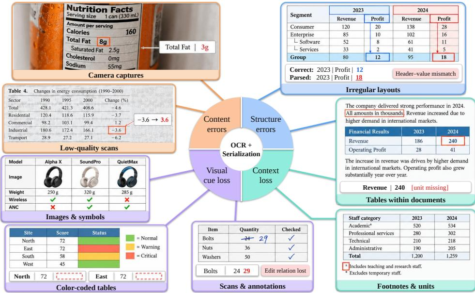
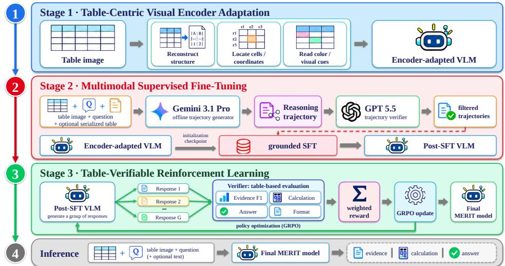
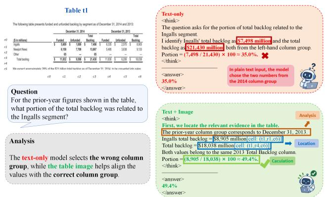
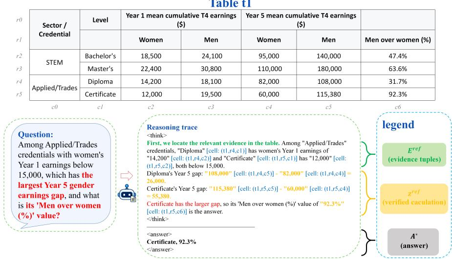
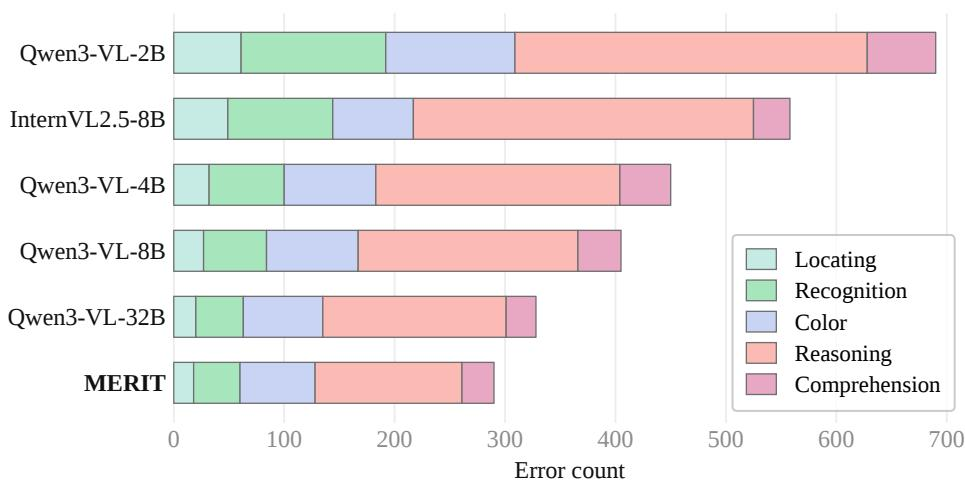
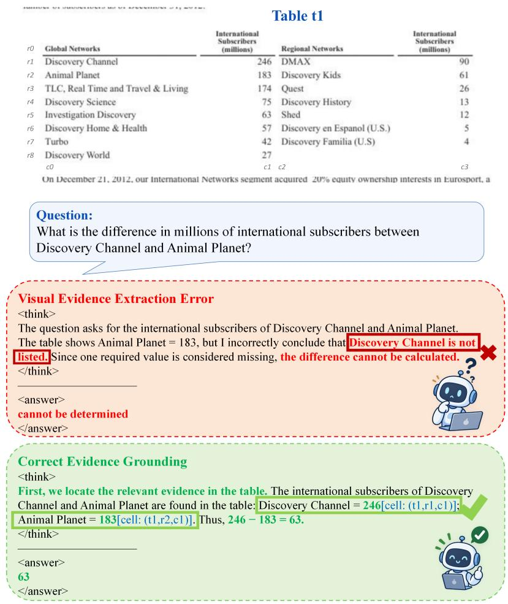
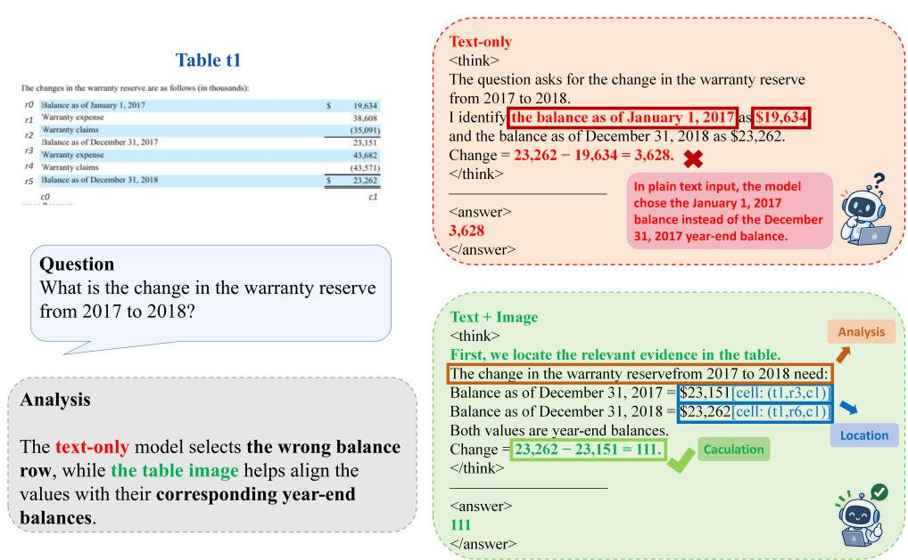
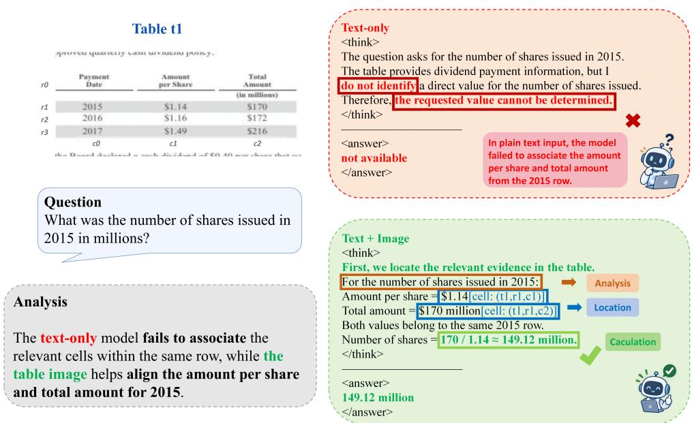
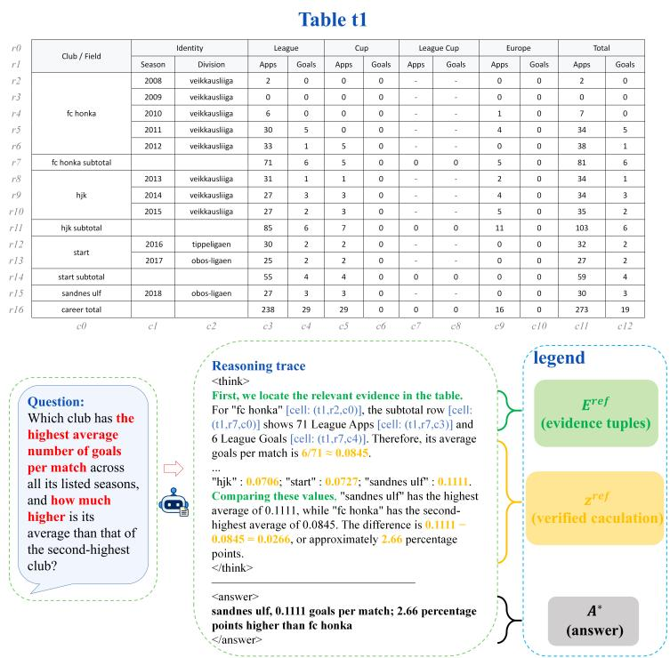
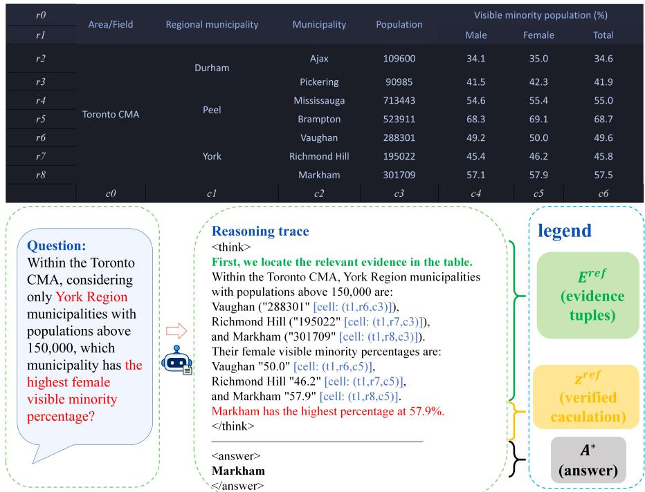

# MERIT: MULTIMODAL EVIDENCE REASONING OVERIMAGE TABLES

Haoyang Jiang1, Zhuotong Fan1, Mingyang Yi1,†, Ju Fan1, Lanqing Hu2, Xiao Zan3

1Renmin University of China

2Independent Researcher 3Beike Inc.

{jianghaoyang233,fzt86,yimingyang,fanj}@ruc.edu.cn

hulanqing1@outlook.com xiaozan001@ke.com

†Corresponding author

## ABSTRACT

Table reasoning with language models typically assumes access to clean textual tables. In practice, tables are often serialized into text, which can corrupt cell contents, distort structural relationships, and discard visual cues, leaving the model to reason over incomplete evidence. In contrast, table images retain this information, but using it requires both accurate perception and reasoning grounded in the relevant cells. To address this, we propose MERIT (Multimodal Evidence Reasoning over Image Tables), a three-stage framework for learning to reason over table images, with serialized tables serving as optional auxiliary inputs (if provided). Our analysis identifies visual evidence acquisition as a bottleneck, motivating table-specific encoder adaptation through reconstruction, localization, and colorconditioned supervision. Building on the adapted representations, supervised finetuning teaches explicit evidence selection and reasoning using verified trajectories. Finally, reinforcement learning refines the policy with separate rewards for evidence correctness, calculation, final answers, and output format. By providing feedback on intermediate steps, the framework targets retrieval and computational errors that final-answer supervision alone does not distinguish. We evaluate the approach on table question answering and fact verification, analyze the contributions of visual inputs and training components, and assess generalization to additional datasets with different table structures and visual presentations.

## 1 INTRODUCTION

Recently, with the rapid development of large language models (LLMs) (Zhao et al., 2026; Naveed et al., 2025), LLMs have become standard tools for table question answering (Table QA), typically taking tables serialized as clean HTML, JSON, or text sequences as input prefixes (Pasupat & Liang, 2015; Chen et al., 2020; 2021; Zhang et al., 2026b). However, tables also appear in PDFs, scans, screenshots, or rendered web pages. These tables are usually converted to text by OCR (Wang et al., 2023) and table parsing (Yu et al., 2024; Kasem et al., 2024), and then processed as standard textual tables. In practice, these textual tables are encoded into a one-dimensional sequence. However, as visualized in Figure 1, this conversion can misalign rows and columns, flatten hierarchical headers, omit cells, and discard merged regions or visual cues such as color and shading (Wang et al., 2024; Li et al., 2022). A parsed table may remain syntactically valid despite these errors, causing a downstream model to reason confidently over corrupted evidence.

Due to the aforementioned limitations, recognizing tables as images provides a natural way to relax this unrealistic dependency on perfect serialization. The table image preserves content, twodimensional structure, and visual semantics in a single representation, enabling reasoning when structured text is unavailable and complementing imperfect text when it is available. Motivated by the strong performance of vision-language models (VLMs) (Bai et al., 2025), we propose to use them to tackle Table QA by providing the original table as an image. This image is used as direct/auxiliary information, depending on whether a textual table is accessible.

  
Figure 1: Common failure modes of OCR and table serialization. Converting table images into text can introduce content errors, structure errors, context loss, and visual cue loss, whereas the original table image preserves this evidence.

However, feeding table images to a VLM is non-trivial. Most VLMs inherit visual encoders pretrained on generic image–text data, which may struggle with table images that contain dense small text, multi-level headers, merged cells, and visual formatting requiring precise row–column alignment. Therefore, we adapt the visual encoder with table-centric supervision to improve its abilities of color understanding, local reading, and row–column localization. However, encoder adaptation alone does not consistently improve end-to-end Table QA. A model may read individual elements more accurately, yet retrieve the wrong values or fail to complete the required computation. This suggests that improving the visual encoder is necessary but insufficient: the model must also learn how to use table evidence to solve the question.

To address this challenge, we develop a multimodal post-training framework combining supervised fine-tuning (SFT) and reinforcement learning (RL). SFT teaches the model table-specific question an swering and structured solution patterns, providing a stable initialization for subsequent optimization. RL then uses table-specific verifiable rewards to improve both intermediate information retrieval and final-answer correctness. This produces a complete training progression from table-aware visual adaptation to reliable multimodal Table QA.

Our contributions are summarized as follows:

• We adapt the visual encoder into a table-aware encoder with table reconstruction, cell localization, and color recognition objectives.

• Based on the adapted encoder, we train a multimodal Table QA model with multimodal SFT and table-specific RL to retrieve question-relevant evidence and reason over it.

• Experiments show that our model improves table perception, evidence retrieval, and finalanswer accuracy, even when structured table representations are unavailable or imperfect.

## 2 RELATED WORK

Table Question Answering. Table QA research typically assumes accurate table serialization and improves reasoning through semantic parsing, table-aware pretraining, cell selection, aggregation, and executable programs (Pasupat & Liang, 2015; Yin et al., 2020; Herzig et al., 2020; Liu et al., 2022; Zhang et al., 2026b). Subsequent studies extend this setting to fact verification and numerical reasoning while improving transparency through explicit row and cell selection (Chen et al., 2020; 2021; Gupta et al., 2022; Wu et al., 2023). However, these methods cannot directly recover information lost or corrupted during serialization, whereas our method grounds evidence and reasoning in the original table image. Recent studies also use table images with VLMs for Table QA (Zheng et al., 2024; Zhao et al., 2024; Park et al., 2025; Jiang et al., 2025b; Kim et al., 2026; Zhang et al., 2025). Complementary studies examine how VLMs use table images and textual representations together for question answering (Zhou et al., 2025b;a; Wang et al., 2026; Jiang et al., 2025a). Documentoriented models improve visual text perception through OCR-free pretraining or document-parsing supervision (Kim et al., 2022; Lee et al., 2023; Niu et al., 2026), but target general text extraction rather than table structure and visual attributes such as color. In contrast, our framework separates table-aware visual encoder adaptation from subsequent QA post-training, enabling the model to use visual evidence without assuming reliable structured input.

Post-Training for Multimodal Table Reasoning. Post-training improves instruction following and reasoning through demonstrations and feedback (Wang et al., 2025; Su et al., 2025; Li et al., 2026a;d;c; Zhang et al., 2026a; Li et al., 2026b), and has been applied to both structured and visual table reasoning (Yang et al., 2025; Wang et al., 2026; Jiang et al., 2025a). Table-oriented approaches strengthen evidence acquisition and reasoning through task-specific training (Wu et al., 2026; Liu et al., 2026a; Kang et al., 2025; Liu et al., 2026b), with intermediate verification supplementing final-answer supervision (Nguyen & Okatani, 2026; Jiang et al., 2026). Unlike these methods, our framework specifically distinguishes retrieving the correct table evidence from correctly computing it. Concretely, our SFT establishes explicit cell retrieval and calculation, while RL applies deterministic, decomposed rewards to evidence correctness, calculation execution, final-answer correctness, and output format. These designs provide targeted feedback on retrieval and computational errors.

## 3 PRELIMINARIES

In this section, we briefly introduce VLMs, SFT, and GRPO, which form the foundations of our multimodal post-training framework.

Vision-Language Modeling. A VLM typically consists of two critical components: a visual encoder $f _ { \phi }$ and an autoregressive language model $\pi _ { \theta }$ . Given an image I and a textual context ${ \bf x } = ( x _ { 1 } , \dots , x _ { K } )$ , the model generates a response $\mathbf { y } = ( y _ { 1 } , \dots , y _ { T } )$

$$
\pi _ { \boldsymbol { \theta } } ( \mathbf { y } \mid I , \mathbf { x } ) = \prod _ { t = 1 } ^ { T } \pi _ { \boldsymbol { \theta } } \left( y _ { t } \mid \mathbf { y } _ { < t } , f _ { \boldsymbol { \phi } } ( I ) , \mathbf { x } \right) ,\tag{1}
$$

where $\phi$ and $\theta$ denote the parameters of the visual encoder and the language decoder, respectively. In our setting, I is a table image and $\mathbf { x } = [ \mathbf { q } ; \mathbf { s } ]$ contains a question q and an optional textual table s, with $\mathbf x = \mathbf q$ when structured input is unavailable.

Supervised Fine-Tuning. SFT trains pretrained models to follow task instructions, produce responses in a prescribed format, and improve their task-specific capabilities (Ouyang et al., 2022; Liu et al., 2023). Given a supervised dataset $\mathcal { D } _ { \mathrm { S F T } } = \{ ( I _ { i } , \mathbf { \bar { x } } _ { i } , \mathbf { y } _ { i } ^ { * } ) \} _ { i = 1 } ^ { \hat { N } }$ , where $\mathbf { y } _ { i } ^ { * } = ( y _ { i , 1 } ^ { * } , \ldots , y _ { i , T _ { i } } ^ { * } )$ is the reference response containing $T _ { i }$ tokens, SFT minimizes the token-level negative log-likelihood:

$$
{ \mathcal { L } } _ { \mathrm { S F T } } ( \phi , \theta ) = - { \frac { 1 } { \sum _ { i = 1 } ^ { N } T _ { i } } } \sum _ { i = 1 } ^ { N } \sum _ { t = 1 } ^ { T _ { i } } \log \pi _ { \theta } \left( y _ { i , t } ^ { * } \mid \mathbf { y } _ { i , < t } ^ { * } , f _ { \phi } ( I _ { i } ) , \mathbf { x } _ { i } \right) .\tag{2}
$$

In our framework, SFT teaches the model to retrieve table evidence and present its calculations and answer in a parseable format. This lets RL refine these components separately, rather than relying on reward feedback alone to teach the solution procedure and output format.

Group Relative Policy Optimization. GRPO is a policy-optimization algorithm that avoids training a separate value model by estimating advantages from the relative rewards of multiple responses sampled for the same input (Shao et al., 2024). Concretely, given an input x and image I, GRPO samples a group of G responses $\{ \mathbf { y } _ { i } \} _ { i = 1 } ^ { G }$ from the old policy $\pi _ { \theta _ { \mathrm { o l d } } }$ and assigns each response a scalar reward $s _ { i } = \mathcal { R } ( \mathbf { x } , \mathbf { y } _ { i } )$ . The group-relative advantage is computed as

$$
\widehat { A } _ { i } = \frac { s _ { i } - \operatorname* { m e a n } \bigl ( \{ s _ { j } \} _ { j = 1 } ^ { G } \bigr ) } { \mathrm { s t d } \bigl ( \{ s _ { j } \} _ { j = 1 } ^ { G } \bigr ) + \delta } ,\tag{3}
$$

where $\delta$ is a small constant for numerical stability. GRPO then maximizes a clipped surrogate objective with a KL penalty relative to a reference policy, taking the expectation over inputs and

  
Figure 2: Overview of MERIT. Table-centric visual encoder adaptation first specializes the visual encoder for table images. Multimodal SFT then teaches explicit evidence selection and structured reasoning, and table-verifiable RL further improves evidence and answer accuracy with verifiable rewards.

response groups sampled from the old policy:

$$
\begin{array} { l } { \mathcal { I } _ { \mathrm { G R P O } } ( \theta ) = \mathbb { E } \Bigg [ \displaystyle \frac { 1 } { G } \sum _ { i = 1 } ^ { G } \frac { 1 } { | \mathbf { y } _ { i } | } \sum _ { t = 1 } ^ { | \mathbf { y } _ { i } | } \Big \{ \operatorname* { m i n } \big ( \rho _ { i , t } ( \theta ) \widehat { A } _ { i } , \mathrm { c l i p } ( \rho _ { i , t } ( \theta ) , 1 - \epsilon , 1 + \epsilon ) \widehat { A } _ { i } \big ) } \\ { - \beta D _ { \mathrm { K L } } \big ( \pi _ { \theta } ( \cdot \vert \ h _ { i , t } ) \| \pi _ { \mathrm { r e f } } ( \cdot \vert \ h _ { i , t } ) \big ) \Big \} \Bigg ] , } \end{array}\tag{4}
$$

where $h _ { i , t } = ( f _ { \phi } ( I ) , \mathbf { x } , \mathbf { y } _ { i , < t } )$ and $\rho _ { i , t } ( \theta ) = \pi _ { \theta } ( y _ { i , t } \mid h _ { i , t } ) / \pi _ { \theta _ { \mathrm { o l d } } } ( y _ { i , t } \mid h _ { i , t } )$ . Here, ϵ and $\beta$ control clipping and KL regularization, respectively. Section 4.3 specifies the table-specific reward R.

## 4 METHOD

As discussed in Section 1, real-world tables may be image-only or lose content, structure, and visual semantics during OCR and parsing. MERIT therefore uses table images as primary input and text as optional auxiliary information. Figure 2 shows its three stages linking perception and verifiable reasoning: Table-Centric Visual Encoder Adaptation specializes the vision backbone for dense cell content, grid coordinates, and visual attributes; Multimodal SFT teaches question-relevant evidence retrieval and grounded reasoning; and Table-Verifiable RL optimizes reasoning with targeted rewards for evidence retrieval, calculation, and answer correctness.

## 4.1 TABLE-CENTRIC VISUAL ENCODER ADAPTATION

Table images provide primary evidence when structured tables are unavailable and complementary evidence when serialized tables are incomplete or noisy. Their utility depends on the visual encoder’s ability to extract image information. However, VLMs such as Qwen3-VL (Bai et al., 2025) are mainly pretrained on broad image–text data, while tables contain dense text, regular grids, hierarchical headers, merged cells, and visual attributes requiring precise row–column alignment. We therefore diagnose this perceptual bottleneck before introducing targeted table supervision for the visual encoder.

Visual-encoder diagnostic. We conduct a controlled experiment on the Table QA benchmark FinQA (Chen et al., 2021), coupling either the NaViT encoder of Qwen2-VL or MinerU 2.5 (Niu et al., 2026) with the same decoder. MinerU 2.5 builds on this encoder with additional documentand table-oriented training for visual text perception. As shown in Figure 3a, it raises image-based accuracy from 57.8% to 72.2%, a 14.4-point gain. With gold supporting facts, the models perform nearly identically (79.8% versus 79.6%). Because the decoder is fixed and gold facts bypass visual evidence extraction, the gain appears to stem primarily from better evidence perception rather than reasoning over provided evidence. This finding motivates our table-specific visual encoder adaptation.1

<table><tr><td>Setting / Visual Encoder</td><td>Acc. (%)</td></tr><tr><td>NaViT → Qwen3 decoder</td><td></td></tr><tr><td>Normal</td><td>57.8</td></tr><tr><td>+Gold Facts</td><td>79.8</td></tr><tr><td>MinerU 2.5 → Qwen3 decoder</td><td></td></tr><tr><td>Normal</td><td>72.2</td></tr><tr><td>+Gold Facts</td><td>79.6</td></tr><tr><td>Gain from doc/table training</td><td></td></tr><tr><td>Normal</td><td>+14.4</td></tr><tr><td>+Gold Facts</td><td>-0.2</td></tr></table>

(a) Accuracy (%) under different visual encoders.

  
(b) Text-only input selects values from the wrong column group, whereas the table image aligns them with the correct one.  
Figure 3: Diagnosing the visual bottleneck in table question answering. (a) NaViT and MinerU 2.5 are connected to the same Qwen3 decoder. The accuracy gap under normal conditions largely disappears when gold facts are provided, indicating that the visual encoder is the primary bottleneck. (b) An example in which the table image corrects an evidence-selection error made from text-only input.

Targeted adaptation. Our analysis of failure cases (Appendix C.1) shows that, when processing table images, visual encoders commonly misread dense cell content, associate values with incorrect row–column positions, or miss question-relevant visual attributes. These three perceptual errors motivate the following task families:

$$
\mathcal { K } = \{ \mathrm { R E C O N } , \mathrm { L O C A T E } , \mathrm { C O L O R } \} .\tag{5}
$$

RECON reconstructs textual tables from rendered images, supporting dense-content recognition and structural preservation. LOCATE uses cell-, row-, and column-level queries to map visual content to logical grid positions. COLOR trains visual-attribute grounding by assigning random background colors to selected cells and asking questions whose answers depend on those assignments. Since colors are sampled independently of cell values, answering requires visual rather than textual cues.

All three tasks use response-generation objectives. The training data are constructed from MMTab (Zheng et al., 2024), together with auxiliary table QA examples from MMTab. Reconstruction and localization targets come from source annotations, whereas color-conditioned targets are generated from assigned colors and cell contents. We compute a length-normalized autoregressive cross-entropy for each task family and combine the losses using task-specific weights:

$$
\operatorname* { m i n } _ { \phi } \mathcal { L } _ { \mathrm { a d a p t } } ( \phi ) = \sum _ { k \in \mathcal { K } } \lambda _ { k } \mathcal { L } _ { k } ( \phi ) , \qquad \mathcal { L } _ { k } ( \phi ) = - \frac { 1 } { | \mathbf { y } | } \sum _ { t = 1 } ^ { | \mathbf { y } | } \log \pi _ { \theta } \left( y _ { t } | f _ { \phi } ( I ) , X _ { k } , \mathbf { y } _ { < t } \right) ,\tag{6}
$$

where I denotes the table image, $X _ { k }$ denotes the task-specific textual input for task family $k ,$ and y denotes the target response. The visual encoder is trained by minimizing the weighted loss in Eq. (6) over the collected data. Data construction and instruction templates are detailed in Appendix A.2.

Effect of encoder adaptation. Table 1 evaluates the adapted encoder on six table-structure understanding tasks. The proposed adaptation improves the macro-average from 46.89 to 53.51, with particularly strong gains in cell extraction, cell localization, and row–column extraction. These results confirm that the targeted objectives strengthen the table-specific perceptual capabilities required by downstream reasoning.

Notably, though these auxiliary tasks improve table perception, they do not directly train the complete evidence-to-answer procedure required for downstream QA. Therefore, we next use multimodal SFT to initialize table reasoning and establish the output protocol for subsequent reinforcement learning.

## 4.2 MULTIMODAL SUPERVISED FINE-TUNING

The adapted encoder provides table-specific visual representations but does not teach the model to select question-relevant evidence, perform calculations, or produce parseable responses. Applying RL directly would require learning both evidence-grounded reasoning and the output protocol from sparse rewards. We therefore initialize the adapted model with multimodal SFT on grounded demonstrations. Each demonstration pairs a table image, optional textual context, and a question with a verified trajectory specifying supporting evidence, calculations when needed, and the final answer. SFT establishes initial table-solving behavior and a standard output format for component-wise verifiable rewards in subsequent RL. Data construction and composition are described below and in Appendix A.3.

Grounded trajectory construction. We use Gemini-3.1-Pro (Google DeepMind, 2026) to generate answer-conditioned Chain-of-Thought (CoT) trajectories (Wei et al., 2022) from table images, structured tables, cell metadata, questions, and annotated answers. Each trajectory identifies relevant headers and cells, recording each cited cell as (r, c, v), where r and c are its logical row and column and v its normalized value. It checks cited values against the corresponding cells before lookup, comparison, calculation, or factual inference, retaining visual conditions such as color when they affect evidence selection. GPT-5.5 (OpenAI, 2026) then independently verifies the cited tuples against the source inputs, as well as the derivation and the final answer. Only trajectories passing all three checks enter $\mathcal { D } _ { \mathrm { S F T } }$ . Each accepted trajectory therefore provides

$$
\left( E ^ { \mathrm { r e f } } , z ^ { \mathrm { r e f } } , A ^ { * } \right) , \qquad E ^ { \mathrm { r e f } } = \{ ( r _ { j } , c _ { j } , v _ { j } ) \} _ { j = 1 } ^ { M } ,\tag{7}
$$

where $E ^ { \mathrm { r e f } }$ contains the verified evidence tuples, $z ^ { \mathrm { r e f } }$ the verified calculation when applicable, and $A ^ { * }$ the annotated answer or verification label.

The response serializes the trajectory $R ( E ^ { \mathrm { r e f } } , z ^ { \mathrm { r e f } } )$ in a unified format:

$$
\mathbf { y } ^ { * } = < \mathrm { t h i n k } > R ( E ^ { \mathrm { r e f } } , z ^ { \mathrm { r e f } } ) < / \mathrm { t h i n k } > < \mathrm { a n s w e r } > A ^ { * } < / \mathrm { a n s w e r } > .\tag{8}
$$

This format exposes evidence, calculation, and answer as separately parseable components. Figure 4 illustrates how the selected table cells are linked to the intermediate calculation and final answer.

Training objective. For each accepted response $\mathbf { y } ^ { * }$ and the corresponding table image I and query x, we minimize the length-normalized autoregressive cross-entropy of the policy $\pi _ { \theta }$ (the SFT objective in Section 3) with the visual encoder $f _ { \phi }$ frozen. The training loss is computed only over response tokens, thereby supervising both the grounded reasoning trajectory and the standardized output format. Generation and verification prompts are provided in Appendix A.4.

SFT establishes an initial table-solving policy and a parseable generation protocol, but it only imitates fixed demonstrations under teacher forcing. We therefore further optimize responses sampled from the policy using table-verifiable reinforcement learning.

## 4.3 TABLE-VERIFIABLE REINFORCEMENT LEARNING

After SFT, the policy follows a standardized output format, but its likelihood objective does not evaluate the correctness of sampled responses. We therefore further improve the SFT model with GRPO using separate rewards for evidence retrieval $r _ { \mathrm { e v i } }$ , calculation $r _ { \mathrm { c a l c } }$ , final-answer correctness $r _ { \mathrm { a n s } } ,$ and output format $r _ { \mathrm { f m t } }$ . Following Section 4.2, we extract the cited cells, arithmetic expression, and final answer from each generated response.

Table 1: Evaluation results on six held-in table-structure understanding benchmarks from MMTab (Zheng et al., 2024). Metric definitions follow Zheng et al. (2024) (see Section B.2). For benchmarks with multiple submetrics, we first average their submetrics; Avg. then denotes the macro-average over the six benchmarks. Higher values indicate better performance.
<table><tr><td rowspan="3">Method</td><td rowspan="3">LLM</td><td colspan="2">TSD</td><td rowspan="3">TCE</td><td rowspan="3">TCL</td><td rowspan="3">MCD F1</td><td colspan="2">RCE Row</td><td colspan="4">TR</td><td rowspan="3">Avg.</td></tr><tr><td>Row Acc.</td><td>Col. Acc.</td><td>Acc.</td><td></td><td>Col. F1</td><td>HTML TEDS</td><td>Markdown TEDS</td><td>LaTeX TEDS</td></tr><tr><td>Table-LLaVA 7B</td><td>Vicuna-1.5 7B</td><td>41.50</td><td>59.00</td><td>27.68</td><td>41.67</td><td>38.85</td><td>38.45</td><td>48.67</td><td>63.88</td><td>66.58</td><td>66.52</td><td>44.61</td></tr><tr><td>Table-LLaVA 13B</td><td>Vicuna-1.5 13B</td><td>44.40</td><td>75.00</td><td>30.88</td><td>45.49</td><td>43.60</td><td>37.74</td><td>55.02</td><td>66.24</td><td>66.75</td><td>66.69</td><td>48.77</td></tr><tr><td>Base</td><td>Qwen3-VL 8B-Instruct</td><td>37.80</td><td>72.40</td><td>37.46</td><td>38.63</td><td>30.99</td><td>41.19</td><td>68.02</td><td>59.26</td><td>88.19</td><td>46.25</td><td>46.89</td></tr><tr><td>Ours</td><td>Qwen3-VL 8B-Instruct</td><td>45.20</td><td>73.20</td><td>45.56</td><td>48.75</td><td>35.91</td><td>51.40</td><td>75.35</td><td>62.12</td><td>89.96</td><td>52.76</td><td>53.51</td></tr></table>

Table t1
<table><tr><td rowspan=7 colspan=1>r0r1r2r3r4r5</td><td></td><td></td><td></td><td></td><td></td><td></td><td></td></tr><tr><td rowspan=2 colspan=1>Sector /Credential</td><td rowspan=1 colspan=1>Level</td><td rowspan=1 colspan=2>Year 1 mean cumulative T4 earnings($)</td><td rowspan=1 colspan=2>Year 5 mean cumulative T4 earnings($)</td><td rowspan=1 colspan=1></td></tr><tr><td rowspan=1 colspan=1></td><td rowspan=1 colspan=1>Women</td><td rowspan=1 colspan=1>Men</td><td rowspan=1 colspan=1>Women</td><td rowspan=1 colspan=1>Men</td><td rowspan=1 colspan=1>Men over women (%)</td></tr><tr><td rowspan=2 colspan=1>STEM</td><td rowspan=1 colspan=1>Bachelor&#x27;s</td><td rowspan=1 colspan=1>18,500</td><td rowspan=1 colspan=1>24,100</td><td rowspan=1 colspan=1>95,000</td><td rowspan=1 colspan=1>140,000</td><td rowspan=1 colspan=1>47.4%</td></tr><tr><td rowspan=1 colspan=1>Master&#x27;s</td><td rowspan=1 colspan=1>22,400</td><td rowspan=1 colspan=1>30,800</td><td rowspan=1 colspan=1>110,000</td><td rowspan=1 colspan=1>180,000</td><td rowspan=1 colspan=1>63.6%</td></tr><tr><td rowspan=2 colspan=1>Applied/Trades</td><td rowspan=1 colspan=1>Diploma</td><td rowspan=1 colspan=1>14,200</td><td rowspan=1 colspan=1>18,100</td><td rowspan=1 colspan=1>82,000</td><td rowspan=1 colspan=1>108,000</td><td rowspan=1 colspan=1>31.7%</td></tr><tr><td rowspan=1 colspan=1>Certificate</td><td rowspan=1 colspan=1>12,000</td><td rowspan=1 colspan=1>19,500</td><td rowspan=1 colspan=1>60,000</td><td rowspan=1 colspan=1>115,380</td><td rowspan=1 colspan=1>92.3%</td></tr></table>

  
Figure 4: Illustration of a grounded reasoning trajectory. The model identifies supporting cells using logical coordinates, performs the required calculation, and produces the final answer in a standardized format. The example is illustrative, and intermediate steps are abbreviated for clarity. The total reward is a weighted sum:

$$
r = \lambda _ { \mathrm { e v i } } r _ { \mathrm { e v i } } + \lambda _ { \mathrm { c a l c } } r _ { \mathrm { c a l c } } + \lambda _ { \mathrm { a n s } } r _ { \mathrm { a n s } } + \lambda _ { \mathrm { f m t } } r _ { \mathrm { f m t } } ,\tag{9}
$$

where the nonnegative coefficients λ control the contribution of each component. We use r as the reward R in the GRPO objective (4).

Verifiable reward components. The evidence reward measures the set-level F1 between the predicted and reference evidence cells:

$$
r _ { \mathrm { e v i } } = \frac { 2 N _ { \mathrm { m a t c h } } } { N _ { \mathrm { p r e d } } + N _ { \mathrm { r e f } } } ,\tag{10}
$$

where $N _ { \mathrm { p r e d } }$ and $N _ { \mathrm { r e f } }$ are the numbers of predicted and reference evidence cells, respectively, and $N _ { \mathrm { m a t c h } }$ is the number of correctly matched cells. A predicted cell is counted as matched only when its logical row, column, and normalized value all agree with the same reference cell.

For arithmetic questions, let zˆ denote the calculation extracted from the model response and zref the verified reference calculation. The calculation reward is the binary indicator $\mathbb { I } _ { \left\{ \hat { z } = z ^ { \mathrm { r e f } } \right\} }$ , where equality is determined by executing both calculations and comparing their normalized numerical results. Numerical normalization removes formatting symbols and converts percentages and units when necessary. For non-arithmetic questions, $\lambda _ { \mathrm { c a l c } }$ is set to zero.

Let Aˆ denote the answer extracted from the model response and $A ^ { * }$ the annotated answer. The answer reward is the binary indicator $\mathbb { I } _ { \{ \hat { A } = A ^ { * } \} }$ , where the comparison is performed after normalizing capitalization, whitespace, punctuation, and numerical formatting.

Finally, the format reward is the binary indicator $\mathbb { I } _ { \{ \mathrm { v a l i d ~ f o r m a t } \} }$ . It equals one when all required fields can be parsed from the model response and zero otherwise. The required fields include the evidence and final answer for all questions, as well as the calculation for arithmetic questions.

For each input, we score a group of sampled responses using (9) and update the policy with the GRPO objective in Section 3. The SFT checkpoint initializes both the trainable policy and the fixed reference policy. We keep the adapted visual encoder frozen and update the language decoder. Reward weights, parsing rules, and numerical tolerances are specified in Appendix A.6.

## 5 EXPERIMENTS

In this section, we evaluate our framework against existing methods on table question answering and fact verification to determine whether the information preserved in table images improves table reasoning. Furthermore, we evaluate its generalization to out-of-distribution (OOD) data, particularly when serialized tables are unavailable. Finally, ablation studies examine the contribution of each training stage.

Table 2: Effectiveness on held-out splits of the five datasets used for reasoning post-training. Scores are accuracy (%); Avg. is the unweighted mean across the five datasets. The three rows for our model report results with different table inputs, indicated in parentheses. † denotes results taken from published reports. Answers are extracted and evaluated against the ground truth, with ambiguous cases reviewed by GPT-5.5.
<table><tr><td rowspan="2">Method</td><td colspan="3">Table Question Answering</td><td colspan="2">Fact Verification</td><td rowspan="2">Avg.</td></tr><tr><td>TABMWP</td><td>WTQ</td><td>TAT-QA</td><td>TabFact</td><td>InfoTabs</td></tr><tr><td>Proprietary models</td><td></td><td></td><td></td><td></td><td></td><td></td></tr><tr><td>GPT-5.5</td><td>89.97</td><td>88.96</td><td>85.62</td><td>93.65</td><td>76.59</td><td>86.96</td></tr><tr><td>Claude Sonnet 5</td><td>89.97</td><td>82.94</td><td>88.29</td><td>81.94</td><td>74.58</td><td>83.55</td></tr><tr><td>Gemini 3.5 Flash</td><td>84.62</td><td>87.63</td><td>88.63</td><td>92.64</td><td>78.93</td><td>86.49</td></tr><tr><td>General-purpose models</td><td></td><td></td><td></td><td></td><td></td><td></td></tr><tr><td>InternVL2.5-8B</td><td>93.56</td><td>54.77</td><td>55.18</td><td>72.49</td><td>67.30</td><td>68.66</td></tr><tr><td>Qwen3-VL-8B</td><td>85.97</td><td>61.04</td><td>82.51</td><td>77.71</td><td>73.04</td><td>76.05</td></tr><tr><td>Qwen3-8B</td><td>86.20</td><td>76.24</td><td>80.18</td><td>86.22</td><td>79.19</td><td>81.61</td></tr><tr><td>Table-specialized models</td><td></td><td></td><td></td><td></td><td></td><td></td></tr><tr><td>Table-LLaVA-7B†</td><td>53.20</td><td>16.62</td><td>10.49</td><td>57.62</td><td>66.78</td><td>40.94</td></tr><tr><td>TabPedia†</td><td>10.66</td><td>23.53</td><td>13.08</td><td>35.49</td><td>2.43</td><td>17.04</td></tr><tr><td>HIPPO†</td><td>87.34</td><td>55.71</td><td>61.40</td><td>82.29</td><td>75.70</td><td>72.49</td></tr><tr><td>TURBO†</td><td>96.75</td><td>67.80</td><td>73.21</td><td>85.81</td><td>81.89</td><td>81.09</td></tr><tr><td>Text-only RL baseline</td><td></td><td></td><td></td><td></td><td></td><td></td></tr><tr><td>Qwen3-8B + RL</td><td>92.85</td><td>73.31</td><td>84.95</td><td>85.58</td><td>76.39</td><td>82.62</td></tr><tr><td>Our model</td><td></td><td></td><td></td><td></td><td></td><td></td></tr><tr><td>Ours (Text only)</td><td>98.48</td><td>64.71</td><td>90.16</td><td>87.95</td><td>75.80</td><td>83.42</td></tr><tr><td>Ours (Image only)</td><td>98.13</td><td>72.86</td><td>87.56</td><td>90.08</td><td>78.63</td><td>85.45</td></tr><tr><td>Ours (Image + Text)</td><td>98.69</td><td>76.40</td><td>87.44</td><td>90.84</td><td>80.15</td><td>86.70</td></tr></table>

Implementation. We initialize from Qwen3-VL-8B-Instruct (Bai et al., 2025) and apply visualencoder adaptation, multimodal SFT, and GRPO as described in Section 4. Inputs comprise table images, questions or statements, and accompanying passages; serialized tables are supplied only in the specified input comparisons. Data construction and training configurations are detailed in Appendix A.

Evaluation. We consider two tasks. Table question answering includes TABMWP (Lu et al., 2023) for mathematical word problems, WikiTableQuestions (WTQ) (Pasupat & Liang, 2015) for compositional reasoning, and TAT-QA (Zhu et al., 2021) for financial table-and-text reasoning. Table fact verification includes TabFact (Chen et al., 2020) with binary labels and InfoTabs (Gupta et al., 2020) with three-way labels. Following HIPPO (Wang et al., 2026) and TURBO (Jiang et al., 2025a), we train SFT and GRPO on these five datasets and evaluate on the same held-out splits with the same metrics. To assess generalization, we further evaluate on HiTab (Cheng et al., 2022), FinQA (Chen et al., 2021), FinMMR (Tang et al., 2025), TableVista (Yang et al., 2026), and MMMU-T (Yue et al., 2024) without further fine-tuning; these datasets vary in table structure and visual presentation, and only HiTab and FinQA provide serialized tables; for the other three, we convert table images into Markdown with MinerU 2.5 (Niu et al., 2026), and visual models receive both the image and this text. We report accuracy and unweighted averages. Dataset, split, and scoring details are in Appendix B.1.

Baselines. We include four groups of comparisons. (1) Proprietary models: GPT-5.5, Claude Sonnet 5, and Gemini 3.5 Flash. (2) General-purpose models: InternVL2.5-8B and Qwen3-VL-8B, with the latter providing the same-backbone reference before our table-specific training. (3) Table-specialized models: Table-LLaVA (Zheng et al., 2024), TabPedia (Zhao et al., 2024), HIPPO (Wang et al., 2026), and TURBO (Jiang et al., 2025a); since TURBO is not publicly released, we report its published results and do not evaluate it on the OOD datasets. (4) Text-based models: Qwen3-8B and Qwen3-8B + RL, which reason over serialized cell contents. The RL variant evaluates whether image-based reasoning remains beneficial when the text-based alternative also receives reasoning post-training. Baseline details are in Appendix B.

Results. We first examine whether reasoning over table images improves table question answering and fact verification over text-based and table-specialized methods. As shown in Table 2, table images alone support strong reasoning: with image-only input, MERIT reaches 85.45% average accuracy, 9.40 points above its Qwen3-VL-8B backbone (more than 11 points on WTQ and TabFact). It also outperforms TURBO, the strongest table-specialized baseline, by 4.36 points and the text-only

Table 3: Generalization ability on five additional datasets without further fine-tuning. Scores are accuracy (%); Avg. requires all five scores.
<table><tr><td rowspan="2">Method</td><td colspan="2">Serialized Table Available</td><td colspan="3">No Serialized Table</td><td rowspan="2">Avg.</td></tr><tr><td>HiTab</td><td>FinQA</td><td>FinMMR</td><td>TableVista</td><td>MMMU-T</td></tr><tr><td colspan="6">General-purpose models</td><td></td></tr><tr><td>InternVL2.5-8B</td><td>31.03</td><td>24.96</td><td>25.20</td><td>35.30</td><td>22.35</td><td>27.77</td></tr><tr><td>Qwen3-VL-8B</td><td>67.43</td><td>48.55</td><td>33.02</td><td>69.54</td><td>42.77</td><td>52.27</td></tr><tr><td>Qwen3-8B</td><td>35.28</td><td>33.04</td><td>33.18</td><td>54.00</td><td>32.75</td><td>37.65</td></tr><tr><td colspan="6">Table-specialized models</td><td></td></tr><tr><td>Table-LLaVA-7B</td><td>7.70</td><td>12.30</td><td>6.71</td><td>19.28</td><td>5.92</td><td>10.38</td></tr><tr><td>TabPedia</td><td>9.64</td><td>2.01</td><td>0.66</td><td>10.98</td><td>1.78</td><td>5.01</td></tr><tr><td>HIPPO</td><td>35.30</td><td>30.08</td><td>16.99</td><td>33.87</td><td>11.18</td><td>25.48</td></tr><tr><td colspan="6">Text-only RL baseline</td><td></td></tr><tr><td>Qwen3-8B + RL</td><td>39.91</td><td>45.60</td><td>36.65</td><td>57.11</td><td>32.75</td><td>42.40</td></tr><tr><td colspan="6">Our model</td><td></td></tr><tr><td>Ours</td><td>68.91</td><td>47.60</td><td>48.67</td><td>70.72</td><td>38.60</td><td>54.90</td></tr></table>

RL baseline by 2.83 points. Moreover, despite having only 8B parameters, this image-only model surpasses Claude Sonnet 5 and approaches GPT-5.5 and Gemini 3.5 Flash, and our variants obtain the best TABMWP and TAT-QA scores among all methods. Beyond serving as a standalone input, table images also complement serialized text: with the same checkpoint, text-only input obtains 83.42%, whereas adding the table image raises the average to 86.70%, the best among open models. This indicates that images supply evidence that serialization loses.

OOD generalization. Because SFT and GRPO use only five datasets, strong held-out results could still reflect dataset-specific fitting. We therefore test whether the learned perception and reasoning transfer to unseen datasets with different table structures and visual presentations, including three without serialized tables, which mirror the image-only setting that motivates this work. As shown in Table 3, MERIT achieves the best average accuracy of 54.90% on the five unseen datasets, 2.63 points above its Qwen3-VL-8B initialization, with the largest gain on FinMMR (+15.65). In contrast, existing table-specialized models transfer poorly: HIPPO, the strongest among them, averages 25.48%, less than half of MERIT. MERIT also exceeds the text-only RL baseline by 12.50 points, indicating that the gains from our training extend beyond the training datasets.

Ablation study. Finally, we examine why each training stage is needed. MERIT stacks three stages, but only SFT and GRPO optimize grounded reasoning on the target tasks, whereas encoder adaptation targets perception. Table 4 therefore ablates encoder adaptation, SFT, and GRPO under image-only input, enabling each stage alone and in combination while keeping their original order. Encoder adaptation alone leaves end-to-end accuracy nearly unchanged (76.07% versus 76.05%), since its auxiliary objectives do not train the complete evidence-to-answer procedure. Its benefit instead emerges after post-training: the full pipeline outperforms SFT + GRPO without adaptation by 0.95 points, with gains on all five datasets. Moreover, the two post-training stages are complementary, as the full pipeline exceeds encoder adaptation followed by GRPO alone by 9.47 points and by SFT alone by 2.11 points. Appendices C.2 and C.3 further ablate the adaptation objectives and reward components.

Table 4: Ablation of encoder adaptation and post-training. Scores are accuracy (%). ∆Avg. is relative to the base.
<table><tr><td rowspan="2">Variant</td><td colspan="3">Table QA</td><td colspan="2">Fact Verification</td><td colspan="2">Avg.</td></tr><tr><td>TABMWP</td><td>WTQ</td><td>TAT-QA</td><td>TabFact</td><td>InfoTabs</td><td>Avg.</td><td>∆Avg.</td></tr><tr><td colspan="8">w/o Encoder adaptation</td></tr><tr><td>Base</td><td>85.97</td><td>61.04</td><td>82.51</td><td>77.71</td><td>73.04</td><td>76.05</td><td></td></tr><tr><td>+ SFT</td><td>97.38</td><td>71.52</td><td>86.53</td><td>88.49</td><td>78.39</td><td>84.46</td><td>+8.41</td></tr><tr><td>+ GRPO</td><td>93.68</td><td>60.52</td><td>81.74</td><td>77.93</td><td>73.13</td><td>77.40</td><td>+1.35</td></tr><tr><td>+ SFT + GRPO</td><td>97.70</td><td>71.52</td><td>86.14</td><td>89.38</td><td>77.78</td><td>84.50</td><td>+8.45</td></tr><tr><td colspan="8">w/ Encoder adaptation</td></tr><tr><td>Encoder only</td><td>86.44</td><td>61.35</td><td>82.38</td><td>77.46</td><td>72.70</td><td>76.07</td><td>+0.01</td></tr><tr><td>+ SFT</td><td>97.09</td><td>68.85</td><td>85.10</td><td>87.48</td><td>78.17</td><td>83.34</td><td>+7.28</td></tr><tr><td>+ GRPO</td><td>91.02</td><td>61.46</td><td>79.53</td><td>78.19</td><td>69.67</td><td>75.98</td><td>-0.08</td></tr><tr><td>+ SFT + GRPO</td><td>98.13</td><td>72.86</td><td>87.56</td><td>90.08</td><td>78.63</td><td>85.45</td><td>+9.40</td></tr></table>

## 6 CONCLUSION

We presented MERIT, which reasons over table images as primary evidence, with serialized text as optional input. Guided by a diagnostic that identifies visual perception as a bottleneck, it adapts the visual encoder with table-centric objectives and then applies evidence-grounded SFT and RL with decomposed verifiable rewards. Image-only MERIT outperforms its backbone, table-specialized models, and a text-only RL baseline, approaches proprietary models, and transfers to unseen datasets; adding serialized text improves it further. Ablations show that encoder adaptation pays off after post-training and that SFT and GRPO are complementary.

## REFERENCES

Shuai Bai, Yuxuan Cai, Ruizhe Chen, Keqin Chen, Xionghui Chen, Zesen Cheng, Lianghao Deng, Wei Ding, Chang Gao, Chunjiang Ge, Wenbin Ge, Zhifang Guo, Qidong Huang, Jie Huang, Fei Huang, Binyuan Hui, Shutong Jiang, Zhaohai Li, Mingsheng Li, Mei Li, Kaixin Li, Zicheng Lin, Junyang Lin, Xuejing Liu, Jiawei Liu, Chenglong Liu, Yang Liu, Dayiheng Liu, Shixuan Liu, Dunjie Liu, Ruilin Lu, Chenxu Luo, Rui Lv, Rui Men, Lingchen Meng, Xuancheng Ren, Xingzhang Ren, Sibo Song, Yuchong Sun, Jun Tang, Jianhong Tu, Jianqiang Wan, Peng Wang, Pengfei Wang, Qiuyue Wang, Yuxuan Wang, Tianbao Xie, Yiheng Xu, Haiyang Xu, Jin Xu, Zhibo Yang, Mingkun Yang, Jianxin Yang, An Yang, Bowen Yu, Fei Zhang, Hang Zhang, Xi Zhang, Bo Zheng, Humen Zhong, Jingren Zhou, Fan Zhou, Jing Zhou, Yuanzhi Zhu, and Ke Zhu. Qwen3-vl technical report. arXiv preprint arXiv:2511.21631, 2025.

Wenhu Chen, Hongmin Wang, Jianshu Chen, Yunkai Zhang, Hong Wang, Shiyang Li, Xiyou Zhou, and William Yang Wang. TabFact: A large-scale dataset for table-based fact verification. In International Conference on Learning Representations, 2020.

Zhiyu Chen, Wenhu Chen, Charese Smiley, Sameena Shah, Iana Borova, Dylan Langdon, Reema Moussa, Matt Beane, Ting-Hao Huang, Bryan Routledge, and William Yang Wang. FinQA: A dataset of numerical reasoning over financial data. In Empirical Methods in Natural Language Processing, 2021.

Zhoujun Cheng, Haoyu Dong, Zhiruo Wang, Ran Jia, Jiaqi Guo, Yan Gao, Shi Han, Jian-Guang Lou, and Dongmei Zhang. HiTab: A hierarchical table dataset for question answering and natural language generation. In Associationfor Computational Linguistics, 2022.

Google DeepMind. Gemini 3.1 Pro model card. Technical report, 2026.

Vivek Gupta, Maitrey Mehta, Pegah Nokhiz, and Vivek Srikumar. INFOTABS: Inference on tables as semi-structured data. In Proceedings of the 58th Annual Meeting of the Association for Computational Linguistics, 2020.

Vivek Gupta, Shuo Zhang, Alakananda Vempala, Yujie He, Temma Choji, and Vivek Srikumar. Right for the right reason: Evidence extraction for trustworthy tabular reasoning. In Association for Computational Linguistics, 2022.

Jonathan Herzig, Pawel Krzysztof Nowak, Thomas Muller, Francesco Piccinno, and Julian Eisensch-¨ los. TaPas: Weakly supervised table parsing via pre-training. In Association for Computational Linguistics, 2020.

Jun-Peng Jiang, Yu Xia, Hai-Long Sun, Shiyin Lu, Qingguo Chen, Weihua Luo, Kaifu Zhang, De-Chuan Zhan, and Han-Jia Ye. Multimodal tabular reasoning with privileged structured information. In Neural Information Processing Systems, 2025a.

Jun-Peng Jiang, Tao Zhou, De-Chuan Zhan, and Han-Jia Ye. Compositional condition question answering in tabular understanding. In International Conference on Machine Learning, 2025b.

Yubo Jiang, Yitong An, Xin Yang, Abudukelimu Wuerkaixi, Xuxin Cheng, Fengying Xie, Zhiguo Jiang, Cao Liu, Ke Zeng, and Haopeng Zhang. V-tableR1: Process-supervised multimodal table reasoning with critic-guided policy optimization. arXiv preprint arXiv:2604.20755, 2026.

Xiaoqiang Kang, Shengen Wu, Zimu Wang, Yilin Liu, Xiaobo Jin, Kaizhu Huang, Wei Wang, Yutao Yue, Xiaowei Huang, and Qiufeng Wang. Can GRPO boost complex multimodal table understanding? In Proceedings of the 2025 Conference on Empirical Methods in Natural Language Processing, 2025.

Mahmoud SalahEldin Kasem, Abdelrahman Abdallah, Alexander Berendeyev, Ebrahem Elkady, Mohamed Mahmoud, Mahmoud Abdalla, Mohamed Hamada, Sebastiano Vascon, Daniyar Nurseitov, and Islam Taj-Eddin. Deep learning for table detection and structure recognition: A survey. ACM Computing Surveys, 2024.

Geewook Kim, Teakgyu Hong, Moonbin Yim, JeongYeon Nam, Jinyoung Park, Jinyeong Yim, Wonseok Hwang, Sangdoo Yun, Dongyoon Han, and Seunghyun Park. OCR-free document understanding transformer. In European Conference on Computer Vision, 2022.

Jongha Kim, Minseong Bae, Sanghyeok Lee, Jinsung Yoon, and Hyunwoo J. Kim. TabFlash: Efficient table understanding with progressive question conditioning and token focusing. In Proceedings of the AAAI Conference on Artificial Intelligence, 2026.

Kenton Lee, Mandar Joshi, Iulia Raluca Turc, Hexiang Hu, Fangyu Liu, Julian Martin Eisenschlos, Urvashi Khandelwal, Peter Shaw, Ming-Wei Chang, and Kristina Toutanova. Pix2Struct: Screenshot parsing as pretraining for visual language understanding. In International Conference on Machine Learning, 2023.

Chenxia Li, Ruoyu Guo, Jun Zhou, Mengtao An, Yuning Du, Lingfeng Zhu, Yi Liu, Xiaoguang Hu, and Dianhai Yu. PP-StructureV2: A stronger document analysis system. arXiv preprint arXiv:2210.05391, 2022.

Xiuyu Li, Jinkai Zhang, Mingyang Yi, Yu Li, Longqiang Wang, Yue Wang, and Ju Fan. Ets: Energyguided test-time scaling for training-free rl alignment. In Forty-third International Conference on Machine Learning, 2026a.

Yu Li, Xiuyu Li, Mingyang Yi, Jiaxing Wang, Liangxu Zhang, Zhaolong Xing, and Zhen Chen. Turning off-policy tokens on-policy: A plug-in approach for improving llm alignment. arXiv preprint arXiv:2607.04728, 2026b.

Yu Li, Mingyang Yi, Xiuyu Li, Ju Fan, Fuxin Jiang, Binbin Chen, Peng Li, Jie Song, and Tieying Zhang. Reasoning and tool-use compete in agentic rl: From quantifying interference to disentangled tuning. arXiv preprint arXiv:2602.00994, 2026c.

Zhaochun Li, Mingyang Yi, Yue Wang, Shisheng Cui, and Yong Liu. Towards a theoretical understanding to the generalization of rlhf. arXiv preprint arXiv:2601.16403, 2026d.

Chaohu Liu, Haoyu Cao, YongXiang Hua, and Linli Xu. Multimodal table understanding with difficulty-aware reinforcement learning. In Proceedings of the AAAI Conference on Artificial Intelligence, 2026a.

Chaohu Liu, Shida Wang, Yubo Wang, and Linli Xu. TableMix: Enhancing multimodal table reasoning in MLLMs from a data-centric perspective. In Computer Vision and Pattern Recognition, 2026b.

Haotian Liu, Chunyuan Li, Qingyang Wu, and Yong Jae Lee. Visual instruction tuning. In Neural Information Processing Systems, 2023.

Qian Liu, Bei Chen, Jiaqi Guo, Morteza Ziyadi, Zeqi Lin, Weizhu Chen, and Jian-Guang Lou. TAPEX: Table pre-training via learning a neural SQL executor. In International Conference on Learning Representations, 2022.

Pan Lu, Liang Qiu, Kai-Wei Chang, Ying Nian Wu, Song-Chun Zhu, Tanmay Rajpurohit, Peter Clark, and Ashwin Kalyan. Dynamic prompt learning via policy gradient for semi-structured mathematical reasoning. In International Conference on Learning Representations, 2023.

Humza Naveed, Asad Ullah Khan, Shi Qiu, Muhammad Saqib, Saeed Anwar, Muhammad Usman, Naveed Akhtar, Nick Barnes, and Ajmal Mian. A comprehensive overview of large language models. ACM Transactions on Intelligent Systems and Technology, 2025.

Van-Quang Nguyen and Takayuki Okatani. CoReTab: Improving multimodal table understanding with code-driven reasoning. In Associationfor Computational Linguistics, 2026.

Junbo Niu, Zheng Liu, Zhuangcheng Gu, Bin Wang, Linke Ouyang, Zhiyuan Zhao, Tao Chu, Tianyao He, Fan Wu, Qintong Zhang, Zhenjiang Jin, Guang Liang, Rui Zhang, Wenzheng Zhang, Yuan Qu, Zhifei Ren, Yuefeng Sun, Zirui Tang, Boyu Niu, Yuanhong Zheng, Dongsheng Ma, Ziyang Miao, Hejun Dong, Siyi Qian, Junyuan Zhang, Fangdong Wang, Jingzhou Chen, Xiaomeng Zhao, Liqun Wei, Wei Li, Shasha Wang, Ruiliang Xu, Yuanyuan Cao, Lu Chen, Qianqian Wu, Huaiyu Gu, Lindong Lu, Dechen Lin, Shenguanlin, Xuanhe Zhou, Linfeng Zhang, Yuhang Zang, Xiaoyi Dong, Jiaqi Wang, Bo Zhang, Lei Bai, Pei Chu, Weijia Li, Jiang Wu, Lijun Wu, Zhenxiang Li, Guangyu Wang, Zhongying Tu, Chao Xu, Kai Chen, Bowen Zhou, Dahua Lin, Wentao Zhang, and Conghui He. MinerU2.5: A decoupled vision-language model for efficient high-resolution document parsing. In Association for Computational Linguistics, 2026.

OpenAI. GPT-5.5 system card. Technical report, 2026.

Long Ouyang, Jeffrey Wu, Xu Jiang, Diogo Almeida, Carroll L. Wainwright, Pamela Mishkin, Chong Zhang, Sandhini Agarwal, Katarina Slama, Alex Ray, John Schulman, Jacob Hilton, Fraser Kelton, Luke Miller, Maddie Simens, Amanda Askell, Peter Welinder, Paul F. Christiano, Jan Leike, and Ryan Lowe. Training language models to follow instructions with human feedback. In Neural Information Processing Systems, 2022.

Hyejin Park, Jiyoon Lee, and Hayoung Oh. FinTab-LLaVA: Finance domain-specific table understanding multimodal LLM using FinTMD. In Advances in Knowledge Discovery and Data Mining, 2025.

Panupong Pasupat and Percy Liang. Compositional semantic parsing on semi-structured tables. In Association for Computational Linguistics, 2015.

Zhihong Shao, Peiyi Wang, Qihao Zhu, Runxin Xu, Junxiao Song, Xiao Bi, Haowei Zhang, Mingchuan Zhang, Y. K. Li, Y. Wu, and Daya Guo. DeepSeekMath: Pushing the limits of mathematical reasoning in open language models. arXiv preprint arXiv:2402.03300, 2024.

Xuerui Su, Yue Wang, Jinhua Zhu, Mingyang Yi, Feng Xu, Zhiming Ma, and Yuting Liu. Reveal the mystery of dpo: The connection between dpo and rl algorithms. In Workshop on Reasoning and Planning for Large Language Models, 2025.

Zichen Tang, Haihong E, Jiacheng Liu, Zhongjun Yang, Rongjin Li, Zihua Rong, Haoyang He, Zhuodi Hao, Xinyang Hu, Kun Ji, Ziyan Ma, Mengyuan Ji, Jun Zhang, Chenghao Ma, Qianhe Zheng, Yang Liu, Yiling Huang, Xinyi Hu, Qing Huang, Zijian Xie, and Shiyao Peng. Finmmr: Make financial numerical reasoning more multimodal, comprehensive, and challenging. In International Conference on Computer Vision, 2025.

Bin Wang, Chao Xu, Xiaomeng Zhao, Linke Ouyang, Fan Wu, Zhiyuan Zhao, Rui Xu, Kaiwen Liu, Yuan Qu, Fukai Shang, Bo Zhang, Liqun Wei, Zhihao Sui, Wei Li, Botian Shi, Yu Qiao, Dahua Lin, and Conghui He. MinerU: An open-source solution for precise document content extraction. arXiv preprint arXiv:2409.18839, 2024.

Haolan Wang, Zhenghao Liu, Xinze Li, Xiaocui Yang, Yu Gu, Yukun Yan, Qi Shi, Fangfang Li, Chong Chen, and Ge Yu. HIPPO: Enhancing the table understanding capability of llms through hybrid-modal preference optimization. In Database Systems for Advanced Applications, 2026.

Jiaxing Wang, Deping Xiang, Jin Xu, Mingyang Yi, Guoqiang Gong, Zicheng Zhang, Haoran Li, Pengzhang Liu, Zhen Chen, Ke Zhang, Ju Fan, and Qixia Jiang. TANDEM: Bi-level data mixture optimization with twin networks. In Advances in Neural Information Processing Systems, 2025.

Xiaofeng Wang, Zhi-Huang He, Kai Wang, Yifan Wang, Le Zou, and Zhize Wu. A survey of text detection and recognition algorithms based on deep learning technology. Neurocomputing, 2023.

Jason Wei, Xuezhi Wang, Dale Schuurmans, Maarten Bosma, Brian Ichter, Fei Xia, Ed Chi, Quoc V. Le, and Denny Zhou. Chain-of-thought prompting elicits reasoning in large language models. In Neural Information Processing Systems, 2022.

Jian Wu, Yicheng Xu, Yan Gao, Jian-Guang Lou, Borje F. Karlsson, and Manabu Okumura. TACR:¨ A table alignment-based cell selection method for HybridQA. In Association for Computational Linguistics, 2023.

Zhenhe Wu, Jian Yang, Zhongjiang He, Changzai Pan, Jiaheng Liu, Xianjie Wu, Yu Zhao, Shuangyong Song, Yongxiang Li, Zhoujun Li, and Xuelong Li. Table-R1: Region-based reinforcement learning for table understanding. In Associationfor Computational Linguistics, 2026.

Zheyuan Yang, Lyuhao Chen, Arman Cohan, and Yilun Zhao. Table-R1: Inference-time scaling for table reasoning tasks. In Empirical Methods in Natural Language Processing, 2025.

Zheyuan Yang, Liqiang Shang, Junjie Chen, Xun Yang, Chenglong Xu, Bo Yuan, Chenyuan Jiao, Yaoru Sun, and Yilun Zhao. TableVista: Benchmarking multimodal table reasoning under visual and structural complexity. In Associationfor Computational Linguistics, 2026.

Pengcheng Yin, Graham Neubig, Wen-tau Yih, and Sebastian Riedel. TaBERT: Pretraining for joint understanding of textual and tabular data. In Association for Computational Linguistics, 2020.

Chenglong Yu, Weibin Li, Wei Li, Zixuan Zhu, Ruochen Liu, Biao Hou, and Licheng Jiao. A survey for table recognition based on deep learning. Neurocomputing, 2024.

Xiang Yue, Yuansheng Ni, Tianyu Zheng, Kai Zhang, Ruoqi Liu, Ge Zhang, Samuel Stevens, Dongfu Jiang, Weiming Ren, Yuxuan Sun, Cong Wei, Botao Yu, Ruibin Yuan, Renliang Sun, Ming Yin, Boyuan Zheng, Zhenzhu Yang, Yibo Liu, Wenhao Huang, Huan Sun, Yu Su, and Wenhu Chen. MMMU: A massive multi-discipline multimodal understanding and reasoning benchmark for expert AGI. In Computer Vision and Pattern Recognition, 2024.

Junwen Zhang, Pu Chen, and Yin Zhang. TableMoE: Neuro-symbolic routing for structured expert reasoning in multimodal table understanding. arXiv preprint arXiv:2506.21393, 2025.

Yining Zhang, Mingyang Yi, Chen Wang, Xuwen Xiang, Tianhe Jia, Zedong Dan, Chengqing Zong, and Yue Wang. Htam: Hierarchical transition-attended memory for operator optimization. arXiv preprint arXiv:2605.29734, 2026a.

Yuxin Zhang, Meihao Fan, Ju Fan, Mingyang Yi, Yuyu Luo, Guoliang Li, Bin Wu, and Wenchao Zhou. Reward-sql: Boosting text-to-sql via stepwise execution-aware reasoning and process-supervised rewards. Proceedings ofthe ACM on Management ofData, 2026b.

Wayne Xin Zhao, Kun Zhou, Junyi Li, Tianyi Tang, Zican Dong, Yupeng Hou, Beichen Zhang, Yingqian Min, Junjie Zhang, Peiyu Liu, Xiaolei Wang, Yifan Du, Chen Yang, Yushuo Chen, Zhipeng Chen, Jinhao Jiang, Ruiyang Ren, Yifan Li, Xinyu Tang, Zikang Liu, Yiwen Hu, Jian-Yun Nie, and Ji-Rong Wen. A survey of large language models. Frontiers Comput. Sci., 2026.

Weichao Zhao, Hao Feng, Qi Liu, Jingqun Tang, Shu Wei, Binghong Wu, Lei Liao, Yongjie Ye, Hao Liu, Wengang Zhou, Houqiang Li, and Can Huang. TabPedia: Towards comprehensive visual table understanding with concept synergy. In Neural Information Processing Systems, 2024.

Mingyu Zheng, Xinwei Feng, Qingyi Si, Qiaoqiao She, Zheng Lin, Wenbin Jiang, and Weiping Wang. Multimodal table understanding. In Associationfor Computational Linguistics, 2024.

Wei Zhou, Mohsen Mesgar, Heike Adel, and Annemarie Friedrich. RITT: A retrieval-assisted framework with image and text table representations for table question answering. In Proceedings ofthe 4th Table Representation Learning Workshop, 2025a.

Wei Zhou, Mohsen Mesgar, Heike Adel, and Annemarie Friedrich. Texts or images? a fine-grained analysis on the effectiveness of input representations and models for table question answering. In Associationfor Computational Linguistics, 2025b.

Fengbin Zhu, Wenqiang Lei, Youcheng Huang, Chao Wang, Shuo Zhang, Jiancheng Lv, Fuli Feng, and Tat-Seng Chua. TAT-QA: A question answering benchmark on a hybrid of tabular and textual content in finance. In Associationfor Computational Linguistics and International Joint Conference on Natural Language Processing, 2021.

## Appendix

## A TRAINING AND DATA DETAILS

## A.1 DATASET DETAILS

Visual-adaptation data. For Stage 1, we construct a structured-table corpus for adapting the visual encoder through table reconstruction, cell localization, and color recognition. Data construction and statistics are provided in Appendix A.2.

Post-training data. For SFT and GRPO, we use training examples from TABMWP (Lu et al., 2023), WikiTableQuestions (WTQ) (Pasupat & Liang, 2015), TAT-QA (Zhu et al., 2021), TabFact (Chen et al., 2020), and InfoTabs (Gupta et al., 2020). TABMWP contains mathematical word problems, WTQ requires compositional question answering, and TAT-QA combines tables with financial text; TabFact and InfoTabs are fact-verification datasets with binary and three-way labels, respectively.

Evaluation data. In addition to the datasets used for post-training, we include HiTab (Cheng et al., 2022), FinQA (Chen et al., 2021), FinMMR (Tang et al., 2025), TableVista (Yang et al., 2026), and MMMU-T (Yue et al., 2024) to evaluate the model’s generalization to unseen table-reasoning tasks and domains.

## A.2 VISUAL-ADAPTATION DATA DETAILS

All Stage-1 examples are built from MMTab (Zheng et al., 2024). For table reconstruction, the model reproduces the serialized table from its image. For cell localization, the model answers position-based queries, returning the content at a given row and column or the position of a given value. For color recognition, we assign random background colors to selected cells of MMTab tables, re-render the table images, and pose questions whose answers depend on these colors, such as the value in a cell of a given color or the color of a given cell. Because colors are sampled independently of cell values, these questions cannot be answered from the textual content alone. We additionally include table question-answering examples from MMTab as an auxiliary task. All tasks are mixed without task-specific weighting; Table 5 summarizes the composition.

<table><tr><td>Task</td><td>Data source</td><td>Training examples</td></tr><tr><td>Table reconstruction</td><td>MMTab</td><td>65,068</td></tr><tr><td>Cell localization</td><td>MMTab</td><td>34,349</td></tr><tr><td>Color recognition</td><td>MMTab (recolored)</td><td>34,349</td></tr><tr><td>Table QA (auxiliary)</td><td>MMTab</td><td>50,000</td></tr><tr><td>Total</td><td>1</td><td>183,766</td></tr></table>

Table 5: Statistics of the visual-adaptation data used in Stage 1.

The instruction templates used for the visual-adaptation tasks are summarized in Table 6.
<table><tr><td>Task</td><td>Instruction template</td></tr><tr><td>Table reconstruction Cell localization</td><td>Reconstruct the structure and content of the table from the given table image. Locate the logical cell corresponding to the specified target in the given table</td></tr><tr><td>Color recognition</td><td>image. Identify the visual color attribute of the specified cell in the given table</td></tr><tr><td>Table QA (auxiliary)</td><td>image. The original MMTab question for the given table image.</td></tr></table>

Table 6: Instruction templates for the visual-adaptation tasks.

## A.3 SFT DATA COMPOSITION

Table 7 reports the statistics of the SFT data before and after trajectory verification. For each dataset, we report the number of generated trajectories and the number that pass all three verification checks and enter the SFT set.

<table><tr><td>Dataset</td><td>Generated</td><td>Verified</td></tr><tr><td>TABMWP</td><td>2,000</td><td>1,540</td></tr><tr><td>WTQ</td><td>2,000</td><td>1,587</td></tr><tr><td>TAT-QA</td><td>2,000</td><td>1,660</td></tr><tr><td>TabFact</td><td>2,000</td><td>1,382</td></tr><tr><td>InfoTabs</td><td>2,000</td><td>1,856</td></tr></table>

Table 7: Numbers of generated and verified SFT trajectories per dataset.

Rejected trajectories primarily contain cell references inconsistent with the source table, invalid intermediate calculations, or final answers inconsistent with the annotated targets. We also remove duplicate examples and exclude samples that overlap with the evaluation splits.

## A.4 GENERATION AND VERIFICATION PROMPTS

For reproducibility, we provide the complete prompts used by the trajectory generator and the independent multimodal verifier.

## Trajectory-generation prompt.

You are constructing grounded chain-of-thought training data for table reasoning. You are given a table image, the structured table with cell metadata (logical row, column, value, and visual attributes such as background color), a question or statement, and its annotated answer. Write a reasoning trajectory that a model could produce from the table image alone and that reaches the annotated answer.

Requirements:

• Identify the headers and cells relevant to the question. Cite every cell you use exactly as "value" [cell: (tN,rN,cN)], where r and c are the logical row and column of the cell in the structured table and value is its normalized value.

• Check each cited value against the corresponding cell before using it in a lookup, comparison, calculation, or factual inference.

• If a visual condition, such as a cell color or highlighting, determines which cells are relevant, state it explicitly and cite only the cells that satisfy it.

• For calculation questions, write every arithmetic step as an equality such as 12 + 7 = 19, using only cited values or earlier intermediate results as operands.

• Do not mention the structured table, the cell metadata, or the annotated answer; the reasoning must read as if derived from the image.

Output format:

<think> reasoning with cited cells and calculations </think>

<answer> final answer or verification label </answer>

Table image: {image}

Structured table with cell metadata: {table}

Question: {question}

Annotated answer: {answer}

## Trajectory-verification prompt.

You are verifying a grounded table-reasoning trajectory. You are given the table image, the structured table with cell metadata, the question or statement, the annotated answer, and the trajectory. Check the following three conditions:

1. Evidence: every cited cell [cell: (tN,rN,cN)] exists in the structured table, its cited value matches the cell value, and the cited cells are sufficient and relevant for the question, including any visual condition such as color.

If all three conditions hold, reply exactly: CORRECT   
Otherwise, reply exactly: WRONG   
Do not explain.   
Table image: {image}   
Structured table with cell metadata: {table}   
Question: {question}   
Annotated answer: {answer}   
Trajectory: {trajectory}

2. Derivation: every lookup, comparison, and calculation step is valid, and every operand comes from a cited cell or an earlier intermediate result.

3. Answer: the final answer in <answer>. . . </answer> matches the annotated an swer after normalization.

The generated trajectories identify the relevant headers and cells, cite each cell by its logical coordinates and normalized value, state the necessary intermediate calculations, and end with the final answer. The verifier checks the cited evidence against the source inputs, the validity of the derivation, and the correctness of the final answer; only trajectories passing all three checks are retained.

## A.5 RL DATA COMPOSITION

Table 8 reports the number of GRPO training prompts drawn from each of the five datasets.

<table><tr><td>Dataset</td><td>Task</td><td>Prompts</td></tr><tr><td>TABMWP</td><td>Table QA</td><td>2,000</td></tr><tr><td>WTQ</td><td>Table QA</td><td>2,000</td></tr><tr><td>TAT-QA</td><td>Table QA</td><td>2,000</td></tr><tr><td>TabFact</td><td>Fact verification</td><td>2,000</td></tr><tr><td>InfoTabs</td><td>Fact verification</td><td>2,000</td></tr></table>

Table 8: Composition of the data used for GRPO training.

For each input question, we sample G = 8 candidate responses from the current policy. The reward formulation is described in Section 4.3, and its weights and parsing rules are given in Appendix A.6.

## A.6 REWARD AND PARSING DETAILS

We set $\lambda _ { \mathrm { a n s } } = 1$ and $\lambda _ { \mathrm { e v i } } = \lambda _ { \mathrm { c a l c } } = \lambda _ { \mathrm { f m t } } = 0 . 5$ in Eq. (9). The final answer is extracted from the <answer> field and compared with the annotation after normalization: strings are lowercased and stripped of whitespace, punctuation, currency symbols, and thousands separators; numeric answers are compared exactly after parsing, with percentages converted to fractions; multi-value answers are compared as sets; and fact-verification labels are mapped to canonical classes. Evidence cells are parsed from the [cell: (t, r, c)] annotations and matched against the table by both logical coordinate and value. Calculations are parsed as arithmetic expressions and executed, and their results are compared with the verified reference calculation; each operand must come from a cited cell or an earlier intermediate result.

## A.7 TRAINING HYPERPARAMETERS

All experiments use Qwen3-VL-8B-Instruct as the base model. The principal hyperparameters for the three training stages are summarized in Table 9.

## B EVALUATION AND BASELINE DETAILS

## B.1 EVALUATION PROTOCOL AND SCORING

The five post-training datasets—TABMWP, WTQ, TAT-QA, TabFact, and InfoTabs—are used for supervised fine-tuning and GRPO. We evaluate the resulting model on the corresponding held-out splits, which constitute the in-distribution (IID) setting. The additional datasets—HiTab, FinQA,

<table><tr><td>Hyperparameter</td><td>Visual adaptation</td><td>SFT</td><td>GRPO</td></tr><tr><td>Learning rate</td><td>5e-6</td><td>1e-5</td><td>2e-6</td></tr><tr><td>Batch size</td><td>24</td><td>128</td><td>64 prompts</td></tr><tr><td>Gradient accumulation steps</td><td>3</td><td>16</td><td></td></tr><tr><td>Training epochs / steps</td><td>3 / 6,782</td><td>2 / 126</td><td>5 /780</td></tr><tr><td>Maximum sequence length</td><td>4,608</td><td>3,328</td><td>18,432 + 1,024</td></tr><tr><td>Optimizer</td><td>AdamW</td><td>AdamW</td><td>AdamW</td></tr><tr><td>Learning-rate scheduler</td><td>Cosine</td><td>Cosine</td><td>Constant</td></tr><tr><td>Warmup ratio</td><td>0.03</td><td>0.03</td><td>0</td></tr><tr><td>Weight decay</td><td>0</td><td>0</td><td>0.01</td></tr><tr><td>Numerical precision</td><td>BF16</td><td>BF16</td><td>BF16</td></tr><tr><td>Trainable modules</td><td>Visual encoder</td><td></td><td>Language decoder Language decoder</td></tr><tr><td>Responses per group G</td><td></td><td></td><td>8</td></tr><tr><td>Clipping coefficient</td><td></td><td></td><td>0.2</td></tr><tr><td>KL coefficient</td><td></td><td></td><td>0</td></tr></table>

Table 9: Training hyperparameters for table-aware visual adaptation, supervised fine-tuning, and GRPO.

FinMMR, TableVista, and MMMU-T—are used only for evaluation and constitute the out-of-domain (OOD) setting. No additional fine-tuning is performed on the OOD datasets.

Unless otherwise specified, the model receives the table image, the question or statement, and accompanying passages when available; serialized tables are supplied only in the specified input comparisons. On the OOD datasets, only HiTab and FinQA provide serialized tables; for FinMMR, TableVista, and MMMU-T, we convert the table images into Markdown with MinerU 2.5 (Niu et al., 2026). Text-based models receive this textual table, and visual models receive both the table image and the textual table.

Answers are extracted and evaluated against the ground truth, with ambiguous cases reviewed by GPT-5.5. For Table QA, we report accuracy and the unweighted average of the per-dataset accuracies. For table fact verification, we report accuracy under the corresponding binary or three-way label setting.

In Table 2, † marks scores taken from published reports under their original evaluation protocols. The remaining scores are obtained using our evaluation pipeline, detailed in Appendix B.1.

## B.2 TABLE-STRUCTURE UNDERSTANDING EVALUATION

Table 1 and Table 10 evaluate the visual encoder on six held-in table-structure understanding tasks from MMTab (Zheng et al., 2024). We follow the task definitions, metrics, and official evaluation scripts of Table-LLaVA (Zheng et al., 2024). Table Size Detection (TSD) asks for the numbers of rows and columns, and we report row and column accuracy. Table Cell Extraction (TCE) asks for the content of the cell at a given row and column, and Table Cell Locating (TCL) asks for the position of a given cell; both report accuracy. Merged Cell Detection (MCD) asks the model to identify merged cells and reports F1. Row and Column Extraction (RCE) asks for all cells in a given row or column and reports row and column F1. Table Recognition (TR) converts the table image into HTML, Markdown, or LaTeX and reports Tree-Edit-Distance-based Similarity (TEDS) for each format, with Markdown and LaTeX outputs converted to HTML before scoring. For tasks with multiple submetrics, we first average the submetrics; Avg. denotes the macro-average over the six tasks.

## B.3 GENERAL-PURPOSE VISION-LANGUAGE MODELS

We evaluate InternVL2.5-8B and Qwen3-VL-8B-Instruct, abbreviated as Qwen3-VL-8B in the result tables. These baselines are evaluated without our table-specific training. Qwen3-VL-8B-Instruct provides the initialization of MERIT and serves as a reference for measuring the overall effect of visual-encoder adaptation, grounded SFT, and GRPO.

In the in-distribution comparisons, these models receive table images, questions or verification statements, and accompanying passages when available, without serialized table contents. On the OOD datasets, they follow the input setting in Appendix B.1.

## B.4 TABLE-SPECIALIZED MODELS

We include Table-LLaVA-7B, TabPedia-7B, HIPPO-8B, and TURBO-8B. Their per-dataset scores in Table 2 are taken from Table 1 of Jiang et al. (2025a). We retain these scores and recompute their unweighted averages over TABMWP, WTQ, TAT-QA, TabFact, and InfoTabs. For the OOD evaluation in Table 3, we evaluate the released Table-LLaVA, TabPedia, and HIPPO checkpoints with our pipeline under the input setting in Appendix B.1; TURBO is not publicly released and is therefore not evaluated on these datasets.

The reported input configurations differ across methods. HIPPO uses both table images and structured tables; the reported scores do not correspond to its image-only “HIPPO w/o ST” variant. TURBO receives table images at inference, while structured tables are used during training-data construction.

For the table-perception evaluation in Table 1, we additionally include the 7B and 13B variants of Table-LLaVA (Zheng et al., 2024). These comparisons assess table structure understanding separately from the downstream reasoning evaluation in Table 2.

## B.5 PROPRIETARY MODELS

We evaluate GPT-5.5 (OpenAI, 2026), Claude Sonnet 5, and Gemini 3.5 Flash through their APIs. Each model receives the table image and the original question, and responses are generated with temperature 0. Their outputs are scored with the same protocol as the other models (Appendix B.1).

## B.6 TEXT-BASED MODELS

We evaluate Qwen3-8B and Qwen3-8B + RL using serialized table contents without direct access to table images. Their inputs also include questions or verification statements and accompanying passages when available. Qwen3-8B + RL is trained with the same SFT and GRPO settings as MERIT, with serialized tables in place of table images, providing a textual baseline that also undergoes reasoning post-training.

These baselines differ from Ours (Text only), which uses MERIT’s final checkpoint without table images. Ours (Text only), Ours (Image only), and Ours (Image + Text) share this checkpoint and differ only in the supplied table representation, allowing input modalities to be compared with the model fixed.

## C ADDITIONAL ANALYSES AND CASE STUDIES

## C.1 ERROR ANALYSIS

To characterize where models fail and how training changes the error profile, we analyze errors on a stratified IID subset (299 examples per dataset, 1,495 in total) with image-only input, together with a color probe of 486 questions on MMTab tables with randomly colored cells. For the IID subset, an LLM classifier compares each wrong response with the ground-truth table and assigns its primary cause to one of five categories: recognition (misread or missed cell content), locating (values taken from the wrong row, column, or header), color (a visual attribute ignored or misidentified), reasoning (correct evidence but a wrong calculation, comparison, or inference), and comprehension (a misunderstood question). Errors on the color probe are attributed by rules against the known coloring. Cases that are not model errors, namely format-only mismatches, correct answers missed by the scorer, and questionable gold labels, are excluded, as are responses whose classification could not be parsed (about 2%).

As shown in Figure 5(a), perception errors (recognition, locating, and color) account for about two fifths of the errors of Qwen3-VL-8B (167 of 405). MERIT reduces errors in every category, including recognition (57→42), locating (27→18), color (83→68), and reasoning (199→133), for a total of 290 errors, fewer than Qwen3-VL-32B (328). Color remains a major error source for all models, mostly from counting colored cells. Figure 5(b) shows a representative perception failure of the unadapted encoder: it misses the Discovery Channel row and concludes that the required value is not listed, whereas correct grounding locates both cells, (t1, r1, c1) and (t1, r2, c1), and computes 246 − 183 = 63.

## C.2 VISUAL ENCODER OBJECTIVE ABLATION

We examine the three objectives used to adapt the encoder: RECON for content and structure, LOCATE for associations between values and grid positions, and COLOR for visual-attribute grounding. Table 10 compares individual objectives, pairs, and the full objective before SFT and GRPO. Removing each objective from Full evaluates its contribution. Structure, localization, and color-conditioned metrics identify the perceptual abilities affected, while QA accuracy measures their downstream benefit before reasoning post-training.

The full objective achieves the highest average score of 53.51, compared with 46.89 for the base model. Among the individual objectives, RECON and LOCATE reach average scores of 48.82 and 47.71, respectively, whereas COLOR alone scores 40.25. Combining RECON and LOCATE yields 52.73. The leave-one-objective-out comparisons show that removing LOCATE causes the largest drop from the full objective (11.56 points), followed by removing RECON (7.04 points); removing COLOR reduces the average by 0.78 points. These results suggest that reconstruction and localization are the main contributors to the reported aggregate perception score, while COLOR provides a smaller incremental gain.

Table 10: Encoder-objective ablation before SFT and GRPO. Tasks and metrics are described in Appendix B.2. Avg. first averages the submetrics within each benchmark and then computes the macro-average over the six held-in benchmarks. Scores are accuracy, F1, or TEDS, depending on the benchmark.
<table><tr><td rowspan="2">Encoder Objective</td><td colspan="2">TSD</td><td rowspan="2">TCE</td><td rowspan="2">TCL Acc.</td><td rowspan="2">MCD</td><td colspan="2">RCE</td><td rowspan="2"></td><td colspan="2">TR</td><td rowspan="2">Avg.</td></tr><tr><td>Row Col.</td><td>Acc.</td><td>F1</td><td>Row Col.</td><td>HTML</td><td>Markdown LaTeX</td></tr><tr><td>Base</td><td>37.80</td><td>72.40</td><td>37.46</td><td>38.63</td><td>30.99</td><td>41.19</td><td>68.02</td><td>59.26</td><td>88.19</td><td>46.25</td><td>46.89</td></tr><tr><td>Recon only</td><td>34.70</td><td>70.60</td><td>40.06</td><td>44.79</td><td>21.44</td><td>45.41</td><td>71.06</td><td>69.74</td><td>91.33</td><td>66.23</td><td>48.82</td></tr><tr><td>Locate only</td><td>26.60</td><td>46.30</td><td>43.07</td><td>57.57</td><td>24.51</td><td>46.56</td><td>70.09</td><td>58.08</td><td>88.49</td><td>52.40</td><td>47.71</td></tr><tr><td>Color only</td><td>35.50</td><td>52.60</td><td>30.34</td><td>38.39</td><td>15.47</td><td>34.67</td><td>61.36</td><td>57.70</td><td>89.33</td><td>48.75</td><td>40.25</td></tr><tr><td>Recon + Locate</td><td>38.80</td><td>71.20</td><td>46.67</td><td>53.79</td><td>28.71</td><td>48.84</td><td>76.89</td><td>63.28</td><td>89.75</td><td>54.96</td><td>52.73</td></tr><tr><td>Recon + Color</td><td>37.50</td><td>62.30</td><td>29.20</td><td>36.86</td><td>22.11</td><td>38.72</td><td>65.98</td><td>62.58</td><td>86.01</td><td>35.16</td><td>41.95</td></tr><tr><td>Locate + Color</td><td>34.50</td><td>54.50</td><td>37.38</td><td>49.90</td><td>23.45</td><td>43.79</td><td>68.96</td><td>58.86</td><td>88.83</td><td>53.92</td><td>46.47</td></tr><tr><td>Full (Ours)</td><td>45.20</td><td>73.20</td><td>45.56</td><td>48.75</td><td>35.91</td><td>51.40</td><td>75.35</td><td>62.12</td><td>89.96</td><td>52.76</td><td>53.51</td></tr></table>

## C.3 REWARD COMPONENT ABLATION

Our RL design provides feedback on evidence selection and numerical calculation in addition to the final answer. Starting from the same encoder-adapted SFT checkpoint, we compare answer-only supervision with variants that additionally introduce evidence or calculation rewards. The Full variant combines all reward components, while keeping the remaining RL settings fixed (Table 11).

Evidence F1 measures the quality of selected evidence, and calculation accuracy measures computation on arithmetic examples. Final-answer accuracy evaluates whether feedback on these intermediate steps benefits task completion. These measurements connect the reward design to the retrieval and computational errors it is intended to address.

Answer-only supervision achieves an average accuracy of 85.01%. Adding the evidence reward raises it slightly to 85.11% (+0.10 points), whereas adding the calculation reward yields 85.39% (+0.38 points). The Full variant achieves the highest average accuracy, 85.45%, a 0.44-point gain over answer-only supervision and a 0.06-point gain over the calculation-reward variant. The gains are not uniform across datasets: for example, the evidence-reward variant improves WTQ but scores lower on TAT-QA and InfoTabs, while the calculation-reward variant improves TAT-QA but slightly lowers TabFact accuracy. Overall, the results show modest improvements in average final-answer accuracy from adding intermediate rewards, with the largest individual gain coming from calculation feedback.

(a) Error counts by category on the IID subset and the color probe.  
  
(b) A visual evidence extraction error of the unadapted encoder and the corresponding correct grounding.  
Figure 5: Error analysis. (a) Error distribution of general-purpose VLMs and MERIT. (b) A representative perception failure.

Table 11: Effect of different reward variants with the final checkpoint fixed. Questions, table inputs, and decoding settings are unchanged. The three QA datasets are TABMWP, WTQ, and TAT-QA, while the two fact verification datasets are TabFact and InfoTabs. Avg. averages all five datasets. Scores are accuracy (%).
<table><tr><td rowspan="2">Reward Variant</td><td colspan="3">Table Question Answering</td><td colspan="2">Fact Verification</td><td rowspan="2">Avg.</td></tr><tr><td>TABMWP</td><td>WTQ</td><td>TAT-QA</td><td>TabFact</td><td>InfoTabs</td></tr><tr><td>Answer only</td><td>97.94</td><td>71.29</td><td>87.18</td><td>89.73</td><td>78.93</td><td>85.01</td></tr><tr><td>Answer + Evidence</td><td>98.13</td><td>72.31</td><td>87.05</td><td>89.80</td><td>78.26</td><td>85.11</td></tr><tr><td>Answer + Calculation</td><td>98.04</td><td>72.03</td><td>88.08</td><td>89.48</td><td>79.31</td><td>85.39</td></tr><tr><td>Full</td><td>98.13</td><td>72.86</td><td>87.56</td><td>90.08</td><td>78.63</td><td>85.45</td></tr></table>

## C.4 ADDITIONAL IMAGE–TEXT COMPARISON CASES

Figures 6 and 7 present additional qualitative comparisons to illustrate how table images complement serialized table text. These cases highlight two types of structural errors under text-only input: temporal row alignment and within-row association.

  
Figure 6: Image–text comparison case 1, illustrating temporal row alignment.

## C.5 MORE GROUNDED REASONING CASES

We present additional grounded reasoning cases in Figures 8 and 9. These examples demonstrate how our trajectory format explicitly connects logical cell coordinates to intermediate calculations and final answers, so that evidence selection, computation, and the final answer can each be checked against the source table.

  
Figure 7: Image–text comparison case 2, illustrating within-row association.

  
Figure 8: Grounded reasoning case 1, showing the table, question, cited cells, reasoning process, and final answer.

Table t1  
  
Figure 9: Grounded reasoning case 2, showing the table, question, cited cells, reasoning process, and final answer.