# GeoCloak: An Agentic Framework for Semantics-Preserving Geolocation Privacy via Peripheral Clue Manipulation

Yixin Wu<sup>1,2</sup> Mingjie Li<sup>3</sup> Yun Shen<sup>4</sup> Michael Backes<sup>3</sup> Yang Zhang<sup>3\*</sup>

<sup>1</sup>The Hong Kong University of Science and Technology (Guangzhou) <sup>2</sup>The Hong Kong University of Science and Technology <sup>3</sup>CISPA Helmholtz Center for Information Security <sup>4</sup>HPE

## Abstract

The rapid advancement of large vision language models (LVLMs) has made geolocation inference from images highly accurate and accessible. This poses serious privacy risks: a passive adversary with black-box LVLM access can infer a user’s location from a single photo with no metadata. Existing protection methods rely almost exclusively on adversarial perturbation, which introduces perceptible visual artifacts and utility degradation. We identify the visual-geolocation asymmetry: geolocation-decisive clues, such as street signs, tend to be visually peripheral but dominate location inference. Exploiting this asymmetry, we propose GeoCloak, an[ agentic framework for semantics-preserving geolocation privacy protection. It acts as a clue-aware planner that analyzes each image to identify geolocation-relevant clues, dispatches targeted semantic edits to directly suppress peripheral clues, and autonomously configures adversarial perturbation to further suppress residual geolocation features, all under iterative utility-aware feedback. We evaluate GeoCloak on four diverse datasets spanning 108 countries and 576 cities against five LVLMs and three inference methods. GeoCloak reduces overall city-level accuracy from 41.2% to 9.9%, approximately half of the best-performing baseline, while achieving substantially superior utility preservation both qualitatively and quantitatively. We hope this work takes a meaningful step toward practical, semantics-preserving geolocation privacy protection, giving users greater control over the location information inadvertently embedded in their shared images.

## 1 Introduction

The rapid advancement of large vision language models (LVLMs) has made image geolocation inference unprecedentedly accessible and accurate. Where geolocation once required specialized expertise and hours of manual analysis, LVLMs can infer precise geographic locations from a single image in minutes [33, 35]. This capability has been further extended through inference-time approaches including prompting strategies [26, 34, 45], retrieval augmentation [20, 57], as well as tool-augmented agentic systems [28, 49, 56] and post-training with geographic reward signals [21, 24, 25, 53]. Consequently, an attacker with access to an LVLM can upload a photo and infer its precise geolocation, posing an unprecedented threat to individual location privacy.

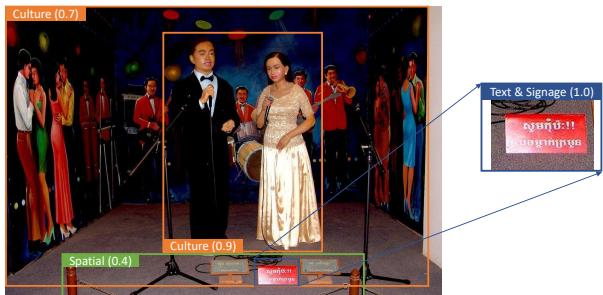  
Figure 1: An illustration of the visual-geolocation asymmetry. The most decisive geolocation clue (ranking score 1.0) is a small, visually peripheral sign in Khmer script.

To counter this threat, existing work mainly proposes defenses at two levels. Model-level approaches such as output moderation [35] and prompt-based refusal [34] restrict location disclosure at inference time. However, these defenses rely on LVLM providers to enforce them, and an attacker can simply turn to an unguarded model to bypass them entirely. At the image level, the dominant approach is adversarial perturbation. Before sharing, carefully crafted signals are injected into the image to disrupt LVLM inference. Existing methods fall into two categories. Targeted approaches, such as M-Attack [29] and AnyAttack [55], steer predictions toward a specific wrong location. Untargeted approaches, such as GeoShield [32] and ReasonBreak [54], concentrate perturbations on geo-revealing regions. However, these methods apply a fixed perturbation pipeline uniformly to each image without adapting to its content, relying on post-hoc utility evaluation rather than actively incorporating utility constraints into the protection process, introducing perceptible visual artifacts and degrading image utility (Section 5.4).

In this paper, we propose GeoCloak, an agentic framework for semantics-preserving geolocation privacy protection, motivated by a key observation. As illustrated in Figure 1, a small floor sign in Khmer script definitively places this image in

Cambodia, yet it occupies only a tiny fraction of the visual scene. We term this the visual-geolocation asymmetry. That is, the clues most decisive for LVLM geolocation inference, e.g., street signs, are often visually inconspicuous and easy for humans to overlook. This asymmetry further characterizes the images that genuinely require protection. In such images, the location can be inferred from subtle, inconspicuous clues that users never intended to share.

Exploiting this asymmetry, GeoCloak introduces semantic editing as a novel protection mechanism that directly targets these peripheral clues, achieving strong privacy protection with minimal impact on visual quality. Adversarial perturbation is reserved for residual scene-level features. By integrating adversarial perturbation within an iterative feedback loop, GeoCloak actively adjusts hyperparameters and loss configuration based on utility feedback, keeping visual degradation manageable. Since every image captures a unique scene, the geolocation clues it contains are inherently imagespecific, and so are the protection strategies it demands. A static pipeline is fundamentally ill-suited to this problem. We address this with an agentic protectionframework, that acts as a clue-aware planner. It first identifies the geolocationrelevant elements present in each image. It then dispatches appropriate manipulation tools: semantic editing, adversarial perturbation, or both. Finally, it iteratively evaluates the resulting privacy-utility tradeoff via metrics such as CLIP similarity, converging on a protected image that is both geolocationally misleading and semantically faithful.

We evaluate GeoCloak on four diverse datasets spanning 108 countries and 576 cities. Location sharing is not always undesirable [8,9], and we therefore adopt an evaluation scope, prioritizing protection for images where location can be inferred from subtle, inconspicuous clues that users did not intend to reveal. Section 3 and Section 5.2 details the evaluation scope and exclusion criteria, respectively. Our main evaluation covers five LVLMs from diverse model families and three distinct inference paradigms, zero-shot prompting, two-stage clue-guided reasoning (GeoMiner [34]), and post-trained toolaugmented agentic inference (GeoVista [49]), yielding 11 attacker configurations. To assess transfer beyond LVLM-based inference, we further test GeoCLIP [5], an embedding-based retrieval method, and GeoSeer [10], a commercial black-box tool. We consider two state-of-the-art image-level defenses, M-Attack [29] (targeted) and GeoShield [32] (untargeted), as baselines. GeoCloak significantly outperforms both baselines across all settings. Starting from an initial city-level accuracy of 41.2%, GeoCloak reduces it to 9.9%, compared to 24.5% for M-Attack and 19.7% for GeoShield. Despite being powered by Gemini-2.5-Pro, GeoCloak generalizes beyond its backbone, defending effectively against stronger models. Against the strongest attacker in our evaluation, Gemini-3.1-Pro under zero-shot inference, GeoCloak reduces city-level accuracy from 51.3% to 13.8%, while GeoShield and M-Attack only achieve 33.2% and 37.3%, respectively. GeoCloak remains effective across zero-shot, clue-guided, and tool-augmented inference. It also transfers to non-LVLM attackers, including the retrieval-based GeoCLIP and the commercial black-box GeoSeer. We further conduct a human perception study, in which GeoCloak receives an overall quality rating of 4.43/5, substantially higher than M-Attack (2.63) and GeoShield (2.53). Automatic metrics further confirm its utility preservation. GeoCloak achieves a CLIP similarity of 0.9197, compared with 0.7719 for M-Attack and 0.4209 for GeoShield. More detailed results are provided in Section 5.4 and Appendix H. Further analysis confirms that semantic editing alone already achieves strong protection, while combining it with adversarial perturbation further improves results. GeoCloak also generalizes well to both proprietary and opensourced backbones (Section 5.6). Targeting the strongest country-level protection, GeoCloak requires a median cost of \$0.32 per image (approximately \$0.16 with the Gemini Batch API) and 8.3 minutes, making it practically deployable for real-world geolocation privacy protection (Section 5.7). We demonstrate that GeoCloak remains effective against adaptive attacks based on conflict-aware prompting, image preprocessing, and fine-tuning on protected images (Section 5.8). Overall, our main contributions are:

• We identify a visual-geolocation asymmetry: geolocationdecisive clues are visually peripheral yet highly informative.

• We propose GeoCloak, an agentic framework that autonomously exploits this asymmetry through targeted semantic editing and adversarial perturbation under iterative utility-aware feedback. We further release a user-centered interactive version of GeoCloak that empowers users to directly control the protection process according to their own privacy preferences.

• We evaluate GeoCloak on four datasets spanning 108 countries and 576 cities across 11 configurations from diverse LVLM families and inference paradigms, along with non-LVLM-based, commercial, and adaptive attackers, demonstrating superior privacy protection and utility preservation.

## 2 Related Work

Geolocation Inference. Recent work has increasingly leveraged LVLMs for geolocation inference, harnessing their world knowledge accumulated during pre-training and, more importantly, their ability to reason over visual clues such as landmarks, signage, vegetation, and architectural styles [26, 33, 34, 56]. A line of work exploits prompting strategies, from zero-shot queries [33, 35] to structured chainof-thought frameworks [26, 34, 45], to elicit hierarchical geographic reasoning from LVLMs. Beyond prompting, some work augments LVLMs with retrieval-augmented generation to ground predictions with external geo-tagged references [20, 57], while others build agentic systems that equip LVLMs with customized tools, such as web search, image zoom-in, and street view navigation, enabling iterative, multistep evidence gathering [28, 56]. A further line of work improves geolocation capability through post-training, via supervised fine-tuning or reinforcement learning with geographic reward signals [21, 24, 25, 53]. More recently, agentic and post-training approaches have converged: several works train LVLMs end-to-end to act as geolocation agents, instilling both tool-calling capabilities and geographic reasoning through multi-stage post-training pipelines [19, 49]. Prior retrievalbased [5, 48] and classification-based methods [16, 51] have been empirically shown to underperform LVLMs despite requiring millions of labeled training images [33, 35, 45].

Protection Methods. Traditional defenses such as metadata stripping and image blurring have been shown to offer limited effectiveness against LVLMs, which infer location directly from visual content [33, 34]. More recently, protection methods targeting LVLM-based geolocation inference have emerged, operating either at the model level [34, 35] or the image level [29, 55]. At the model level, output moderation [35] and prompt-based refusal [34] restrict location disclosure at inference time. They require deployment on the service side, leaving individual image owners with no direct control over how their shared images are processed. At the image level, the dominant approach is adversarial perturbation, adding imperceptible noise to images before sharing to disrupt LVLM geolocation inference. Existing approaches fall into two categories. Targeted methods, such as M-Attack [29] and AnyAttack [55], steer predictions toward a specific incorrect location by aligning image features with a target image. Untargeted methods, such as GeoShield [32] and ReasonBreak [54], instead aim to suppress geolocation capability without specifying a target. These approaches, however, rely on post-hoc utility evaluation rather than actively incorporating utility constraints into the protection process. This inevitably introduces perceptible visual artifacts and utility degradation, as demonstrated in Figure 3, Table 6, and Appendix G.

## 3 Threat Model

Scenario. Users frequently share images that inadvertently contain visual clues, such as street signs and background architectural details, that are highly informative of geographic location. As LVLMs become increasingly capable of exploiting such clues, these shared images may unintentionally disclose location information that users never intended to reveal, posing serious privacy risks.

Attacker. The attacker is a malicious individual who seeks to infer the city-, state-, or country-level geolocation of images shared by users on public platforms. The attacker is assumed to have access to the protected image only, without access to the original unprotected version. To perform geolocation inference, the attacker leverages state-of-the-art LVLMs and various geolocation inference methods.

Defender. The user is an individual who wishes to share an image on social media or other public platforms, but wants to prevent their location from being inferred. Before sharing, the user provides the image and its ground-truth geolocation to GeoCloak, which analyzes the image and applies targeted modifications. The ground-truth geolocation is required, as it serves as the termination condition for the iterative protection loop, protection is declared successful only when GeoCloak can no longer correctly infer the ground-truth location from the modified image. When external model APIs are used, the trust assumption extends to the providers that process the images and the ground-truth location. Alternatively, users or trusted organizations can host both GeoCloak and its underlying open-source models within their own infrastructure, keeping these inputs within that environment. Our open-source configuration demonstrates that effective protection does not require proprietary model APIs (Table 7).

Protection Goal. GeoCloak aims to achieve two objectives: (1) privacy goal: prevent the attacker from correctly inferring the geolocation of a protected image; (2) utility goal: preserve the semantic content and visual quality of the original image so that the user’s intended sharing experience is not compromised.

Scope. Several studies [6, 49] argue that easily localizable landmark images inflate reported accuracy and fail to reflect the true geolocation reasoning capability of LVLMs, as such locations are often recognized through memorization rather than visual reasoning. Therefore, these images are excluded during evaluation. However, we argue that this issue should not be considered solely from an evaluation perspective, but also from the standpoint of user sharing intention. Location sharing is not always undesirable, e.g., platforms such as OpenBenches [9] rely on users intentionally sharing photos alongside their geographic locations. While major platforms and operating systems have begun stripping location metadata by default to protect user privacy, this one-size-fits-all approach has been criticized for overriding the intentional sharing preferences of users who actively want their location to be known [8]. From both an evaluation and a user intent perspective, we scope our study to exclude images containing globally recognizable landmarks that are visually dominant, as such images are more likely to reflect an intention to share location information rather than concealing it. For instance, a user who captures a photo with the Eiffel Tower prominently occupying the frame is most likely intending to share that they are in Paris at that moment. Prior work [6, 49] does not specify how to systematically identify and exclude such images; we address this gap by introducing a practical procedure for filtering them (see Section 5.2).

## 4 GeoCloak

## 4.1 System Overview

As illustrated in Figure 2, GeoCloak is an agentic framework comprising two specialized agents, ClueAgent and EditAgent, coordinated by a central Orchestrator. Given an input image and its ground-truth geolocation, the system iteratively applies targeted modifications until the image can no longer be correctly geolocated while visual utility is preserved, or until a maximum number of steps is reached. ClueAgent identifies geolocation-revealing clues and predicts the current location, while EditAgent formulates a protection plan and executes targeted edits; details are given in Section 4.2 and Section 4.3. The Orchestrator coordinates two checks: a utility check to ensure visual quality is preserved, and a protection check to determine whether geolocation has been successfully disrupted. Formally, we define the utility check of a protected image $I ^ { ( t ) }$ at iteration t as:

$$
\begin{array} { r } { \mathcal { U } ( I ^ { ( t ) } ) = \mathbf { 1 } \Big [ \mathrm { o b j } ( I ^ { ( t ) } ) = \mathrm { o b j } ( I ^ { ( 0 ) } ) \Big ] } \\ { \cdot \cos \Big ( \Phi ^ { I } ( I ^ { ( t ) } ) , \Phi ^ { I } ( I ^ { ( 0 ) } ) \Big ) , } \end{array}\tag{1}
$$

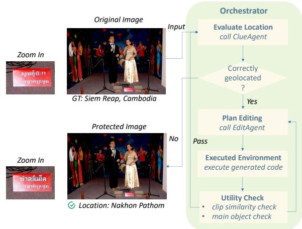  
Figure 2: Overview of GeoCloak. A utility check ensures visual quality, and ClueAgent re-evaluates the image as a protection check, terminating when the correct location can no longer be inferred. See multi-turn examples in Appendix A.

where obj( ) returns the set of primary objects detected by the LVLM, $\overset { \cdot } { \boldsymbol { \Phi } ^ { I } } ( \cdot )$ is the CLIP image encoder, and $I ^ { ( 0 ) }$ is the original image. 1( ) acts as a hard constraint: any significant modification that alters the primary objects immediately yields ${ \mathcal { U } } = 0 .$ , regardless of visual similarity. The cosine term measures residual visual drift. We further define a multigranularity protection check as:

$$
\begin{array} { r } { \mathcal { I } ( \hat { \ell } , \ell ^ { * } ; g ) = \mathrm { G E O M A T C H } ( \hat { \ell } , \ell ^ { * } ; g ) , } \end{array}\tag{2}
$$

where GEOMATCH $\iota ( \cdot , \cdot ; g ) \in \{ 0 , 1 \}$ jointly determines whether $\hat { \ell }$ and $\ell ^ { * }$ agree at granularity g and $g \in$ $\{ { \tt c i t y } ,$ , state, country . The loop terminates at the earliest iteration $t ^ { * } \colon$

$$
t ^ { * } = \operatorname* { m i n } \Bigl \{ t \Big | \mathcal { I } ( \widehat { \ell } ^ { ( t ) } , \ell ^ { * } ; g _ { \mathrm { t g t } } ) = 0 \land \mathcal { U } ( I ^ { ( t ) } ) \geq \tau \mathrm { ~ o r ~ } t = N \Bigr \} ,\tag{3}
$$

where N is the maximum number of allowed iterations, $\tau \in [ 0 , 1 ]$ is the utility threshold, and $g _ { \mathrm { t g t } } ~ \in$ $\{ { \tt c i t y } .$ , state, country is the target protection granularity. When $t ^ { * } = N$ , we report the strongest protection level $g ^ { * }$ achieved: country-level if $\begin{array} { r } { g ( \hat { \ell } ^ { ( N ) } , \ell ^ { * } ; \mathrm { c o u n t r y } ) = 0 . } \end{array}$ state-level if only $\begin{array} { r } { \boldsymbol { \mathcal { I } } ( \hat { \ell } ^ { ( N ) } , \ell ^ { * } ; \mathrm { s t a t e } ) = \boldsymbol { 0 } , } \end{array}$ and city-level if only $\begin{array} { r } { g ( \hat { \ell } ^ { ( N ) } , \ell ^ { * } ; \dot { \mathrm { c i t y } } ) = 0 } \end{array}$ If no protection is achieved $( \mathrm { i . e . }$ , the image remains unmodified), a fallback adversarial perturbation is applied, yielding $I ^ { \mathrm { f b } }$ , constrained to cos $\Big ( \Phi ( I ^ { ( f b ) } ) , \Phi ( I ^ { ( 0 ) } ) \Big ) \geq \tau . \mathrm { A t \ } t = 0 .$ , only the protection check is performed: ClueAgent and the Orchestrator analyze $I ^ { ( 0 ) }$ to check whether the image is currently geolocatable, $\mathrm { i . e . }$ , whether $\begin{array} { r } { g ( \hat { \ell } ^ { ( 0 ) } , \ell ^ { * } ; g _ { \mathrm { t g t } } ) = 1 } \end{array}$ . At each subsequent iteration t, both agents and both checks are involved: EditAgent formulates a plan and generates executable code, which the Orchestrator executes to yield a candidate $I ^ { ( t + 1 ) }$ The Orchestrator first performs the utility check (Equation 1): if $\mathcal { U } \big ( I ^ { ( t + 1 ) } \big ) < \tau .$ , the modification is rolled back and EditAgent revises its plan. If it passes, ClueAgent and Orchestrator re-evaluate the image (protection check) via Equation 2: if $\begin{array} { r } { g ( \widehat { \ell } ^ { ( t + 1 ) } , \ell ^ { * } ; g _ { \mathrm { t g t } } ) = \mathbf { \overline { { 0 } } } } \end{array}$ , the loop terminates; otherwise the next iteration begins. EditAgent employs two complementary skills, detailed in Section 4.3. We further exhibit a successful example of multi-turn GeoCloak protection in Appendix A.

## 4.2 ClueAgent

Overview. ClueAgent serves a dual role in GeoCloak: it acts as both a geolocation analyzer and an attacker. At the start of each iteration t, ClueAgent is prompted to analyze the current image $I ^ { ( t ) }$ and identify all geolocation-revealing clues, producing a structured clue set:

$$
\begin{array} { r } { C ^ { ( t ) } = \mathrm { A N A L Y Z E } \Big ( I ^ { ( t ) } \Big ) . } \end{array}\tag{4}
$$

Each clue $c _ { i } \in C ^ { ( t ) }$ is characterized by a four-tuple:

$$
c _ { i } = ( \tau _ { i } , \ d _ { i } , \ r _ { i } , \ s _ { i } ) ,\tag{5}
$$

comprising its type $\tau _ { i } ,$ description $d _ { i } ,$ region $r _ { i } \subset \mathbb { R } ^ { 4 }$ (bounding box in pixel coordinates), and ranking score $s _ { i } \in [ 0 , 1 ]$ The type $\tau _ { i }$ has four values: landmark, text&signage, culture, and spatial, following the categories proposed by Li et al. [26]. The description $d _ { i }$ captures the semantic content of each clue and the reasoning behind its geolocation relevance, serving as the primary input for EditAgent to formulate targeted modification strategies. Clues are assigned a ranking score $s _ { i }$ reflecting how precisely they localize the scene, from uniquely identifying a specific location down to weak or ambiguous signals, where a higher rank indicates the clue more precisely identifies the location. In addition to producing $\bar { C ^ { ( t ) } }$ , ClueAgent acts as an attacker by predicting a location estimate from the identified clues. Concretely, ClueAgent is an LVLM that is prompted with the full clue set $C ^ { ( t ) }$ and asked to output its best geolocation prediction:

$$
\hat { \ell } ^ { ( t ) } = \mathrm { G E O P R E D I C T } \left( C ^ { ( t ) } \right) ,\tag{6}
$$

where ${ \hat { \ell } } ^ { ( t ) }$ is a location name $( \mathrm { e . g . }$ ., “Warsaw, Poland”), which serves as the termination condition for the iteration loop. That is, protection is declared successful when ClueAgent can no longer correctly infer the ground truth location from the modified image, i.e., $\hat { \ell } ^ { ( t ) } \neq \ell ^ { * }$ , where $\ell ^ { * }$ denotes the groundtruth location. This criterion determines when to stop editing based on ClueAgent’s prediction and does not imply that all location-revealing clues have been removed. Protection beyond ClueAgent is assessed through the external attacker evaluation described in Section 5.1.

Adaptive Strategy. We further consider the case where ClueAgent fails to correctly geolocate the image even on the unmodified image, i.e., $\boldsymbol { \tilde { \ell } ^ { ( 0 ) } } \not \sim \ell ^ { \ast }$ , which occurs when geolocation clues are subtle or ambiguous. In this case, since a stronger attacker in practice may succeed where ClueAgent fails, we propose an adaptive strategy. Our system switches to a GT-guided mode in which the ground truth $\ell ^ { * }$ is explicitly provided as additional context to guide the clue identification process. Crucially, this mode is determined once at $t = 0$ based on whether ClueAgent succeeds on the original image, and remains fixed for the entire run:

$$
\begin{array} { r } { \mathrm { m o d e } = \left\{ \begin{array} { l l } { \mathrm { s t a n d a r d } } & { \mathrm { i f } \ \hat { \ell } ^ { ( 0 ) } \sim \ell ^ { \ast } , } \\ { \mathrm { G T - g u i d e d } } & { \mathrm { i f } \ \hat { \ell } ^ { ( 0 ) } \nsim \ell ^ { \ast } . } \end{array} \right. } \end{array}\tag{7}
$$

Under GT-guided mode, each iteration uses an oracleaugmented clue analysis:

$$
\begin{array} { r } { C _ { \mathrm { G T } } ^ { \left( t \right) } = \mathrm { A N A L Y Z E } \left( I ^ { \left( t \right) } , \ell ^ { \ast } \right) , } \end{array}\tag{8}
$$

which is then passed to EditAgent in place of $C ^ { ( t ) }$ . The ground-truth guidance helps ClueAgent identify residual clues that a more capable attacker might exploit, even when its own geolocation inference fails. The loop stops when ClueAgent can no longer identify clues relevant to the ground-truth location, replacing the geolocation-mismatch condition in Equation 3. The utility constraint and iteration limit remain unchanged.

## 4.3 EditAgent

Overview. EditAgent aims to formulate targeted modifications to suppress geolocation-revealing clues identified by ClueAgent. Upon receiving the active clue set $\widetilde { C } ^ { ( t ) }$ (equal to $C ^ { ( t ) }$ in standard mode or $C _ { \mathrm { G T } } ^ { ( t ) }$ in GT-guided mode, as determined by Equation 7), EditAgent produces a structured modification plan $\mathcal { P } ^ { ( t ) }$ , selects and executes appropriate skills, and yields an updated image $I ^ { ( t + 1 ) }$

$$
\begin{array} { r } { \boldsymbol { \mathcal { P } } ^ { ( t ) } = \mathrm { P L A N } \left( \widetilde { \boldsymbol { C } } ^ { ( t ) } \right) , \qquad \boldsymbol { I } ^ { ( t + 1 ) } = \mathrm { E x E C U T E } \left( \boldsymbol { I } ^ { ( t ) } , \boldsymbol { \mathcal { P } } ^ { ( t ) } \right) . } \end{array}\tag{9}
$$

EditAgent is equipped with two complementary skills: semantic editing, which applies targeted modifications to discrete, fine-grained clues; and adversarial perturbation, which applies gradient-based noise to disrupt large or structural clues that resist semantic editing. For each iteration, EditAgent selects the appropriate skill based on the remaining clues and generates a structured plan specifying the skill, its corresponding parameters, and a reasoning field that details the rationale behind the chosen strategy. For semantic editing, this includes the editing strategy and a natural language prompt. For adversarial perturbation, this includes configuring the optimization objectives (e.g., loss function) and hyperparameters (e.g., privacy budget). Each plan is accompanied by executable Python code passed to the Orchestrator.

Semantic Editing Skill. This skill targets discrete, localizable clues by applying one of five strategies: ReplaceText, AddDecoy, ReplaceObject, EraseObject, and StyleTransfer. It is implemented as a prompted LVLM call that receives the clue set $\widetilde { C } ^ { \left( t \right) }$ , the current image $I ^ { ( t ) }$ , and the strategy Σ, and returns a structured plan specifying σ and ρ. Due to space limitation, we provide examples of each strategy in Appendix C. The full prompt template is provided in Appendix B. Given the clue with high ranking score s<sub>i</sub> relative to their region area $r _ { i } \mathrm { : }$

$$
\boldsymbol { c } ^ { * } = \underset { c _ { i } \in \widetilde { C } ^ { ( t ) } } { \arg \operatorname* { m a x } } \boldsymbol { s } _ { i } / | \boldsymbol { r } _ { i } | ,\tag{10}
$$

EditAgent selects a strategy $\sigma \in \Sigma$ and constructs a naturallanguage prompt ρ to drive the edit:

$$
\begin{array} { r } { ( \sigma , \rho ) = \mathrm { S T R A T E G Y S E L E C T } \left( c ^ { \ast } , I ^ { ( t ) } \right) , } \end{array}\tag{11}
$$

where Σ denotes the five editing strategies.

• ReplaceText substitutes geolocation-revealing text, such as street signs, shop names, or license plates, with text from a visually similar but geographically distinct region.

• AddDecoy is applied when dominant clues are too large or structural to edit directly; it inserts a nearby misleading element to recontextualize existing clues.

• ReplaceObject swaps geolocation-specific objects, such as post boxes, tram models, or traffic signs, with plausible alternatives from a nearby country.

• EraseObject removes clues that are too distinctive to replace but small enough to inpaint cleanly.

• StyleTransfer shifts the visual style of peripheral background elements, such as distant buildings or vegetation, toward a geographically distinct but visually similar region, while leaving the primary subject untouched.

Note that we do not distinguish between text and objects for erasure, as both are simply removed and inpainted; the distinction becomes necessary for replacement, where the substitution strategy differs fundamentally between linguistic clues and physical objects. Strategy selection is implemented via the LVLM following five ordered principles, which together enforce a privacy-utility trade-off: (1) start small, where we prioritize clues by $c ^ { * } = \arg \operatorname* { m a x } _ { c _ { i } } s _ { i } / | r _ { i } |$ , favoring those with a high ranking score s<sub>i</sub> relative to their region area $r _ { i } ; ( 2 )$ blend naturally, where all modifications specified by the generated prompt ρ must be consistent with the scene’s lighting, perspective, and style; (3) stay culturally close, where replacements must be drawn from a geographically adjacent region to remain visually plausible; (4) preserve the main subject, where $r ^ { * }$ must not overlap with the primary subject region detected by the LVLM; (5) persist and escalate, where upon failure, retry within σ with a revised $\rho ,$ then switches to an alternative strategy ${ \pmb { \sigma } } ^ { \prime } \in \Sigma \setminus \{ { \sigma } \}$ . The region $r ^ { * }$ of the image is updated as:

$$
I ^ { ( t + 1 ) } [ r ^ { * } ] = { \tt S E M A N T I C E D I T } \left( I ^ { ( t ) } [ r ^ { * } ] , \sigma , \rho \right) .\tag{12}
$$

Adversarial Perturbation Skill. This skill applies gradientbased noise to disrupt large or structural clues that resist semantic editing, such as scene-level architectural features. It requires EditAgent to make several autonomous decisions when constructing and refining a perturbation. For the optimization reference, it selects either region\_focus, which builds a bounding-box pool $\mathcal { B } = \{ r _ { i } | c _ { i } \in \widetilde { C } ^ { ( t ) } \} \cup \{ I ^ { ( t ) } \}$ including all clue regions and the full image, or full\_image, which uses only the full image as the reference target. For the lossfunction, it selects $\lambda \in \{ 0 , 1 \}$ , where $\lambda = 0$ corresponds to feature\_only\_loss and $\lambda = 1$ to dual\_loss. At each optimization step k, the adversarial image $I ^ { ( t ) } + \mathbb { \delta } ^ { ( k ) }$ is cropped into a local and global view,

$$
\left( I _ { k } ^ { \mathrm { l o c } } , \ I _ { k } ^ { \mathrm { g l o b } } \right) = \mathrm { G E T C R O P S } \left( I ^ { ( t ) } + \ S ^ { ( k ) } \right) .\tag{13}
$$

A reference crop is sampled uniformly from the bounding box pool:

$$
\begin{array} { r } { \tilde { I } _ { k } ^ { ( t ) } \sim \mathrm { U n i f o r m } ( \mathcal { B } ) . } \end{array}\tag{14}
$$

Let $\phi ^ { I } ( \cdot )$ denote the image encoder and $\boldsymbol { \Phi } ^ { T } ( \cdot )$ the text encoder of an ensemble of CLIP models. The per-step loss is accumulated over both adversarial crops and all ensemble members $i \in [ M ]$

$$
\begin{array} { r } { \mathcal { L } _ { \mathsf { \lambda } , k } = \displaystyle \frac { 1 } { M } \sum _ { i = 1 } ^ { M } \sum _ { \nu \in \{ \mathrm { l o c } , \mathrm { g l o b } \} } \Big [ - \cos \big ( \Phi _ { i } ^ { I } ( I _ { k } ^ { \nu } ) , ~ \Phi _ { i } ^ { I } ( \tilde { I } _ { k } ^ { ( t ) } ) \big ) } \\ { + \mathsf { \lambda } \cdot \mu \cdot \cos \big ( \Phi _ { i } ^ { I } ( I _ { k } ^ { \nu } ) , ~ \Phi _ { i } ^ { T } ( \mathsf { p } _ { \mathrm { n e g } } ) \big ) \Big ] , } \end{array}\tag{15}
$$

where $\mu > 0$ is the text-pull weight and $\rho _ { \mathrm { n e g } }$ is a nongeolocation description generated by EditAgent that preserves the scene’s visual content while stripping all locationidentifying elements. The perturbation is updated via sign stochastic gradient ascent with step size $\varepsilon / 1 0$ and projected onto the $\ell _ { \infty }$ ball of radius $\varepsilon ,$ where ε denotes the perturbation budget:

$$
\begin{array} { r l } & { \delta ^ { ( k + 1 ) } \gets \Pi _ { \| \cdot \| _ { \infty } \leq \mathfrak { E } } \left( \delta ^ { ( k ) } + \frac { \mathfrak { E } } { 1 0 } \mathrm { s i g n } \big ( \nabla _ { \delta } \mathcal { L } _ { \lambda , k } \big ) \right) , } \\ & { I ^ { ( t + 1 ) } = I ^ { ( t ) } + \delta ^ { ( K ) } , } \end{array}\tag{16}
$$

and is run for K steps. Under $\lambda { = } 0 ( \mathrm { f e a t u r e { \_ } o n l y } )$ , maximizing $\mathcal { L } _ { \lambda , k }$ minimizes cosine similarity between the adversarial crops and the reference, pushing the image away from its geolocation-revealing CLIP representation. Under $\lambda = 1$ (dual\_loss), the second term pulls the adversarial crops toward $\Phi _ { T } ( \mathfrak { p } _ { \mathrm { n e g } } )$ , constraining the perturbation direction and reducing visual degradation.

Once EditAgent selects adversarial perturbation as the protection skill for the first time, it inspects the available clues and initially selects the optimization reference (region\_focus if clues carry bounding boxes, otherwise full\_image), loss function (dual\_loss when the scene has clear visual content, otherwise feature\_only), and sets an initial K and ε. When dual\_loss is chosen, EditAgent additionally composes a $\rho _ { \mathrm { n e g } } ,$ and sets an initial $\mu .$ When a previous attempt has been made, EditAgent iteratively adapts its configuration based on the observed privacy-utility tradeoff. If $\mathcal { U } ( I ^ { ( t ) } ) < \mathfrak { \tau } ( \mathbf { e . g . }$ primary objects have been altered or visual drift is excessive, EditAgent rolls back the current perturbation and tightens the configuration: it can switch to dual\_loss, raise µ, make the description more descriptive, reduce ε, or reduce K. If privacy protection is insufficient while $\mathcal { U } ( I ^ { ( t ) } ) \geq \tau ,$ it can switch to region\_focus, make the description more generic, lower $\mu ,$ switch to feature\_only, increase ε, or increase K. The full prompt template is provided in Appendix B.

## 5 Evaluation

## 5.1 Experimental Setup

Datasets. We evaluate GeoCloak on four datasets that support level-wise geolocation evaluation to comprehensively assess protection effectiveness across diverse geographic and visual contexts: Im2GPS3k [48], GeoBench [49], Dataset-GSS [26], and Dataset-PCW [26]. We use all available data from GeoBench and Dataset-PCW. Because Im2GPS3k and Dataset-GSS are substantially larger, we randomly sample 500 images from each dataset. This yields a benchmark of 1,779 images spanning 108 unique countries and 576 unique cities across all four datasets. This scale exceeds the 500-image DoxBench evaluation used in the prior GeoMiner study [34]. Across the available images, our full evaluation design comprises over 75,000 evaluation runs, covering 11 attacker configurations and four conditions (Initial, M-Attack, GeoShield, and GeoCloak). Further details on dataset statistics and composition are provided in Appendix D.1.

Table 1: Proportion of images labeled as Exempt (containing intentional landmarks) across the four evaluation datasets.
<table><tr><td></td><td>GeoBench</td><td>Im2GPS3k</td><td>Dataset-GSS</td><td>Dataset-PCW</td></tr><tr><td>Exempt Rate</td><td>37.5%</td><td>53.4%</td><td>21.0%</td><td>55.3%</td></tr></table>

Agent Configurations. Both ClueAgent and EditAgent are powered by large vision-language models. ClueAgent uses Gemini-2.5-Pro [1] for geolocation analysis and clue identification. EditAgent requires two models: one for planning and code generation, and one for image editing. For the former, we evaluate Gemini-2.5-Pro [1], o3 [37], and Qwen3.6-35B-A3B [43]; for the latter, we evaluate Gemini-2.5-Flash-Image [13], i.e., Nano Banana, Seedream-4.5 [3], and Qwen-Image-Edit-2511 [42]. The combination of Gemini-2.5-Pro + Gemini-2.5-Flash-Image serves as our primary configuration in the main evaluation, while o3 + Seedream-4.5 is used to verify that GeoCloak generalizes across different model choices. We additionally pair Qwen3.6- 35B-A3B with Qwen-Image-Edit-2511 to evaluate a fully open-source configuration. For all agents, the maximum number of turns is set to 20 and the temperature to 0.5. For the utility check (Equation 1), we set τ = 0.85, determined empirically to filter out modifications that cause perceptible visual degradation while preserving overall image fidelity. We set the target protection granularity $g _ { \mathrm { t g t } } = \mathtt { c o u n t r y }$ for the protection check (Equation 2), as country-level mismatch represents the strongest protection level.

Evaluation LVLMs. We examine against five LVLMs spanning multiple model families and capability levels. In addition to Gemini-2.5-Pro and o3, which serve as the backbone of GeoCloak, we include Gemini-3.1-Pro-Preview (abbreviated as Gemini-3.1-Pro) [14], GPT-5.4 [38], and Qwen-3.5- Plus [41]. This selection allows us to assess whether protection optimized against one model generalizes to stronger attackers and to models from entirely different families. We initially considered Claude-Sonnet-4.6 [2] via OpenRouter [39] as an evaluation LVLM, but excluded it due to a high rate of API errors caused by image size limitations. In our initial run, 40.0% of samples in Dataset-PCW exceeded the 5MB input limit, making reliable evaluation infeasible.

Geolocation Inference Methods. Prior retrieval-based methods [5,48] and classification-based methods [16,51] have been empirically shown to underperform LVLMs despite requiring millions of labeled training images [33, 35, 45]. We therefore leverage three geolocation inference methods of increasing sophistication, all built upon the visual reasoning capabilities and broad world knowledge of LVLMs: zero-shot prompting, a two-stage clue-guided framework (GeoMiner [34]), and a post-trained tool-augmented agentic system (GeoVista [49]). Further details about these inference methods are in Appendix D.2. Zero-Shot and GeoMiner are instantiated with each of the five evaluation LVLMs described above, while GeoVista is powered by its own trained model [11]. Overall, combined with multiple LVLMs, these methods yield a total of 11 distinct geolocation attackers.

Table 2: Geolocation prediction performance measured by levelwise accuracy (%) and distance accuracy (%) on exempt images and non-exempt images. We leverage zero-shot inference and Gemini-2.5-Pro.
<table><tr><td></td><td></td><td colspan="3">Level-Wise Acc.</td><td colspan="3">Distance-Based Acc.</td></tr><tr><td>Dataset</td><td>Type</td><td>City</td><td>State</td><td>Country</td><td>@1km</td><td>@25km</td><td>@100km</td></tr><tr><td>Overall</td><td>Exempt</td><td>73.0%</td><td>84.0%</td><td>93.9%</td><td>30.8%</td><td>82.3%</td><td>86.0%</td></tr><tr><td></td><td>Non-Exempt</td><td>48.3%</td><td>58.9%</td><td>87.9%</td><td>16.1%</td><td>55.2%</td><td>61.6%</td></tr></table>

Effectiveness Metrics. A wide variety of metrics have been proposed to evaluate geolocation performance. They broadly fall into two categories. The first is hierarchical classification metrics, which assess whether the predicted location matches the ground truth at the city, state, or country level [6, 26, 28, 49, 53, 56]. The second is distance-based metrics, which measure the geographic error between the predicted and ground-truth coordinates, such as mean or median Haversine distance [26, 53], or the percentage of predictions falling within a given radius threshold (e.g., within 1km accuracy) [12, 28, 34, 49]. We leverage both types of metrics, with city-level accuracy as the primary metric. The other metrics are presented in Appendix F.

Utility Metrics. We provide qualitative examples (e.g., Figure 3) to visually demonstrate the semantic preservation achieved by each defense method. We quantitatively evaluate image utility from two complementary perspectives. For visual semantic preservation, we report CLIP Similarity, which measures the cosine similarity between the CLIP embeddings of the original and protected images, capturing high-level semantic preservation. Following GeoShield [32], we further evaluate text-based semantic preservation by using an LVLM to generate textual descriptions of both images and measuring their similarity via BERT Score, BLEU, and ROUGE-L.

Baseline Protection Methods. We compare against two representative adversarial perturbation baselines: M-Attack [29] (targeted) and GeoShield [32] (untargeted), covering both categories identified in Section 2. Both are reproduced based on the released code [31], following all original hyperparameters. See details in Section D.3.

## 5.2 Evaluation Scoping

Automatic Landmark Intention Analysis. As discussed in Section 3, we scope GeoCloak to images with genuine privacy intent, excluding those that prominently feature globally recognizable landmarks, as users photographing such landmarks are more likely intending to share their location. To automatically identify and filter out such images, we develop a three-stage landmark intention analysis pipeline.First, we apply $U ^ { 2 } .$ -Net [40] to generate a saliency map and compute a Saliency Dominance Ratio (SDR) for each candidate region, defined as the ratio of the mean saliency within the candidate bounding box to the global image mean saliency. A high SDR indicates that the region stands out visually from its surroundings. Second, we employ Florence-2 [52] for phrase grounding, querying it with landmark-related terms (e.g., building, tower, statue, monument) to localize candidate objects and their bounding boxes. For each candidate, we compute three physical metrics: relative size, centrality, and SDR. Finally, the top-3 candidates ranked by these metrics are passed to Gemini-2.5-Pro, which classifies each object as intentional or incidental based on these physical metrics, and further categorizes each object into tier-A (globally recognized landmarks whose location is already public knowledge), tier-B (locally known landmarks), or tier-C (generic structures) based on the world knowledge of the LVLM. An image is labeled exempt if at least one tier-A object is classified as intentional; otherwise it is labeled non-exempt. The full prompt is provided in Appendix B. Table 1 shows the exempt rate across datasets, ranging from 21.0% to 55.3%. Table 2 further confirms that exempt images are substantially easier to geolocate than non-exempt images across all datasets and metrics; for instance, overall city-level accuracy drops from 73.0% to 48.3% when landmark images are excluded, showing that the non-exempt subset presents a more challenging geolocation setting.

Human Validation. To assess the reliability of our automated pipeline, we conduct a human validation study. Specifically, two independent annotators manually examined exempt samples on GeoBench. Each sample was evaluated against four criteria: (1) whether the photo intentionally depicts the landmark, (2) whether the landmark is identifiable via Google Search, (3) whether the provided reasoning is supported by verifiable references, and (4) if the reasoning directly identifies the geographic location through the landmark, whether that location matches the ground truth. The validation yields 86.7% precision and 93.3% inter-annotator agreement. Most misclassified samples coincide with cases of annotator disagreement, highlighting the inherently subjective nature of borderline cases. We therefore consider 86.7% precision sufficient to support a reliable large-scale automated assessment. User-Centered System. We acknowledge that user intent is inherently subjective and cannot be fully captured by automated analysis. To address this and facilitate real-world deployment, we further release a user-centered interactive GeoCloak, letting users directly specify which images they wish to protect. An example screenshot is provided in Appendix J, and the system is publicly accessible.

## 5.3 Effectiveness

We report the geolocation inference performance for the initial setting (without any defense) and after applying each of the three defense methods. For GeoCloak, we use Gemini-2.5- Pro to generate clues, propose editing plans, and produce the corresponding code, while Gemini-2.5-Flash-Image is used to execute the image editing. All other level-wise metrics and distance accuracy can be found in Table 13, from which we draw similar conclusions.

Gemini-3.1-Pro is the strongest attacker model. As shown in Table 3, it achieves the highest overall city-level accuracy of

Table 3: Geolocation inference performance measured by city-level accuracy (%) under no defense (Initial) and three defenses (GeoShield [32], M-Attack [29], and GeoCloak). Bold indicates the lowest (best) value within each inference method, model, and dataset group. lower is better. GeoCloak uses Gemini-2.5-Pro and Gemini-2.5-Flash-Image. Results for additional metrics are provided in Table 13.
<table><tr><td rowspan="2">Dataset</td><td rowspan="2">Defense</td><td colspan="5">Zero-Shot</td><td rowspan="2">GeoVista</td><td colspan="5">GeoMiner</td><td rowspan="2">Overall</td></tr><tr><td></td><td>Gemini-2.5-Pro Gemini-3.1-Pro</td><td>GPT-5.4</td><td>03</td><td>Qwen3.5-Plus</td><td>GeoVista Gemini-2.5-Pro</td><td>Gemini-3.1-Pro</td><td>GPT-5.4</td><td>03</td><td>Qwen3.5-Plus</td></tr><tr><td></td><td>Initial</td><td>74.1%</td><td>81.9%</td><td>63.1%</td><td>71.6%</td><td>54.7%</td><td>63.7%</td><td>70.6%</td><td>77.2%</td><td>58.8%</td><td>62.5%</td><td>53.1%</td><td>66.5%</td></tr><tr><td>GeoBench</td><td>M-Attack</td><td>54.4%</td><td>62.8%</td><td>37.2%</td><td>47.2%</td><td>33.1%</td><td>42.8%</td><td>50.9%</td><td>60.6%</td><td>38.8%</td><td>36.9%</td><td>28.4%</td><td>44.8%</td></tr><tr><td></td><td>GeoShield</td><td>53.1%</td><td>64.1%</td><td>36.2%</td><td>40.3%</td><td>29.4%</td><td>35.9%</td><td>50.0%</td><td>60.3%</td><td>35.0%</td><td>30.3%</td><td>28.4%</td><td>42.1%</td></tr><tr><td></td><td>GeoCloak</td><td>17.5%</td><td>22.2%</td><td>18.1%</td><td>25.3%</td><td>11.2%</td><td>21.6%</td><td>19.1%</td><td>22.5%</td><td>12.2%</td><td>16.9%</td><td>7.5%</td><td>17.6%</td></tr><tr><td></td><td>Initial</td><td>30.0%</td><td>30.9%</td><td>24.0%</td><td>29.6%</td><td>16.3%</td><td>18.9%</td><td>30.0%</td><td>26.6%</td><td>21.5%</td><td>19.7%</td><td>17.2%</td><td>24.1%</td></tr><tr><td>Im2GPS3k</td><td>M-Attack</td><td>18.5%</td><td>17.6%</td><td>10.7%</td><td>11.2%</td><td>8.2%</td><td>7.3%</td><td>15.0%</td><td>17.2%</td><td>10.3%</td><td>5.6%</td><td>7.7%</td><td>11.7%</td></tr><tr><td></td><td>GeoShield</td><td>12.9%</td><td>14.2%</td><td>7.7%</td><td>6.0%</td><td>5.6%</td><td>6.0%</td><td>12.0%</td><td>11.2%</td><td>5.2%</td><td>3.0%</td><td>5.2%</td><td>8.1%</td></tr><tr><td></td><td>GeoCloak</td><td>4.7%</td><td>5.2%</td><td>4.3%</td><td>6.0%</td><td>3.9%</td><td>3.9%</td><td>3.9%</td><td>7.3%</td><td>1.7%</td><td>1.3%</td><td>1.7%</td><td>4.0%</td></tr><tr><td></td><td>Initial</td><td>41.0%</td><td>40.8%</td><td>31.4%</td><td>37.7%</td><td>23.5%</td><td>25.3%</td><td>41.0%</td><td>38.2%</td><td>32.4%</td><td>29.9%</td><td>20.8%</td><td>32.9%</td></tr><tr><td>Dataset-GSS</td><td>M-Attack</td><td>24.8%</td><td>30.4%</td><td>15.9%</td><td>17.0%</td><td>7.3%</td><td>15.2%</td><td>23.8%</td><td>24.3%</td><td>15.9%</td><td>10.9%</td><td>7.6%</td><td>17.6%</td></tr><tr><td></td><td>GeoShield</td><td>14.7%</td><td>22.5%</td><td>9.1%</td><td>8.4%</td><td>3.8%</td><td>7.3%</td><td>15.7%</td><td>19.2%</td><td>10.1%</td><td>4.1%</td><td>3.5%</td><td>10.8%</td></tr><tr><td></td><td>GeoCloak</td><td>7.1%</td><td>12.4%</td><td>12.9%</td><td>8.6%</td><td>5.3%</td><td>8.9%</td><td>7.1%</td><td>9.9%</td><td>7.8%</td><td>5.6%</td><td>3.0%</td><td>8.1%</td></tr><tr><td></td><td>Initial</td><td>38.6%</td><td>43.9%</td><td>32.5%</td><td>44.7%</td><td>21.1%</td><td>22.8%</td><td>35.1%</td><td>51.8%</td><td>26.3%</td><td>36.0%</td><td>20.2%</td><td>33.9%</td></tr><tr><td>Dataset-PCW</td><td>M-Attack</td><td>24.6%</td><td>29.8%</td><td>18.4%</td><td>21.1%</td><td>7.0%</td><td>11.4%</td><td>21.1%</td><td>26.3%</td><td>14.9%</td><td>17.5%</td><td>5.3%</td><td>17.9%</td></tr><tr><td></td><td>GeoShield</td><td>15.8%</td><td>22.8%</td><td>10.5%</td><td>10.5%</td><td>2.6%</td><td>7.0%</td><td>16.7%</td><td>20.2%</td><td>8.8%</td><td>8.8%</td><td>4.4% 6.1%</td><td>11.6%</td></tr><tr><td></td><td>GeoCloak</td><td>5.3%</td><td>13.2%</td><td>9.6%</td><td>10.5%</td><td>2.6%</td><td>4.4%</td><td>1.8%</td><td>11.4%</td><td>3.5%</td><td>3.5%</td><td></td><td>6.5%</td></tr><tr><td></td><td>Initial</td><td>48.3%</td><td>51.3%</td><td>39.5%</td><td>46.9%</td><td>31.1%</td><td>35.2%</td><td>46.9%</td><td>48.9%</td><td>37.3%</td><td>38.1%</td><td>29.7%</td><td>41.2%</td></tr><tr><td>Overall</td><td>M-Attack</td><td>32.3%</td><td>37.3%</td><td>21.5%</td><td>25.2%</td><td>15.3%</td><td>21.4%</td><td>29.8%</td><td>33.9%</td><td>21.5%</td><td>18.3%</td><td>13.7%</td><td>24.5%</td></tr><tr><td></td><td>GeoShield</td><td>26.0%</td><td>33.2%</td><td>17.1%</td><td>17.7%</td><td>11.8%</td><td>15.6%</td><td>25.3%</td><td>29.9%</td><td>16.4%</td><td>12.2%</td><td>11.5%</td><td>19.7%</td></tr><tr><td></td><td>GeoCloak</td><td>9.5%</td><td>13.8%</td><td>12.2%</td><td>13.3%</td><td>6.5%</td><td>11.1%</td><td>9.4%</td><td>13.3%</td><td>7.3%</td><td>7.8%</td><td>4.4%</td><td>9.9%</td></tr></table>

Table 4: City-level accuracy of extra geolocation attackers.
<table><tr><td>Attacker</td><td>Mechanism</td><td>Initial</td><td>GeoCloak</td></tr><tr><td>GeoCLIP [5]</td><td>Embedding-based retrieval</td><td>12.1</td><td>5.0</td></tr><tr><td>GeoSeer [10]</td><td>Commercial black-box tool</td><td>30.7</td><td>5.7</td></tr></table>

51.3% under zero-shot inference in the initial setting. From a model perspective, Gemini-3.1-Pro consistently outperforms other models regardless of the inference method used. From a method perspective, even the zero-shot prompting already achieves strong geolocation performance across all models, highlighting the severity of the privacy threat posed by LVLM without any specialized inference strategy. We note that o3 exhibits a notable performance gap between zero-shot and GeoMiner, largely due to safety refusals when paired with GeoMiner. As such refusals are consistently treated as failures across all defense methods, they introduce no systematic bias toward any particular one. We provide detailed analysis in Appendix I. GeoVista performs comparatively weaker, which is expected given that it is built on Qwen2.5-VL-7B-Instruct trained via reinforcement learning, whereas the other evaluation models are among the most competitive models from their providers.

GeoCloak achieves the best overall protection across all data-sets and attackers. Specifically, it reduces city-level accuracy to 9.9%, approximately half of GeoShield (19.7%) and substantially below M-Attack (24.5%). The impact is especially significant on specific datasets. For instance, on GeoBench, GeoCloak reduces city-level accuracy from 66.5% to 17.6%, whereas GeoShield only lowers it to 42.1%.

GeoCloak transfers effectively to stronger attackers. GeoCloak powered by Gemini-2.5-Pro reduces the strongest attacker in our evaluation (Gemini-3.1-Pro under zero-shot inference)’s city-level accuracy from 51.3% to 13.8%, while GeoShield and M-Attack only achieve 33.2% and 37.3%, respectively. Achieving such strong transferability is notable and indicates that GeoCloak can effectively handle even stronger attackers.

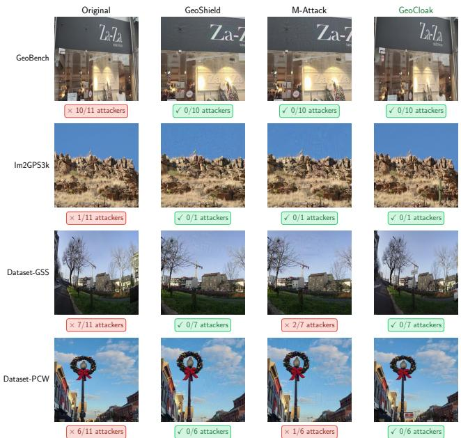  
Figure 3: Qualitative comparison of defense methods. Numbers indicate how many of the 11 attackers, each corresponding to a unique (model, inference method) pair, successfully geolocate the image. We present cases where all defenses largely succeed. Best viewed (Appendix G) with zoom to observe severe visual artifacts, such as floating text, superimposed objects, spatial distortions, and unnatural cropping.

GeoCloak transfers across diverse attacker families and geolocation paradigms. Across different model families, GeoCloak similarly transfers effectively, reducing accuracy to 12.2% on GPT-5.4, 13.3% on o3, and 6.5% on Qwen3.5-Plus under zero-shot inference. Its protection also transfers across substantially different inference pipelines, from zero-shot prompting and GeoMiner’s structured clue-guided reasoning to GeoVista’s post-trained, tool-augmented agentic inference. We further extend the evaluation beyond LVLM-based attackers using GeoCLIP [5], an embedding-based retrieval method, and GeoSeer [10], a commercial black-box geolocation tool on Im2GPS3k. As shown in Table 4, GeoCloak reduces GeoCLIP’s city-level accuracy from 12.1% to 5.0% and GeoSeer’s from 30.7% to 5.7%. Together, these results provide additional evidence that GeoCloak transfers across not only LVLM families and inference pipelines, but also substantially different geolocation mechanisms. We further conduct a fine-grained analysis based on each image’s initial geo-identifiability to compare the effectiveness of different protection methods and examine failure cases; see Appendix E.

Table 5: Human perception ratings on a five-point Likert scale. Higher is better ( ).
<table><tr><td>Defense</td><td>Naturalness↑</td><td>Semantic Preservation↑</td><td>Overall Quality↑</td></tr><tr><td>GeoShield</td><td>2.23</td><td>3.68</td><td>2.53</td></tr><tr><td>M-Attack</td><td>2.31</td><td>3.77</td><td>2.63</td></tr><tr><td>GeoCloak</td><td>4.57</td><td>4.45</td><td>4.43</td></tr></table>

## 5.4 Utility

Human perception analysis shows that GeoCloak preserves visual quality while others introduce severe artifacts. To assess the perceptibility of visual differences, we evaluate 100 source images sampled uniformly across the four datasets. Each source image is paired separately with the outputs of GeoCloak, GeoShield, and M-Attack, yielding 300 rating tasks. Two independent annotators rate naturalness, semantic preservation, and overall quality on a five-point Likert scale by comparing each protected image with its original, without knowing the defense method. The annotators achieve substantial agreement, with a quadraticweighted Cohen’s κ of 0.709 [23]. Full experimental details are provided in Appendix H. As shown in Table 5, GeoCloak achieves substantially higher overall quality (4.43) than M-Attack (2.63) and GeoShield (2.53), with the same trend in naturalness and semantic preservation. Consistent with these human ratings, Figure 3 shows that, in cases where all defenses largely achieve successful protection, GeoShield and M-Attack exhibit significant visual degradation, including cropping of non-square images, floating text, and disembodied heads. See more details in Appendix G. These artifacts are clearly perceptible upon close inspection and render the protected images visually implausible. In contrast, GeoCloak achieves successful protection through semantics-preserving targeted edits, such as replacing a text sign, adding contextually plausible objects, or substituting a street sign, all of which blend naturally into the scene while effectively misleading all attackers.

Quantitative results further confirm the qualitative observations. As reported in Table 6, GeoCloak achieves the highest utility, with an overall CLIP similarity of 0.9197, substantially higher than M-Attack (0.7719) and GeoShield (0.4209). The particularly low CLIP similarity of GeoShield suggests that its perturbations fundamentally alter the visual semantics of the protected image, consistent with the severe artifacts observed qualitatively. Across text-based metrics, GeoCloak similarly leads on BERT score (0.9158), BLEU (0.1136), and ROUGE-L (0.4054), demonstrating that its targeted edits preserve not only visual appearance but also the semantic content describable from the image.

Table 6: Utility comparison of defense methods across four datasets. Higher is better ( higher is better). Bold indicates the best value per dataset.
<table><tr><td>Dataset</td><td>Defense</td><td>CLIP Sim↑</td><td>BERT Score↑</td><td>BLEU↑</td><td>ROUGE-L↑</td></tr><tr><td rowspan="3">Overall</td><td>M-Attack</td><td>0.7719</td><td>0.9124</td><td>0.0968</td><td>0.3839</td></tr><tr><td>GeoShield</td><td>0.4209</td><td>0.9047</td><td>0.0766</td><td>0.3480</td></tr><tr><td>GeoCloak</td><td>0.9197</td><td>0.9158</td><td>0.1136</td><td>0.4054</td></tr></table>

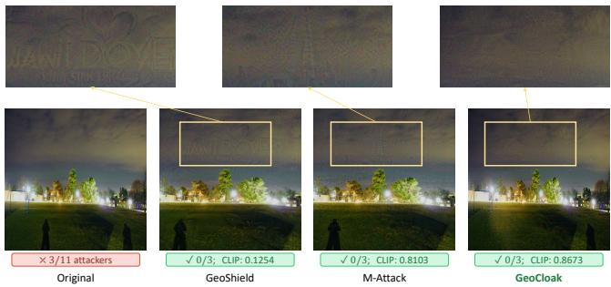  
Figure 4: Visual quality comparison with zoomed-in regions on a Dataset-PCW sample, where adversarial perturbation is the key skill driving GeoCloak’s successful protection. Zoomed-in crops (top) reveal that GeoCloak introduces imperceptible perturbations compared to GeoShield and M-Attack. Comparison on other datasets are in Appendix G.

User-Centered Interactive GeoCloak. While our automated utility checks work well in practice, direct user involvement provides the strongest guarantee of utility preservation, as users themselves are the ultimate judges of whether a protected image remains acceptable for sharing. We therefore release a user-centered interactive version of GeoCloak, where users upload the image they wish to protect and specify regions that must remain unmodified. The system iteratively proposes edits, pausing after each turn for the user to accept, roll back, or stop. An example screenshot is provided in Appendix J, and the system is publicly accessible.

## 5.5 Skill Usage

Semantic editing dominates skill usage and yields superior utility preservation. Figure 5 analyzes how GeoCloak invokes its skills across all iterations. As shown in Figure 5a, Erase Object is the most frequently invoked skill (24.9%), followed by Replace Text (21.4%) and Adversarial Perturbation (20.4%). This reflects GeoCloak’s preference for fine-grained, targeted modifications that prioritize high-importance but inconspicuous clues, consistent with the start small principle defined in our agent (Section 4.3). Erase Object also achieves the highest utility preservation rate (85.6%), followed by Replace Text (81.8%), as modifying a small, localized element is less likely to disrupt the overall visual semantics of the image. In contrast, Adversarial Perturbation exhibits the lowest utility preservation rate (13.5%), as gradient-based noise is inherently less controllable and more prone to causing perceptible visual degradation, a limitation consistent with prior perturbation-based methods such as GeoShield and M-Attack. Nevertheless, GeoCloak’s agentic design substantially mitigates this limitation. EditAgent iteratively adjusts hyperparameters, loss composition, and optimization target based on utility feedback, and can further combine perturbation with semantic editing skills to handle discrete clues, allowing perturbation to operate at reduced intensity with less visual degradation. Across all cases, GeoCloak combines semantic editing and adversarial perturbation in 58.4% of cases and uses semantic editing alone in 39.9%. As illustrated in Figure 4, the visual artifacts introduced by GeoCloak’s adversarail perturbation skill are substantially less pronounced compared to those of GeoShield and M-Attack.

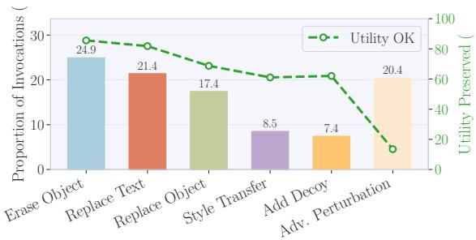  
(a) Distribution of skill invocations across all turns.

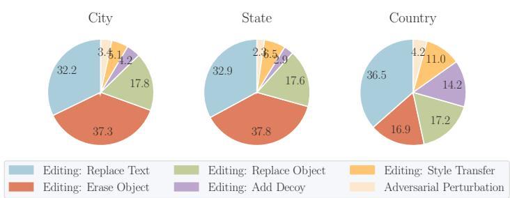  
(b) Distribution of skills used in the successful protection turn.  
Figure 5: Skill usage analysis of GeoCloak. (a) Distribution of all skill invocations and the utility preservation rate for each skill, where Utility OK indicates that the CLIP similarity remains above a pre-defined threshold and the main object is unmodified. (b) Breakdown of skills used in the first successful turn recorded at each exact protection level (city, state, country); runs that directly reach a stronger level are not back-counted at lower levels.

Removal suffices for city-level clues; country-level clues demand recontextualization. Figure 5b exhibits the skill distribution at the successful protection turn across granularity levels. We observe that a clear shift emerges from the city to the country level. At the city level, Erase Object dominates (37.3%), reflecting that city-level geolocation often hinges on a single highly specific clue, such as a street sign or address number, that can be simply removed. As granularity coarsens to the country level, Erase Object’s contribution drops to 16.9%. Instead, Replace Text becomes the dominant successful strategy (36.5%), while Style Transfer and Add Decoy also contribute by introducing conflicting geographic evidence that redirects the attacker’s inference toward a different country. This shift suggests that country-level geolocation clues are more widely distributed and therefore harder to eliminate, as they often involve broader cultural or architectural patterns that cannot be addressed through simple removal.

## 5.6 Design Choices of GeoCloak

Table 7 compares four variants against the full system on Im2GPS3k: GeoCloak w/o Semantic Editing, GeoCloak w/o Perturbation, a closed-source alternative that pairs o3 with Seedream 4.5, and an open-source alternative that pairs Qwen3.6-35B-A3B with Qwen-Image-Edit-2511. The first two variants retain the agentic control loop, including iterative clue analysis and feedback-driven skill configuration. They therefore isolate skill availability rather than the contribution

Table 7: Ablation study on GeoCloak design choices. Overall city-level attack success rate (%) is averaged across 11 attacker configurations on the Im2GPS3k.
<table><tr><td rowspan=1 colspan=4>Design Choice               Overall ↓</td></tr><tr><td rowspan=1 colspan=4>Initial                        24.1%GeoCloak w/o Semantic Editing   15.4%</td></tr><tr><td rowspan=1 colspan=1>GeoCloak w/o Pert</td><td></td><td rowspan=1 colspan=2>urbation        5.1%</td></tr><tr><td rowspan=1 colspan=1>Closed-source alternative†</td><td></td><td rowspan=1 colspan=1>rnative†</td><td rowspan=1 colspan=1>6.3%</td></tr><tr><td rowspan=2 colspan=1>Open-source alte</td><td></td><td></td><td></td></tr><tr><td></td><td rowspan=1 colspan=2>rnative          7.4%</td></tr><tr><td rowspan=1 colspan=4>GeoCloak (Full)                 4.0%</td></tr></table>

<sup>†</sup>o3 + Seedream-4.5. <sup>‡</sup>Qwen3.6-35B-A3B + Qwen-Image-Edit-2511.

of agentic orchestration.

Semantic Editing vs. Adversarial Perturbation. When restricted to semantic editing alone, GeoCloak w/o Perturbation achieves strong protection with an overall city-level accuracy of 5.1%, demonstrating that targeted semantic edits are highly effective within the agentic framework. The full system further reduces this accuracy to 4.0% by allowing the agent to also select adversarial perturbation. In contrast, GeoCloak w/o Semantic Editing performs considerably worse (15.4%), which is expected. Under our strict utility constraint (CLIP similarity>0.85), the adversarial perturbation budget is severely limited, making it difficult to suppress all geolocation clues through noise alone. However, when combined in the full agent, adversarial perturbation and semantic editing are complementary: semantic edits first remove the most decisive discrete clues, after which a moderate perturbation is sufficient to suppress the remaining scene-level features. The GeoBench example in Figure 10 (Appendix G) demonstrates this complementary effect. GeoCloak first erases the semitransparent text “NATASHA CADONICI” from the glass, after which a moderate perturbation successfully defeats all 8 previously successful attacks.

Adaptive guidance with a single ClueAgent outperforms multi-agent debate on hard cases. When ClueAgent fails to identify the correct geolocation, EditAgent cannot effectively protect the image, as it has no reliable clues to target. This is particularly problematic when ClueAgent fails to identify even the correct country, a condition that triggers early termination under the assumption that no protection is needed, while in reality, attackers powered by stronger or different LVLM may still correctly geolocate the image, compromising transferability. The adaptive mode in GeoCloak is designed to address this: when ClueAgent fails to identify the correct country, the ground truth is explicitly provided to guide ClueAgent in identifying location-relevant clues, until no high-importance clues remain. Among all non-exempt images in our evaluation, 12.1% of cases trigger this adaptive mode. We additionally explore a multi-agent alternative, where an additional o3 instance engages in a one-round debate with Gemini-2.5-Pro to derive a more accurate clue list. In Im2GPS3k, only 2.9% of attackers in the adaptive mode still successfully geolocate the protected image, substantially outperforming the multi-agent debate approach (11.8%). This result suggests that in these hard cases, where discriminative location clues are inherently difficult to identify from the image alone, providing ground-truth guidance more effectively focuses the search on relevant evidence than augmenting the agent with additional reasoning capacity.

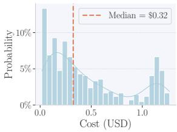  
(a) Token Cost

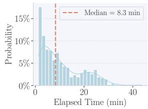  
(b) Elapsed Time  
Figure 6: Cost and elapsed time distribution of GeoCloak. API cost is computed from the total token usage of GeoCloak based on the official Gemini pricing [15].

GeoCloak generalizes across proprietary and opensource backbones. As reported in Table 7, GeoCloak (o3+Seedream 4.5) demonstrates that the framework generalizes to different LVLM backbones, reducing overall citylevel accuracy from 24.1% to 6.3%. The choice of backbone influences protection strength: GeoCloak with Gemini-2.5- Pro+Gemini-2.5-Flash-Image achieves stronger overall protection (4.0%) than with o3+Seedream 4.5 (6.3%), though both substantially outperform all baselines (Table 3). To understand this gap, we analyze the runtime trajectories of both configurations on Im2GPS3k. o3 as ClueAgent exhibits weaker geolocation clue identification, even in adaptive mode, where the ground-truth location is explicitly provided, it fails to identify highly location-relevant clues in several cases. This causes the agent to terminate without applying any protection to these images. Meanwhile, the Gemini backbone employs a combination of semantic editing and adversarial perturbation in 54.5% of cases, compared to only 34.1% for o3. Its typical pattern is to first apply semantic editing, modifying small clues, to introduce semantic-level misdirection, followed by adversarial perturbation to suppress residual scene-level features. Among cases where both skills are combined, the Gemini backbone achieves transferable protection, where the protected image fools all evaluation attackers, in 66.7% of cases, compared to only 40.0% for o3. This suggests that the Gemini backbone not only uses skill combinations more frequently but also more effectively. The fully open-source configuration, instantiated with Qwen3.6-35B-A3B and Qwen-Image-Edit-2511, further reduces overall accuracy from 24.1% to 7.4%, demonstrating that GeoCloak can also operate without proprietary backbones. Manual inspection reveals no obvious quality differences among images edited by Seedream-4.5, Qwen-Image-Edit-2511, and Gemini-2.5-Flash-Image.

## 5.7 Cost and Efficiency Analysis

GeoCloak achieves strong protection at acceptable cost. As shown in Figure 6, the median cost is \$0.32 per image, and the median elapsed time is 8.3 minutes. Using the Gemini Batch API would further halve this cost, reducing the estimated median to approximately \$0.16 per image. Image editing is the largest cost component and is explicitly included in these estimates. GeoCloak typically achieves cityand state-level protection within 2 turns (median = 2.0 for both), as the geolocation-decisive clues at these granularities tend to be more peripheral and discrete, such as a specific street sign or address number, making them easier to identify and suppress. Country-level protection requires considerably more iterations (median = 5.0), consistent with our earlier finding that country-level clues are more distributed and require repeated recontextualization. In practice, users can run GeoCloak in advance to protect images they plan to share.

## 5.8 Adaptive Attacks

GeoCloak has high robustness against diverse attackers. Our agent has already been evaluated against a diverse set of attackers, ranging from simple zero-shot prompting to structured two-stage cot prompting (GeoMiner) and toolaugmented agentic inference (GeoVista), embedding-based retrieval method (GeoCLIP) and commercial tool (GeoSeer) and consistently achieves the strongest protection.

Adaptive prompting provides limited gain at the cost of unprotected image performance. We further evaluate GeoCloak against an adaptive attacker that is explicitly aware that the image may have been modified. Rather than using a standard zero-shot prompting, this attacker instructs the LVLM to identify and discard potentially manipulated or conflicting clues before inferring the location. As shown in Table 8, the adaptive attacker achieves a higher success rate than naive prompting after GeoCloak defense (15.9% vs. 11.1% overall). This indicates that conflict-aware prompting provides some additional attack capability. Nevertheless, GeoCloak reduces the adaptive attacker’s performance from 41.6% to 15.9%, a substantial reduction that demonstrates the robustness of GeoCloak’s protection even against an informed attacker. Notably, the adaptive approach provides little benefit on unprotected images and even slightly degrades the performance (41.6% vs. 43.4%), suggesting that indiscriminately treating clues as suspicious can mislead the attacker into discarding genuine evidence. This means an attacker cannot blindly apply adaptive prompting without prior knowledge of whether the image has been protected, further limiting its practical threat.

Adaptive fine-tuning only partially recovers geolocation performance. We further consider an adaptive attacker with access to GeoCloak-protected images and their location labels, who attempts to adapt geolocation models directly to the protected-image distribution. We fine-tune both Geo-CLIP, a retrieval-based geolocation model, and Qwen3.5-9B, a reasoning-based model adapted using LoRA, with an 80/20 train/test split of protected images. Fine-tuning provides only partial recovery for both attacker families. For vanilla Geo-CLIP, applying GeoCloak reduces city-level accuracy from 17.0% on unprotected images to 7.4% on protected images; fine-tuning on protected images raises it to only 9.6%. Similarly, vanilla Qwen3.5-9B [46] achieves 24.5% on unprotected images and 6.4% on protected images, while LoRA finetuning recovers accuracy to 11.3%, still less than half of its unprotected performance. Thus, although adaptive fine-tuning weakens GeoCloak to some extent, it does not restore the original geolocation capability, demonstrating that GeoCloak remains effective against adaptive fine-tuning attacks across both retrieval-based and reasoning-based models.

GeoCloak remains robust against denoising-based adaptive attacks. Because GeoCloak uses adversarial perturbation as one of its protection skills, an adaptive attacker can apply image purification before inference to remove the perturbation. Here we evaluate DiffPure [36], a representative diffusion-based purification method. However, it substantially degrades image utility, fine-grained details (e.g., text and human subjects) become blurred or unrecognizable, while perturbation artifacts remain visible. This behavior occurs across its guided diffusion [7], DDPM [17], and Stable Diffusionbased [44] variants. We also evaluate JPEG compression as a lightweight alternative with negligible utility loss. As shown in Table 8, compression provides little benefit, indicating that GeoCloak remains robust to this adaptive attack.

## 6 Discussion, Limitation, and Future Work

The Necessity of Our Agent Architecture. GeoCloak cannot be trivially reduced to either a fixed pipeline or a trivial agent composition. Geolocation clues are image-specific and only discoverable through inference-time reasoning. This makes static strategies insufficient to jointly preserve privacy and utility. Moreover, GeoCloak’s effectiveness relies on adaptive reasoning, including adversarially grounded stopping criteria, dynamic strategy selection, adaptive optimization, and iterative feedback between clue discovery and editing. For example, in Figure 7, two attempts to modify the shop sign fail the utility check. Based on this feedback, EditAgent dynamically adjusts its strategy by rolling back the failed edits and replacing the Moroccan-style sofa instead, shifting ClueAgent’s prediction from Morocco to Algeria. Such failures are difficult to address with a fixed editing pipeline, where subsequent edits are predetermined rather than adjusted to intermediate feedback.

Prompt Sensitivity. Prompts templates used in GeoCloak are provided in Appendix B. We find that paraphrasing these prompts, without altering each agent (Section 4), has negligible impact on protection performance. This indicates that GeoCloak is robust to prompt variations and does not require careful prompt engineering to achieve strong results. While frameworks such as DSPy [22] enable systematic prompt optimization for single-turn pipelines, they are not directly applicable to our multi-turn agentic setting, where prompts interact dynamically across agents and iterative feedback loops. We therefore leave systematic prompt optimization for multiturn agentic systems to future work.

Table 8: City-level accuracy (%) over five LVLMs under naive and adaptive attackers with zero-shot prompting, before and after GeoCloak defense, and (for the naive attacker) after additional JPEG compression.
<table><tr><td>Attacker</td><td>Setting</td><td>GeoBench</td><td>Im2GPS3k</td><td>Dataset-GSS</td><td>Dataset-PCW</td><td>Overall</td></tr><tr><td rowspan="3">Naive</td><td>Initial</td><td>69.1</td><td>26.2</td><td>34.9</td><td>36.1</td><td>43.4</td></tr><tr><td>GeoCloak</td><td>18.9</td><td>4.8</td><td>9.3</td><td>8.2</td><td>11.1</td></tr><tr><td>GeoCloak (JPEG)</td><td>20.0</td><td>4.9</td><td>9.6</td><td>8.2</td><td>11.5</td></tr><tr><td rowspan="2">Adaptive</td><td>Initial</td><td>66.6</td><td>26.5</td><td>32.8</td><td>33.0</td><td>41.6</td></tr><tr><td>GeoCloak</td><td>24.0</td><td>8.0</td><td>15.2</td><td>11.9</td><td>15.9</td></tr></table>

User-Centered Agentic System. We argue that geolocation privacy protection should respect user intent, protecting only images whose owners do not intend to disclose their location. Because ground-truth intent is unavailable in existing datasets, our evaluation (Section 5.2) approximates it using visual landmark analysis, while automated utility checks estimate acceptable modifications. To move beyond these proxies, we introduce an interactive version of GeoCloak that allows users to specify objects that must remain unchanged and accept, roll back, or stop edits at each step. This gives image owners direct control over the information their images reveal.The system is publicly accessible, with an example in Appendix J. Future work will include real-world user feedback.

Manual Inspection of GeoCloak’s Outputs. Throughout system development, all authors manually inspect randomly sampled intermediate outputs from GeoCloak’s agent trajectories. We specifically examine whether the agents’ intended actions are successfully executed and whether subsequent agent decisions are consistent with the observed privacy and utility feedback. By the final system iteration, the sampled trajectories generally exhibit successful execution of the proposed edits and coherent multi-turn refinement behavior.

LVLM Capability. GeoCloak’s effectiveness depends on the underlying LVLM’s visual reasoning capability, as stronger models can identify more comprehensive clues and enable more targeted protection. Our evaluation against 11 attacker configurations, including stronger models and different model families, shows substantial reductions in geolocation accuracy under the current stopping rule. A final GT-guided audit after standard-mode termination could provide an additional check for residual clues, although it would still depend on ClueAgent’s ability to identify them. Its additional protection benefit and processing overhead remain to be evaluated. This dependence allows GeoCloak to benefit from future model advances without architectural changes. Our open-source Qwen configuration demonstrates that GeoCloak does not require proprietary backbones, although its 7.4% attack success rate remains higher than the 4.0% of our primary Gemini configuration (Table 7). Improving protection with smaller, resource-constrained open-source backbones remains important future work.

## 7 Conclusion

We present GeoCloak, an agentic framework for geolocation privacy protection. Our approach is motivated by an observation visual-geocalocation asymmetry: geolocation-decisive clues tend to be visually peripheral, enabling targeted protection with minimal impact on image quality. GeoCloak exploits this asymmetry through a combination of targeted editing and adversarial perturbation, driven by an agentic system that adaptively analyzes each image and iteratively refines its protection strategies under utility-aware feedback. Extensive evaluation demonstrates that our agent outperforms baselines in both effectiveness and utility. We further release an interactive version of GeoCloak that allows users to directly participate in the protection process. We hope this work contributes to the development of practical, user-intent-aware geolocation privacy protection, and inspires further research into semantics-preserving approaches to visual privacy in the LVLM era.

## References

[1] Gemini Pro. https://docs.cloud.google.com/ve rtex-ai/generative-ai/docs/models/gemini/2- 5-pro. 6

[2] Anthropic. Claude Sonnet 4.6. https://www.anthro pic.com/claude/sonnet, 2026. 6

[3] ByteDance. Seedream 4.5. https://seed.bytedan ce.com/en/seedream4\_5, 2025. 6

[4] JHU Center for Imaging Science. The Download Ddress for im2gps3K Dataset. http://www.cis.jhu.edu/\~s hraman/TransLocator/Datasets/im2gps3k\_rgb\_ images.tar.gz, 2022. 15

[5] Vicente Vivanco Cepeda, Gaurav Kumar Nayak, and Mubarak Shah. GeoCLIP: Clip-Inspired Alignment between Locations and Images for Effective Worldwide Geo-localization. In Annual Conference on Neural Information Processing Systems (NeurIPS), pages 8690– 8701. NeurIPS, 2023. 2, 3, 6, 8, 9

[6] Fenghua Cheng, Jinxiang Wang, Sen Wang, Zi Huang, and Xue Li. GeoGuess: Multimodal Reasoning based on Hierarchy of Visual Information in Street View. CoRR abs/2506.16633, 2025. 3, 7, 16

[7] Prafulla Dhariwal and Alexander Quinn Nichol. Diffusion Models Beat GANs on Image Synthesis. In Annual Conference on Neural Information Processing Systems (NeurIPS), pages 8780–8794. NeurIPS, 2021. 12

[8] Terence Eden. Android Now Stops You Sharing Your Location in Photos. https://shkspr.mobi/blog/2 026/04/android-now-stops-you-sharing-yourlocation-in-photos/, 2026. 2, 3

[9] Terence Eden and Elizabeth Eden. OpenBenches. http s://openbenches.org/, 2026. 2, 3

[10] GeoSeer. GeoSeer. https://geoseeer.com/, 2026. 2, 8, 9

[11] GeoVista. GeoVista-RL-6k-7B. https://huggingfac e.co/LibraTree/GeoVista-RL-6k-7B, 2026. 7

[12] Narges Ghasemi, Amir Ziashahabi, Salman Avestimehr, and Cyrus Shahabi. GeoToken: Hierarchical Geolocalization of Images via Next Token Prediction. In International Conference on Data Mining (ICDM), pages 1214–1223. IEEE, 2025. 7

[13] Google. Gemini 2.5 Flash Image. https://ai.goo gle.dev/gemini-api/docs/models/gemini-2.5- flash-image, 2025. 6

[14] Google. Gemini 3.1 Pro Preview. https://ai.goo gle.dev/gemini-api/docs/models/gemini-3.1- pro-preview, 2026. 6

[15] Google. The Official Price of Gemini Models. https: //ai.google.dev/gemini- api/docs/pricing, 2026. 11

[16] Lukas Haas, Michal Skreta, Silas Alberti, and Chelsea Finn. PIGEON: Predicting Image Geolocations. In IEEE Conference on Computer Vision and Pattern Recognition (CVPR), pages 12893–12902. IEEE, 2024. 3, 6

[17] Jonathan Ho, Ajay Jain, and Pieter Abbeel. Denoising Diffusion Probabilistic Models. In Annual Conference on Neural Information Processing Systems (NeurIPS). NeurIPS, 2020. 12

[18] Yujun Hou, Matias Quintana, Maxim Khomiakov, Winston Yap, Jiani Ouyang, Koichi Ito, Zeyu Wang, Tianhong Zhao, and Filip Biljecki. Global Streetscapes—A Comprehensive Dataset of 10 Million Street-Level Images across 688 Cities for Urban Science and Analytics. ISPRS Journal ofPhotogrammetry and Remote Sensing, 2024. 16

[19] Furong Jia, Ling Dai, Wenjin Deng, Fan Zhang, Chen Hu, Daxin Jiang, and Yu Liu. SpotAgent: Grounding Visual Geo-localization in Large Vision-Language Models through Agentic Reasoning. CoRR abs/2602.09463, 2026. 3

[20] Pengyue Jia, Yiding Liu, Xiaopeng Li, Xiangyu Zhao, Yuhao Wang, Yantong Du, Xiao Han, Xuetao Wei, Shuaiqiang Wang, and Dawei Yin. G3: An Effective and Adaptive Framework for Worldwide Geolocalization Using Large Multi-Modality Models. In Annual Conference on Neural Information Processing Systems (NeurIPS), pages 53198–53221. NeurIPS, 2024. 1, 2, 16

[21] Pengyue Jia, Seongheon Park, Song Gao, Xiangyu Zhao, and Yixuan Li. GeoRanker: Distance-Aware Ranking for Worldwide Image Geolocalization. CoRR abs/2505.13731, 2025. 1, 2, 16

[22] Omar Khattab, Arnav Singhvi, Paridhi Maheshwari, Zhiyuan Zhang, Keshav Santhanam, Sri Vardhamanan, Saiful Haq, Ashutosh Sharma, Thomas T. Joshi, Hanna Moazam, Heather Miller, Matei Zaharia, and Christopher Potts. DSPy: Compiling Declarative Language

Model Calls into Self-Improving Pipelines. CoRR abs/2310.03714, 2023. 12

[23] J. Richard Landis and Gary G. Koch. The Measurement of Observer Agreement for Categorical Data. Biometrics, 1977. 9

[24] Ling Li, Yu Ye, Bingchuan Jiang, and Wei Zeng. Geo-Reasoner: Geo-localization with Reasoning in Street Views using a Large Vision-Language Model. In International Conference on Machine Learning (ICML), pages 29222–29233. PMLR, 2024. 1, 2

[25] Ling Li, Yao Zhou, Yuxuan Liang, Fugee Tsung, and Jiaheng Wei. Recognition through Reasoning: Reinforcing Image Geo-localization with Large Vision-Language Models. CoRR abs/2506.14674, 2025. 1, 2

[26] Lingyao Li, Runlong Yu, Qikai Hu, Bowei Li, Min Deng, Yang Zhou, and Xiaowei Jia. From Pixels to Places: A Systematic Benchmark for Evaluating Image Geolocalization Ability in Large Language Models. CoRR abs/2508.01608, 2025. 1, 2, 4, 6, 7, 16

[27] Lingyao Li, Runlong Yu, Qikai Hu, Bowei Li, Min Deng, Yang Zhou, and Xiaowei Jia. The Zenodo Repository of GeoBench. https://zenodo.org/records/1667047 1, 2025. 15

[28] Qiujun Li, Zijin Xiao, Xulin Wang, Zhidan Ma, Cheng Yang, and Haifeng Li. LocationAgent: A Hierarchical Agent for Image Geolocation via Decoupling Strategy and Evidence from Parametric Knowledge. CoRR abs/2601.19155, 2026. 1, 2, 7

[29] Zhaoyi Li, Xiaohan Zhao, Dong-Dong Wu, Jiacheng Cui, and Zhiqiang Shen. A Frustratingly Simple Yet Highly Effective Attack Baseline: Over 90% Success Rate Against the Strong Black-box Models of GPT-4.5/4o/o1. In Annual Conference on Neural Information Processing Systems (NeurIPS). NeurIPS, 2025. 1, 2, 3, 7, 8

[30] Shilong Liu, Zhaoyang Zeng, Tianhe Ren, Feng Li, Hao Zhang, Jie Yang, Qing Jiang, Chunyuan Li, Jianwei Yang, Hang Su, Jun Zhu, and Lei Zhang. Grounding DINO: Marrying DINO with Grounded Pre-training for Open-Set Object Detection. In European Conference on Computer Vision (ECCV), pages 38–55. Springer, 2024. 17

[31] Xinwei Liu. Geoshield. https://github.com/thinw ayliu/Geoshield, 2025. 7, 17

[32] Xinwei Liu, Xiaojun Jia, Yuan Xun, Simeng Qin, and Xiaochun Cao. GeoShield: Safeguarding Geolocation Privacy from Vision-Language Models via Adversarial Perturbations. In AAAI Conference on Artificial Intelligence (AAAI), pages 35653–35661. AAAI, 2026. 1, 2, 3, 7, 8

[33] Yi Liu, Junchen Ding, Gelei Deng, Yuekang Li, Tianwei Zhang, Weisong Sun, Yaowen Zheng, Jingquan Ge, and Yang Liu. Image-Based Geolocation Using Large

Vision-Language Models. CoRR abs/2408.09474, 2024. 1, 2, 3, 6, 16

[34] Weidi Luo, Qiming Zhang, Tianyu Lu, Xiaogeng Liu, Yue Zhao, Zhen Xiang, and Chaowei Xiao. Doxing via the Lens: Revealing Privacy Leakage in Image Geolocation for Agentic Multi-Modal Large Reasoning Model. CoRR abs/2504.19373, 2025. 1, 2, 3, 6, 7, 16, 17

[35] Ethan Mendes, Yang Chen, James Hays, Sauvik Das, Wei Xu, and Alan Ritter. Granular Privacy Control for Geolocation with Vision Language Models. In Conference on Empirical Methods in Natural Language Processing (EMNLP), page 17240–17292. ACL, 2024. 1, 2, 3, 6, 16

[36] Weili Nie, Brandon Guo, Yujia Huang, Chaowei Xiao, Arash Vahdat, and Animashree Anandkumar. Diffusion Models for Adversarial Purification. In International Conference on Machine Learning (ICML), pages 16805– 16827. PMLR, 2022. 12

[37] OpenAI. o3. https://platform.openai.com/docs /models/o3, 2025. 6

[38] OpenAI. GPT-5.4. https://developers.openai.co m/api/docs/models/gpt-5.4, 2026. 6

[39] OpenRouter. OpenRouter. https://openrouter.ai/, 2026. 6

[40] Xuebin Qin, Zichen Zhang, Chenyang Huang, Masood Dehghan, Osmar R. Zaïane, and Martin Jägersand. U<sup>2</sup>- Net: Going Deeper with Nested U-Structure for Salient Object Detection. CoRR abs/2005.09007, 2020. 7

[41] Qwen. Qwen 3.5 Plus. https://qwen.ai/blog?id= qwen3.5, 2026. 6

[42] Qwen Team. Qwen-Image-Edit-2511, 2026. URL: ht tps://huggingface.co/Qwen/Qwen-Image-Edit-2511. 6

[43] Qwen Team. Qwen3.6-35B-A3B: Agentic coding power, now open to all, 2026. URL: https://qwen.ai/blog ?id=qwen3.6-35b-a3b. 6

[44] Robin Rombach, Andreas Blattmann, Dominik Lorenz, Patrick Esser, and Björn Ommer. High-Resolution Image Synthesis with Latent Diffusion Models. In IEEE Conference on Computer Vision and Pattern Recognition (CVPR), pages 10684–10695. IEEE, 2022. 12

[45] Zirui Song, Jingpu Yang, Yuan Huang, Jonathan Tonglet, Zeyu Zhang, Tao Cheng, Meng Fang, Iryna Gurevych, and Xiuying Chen. Geolocation with Real Human Gameplay Data: A Large-Scale Dataset and Human-Like Reasoning Framework. CoRR abs/2502.13759, 2025. 1, 2, 3, 6, 16

[46] Qwen Team. Qwen3.5: Towards Native Multimodal Agents. https://qwen.ai/blog?id=qwen3.5, 2026. 12

[47] Bart Thomee, David A. Shamma, Gerald Friedland, Benjamin Elizalde, Karl Ni, Douglas Poland, Damian Borth,

and Li-Jia Li. YFCC100M: the new data in multimedia research. Communications ofthe ACM, 2016. 16

[48] Nam N. Vo, Nathan Jacobs, and James Hays. Revisiting IM2GPS in the Deep Learning Era. In IEEE International Conference on Computer Vision (ICCV), pages 2640–2649. IEEE, 2017. 3, 6, 16

[49] Yikun Wang, Zuyan Liu, Ziyi Wang, Han Hu, Pengfei Liu, and Yongming Rao. GeoVista: Web-Augmented Agentic Visual Reasoning for Geolocalization. CoRR abs/2511.15705, 2025. 1, 2, 3, 6, 7, 16

[50] Yikun Wang, Zuyan Liu, Ziyi Wang, Han Hu, Pengfei Liu, and Yongming Rao. The Hugging Face Repository of GeoBench. https://huggingface.co/datasets/ LibraTree/GeoVistaBench, 2025. 15

[51] Tobias Weyand, Ilya Kostrikov, and James Philbin. PlaNet - Photo Geolocation with Convolutional Neural Networks. In European Conference on Computer Vision (ECCV), pages 37–55. Springer, 2016. 3, 6

[52] Bin Xiao, Haiping Wu, Weijian Xu, Xiyang Dai, Houdong Hu, Yumao Lu, Michael Zeng, Ce Liu, and Lu Yuan. Florence-2: Advancing a Unified Representation for a Variety of Vision Tasks. In IEEE Conference on Computer Vision and Pattern Recognition (CVPR), pages 4818–4829. IEEE, 2024. 7

[53] Chenhui Xu, Fuxun Yu, Michael J. Bianco, Jacob Kovarskiy, Raphael Tang, Qi Zhang, Zirui Xu, Will LeVine, Brandon Dubbs, Heming Liao, Cassandra Burgess, Suvam Bag, Jay Patravali, Rupanjali Kukal, Mikael Figueroa, Rishi Madhok, Nikolaos Karianakis, and Jinjun Xiong. Geo-R1: Unlocking VLM Geospatial Reasoning with Cross-View Reinforcement Learning. CoRR abs/2510.00072, 2025. 1, 2, 7

[54] Jiaming Zhang, Che Wang, Yang Cao, Longtao Huang, and Wei Yang Bryan Lim. Disrupting Hierarchical Reasoning: Adversarial Protection for Geographic Privacy in Multimodal Reasoning Models. CoRR abs/2512.08503, 2025. 1, 3

[55] Jiaming Zhang, Junhong Ye, Xingjun Ma, Yige Li, Yunfan Yang, Yunhao Chen, Jitao Sang, and Dit-Yan Yeung. Anyattack: Towards Large-scale Self-supervised Adversarial Attacks on Vision-language Models. In IEEE Conference on Computer Vision and Pattern Recognition (CVPR), pages 19900–19909. IEEE, 2025. 1, 3

[56] Xinyu Zhang, Yixin Wu, Boyang Zhang, Chenhao Lin, Chao Shen, Michael Backes, and Yang Zhang. GEO-Detective: Unveiling Location Privacy Risks in Images with LLM Agents. CoRR abs/2511.22441, 2025. 1, 2, 7

[57] Zhongliang Zhou, Jielu Zhang, Zihan Guan, Mengxuan Hu, Ni Lao, Lan Mu, Sheng Li, and Gengchen Mai. Img2Loc: Revisiting Image Geolocalization using Multi-modality Foundation Models and Image-based Retrieval-Augmented Generation. In International ACM SIGIR Conference on Research and Development in Information Retrieval (SIGIR), pages 2749–2754. ACM, 2024. 1, 2

## Open Science

In this paper, we provide the code for interactive version of GeoCloak to faciliate the real-world deployment. An example screenshot is provided in Appendix J, and the (anonymous) artifact is publicly accessible at https://anonymous.4ope n.science/r/GeoCloak-7AA4. All evaluation datasets used in this work are publicly available: Im2GPS3k [4], GeoBench [50], Dataset-GSS [27], and Dataset-PCW [27]. In our evaluation, we access all evaluated LVLMs via their official APIs.

## Ethical Considerations

Our Primary Goal. GeoCloak is designed exclusively as a privacy protection tool, intended to help individuals prevent unintended location disclosure when sharing images online. We do not anticipate significant dual-use concerns, as the system is designed to suppress geolocation information rather than enable tracking.

Dataset and Image Usage. All datasets used in our evaluation are publicly available benchmarks. Images used in qualitative examples are either from these public benchmarks. Human Annotation Tasks. Our annotation tasks were exempt from IRB review as they involved no sensitive data collection, no deception, and no risk to participants. The tasks were benign in nature and did not involve any sensitive, disturbing, or personally identifiable content. Annotators evaluated whether images contained intentionally photographed landmarks and rated the perceptual quality of protected benchmark images. No annotator reported any discomfort during the study.

Potential for Misuse. While GeoCloak is designed for privacy protection, the underlying image editing capabilities could theoretically be misused to manipulate images for deceptive purposes. However, the system is specifically optimized for subtle, targeted edits that preserve visual semantics, making it less suitable for generating deceptive content compared to general-purpose image generation tools.

## A Examples of Multi-Turn GeoCloak Protection Example

We exhibit an successful example of multi-turn GeoCloak protection example in Figure 7.

## B Prompt Templates

In this section, we provide the prompt templates for ClueAgent (Listing 1), EditAgent (Listing 2), semantic editing skill (Listing 3), adversarial perturbation skill (Listing 4), and evaluation scoping (Listing 5).

## C Examples of Semantic Editing Skill

Table 9 exhibit examples of each strategy of the semantic editing skill. In all cases, modifications are subtle and semanticspreserving, yet sufficient to redirect ClueAgent’s predicted location.

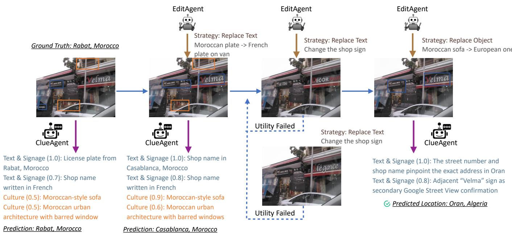  
Figure 7: A multi-turn GeoCloak protection example. Starting from Rabat, Morocco, EditAgent first replaces the Moroccan license plate with a French one, shifting ClueAgent’s prediction to Casablanca, Morocco. A subsequent attempt to change the shop sign fails the utility check twice and is rolled back. EditAgent then switches strategy to replace the Moroccan sofa with a European one, successfully redirecting the predicted location to Oran, Algeria, with minimal visual change across all turns.

## D More Details of Evaluation Setup

## D.1 Evaluation Datasets

Im2GPS3k [48] and YFCC4k [47] were originally introduced to evaluate retrieval- and classification-based methods, and remain widely adopted as standard evaluation protocols in the LVLM era [20, 21, 33–35]. Newer benchmarks emerged to assess reasoning quality and broader capabilities [6, 26, 34, 45, 49]. In this paper, we evaluate GeoCloak on four datasets that support level-wise geolocation evaluation to comprehensively assess protection effectiveness across diverse geographic and visual contexts.

Im2GPS3k [48] is a widely adopted benchmark in geolocation research, containing 3,000 geo-tagged images spanning diverse locations worldwide.

GeoBench [49] consists of high-resolution photos with global coverage, specifically designed to challenge current LVLM with high localizability requirements.

Dataset-GSS [26] is sourced from IMAGEO-Bench. It is drawn from the NUS Global Streetscapes dataset [18] across 688 cities worldwide. The IMAGEO-Bench authors further filtered the original data, manually excluding images with insufficient geographic information, resulting in a diverse collection spanning varied geographies, environmental conditions, architectural styles, and cultural contexts.

Dataset-PCW [26] is also sourced from IMAGEO-Bench, but does not draw from any publicly available sources, making it well-suited to evaluate geolocation protection on truly unseen images.

We use all available data from GeoBench and Dataset-PCW. Because Im2GPS3k and Dataset-GSS are substantially larger, we randomly sample 500 images from each dataset. As reported in Table 10, the resulting benchmark contains 1,779 images spanning 108 unique countries and 576 unique cities across all four datasets, ensuring broad geographic diversity in our evaluation. This scale exceeds the 500-image DoxBench evaluation used in the GeoMiner study [34] while providing substantially broader geographic coverage. Across the available images, the full evaluation design comprises over 75,000 evaluation runs, covering 11 attacker configurations and four conditions (Initial, M-Attack, GeoShield, and GeoCloak).

## D.2 Geolocation Inference Methods

Zero-Shot is a simple single-turn prompt that asks “Where was this photo taken? Explain your reasoning based on visual evidence,” along with a structured output format to ensure consistent responses. Despite its simplicity, this prompt already elicits strong geolocation performance from LVLMs [33, 34], reflecting a realistic attack scenario where any user can infer location from a shared image without any prompt engineering expertise.

GeoMiner is a two-stage collaborative attack framework from Dox-Bench that leverages two LVLM in a pipeline. In the first stage, a Detector model processes the image and produces a structured set of geolocation-relevant visual clues organized by category. These clues are then passed to an Analyzer model in the second stage, which incorporates them as explicit context to generate a more accurate location prediction.

GeoVista is a web-augmented agentic framework that operates through an iterative thought-action-observation loop. At each step, the model generates a reasoning thought and autonomously decides when and how to invoke tools, enabling a dynamic process of visual clue extraction and external information retrieval. Two tools are available: image\_zoom\_in, which crops and magnifies regions of interest specified by a bounding box, and search\_web, which retrieves up to 10 relevant documents from the internet.

<table><tr><td rowspan=1 colspan=1>Strategy</td><td rowspan=1 colspan=8>Application Scenario            Original                      Protected                      How it protects</td></tr><tr><td rowspan=1 colspan=1>ReplaceTxt</td><td rowspan=1 colspan=1>Signs, street names,or any visible textreveal the location.</td><td rowspan=1 colspan=6>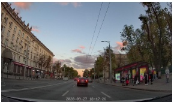                              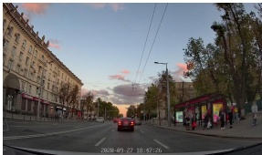</td><td rowspan=1 colspan=1>Replacing Romanian sign text onthe red shop signs with Polish wordsshifts the language clue and misleadsthe predicted location from Chişinău,Moldova to Warsaw, Poland.</td></tr><tr><td rowspan=1 colspan=1>Replaceobet</td><td rowspan=1 colspan=1>Location-specificobjects are present(e.g., post boxes andtraffic signs).</td><td rowspan=1 colspan=3>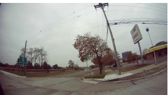</td><td rowspan=1 colspan=3>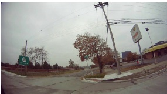</td><td rowspan=1 colspan=1>Replacing the American highway signwith a Canadian highway sign shiftsthe predicted location from Southfield,Michigan, USA, to Windsor, Ontario,Canada.</td></tr><tr><td rowspan=1 colspan=1>EFraseObet</td><td rowspan=1 colspan=1>An object, sign, text,or logo is too specificto replace but smallenough to removecleanly.</td><td rowspan=1 colspan=3>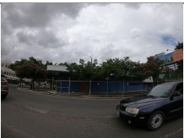</td><td rowspan=1 colspan=3>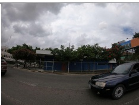</td><td rowspan=1 colspan=1>Removing all text from the orangebillboard shifts the predicted locationfrom San José, Costa Rica, to SanSalvador, El Salvador.</td></tr><tr><td rowspan=1 colspan=1>ppVDeoy</td><td rowspan=1 colspan=1>Dominant clues aretoo large or structuralto edit or perturbdirectly.</td><td rowspan=1 colspan=2>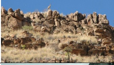</td><td rowspan=1 colspan=1></td><td rowspan=1 colspan=1></td><td rowspan=1 colspan=1>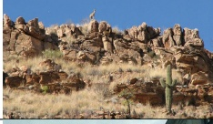</td><td rowspan=1 colspan=1></td><td rowspan=1 colspan=1>Adding a small Saguaro cactus growingamong the rocks shifts the predictedlocation from Khomas, Namibia toTucson, Arizona, US.</td></tr><tr><td rowspan=1 colspan=1>StyleTraner</td><td rowspan=1 colspan=1>Apply only to smallor background ele-ments.</td><td rowspan=1 colspan=1></td><td rowspan=1 colspan=1>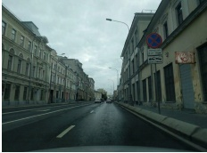</td><td rowspan=1 colspan=1></td><td rowspan=1 colspan=2>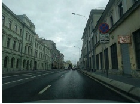</td><td rowspan=1 colspan=1></td><td rowspan=1 colspan=1>Changing the architectural style of thegreenish building on the left from Rus-sian neoclassical to German neoclassi-cal shifts the predicted location fromMoscow, Russia to Warsaw, Poland.</td></tr></table>

Table 9: Overview of the five Semantic Editing strategies in EditAgent. The EditAgent generates plans for modifying the image based on the clues obtained from ClueAgent. In all cases, modifications are subtle and semantics-preserving, yet sufficient to redirect ClueAgent’s predicted location.

Table 10: Geographic coverage of the four benchmark datasets.
<table><tr><td>Dataset</td><td>#Samples</td><td>#Countries</td><td>#Cities</td></tr><tr><td>IM2GPS3K</td><td>500</td><td>74</td><td>297</td></tr><tr><td>Dataset-GSS</td><td>500</td><td>61</td><td>161</td></tr><tr><td>Dataset-PCW</td><td>267</td><td>6</td><td>76</td></tr><tr><td>GeoBench</td><td>512</td><td>64</td><td>117</td></tr><tr><td>Overall</td><td>1,779</td><td>108</td><td>576</td></tr></table>

For GeoMiner and GeoVista, we follow the official GitHub implementations with default settings.

## D.3 SOTA Methods for Comparison

GeoShield and M-Attack are reproduced based on the released code [31], following all original hyperparameters: a CLIP ensemble of ViT-B/16, ViT-B/32, and CLIP-Laion backbones, perturbation budget ε = 8/255, step size α = 1/255, 100 PGD steps, input resolution 640x640, and RandomResized-Crop augmentation (scale 0.5–0.9) for transferability. For GeoShield, geo-revealing regions are identified via GroundingDINO [30], and non-geographical descriptions are generated by GPT-5-mini. For M-Attack, target images are sampled randomly from the same dataset at different locations.

## E Fine-Grained Complexity and Failure-Mode Analysis

We first investigate whether the number of geolocation clues provides a useful measure of image complexity. We use Gemini-2.5-Pro with GeoMiner [34] to extract structured clues from each original image and compare the number of extracted clues with the mean number of successful attackers.

Table 11: Mean number of successful attackers per image, stratified by the number of clues extracted by GeoMiner.
<table><tr><td>#Clues</td><td>Initial</td><td>GeoCloak</td><td>GeoShield</td><td>M-Attack</td></tr><tr><td>2</td><td>3.83/11</td><td>0.00/11</td><td>1.67/11</td><td>1.33/11</td></tr><tr><td>3</td><td>5.89/11</td><td>1.11/11</td><td>2.22/11</td><td>3.33/11</td></tr><tr><td>4</td><td>6.39/11</td><td>1.35/11</td><td>3.36/11</td><td>4.00/11</td></tr><tr><td>5</td><td>6.76/11</td><td>1.70/11</td><td>3.02/11</td><td>3.99/11</td></tr><tr><td>6</td><td>6.58/11</td><td>1.74/11</td><td>3.17/11</td><td>3.82/11</td></tr><tr><td>7</td><td>5.12/11</td><td>1.29/11</td><td>2.35/11</td><td>2.29/11</td></tr><tr><td>8</td><td>7.40/11</td><td>0.40/11</td><td>6.00/11</td><td>5.80/11</td></tr><tr><td>Overall</td><td>6.55/11</td><td>1.57/11</td><td>3.13/11</td><td>3.90/11</td></tr></table>

As shown in Table 11, the number of extracted clues has no monotonic relationship with initial attack success. For example, images with five clues have 6.76 successful attackers on average, whereas those with seven clues have only 5.12. This indicates that clue specificity and discriminative strength matter more than the raw number of clues, making clue count an unreliable proxy for geolocation difficulty.

We therefore use a direct empirical measure of image difficulty. We define an image’s initial geo-identifiability as the number of attacker configurations that successfully geolocate it at the city level under no defense. The score ranges from 1 to 11, corresponding to zero-shot and GeoMiner inference with five LVLMs plus GeoVista. We analyze all non-exempt images across the four datasets and divide them into low-, medium-, and high-identifiability groups.

Table 12: Mean number of successful attackers per image, stratified by initial geo-identifiability. Lower is better for all defense columns.
<table><tr><td>Geo-identifiability</td><td>Initial</td><td>GeoCloak</td><td>GeoShield</td><td>M-Attack</td></tr><tr><td>Low (1–4/11)</td><td>2.18/11</td><td>0.35/11</td><td>0.39/11</td><td>0.57/11</td></tr><tr><td>Medium (5–7/11)</td><td>5.98/11</td><td>0.86/11</td><td>1.73/11</td><td>2.39/11</td></tr><tr><td>High (8–11/11)</td><td>9.84/11</td><td>2.75/11</td><td>5.69/11</td><td>6.91/11</td></tr><tr><td>Overall</td><td>6.55/11</td><td>1.57/11</td><td>3.13/11</td><td>3.90/11</td></tr></table>

As shown in Table 12, GeoCloak leaves the fewest successful attackers and yields the largest attacker reduction in every group. The difference is most pronounced for highly geoidentifiable images: GeoCloak reduces the mean from 9.84 to 2.75 successful attackers, compared with 5.69 for GeoShield and 6.91 for M-Attack. To understand where GeoCloak can struggle, we further examine low-identifiability images. These images expose only weak or ambiguous geographic evidence, making it difficult for ClueAgent to identify actionable clues and leaving less evidence for the protection agent to suppress. Consequently, GeoCloak’s advantage is less pronounced. Nevertheless, it still leaves the lowest mean number of successful attackers, outperforming both GeoShield and M-Attack.

## F Evaluation Results Measured by Multiple Metrics

As illustrated in Table 13, we report both level-wise accuracy and distance-based accuracy. We observe that our agent still achieve better protection performance than two baselines.

## G Visual Quality Comparison

Figure 8 and Figure 9 supplement Figure 3 with zoomin comparisons across three defense methods on images from Im2GPS3k and Dataset-PCW. As can be clearly seen, GeoCloak introduces negligible utility degradation compared to GeoShield and M-Attack, both of which produce prominent visual artifacts such as floating text and fragmented human heads.

Figure 10 supplements Appendix G with additional cases where adversarial perturbation serves as the key skill in GeoCloak’s successful protection. Each row presents a case in which all three defense methods successfully apply adversarial perturbation from different datasets. As best viewed with zoom, GeoShield and M-Attack both exhibit perceptible visual artifacts, whereas GeoCloak maintains high visual fidelity.

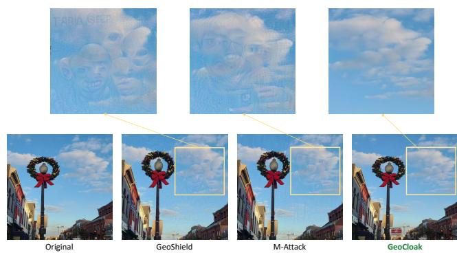

Figure 8: Visual quality comparison with zoomed-in regions on a Im2GPS3k sample. It serves as a supplementary illustration to Figure 3, providing additional visual comparison details Zoomedin crops (top) reveal that GeoCloak introduces negligible utility degradation compared to GeoShield and M-Attack.  
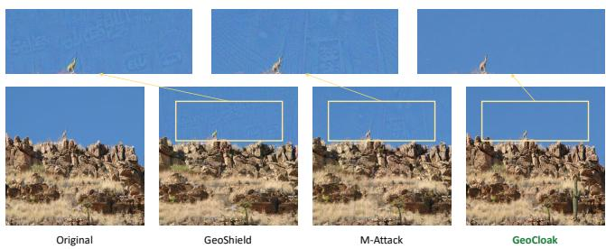  
Figure 9: Visual quality comparison with zoomed-in regions on a Dataset-PCW sample. It serves as a supplementary illustration to Figure 3, providing additional visual comparison details Zoomed-in crops (top) reveal that GeoCloak introduces negligible utility degradation compared to GeoShield and M-Attack.

## H Human Perception Analysis

We randomly sample 100 source images, equally distributed in four datasets. Each source image is paired with its GeoCloak, GeoShield, and M-Attack output, producing 300 rating tasks. Two independent annotators evaluate the same trials. In each trial, the original image is presented alongside one protected image. The defense identities are hidden. Annotators score each protected image on a five-point Likert scale for naturalness, semantic preservation relative to the original image, and overall quality, with overall quality designated as the primary metric. The evaluation interface provides the following guidelines as follows:

• naturalness assesses whether the protected image appears natural and realistic without obvious artifacts.

• semantic preservation assesses whether the main objects, scene, and meaning of the original image are retained.

• overall quality assesses the protected image holistically by considering both naturalness and content preservation.

All three metrics use the same five-point scale, ranging from 1 (severe and unacceptable problems) to 5 (a natural, complete image with almost no visible problems).

For analysis, we first average the two annotators’ scores for each source image–defense pair, preserving the source image as the sampling unit rather than treating repeated ratings as independent observations. We then estimate 95% confidence intervals by bootstrapping the 100 source images with 10,000 resamples. The complete results are reported in Table 14.

Table 13: Geolocation accuracy (%) under no defense and each defense (aggregated across all datasets). All metrics  lower is better.
<table><tr><td rowspan="2"></td><td rowspan="2"></td><td rowspan="2">Defense</td><td colspan="3">Level-Wise Acc.</td><td colspan="3">Distance Acc.</td></tr><tr><td>City↓</td><td>State↓</td><td>Country↓</td><td>@1km↓</td><td>@25km↓</td><td>@100km↓</td></tr><tr><td rowspan="9"></td><td rowspan="4">Zero-Shot</td><td>Initial</td><td>48.3%</td><td>58.9%</td><td>87.9%</td><td>16.1%</td><td>55.2%</td><td>61.6%</td></tr><tr><td>M-Attack</td><td>32.3%</td><td>36.5%</td><td>55.2%</td><td>11.2%</td><td>34.8%</td><td>38.0%</td></tr><tr><td>GeoShield</td><td>26.0%</td><td>27.7%</td><td>44.4%</td><td>9.6%</td><td>26.7%</td><td>29.8%</td></tr><tr><td>GeoCloak</td><td>9.5%</td><td>10.9%</td><td>18.0%</td><td>2.8%</td><td>9.8%</td><td>11.9%</td></tr><tr><td rowspan="4">GeoMiner</td><td>Initial</td><td>46.9%</td><td>59.1%</td><td>88.2%</td><td>30.2%</td><td>53.7%</td><td>62.1%</td></tr><tr><td>M-Attack</td><td>29.8%</td><td>31.4%</td><td>39.8%</td><td>18.7%</td><td>30.1%</td><td>31.2%</td></tr><tr><td>GeoShield</td><td>25.3%</td><td>27.1%</td><td>34.9%</td><td>15.9%</td><td>26.1%</td><td>27.6%</td></tr><tr><td>GeoCloak</td><td>9.4%</td><td>11.0%</td><td>16.9%</td><td>4.7%</td><td>9.9%</td><td>11.6%</td></tr><tr><td rowspan="6">Gemini-3.1-Pro</td><td rowspan="6">Zero-Shot</td><td>Initial</td><td>51.3%</td><td>60.1%</td><td>86.3%</td><td>16.3%</td><td>54.4%</td><td>59.7%</td></tr><tr><td>M-Attack</td><td>37.3%</td><td>38.9%</td><td>45.0%</td><td>12.8%</td><td>36.9%</td><td>37.8%</td></tr><tr><td>GeoShield</td><td>33.2% 13.8%</td><td>34.6%</td><td>42.1%</td><td>11.3%</td><td>33.1%</td><td>34.4%</td></tr><tr><td>GeoCloak</td><td></td><td>15.3%</td><td>24.9%</td><td>4.0%</td><td>14.5%</td><td>15.7%</td></tr><tr><td>Initial</td><td>48.9% 33.9%</td><td>58.6%</td><td>79.6%</td><td>26.9%</td><td>43.2%</td><td>48.3%</td></tr><tr><td>M-Attack GeoShield</td><td>29.9%</td><td>35.6% 31.2%</td><td>39.7% 37.6%</td><td>18.9% 17.7%</td><td>26.7% 23.7%</td><td>27.9% 24.6%</td></tr><tr><td rowspan="8">GPT-5.4</td><td rowspan="4"></td><td>GeoCloak</td><td>13.3%</td><td>15.2%</td><td>23.6%</td><td>4.2%</td><td>8.8%</td><td>10.0%</td></tr><tr><td>Initial</td><td>39.5%</td><td>50.0%</td><td>76.6%</td><td>12.5%</td><td>44.1%</td><td>50.6%</td></tr><tr><td>M-Attack</td><td>21.5%</td><td>22.4%</td><td>27.4%</td><td>6.9%</td><td>21.4%</td><td>22.1%</td></tr><tr><td>Zero-Shot GeoShield</td><td>17.1%</td><td>17.8%</td><td>23.7%</td><td>6.0%</td><td>17.1%</td><td>17.7%</td></tr><tr><td rowspan="4"></td><td>GeoCloak</td><td>12.2%</td><td>12.8%</td><td>17.8%</td><td>3.9%</td><td>12.4%</td><td>12.7%</td></tr><tr><td>Initial</td><td>37.3%</td><td>48.0%</td><td>76.5%</td><td>20.8%</td><td>41.0%</td><td>46.8%</td></tr><tr><td>M-Attack GeoMiner</td><td>21.5%</td><td>23.0%</td><td>28.5%</td><td>11.9%</td><td>21.7%</td><td>23.0%</td></tr><tr><td>GeoShield</td><td>16.4%</td><td>17.1%</td><td>23.3%</td><td>9.1%</td><td>16.9%</td><td>17.1%</td></tr><tr><td rowspan="8"></td><td rowspan="4">Zero-Shot</td><td>GeoCloak</td><td>7.3%</td><td>8.2%</td><td>13.2%</td><td>2.5%</td><td>7.7%</td><td>8.2%</td></tr><tr><td>Initial</td><td>46.9%</td><td>58.0%</td><td>84.6%</td><td>15.1%</td><td>53.2%</td><td>59.7%</td></tr><tr><td>M-Attack</td><td>25.2%</td><td>27.3%</td><td>34.5%</td><td>8.6%</td><td>25.2%</td><td>25.8%</td></tr><tr><td>GeoShield</td><td>17.7%</td><td>18.3%</td><td>26.3%</td><td>6.6%</td><td>17.7%</td><td>18.5%</td></tr><tr><td rowspan="6"></td><td>GeoCloak</td><td>13.3%</td><td>14.3%</td><td>20.6%</td><td>4.1%</td><td>13.3%</td><td>14.4%</td></tr><tr><td>Initial</td><td>38.1%</td><td>47.3%</td><td>65.3%</td><td>21.8%</td><td>39.3%</td><td>43.9%</td></tr><tr><td>M-Attack</td><td>18.3%</td><td>19.3%</td><td>24.3%</td><td>11.4%</td><td>17.9%</td><td>19.0%</td></tr><tr><td>GeoMiner GeoShield</td><td>12.2%</td><td>13.0%</td><td>18.6%</td><td>8.1%</td><td>12.2%</td><td>13.0%</td></tr><tr><td>GeoCloak</td><td>7.8%</td><td>8.9%</td><td>13.5%</td><td>4.0%</td><td>8.3%</td><td>8.9%</td></tr><tr><td rowspan="8">Zero-Shot</td><td rowspan="4">Initial</td><td></td><td>31.1%</td><td>41.2%</td><td>71.7%</td><td>10.5%</td><td>35.7%</td><td>40.7%</td></tr><tr><td>M-Attack</td><td>15.3%</td><td>15.8%</td><td>21.9%</td><td>5.6%</td><td>15.3%</td><td>15.8%</td></tr><tr><td>GeoShield</td><td>11.8%</td><td>12.4%</td><td>17.1%</td><td>4.1%</td><td>11.2%</td><td>11.3%</td></tr><tr><td rowspan="3">GeoCloak</td><td>6.5%</td><td>6.9%</td><td>10.9%</td><td></td><td>1.6%</td><td>5.8%</td><td>6.0%</td></tr><tr><td>Initial</td><td>29.7%</td><td>39.7%</td><td>71.2%</td><td>14.2%</td><td>33.3%</td><td>39.8%</td></tr><tr><td>M-Attack GeoShield</td><td>13.7% 11.5%</td><td>14.5%</td><td>20.3%</td><td>4.9%</td><td>12.2%</td><td>13.2%</td></tr><tr><td rowspan="4"></td><td rowspan="4"></td><td></td><td></td><td>12.4%</td><td>17.9%</td><td>4.7% 1.5%</td><td>10.3% 3.7%</td><td>11.4% 4.5%</td></tr><tr><td>GeoCloak</td><td>4.4%</td><td>5.2%</td><td>8.2%</td><td></td><td></td><td></td></tr><tr><td>Initial</td><td>35.2%</td><td>45.3%</td><td>71.9%</td><td>11.5%</td><td>39.3%</td><td>44.6%</td></tr><tr><td>M-Attack</td><td>21.4%</td><td>21.8%</td><td>25.3%</td><td>7.3%</td><td>21.1%</td><td>21.3%</td></tr><tr><td rowspan="4">GeoVista</td><td rowspan="4">GeoVista</td><td>GeoShield</td><td></td><td></td><td></td><td></td><td></td><td></td></tr><tr><td></td><td>15.6%</td><td>16.1%</td><td>19.6%</td><td>6.1%</td><td>15.3%</td><td>15.6%</td></tr><tr><td>GeoCloak</td><td>11.1%</td><td>12.1%</td><td>14.9%</td><td>3.3%</td><td>10.9%</td><td>11.4%</td></tr></table>

Table 14: Complete human perception results on a five-point Likert scale. Each cell reports the mean and image-level bootstrap 95% confidence interval after averaging the two annotators’ ratings for each source image and defense. Higher is better ( ).
<table><tr><td>Defense</td><td>Naturalness↑</td><td>Semantic Preservation↑</td><td>Overall Quality↑</td></tr><tr><td>GeoShield</td><td>2.23 [2.06, 2.41]</td><td>3.68 [3.59, 3.76]</td><td>2.53 [2.38, 2.68]</td></tr><tr><td>M-Attack</td><td>2.31 [2.15, 2.47]</td><td>3.77 [3.67, 3.86]</td><td>2.63 [2.49, 2.78]</td></tr><tr><td>GeoCloak</td><td>4.57 [4.44, 4.69]</td><td>4.45 [4.34, 4.56]</td><td>4.43 [4.30, 4.55]</td></tr></table>

## I Invalid Responses in Evaluation

As shown in Table 15, a fraction of model evaluations produce invalid responses. First, API-level failures (e.g., request timeouts and image-size limits) affect Qwen3.5-Plus evaluations, reflecting infrastructure constraints of the model provider. Note that we leverage the official provider platform. Second, o3 exhibits a high safety-refusal rate (28.1% with no defense) under the GeoMiner inference method, where the model may explicitly identify the step-by-step geolocation prompt as a potential privacy risk and decline to respond. We acknowledge that these sources of error are difficult to mitigate on our side. Samples that encounter such errors during the initial evaluation are therefore excluded from post-defense evaluation and recorded as localization failures across all metrics. Importantly, invalid responses are consistently treated as failures across all defense methods, ensuring no systematic bias toward any particular one. They are also negligible for other models (0.0% invalid response rate), so our conclusions

Table 15: API error and safety refusal rates (%) per model, inference method, and defense method. API Error: request timeout or image-size limit (infrastructure failure). Safety Refusal: model explicitly declined to geolocalize (e.g., “I cannot help with that”).
<table><tr><td></td><td></td><td colspan="2">Initial</td><td colspan="2">M-Attack</td><td colspan="2">GeoShield</td><td colspan="2">GeoCloak</td></tr><tr><td>Model</td><td>Method</td><td>API</td><td>Ref.</td><td>API</td><td>Ref.</td><td>API</td><td>Ref.</td><td>API</td><td>Ref.</td></tr><tr><td rowspan="2">Gemini-2.5-Pro</td><td>Zero-Shot</td><td>0.0%</td><td>0.0%</td><td>0.0%</td><td>0.0%</td><td>0.0%</td><td>0.0%</td><td>0.0%</td><td>0.0%</td></tr><tr><td>GeoMiner</td><td>0.0%</td><td>0.2%</td><td>0.0%</td><td>0.0%</td><td>0.0%</td><td>0.0%</td><td>0.0%</td><td>0.0%</td></tr><tr><td rowspan="2">Gemini-3.1-Pro</td><td>Zero-Shot</td><td>0.0%</td><td>0.0%</td><td>0.0%</td><td>0.0%</td><td>0.0%</td><td>0.0%</td><td>0.0%</td><td>0.0%</td></tr><tr><td>GeoMiner</td><td>0.2%</td><td>0.0%</td><td>0.0%</td><td>0.0%</td><td>0.0%</td><td>0.0%</td><td>0.0%</td><td>0.0%</td></tr><tr><td rowspan="2">GPT-5.4</td><td>Zero-Shot</td><td>0.0%</td><td>0.0%</td><td>0.0%</td><td>0.0%</td><td>0.0%</td><td>0.0%</td><td>0.0%</td><td>0.0%</td></tr><tr><td>GeoMiner</td><td>0.0%</td><td>0.0%</td><td>0.0%</td><td>0.0%</td><td>0.0%</td><td>0.0%</td><td>0.0%</td><td>0.0%</td></tr><tr><td rowspan="2">03</td><td>Zero-Shot</td><td>0.0%</td><td>0.0%</td><td>0.0%</td><td>0.0%</td><td>0.0%</td><td>0.0%</td><td>0.0%</td><td>0.0%</td></tr><tr><td>GeoMiner</td><td>0.2%</td><td>28.1%</td><td>0.0%</td><td>15.2%</td><td>0.0%</td><td>21.6%</td><td>0.0%</td><td>18.1%</td></tr><tr><td rowspan="2">Qwen3.5-Plus</td><td>Zero-Shot</td><td>6.2%</td><td>0.0%</td><td>0.7%</td><td>0.0%</td><td>0.8%</td><td>0.0%</td><td>2.0%</td><td>0.0%</td></tr><tr><td>GeoMiner</td><td>9.6%</td><td>0.0%</td><td>0.8%</td><td>0.0%</td><td>0.8%</td><td>0.0%</td><td>2.1%</td><td>0.0%</td></tr><tr><td>GeoVista</td><td>GeoVista</td><td>| 0.0%</td><td>0.0%</td><td>| 0.0%</td><td>0.0%</td><td>| 0.0%</td><td>0.0%</td><td>0.0%</td><td>0.0%</td></tr></table>

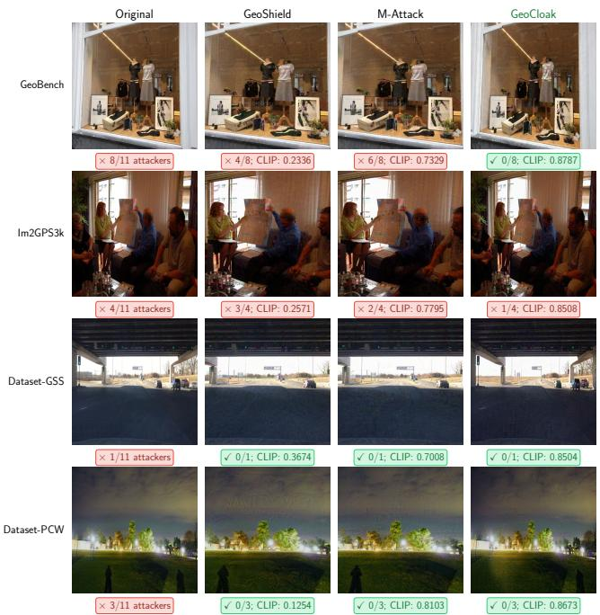  
Figure 10: Adversarial perturbation quality comparison. Each row shows a case where adversarial perturbation is the key skill in GeoCloak’s successful protection turn. Numbers indicate attackers that successfully geolocate the image and CLIP similarity. GeoCloak introduces substantially fewer visual artifacts than GeoShield and M-Attack while achieving equal or superior protection.

remain unaffected.

## J Interactive GeoCloak

Figure 11 exhibit the interactive version of GeoCloak. Interactive version of GeoCloak. Users upload the image they wish to protect, specify objects that must remain unmodified, and set a target protection level (city, state, or country); it then iteratively proposes and applies privacy-preserving edits, pausing after each turn so the user can accept, roll back, or stop. This design replaces automated utility checks with direct human judgment, giving image owners transparent, turn-by-turn control over what their shared images ultimately reveal.

## ClueAgent Prompt

ACT AS A GEOLOCALIZATION EXPERT AGENT.   
Your task is to identify the location of   
this image.   
Analyze this image step -by - step :   
1. Look for landmarks , text / signage ,   
cultural elements , and spatial   
patterns .   
2. Determine the most likely location.   
3. Explain your reasoning .   
4. List the specific VISUAL CLUES that   
helped you identify it .

```csv
Return your analysis in JSON format:
" predicted_location ": "City , State (
if applicable), Country",
"reasoning ": "Your step -by -step
reasoning process",
"clues ": [
{
"type ": "landmark|
text_signage |culture|
spatial",
"description ": "what the clue
is and why it suggests
this location",
"region ": [x1 , y1 , x2 , y2],
"importance ": 0.0 -1.0
Clue types :
landmark : Famous buildings , monuments ,
natural landmarks , recognizable
structures
text_signage : Street signs , shop names ,
billboards , language on signs
culture: Clothing styles , vehicle types
(left/right -hand drive), local
customs , architectural style
spatial : Road layout , urban planning
patterns , intersection design , city
structure
Importance scoring:
- 0.9 -1.0: Uniquely identifies location
e.g., Eiffel Tower , specific street
sign with address )
0.7 -0.8: Narrows to city/region (e.g.,
language on signs , distinctive
architecture )
0.4 -0.6: Narrows to country (e.g.,
driving side , general cultural style )
- 0.1 -0.3: Weak/ambiguous clue (e.g.,
common objects , generic features )
Note: "region" should be bounding box in
pixel coordinates [x1 , y1 , x2 , y2],
or null if not precisely localizable .
IMPORTANT: Some clues in the image may be
contradictory or misleading (e.g., a
foreign -brand shop sign in a local
street , a tourist souvenir from
another country , or an imported
vehicle ). When clues conflict ,
critically evaluate each one , weigh
higher -confidence , location -specific
clues (e.g., unique architecture ,
local -language street signs ,
distinctive road markings) over
generic or easily transplanted clues
(e.g., global brand logos , mass -
produced vehicles). Explicitly note
```

any contradictory clues in your   
reasoning and explain why you   
prioritize certain clues over others.

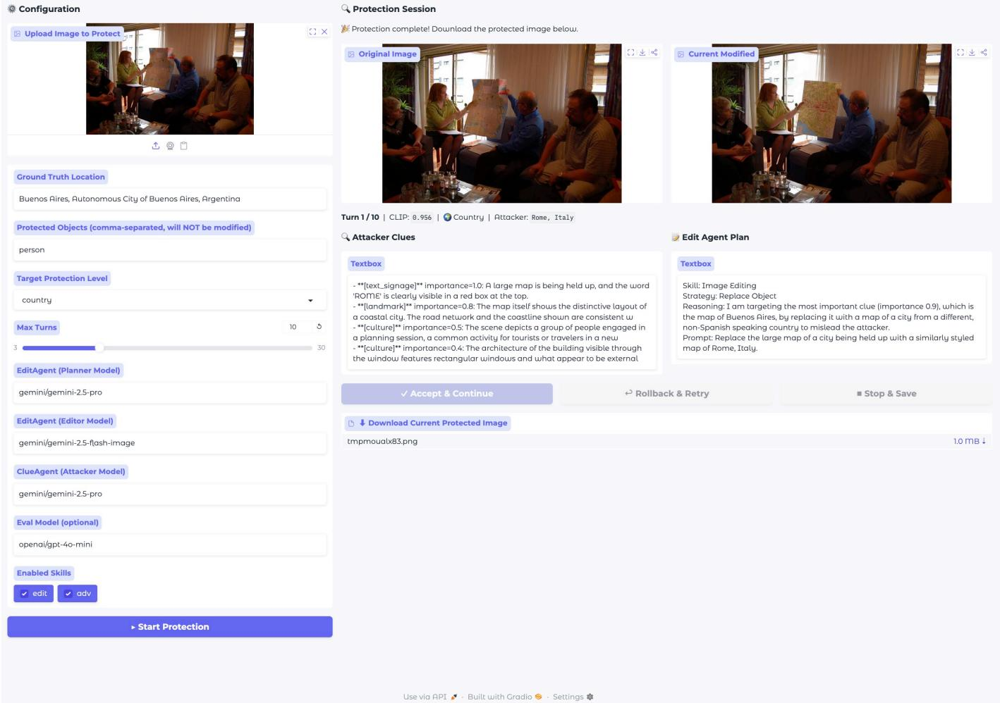

## GeoCloak

Figure 11: Interactive version of GeoCloak.  
You are an Image Privacy Protection Agent   
. Your task is to write Python code   
that modifies images to obfuscate   
location -revealing clues.   
## Your Workflow   
Each turn the orchestrator sends you a   
structured observation with four XML   
sections:   
111   
<code\_output > stdout from your last   
code execution   
</ code\_output >

<utility > whether your   
modification was accepted or rolled   
back </utility >   
<attacker\_result > attacker ’s current   
prediction , protection level , clues   
</attacker\_result >   
\*\*How to read each section :\*\*   
‘<utility > status: FAILED ‘ - your image   
was rolled back , ‘image ‘ is restored   
to the previous state ; try a   
different approach   
‘< utility > status : PASSED ‘ - your   
modification was committed; ‘image ‘   
is now that modified version   
‘<attacker\_result >‘ - shows ‘   
predicted\_location ‘, current ‘   
protection\_achieved ‘ vs target , and   
ranked clues to tackle   
Based on the observation , write ONE   
Python code block that further   
modifies ‘image ‘ to remove/obfuscate   
the remaining clues .

## Available Variables & Functions   
‘image ‘: Current image (float32 numpy   
[0,1], persists across turns , always   
start from this)   
‘original\_image ‘: Original unmodified   
image (read -only , for reference only)   
‘image\_height ‘, ‘image\_width ‘: Image   
dimensions (int)   
‘clues ‘: List of attacker clues from   
the most recent analysis (auto -   
updated each turn)   
- Each clue: {’type ’: str , ’description   
’: str , ’region ’: [x1 ,y1 ,x2 , y2 ], ’   
importance ’: float}   
‘ edit\_image ( image , prompt ) ‘: Semantic   
image editing , returns float32 numpy   
[0 ,1]   
‘ensemble ‘: Pre -loaded CLIP ensemble (   
EnsembleExtractor , 4 backbones , do   
NOT recreate )   
‘get\_crops(tensor) ‘: Returns (   
local\_crop , global\_crop) for CLIP   
feature extraction   
‘bbox\_to\_crop (tensor , bbox) ‘: Crops   
tensor to [x1 ,y1 ,x2 ,y2] bounding box   
Standard libraries available: ‘torch ‘, ‘   
numpy (np)‘, ‘cv2 ‘, ‘PIL.Image ‘, ‘io   
‘, ‘base64 ‘   
## Rules   
ALWAYS store your result: ‘image =   
modified\_image ‘   
Do NOT import modules; all functions   
are pre - injected into scope   
Write exactly ONE ‘‘‘python ‘‘‘ code   
block per turn   
- After writing your code block , STOP and   
wait for feedback   
## Skills   
{{ skill\_num }} skills are available.   
Choose based on the nature of the   
remaining clues:   
| Skill | When to Use |   
--|   
| \*\* Image Editing \*\* | Semantically modify   
discrete clues : change text / signs ,   
swap objects , erase landmarks , shift   
style , add decoys. Best when clues   
are specific and editable. Consider   
\*\* Add Decoy \*\* when clues are large /

structural and adversarial   
perturbation has repeatedly failed;   
plant a misleading foreign element   
instead of altering existing content.   
|   
| \*\* Adversarial Perturbation \*\* | Gradient   
-based noise targeting CLIP features.   
Best for large landmarks or scene -   
level features that cannot be   
semantically edited. |   
\*\* Retry rule :\*\* After a utility failure   
or attack failure , adjust based on   
the active skill ’s retry logic and   
try again . Switch to a different   
skill only when you have exhausted   
the retry options for the current   
skill.   
Skill specification (s) are provided below   
{{ SKILLS }}

## Editing Skill Prompt

```markdown
## Image Editing Skill
Read the strategies and guidelines below ,
then in your response output ** two
things in order **:
1. A JSON config block declaring your
plan :
‘‘‘ json
{{" skill ": " Image Editing ", " strategy ":
Replace Text", "prompt ": "the exact
prompt you will pass to edit_image",
"reasoning ": "one sentence: which
clue you are targeting and why this
strategy fits "}}
‘"skill "‘: always ‘"Image Editing"‘
‘"strategy "‘: one of ‘"Replace Text"‘,
‘"Replace Object"‘, ‘"Erase Object"‘,
‘"Add Decoy"‘, ‘"Style Transfer"‘
‘" prompt " ‘: the exact string you will
pass to ‘ edit_image ‘
‘" reasoning " ‘: which clue ( description
+ importance ) you are targeting and
why
2. A ‘python ‘ code block calling ‘
edit_image ‘ with that prompt .
```

```markdown
Both must appear in the same response or perturb directly (e.g. large
turn. central landmarks , iconic facades ,
wide street scenes), add a misleading
### General Principles element nearb to recontextualize
them instead |
** Blend naturally **: all modifications ** Style Transfer ** | ** apply only to
must be consistent with the scene ’s peripheral , small , or background
lighting , perspective , scale , and elements ** (e.g. a side wall , distant
style; nothing should look building , or background vegetation);
artificially inserted or out of place never restyle the main subject or
** Stay culturally close **: replacements dominant foreground elements , as
and additions must come from a broad style changes are visually
visually similar culture/region; do conspicuous |
not introduce elements from a
visually distant culture (e.g. do not
add East Asian signage to a European
street scene) ** Replace Text **
** Start small **: prioritize clues that - Use when : signs , storefronts , street
are both high - importance and small in names , license plates , or any visible
region first ; they give the most text reveals the location
privacy gain with the least visual Strategy : change to a different
disruption language or writing system that
** Preserve the main subject **: never suggests another country
replace , recolor , or occlude the Example prompt : ‘" Change the German
image ’s primary subject as a whole (e text ’B\" ackerei ’ on the shop sign to
.g. do not swap out an entire Czech text ’Pek\’arna ’"‘
building , vehicle , or person , and do
not change the dominant color scheme ** Replace Object **
of a main object). Fine -grained - Use when: location -specific objects are
details *on* the main subject , such present ( tram models , post boxes ,
as text , logos , or small markings , traffic signs , vehicle types)
are fine to edit Strategy: swap with a visually similar
** Persist and escalate **: After each object from a geographically nearby
edit , check both ‘check_utility ‘ and but distinct country
‘attacker.attack ‘ results. If the Example prompt: ‘"Replace the Austrian
attacker still identifies the tram with a German -style tram ,
location: (1) ** retry within the same keeping the same color and size"‘
strategy **, adjust the prompt ,
target a different element , or pick a ** Erase Object **
different replacement target (up to - Use when: a sign , logo , or label is too
2 retries); (2) if still failing , ** specific to replace but small enough
switch to a different strategy ** to remove
targeting the same or next clue; (3) Strategy: remove entirely and let the
only switch skill after exhausting background fill in naturally
multiple strategies Example prompt : ‘" Remove the street
sign on the left wall completely ,
### Editing Strategies inpaint with the surrounding wall
texture"‘
| Strategy | Use when |
|---|---| **Add Decoy **
| ** Replace Text ** | signs , storefronts , - Use when : the image has empty space (
street names , license plates , or any walls , ground , sky) where a
visible text reveals the location | misleading element can be added
** Replace Object ** | location -specific Strategy: add an element that suggests
objects are present ( tram models , a different country ; place it so that
post boxes , traffic signs , vehicle it ** recontextualizes nearby
types) | existing clues **; the goal is to make
** Erase Object ** | an object , sign , the attacker re -interpret other
text , or logo is too specific to scene elements as also belonging to
replace but small enough to remove the target country , not just notice
cleanly | an isolated foreign object
** Add Decoy ** | dominant clues are hard ** Physical plausibility is required **:
to replace , erase , style -transfer , the added element must be attached to
```

```markdown
or resting on a real surface , e.g. a
sign mounted on a wall , a sticker on
a pole , text painted on the ground.
Never place elements floating in mid -
air or in physically impossible
positions
Example prompt: ‘"Add a small Japanese
street sign with hiragana text
mounted on the wall in the lower -
right corner , matching the wall
texture and lighting"‘
** Style Transfer **
- Use when: architecture , vegetation , or
overall scene style is the primary
clue
Strategy : shift visual style toward a
geographically similar but distinct
region
Example prompt: ‘"Shift the style of
the background buildings on the far
left from Thai temple to Indonesian
architecture , keeping the main
foreground structure unchanged"‘
---
### Good Location Swap Pairs
(visually similar but geographically
distinct)
- Austria - Germany - Switzerland
- Taiwan - Hong Kong - Japan
- France - Belgium - Italy
- Czech - Poland - Slovakia
- UK - Ireland - Australia
- Thailand - Indonesia - Malaysia
---
### API
- ‘edit_image(image , prompt)‘, returns
numpy float32 array in [0 , 1] ,
original resolution , no mask required
‘numpy ‘, ‘plt ‘ are available
**DO NOT import any modules or skills **:
‘edit_image ‘ and all other functions
are already pre -injected into the
execution scope. Never write ‘import ‘
or ‘from ... import ‘ statements.
There is no ‘editor ‘ object , no ‘
ImageEditing ‘ class. Use ‘edit_image(
image , prompt ) ‘ directly .
```

## Adversarial Perturbation Skill Prompt

## Adversarial Perturbation Skill   
Read the options below , then in your   
response output \*\* two things in order

\*\*:   
1. A JSON config block declaring your   
choices :   
‘‘‘ json   
{{" skill ": "Adversarial Perturbation ",   
target ": " region\_focus ", "loss ": "   
dual\_loss", " non\_geo\_description ":   
"..." , "text\_weight ": 1.0, "steps ":   
100, "reasoning ": "one sentence:   
which clue(s) you are targeting and   
why this configuration fits "}}   
‘"skill "‘: always ‘" Adversarial   
Perturbation "‘   
‘"target "‘: ‘" region\_focus "‘ (when   
clues have bbox) or ‘"full\_image"‘   
‘"loss"‘: ‘"dual\_loss"‘ (when scene has   
clear visual content) or ‘"   
feature\_only "‘   
‘" non\_geo\_description " ‘: required when   
‘loss ‘ is ‘" dual\_loss "‘, omit key   
otherwise   
‘"text\_weight "‘: \*( dual\_loss only)\* how   
strongly to pull toward ‘   
non\_geo\_description ‘; start with   
‘5.0‘   
‘"steps "‘: start with ‘50‘   
‘" reasoning " ‘: which clue (s) you are   
targeting and why this target / loss   
combination fits   
2. A ‘python ‘ code block implementing the   
attack.   
‘‘‘ python   
code snippet   
111   
Both must appear in the same response   
turn.   
Use ‘torch ‘ and the pre -loaded ‘ensemble ‘   
(an ‘EnsembleExtractor ‘ instance   
already available in scope ) to   
implement gradient -based noise.   
### Fixed Setup   
‘‘‘ python   
import torch   
import random   
# Pre -injected. Do NOT recreate: ensemble   
, get\_crops , bbox\_to\_crop   
device = "cuda" if torch.cuda.   
is\_available () else "cpu"   
epsilon = 8 / 255 # privacy budget   
image\_tensor = torch.from\_numpy(image).

permute (2, 0, 1).float ().to(device) attack () result , each with ’region ’   
delta = torch . zeros\_like ( image\_tensor , x1 ,y1 ,x2 ,y2]   
requires\_grad =True) # [ region\_focus ] build bbox\_list once ,   
111 outside the loop   
bbox\_list = [[c[’region ’][0] , c[’region   
’][1] , c[’region ’][2] , c[’region   
’][3]]   
### Autonomous Decisions for c in clues if c.get(’   
region ’)]   
\*\*A. Steps \*\*: how many optimization steps bbox\_list.append ([0, 0, image\_tensor .   
? shape [2], image\_tensor .shape [1]]) #   
Start with 50; see Retry Logic for when always include full image   
to increase.   
# [dual\_loss only] precompute text   
\*\*B. Reference region \*\* features once; they don ’t change   
‘region\_focus ‘ \*( when clues have bbox) across steps   
\*: randomly sample one region per # REMOVE these two lines entirely if   
step from the attacker clues as the using feature\_only   
push - away reference . The full image with torch.no\_grad ():   
is also included in the pool so txt\_feats = ensemble.   
global features are disrupted too . get\_text\_features (   
‘ full\_image ‘: Use the full image as non\_geo\_description )   
reference.   
for step in range(steps):   
\*\*C. Loss composition \*\* adv = image\_tensor + delta   
‘feature\_only ‘: maximize cosine local\_crop , global\_crop = get\_crops (   
distance between adv crops and adv)   
reference.   
‘dual\_loss ‘ \*( when scene has clear # [ region\_focus ] single random bbox   
visual content)\*: feature distance + per step   
pull toward a ‘non\_geo\_description ‘ ( ref\_crop = bbox\_to\_crop ( image\_tensor .   
see D). detach (), random.choice(bbox\_list   
))   
\*\*D. Generating ‘non\_geo\_description ‘\*\* # [full\_image] ref\_crop =   
\*( dual\_loss only)\* image\_tensor .detach ()   
Max 15 words. Derived from clue ‘ # Extract features for both crops ;   
description ‘ fields: keep visual gradients flow through to delta   
content ( objects , colors , scene type ) local\_feats = ensemble.   
, strip all geo - identifying language get\_image\_features (local\_crop)   
( place names , landmark names , # Dict [int , (1 ,D)]   
culturally specific references , or global\_feats = ensemble .   
any combination of elements that get\_image\_features ( global\_crop )   
uniquely identifies a place). # Dict[int , (1,D)]   
Example : clue : \*" Vanda orchids , Singapore loss = torch . tensor (0.0 , device =   
’s national flower , in a botanical device)   
garden "\*   
-> ‘"Colorful tropical orchid flowers # [ region\_focus / full\_image] single   
with purple and orange blooms in a ref   
garden"‘ with torch.no\_grad ():   
ref\_feats = ensemble.   
get\_image\_features ( ref\_crop )   
for i in range(len(ensemble)):   
### Attack Loop for adv\_feat in [local\_feats [i],   
global\_feats [i]]:   
‘‘‘ python loss = loss - torch.sum(   
non\_geo\_description = "..." # [dual\_loss adv\_feat \* ref\_feats[i])   
only ] loss = loss + text\_weight \*   
text\_weight = 5.0 # [dual\_loss torch.sum(adv\_feat \*   
only ] set from your JSON config txt\_feats[i]) # [   
dual\_loss only] REMOVE if   
# clues: list of dicts from attacker. feature\_only

grad = torch.autograd.grad(loss ,   
delta , create\_graph =False)[0]   
with torch.no\_grad ():   
delta.data = delta.data + (   
epsilon / 10) \* torch.sign(   
grad)   
delta.data = torch.clamp(delta.   
data , -epsilon , epsilon)   
delta.data = torch.clamp(   
image\_tensor + delta.data , 0,   
1) - image\_tensor   
modified\_image = torch.clamp( image\_tensor   
+ delta , 0, 1).detach ().cpu().   
permute (1, 2, 0).numpy ()   
111   
### Retry Logic   
\*\*‘ non\_geo\_description ‘ as a tuning dial   
\*\* \*( dual\_loss only)\*:   
More \*\* descriptive \*\* (rich visual   
detail , closely matching original   
scene) -> stronger utility anchor ,   
weaker privacy effect   
More \*\* generic \*\* (broad scene type only   
) -> weaker utility anchor , stronger   
privacy effect   
Adjust in either direction depending on   
which constraint is failing.   
\*\*If utility check fails \*\*:   
- Add ‘dual\_loss ‘ if using ‘feature\_only ‘   
- text pull constrains perturbation   
direction , reducing visual   
degradation   
If already using ‘dual\_loss ‘: increase   
‘text\_weight ‘ (e.g. ‘5‘ -> ‘20‘) to   
strengthen the semantic anchor ; or   
make ‘non\_geo\_description ‘ more   
descriptive ( closer to the original   
visual content)   
- If still failing : decrease epsilon (e.g   
. ‘6/255 ‘)   
\*\*If utility OK but attack still succeeds   
Switch ‘full\_image ‘ -> ‘region\_focus ‘ (   
concentrate disruption on high -   
importance clue regions)   
Make ‘non\_geo\_description ‘ more generic   
(broader scene type , fewer visual   
details); or decrease ‘text\_weight ‘ (   
e.g. ‘5.0‘ -> ‘2.0‘) to let the pull -   
away loss dominate more freely   
If using ‘dual\_loss ‘: try switching to   
‘ feature\_only ‘, removes the text   
anchor , allowing the perturbation to   
move more freely away from location -   
specific features (monitor utility

```perl
closely )
- Increase steps (e.g. 100 -> 200)
### Coding Rules
NEVER use in -place ops in forward pass
(‘x += y‘); use ‘x = x + y‘
NEVER reassign ‘delta ‘; always modify ‘
delta.data ‘
- All ‘get_image_features ‘ expect ‘(C, H,
W)‘ float ‘[0,1]‘; do NOT pre -
normalize
NEVER call ‘attacker.attack ()‘ inside
the optimization loop; ‘clues ‘ is
already available from a prior call
before entering this skill; calling
it per - step wastes ~20 s x steps and
provides no gradient benefit
check_utility is handled by the
orchestrator automatically
```

## Evaluating Scope: Landmark Intention Analysis

\*\* Task :\*\* Analyze the object highlighted   
in the \*\* RED BOX \*\*.   
\*\* Physical Data :\*\*   
\*\* Relative Size :\*\* {metrics[’   
R\_area ’]:.2\%} of total image   
\*\* Centrality :\*\* {metrics[’   
D\_center ’]:.2 f} (0.00 is dead   
center).   
★ \*\* Saliency Gap :\*\* {metrics[’   
SDR ’]:.2f} (Box Brightness vs   
Avg ).   
\*\* Decision Logic :\*\*   
1. \*\* IDENTIFY \*\*: Is it a Widely -   
Known Landmark ( Tier A) ,   
Local Spot ( Tier B) , or   
Generic (Tier C)?   
- Tier A: Recognized beyond a   
local community ,   
includes globally famous   
landmarks , nationally   
iconic structures , UNESCO   
World Heritage Sites ,   
and major tourist   
attractions whose   
location is already   
public knowledge   
- Tier B: Recognizable only   
within a local or   
regional community (   
neighborhood temple , city   
-specific monument ,   
regional landmark unknown   
outside its area)   
Tier C: Generic structure

with no identifying   
features (random building   
, anonymous wall), not   
identifiable   
2. \*\* PHYSICAL CHECK \*\*:   
Object needs PROMINENCE (   
High Size/Saliency/Center   
) to be ’Intentional ’.   
3. \*\* CONTEXT \*\*: Subject vs   
Background?   
\*\* Output Format :\*\*   
Provide PURE JSON. For "reasoning   
": if Tier A or B, include   
the specific landmark name   
and its geolocation ( city ,   
country ) if you can identify   
it .   
{{   
" object\_name ": "..." ,   
"tier ": "A/B/C",   
" verdict ": " Intentional " or II   
Incidental",   
" reasoning ": "..."   
}}