# HOLI-SPATIAL 360: GENERATIVE RECONSTRUCTION FROM SPARSE PANORAMAS FOR SPATIAL RENDERING AND INTELLIGENCE

Yuanyuan Gao1,∗, Zhirui Liu2,∗, Yuning Gong3, Yifei Liu4, Yifan Zhan5, Kuixuan Jiao6, Xiaolong Zhou4, Yifan Yang7, Hongjie Zhang4, Xue Yang7, Dan Xu1, and Zhihang Zhong7,†

1The Hong Kong University of Science and Technology, 2ShanghaiTech University, 3Tencent, 4Shanghai Artificial Intelligence Laboratory, 5The University of Tokyo, 6Northwestern Polytechnical University, 7Shanghai Jiao Tong University Project Page: visionary-laboratory.github.io/Holi-spatial-360/

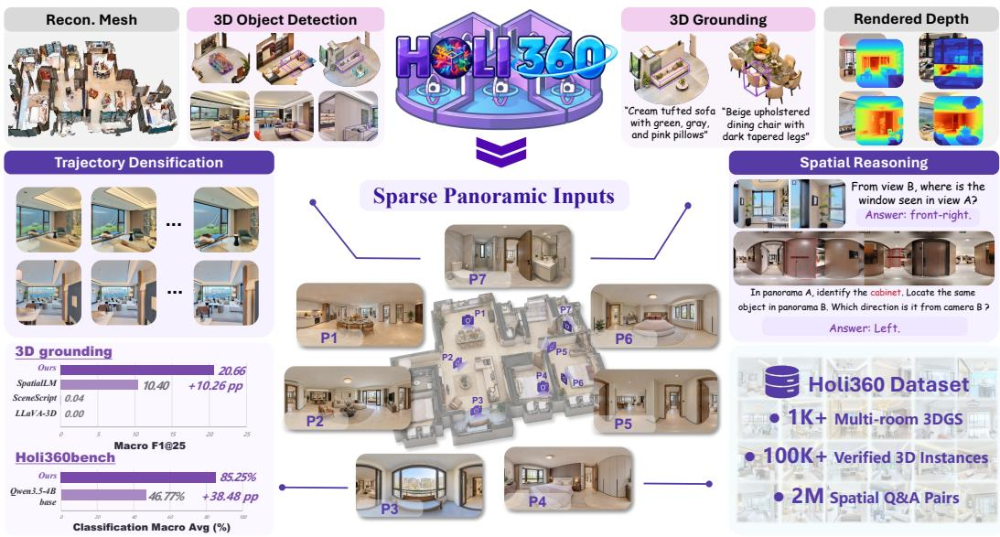  
Figure 1: Overview of Holi-Spatial 360. Sparse panoramas are reconstructed into geometrically multi-room 3DGS, densified with image and video generative priors, and converted into RGB-D, 3D grounding, and spatial-reasoning supervision.

## ABSTRACT

Spatial intelligence requires scalable 3D environments that are both photorealistic and semantically grounded, yet existing indoor datasets are dominated by room-scale captures and costly LiDAR acquisition. Online real-estate platforms offer abundant panoramas of diverse multi-room homes, but sparse viewpoints and texture-poor regions make reconstruction severely under-constrained. We introduce Holi-Spatial 360, a generative reconstruction and data curation framework for converting these panoramas into annotated multi-room 3D environments. Because reconstruction quality bounds subsequent generation, our Correspondence-Guided Geometric Optimization converts feed-forward reconstruction priors into reliable cross-view constraints and builds a coherent 3D Gaussian Splatting representation as 3D spatial memory. Adapted single-image and video priors then restore appearance and complete continuous trajectories while preserving observed content. The reconstructed scenes support arbitrary RGB-D rendering and an au-

tomated curation pipeline that combines end-to-end 3D grounding with VLMbased verification. Holi360 contains over 1K multi-room 3DGS scenes, more than 100K instance annotations, and 2M spatial question-answer pairs. We also introduce the Holi360 benchmark to evaluate the spatial understanding of VLMs in real-world, multi-room indoor environments. Experiments demonstrate superior reconstruction and curation quality under sparse panoramic inputs, while finetuning VLMs on Holi360 substantially improves spatial reasoning capabilities.

## 1 INTRODUCTION

Spatial intelligence aims to equip large models (Bai et al., 2025a; Team et al., 2023; Bai et al., 2025b) with the ability to perceive, ground, reason, and act in the 3D world. Its progress depends on scalable 3D environments that are both photorealistic and semantically grounded. Multi-room homes are particularly important for embodied applications, where understanding must extend beyond individual objects to layouts and relationships across interconnected spaces.

However, existing indoor datasets remain difficult to scale. ScanNet (Dai et al., 2017) and Scan-Net++ (Yeshwanth et al., 2023) are dominated by room-scale captures, while building-scale datasets such as Matterport3D (Chang et al., 2017) and HM3D (Ramakrishnan et al., 2021) rely on dedicated capture and processing. SAGE-3D (Miao et al., 2026) provides semantically annotated 3DGS environments but builds upon designed 3D assets and expert annotation. Holi-Spatial (Gao et al., 2026) automates spatial data curation from videos, yet relies on densely captured trajectories with continuous camera motion and sufficient view overlap. Diverse, real-world multi-room environments with both high-quality reconstruction and semantic supervision therefore remain costly to obtain.

Online real-estate platforms offer a largely untapped alternative: abundant 360-degree panoramas of diverse multi-room homes. Yet these panoramas are captured at only a few widely separated locations. Limited overlap, texture-poor surfaces, and extensive unobserved regions make crossview matching and geometric reconstruction unreliable (Ren et al., 2025; Jin et al., 2026). Recent image- and video-based generative methods can repair artifacts in novel views (Wu et al., 2025a; Yin et al., 2025; De Lutio et al., 2026; Wang et al., 2026), but they do not by themselves establish reliable geometry from sparse, multi-room panoramas. When the initial reconstruction is misaligned, generated views may drift from the observed scene and reinforce errors when distilled back into 3D.

To address these challenges, we introduce Holi-Spatial 360, a generative reconstruction and data curation framework that transforms sparse panoramas into semantically annotated multi-room 3D environments. Our key insight is that reconstruction quality sets the ceiling for generation. Correspondence-Guided Geometric Optimization uses priors from feed-forward large reconstruction models (Wang et al., 2025; Lin et al., 2025) to establish cross-view constraints and optimize a coherent initial 3D Gaussian Splatting (3DGS) representation. This representation serves as persistent spatial memory for generative trajectory densification: image and video priors restore and complete novel views, which are distilled back into 3D while remaining grounded in the observed panoramas. The scenes support RGB-D rendering and automated spatial data curation, including verified 3D instances, grounding annotations, and spatial question-answer pairs. The pipeline requires only RGB panoramas, without depth capture or human-in-the-loop labeling.

From publicly available real-estate and rental panoramas, we construct Holi360: over 1K multiroom 3DGS scenes, dense RGB-D renderings and meshes, more than 100K verified 3D instances, and 2M spatial question-answer pairs. Reconstruction and annotation use only RGB panoramas; RealSee3D (Li et al., 2026) LiDAR and semantic maps are reserved for evaluation. Experiments show improved rendering, geometry, and grounding, while VLM fine-tuning on Holi360 boosts spatial reasoning.

## 2 RELATED WORK

## 2.1 SCALABLE INDOOR ENVIRONMENTS FOR SPATIAL INTELLIGENCE

Recent datasets such as SenseNova-SI-800K (Cai et al., 2025) and VST-P (Yang et al., 2025) scale spatial supervision, but annotation count does not imply environment diversity. EmbodiedScan (Wang et al., 2024) and SceneSplat-7K (Li et al., 2025) reuse existing scans, while HM3DSEM (Yadav et al., 2023), HM3D-OVON (Yokoyama et al., 2024), and GOAT-Bench (Khanna et al., 2024) derive further annotations or tasks from HM3D (Ramakrishnan et al., 2021). These efforts enrich supervision over a largely fixed pool of 3D assets. We instead scale the pool itself by reconstructing diverse, real-world multi-room homes from online panoramas.

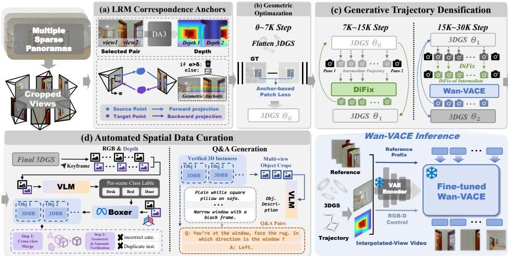  
Figure 2: Framework overview. DA3 correspondences anchor 3DGS optimization; adapted Di-Fix and Wan-VACE (Jiang et al., 2025) densify trajectories; verified RGB-D groundings yield 3D instances, captions, and spatial QA.

## 2.2 GENERATIVE RECONSTRUCTION FROM SPARSE VIEWS

Generative priors have become a powerful remedy for sparse-view reconstruction. Recon-Fusion (Wu et al., 2023) regularizes NeRF optimization with image diffusion, while 3DGS-Enhancer (Liu et al., 2024), Difix3D+ (Wu et al., 2025a), and GenFusion (Wu et al., 2025b) distill restored novel views into 3D representations. Video-based methods further improve temporal consistency through scene- or reference-grounded guidance (Zhong et al., 2025; Yin et al., 2025), long autoregressive generation (De Lutio et al., 2026), or large-scale restoration training (Wang et al., 2026). Although these methods refine the resulting 3D representation, their main advances center on the generator, leaving the initial reconstruction largely unchanged. Beyond static scenes, Neo-Verse (Yang et al., 2026) and One4D (Mi et al., 2025) extend coupled generation and reconstruction to dynamic 4D scenes from monocular videos or sparse frames. PanoWorld (Jia et al., 2026) similarly maintains a dynamic 3DGS cache, but relies on single-image diffusion to update it, making independently generated views susceptible to cross-view inconsistencies similar to those observed in DiFix. In contrast, we globally optimize a unified 3DGS from observed panoramas and use generation to densify missing evidence while preserving scene identity along continuous trajectories.

## 3 METHOD

## 3.1 CORRESPONDENCE-GUIDED GEOMETRIC OPTIMIZATION

Sparse panoramic inputs provide limited overlap and often contain large textureless regions, where conventional feature matching yields too few reliable constraints for 3DGS optimization. We therefore leverage a frozen feed-forward large reconstruction model (LRM) as an offline correspondence teacher. As shown in Appendix Tab. 7, conventional feature-based matchers such as i3dgs (Meuleman et al., 2026) and COLMAP (Pan et al., 2024) are insensitive to the number of input views because they operate pairwise, but produce too few reliable correspondences on sparsely textured indoor surfaces. LRMs provide substantially denser matches, although the number of forward– backward-consistent correspondences decreases when additional context views are jointly processed. We therefore select nearby view pairs with sufficient co-visibility and process each pair independently with DA3 (Lin et al., 2025), yielding a dense set of reliable correspondence anchors for subsequent 3DGS optimization.

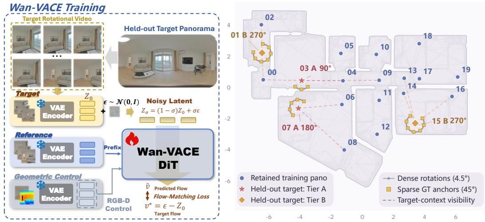  
Figure 3: Panorama-derived supervision. Left: Held-out panoramas provide image pairs and fixed-center rotation sequences for adapting DiFix and Wan-VACE; Right: An example shows the train–test split and co-visibility graph.

Given a candidate pair $( I _ { i } , I _ { j } )$ , the LRM predicts dense geometry, relative camera transformation $\widetilde { \mathbf { T } } _ { j  i }$ , and per-pixel confidence. For each source point p, we obtain its target coordinate and forward–backward error as

$$
\begin{array} { r l } & { \widetilde { \mathbf { q } } _ { i  j } = \pi _ { j } ( \widetilde { \mathbf { T } } _ { j  i } \pi _ { i } ^ { - 1 } ( \mathbf { p } , \widetilde { D } _ { i } ( \mathbf { p } ) ) ) , } \\ & { e _ { i j } ^ { \mathrm { f b } } ( \mathbf { p } ) = d _ { \pi } ( \mathbf { p } , \widetilde { \mathbf { p } } _ { i  j  i } ) . } \end{array}\tag{1}
$$

We retain only valid, confident correspondences satisfying $e _ { i j } ^ { \mathrm { f b } } \ < \ \tau _ { \mathrm { f b } }$ and collect them as fixed anchors $\mathcal { M } _ { i j } = \{ ( { \bf p } , { \bf q } , w _ { i j } ) \}$ , where $w _ { i j }$ is determined by the LRM confidence and forward– backward error. These correspondences are computed once before training and held fixed during the initial 3DGS optimization. Similar to the multi-view geometric regularization used in Gaussian-Pro (Cheng et al., 2024) and PGSR (Chen et al., 2024), we use them as fixed cross-view references for geometric supervision. Because the correspondences are not re-estimated from the evolving 3DGS, they help stabilize optimization in texture-poor regions.

## 3.2 IN-THE-WILD GENERATIVE PRIOR ADAPTATION

Training data construction. We construct a generative adaptation corpus from over 1K multiroom real-estate scenes. For each scene, we build a co-visibility graph over its panoramas and partition them into a connected reconstruction set and a held-out target set. We optimize a 3DGS using only the retained panoramas, following the same reconstruction pipeline and hyperparameters used at inference. All perspective views derived from held-out panoramas are excluded from this reconstruction. Renderings at held-out camera poses provide naturally degraded inputs, while the corresponding panoramic reprojections supply ground-truth RGB supervision. Reference views are selected from nearby retained panoramas. This construction preserves the natural artifacts caused by sparse coverage, texture-poor regions, and viewpoint extrapolation. The right panel visualizes the split and co-visibility graph; tiers A and B use strict and permissive coverage criteria, respectively.

Single-image restoration. For each sparse ground-truth anchor view t sampled from a held-out panorama, we pair its 3DGS rendering $I _ { t } ^ { \mathrm { r e n d e r } }$ with the corresponding panoramic reprojection $I _ { t } ^ { \mathrm { g t } }$ and obtain a reference view $I _ { t } ^ { \mathrm { r e f } }$ from a nearby retained panorama. DiFix additionally receives normalized rendered inverse depth $D _ { t }$ through its confidence branch:

$$
\begin{array} { r l } & { \hat { \boldsymbol I } _ { t } = { \cal F } _ { \boldsymbol \theta } ^ { \mathrm { D i F i x } } \left( { \cal I } _ { t } ^ { \mathrm { r e n d e r } } , { \cal I } _ { t } ^ { \mathrm { r e f } } , { \mathrm { C o n c a t } } \left( { \cal I } _ { t } ^ { \mathrm { r e n d e r } } , { \cal D } _ { t } \right) \right) , } \\ & { { \cal L } _ { \mathrm { D i F i x } } = \left\| \hat { \boldsymbol I } _ { t } - { \cal I } _ { t } ^ { \mathrm { g t } } \right\| _ { 1 } + \mathrm { L P I P S } \left( \hat { \boldsymbol I } _ { t } , { \cal I } _ { t } ^ { \mathrm { g t } } \right) . } \end{array}\tag{2}
$$

Temporally consistent video restoration. As illustrated in Fig. 3 (left), we reproject each heldout panorama into perspective frames along a rotational trajectory with a fixed camera center. These frames provide ground-truth RGB supervision for video prior adaptation. Rendering the 3DGS at the same camera poses yields aligned, artifact-prone RGB and depth sequences. We construct training clips of T frames and condition Wan-VACE on the rendered RGB-D sequence and K real reference views selected from retained panoramas. Let $E ( \cdot )$ denote the frozen VAE encoder. The reference views are encoded into a latent conditioning prefix $Z _ { 1 : K } ^ { \mathrm { r e f } }$ , and the geometric control is constructed as

$$
\begin{array} { r } { Z ^ { \mathrm { c t r l } } = \mathrm { C o n c a t } \left( E \left( I _ { 1 : T } ^ { \mathrm { g u i d e } } \right) , E \left( \mathrm { R e p e a t } _ { 3 } ( D _ { 1 : T } ) \right) , \tilde { M } _ { 1 : T } \right) , } \end{array}\tag{3}
$$

where $\tilde { M } _ { 1 : T }$ encodes depth validity. Given the ground-truth latent $Z _ { 0 } = E ( I _ { 1 : T } ^ { \mathrm { g t } } )$ and noise $\epsilon \sim$ $\mathcal { N } ( 0 , I )$ , we construct the noisy input $Z _ { \sigma } = ( 1 - \sigma ) Z _ { 0 } + \sigma \epsilon$ . Wan-VACE predicts the target flow $\epsilon - Z _ { 0 }$ under the RGB-D control and reference conditioning:

$$
\mathcal { L } _ { \mathrm { W a n } } = \mathbb { E } _ { Z _ { 0 } , \epsilon , \sigma } \left[ \left\| F _ { \psi } ^ { \mathrm { W a n } } \left( Z _ { \sigma } , \sigma , Z ^ { \mathrm { c t r l } } , Z _ { 1 : K } ^ { \mathrm { r e f } } \right) - \left( \epsilon - Z _ { 0 } \right) \right\| _ { 2 } ^ { 2 } \right] .\tag{4}
$$

During adaptation in Fig. 3 (left), $I ^ { \mathrm { g u i d e } }$ is the original 3DGS rendering. During trajectory densification in Fig. 2(c), it is replaced by the DiFix-restored RGB sequence, while the rendered depth is retained as geometric conditioning.

## 3.3 GENERATIVE TRAJECTORY DENSIFICATION

After in-the-wild adaptation, the image and video generative models acquire strong priors for restoring residential indoor scenes. Starting from the 3DGS $\Theta _ { 0 }$ optimized by Correspondence-Guided Geometric Optimization, we construct a continuous camera trajectory $\{ \check { P _ { t } } \} _ { t = 1 } ^ { T }$ between each pair of nearby co-visible panoramas. We then perform generative trajectory densification in two stages, as illustrated in Fig. 2(c).

During iterations 7K–15K, we render intermediate views from $\Theta _ { 0 }$ and restore them using DiFix, conditioned on the rendered depth and reference views. The restored RGB observations are distilled into the 3DGS, producing $\Theta _ { 1 } .$ During iterations 15K–30K, we render RGB-D observations from $\Theta _ { 1 }$ and apply the full image–video restoration pipeline:

$$
\begin{array} { r l } & { ( I _ { t } ^ { r } , D _ { t } ^ { r } ) = \mathcal { R } ( \Theta _ { 1 } , P _ { t } ) , } \\ & { \qquad I _ { t } ^ { c } = F _ { \mathrm { D i F i x } } ( I _ { t } ^ { r } , D _ { t } ^ { r } ; I ^ { \mathrm { r e f } } ) , } \\ & { \qquad \tilde { I } _ { 1 : T } = F _ { \mathrm { W a n } } ( I _ { 1 : T } ^ { c } , D _ { 1 : T } ^ { r } ; I ^ { \mathrm { r e f } } ) , } \end{array}\tag{5}
$$

where DiFix first suppresses local floaters and rendering artifacts, after which Wan-VACE jointly refines the sequence to improve appearance quality and temporal consistency.

Wan-VACE is adapted using fixed-center rotational clips and applied in the second stage to trajectories interpolated between distinct panorama locations, which can involve both rotation and translation. The DiFix-restored RGB sequences and rendered depth provide frame-aligned conditioning along these trajectories, while the video prior restores appearance and temporal coherence. This transfer does not assume that the model has learned translational camera motion from the rotational clips: the initial 3DGS supplies a shared spatial frame, and its per-frame RGB-D renderings provide view-aligned geometry and appearance cues along the new path. Wan-VACE is therefore asked to restore the conditioned sequence, rather than infer camera motion without guidance. We observe this generalization empirically in Fig. $4 ;$ it is not a guarantee for trajectories outside the reconstructed region. More visualizations can be found in the Appendix 3.3

For each stage, let $\nu$ denote the captured views and $\tilde { \nu }$ denote the restored RGB pseudo-observations produced by that stage’s generative pipeline. During initial optimization, sparse panorama overlap makes unconstrained patch matching unstable, so the precomputed LRM correspondences anchor geometric supervision. After densification, $\Theta _ { 0 }$ provides coarse global alignment while intermedi ate views shorten the baselines and introduce substantially more overlapping image content. Local multi-view comparisons can then be drawn from these overlaps rather than only from patches centered at the original anchors. We therefore release the anchor-only restriction and allow both captured and generated views to participate in multi-view optimization:

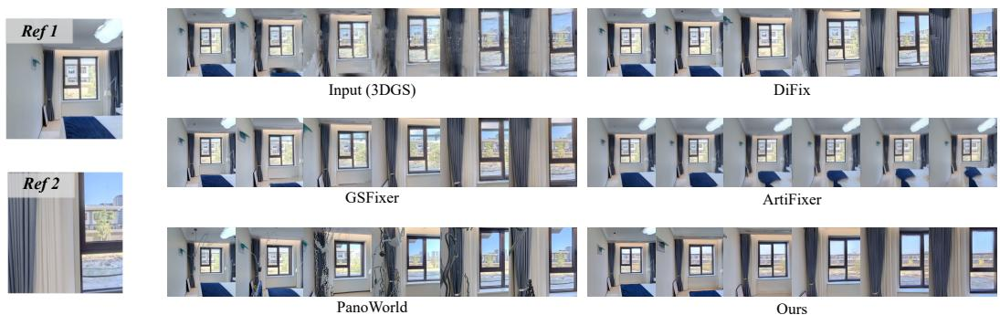  
Figure 4: Interpolated-view generation from trajectory endpoints. Ours better preserves scene identity and temporal consistency than existing reconstruction and restoration methods.

$$
\Theta ^ { * } = \arg \operatorname* { m i n } _ { \Theta } \mathcal { L } _ { \mathrm { o b s } } ( \Theta ; \mathcal { V } ) + \lambda _ { \mathrm { g e n } } \mathcal { L } _ { \mathrm { r g b } } ( \Theta ; \tilde { \mathcal { V } } ) + \lambda _ { \mathrm { m v } } \mathcal { L } _ { \mathrm { m v } } ( \Theta ; \mathcal { V } \cup \tilde { \mathcal { V } } ) .\tag{6}
$$

In the first stage, this optimization is initialized from $\Theta _ { 0 }$ and yields $\Theta _ { 1 }$ using DiFix-restored observations. In the second stage, it is initialized from $\Theta _ { 1 }$ and yields the final representation $\Theta _ { 2 }$ using Wan-VACE-refined observations.

Unlike the initial reconstruction stage, multi-view supervision is no longer restricted to patches centered at the precomputed correspondence anchors. Instead, the denser view coverage enables geometric consistency to be optimized across overlapping observations. The captured panoramas remain the source of observed-scene fidelity in ${ \mathcal { L } } _ { \mathrm { o b s } } .$ , while the generated RGB frames provide weighted pseudo-view supervision. Rendered depth conditions restoration but is not treated as pseudo-ground-truth geometry, avoiding the direct reinforcement of errors in the initial depth.

## 3.4 AUTOMATED SPATIAL DATA CURATION

Given the densely rendered RGB-D trajectories, we automatically transform each reconstructed environment into spatially grounded training data. We first sample representative views throughout the scene and prompt Qwen3.5-VL-27B to identify visible, spatially groundable object categories. Its predictions are canonicalized and merged into a scene-specific label vocabulary, avoiding the limited coverage of a predefined indoor taxonomy. Conditioned on this scene-specific vocabulary, Boxer (DeTone et al., 2026) processes posed RGB-D observations to propose globally aligned 3D object instances and bounding boxes.

We subsequently apply geometric and semantic verification to remove unreliable predictions. Geometric filtering rejects boxes with insufficient multi-view support, implausible dimensions, or inconsistent projections, while a second VLM pass examines their multi-view crops to eliminate incorrect categories and duplicate instances. The remaining annotations form a verified instance set containing canonical labels, captions, and world-coordinate 3D bounding boxes.

Finally, following the question-answer templates of Holi-Spatial (Gao et al., 2026), we combine appearance descriptions generated by the VLM from multi-view object crops with geometric attributes and spatial relations computed from the verified 3D bounding boxes. These complementary annotations are used to instantiate large-scale 3D grounding samples and spatial question-answer pairs. This automated label–ground–verify pipeline scales semantic annotation to new environments without human-in-the-loop labeling.

Table 1: Novel-view synthesis on three room-random batches. ↑ / ↓ indicate better. ∗ denotes models fine-tuned on our data.
<table><tr><td>Methods</td><td colspan="2">Room-Random Batch 1 PSNR↑ SSIM↑ LPIPS↓</td><td colspan="2">Room-Random Batch 2 PSNR↑ SSIM↑</td><td colspan="2">LPIPS↓</td><td colspan="3">Room-Random Batch 3 PSNR↑ SSIM↑ LPIPS↓</td></tr><tr><td colspan="10">Reconstruction Baselines</td></tr><tr><td>3DGS</td><td>19.68</td><td>0.797</td><td>0.365</td><td>18.63</td><td>0.738</td><td>0.410</td><td>19.54</td><td>0.777</td><td>0.407</td></tr><tr><td>2DGS</td><td>16.99</td><td>0.752</td><td>0.393</td><td>17.47</td><td>0.725</td><td>0.420</td><td>17.93</td><td>0.768</td><td>0.417</td></tr><tr><td>PGSR</td><td>17.32</td><td>0.726</td><td>0.439</td><td>16.71</td><td>0.646</td><td>0.483</td><td>17.51</td><td>0.684</td><td>0.479</td></tr><tr><td>FSGS</td><td>20.01</td><td>0.820</td><td>0.345</td><td>18.83</td><td>0.756</td><td>0.391</td><td>19.57</td><td>0.801</td><td>0.397</td></tr><tr><td>DNGaussian</td><td>16.73</td><td>0.769</td><td>0.423</td><td>16.38</td><td>0.725</td><td>0.460</td><td>16.16</td><td>0.767</td><td>0.464</td></tr><tr><td>360-GS</td><td>18.49</td><td>0.771</td><td>0.395</td><td>17.59</td><td>0.693</td><td>0.440</td><td>18.80</td><td>0.754</td><td>0.429</td></tr><tr><td>DropGaussian</td><td>19.56</td><td>0.820</td><td>0.345</td><td>18.55</td><td>0.761</td><td>0.387</td><td>19.52</td><td>0.804</td><td>0.391</td></tr><tr><td>CoR-GS</td><td>20.24</td><td>0.830</td><td>0.329</td><td>19.03</td><td>0.775</td><td>0.375</td><td>19.60</td><td>0.812</td><td>0.386</td></tr><tr><td>Holi-360-recon* *</td><td>20.34</td><td>0.834</td><td>0.323</td><td>19.15</td><td>0.758</td><td>0.373</td><td>19.94</td><td>0.805</td><td>0.376</td></tr><tr><td colspan="10">w/ Diffusion Model</td></tr><tr><td>ArtiFixer</td><td>19.58</td><td>0.812</td><td>0.285</td><td>18.22</td><td>0.753</td><td>0.328</td><td>18.96</td><td>0.798</td><td>0.330</td></tr><tr><td>PanoWorld*</td><td>18.34</td><td>0.737</td><td>0.430</td><td>17.59</td><td>0.681</td><td>0.455</td><td>18.05</td><td>0.725</td><td>0.459</td></tr><tr><td>GSFixer</td><td>18.89</td><td>0.790</td><td>0.388</td><td>17.98</td><td>0.737</td><td>0.412</td><td>18.91</td><td>0.766</td><td>0.425</td></tr><tr><td>ArtifactWorld</td><td>19.14</td><td>0.796</td><td>0.389</td><td>17.74</td><td>0.731</td><td>0.434</td><td>17.80</td><td>0.763</td><td>0.445</td></tr><tr><td>Difix(3DGS)</td><td>19.55</td><td>0.768</td><td>0.337</td><td>18.27</td><td>0.709</td><td>0.362</td><td>19.09</td><td>0.754</td><td>0.349</td></tr><tr><td>Holi-360*</td><td>22.58</td><td>0.844</td><td>0.231</td><td>21.67</td><td>0.785</td><td>0.273</td><td>22.21</td><td>0.816</td><td>0.295</td></tr></table>

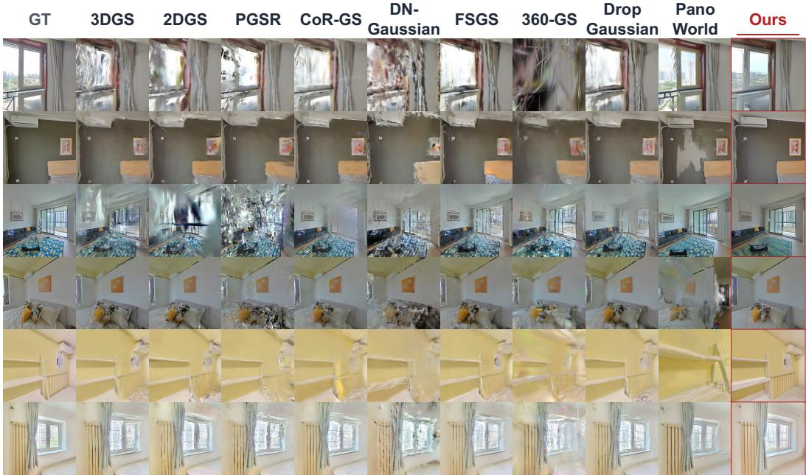  
Figure 5: Gaussian-rendered out-of-distribution novel views. Columns compare methods; rows share target viewpoints.

## 4 EXPERIMENTS

## 4.1 OUT-OF-DISTRIBUTION RENDERING QUALITY

Table 1 shows that our method outperforms reconstruction-only and generative baselines on held-out household views. Fig. 5 shows that anchored 3DGS better preserves observed structure; PanoWorld, for example, misaligns generated content with the reference in the fourth row. Along interpolated trajectories (Fig. 4), DiFix lacks temporal consistency, ArtiFixer propagates opacity artifacts,

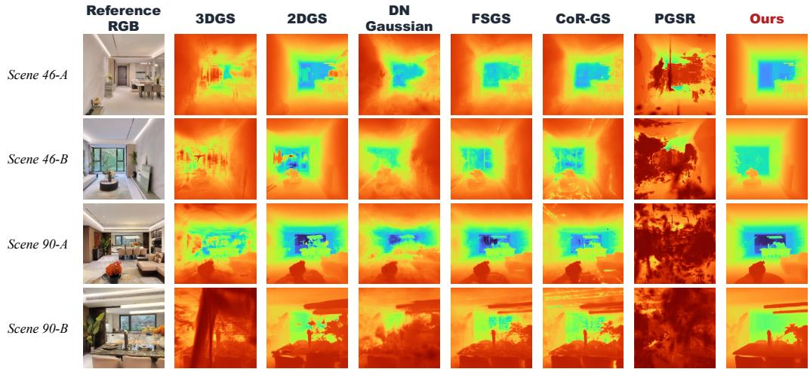  
Figure 6: OOD novel-view depth over 0.2–10.0 m. Ours produces more complete and coherent geometry than 3DGS, 2DGS, and PGSR.

Table 2: Geometry reconstruction at the 2 cm threshold tested on 10 Realsee scene.
<table><tr><td>Method</td><td>P@2cm</td><td>R@2cm</td><td>F@2cm</td></tr><tr><td>DA3</td><td>0.2669</td><td>0.1929</td><td>0.2207</td></tr><tr><td>RaDe-GS</td><td>0.1881</td><td>0.1197</td><td>0.1442</td></tr><tr><td>2DGS</td><td>0.1443</td><td>0.0858</td><td>0.1063</td></tr><tr><td>3DGS</td><td>0.0960</td><td>0.0480</td><td>0.0635</td></tr><tr><td>PGSR</td><td>0.1399</td><td>0.0410</td><td>0.0616</td></tr><tr><td>Ours</td><td>0.3235</td><td>0.2249</td><td>0.2617</td></tr></table>

Table 3: 3D grounding performance on realsee datasets (%).
<table><tr><td rowspan="2">Method</td><td colspan="2">Macro F1</td><td colspan="2">Micro F1</td></tr><tr><td>@25</td><td>@50</td><td>@25</td><td>@50</td></tr><tr><td>SpatialLM</td><td>10.40</td><td>3.48</td><td>8.19</td><td>2.26</td></tr><tr><td>SceneScript</td><td>0.04</td><td>0.00</td><td>0.21</td><td>0.00</td></tr><tr><td>LLaVA-3D</td><td>0.00</td><td>0.00</td><td>0.00</td><td>0.00</td></tr><tr><td>Ours</td><td>20.66</td><td>4.81</td><td>18.59</td><td>4.67</td></tr></table>

GSFixer blurs bed boundaries, and PanoWorld introduces reference-misaligned structures. Our geometry-anchored restoration maintains scene identity across views.

## 4.2 GEOMETRIC RECONSTRUCTION

We evaluate geometry against LiDAR point clouds from 10 public RealSee3D scenes (Li et al., 2026), using the same DA3 (Lin et al., 2025) initialization for all methods. In Tab. 2, ours attains the highest F-score at 2 cm (0.2617 versus 0.2207 for DA3). Under sparse views, RGB-dominated optimization can instead degrade initial geometry when correspondences are unreliable. Figure 6 confirms that our novel-view depth is more complete and coherent.

## 4.3 3D GROUNDING AND VLM FINE-TUNING

Tab. 3 shows that ours reaches 20.66% Macro F1@25 in 3D grounding, versus 10.40% for SpatialLM; Fig. 7 illustrates the box alignment. We use the 2D segment and lidar point cloud from Realsee to construct the GT grounding; all the implementation details and analysis can be found in Appendix A. On the Holi360 benchmark (Tab. 4), Qwen3.8-27B (Qwen Team, 2026b) is the strongest zero-shot model, while fine-tuning Qwen3.5-4B (Qwen Team, 2026a) on Holi360 raises classification macro accuracy from 46.77% to 85.25%. Zero-shot models struggle particularly with metric-scale reasoning: their numerical Acc@0.5m ranges from 28.95% to 49.46%. By providing scale-aware supervision from reconstructed real-world indoor scenes, Holi360 raises Qwen3.5-4B’s numerical Acc@0.5m from 37.59% to 76.34% and reduces its MAE from 0.9767 m to 0.3898 m. Moreover, more details on our QA can be seen in Appendix C.

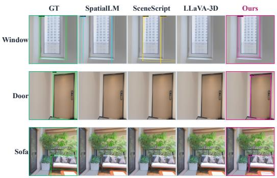

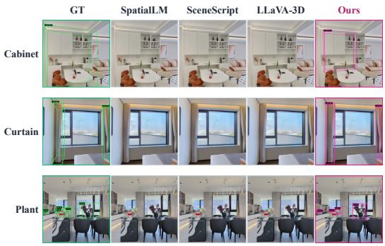  
Figure 7: 3D grounding on real-world scenes. Qualitative comparison against pseudo ground truth, SpatialLM (Mao et al., 2025), SceneScript (Avetisyan et al., 2024), and LLaVA-3D (Zhu et al., 2024). Our verified boxes align more closely with the target objects across diverse categories.

Table 4: Spatial reasoning on the Holi360 benchmark.
<table><tr><td>Model</td><td>Classification Macro ↑</td><td>Numerical Acc@0.5m ↑</td><td>Numerical MAE↓</td><td>13-Class Macro ↑</td><td>Scene Macro ↑</td></tr><tr><td>VST-SFT-3B</td><td>48.04</td><td>30.65</td><td>1.2444</td><td>44.02</td><td>37.90</td></tr><tr><td>InternVL3-8B</td><td>43.10</td><td>28.95</td><td>1.2257</td><td>39.83</td><td>34.54</td></tr><tr><td>Qwen3.8-27B</td><td>53.15</td><td>49.46</td><td>0.7389</td><td>52.30</td><td>49.51</td></tr><tr><td>Qwen3.5-4B</td><td>46.77</td><td>37.59</td><td>0.9767</td><td>44.65</td><td>42.16</td></tr><tr><td>Qwen3.5-4B+Ours</td><td>85.25</td><td>76.34</td><td>0.3898</td><td>83.19</td><td>81.27</td></tr></table>

Table 5: Rendering and geometry ablation on 5 scenes of Realsee.
<table><tr><td>ID</td><td>Gen. views</td><td>Corr. guide</td><td></td><td>PSNR↑ F@2cm↑</td></tr><tr><td>1</td><td>x</td><td>x</td><td>19.2374</td><td>0.1991</td></tr><tr><td>2</td><td>x</td><td>√</td><td>19.6408</td><td>0.3297</td></tr><tr><td>3</td><td>√</td><td>√</td><td>21.3035</td><td>0.3529</td></tr></table>

Table 6: Grounding curation ablation on 5 scenes of Realsee.
<table><tr><td>Verifier</td><td>Merge</td><td>F1@0.25</td><td>F1@0.50</td></tr><tr><td>x</td><td>x</td><td>16.81</td><td>8.40</td></tr><tr><td>x</td><td>√</td><td>18.14</td><td>9.05</td></tr><tr><td>√</td><td>x</td><td>18.02</td><td>9.01</td></tr><tr><td>√</td><td>√</td><td>19.42</td><td>9.71</td></tr></table>

## 5 ABLATIONS

Rendering and geometry. In Tab. 5, correspondence guidance raises F@2cm from 0.1991 to 0.3297 by stabilizing sparse-view geometry; generated views further raise PSNR from 19.64 to 21.30 and F@2cm to 0.3529. More details on Visualization can be seen in our Appendix B.

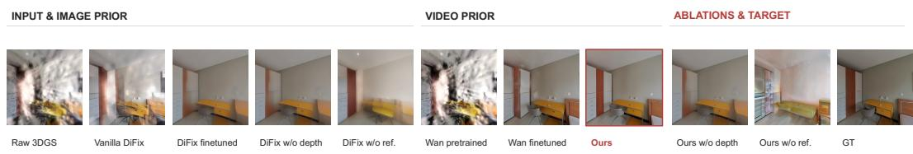  
Figure 8: Ablation study on DiFix and Wan; DiFix and Wan finetuned denote DiFix and Wan models after our finetuning. W/O depth denotes only GS RGB input without depth.

Generative restoration. As shown in Fig. 8, fine-tuning on our in-the-wild data visibly improves both DiFix and Wan-VACE. However, each retains a distinct failure mode: Finetuned DiFix introduces unnatural structures around the left cabinet, while adapted Wan-VACE preserves the overall layout but produces a spurious cabinet protrusion under the influence of input floaters. Combining the two yields substantially cleaner and more structurally coherent views.

Grounding curation. Both cross-view merging and verification improve grounding in Tab. 6, increasing F1@0.25 from 16.81 to 19.42 when combined. More details on Visualization can be seen in our Appendix B.

## 6 CONCLUSION

In this paper, we presented Holi-Spatial 360, an automated pipeline that turns sparse panoramas of multi-room homes into high-fidelity 3D environments and holistic spatial annotations. Correspondence-guided 3DGS reconstruction provides a coherent geometric foundation, while adapted image and video generative priors restore appearance and complete continuous views without losing the observed scene content. The resulting Holi360 dataset contains over 1K scenes, 100K instance annotations, and 2M spatial question-answer pairs. Experiments show improved reconstruction and annotation quality under sparse panoramic inputs, and demonstrate that Holi360 benefits VLM spatial reasoning.

## AI USE STATEMENT

We used generative AI tools to improve the language and clarity of this manuscript and to assist with code development. The authors reviewed and revised all AI-assisted text and code, and adapted code suggestions to the specific requirements of our pipeline. The use of generative models and VLMs within the proposed reconstruction and data curation framework is described in the Method section. The authors take full responsibility for the final content, implementation, and reported results.

## REPRODUCIBILITY STATEMENT

Section 3 describes our panorama-based reconstruction, generative trajectory densification, and automated spatial data curation pipeline. The Appendix specifies the scene-disjoint data splits, RealSee evaluation annotations, Wan-VACE conditioning, and shared reconstruction initialization. Section 4 reports rendering, geometry, grounding, and spatial-reasoning results, together with component ablations.

## ETHICS STATEMENT

Our source panoramas come from publicly accessible real-estate listings, which may depict private living spaces. Public accessibility does not imply permission to redistribute them. Any release will therefore be limited to materials we are permitted to share, with identifying details such as faces, addresses, and personal documents screened out. Automatically reconstructed geometry and generated annotations may contain errors or biases; they should not be used to identify occupants, surveil homes, or support safety-critical decisions.

## REFERENCES

Armen Avetisyan, Christopher Xie, Henry Howard-Jenkins, Tsun-Yi Yang, Samir Aroudj, Suvam Patra, Fuyang Zhang, Duncan Frost, Luke Holland, Campbell Orme, et al. Scenescript: Reconstructing scenes with an autoregressive structured language model. In European Conference on Computer Vision, pp. 247–263. Springer, 2024.

Shuai Bai, Yuxuan Cai, Ruizhe Chen, Keqin Chen, Xionghui Chen, Zesen Cheng, Lianghao Deng, Wei Ding, Chang Gao, Chunjiang Ge, Wenbin Ge, Zhifang Guo, Qidong Huang, Jie Huang, Fei Huang, Binyuan Hui, Shutong Jiang, Zhaohai Li, Mingsheng Li, Mei Li, Kaixin Li, Zicheng Lin, Junyang Lin, Xuejing Liu, Jiawei Liu, Chenglong Liu, Yang Liu, Dayiheng Liu, Shixuan Liu, Dunjie Lu, Ruilin Luo, Chenxu Lv, Rui Men, Lingchen Meng, Xuancheng Ren, Xingzhang Ren, Sibo Song, Yuchong Sun, Jun Tang, Jianhong Tu, Jianqiang Wan, Peng Wang, Pengfei Wang, Qiuyue Wang, Yuxuan Wang, Tianbao Xie, Yiheng Xu, Haiyang Xu, Jin Xu, Zhibo Yang, Mingkun Yang, Jianxin Yang, An Yang, Bowen Yu, Fei Zhang, Hang Zhang, Xi Zhang, Bo Zheng, Humen Zhong, Jingren Zhou, Fan Zhou, Jing Zhou, Yuanzhi Zhu, and Ke Zhu. Qwen3-vl technical report. arXiv preprint arXiv:2511.21631, 2025a.

Shuai Bai, Keqin Chen, Xuejing Liu, Jialin Wang, Wenbin Ge, Sibo Song, Kai Dang, Peng Wang, Shijie Wang, Jun Tang, Humen Zhong, Yuanzhi Zhu, Mingkun Yang, Zhaohai Li, Jianqiang Wan, Pengfei Wang, Wei Ding, Zheren Fu, Yiheng Xu, Jiabo Ye, Xi Zhang, Tianbao Xie, Zesen Cheng, Hang Zhang, Zhibo Yang, Haiyang Xu, and Junyang Lin. Qwen2.5-vl technical report. arXiv preprint arXiv:2502.13923, 2025b.

Zhongang Cai, Ruisi Wang, Chenyang Gu, Fanyi Pu, Junxiang Xu, Yubo Wang, Wanqi Yin, Zhitao Yang, Chen Wei, Qingping Sun, et al. Scaling spatial intelligence with multimodal foundation models. arXiv preprint arXiv:2511.13719, 2025.

Angel Chang, Angela Dai, Thomas Funkhouser, Maciej Halber, Matthias Niessner, Manolis Savva, Shuran Song, Andy Zeng, and Yinda Zhang. Matterport3d: Learning from rgb-d data in indoor environments. International Conference on 3D Vision (3DV), 2017.

Danpeng Chen, Hai Li, Weicai Ye, Yifan Wang, Weijian Xie, Shangjin Zhai, Nan Wang, Haomin Liu, Hujun Bao, and Guofeng Zhang. Pgsr: Planar-based gaussian splatting for efficient and high-fidelity surface reconstruction. arXiv preprint arXiv:2406.06521, 2024.

Kai Cheng, Xiaoxiao Long, Kaizhi Yang, Yao Yao, Wei Yin, Yuexin Ma, Wenping Wang, and Xuejin Chen. Gaussianpro: 3d gaussian splatting with progressive propagation. ArXiv, abs/2402.14650, 2024. URL https://api.semanticscholar.org/CorpusID:267782867.

Angela Dai, Angel X Chang, Manolis Savva, Maciej Halber, Thomas Funkhouser, and Matthias Nießner. Scannet: Richly-annotated 3d reconstructions of indoor scenes. In Proceedings of the IEEE conference on computer vision and pattern recognition, pp. 5828–5839, 2017.

Riccardo De Lutio, Tobias Fischer, Yen-Yu Chang, Yuxuan Zhang, Zhangjie Wu, Xuanchi Ren, Tianchang Shen, Katar´ına Tothov´ a, Zan Gojcic, and Haithem Turki. Artifixer: Enhancing and´ extending 3d reconstruction with auto-regressive diffusion models. In Proceedings ofthe Special Interest Group on Computer Graphics and Interactive Techniques Conference Conference Papers, pp. 1–12, 2026.

Daniel DeTone, Tianwei Shen, Fan Zhang, Lingni Ma, Julian Straub, Richard Newcombe, and Jakob Engel. Boxer: Robust lifting of open-world 2d bounding boxes to 3d. arXiv preprint arXiv:2604.05212, 2026.

Yuanyuan Gao, Hao Li, Yifei Liu, Xinhao Ji, Yuning Gong, Yuanjun Liao, Fangfu Liu, Manyuan Zhang, Yuchen Yang, Dan Xu, et al. Holi-spatial: Evolving video streams into holistic 3d spatial intelligence. arXiv preprint arXiv:2603.07660, 2026.

Jinrang Jia, Zhenjia Li, Yi-Jiang Hu, and Yifeng Shi. Panoworld: A generative spatial world model for consistent whole-house panorama synthesis. ArXiv, abs/2605.17916, 2026. URL https: //api.semanticscholar.org/CorpusID:288654784.

Zeyinzi Jiang, Zhen Han, Chaojie Mao, Jingfeng Zhang, Yulin Pan, and Yu Liu. Vace: All-in-one video creation and editing. In 2025 IEEE/CVF International Conference on Computer Vision (ICCV), pp. 17191–17202. IEEE, 2025.

Xirui Jin, Renbiao Jin, Boying Li, Danping Zou, and Wenxian Yu. Planargs: High-fidelity indoor 3d gaussian splatting guided by vision-language planar priors. Advances in Neural Information Processing Systems, 38:36342–36370, 2026.

Mukul Khanna, Ram Ramrakhya, Gunjan Chhablani, Sriram Yenamandra, Theophile Gervet,´ Matthew Chang, Zsolt Kira, Devendra Singh Chaplot, Dhruv Batra, and Roozbeh Mottaghi. Goat-bench: A benchmark for multi-modal lifelong navigation. 2024 IEEE/CVF Conference on Computer Vision and Pattern Recognition (CVPR), pp. 16373–16383, 2024. URL https: //api.semanticscholar.org/CorpusID:269033284.

Linyuan Li, Yan Wu, Xi Li, Lingli Wang, Tong Rao, Jie Zhou, Cihui Pan, and Xinchen Hui. Realsee3d: A large-scale multi-view rgb-d dataset of indoor scenes (version 1.1), 2026. URL https://doi.org/10.5281/zenodo.17826242.

Yue Li, Qi Ma, Runyi Yang, Huapeng Li, Mengjiao Ma, Bin Ren, Nikola Popovic, Nicu Sebe, Ender Konukoglu, Theo Gevers, et al. Scenesplat: Gaussian splatting-based scene understanding with vision-language pretraining. In Proceedings of the IEEE/CVF International Conference on Computer Vision (ICCV), 2025.

Haotong Lin, Sili Chen, Junhao Liew, Donny Y Chen, Zhenyu Li, Guang Shi, Jiashi Feng, and Bingyi Kang. Depth anything 3: Recovering the visual space from any views. arXiv preprint arXiv:2511.10647, 2025.

Xi Liu, Chaoyi Zhou, and Siyu Huang. 3dgs-enhancer: Enhancing unbounded 3d gaussian splatting with view-consistent 2d diffusion priors. ArXiv, abs/2410.16266, 2024. URL https://api. semanticscholar.org/CorpusID:273508035.

Yongsen Mao, Junhao Zhong, Chuan Fang, Jia Zheng, Rui Tang, Hao Zhu, Ping Tan, and Zihan Zhou. Spatiallm: Training large language models for structured indoor modeling. arXiv preprint arXiv:2506.07491, 2025.

Andreas Meuleman, Linus Franke, Boris Zhestiankin, Camille Montemagni, and George Drettakis. Immediate 3d gaussian splat reconstruction of unordered input with global consistency. In SIG-GRAPH Conference Papers, 2026.

Zhenxing Mi, Yuxin Wang, and Dan Xu. One4d: Unified 4d generation and reconstruction via decoupled lora control. ArXiv, abs/2511.18922, 2025. URL https://api. semanticscholar.org/CorpusID:283244178.

Bingchen Miao, Rong Wei, Zhiqi Ge, Shiqi Gao, Jingzhe Zhu, Renhan Wang, Siliang Tang, Jun Xiao, Rui Tang, Juncheng Li, et al. Towards physically executable 3d gaussian for embodied navigation. In International Conference on Learning Representations, volume 2026, pp. 22945– 22965, 2026.

Linfei Pan, Daniel Barath, Marc Pollefeys, and Johannes Lutz Schonberger. Global Structure-from-¨ Motion Revisited. In European Conference on Computer Vision (ECCV), 2024.

Qwen Team. Qwen3.5: Towards native multimodal agents, February 2026a. URL https:// qwen.ai/blog?id=qwen3.5.

Qwen Team. Qwen3.8-Max: A new bar for coding and cowork, August 2026b. URL https: //qwen.ai/blog?id=qwen3.8.

Santhosh K Ramakrishnan, Aaron Gokaslan, Erik Wijmans, Oleksandr Maksymets, Alex Clegg, John Turner, Eric Undersander, Wojciech Galuba, Andrew Westbury, Angel X Chang, et al. Habitat-matterport 3d dataset (hm3d): 1000 large-scale 3d environments for embodied ai. arXiv preprint arXiv:2109.08238, 2021.

Jiahui Ren, Mochu Xiang, Jiajun Zhu, and Yuchao Dai. Panosplatt3r: Leveraging perspective pretraining for generalized unposed wide-baseline panorama reconstruction. In 2025 IEEE/CVF International Conference on Computer Vision (ICCV), pp. 28959–28969. IEEE, 2025.

Gemini Team, Rohan Anil, Sebastian Borgeaud, Jean-Baptiste Alayrac, Jiahui Yu, Radu Soricut, Johan Schalkwyk, Andrew M Dai, Anja Hauth, Katie Millican, et al. Gemini: a family of highly capable multimodal models. arXiv preprint arXiv:2312.11805, 2023.

Jianyuan Wang, Minghao Chen, Nikita Karaev, Andrea Vedaldi, Christian Rupprecht, and David Novotny. Vggt: Visual geometry grounded transformer. In Proceedings of the Computer Vision and Pattern Recognition Conference, pp. 5294–5306, 2025.

Tai Wang, Xiaohan Mao, Chenming Zhu, Runsen Xu, Ruiyuan Lyu, Peisen Li, Xiao Chen, Wenwei Zhang, Kai Chen, Tianfan Xue, Xihui Liu, Cewu Lu, Dahua Lin, and Jiangmiao Pang. Embodiedscan: A holistic multi-modal 3d perception suite towards embodied ai. In IEEE Conference on Computer Vision and Pattern Recognition (CVPR), 2024.

Xinliang Wang, Yifeng Shi, and Zhenyu Wu. Artifactworld: Scaling 3d gaussian splatting artifact restoration via video generation models. arXiv preprint arXiv:2604.12251, 2026.

Jay Zhangjie Wu, Yuxuan Zhang, Haithem Turki, Xuanchi Ren, Jun Gao, Mike Zheng Shou, Sanja Fidler, Zan Gojcic, and Huan Ling. Difix3d+: Improving 3d reconstructions with single-step diffusion models. In 2025 IEEE/CVF Conference on Computer Vision and Pattern Recognition (CVPR), pp. 26024–26035. IEEE, 2025a.

Rundi Wu, Ben Mildenhall, Philipp Henzler, Keunhong Park, Ruiqi Gao, Daniel Watson, Pratul P. Srinivasan, Dor Verbin, Jonathan T. Barron, Ben Poole, and Aleksander Holynski. Reconfusion: 3d reconstruction with diffusion priors. 2024 IEEE/CVF Conference on Computer Vision and Pattern Recognition (CVPR), pp. 21551–21561, 2023. URL https://api. semanticscholar.org/CorpusID:265659460.

Sibo Wu, Congrong Xu, Binbin Huang, Andreas Geiger, and Anpei Chen. Genfusion: Closing the loop between reconstruction and generation via videos. 2025 IEEE/CVF Conference on Computer Vision and Pattern Recognition (CVPR), pp. 6078–6088, 2025b. URL https: //api.semanticscholar.org/CorpusID:277349562.

Karmesh Yadav, Ram Ramrakhya, Santhosh Kumar Ramakrishnan, Theo Gervet, John Turner, Aaron Gokaslan, Noah Maestre, Angel Xuan Chang, Dhruv Batra, Manolis Savva, Alexan der William Clegg, and Devendra Singh Chaplot. Habitat-matterport 3d semantics dataset, 2023. URL https://arxiv.org/abs/2210.05633.

Rui Yang, Ziyu Zhu, Yanwei Li, Jingjia Huang, Shen Yan, Siyuan Zhou, Zhe Liu, Xiangtai Li, Shuangye Li, Wenqian Wang, et al. Visual spatial tuning. arXiv preprint arXiv:2511.05491, 2025.

Yuxue Yang, Lue Fan, Ziqi Shi, Junran Peng, Feng Wang, and Zhaoxiang Zhang. Neoverse: Enhancing 4d world model with in-the-wild monocular videos. ArXiv, abs/2601.00393, 2026. URL https://api.semanticscholar.org/CorpusID:284475749.

Chandan Yeshwanth, Yueh-Cheng Liu, Matthias Nießner, and Angela Dai. Scannet++: A highfidelity dataset of 3d indoor scenes. In Proceedings of the IEEE/CVF International Conference on Computer Vision, pp. 12–22, 2023.

Xingyilang Yin, Qi Zhang, Jiahao Chang, Ying Feng, Qingnan Fan, Xi Yang, Chi-Man Pun, Huaqi Zhang, and Xiaodong Cun. Gsfixer: Improving 3d gaussian splatting with reference-guided video diffusion priors. arXiv preprint arXiv:2508.09667, 2025.

Naoki Yokoyama, Ram Ramrakhya, Abhishek Das, Dhruv Batra, and Sehoon Ha. Hm3d-ovon: A dataset and benchmark for open-vocabulary object goal navigation. 2024 IEEE/RSJ International Conference on Intelligent Robots and Systems (IROS), pp. 5543–5550, 2024. URL https: //api.semanticscholar.org/CorpusID:271972047.

Yingji Zhong, Zhihao Li, Dave Zhenyu Chen, Lanqing Hong, and Dan Xu. Taming video diffusion prior with scene-grounding guidance for 3d gaussian splatting from sparse inputs. 2025 IEEE/CVF Conference on Computer Vision and Pattern Recognition (CVPR), pp. 6133–6143, 2025. URL https://api.semanticscholar.org/CorpusID:276884590.

Chenming Zhu, Tai Wang, Wenwei Zhang, Jiangmiao Pang, and Xihui Liu. Llava-3d: A simple yet effective pathway to empowering lmms with 3d-awareness. arXiv preprint arXiv:2409.18125, 2024.

Realsee3D panoramic observations  
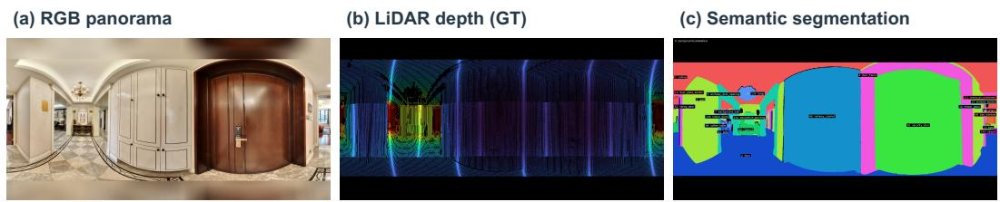

Figure 9: Realsee 2D iamges Sample.  
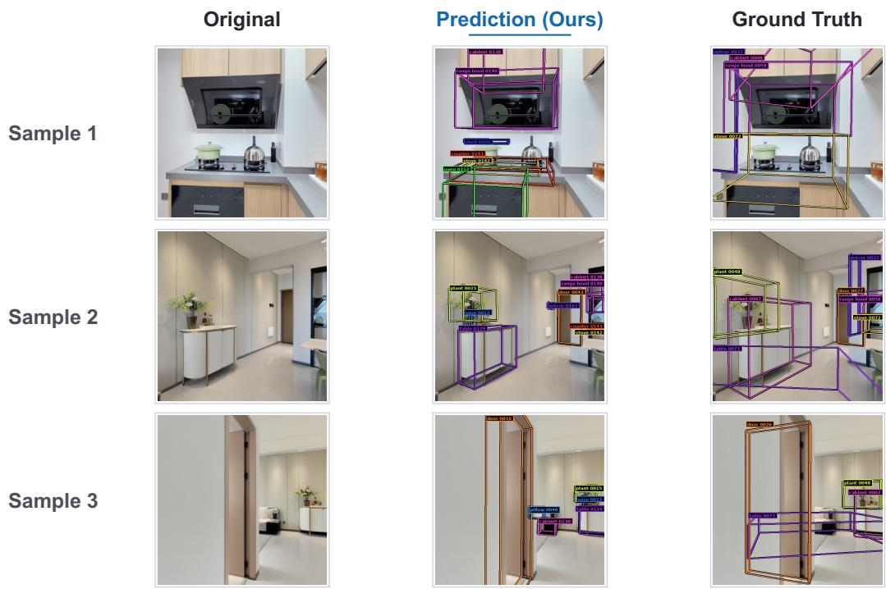  
Figure 10: Qualitative comparison between pseudo 3D bounding-box ground truth and our predicted annotations.

## A IMPLEMENTATION DETAILS

Data collection and splits. We ensure that no scene overlaps between the training data and any of the evaluation sets, including RealSee. We collect approximately 1,000 real-world multi-room scenes from publicly available online real-estate and rental platforms across multiple geographic regions. From this collection, we reserve 30 scenes exclusively for testing and exclude them from training. The test scenes are divided into three batches, denoted as Batch 1, Batch 2, and Batch 3, with 10 scenes in each batch. Since these panoramas are captured under real-world conditions, different views may exhibit exposure and illumination inconsistencies. Consequently, a reconstruction may recover the correct scene structure while showing a slight color discrepancy from the reference image, resulting in relatively low PSNR values across all methods.

RealSee evaluation. We additionally evaluate on RealSee because, to the best of our knowledge, it is the only publicly available dataset of real-world multi-room indoor scenes that provides both Li-DAR measurements and semantic annotations. Nevertheless, RealSee has several limitations. First, its LiDAR observations are relatively sparse and therefore capture only part of the scene geometry. Second, its semantic annotations do not follow a fully unified category taxonomy. For example, labels such as wall and background wall, door and swing door may refer to closely related semantic categories. We lift the 2D semantic annotations into 3D using the available depth observa-

Table 7: Forward–backward-consistent matches (< 1 px) versus input-view count.
<table><tr><td>Method</td><td>2 Frames</td><td>4 Frames</td><td>8 Frames</td></tr><tr><td>DA3</td><td>114.6</td><td>87.1</td><td>79.0</td></tr><tr><td>VGGT</td><td>46.8</td><td>22.7</td><td>15.5</td></tr><tr><td>i3dgs</td><td>44.0</td><td>44.0</td><td>44.0</td></tr><tr><td>COLMAP</td><td>29.0</td><td>29.0</td><td>29.0</td></tr></table>

tions and construct the ground-truth 3D bounding boxes used for evaluation. However, sparse depth measurements and inconsistent label granularity can introduce inaccuracies during this projection process.

Reconstruction initialization. For a fair comparison, all methods in the reconstruction experiments, including ours, use DA3 as their initialization.

## B ABLATION VISUALIZATION

In Fig 11, We qualitatively visualize and quantitatively evaluate how the designs of our reconstruction affect the overall pipeline quality. It‘s clear that after the LRM corresononded-guided Gaussian depth can under stable geometry in the sparse view setting, if without it, even under the same initialization, GS optimization becomes dominated by the RGB reconstruction objective, reducing reliable correspondences and weakening multi-view constraints. Consequently, the model overfits the RGB observations and produces more floaters. In detail, as shown in the w/o correspondence-guided case, removing the matching constraint can produce clearly incorrect correspondences even when the reprojection constraint is satisfied. Existing multi-view optimization typically estimates correspondence errors directly between pairs of frames. Once an erroneous match is introduced, it may be repeatedly reinforced during optimization, especially under sparse-view settings where only a few nearby observations are available. For example, the blue point on the panel adjacent to the wall is matched to an incorrect location in the other view, although the resulting correspondence still yields a low reprojection error. This ambiguity motivates our correspondence-guided design, which pro vides additional constraints to suppress geometrically plausible but semantically incorrect matches. While in Fig 6, despite its strong performance, Boxer still produces duplicate detections of the same object and occasional misclassifications. Our post-processing pipeline is designed to address these issues, further improving its accuracy and robustness.

## C ADDITIONAL VISUALIZATIONS AND QA TEMPLATES

Here in Fig 14, we present a large-scale qualitative visualization of generated views, all sampled from the test set. And we also visualize our QA example in Fig 15, which contains normal RGB understanding and panorama spatial understanding in real-world indoor scenes.

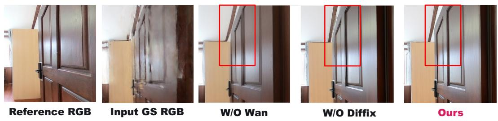  
Figure 12: Extra ablation study on DiFix and Wan.

Ours  
W/O Correspondence Guided  
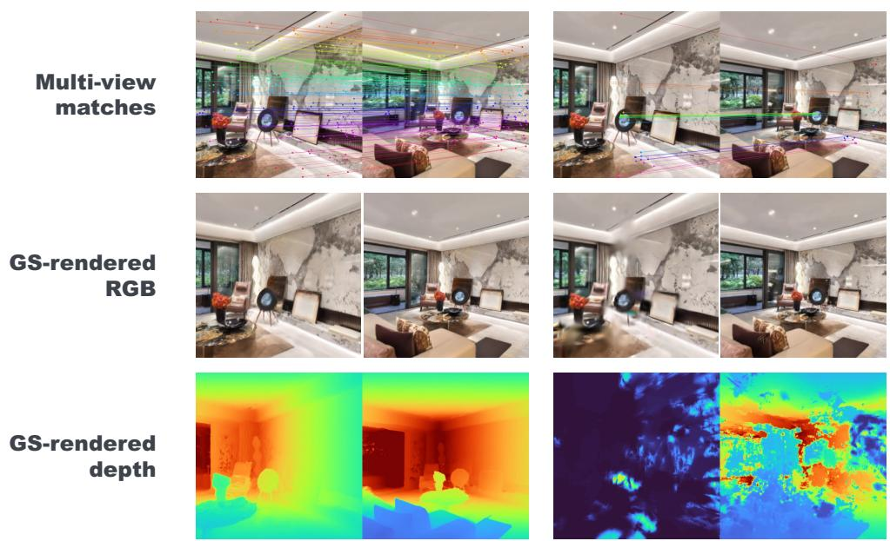  
Figure 11: Ablation of the correspondence-guided module in our LRM. All visualized correspondences have reprojection errors below 1 pixel.

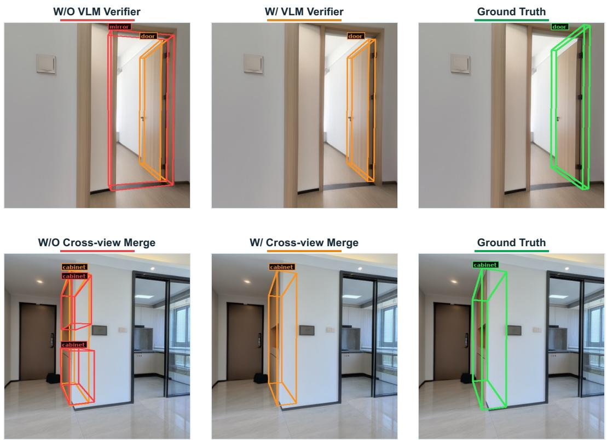  
Figure 13: Ablation on our cross-view merge and VLM verifier.

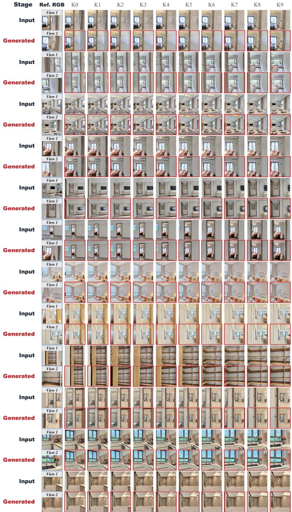  
Figure 14: Additional qualitative results. Reference views, 3DGS inputs, and generated trajectories across diverse indoor scenes.

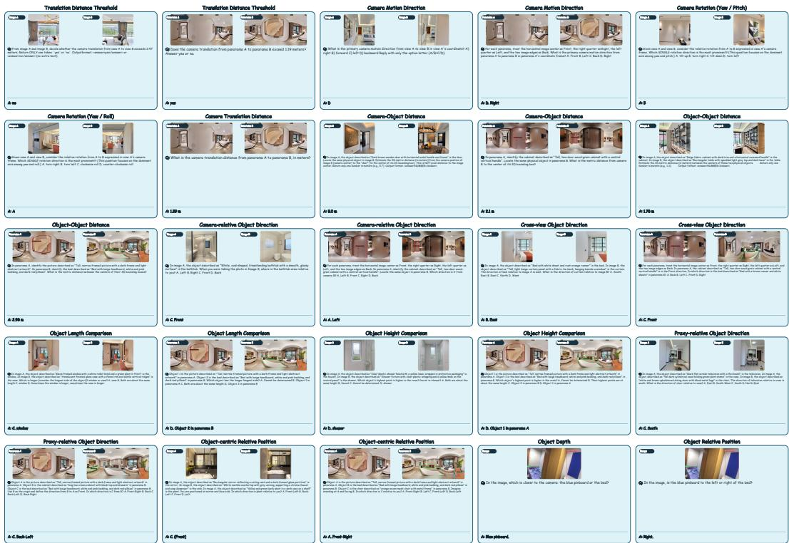  
Figure 15: Holi360 benchmark QA visualization.