# HyperLoop: Hyperspectral-Assisted Loop Closure Detection in 3D-SLAM for Planetary Exploration

Annie Bhalla 1, Dennis Rotondi 1, Riccardo Giubilato 2, Kai O. Arras 1, Wolfgang Stuerzl 2

1 Institute for Artificial Intelligence (AI), University of Stuttgart, Universitatsstraße 32, 70569 Stuttgart, Germany.¨ E-mail: anniebhalla16@gmail.com

2 German Aerospace Center (DLR), Institute of Robotics and Mechatronics, 82234 Oberpfafenhofen, Germany.

Abstract , Autonomous navigation of planetary rovers remains a fundamental challenge in space exploration, particularly in environments that are featureless, poorly illuminated, or visually repetitive. Simultaneous Localization and Mapping (SLAM) systems based on 3D Gaussian Splatting (3DGS) ofer promising dense mapping capabilities; however, their loop closure modules rely on RGB appearance descriptors that degrade under perceptual aliasing–a common failure mode in extraterrestrial terrain where physically distinct locations appear visually identical to optical sensors. This paper presents HyperLoop, the first framework integrating hyperspectral imaging (HSI) into the loop closure module of a 3DGS-based SLAM system. Hyperspectral descriptors encode material-level spectral signatures that complement RGB appearance features, providing a modality inherently robust to illumination changes and visual repetitiveness. Two HSI descriptor families are introduced: the Bag-of-Spectral-Words (BoSW) model, which encodes spectral material distributions via TF-IDF weighted frequency histograms, and the PCA-K VLAD (PCAK-VLAD) model, which captures first-order residual statistics of PCA-compressed spectral signatures. Both are evaluated in combination with SIFT-VLAD and NetVLAD RGB descriptors under Strict-AND and Weighted decision-level fusion strategies. The framework is assessed on a custom multi-modal dataset collected at the Moon-Mars Outdoor Test Site (MMOTS) of the German Aerospace Center (DLR), comprising synchronized RGB-D and hyperspectral sequences totalling 65.5 m across four planetary analog traverses, with evaluation conducted on the MMOTS-WS loop sequence (8 m). A key empirical finding is that the sensor’s Red-NIR spectral range (600–860 nm) provides limited discriminability for planetary analog rock terrain: the best fusion configuration (SIFT-VLAD + BoSW, Strict-AND) achieves 5.04 cm aligned ATE RMSE, within 1.8% of the best RGB-only configuration (4.95 cm, SIFT-VLAD alone). The improvement over the NetVLAD baseline (8.81 cm) is attributable entirely to replacing NetVLAD with SIFT-VLAD, not to HSI fusion; the sensor’s Red-NIR spectral range is identified as the primary limiting factor for the HSI contribution. This motivates future adoption of shortwave infrared (SWIR) sensors, which capture diagnostic mineral absorption features absent from the 600–860 nm range, for planetary SLAM missions.

Keywords: Planetary SLAM; Hyperspectral Imaging; Loop Closure Detection; 3D Gaussian Splatting; Place Recognition; Sensor Fusion

## Nomenclature

s Pixel spectral signature ∈ R15   
$\mathbf { z } _ { i }$ PCA-projected pixel spectrum ∈ R6   
${ \bf d } _ { i }$ Local SIFT descriptor ∈ R128   
$\mathbf { c } _ { k }$ �-th cluster centre (RGB or spectral codebook)   
$a _ { i }$ Nearest-neighbour cluster assignment   
$\mathbf { v } _ { k }$ VLAD residual vector for cluster �   
$K$ Codebook / vocabulary size   
$S ( \cdot , \cdot )$ Cosine similarity score   
$\tau$ Similarity threshold   
$\mathcal { D }$ Set of detected loop closures   
$\mathcal { G }$ Set of ground-truth loop closures   
$\alpha$ 3DGS Gaussian opacity   
$\beta$ Weighted fusion coeficient

## Acronyms/Abbreviations

3DGS 3D Gaussian Splatting   
ROS Robot Operating System   
ATE Absolute Trajectory Error   
BoSW Bag-of-Spectral-Words   
DLR German Aerospace Center   
FOV Field of View   
HSI Hyperspectral Imaging   
MMOTS Moon-Mars Outdoor Test Site   
NIR Near-Infrared   
PCAK-VLAD PCA-K Vector of Locally Aggregated Descriptors   
PGO Pose Graph Optimisation   
RMSE Root Mean Square Error   
SIFT Scale-Invariant Feature Transform   
SLAM Simultaneous Localization and Mapping   
SWIR Shortwave Infrared   
TF-IDF Term Frequency–Inverse Document Frequency   
VLAD Vector of Locally Aggregated Descriptors

## 1. Introduction

Simultaneous Localization and Mapping (SLAM)—the joint estimation of a robot’s pose and a map of its surroundings from on-board sensor data—has reached remarkable maturity over the past two decades [1]. Classical geometricallygrounded pipelines now achieve centimetre-level accuracy in structured environments, while recent semantic extensions such as 3D scene graph representations [2] further enrich these maps with object-level and spatial reasoning. Yet this progress has been concentrated in information-rich, featuredense settings: urban streets, indoor ofices, and structured facilities where visual cues are abundant and predictable. Mapping in extreme environments—planetary surfaces dominated by featureless regolith, visually repetitive craters, and mineralogically diverse rocks—remains a frontier where classical SLAM assumptions break down.

Autonomous navigation of planetary rovers must contend with exactly these conditions. Rovers must navigate unknown, unstructured terrain autonomously, performing in-situ scientific analysis while building consistent environmental representations. Unlike the structured, feature-rich urban environments common on Earth, extraterrestrial terrain is dominated by craters, regolith, rocks, and dust that create a visually repetitive landscape. This causesperceptual aliasing: distinct locations appear nearly identical to optical sensors. In SLAM, this directly impairs loop closure detection: the critical process of recognising a previously visited location to correct accumulated odometric drift. Failed loop closures produce corrupted maps and irrecoverable trajectory divergence, threatening mission success.

Despite visual similarity, planetary terrain is often mineralogically diverse. Rocks of diferent composition, regolith with varying particle distributions, and exposed bedrock exhibit distinct spectral signatures in the infrared range, diferences entirely invisible to conventional RGB cameras. Hyperspectral imaging (HSI) captures tens to hundreds of narrow spectral bands per pixel, encoding material composition and chemical properties as a high-dimensional fingerprint. These signatures reflect what a surface is made of rather than how it appears, and are inherently more robust to illumination changes.

Recent advances in 3DGS [3] have transformed dense visual SLAM by enabling eficient, photorealistic scene representations. LoopSplat [4], the first 3DGS SLAM system with explicit loop closure, demonstrates compelling performance in structured indoor environments using NetVLAD [5] descriptors. However, its reliance on RGB appearance limits applicability to the visually uniform terrain of planetary environments.

This paper introduces HyperLoop, extending LoopSplat by integrating hyperspectral sensing into its loop closure module. The key contributions are:

1. A 3DGS-SLAM architecture integrating HSI loop closure detection, the first such combination, to the best of our knowledge.

2. Two HSI descriptor families: BoSW and PCAK-VLAD, adapted from visual retrieval literature to spectral signatures.

3. Evaluation of Strict-AND and Weighted decision-level fusion strategies combining RGB and HSI descriptors.

4. The first empirical analysis of hyperspectral loop closure on a planetary analog dataset, yielding an empirically motivated spectral range hypothesis for future mission hardware selection.

The remainder of this paper is organised as follows: Section 2 covers relevant background; Section 3 reviews related work; Section 4 describes the HyperLoop methodology; Section 5 presents the experimental setup; Section 6 analyses descriptor performance; Section 7 reports trajectory and loop closure results; Sections 8 and 9 discuss findings and conclude.

## 2. Background

## 2.1 SLAM and Loop Closure

SLAM jointly estimates a robot’s pose trajectory and map from on-board sensor data [1]. Sensor noise causes odometric drift; loop closure corrects it by recognising a previously visited location, inserting a constraint, and triggering Pose Graph Optimisation (PGO) [6]. The pipeline comprises (1) place recognition via descriptor similarity and (2) geometric verification via spatial consistency checks. In planetary terrain, both stages are challenged: perceptual aliasing degrades appearance-based retrieval, and surface planarity limits geometric filtering.

## 2.2 3D Gaussian Splatting and LoopSplat

3DGS [3] represents a scene as a collection of anisotropic 3D Gaussian primitives, each parameterised by position �, covariance �, opacity �, and view-dependent colour encoded via spherical harmonics (SH, a basis for viewdependent appearance). Diferentiable splatting projects each 3D Gaussian as a 2D Gaussian; overlapping splats are composited via depth-sorted alpha-blending, enabling gradient-based optimisation of all parameters.

LoopSplat [4] implements a real-time dense RGB-D SLAM system on 3DGS with explicit loop closure. It maintains submaps (groups of keyframes) for computational tractability. Tracking minimises photometric and geometric losses. Loop closure candidates are retrieved via NetVLAD cosine similarity and verified by computing the geometric overlap of Gaussian splats between candidate submaps. Confirmed loops trigger submap registration in Gaussian space followed by PGO.

## 2.3 Hyperspectral Imaging

A hyperspectral image is a data cube $H \times W \times B$ , where � is the number of spectral bands. Each pixel stores a spectral signature: reflectance at � wavelengths, encoding material composition. Raw measurements are converted to reflectance via calibration [7]:

$$
r = { \frac { p _ { \mathrm { r a w } } - p _ { \mathrm { d a r k } } } { p _ { \mathrm { w h i t e } } - p _ { \mathrm { d a r k } } } } ,\tag{1}
$$

where $p _ { \mathrm { w h i t e } }$ and $p _ { \mathrm { d a r k } }$ are white-reference and dark-reference frames respectively. This removes illumination intensity, making spectral measurements comparable across acquisitions. An additional spectral correction $\mathbf { v } = \mathbf { C } { \cdot } \mathbf { r } { + } \mathbf { T }$ corrects for spectral cross-talk between mosaic filter elements.

## 2.4 Multi-Modal Sensor Fusion

Multi-modal sensor fusion combines information from heterogeneous sensors to improve robustness beyond what any single modality can achieve [8]. Three levels of fusion are commonly distinguished. Early (data-level)fusion merges raw sensor measurements before any feature extraction, requiring tight spatial and temporal alignment between modalities. Feature-level fusion concatenates or projects intermediate representations into a shared embedding space, and is applicable when modalities share a common field of view. Decision-level (late) fusion combines independent per-modality decisions or scores, and is applicable even when modalities have mismatched resolutions, fields of view, or update rates–making it the most flexible strategy for heterogeneous sensor pairs.

## 3. Related Work

## 3.1 Visual SLAM in Unstructured Environments

Classical visual SLAM systems including ORB-SLAM [9] and ORB-SLAM2 [10] achieve strong performance in structured, feature-rich indoor and urban scenes; however, all RGB-based approaches degrade severely in texture-poor terrain where distinctive appearance cues are absent [11]. Outdoor and planetary analog environments compound this by adding illumination variation, featureless regolith, and large-scale perceptual aliasing–distinct locations that appear visually identical. These conditions cause place recognition to fail systematically, leading to missed loop closures and unbounded trajectory drift. Recent work on 3DGS-based relocalization in planetary-analog terrain [12] independently confirms that RGB appearance alone is insuficient for reliable localization under these conditions. No existing RGB-only SLAM system reliably solves loop closure on planetary analog terrain.

## 3.2 3DGS-Based Dense SLAM

Neural Radiance Fields (NeRF) [13] introduced volumetric scene representations capable of photorealistic rendering but required slow ofline optimisation incompatible with realtime robotics. 3DGS [3] replaced implicit networks with an explicit set of anisotropic Gaussian primitives, enabling real-time rendering. LoopSplat [4] built the first loop-closed 3DGS SLAM system and serves as the direct baseline for this work. Concurrent work by Periba´nez et al. [˜ 12] demonstrates 3DGS-based visual relocalization on planetary-analog terrain and confirms that standard 3DGS representations sufer from aliasing and sparse-view ambiguity under challenging outdoor conditions–precisely the failure mode HyperLoop targets at the loop closure stage. None of these systems incorporate non-visual sensing into their loop closure modules.

## 3.3 Loop Closure Detection

Classical place recognition uses visual vocabulary retrieval with hand-crafted features; a comprehensive overview is provided by [14]. NetVLAD [5] improved robustness to viewpoint and illumination by training on large-scale urban datasets, but this introduces a domain gap for natural unstructured terrain where object-centric features are absent. VLAD aggregation [5, 15] underpins both NetVLAD and the hand-crafted descriptor baselines evaluated in this work. To the best of our knowledge, all existing loop closure detectors in 3DGS-based dense SLAM operate on RGB appearance alone; under perceptual aliasing, appearance similarity provides no reliable signal. LiDAR-based and multimodal loop closure methods are well established in other SLAM frameworks [14], but none have been integrated into the 3DGS submap pipeline.

## 3.4 Hyperspectral Imaging in Robotics and Remote Sensing

HSI has been extensively used in remote sensing for material classification and mineral mapping [7]. Orbital instruments such as CRISM on the Mars Reconnaissance Orbiter [16] have successfully identified mineralogical diversity on planetary surfaces, and drone-based surveys have demonstrated discriminative rock spectral analysis at ground level [17]. Despite this maturity in remote sensing, integration of HSI into real-time robotic SLAM systems remains entirely unexplored. HyperLoop is, to the best of our knowledge, the first system to integrate hyperspectral sensing into the loop closure module of a 3DGS-based dense SLAM pipeline, closing the gap between orbital spectral mapping and ground-level autonomous navigation.

## 4. Methodology

## 4.1 System Overview

HyperLoop extends LoopSplat by augmenting its loop closure module with a parallel hyperspectral processing pipeline, as illustrated in Fig. 1.

For each incoming RGB-D frame, the system performs tracking and submap-based 3DGS mapping following Loop-Splat. Simultaneously, for each keyframe, two descriptor sets are computed: RGB descriptors from the colour image and HSI descriptors from the temporally aligned hyperspectral frame. When a new submap is finalised, loop closure candidates are evaluated by computing pairwise similarity under both modalities. A candidate is accepted only if it passes a decision-level fusion gate followed by Loop-Splat’s geometric consistency check. Confirmed closures are integrated into PGO to correct the trajectory.

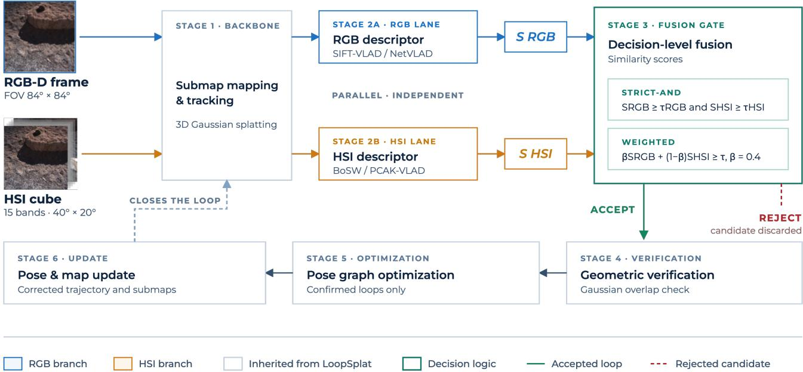  
Figure 1. Overview of the HyperLoop framework. RGB and HSI streams are processed independently to yield complementary descriptors, which are combined via decision-level fusion before geometric verification and Pose Graph Optimization.

## 4.2 Outdoor Configuration

The default LoopSplat configuration targets indoor RGB-D sequences. Applied directly to MMOTS outdoor data, it produces catastrophic trajectory divergence (ATE RMSE: 3380.89 cm). Two adaptations are required. First, the odometer tracking mode is adopted, which aligns consecutive RGB-D frames to produce accurate relative pose estimates, replacing the constant-velocity model suited to constrained indoor motion. Second, an inverse-depth L1 loss term is enabled to improve tracking stability. When visual gradients are absent–as is common on uniform regolith or gravel–a depth loss provides a dense geometric constraint that anchors the pose estimate and prevents scale drift. The inverse-depth formulation prevents distant points (sky, far terrain) from dominating the loss due to their large absolute depth values, improving convergence in outdoor scenes with large depth variation. L1 loss is preferred over L2 loss as its constant gradient magnitude (independent of residual size) is more robust to depth outliers from sensor noise, avoiding the over-penalisation that would otherwise destabilise tracking.

## 4.3 RGB Descriptor Extraction: SIFT-VLAD

Two RGB descriptor models are evaluated. The first is NetVLAD [5], a VGG-16 (standard 16-layer CNN) based model with a trainable VLAD pooling layer producing 4096- dimensional descriptors, originally used in LoopSplat. The Pittsburgh30K pre-trained checkpoint (VGG16-NetVLAD-Pitts30K) is used throughout, with random seed fixed to 0. The second, and primary proposed contribution for outdoor terrain, is SIFT-VLAD, illustrated in Fig. 2.

SIFT keypoints are detected across all input RGB frames, yielding 128-dimensional local descriptors. A visual codebook of � cluster centres is learned via K-Means on the training descriptor set. The VLAD encoding aggregates descriptors by computing, for each cluster �, the sum of residuals [15]:

$$
\mathbf { v } _ { k } = \sum _ { i : a _ { i } = k } ( \mathbf { d } _ { i } - \mathbf { c } _ { k } ) \in \mathbb { R } ^ { 1 2 8 } ,\tag{2}
$$

where $a _ { i } = \arg$ min� $\| \mathbf { d } _ { i } - \mathbf { c } _ { k } \|$ is the nearest-neighbour assignment. The final descriptor is formed by concatenating all $\mathbf { v } _ { k }$ , flattening to $\mathbb { R } ^ { 1 2 8 K }$ , and applying L2 normalisation. Codebook sizes $K \in \{ 8 , 1 6 , 3 2 , 6 4 \}$ are evaluated; $K =$ 8 yields the best separation on the MMOTS-WS dataset (Section 6.1) and is adopted throughout.

## 4.4 HSI Descriptor Extraction

The hyperspectral sensor produces data cubes of shape 1020 × 540 × 15 after a structured preprocessing pipeline. A descriptor pipeline is then applied, as shown in Fig. 3.

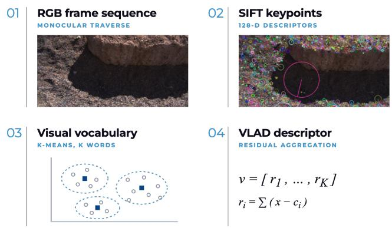  
Figure 2. The SIFT-VLAD pipeline. SIFT keypoints provide 128-dimensional local descriptors; K-Means clustering builds a visual codebook; VLAD aggregates residuals per cluster into a global descriptor invariant to scale, rotation, and illumination.

## 4.4.1 Shared Preprocessing

Each cube is spatially downsampled by factor 4 via block averaging, producing $\phantom { + } 2 5 5 \times 1 3 5 \times 1 5$ tensor. Each pixel’s spectral signature $\textbf { s } \in \mathbb { R } ^ { 1 5 }$ corresponds to the calibrated reflectance vector v defined in Section 2.3 – that is, the per-pixel 15-band reflectance after white/dark reference correction and spectral crosstalk removal. This gives a physically meaningful, sensor-corrected spectral measurement per pixel. A further per-pixel spectral normalization is then applied:

$$
\begin{array} { r } { \mathbf { s } _ { \mathrm { n o r m } } = \mathbf { s } / \operatorname* { m e a n } ( \mathbf { s } ) , \quad \operatorname* { m e a n } ( \mathbf { s } ) = \frac { 1 } { 1 5 } \sum _ { b = 1 } ^ { 1 5 } s _ { b } , } \end{array}\tag{3}
$$

removing residual inter-frame intensity diferences caused by illumination variation or shadows while preserving the spectral shape that encodes material identity. Each cube is reshaped to an $N \times 1 5$ matrix $( N = 2 5 5 \times 1 3 5 = 3 4 { , } 4 2 5 )$ treating each pixel as an independent observation. Principal Component Analysis (PCA) is then applied to reduce each 15-dimensional spectrum to $\mathbf { z } _ { i } \in \mathbb { R } ^ { 6 }$ , retaining ≈95% of spectral variance (Fig. 4).

## 4.4.2 Bag-of-Spectral-Words (BoSW)

BoSW constructs a histogram-based descriptor encoding the distribution of spectral material types per frame. For a query frame with �′ pixels: (1) Each pixel spectrum is projected via PCA and assigned to its nearest cluster: $a _ { i } =$ arg min� $\| \mathbf { z } _ { i } - \mathbf { c } _ { k } \|$ . (2) Term frequency is computed: tf $\left[ k \right] =$ $| \{ i : a _ { i } = k \} | / N ^ { \prime }$ . (3) Inverse Document Frequency (IDF), learned from � training frames, re-weights by spectral word rarity:

$$
\mathrm { I D F } ( k ) = \log \left( \frac { M + 1 } { d _ { k } + 1 } \right) + 1 ,\tag{4}
$$

where $d _ { k }$ is the number of training frames containing word �. (4) Element-wise TF-IDF product and L2 normalisation yield $\mathbf { d } _ { \mathrm { B o S W } } \in \mathbb { R } ^ { K }$ . BoSW encodes spectral word frequency distributions (material type counts) and is robust to noise under low spectral discriminability.

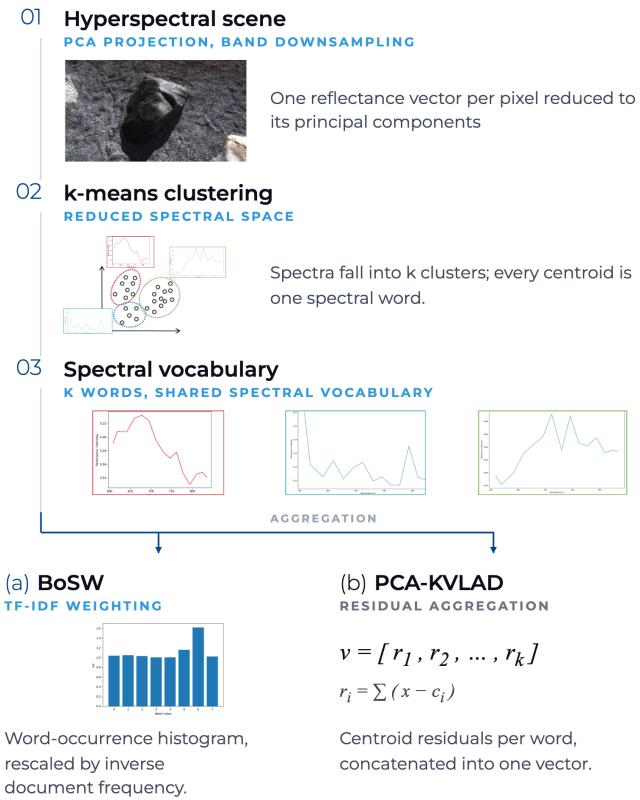  
Figure 3. HSI descriptor extraction pipelines. (a) BoSW constructs a TF-IDF weighted spectral word histogram; (b) PCAK-VLAD aggregates VLAD residuals in PCA-reduced spectral space. Both share the same preprocessing, PCA, and K-Means vocabulary.

## 4.4.3 PCA-K VLAD

PCAK-VLAD replaces histogram counting with VLAD residual aggregation. Using the same PCA and K-Means vocabulary, for each cluster �:

$$
\mathbf { v } _ { k } = \sum _ { i : a _ { i } = k } ( \mathbf { z } _ { i } - \mathbf { c } _ { k } ) \in \mathbb { R } ^ { 6 } ,\tag{5}
$$

using the same nearest-neighbour assignment $a _ { i }$ as in Eq. 2. Residual vectors are concatenated, flattened to $\mathbb { R } ^ { 6 K }$ , and L2- normalised. PCAK-VLAD encodes intra-cluster residuals (first-order moments relative to cluster centres), capturing both spectral material distribution and intra-cluster variation, providing greater expressiveness than BoSW but at higher sensitivity to noise.

## 4.4.4 Computational Cost

To quantify the computational cost ofdescriptor extraction, all three pipelines were benchmarked on the full MMOTS-WS sequence, using the same trained vocabularies employed in the final experiments (� = 8 throughout). For each frame already resident in memory (sensor read-out and disk I/O excluded), wall-clock time was measured for the full compute pipeline using time.perf counter() after a 5-item warm-up on a single CPU thread (no GPU acceleration). The benchmark processes each modality at its native captured frame rate before synchronisation: 1,135 raw HSI frames and 1,506 raw RGB frames (higher due to the RGB camera’s faster capture rate), compared to the 1,072 synchronised RGB-HSI keyframe pairs reported in Table 2 and used in the SLAM evaluation. On the HSI branch (spectral downsampling, radiometric normalisation, PCA projection, K-Means cluster assignment, descriptor encoding), BoSW required a mean of 14.09 ms per frame (median 13.70 ms, std 1.07 ms, 95th percentile 15.81 ms) and PCAK-VLAD required 14.22 ms (median 14.07 ms, std 0.62 ms, 95th percentile 15.14 ms) – nearly identical, as expected, since both share the same PCA-projection and cluster-assignment cost and difer only in the final aggregation step. On the RGB branch (grayscale conversion, SIFT detection and description, K-Means assignment, VLAD aggregation), SIFT-VLAD required 12.60 ms per frame (median 12.49 ms, std 1.03 ms, 95th percentile 13.66 ms). Since each keyframe evaluates exactly one RGB descriptor together with one HSI descriptor (Table 3), the combined worst-case descriptor overhead is ≈27 ms per keyframe – well within the sensor’s 125 ms (8 Hz) capture interval, though this accounts only for descriptor extraction and excludes the tracking, mapping, and fusion stages of the full pipeline.

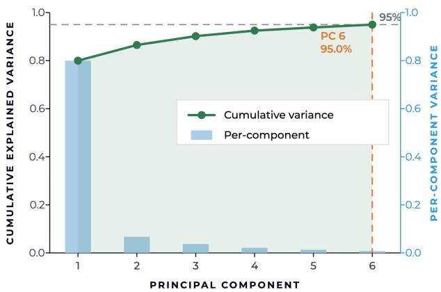  
Figure 4. Cumulative explained variance of the fitted PCA model on the spectral training set. Six principal components capture ≈95% of variance, justifying the $\mathbb { R } ^ { 1 5 } \xrightarrow { } \mathbb { R } ^ { 6 }$ dimensionality reduction. The steep drop after PC 1 (80% variance) reflects the dominant residual spectral shape mode; after per-pixel intensity normalisation (Eq. 3), PC 1 captures the largest source of remaining spectral variation across the training set, not raw reflectance intensity, which has already been divided out.

## 4.5 Decision-Level Fusion

Decision-level fusion is adopted because the mismatched fields of view between the RGB (≈84◦×84◦) and HSI $( \approx 4 0 ^ { \circ } \times 2 0 ^ { \circ } )$ cameras motivate operating on per-frame descriptors rather than pixel-level correspondence: the HSI sensor covers only a central sub-region of the RGB frame (Fig. 5), and reliable pixel-level projection would require precise extrinsic calibration not available in this setup. Independent cosine similarity scores �RGB and �HSI are therefore computed for each keyframe pair and combined at the decision stage.

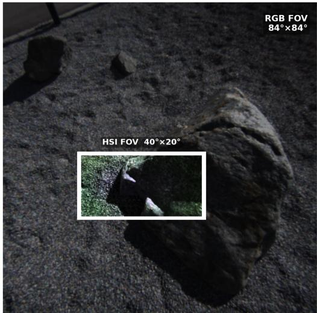  
Figure 5. Field-of-view mismatch between the RGB camera (84◦×84◦, full frame) and the Ximea IMEC hyperspectral sensor $( 4 0 ^ { \circ } \times 2 0 ^ { \circ }$ , white rectangle). The HSI sensor covers only a central sub-region of the RGB frame, motivating decision-level fusion rather than pixel-level registration.

Two fusion strategies are evaluated:

Strict-AND Fusion. A candidate is accepted only if both modalities independently exceed their respective thresholds:

$$
S _ { \mathrm { R G B } } \geq \tau _ { \mathrm { R G B } } \mathrm { A N D } S _ { \mathrm { H S I } } \geq \tau _ { \mathrm { H S I } } .\tag{6}
$$

Weighted Fusion. A combined score is computed:

$$
S _ { \mathrm { f u s e d } } = \beta \cdot S _ { \mathrm { R G B } } + ( 1 - \beta ) \cdot S _ { \mathrm { H S I } } ,\tag{7}
$$

and accepted when $S _ { \mathrm { f u s e d } } \geq \tau _ { \mathrm { f u s e d } }$ , where $\tau _ { \mathrm { f u s e d } } = \beta \tau _ { \mathrm { R G B } } +$ $( 1 - \beta ) \tau _ { \mathrm { H S I } } . \ \beta = 0 . 4$ is fixed prior to evaluation and not tuned on the test set (i.e. HSI receives 60% weight, based on the prior expectation that spectral signatures would provide stronger discrimination than RGB on featureless terrain; the experimental results do not confirm this prior). Both �RGB and �HSI are set adaptively at runtime: for each query frame, � is the minimum cosine similarity among the top-30% most similar within-submap frame pairs under the respective descriptor, providing a data-driven threshold calibrated to local scene structure without using inter-submap groundtruth labels.

## 5. Experimental Setup

## 5.1 Dataset and Test Site

Data was collected at the Moon-Mars Outdoor Test Site (MMOTS) of DLR, Oberpfafenhofen [18], a purposebuilt planetary analog environment with regolith-like soil, scattered rocks, gravel, and craters simulating lunar and Martian surface conditions (Fig. 6).

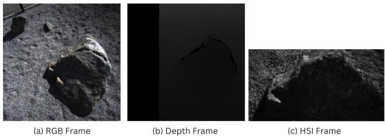  
Figure 6. Synchronised multi-modal data sample from MMOTS-WS. (a) RGB frame; (b) Depth frame; (c) HSI false-colour frame. Note the HSI frame covers a smaller field of view than the RGB pair.

Table 1. Ximea IMEC Hyperspectral Camera Specifications
<table><tr><td>Property</td><td colspan="3">Value</td></tr><tr><td>Spectral bands</td><td>15 channels</td><td></td><td rowspan="6"></td></tr><tr><td>Spectral range</td><td>600–860 nm (Red-NIR)</td><td></td></tr><tr><td>Sensor resolution</td><td>2048×1088 px (native)</td><td></td></tr><tr><td>Cube resolution</td><td>1020×540×15 (after interleaving)</td><td>mosaic de-</td></tr><tr><td>Frame rate</td><td>up to 170 FPS (raw); operated at 8 Hz for HSI cubes</td><td></td></tr><tr><td>Pixel size</td><td>5.5 μm</td><td></td></tr><tr><td>Shutter</td><td>Global</td><td></td></tr><tr><td>Focal Length</td><td>16 mm</td><td></td></tr><tr><td>FOV</td><td>≈40°×20°</td><td></td></tr><tr><td>Interface</td><td>USB3 (5 Gbit/s)</td><td></td></tr></table>

The Ximea IMEC hyperspectral camera [19] (Table 1) and a stereo RGB pair were mounted on an Ardea multicopter [20], operated at low altitude above the analog terrain to simulate a rover-perspective sensor view; the multicopter serves as a data-collection proxy and is not a planetary rover itself. RGB frames are rectified to 400 × 400 px ( FOV ≈84◦×84◦). Depth maps are derived via stereo disparity estimation. A hardware trigger synchronises RGB and HSI frame captures. Ground-truth poses are generated using VINS-Fusion [21,22] in stereo mode with loop fusion enabled.

Table 2 summarises all collected sequences. MMOTS-WS is the primary evaluation sequence: three loop traversals over an 8 m-extent area, all beginning and ending at the same spatial location, providing ground-truth loop pairs for quantitative assessment (Fig. 7). The three additional MMOTS trajectories—MMOTS-LL, MMOTS-RL, and MMOTS-US—are longer traversals (15–24.5 m) recorded at the same site under varied walking patterns; they do not share MMOTS-WS’s closed-loop geometry and therefore yield no ground-truth loop pairs suitable for trajectory evaluation. SS-SWEDEN is an outdoor sequence collected at a natural rocky terrain site in Sweden, covering 123.3 m over 262.2 s; it ofers spectral diversity from a geographically distinct environment but was acquired without a pose reference system, precluding trajectory evaluation. All sequences are used jointly to train the spectral vocabulary: K-Means codebook, PCA basis, and IDF weights. Because vocabulary learning is unsupervised (K-Means, TF-IDF), including MMOTS-WS in training does not constitute label leakage in the strict sense, though spectral vocabulary statistics are mildly influenced by the MMOTS-WS frame distribution. The codebook size � = 8 is selected based on positive/negative cosine similarity separation statistics computed on MMOTS-WS (Section 6.1), which is also the sole evaluation sequence; this represents a form of hyperparameter tuning on the test set and is acknowledged as a limitation. All experiments use random seed 0.

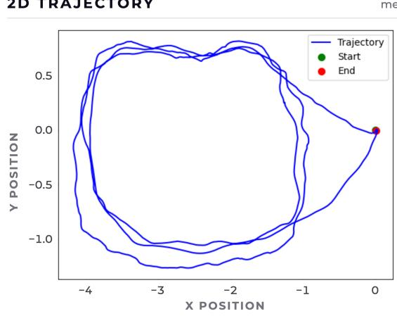  
Figure 7. Ground-truth trajectory of the MMOTS-WS dataset. The loop closure is enforced by starting and ending at the same spatial location.

Table 2. Overview of Collected Datasets
<table><tr><td>Dataset</td><td>RGB</td><td>HSI</td><td>Dur.(s)</td><td>Dist.(m)</td></tr><tr><td>MMOTS-WS</td><td>1072</td><td>1072</td><td>133.9</td><td>8</td></tr><tr><td>MMOTS-LL</td><td>1385</td><td>1385</td><td>172.9</td><td>15</td></tr><tr><td>MMOTS-RL</td><td>945</td><td>945</td><td>119.1</td><td>18</td></tr><tr><td>MMOTS-US</td><td>1540</td><td>1540</td><td>186.0</td><td>24.5</td></tr><tr><td>SS-SWEDEN</td><td>2100</td><td>2100</td><td>262.2</td><td>123.3</td></tr><tr><td>Total</td><td>7042</td><td>7042</td><td>874.1</td><td>188.8</td></tr></table>

## 5.2 Experiment Configurations

Ten experiments are conducted on MMOTS-WS, building progressively from baseline to full multi-modal system (Table 3). E1 applies the unmodified LoopSplat configuration to establish a failure-mode baseline. E2 introduces outdoor-specific parameter tuning with NetVLAD, establishing the RGB-only reference. E3 replaces NetVLAD with SIFT-VLAD. Experiments E4 and E5 introduce HSI under Strict-AND and Weighted fusion respectively, across all descriptor combinations.

Table 3. Experiment Configuration Matrix
<table><tr><td>ID</td><td>RGB</td><td>HSI</td><td>Fusion</td></tr><tr><td>E1</td><td>NetVLAD (de- fault)</td><td>一</td><td>一</td></tr><tr><td>E2</td><td>NetVLAD (tuned)</td><td></td><td></td></tr><tr><td>E3</td><td>SIFT-VLAD K=8</td><td></td><td></td></tr><tr><td>E4-A</td><td>NetVLAD</td><td>BoSW</td><td>Strict-AND</td></tr><tr><td>E4-B</td><td>SIFT-VLAD</td><td>BoSW</td><td>Strict-AND</td></tr><tr><td>E4-C</td><td>NetVLAD</td><td>PCAK-VLAD</td><td>Strict-AND</td></tr><tr><td>E4-D</td><td>SIFT-VLAD</td><td>PCAK-VLAD</td><td>Strict-AND</td></tr><tr><td>E5-A</td><td>NetVLAD</td><td>BoSW</td><td>Weighted</td></tr><tr><td>E5-B</td><td>SIFT-VLAD</td><td>BoSW</td><td>Weighted</td></tr><tr><td>E5-C</td><td>NetVLAD</td><td>PCAK-VLAD</td><td>Weighted</td></tr><tr><td>E5-D</td><td>SIFT-VLAD</td><td>PCAK-VLAD</td><td>Weighted</td></tr></table>

## 5.3 Evaluation Metrics

Trajectory accuracy is measured by the Absolute Trajectory Error (ATE) RMSE after a similarity transformation (Sim(3)) alignment:

$$
{ \mathrm { A T E } _ { \mathrm { R M S E } } } = \sqrt { \frac { 1 } { N } \sum _ { i = 1 } ^ { N } \| \mathbf { x } _ { \mathrm { e s t } , i } - \mathbf { x } _ { \mathrm { g t } , i } \| ^ { 2 } } .\tag{8}
$$

The Sim(3)-aligned variant removes global reference frame ofset and scale and is the primary reported metric. For a metric stereo/RGB-D system, scale is nominally observable from depth; Sim(3) alignment may therefore absorb residual scale error and report optimistically low ATE values. SE(3)-aligned ATE (no scale correction) was not computed and represents an acknowledged limitation of the current evaluation; relative comparisons between configurations are nonetheless valid since all are evaluated under the same alignment. Loop closure detection is evaluated via precision, recall, and F1-score against a set of ground-truth loop pairs. A pair (�, �) qualifies as a ground-truth loop closure if the two frames lie within 0.2 m translation and $1 ^ { \circ }$ rotation in ground-truth pose, with a minimum separation of 50 frames and 10 s to exclude temporally adjacent observations. D is the set of detected closures and $\mathcal { G }$ is the set of ground-truth closures:

$$
\begin{array} { r l } & { \mathrm { P r e c . } = \vert \mathcal { D } \cap \mathcal { G } \vert / \vert \mathcal { D } \vert , \quad \mathrm { R e c . } = \vert \mathcal { D } \cap \mathcal { G } \vert / \vert \mathcal { G } \vert , } \\ & { \quad \mathrm { F } 1 = 2 \cdot \displaystyle \frac { \mathrm { P r e c . } \times \mathrm { R e c . } } { \mathrm { P r e c . } + \mathrm { R e c . } } . } \end{array}\tag{9}
$$

## 6. Descriptor Analysis

## 6.1 RGB Descriptor Analysis

Table 4 reports cosine similarity statistics for positive (ground-truth loop closure) and negative (non-matching) pairs across all RGB descriptor configurations on the full MMOTS-WS dataset.

Table 4. Cosine Similarity Statistics for RGB Descriptors (MMOTS-WS)
<table><tr><td>Descriptor</td><td>Pos.  $\mu$ </td><td>Pos. σ</td><td>Neg.µ</td><td>Neg. σ</td></tr><tr><td>NetVLAD</td><td>0.662</td><td>0.137</td><td>0.247</td><td>0.137</td></tr><tr><td>SIFT-VLAD K=8</td><td>0.729</td><td>0.105</td><td>0.404</td><td>0.221</td></tr><tr><td>SIFT-VLAD K=16</td><td>0.581</td><td>0.125</td><td>0.224</td><td>0.139</td></tr><tr><td>SIFT-VLAD K=32</td><td>0.446</td><td>0.123</td><td>0.144</td><td>0.105</td></tr><tr><td>SIFT-VLAD K=64</td><td>0.347</td><td>0.110</td><td>0.087</td><td>0.090</td></tr></table>

NV = NetVLAD, SV = SIFT-VLAD

The pretrained NetVLAD descriptor shows a distinctive mean separation between positive and negative pairs. However, both distributions contain outliers, producing overlap between true and false matches. This issue is largely attributed to the domain gap between the data used to train NetVLAD’s underlying VGG-16 backbone, which favours object-centric urban scenes, and the MMOTS-WS dataset, which primarily features unstructured outdoor terrain of stones and gravel.

SIFT-VLAD with K=8 shows positive pairs tightly grouped around a high mean, with minimal overlap against the negative distribution. This indicates robustness for loop closure detection at this setting. As K increases, the positivepair mean decreases while separation between positives and negatives slightly improves. This trade-of between lower absolute similarity for true matches and better separability means that higher K values are less practical for reliable retrieval. Additionally, repetitive textures such as gravel and stone lead to recurring SIFT keypoints across diferent locations, which can limit discriminative power when relying solely on SIFT features.

Overall, SIFT-VLAD with K=8 emerges as the best configuration for this dataset, balancing cluster quality, compact positive-pair distributions, and suficient separation from negatives.

## 6.2 HSI Descriptor Analysis

Cluster quality. The quality of the clustering process was assessed by varying the number of clusters (K=8, 16, 32, 64) and analysing the centroid spectra. A smaller K yields clearer cluster separations and higher silhouette scores (0.232 at K=8, decreasing to 0.178 at K=16 and 0.152 at K=32), indicating more meaningful spectral groupings at low K. Increasing K captures finer-grained distinctions but leads to less compact and more fragmented clusters. Silhouette scores remain relatively low across all values of K, suggesting there is scope for improvement in the spectral preprocessing pipeline.

IDF weighting. The BoSW model applies Inverse Document Frequency (IDF) weighting learned from the full dataset. Most spectral words receive similar IDF weights, indicating limited spectral diversity across the captured frames. However, spectral word 6 receives a distinctly higher IDF weight (≈1.6), indicating that the BoSW model assigned elevated discriminative weight to a spectrally rare pattern in the training data. This confirms that the model can identify and up-weight rare spectral signatures when they appear.

Positive pairs (loop closures) Negative pairsOutlier mass Box = IQR, rule = median, value = mean  
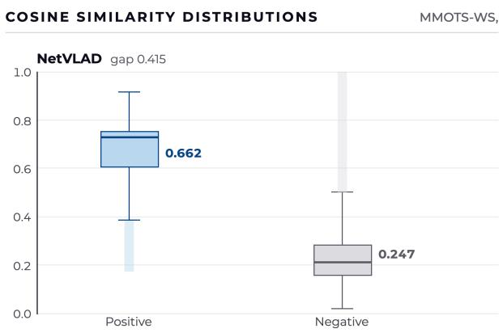

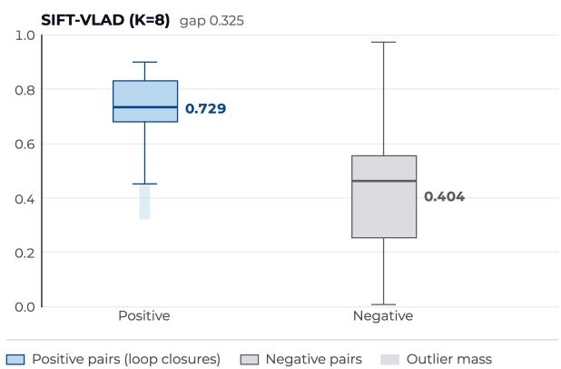  
Figure 8. Cosine similarity distributions (positive and negative pairs) for SIFT-VLAD K=8 and NetVLAD on the full MMOTS-WS dataset.

Raw mean spectral signatures. Fig. 9 shows the raw mean spectral signatures of all HSI keyframe cubes from the MMOTS-WS dataset. The spectral curves appear largely similar across frames, difering mainly in absolute intensity. These intensity diferences may result from varying rock reflectivity, or the presence of shadows. The similarity in curve shape indicates that the sensor’s spectral range (600–860 nm) may not be suficient to discriminate between the materials present at this outdoor test site. This finding directly explains why HSI fusion does not consistently outperform the RGB-only baseline and motivates the use of SWIR-capable sensors in future work.

## 7. Results

## 7.1 Trajectory Accuracy

The default LoopSplat configuration fails catastrophically on outdoor data (3380.89 cm aligned ATE), confirming that the indoor-tuned pipeline cannot be directly applied to planetary analog terrain. Fig. 10 shows ATE RMSE results for all tuned experiments (E2–E5-D) on MMOTS-WS. With outdoor-specific tuning (E2), the system achieves 8.81 cm. Replacing NetVLAD with SIFT-VLAD (E3) improves this to 4.95 cm, validating the domain-mismatch hypothesis.

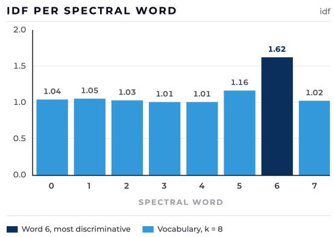

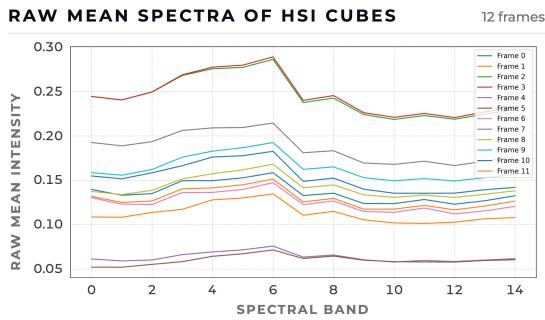  
Figure 9. Top: IDF weights per spectral word (K=8); spectral word 6 receives the highest IDF weight (≈1.6), identifying a rare material. Bottom: Raw mean spectra of all MMOTS-WS HSI keyframe cubes. Curves are largely similar in shape, difering mainly in intensity, indicating limited material discriminability in the 600–860 nm range.

Introducing HSI under Strict-AND fusion preserves trajectory accuracy relative to the best RGB-only configuration. The best fusion result, E4-B (SIFT-VLAD + BoSW, Strict-AND), achieves 5.04 cm aligned ATE RMSE, statistically comparable to the RGB-only counterpart E3 (4.95 cm, a 1.8% diference). The controlled comparison for assessing the HSI contribution is E4-B versus E3, where the RGB backbone is held fixed at SIFT-VLAD; under this comparison, HSI fusion results in a marginal 1.8% increase in ATE error (4.95 cm to 5.04 cm). The 43% improvement relative to E2 (8.81 cm) is attributable to the RGB descriptor change from NetVLAD to SIFT-VLAD: the descriptor change alone (E2 → E3) already yields 43.8% improvement without any HSI component. E3 (SIFT-VLAD, RGB-only) achieves the best overall trajectory accuracy at 4.95 cm, with the sensor’s limited spectral range identified as the primary limiting factor (Section 8). The PCAK-VLAD variant (E4-D) performs worse (8.01 cm), consistent with the spectral analysis finding. Under Weighted fusion, E5-B (SIFT-VLAD + BoSW)

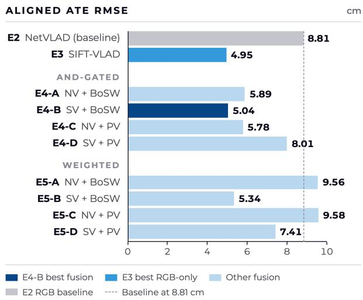  
Figure 10. Aligned ATE RMSE for tuned experiments E2–E5-D on MMOTS-WS. E3 (SIFT-VLAD, RGB-only) achieves the best overall result (4.95 cm); E4-B (SIFT-VLAD + BoSW, Strict-AND) achieves the best fusion result (5.04 cm), within 1.8% of E3. The gap to E2 (8.81 cm) is attributable to the RGB descriptor change (NetVLAD → SIFT-VLAD), not to HSI fusion. NV: NetVLAD; SV: SIFT-VLAD; PV: PCAK-VLAD; AND: Strict-AND; Wt.: Weighted.

achieves 5.34 cm, close to E4-B, but other weighted combinations degrade substantially, confirming that unconstrained HSI score weighting contaminates reliable RGB decisions when spectral discriminability is low.

## 7.2 Loop Closure Detection

As shown in Fig. 11, precision consistently exceeds recall across all experiments. These metrics are computed before geometric verification (Gaussian-overlap check), so the reported precision and recall reflect the descriptor-level retrieval stage only; post-verification loop closure counts are not reported separately, as the geometric check is embedded within LoopSplat’s submap registration and its output is not exposed as a standalone metric in the current evaluation pipeline. E4-B achieves the highest precision (≈0.24), meaning approximately 76% of detections are false positives under the stated evaluation criteria; recall and F1 remain very low across all configurations. E5-C (NetVLAD + PCAK-VLAD, Weighted) achieves the best F1 balance (≈0.11) by trading some precision for improved recall. These results indicate that no configuration achieves satisfactory retrieval performance in absolute terms; fusion-based approaches modestly reduce false positives relative to RGB-only retrieval under the Strict-AND gate, but the overall detection rate remains low. The uniformly low recall reflects both the limited number of successfully detected loop closures and the inherent dificulty of the dataset: spectrally similar terrain reduces HSI discriminability, while perceptual aliasing limits RGB retrieval.

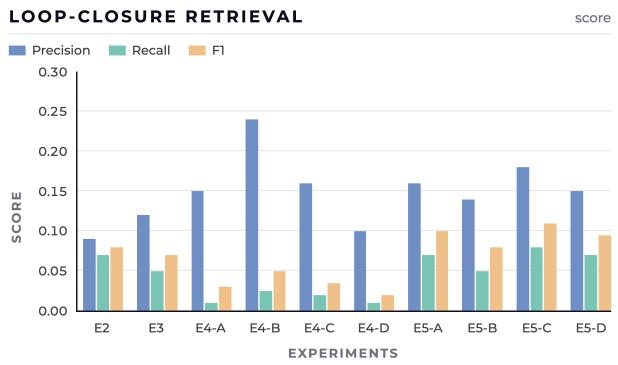  
Figure 11. Precision, Recall, and F1-score across all experiments, computed before geometric verification (descriptor-level retrieval only). E4-B achieves the highest precision (≈0.24); E5-C achieves the best F1-score balance (≈0.11). NV: NetVLAD; SV: SIFT-VLAD; PV: PCAK-VLAD; AND: Strict-AND; Wt.: Weighted.

## 8. Discussion

RGB descriptor performance. Across all experiments, SIFT-VLAD consistently outperforms NetVLAD on the MMOTS-WS outdoor dataset. This is expected, as NetVLAD is trained on urban, object-centric imagery and struggles in scenes dominated by uniform textures such as gravel and sand [5, 11]. SIFT, by contrast, captures fine-grained local features such as edges and small stones, making it better suited to outdoor planetary analog terrain.

HSI descriptor performance. Among the two HSI descriptor models, BoSW consistently outperforms PCAK-VLAD. The sensor’s spectral range (600–860 nm) produces spectra that are highly similar across diferent terrain patches, leaving little inter-frame residual variation for PCAK-VLAD to encode. The simpler frequency histogram of BoSW is more robust under these low-discriminability conditions.

Fusion strategy. Strict-AND fusion yields better results than Weighted fusion in most configurations. By requiring both RGB and HSI descriptors to independently agree on a loop closure candidate, Strict-AND avoids introducing false positives when HSI discriminability is low. Weighted fusion, by contrast, allows uncertain HSI scores to influence the decision, which degrades performance when the spectral signal is weak.

Sensor limitations and the path to planetary SLAM. A central finding of this work is that the Red-NIR spectral range (600–860 nm) provides limited discriminability for planetary analog terrain composed mainly of repetitive materials such as rocks and gravel. The manufacturer originally designed this camera for agricultural vegetation analysis; its spectral range yields little material-specific information in this planetary setting. The SWIR range (900–2500 nm) captures characteristic absorption features of common planetary minerals, where reflectance dips at specific wavelengths uniquely fingerprint mineral composition [16, 17]. On the Moon, the two dominant terrains are spectrally separable only in SWIR: highland anorthosite (plagioclase, ∼1250 nm) is distinct from mare basalt (high-Ca pyroxene Band I at 1000–1050 nm; Band II at 2200–2300 nm), while olivine produces a broad asymmetric absorption centred at 1040–1090 nm [23]. On Mars, the three major mineral eras [16, 24] each have diagnostic SWIR signatures: ancient phyllosilicates (smectite clays, 2200–2350 nm; Fe-OH at 2290 nm), Hesperian sulfates (gypsum at 2220 nm; jarosite at 2270 nm), and mafic pyroxenes (Band I 900–1050 nm; Band II 1800–2300 nm). None of these features fall within the 600–860 nm range of the current sensor. This is the primary hypothesis for why Red-NIR HSI provides limited advantage over RGB for planetary rock terrain; however, the experiments establish this for the specific sensor, preprocessing pipeline, descriptor family, and test site used here, and cannot isolate wavelength range as the sole cause. Other contributing factors include descriptor design, FOV mismatch, spatial aggregation, and material homogeneity at the MMOTS test site. Controlled SWIR measurements or labeled material spectra would be required to confirm the spectral range hypothesis directly. This is consistent with orbital instruments (CRISM [16], M3 [25]) that operate in SWIR and have successfully mapped mineral diversity on Mars and the Moon. However, even SWIR spectroscopy faces a fundamental planetary challenge: space weathering deposits nanophase iron on exposed surfaces, suppressing spectral contrast and reducing discrimination between rock types [26]. This motivates a broader multi-modal approach for robust planetary SLAM: RGB captures visual texture, SWIR-HSI encodes material identity, and LiDAR provides geometric distinctiveness through rock shape and relief– three complementary channels that are individually limited but jointly robust. Crucially, HyperLoop’s decision-level fusion architecture accommodates additional modalities without structural change: a LiDAR-derived geometric descriptor can be fused alongside RGB and HSI scores using the same Strict-AND or Weighted gate, making the framework directly extensible to the full sensor suite required for planetary exploration.

System and hardware limitations. The hyperspectral camera’s narrow field of view (≈40◦×20◦) compared to the RGB camera (≈84◦×84◦) reduces spatial coverage per frame and complicates alignment between modalities. Some hyperspectral channels also sufer from low resolution and blurriness, afecting descriptor quality. Additionally, operating RGB and HSI sensors under ROS 1 and ROS 2 respectively introduced synchronisation challenges, with occasional frame drops compensated by nearest-timestamp substitution.

LoopSplat baseline limitations. LoopSplat was originally designed and tuned for structured indoor environments, and required significant hyperparameter adjustments to operate on the outdoor MMOTS-WS dataset. LoopSplat’s geometric verification relies on Gaussian splat overlap alone, without accounting for pose uncertainty; this is an inherited limitation that can cause valid loop closures to be rejected under accumulated drift. Pose graph optimisation is only triggered when new loop edges are added.

Dataset constraints. The evaluation is limited to a single planetary analog site with a relatively small number of traverses, and trajectory evaluation is conducted on a single 8 m closed-loop sequence. This restricts the diversity of conditions tested and precludes claims about generalisation to other sites, illumination conditions, or terrain types. Additionally, the codebook size � = 8 was selected based on positive/negative similarity statistics computed on MMOTS-WS, which is also the sole evaluation sequence; results at this setting may therefore carry a degree of test-set optimism. A leave-one-sequence-out or leave-one-site-out protocol would be required for unbiased hyperparameter selection.

## 9. Conclusions

This paper presents HyperLoop, the first framework integrating hyperspectral imaging into the loop closure module of a 3DGS-based dense SLAM system. The central empirical finding is that the Red-NIR spectral range (600–860 nm) is insuficient for discriminating planetary analog terrain. The best fusion configuration (SIFT-VLAD + BoSW, Strict-AND, 5.04 cm) is within 1.8% of the RGB-only SIFT-VLAD baseline (4.95 cm) and does not surpass it. The 43% reduction in aligned ATE RMSE over the NetVLAD baseline (8.81 cm) is attributable entirely to replacing NetVLAD with SIFT-VLAD, not to HSI fusion. This null result has direct mission implications: SWIR-capable sensors (900– 2500 nm), which capture diagnostic absorption features of pyroxene, olivine, and feldspar, are required to fully exploit material semantics for autonomous rover SLAM.

Future directions include:

1. Upgrading to a SWIR-capable sensor (900–2500 nm) for rock mineral discrimination.

2. Developing end-to-end learned descriptors that jointly encode spectral and visual appearance for place recognition.

3. Extending HSI integration into tracking, mapping, and PGO information matrix estimation.

4. Evaluating on additional planetary analog sites (Atacama Desert, Iceland lava fields) to assess generalisation.

5. Incorporating adaptive exposure control for the hyperspectral camera to mitigate intensity variation across frames under varying illumination conditions.

6. Extending the decision-level fusion architecture to a full multi-modal suite (RGB + SWIR-HSI + LiDAR), exploiting geometric distinctiveness from LiDAR alongside spectral material identity from SWIR to address space weathering and perceptual aliasing jointly.

## Acknowledgements

The authors thank Julius Quell for assistance with dataset collection and ground-truth generation using VINS-Fusion.

## References

[1] Luca Carlone, Ayoung Kim, Timothy Barfoot, Daniel Cremers, and Frank Dellaert, editors. SLAM Handbook. From Localization and Mapping to Spatial Intelligence. Cambridge University Press, 2026.

[2] Dennis Rotondi, Francesco Argenziano, Sebastian Koch, Nathan Hughes, Martin Buechner, Johanna Wald, Lukas Rosenberger Schmid, Daniele Nardi, Abhinav Valada, Liam Paull, Federico Tombari, Luca Carlone, and Kai O. Arras. 3d scene graphs: Open challenges and future directions, 2026.

[3] Bernhard Kerbl, Georgios Kopanas, Thomas Leimk¨uhler, and George Drettakis. 3d gaussian splatting for real-time radiance field rendering, 2023.

[4] Liyuan Zhu, Yue Li, Erik Sandstrom, Shengyu Huang,¨ Konrad Schindler, and Iro Armeni. Loopsplat: Loop closure by registering 3d gaussian splats, 2024.

[5] Relja Arandjelovic, Petr Gronat, Akihiko Torii, Tomas´ Pajdla, and Josef Sivic. Netvlad: Cnn architecture for weakly supervised place recognition, 2016.

[6] Giorgio Grisetti, Rainer K¨ummerle, C. Stachniss, and Wolfram Burgard. A tutorial on graph-based slam. IEEE Intelligent Transportation Systems Magazine, 2:31–43, 2010.

[7] Shutao Li, Weiwei Song, Leyuan Fang, Yushi Chen, Pedram Ghamisi, and Jon Atli Benediktsson. Deep´ learning for hyperspectral image classification: An overview. IEEE Transactions on Geoscience and Remote Sensing, 57(9):6690–6709, 2019.

[8] Bahador Khaleghi, Alaa Khamis, Fakhreddine O. Karray, and Saiedeh N. Razavi. Multisensor data fusion: A review of the state-of-the-art. Information Fusion, 14(1):28–44, 2013.

[9] Ra´ul Mur-Artal, J. M. M. Montiel, and Juan D. Tardos.´ Orb-slam: A versatile and accurate monocular slam system. IEEE Transactions on Robotics, 31(5):1147– 1163, 2015.

[10] Ra´ul Mur-Artal and Juan D. Tardos. Orb-slam2:´ An open-source slam system for monocular, stereo, and rgb-d cameras. IEEE Transactions on Robotics, 33(5):1255–1262, 2017.

[11] Basheer Al-Tawil, Thorsten Hempel, Ahmed Abdelrahman, and Ayoub Al-Hamadi. A review of visual SLAM for robotics: Evolution, properties, and future applications. Frontiers in Robotics and AI, 11, 2024.

[12] Maria Peribanez, Javier Civera, Rudolph Triebel, and˜ Riccardo Giubilato. Visual relocalization from sparse views in aliased and low-texture environments via novel view synthesis, 2026.

[13] Ben Mildenhall, Pratul P. Srinivasan, Matthew Tancik, Jonathan T. Barron, Ravi Ramamoorthi, and Ren Ng. Nerf: Representing scenes as neural radiance fields for view synthesis, 2020.

[14] Saba Arshad and Gon-Woo Kim. Role of deep learning in loop closure detection for visual and LiDAR SLAM: A survey. Sensors, 21(4):1243, 2021.

[15] Herve J´ egou, Matthijs Douze, Cordelia Schmid, and´ Patrick Perez. Aggregating local descriptors into a compact image representation. In Proceedings of the IEEE Computer Society Conference on Computer Vision and Pattern Recognition, pages 3304 – 3311, 07 2010.

[16] S. Murchie, R. Arvidson, P. Bedini, K. Beisser, J.-P. Bibring, J. Bishop, J. Boldt, P. Cavender, T. Choo, R. T. Clancy, E. H. Darlington, D. Des Marais, R. Espiritu, D. Fort, R. Green, E. Guinness, J. Hayes, C. Hash, K. Hefernan, J. Hemmler, G. Heyler, D. Humm, J. Hutcheson, N. Izenberg, R. Lee, J. Lees, D. Lohr, E. Malaret, T. Martin, J. A. McGovern, P. McGuire, R. Morris, J. Mustard, S. Pelkey, E. Rhodes, M. Robinson, T. Roush, E. Schaefer, G. Seagrave, F. Seelos, P. Silverglate, S. Slavney, M. Smith, W.-J. Shyong, K. Strohbehn, H. Taylor, P. Thompson, B. Tossman, M. Wirzburger, and M. Wolf. Compact reconnaissance imaging spectrometer for Mars (CRISM) on Mars reconnaissance orbiter (MRO). Journal ofGeophysical Research: Planets, 112(E5), 2007.

[17] S. J. Lee, G. C. Jeong, and J. T. Kim. Analysis and comparison of rock spectroscopic information using drone-based hyperspectral sensor. Journal of Engineering Geology, 31(4):479–492, 2021.

[18] Deutsches Zentrum f¨ur Luft- und Raumfahrt (DLR). Mond-mars-testgelande f¨ur robotische missionen¨ (moon-mars outdoor test site for robotic missions). https://www.dlr.de/de/aktuelles/nachri chten/2023/03/mond-mars-testgelaende-f uer-robotische-missionen, 2023. Accessed: 2026-09-08.

[19] XIMEA GmbH. xspe hyperspectral miniature cameras: IMEC SM range Red-NIR. https://www.ximea. com/products/hyperspectral-imaging/xispe c-hyperspectral-miniature-cameras/imec-s m-range-rednir-usb3-hyperspectral-camer a, 2025.

[20] Philipp Lutz, Marcus G. M¨uller, Moritz Maier, Samantha Stoneman, Teodor Tomic, Ingo von Bargen, Mar-´ tin J. Schuster, Florian Steidle, Armin Wedler, Wolfgang St¨urzl, and Rudolph Triebel. ARDEA—an MAV with skills for future planetary missions. Journal of Field Robotics, 37(4):515–551, 2020.

[21] Tong Qin, Jie Pan, Shaozu Cao, and Shaojie Shen. A general optimization-based framework for local odometry estimation with multiple sensors, 2019.

[22] Tong Qin, Shaozu Cao, Jie Pan, and Shaojie Shen. A general optimization-based framework for global pose estimation with multiple sensors, 2019.

[23] Paul Lucey, Randy L. Korotev, Jefrey J. Gillis, Larry A. Taylor, David Lawrence, Bruce A. Campbell, Rick Elphic, Bill Feldman, Lon L. Hood, Donald Hunten, Malcolm Mendillo, Sylvestre Maurice, G. Jefrey Taylor, Bradley L. Jollif, and Heinrich Wieczorek. Understanding the lunar surface and space-moon interactions. In Bradley L. Jollif, Mark A. Wieczorek, Charles K. Shearer, and Clive R. Neal, editors, New Views of the Moon, pages 83–219. De Gruyter, Berlin, Boston, 2006.

[24] Jean-Pierre Bibring, Yves Langevin, John F. Mustard, Franc¸ois Poulet, Raymond Arvidson, Aline Gendrin, Brigitte Gondet, Nicolas Mangold, Philippe Pinet, Franc¸ois Forget, and the OMEGA team. Global mineralogical and aqueous Mars history derived from OMEGA/Mars Express data. Science, 312(5772):400– 404, 2006.

[25] Carle M. Pieters, J. N. Goswami, R. N. Clark, M. Annadurai, J. Boardman, B. Buratti, J.-P. Combe, M. D. Dyar, R. Green, J. W. Head, C. Hibbitts, M. Hicks, P. Isaacson, R. Klima, G. Kramer, S. Kumar, E. Livo, S. Lundeen, E. Malaret, T. McCord, J. Mustard, J. Nettles, N. Petro, C. Runyon, M. Staid, J. Sunshine, L. A. Taylor, S. Tompkins, and P. Varanasi. Character and spatial distribution of OH/� � on the surface of the moon seen by $M ^ { 3 }$ on chandrayaan-1. Science, 326(5952):568– 572, 2009.

[26] Bruce Hapke. Space weathering from Mercury to the asteroid belt. Journal of Geophysical Research: Planets, 106(E5):10039–10073, 2001.