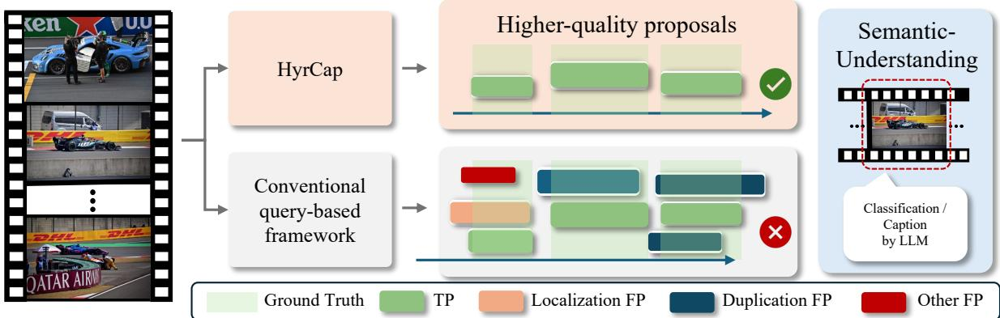
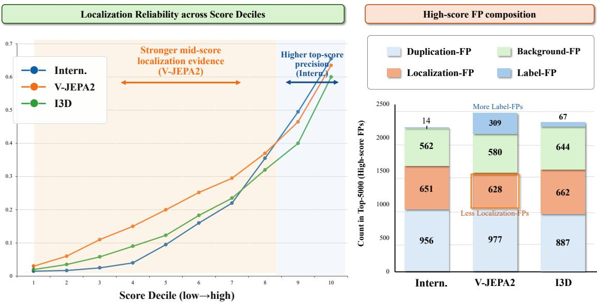
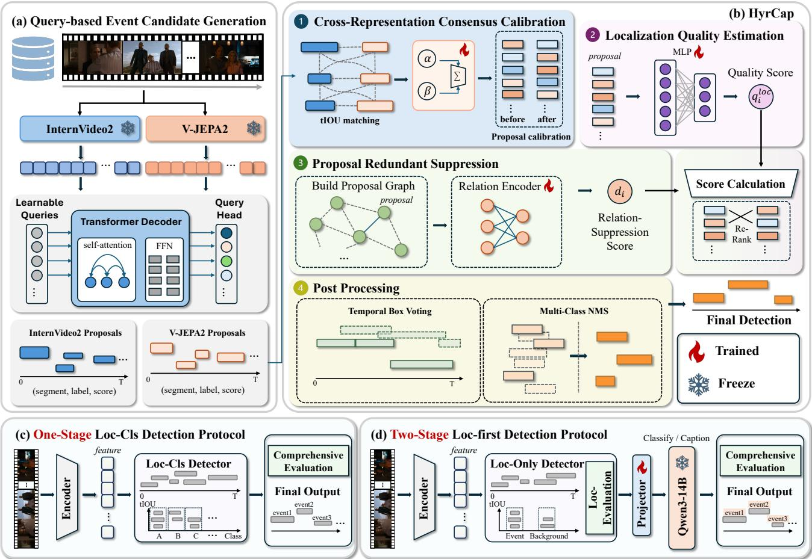
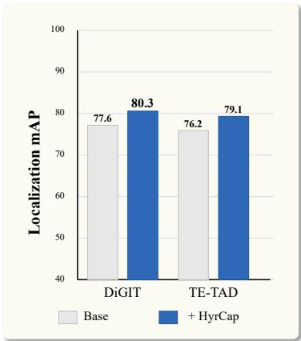
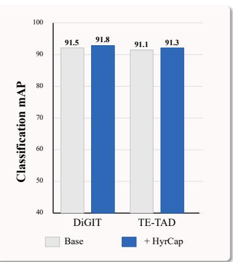
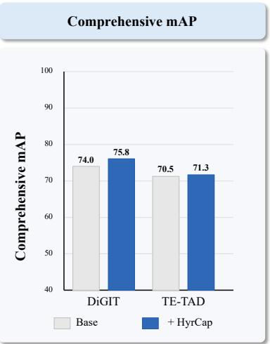
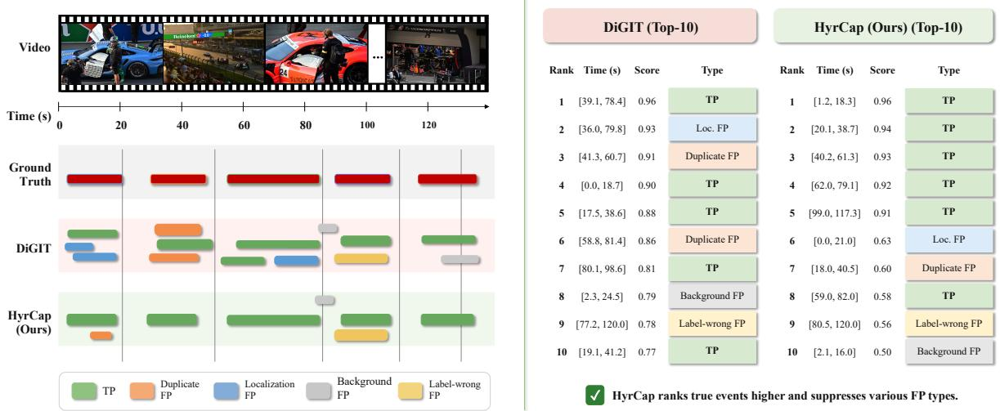
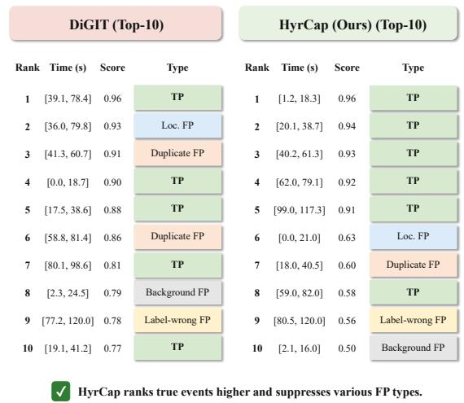

# HyrCap: Hybrid Rank-Calibration of Action Proposals for Temporal Event Understanding

Rui Chen1 Xingyu Chen2,B,† Pengxin Xu4,2 Kai Chen3,2 Junzhi Yu1,B

1 Peking University 2 Zhongguancun Academy

3 Zhongguancun Institute of Artificial Intelligence 4 Harbin Institute of Technology, Shenzhen

https://zgca-hmi-lab.github.io/HyrCap https://github.com/ZGCA-HMI-Lab/HyrCap

Figure 1. Comparison of HyrCap and conventional query-based TAD: HyrCap produces higher-quality temporal proposals that better support subsequent semantic understanding.

## Abstract

Temporal action detection in long untrimmed videos still suffers from inaccurate temporal localization and low-quality proposals, especially under sparse temporal annotations and ambiguous event boundaries. In the context of open-ended video understanding and LLM-driven event analysis, reliable temporal action proposals have emerged as a critical interface bridging temporal localization, event annotation, and semantic understanding. However, conventional temporal action detection (TAD) pipelines lack explicit modeling of proposal localization quality, cross-representation support, and inter-proposal relations, making it difficult to consistently provide high-quality proposals. We propose Hybrid Rank-Calibration of Action Proposals (HyrCap), a proposal-centric query-based TAD framework for temporal event understanding. In HyrCap, Hybrid denotes the use of complementary video features that provide different temporal localization cues, while Rank-Calibration refers to calibrating the ranking confidence of dense action proposals so that it better reflects proposal localization reliability and candidate competition. HyrCap treats dense query-based predictions as an over-complete temporal event hypothesis space and improves the ranking reliability, localization quality, and candidate discrimination of action proposals through modules such as Cross-Representation Consensus Calibration, Localization Quality Estimation, and Proposal Redundancy Suppression Furthermore, inspired by the strong capability of LLMs in fine-grained semantic recognition, event description, and reasoning we introduce HyrCap for Semantic Action Understanding: calibrated proposals can be used for standard TAD detection and as inputs for LLM-based semantic understanding. We further define a staged evaluation protocol to separately measure event localization ability, segment-level semantic understanding, and their combined event understanding performance. Experiments on public benchmarks show that HyrCap achieves state-of-the-art performance across multiple metrics and provides a more fine-grained paradigm and evaluation protocol for query-based event segmentation and annotation.

## 1 Introduction

Existing video data typically consist of long untrimmed videos with sparse temporal annotations and imprecise event boundaries, making accurate temporal localization difficult and often leading to low-quality proposals [1, 2, 3]. Localizing reliable event segments from such videos is a fundamental step for video classification, event description, retrieval, and high-level semantic understanding. Temporal action detection (TAD) aims to localize action instances in untrimmed videos and recognize their semantic categories [1, 2]. Conventional methods usually formulate TAD as a closed-set detection problem, where a model predicts temporal boundaries, assigns action labels, and ranks candidate detections by confidence scores [4, 5, 6]. However, in the context of open-ended video understanding and LLM-driven event analysis, reliable temporal action proposals have become a key interface between temporal localization, event annotation, and semantic understanding [7, 8, 9]. Therefore, TAD is expected not only to produce final detections, but also to provide high-quality proposals.

Recent query-based TAD methods generate dense temporal candidates with learnable queries and have shown strong potential for localizing events in long videos [10, 11, 12, 13]. However, detection performance depends not only on whether the model generates proposals that cover ground-truth events, but also on how these proposals are ranked, suppressed, and matched during evaluation. Existing pipelines lack explicit modeling of proposal localization quality, cross-representation support, and inter-proposal relations, making dense query predictions with localization potential difficult to preserve, rank, and exploit. This suggests that improving TAD should not only rely on generating more candidates, but should also understand and optimize how proposals behave throughout the final detection pipeline.

Motivated by this observation, we first revisit the role of proposals in query-based TAD and analyze different video features for this task. We study how different types of false positives (FPs), proposal ranking, evaluation matching, and video feature representations affect proposal quality and final detection performance [14, 15, 16]. This analysis clarifies the relationship among proposal behavior, feature representation, and final mAP, and indicates that the localization potential of query-based detectors should be released through more reliable proposal-level ranking calibration.

Based on the above analysis, we propose Hybrid Rank-Calibration of Action Proposals (HyrCap), as shown in Figure 1, a proposal-centric query-based TAD framework for temporal event understanding. In HyrCap, Hybrid denotes the use of complementary video feature representations that provide different temporal localization cues, while Rank-Calibration refers to calibrating the ranking confidence of dense action proposals so that it better reflects proposal localization reliability and candidate competition. HyrCap does not directly treat dense query predictions as final detections. Instead, it regards them as an over-complete temporal event hypothesis space and improves the ranking reliability, localization quality, and candidate discrimination of action proposals through modules such as Cross-Representation Consensus Calibration, Localization Quality Estimation, and Proposal Redundancy Suppression.

Furthermore, inspired by the growing capability of LLMs in fine-grained event description, semantic recognition, and spatio-temporal reasoning [7, 8, 9], we introduce HyrCap for Semantic Action Understanding. Under this protocol, query-based TAD is evaluated in two stages rather than solely by overall mAP under the conventional one-stage loc-cls setting. The first stage measures proposal localization ability, while the second evaluates segment-level semantic understanding on the localized events. Specifically, in the first stage, action categories are collapsed into foreground event and background, and the category-agnostic localization quality, ranking reliability, and event coverage of proposals are evaluated independently In the second stage, an LLM or semantic classifier is applied to localized segments to evaluate classification, description, o reasoning performance. This two-stage protocol decouples whether an event is accurately localized from whether its semantics are correctly understood, making reliable generation, ranking, and selection of temporal action proposals the central capability of query-based detectors.

## Our contributions are summarized as follows:

• We provide a systematic analysis of proposals in query-based TAD, studying how FPs, proposal ranking, evaluation matching, and different video features affect proposal quality and final detection performance, thereby clarifying the relationship among proposal behavior, feature representation, and final mAP.

• We propose HyrCap, a proposal-centric rank-calibration framework that improves proposal localization reliability, ranking quality, and candidate discrimination through modules such as Cross-Representation Consensus Calibration, Localization Quality Estimation, and Proposal Redundancy Suppression.

• We introduce a two-stage paradigm for semantic action understanding, where proposal localization ability and segmentlevel semantic understanding ability are evaluated separately. HyrCap achieves state-of-the-art performance across multiple metrics on public benchmarks and provides a more fine-grained paradigm and evaluation protocol for querybased event segmentation and annotation.

## 2 Related Work

Video representations for action understanding. Action recognition is a fundamental task in video analysis, aiming to classify video sequences into specific action categories. I3D [14] extends the Inception network to the video domain by introducing 3D convolutions; R(2+1)D [17] improves computational efficiency by decomposing 3D convolutions into 2D spatial operations and 1D temporal operations. TSN [18] divides a video into multiple temporal segments and aggregates segmentlevel predictions through a consensus function, enabling effective long-range temporal modeling for action recognition. VideoMAEv2 [19] adopts a Transformer-based masked reconstruction pretraining strategy to learn more robust video representations. InternVideo2 [15] further enhances video representation learning with large-scale training data and a highly scalable model. V-JEPA2 [16] learns high-level video representations through self-supervised joint embedding prediction, improving spatiotemporal modeling capability. These models are commonly used as feature extractors for downstream tasks such as TAD.

Temporal action detection. Anchor-free and query-based detectors are two mainstream paradigms in current TAD. Anchorfree methods such as ActionFormer [5], TriDet [6], and ActionMamba [20] directly predict action segments, avoiding predefined anchors and improving temporal modeling with Transformer architectures, trident prediction schemes, or Mamba based structures, but still typically rely on NMS to remove redundant proposals. Query-based methods, inspired by DETR [10] formulate TAD as a set prediction problem and generate candidate events with learnable queries, thereby reducing reliance on hand-crafted components. RTD-Net [21], ReAct [22], TadTR [11], and DualDETR [23] have advanced query-based TAD, but some still depend on sliding windows or NMS. In contrast, TE-TAD [12] achieves a complete end-to-end detection framework by redesigning coordinate representation; building on it, DiGIT [13] further introduces MDGE, a multi-scale adapter, and CAID to improve encoder representation capability and decoder temporal context modeling.

Localization quality, temporal refinement, and video-language understanding. Localization-aware ranking and postprocessing have been studied in the 2D object detection domain, including Soft-NMS [24], IoU-Net [25], and Weighted Boxes Fusion [26]. These methods improve detection from the perspectives of score suppression, localization quality estimation, and box-level fusion. However, TAD focuses on temporal action segments, where boundaries are more ambiguous and proposal ranking is affected by redundancy, one-to-one matching, and global score ordering across videos. Therefore, post-processing strategies from 2D detection cannot be directly regarded as equivalent solutions for TAD. Meanwhile, video-language models such as VideoBERT [7] show the potential of event-level semantic understanding. For query-based TAD, reliable temporal localization is the foundation for subsequent semantic understanding, making high-quality temporal proposals essential for connecting detection with video-language understanding.

## 3 Analysis of Proposal Behavior

FP Categorization. For dense query predictions, final detection quality is determined not only by the generated candidate segments, but also by temporal boundary accuracy, confidence ranking, proposal redundancy, and one-to-one evaluation matching. Therefore, how proposals are preserved, ranked, and matched in the final detection pipeline is critical for understanding the performance bottleneck of TAD. To analyze the sources of false positives (FPs), we instantiate the analysis with DiGIT and compare the proposal behaviors of I3D [14], InternVideo2 [15], and V-JEPA2 [16]. We categorize FPs into four types: duplication FP denotes redundant proposals caused by one-to-one matching when multiple candidates correspond to the same ground-truth event; localization FP denotes proposals that overlap with a ground-truth event but have inaccurate temporal boundaries; background FP denotes proposals with low overlap to all ground-truth events; and label FP denotes proposals with correct temporal coverage but incorrect class prediction.

  
Figure 2. Visualization of different features under TAD. Intern. denotes InternVideo2 features.

Feature-dependent Proposal Behavior. As shown in Fig. 2, different feature inputs lead to distinct proposal behaviors. InternVideo2 shows the strongest proposal quality: it achieves the highest TP rate in the top deciles and produces fewer duplication, background, and label FPs among high-score predictions, indicating cleaner high-confidence candidates and more stable category prediction. In contrast, although V-JEPA2 is weaker than InternVideo2 as a detection representation, it achieves higher localization reliability in the middle score range and produces fewer localization FPs in the top-5000 predictions, suggesting complementary localization evidence. I3D exhibits weaker localization reliability and produces more background FPs. These observations indicate that InternVideo2 is suitable as the primary proposal source, while V-JEPA2 provides complementary localization reliability, motivating the hybrid rank-calibration design of HyrCap.

## 4 Method

The preceding analysis indicates that InternVideo2 and V-JEPA2 exhibit complementary proposal behaviors in TAD. Based on this observation, we propose HyrCap, a hybrid rank-calibration framework for query-based temporal action detection. As illustrated in Fig. 3(a), dense query-based proposals are first generated from the primary InternVideo2 representation and the auxiliary V-JEPA2 representation. HyrCap then operates in the proposal space, as shown in Fig. 3(b), and recalibrates existing proposal scores by combining learned cross-representation temporal consensus, proposal-level localization reliability, and local proposal competition:

$$
s _ { i } ^ { c a l } = s _ { i } ( 1 + \beta c _ { i } m _ { i } ) ( q _ { i } ^ { l o c } ) ^ { \gamma _ { q } } ( 1 - d _ { i } ) ^ { \gamma _ { d } } ,\tag{1}
$$

where $s _ { i }$ is the detector score, $m _ { i }$ denotes cross-representation temporal support, $c _ { i }$ is the learned consensus gate, $q _ { i } ^ { l o c }$ estimates localization reliability, and $d _ { i }$ is the relation-suppression score. After calibration, HyrCap refines proposal boundaries by temporal voting and applies multi-class NMS to obtain final detections

## 4.1 Cross-Representation Consensus Calibration

As shown in Fig. 3(b)-1, CPCC uses InternVideo2 proposals as the primary candidates and V-JEPA2 proposals as classagnostic auxiliary temporal evidence. The primary proposal set is denoted as $\mathcal { P } ^ { I } = \{ p _ { i } = ( b _ { i } , y _ { i } , s _ { i } ) \} _ { i = 1 } ^ { \bar { N } }$ , where $b _ { i }$ is the temporal segment, $y _ { i }$ is the predicted category, and $s _ { i }$ is the detector confidence. The auxiliary proposal set is denoted as $\mathcal { P } ^ { A } \overset { \cdot } { = } \{ \bar { p } _ { j } = ( \bar { b } _ { j } ) \} _ { j = 1 } ^ { \bar { M } }$

  
Figure 3. Overview of HyrCap. (a) Query-based event candidate generation with InternVideo2 and V-JEPA2 representations. (b) HyrCap calibrates and refines dense proposals through cross-representation consensus calibration, localization quality estimation, proposal redundancy suppression, and post-processing. (c) Conventional one-stage loc-cls detection protocol. (d) Two-stage loc-first protocol for staged semantic understanding. Loc denotes localization.

For each primary proposal, we compute its auxiliary temporal support by the maximum tIoU:

$$
m _ { i } = \operatorname* { m a x } _ { \bar { p } _ { j } \in \mathcal { P } ^ { A } } \mathrm { t I o U } ( b _ { i } , \bar { b } _ { j } ) .\tag{2}
$$

Instead of using $m _ { i }$ as a fixed heuristic, CPCC trains a lightweight consensus head to predict a gate $c _ { i } = f _ { \theta } ^ { c o n } ( r _ { i } )$ from proposal-level consensus cues. The gate is supervised by the localization quality of the primary proposal:

$$
\begin{array}{c} \begin{array} { r } { \hat { c } _ { i } = \left\{ 1 , \quad \operatorname* { m a x } _ { g \in \mathcal { G } _ { v } } \mathrm { t I o U } ( b _ { i } , b _ { g } ) \geq \mu _ { c } , \quad \right.} \\ { 0 , \quad \mathrm { o t h e r w i s e } , } \end{array}  \mathcal { L } _ { c o n } = \mathrm { B C E } ( c _ { i } , \hat { c } _ { i } ) .  \end{array}\tag{3}
$$

The consensus-calibrated score is defined as $s _ { i } ^ { c o n } = s _ { i } ( 1 + \beta c _ { i } m _ { i } )$ . This module keeps the original segment and category unchanged, and only adjusts proposal ranking through learned cross-representation temporal consensus.

## 4.2 Localization Quality Estimation

Fig. 3(b)-2 shows the localization quality estimation module. Detector confidence does not always reflect tempora localization quality. HyrCap therefore estimates a proposal-level localization score $q _ { i } ^ { l o c }$ from a compact descriptor $x _ { i } ^ { l o c }$ , which includes confidence statistics, temporal geometry, consensus evidence, and local ranking cues:

$$
\begin{array} { r } { q _ { i } ^ { l o c } = f _ { \theta } ^ { l o c } ( x _ { i } ^ { l o c } ) , \quad q _ { i } ^ { l o c } \in [ 0 , 1 ] . } \end{array}\tag{4}
$$

The supervision is constructed offline from ground-truth annotations. A proposal is localization-positive when it sufficiently overlaps with any ground-truth event in the same video:

$$
\begin{array} { r } { \mathcal { L } _ { l o c } = \mathrm { B C E } ( q _ { i } ^ { l o c } , \hat { q } _ { i } ) , \quad \hat { q } _ { i } = \left\{ 1 , \quad \operatorname* { m a x } _ { g \in \mathcal { G } _ { v } } \mathrm { t I o U } ( b _ { i } , b _ { g } ) \geq \mu _ { q } , \right. } \end{array}\tag{5}
$$

This target is category-agnostic and measures temporal alignment rather than semantic correctness. During inference, $q _ { i } ^ { l o c }$ is used as a multiplicative factor in the calibrated ranking score.

## 4.3 Proposal Redundancy Suppression

As illustrated in Fig. 3(b)-3, dense query predictions often contain multiple overlapping proposals around the same event. To model local proposal competition, HyrCap builds same-video and same-class neighborhoods according to temporal overlap. For each proposal, pairwise cues such as temporal IoU, center distance, length ratio, and score gap are aggregated by a lightweight relation encoder:

$$
d _ { i } = f _ { \phi } ^ { r e l } ( h _ { i } ^ { \prime } ) , \quad d _ { i } \in [ 0 , 1 ] .\tag{6}
$$

Here, $d _ { i }$ estimates whether proposal $p _ { i }$ should be suppressed under its local proposal context. The suppression target is constructed from offline proposal matching diagnosis, where duplicate proposals and locally inferior candidates in overlapping groups are treated as suppression-positive samples:

$$
\begin{array} { r } { \mathcal { L } _ { r e l } = \mathrm { B C E } ( d _ { i } , \hat { d } _ { i } ) , \qquad \mathcal { L } _ { c a l } = \mathcal { L } _ { c o n } + \mathcal { L } _ { l o c } + \lambda _ { r e l } \mathcal { L } _ { r e l } . } \end{array}\tag{7}
$$

Here, $\mathcal { L } _ { c o n } , \mathcal { L } _ { l o c } ,$ and $\mathcal { L } _ { r e l }$ supervise CPCC, LQE, and PRS, respectively. The suppression factor $( 1 - d _ { i } ) ^ { \gamma _ { d } }$ reduces the ranking priority of redundant or inferior candidates while preserving proposals with stronger local evidence.

After reranking, HyrCap further refines proposal boundaries by temporal voting, as shown in Fig. 3(b)-4. For each proposal $p _ { i } ,$ , we collect its same-video and same-class neighbors $B _ { i }$ whose tIoU with $p _ { i }$ exceeds a threshold $c .$ The refined boundaries are computed as

$$
\hat { t } _ { i } ^ { s } = \frac { \sum _ { p _ { j } \in B _ { i } } w _ { j } t _ { j } ^ { s } } { \sum _ { p _ { j } \in B _ { i } } w _ { j } + \epsilon } , \quad \hat { t } _ { i } ^ { e } = \frac { \sum _ { p _ { j } \in B _ { i } } w _ { j } t _ { j } ^ { e } } { \sum _ { p _ { j } \in B _ { i } } w _ { j } + \epsilon } , \quad w _ { j } = \operatorname* { m a x } ( s _ { j } ^ { c a l } - \tau , 0 ) .\tag{8}
$$

The final refined proposal is $\hat { p } _ { i } = ( \hat { b } _ { i } , y _ { i } , s _ { i } ^ { c a l } )$ , where $\hat { b } _ { i } = ( \hat { t } _ { i } ^ { s } , \hat { t } _ { i } ^ { e } )$ . Multi-class NMS is then applied to produce the fina detection results.

## 4.4 HyrCap for Staged Semantic Understanding

Beyond closed-set TAD evaluation, HyrCap supports a staged semantic understanding protocol. As shown in Fig. 3(c), the conventional one-stage loc-cls protocol jointly performs temporal localization and closed-set classification, where proposa ranking, boundary quality, and semantic prediction are coupled in the final class-specific detections.

In contrast, Fig. 3(d) shows our two-stage loc-first protocol. In the first stage, HyrCap focuses on category-agnostic event localization and converts dense query predictions into a compact set of event proposals through rank calibration, boundary refinement, and class-agnostic NMS:

$$
\begin{array} { r } { \mathcal { E } ( V ) = \mathrm { T o p K } \left( \mathrm { N M S } _ { c a } \left( \{ ( \hat { b } _ { i } , s _ { i } ^ { c a l } ) \} _ { i = 1 } ^ { N } \right) \right) , } \end{array}\tag{9}
$$

Table 1. Comparison with state-of-the-art methods on THUMOS14 [1] and ActivityNet v1.3 [2]. For TE -TAD + Ours, we additionally apply our methods on TE-TAD.
<table><tr><td rowspan="2">Training Type</td><td rowspan="2">Head Type</td><td rowspan="2">Method</td><td rowspan="2">Feature</td><td colspan="5">THUMOS14</td><td colspan="4">ActivityNet v1.3</td></tr><tr><td>0.3</td><td>0.4</td><td>0.5</td><td>0.6</td><td>0.7</td><td>Avg.</td><td>0.5</td><td>0.75 0.95</td><td>Avg.</td></tr><tr><td rowspan="4">Full</td><td rowspan="4"></td><td>AFSD</td><td>I3D [14]</td><td>67.3</td><td>62.4</td><td>55.5</td><td>43.7</td><td>31.1</td><td>52.0 52.4</td><td>35.3</td><td>6.5</td><td>34.4</td></tr><tr><td>TALLFormer</td><td>Swin-B [27]</td><td>76.0</td><td>-</td><td>63.2 1</td><td>34.5</td><td>59.2</td><td>54.1</td><td>36.2</td><td>7.9</td><td>35.6</td></tr><tr><td>ViT-TAD</td><td>ViT-B [28]</td><td>85.1</td><td>80.9</td><td>74.2 61.8</td><td>45.4</td><td>69.5</td><td>55.8</td><td>38.5</td><td>8.8</td><td>37.4</td></tr><tr><td>AdaTAD</td><td>VideoMAEv2-g [19]</td><td>89.7</td><td>86.7</td><td>80.9 71.0</td><td>56.1</td><td>76.9</td><td>61.7</td><td>43.4</td><td>10.9</td><td>41.9</td></tr><tr><td rowspan="11">Head only</td><td rowspan="5">Anchor -free</td><td>TriDet</td><td>I3D [14] / R(2+1)D [17]</td><td>83.6</td><td>80.1</td><td>72.9</td><td>62.4</td><td>47.4</td><td>69.3 54.7</td><td>38.0</td><td>8.4</td><td>36.8</td></tr><tr><td>DyFADet</td><td>I3D [14] / R(2+1)D [17]</td><td>84.0</td><td>80.1</td><td>72.7 61.1</td><td>47.9</td><td>69.2</td><td>58.1</td><td>39.6</td><td>8.4</td><td>38.5</td></tr><tr><td>ActionFormer</td><td>I3D [14] / R(2+1)D [17]</td><td>82.1</td><td>77.8</td><td>71.0 59.4</td><td>43.9</td><td>66.8</td><td>54.7</td><td>37.8</td><td>8.4</td><td>36.6</td></tr><tr><td>ActionFormer</td><td>InternVideo2 [15]</td><td>82.3</td><td>81.9</td><td>75.1 65.8</td><td>50.3</td><td>71.9</td><td>61.5</td><td>44.6</td><td>12.7</td><td>41.2</td></tr><tr><td>ActionMamba</td><td>InternVideo2 [15]</td><td>86.9 83.1</td><td>76.9</td><td>65.9</td><td>50.8</td><td>72.7</td><td>62.4</td><td>43.5</td><td>10.2</td><td>42.0</td></tr><tr><td rowspan="13">Query -based</td><td>RTD-Net</td><td>I3D [14] / TSN [18]</td><td>68.3</td><td>62.3</td><td>51.9</td><td>38.8</td><td>23.7</td><td>49.0</td><td>47.2</td><td>30.7 8.6</td><td>30.8</td></tr><tr><td>ReAct</td><td>I3D [14] / TSN [18]</td><td>69.2</td><td>65.0</td><td>57.1</td><td>47.8</td><td>35.6</td><td>55.0</td><td>49.6</td><td>33.0 8.6</td><td>32.6</td></tr><tr><td>Self-DETR</td><td>I3D [14]</td><td>74.6</td><td>69.5</td><td>60.0 47.6</td><td>31.8</td><td></td><td>56.7 52.3</td><td>33.7</td><td>8.4</td><td>33.8</td></tr><tr><td>TadTR</td><td>I3D [14] / R(2+1)D [17]</td><td>74.8</td><td>69.1</td><td>60.1 46.6</td><td>32.8</td><td></td><td>56.7 53.6</td><td>37.5</td><td>10.6</td><td>36.8</td></tr><tr><td>DualDETR</td><td>I3D [14]</td><td>82.9</td><td>78.0</td><td>70.4 58.5</td><td></td><td>44.4</td><td>66.8 52.6</td><td>35.0</td><td>7.8</td><td>34.3</td></tr><tr><td>TE-TAD</td><td>I3D [14] / R(2+1)D [17]</td><td>83.3</td><td>78.4</td><td>71.3 60.7</td><td>45.6</td><td></td><td>67.9 54.2</td><td>38.1</td><td>10.6</td><td>37.1</td></tr><tr><td>DiGIT</td><td>I3D [14] / R(2+1)D [17]</td><td>83.6</td><td>79.6</td><td>71.9 61.5</td><td>48.6</td><td></td><td>69.0 54.4</td><td>38.2</td><td>10.7</td><td>37.3</td></tr><tr><td>TadTR</td><td>InternVideo2 [15]</td><td>84.8</td><td>79.3</td><td>70.4</td><td>58.2</td><td>43.8</td><td>67.3</td><td>57.1</td><td>38.8</td><td>11.0</td><td>38.2</td></tr><tr><td>TE-TAD</td><td></td><td>InternVideo2 [15]</td><td>84.3</td><td>81.1</td><td>73.7 62.6</td><td>49.5</td><td>70.3</td><td>61.3</td><td>41.8</td><td>10.9</td><td>41.1</td></tr><tr><td>DiGIT</td><td></td><td>InternVideo2 [15]</td><td>87.6</td><td>84.2</td><td>77.6 67.3</td><td>52.5</td><td>73.8</td><td>62.0</td><td>43.1</td><td>11.3</td><td>42.0</td></tr><tr><td>TE-TAD + Ours</td><td></td><td>InternVideo2 [15] + V-JEPA2 [16]</td><td>85.9 81.4</td><td>74.1</td><td>66.9</td><td>48.6</td><td>71.4</td><td>62.1</td><td>42.5</td><td>11.0</td><td>41.9</td></tr><tr><td>HyrCap</td><td></td><td>InternVideo2 [15] + V-JEPA2 [16]</td><td>88.1</td><td>85.2</td><td>79.1 70.8</td><td>54.6</td><td>75.6</td><td>64.4</td><td>44.0</td><td>11.4</td><td>43.3</td></tr></table>

where E(V) denotes the selected event units and $\mathrm { N M S } _ { c a }$ denotes class-agnostic NMS. The selection only depends on the calibrated localization score $s _ { i } ^ { c a l }$ , without using ground-truth annotations or semantic model confidence.

In the second stage, each selected event segment is passed to a semantic model through a trained projector for segment-leve classification, captioning, or reasoning:

$$
\left( \tilde { y } _ { i } , \tilde { r } _ { i } \right) = \mathcal { M } _ { s e m } \left( g _ { \omega } \left( \psi ( V [ \hat { b } _ { i } ] ) \right) , \mathcal { C } , \pi \right) ,\tag{10}
$$

where $\psi ( V [ \hat { b } _ { i } ] )$ denotes the segment-level visual representation, $g _ { \omega } ( \cdot )$ is the trained projector, C is the candidate action vocabulary, and π is the task prompt. The final staged output is

$$
\mathcal { D } _ { s t a g e } ( V ) = \{ ( \hat { b } _ { i } , \tilde { y } _ { i } , s _ { i } ^ { c a l } , \tilde { r } _ { i } ) \} _ { i = 1 } ^ { K } .\tag{11}
$$

The ranking score remains $s _ { i } ^ { c a l }$ rather than the semantic model confidence, keeping temporal proposal ranking and semantic interpretation decoupled. For joint evaluation, a prediction is considered correct only when both its temporal segment and semantic prediction are correct.

## 5 Experiments

## 5.1 Setup

Datasets. We conduct experiments on three public TAD datasets: THUMOS14 [1], ActivityNet v1.3 [2], and HACS-Segment [3]. THUMOS14 contains 20 action classes with 200/213 validation/test videos and 3,007/3,358 action instances. ActivityNet v1.3 and HACS-Segment both cover 200 classes, with 10,024/4,926 and 37,613/5,981 training/validation videos, respectively.

Evaluation Metrics. We follow the standard evaluation protocols of each dataset. For THUMOS14, we report mAP a tIoU thresholds of 0.3, 0.4, 0.5, 0.6, and 0.7, together with the average mAP. For ActivityNet v1.3 and HACS-Segment, we report mAP@0.5, mAP@0.75, mAP@0.95, and the average mAP over 0.5:0.95. In addition to standard class-specific detection evaluation, we report category-agnostic localization results. For staged semantic evaluation, we further measure event localization, segment-level semantic understanding, and their combined performance.

Implementation Details. During training, we freeze the video encoders and the base detector, and train the Cross-Representation Consensus Calibration, Localization Quality Estimation, Proposal Duplication Suppression, and semantic projector modules. All experiments are conducted on 4 NVIDIA A100-SXM4-80GB GPUs with 80GB memory per GPU. For THUMOS14, ActivityNet v1.3, and HACS-Segment, we follow the standard training/validation/test splits used in prior TAD works. The base detectors are trained or evaluated following their official configurations, and HyrCap is applied to the generated proposal predictions. For the proposed calibration modules, we train all modules of HyrCap for 50 epochs with batch size 4, optimizer AdamW. The main hyperparameters are set to NMS threshold 0.70, and Top-K 900.

## 5.2 Comparison with State-of-the-Art Methods

We first compare HyrCap with existing state-of-the-art temporal action detection methods. The compared methods include anchor-based, anchor-free, and query-based detectors. The main results are reported on multiple public benchmarks to evaluate the effectiveness of HyrCap under different dataset scales, action category distributions, and video characteristics.

Table 1 reports the comparison on THUMOS14 and ActivityNet v1.3. On THUMOS14, HyrCap improves over strong query-based baselines in terms of average mAP and remains effective under stricter tIoU thresholds. This indicates that hybrid rank-calibration not only improves proposal ranking, but also preserves proposals with more accurate temporal boundaries. On ActivityNet v1.3, HyrCap also achieves consistent improvement, showing that the proposal-level calibration strategy is not limited to short action instances or a single benchmark.

Table 2 reports the results on HACS-Segment. The performance on this large-scale benchmark shows that HyrCap generalizes to diverse action categories and video distributions. These results validate HyrCap as a general proposal-centric framework for improving query-based TAD.

## 5.3 Ablation Study

To validate the effectiveness of each component, we conduct ablation experiments on each module, as shown in Table 3. CPCC improves proposal ranking by exploiting cross-representation temporal consistency, LQE explicitly estimates proposa localization reliability and prioritizes candidates with more accurate temporal boundaries, and PRS suppresses redundant candidates to reduce high-score false positives. When combined, these modules achieve the best performance on different baselines. The Top-100 FP statistics further show that HyrCap effectively reduces duplicate, background, and localization FPs, leading to more reliable proposal ranking and improved detection performance.

Table 2. Performance comparison with state-of-the-art methods on HACS-Segment.
<table><tr><td rowspan="2">Head Type</td><td rowspan="2">Method</td><td rowspan="2">Feature</td><td colspan="4">mAP</td></tr><tr><td>0.5</td><td>0.75</td><td>0.95</td><td>Avg.</td></tr><tr><td rowspan="4">Anchor-based</td><td>SSN [29]</td><td>I3D [14]</td><td>28.8</td><td>18.8</td><td>5.3</td><td>19.0</td></tr><tr><td>G-TAD [30]</td><td>I3D [14]</td><td>41.1</td><td>27.6</td><td>8.3</td><td>27.5</td></tr><tr><td>BMN [4]</td><td>SlowFast [31]</td><td>52.5</td><td>36.4</td><td>10.4</td><td>35.8</td></tr><tr><td>TCANet [32]</td><td>SlowFast [31]</td><td>54.1</td><td>37.2</td><td>11.3</td><td>36.8</td></tr><tr><td rowspan="8">Anchor-free</td><td>TALLFormer [33]</td><td>Swin-B [27]</td><td>55.0</td><td>36.1</td><td>11.8</td><td>36.5</td></tr><tr><td>TriDet [6]</td><td>I3D [14]</td><td>54.5</td><td>36.8</td><td>11.5</td><td>36.8</td></tr><tr><td>TriDet [6]</td><td>SlowFast [31]</td><td>56.7</td><td>39.3</td><td>11.7</td><td>38.6</td></tr><tr><td>TriDet [6]</td><td>VideoMAEv2-g [19]</td><td></td><td>62.444.1</td><td>13.1</td><td>43.1</td></tr><tr><td>DyFADet [34]</td><td>SlowFast [31]</td><td>57.8</td><td>39.8</td><td>11.8</td><td>39.2</td></tr><tr><td>DyFADet [34]</td><td>VideoMAEv2-g [19]</td><td>64.0</td><td>44.8</td><td>14.1</td><td>44.3</td></tr><tr><td>ActionFormer [5]</td><td>InternVideo2 [15]</td><td>62.6</td><td>44.6</td><td>12.7</td><td>43.3</td></tr><tr><td>ActionMamba [20]</td><td>InternVideo2 [15]</td><td>64.0</td><td>45.7</td><td>13.3</td><td>44.6</td></tr><tr><td rowspan="6">Query-based</td><td>TadTR [11]</td><td>I3D [14]</td><td>47.1</td><td>32.1</td><td>10.9</td><td>32.1</td></tr><tr><td>TadTR [11]</td><td>InternVideo2 [15]</td><td>54.2</td><td>38.8</td><td>12.8</td><td>37.8</td></tr><tr><td>TadTR [11] + Ours InternVideo2 [15]</td><td></td><td>55.0</td><td>40.0</td><td>13.8</td><td>39.0</td></tr><tr><td>TE-TAD [12]</td><td>InternVideo2 [15]</td><td></td><td>60.4 45.6</td><td>16.5</td><td>44.1</td></tr><tr><td>DiGIT [13]</td><td>InternVideo2 [15]</td><td></td><td>61.1 47.5</td><td>17.8</td><td>45.5</td></tr><tr><td>HyrCap</td><td>InternVideo2 [15] + V-JEPA2 [16] 62.7 48.8</td><td></td><td></td><td>17.9</td><td>47.1</td></tr></table>

Controlled Comparison of Fusion and Calibration Strategies. Because CPCC introduces proposals from an auxiliary representation, we further conduct controlled comparisons to distinguish the benefit of additional proposals from that of the proposed calibration mechanism. All methods use exactly the same InternVideo2 primary proposals and V-JEPA2 auxiliary proposals, together with the same proposal budget, score normalization, Top-K setting, NMS threshold, and evaluation protocol. Direct Union + NMS directly merges proposals from both branches before NMS; Score Average and Max-Score Fusion combine the scores of matched proposals; Temporal WBF fuses their temporal boundaries using proposal-score-based weights; and Fixed Consensus uniformly sets the consensus gate to $c _ { i } = 1$ . Therefore, the performance differences reflect onl the fusion, calibration, and suppression strategies.

As shown in Table 4, directly combining the two proposal sources or applying simple score-level fusion remains substantially inferior to HyrCap, showing that the improvement cannot be attributed merely to the availability of additional proposals. Temporal WBF improves over simple fusion, while Fixed Consensus further confirms that cross-branch temporal agreement provides useful reliability evidence. HyrCap surpasses Fixed Consensus by 1.5 points in average mAP, demonstrating tha learned proposal-level calibration can selectively exploit beneficial auxiliary evidence while limiting the influence of unreliable cross-branch agreement.

## 5.4 Staged Semantic Evaluation

Beyond closed-set TAD evaluation, we further evaluate HyrCap under a staged semantic understanding protocol on THUMOS14 with InternVideo2 features. This protocol first evaluates whether a detector can produce category-agnostic event proposals, and then sends the selected event segments to Qwen3-14B [9] for segment-level classification or captioning.

Specifically, for localization evaluation, all action categories are collapsed into foreground event and background, and proposals are ranked by localization scores and matched to ground-truth segments using standard tIoU-based AP computation. For semantic evaluation, we select the top-ranked proposals after class-agnostic NMS, extract their segment features, map them with the trained projector, and feed them into Qwen3-14B for segment-level semantic prediction. For joint event evaluation, proposals are ranked by the calibrated localization score, and a prediction is counted as a true positive only when its temporal segment matches an unmatched ground-truth instance under the required tIoU threshold and its semantic prediction is correct. Thus, semantic confidence is not used for proposal ranking, keeping temporal localization and semantic interpretation decoupled.

Table 3. Component Analysis. CPCC denotes Cross-Representation Consensus Calibration, LQE denotes Localization Quality Estimation, and PRS denotes Proposal Redundant Suppression. Dup. represents Duplication FPs, Bg. Background FPs, Loc. Localization FPs, and Lab. Label FPs.
<table><tr><td rowspan="2">Baseline</td><td colspan="2">Input Feature</td><td rowspan="2">CPCC</td><td rowspan="2">LQE</td><td rowspan="2">PRS</td><td colspan="4">mAP</td><td colspan="4">FPs in Top-100</td></tr><tr><td>Intern.</td><td>V-JEPA2</td><td></td><td>0.3</td><td>0.5</td><td>0.7</td><td>Avg.</td><td>Dup. Bg.</td><td>Loc.</td><td>Lab.</td></tr><tr><td rowspan="9">TE-TAD [12]</td><td>V</td><td></td><td></td><td></td><td></td><td>85.0</td><td>73.0</td><td>46.5</td><td>70.3</td><td>2</td><td>2</td><td>1</td><td>1</td></tr><tr><td></td><td>√</td><td></td><td></td><td></td><td>67.5</td><td>56.7</td><td>38.4</td><td>55.2</td><td>0</td><td>1</td><td>1</td><td>0</td></tr><tr><td>√</td><td>√</td><td>√</td><td></td><td></td><td>85.2</td><td>73.8</td><td>48.1</td><td>71.1</td><td>0</td><td>1</td><td>1</td><td>0</td></tr><tr><td>√</td><td></td><td></td><td>√</td><td></td><td>85.0</td><td>73.0</td><td>47.2</td><td>70.9</td><td>2</td><td>2</td><td>0</td><td>0</td></tr><tr><td>√</td><td></td><td></td><td></td><td>√</td><td>85.2</td><td>73.1</td><td>46.6</td><td>70.7</td><td>0</td><td>4</td><td>1</td><td>1</td></tr><tr><td>√</td><td>√</td><td>√</td><td>√</td><td></td><td>85.0</td><td>73.0</td><td>47.2</td><td>70.8</td><td>0</td><td>2</td><td>0</td><td>1</td></tr><tr><td>√</td><td>√</td><td>√</td><td></td><td>√</td><td>85.6</td><td>73.9</td><td>48.3</td><td>70.4</td><td>0</td><td>3</td><td>0</td><td>2</td></tr><tr><td>√</td><td></td><td></td><td>√</td><td>√</td><td>85.0</td><td>73.4</td><td>48.0</td><td>71.0</td><td>0</td><td>4</td><td>1</td><td>1</td></tr><tr><td>√</td><td>√</td><td>V</td><td>√</td><td>√</td><td>85.9</td><td>74.1</td><td>48.6</td><td>71.4</td><td>0</td><td>1</td><td>0</td><td>0</td></tr><tr><td rowspan="9">DiGIT [13]</td><td>V</td><td></td><td></td><td></td><td></td><td>86.6</td><td>77.3</td><td>52.8</td><td>73.8</td><td>2</td><td>7</td><td>6</td><td>0</td></tr><tr><td></td><td>√</td><td></td><td></td><td></td><td>82.4</td><td>73.1</td><td>47.3</td><td>69.9</td><td>1</td><td>1</td><td>0</td><td>2</td></tr><tr><td>√</td><td>√</td><td>√</td><td></td><td></td><td>86.9</td><td>77.7</td><td>54.4</td><td>75.0</td><td>1</td><td>4</td><td>1</td><td>0</td></tr><tr><td>√</td><td></td><td></td><td>√</td><td></td><td>86.8</td><td>77.4</td><td>53.7</td><td>74.5</td><td>2</td><td>6</td><td>2</td><td>0</td></tr><tr><td>√</td><td></td><td></td><td></td><td>√</td><td>87.7</td><td>77.8</td><td>52.8</td><td>74.7</td><td>1</td><td>5</td><td>5</td><td>0</td></tr><tr><td>√</td><td>√</td><td>V</td><td>√</td><td></td><td>87.3</td><td>77.8</td><td>54.5</td><td>75.1</td><td>2</td><td>5</td><td>1</td><td>0</td></tr><tr><td>√</td><td></td><td>√</td><td></td><td>√</td><td>87.7</td><td>78.5</td><td>54.2</td><td>75.4</td><td>0</td><td>2</td><td>4</td><td>0</td></tr><tr><td>√</td><td></td><td></td><td>√</td><td>√</td><td>87.6</td><td>77.7</td><td>52.2</td><td>74.8</td><td>0</td><td>5</td><td>6</td><td>0</td></tr><tr><td>√</td><td></td><td>√</td><td>√</td><td>√</td><td>88.1</td><td>79.1</td><td>54.6</td><td>75.6</td><td>0</td><td>1</td><td>1</td><td>0</td></tr></table>

As shown in Fig. 4, HyrCap consistently improves localization mAP on different query-based detectors. For DiGIT and TE-TAD, the localization mAP increases from 77.6 and 76.2 to 80.3, 79.1, respectively. Since the semantic model operates on localized event segments, better localization provides more reliable inputs for segment-level semantic prediction. Under joint event evaluation, HyrCap also improves final event understanding performance, showing that calibrated proposals benefit both closed-set TAD and LLM-based semantic understanding.

## 5.5 Qualitative Results

We conduct a qualitative comparison between HyrCap and the baseline DiGIT detector on representative videos. As shown in Figure 5, HyrCap generates proposals that more accurately cover the ground-truth action segments, while simultaneously reducing duplicate, background, and localization-error false positives. In contrast, DiGIT produces more redundant or misaligned proposals.

On the top-ranked proposals (Figure 5), HyrCap consistently ranks true positives higher and suppresses various types of false positives, demonstrating that its cross-representation consensus and proposal calibration effectively improve both proposal quality and ranking reliability. This visual inspection highlights HyrCap’s ability to produce temporally precise and stable event segments suitable for downstream semantic understanding.

Table 4. Controlled comparison of fusion and calibration strategies on THUMOS14 using identical dual-branch proposal inputs.
<table><tr><td>Method</td><td>AP@0.3</td><td>AP@0.5</td><td>AP@0.7</td><td>Avg. mAP</td></tr><tr><td>Direct Union + NMS</td><td>80.9</td><td>72.2</td><td>48.2</td><td>68.2</td></tr><tr><td>Score Average</td><td>81.8</td><td>72.6</td><td>48.4</td><td>68.6</td></tr><tr><td>Max-Score Fusion</td><td>80.5</td><td>71.1</td><td>45.7</td><td>66.8</td></tr><tr><td>Temporal WBF</td><td>83.8</td><td>75.2</td><td>50.8</td><td>71.1</td></tr><tr><td>Fixed Consensus</td><td>87.3</td><td>78.0</td><td>53.8</td><td>74.1</td></tr><tr><td>HyrCap</td><td>88.1</td><td>79.1</td><td>54.6</td><td>75.6</td></tr></table>

Stage 1: Query-based Localization  

Stage 2: LLM Classification / Caption  
  
Figure 4. Two-Stage Evaluation.

## 6 Conclusion

In this paper, we proposed HyrCap, a proposal-centric hybrid rank-calibration framework for query-based temporal action detection and temporal event understanding. HyrCap treats dense query predictions as an over-complete temporal event hypothesis space and improves proposal quality through cross-representation consensus calibration, localization quality estimation, Proposal Redundancy Suppression, and temporal boundary refinement. Experiments on public TAD benchmarks show that HyrCap consistently improves strong query-based baselines, while ablation and qualitative results verify each component. Beyond closed-set detection, HyrCap further supports a staged semantic understanding protocol, where calibrated proposals serve as reliable event-level inputs for LLM-based classification, captioning, and reasoning. These results demonstrate the importance of high-quality temporal proposals for connecting TAD with higher-level video understanding.

Limitation and future work Although HyrCap consistently improves query-based TAD baselines, it still has several limitations. First, HyrCap is a proposal calibration framework and therefore depends on the quality of the base detector. I the base detector fails to generate candidates that cover true action instances, the missing events cannot be recovered by subsequent rank calibration or boundary refinement. Second, the cross-representation consensus module relies on auxiliar video representations to provide complementary temporal evidence. While this design improves proposal reliability, it may introduce additional feature extraction, storage, and inference cost. Reducing the dependence on auxiliary representations or learning more efficient consensus cues is an important direction for future work.

(a) Qualitative Comparison on a Video  
(b) Top-10 Ranked Proposals Comparison  

  
Figure 5. Qualitative visualization of proposal quality and ranking behavior.

Third, the staged semantic understanding protocol depends on the selected event proposals, the trained projector, and the semantic model. Errors in temporal localization or visual-semantic projection may affect segment-level classification, captioning, and reasoning. Moreover, our current semantic evaluation is mainly built on predefined action categories and public TAD benchmarks, which does not fully cover open-vocabulary event discovery or complex long-form video reasoning. In the future, we will explore more adaptive proposal selection, more efficient proposal calibration, and stronger integration with open-vocabulary semantic models for temporal event understanding in more diverse real-world videos.

## References

[1] Haroon Idrees, Amir R Zamir, Yu-Gang Jiang, Alex Gorban, Ivan Laptev, Rahul Sukthankar, and Mubarak Shah. The thumos challenge on action recognition for videos “in the wild”. Computer Vision and Image Understanding, 155:1–23, 2017.

[2] Fabian Caba Heilbron, Victor Escorcia, Bernard Ghanem, and Juan Carlos Niebles. Activitynet: A large-scale video benchmark for human activity understanding. In Proceedings of the ieee conference on computer vision and pattern recognition, pages 961–970, 2015.

[3] Hang Zhao, Antonio Torralba, Lorenzo Torresani, and Zhicheng Yan. Hacs: Human action clips and segments dataset for recognition and temporal localization. In Proceedings of the IEEE/CVF International Conference on Computer Vision, pages 8668–8678, 2019.

[4] Tianwei Lin, Xiao Liu, Xin Li, Errui Ding, and Shilei Wen. Bmn: Boundary-matching network for temporal action proposal generation. In Proceedings of the IEEE/CVF international conference on computer vision, pages 3889–3898, 2019.

[5] Chen-Lin Zhang, Jianxin Wu, and Yin Li. Actionformer: Localizing moments of actions with transformers. In European Conference on Computer Vision, pages 492–510. Springer, 2022.

[6] Dingfeng Shi, Yujie Zhong, Qiong Cao, Lin Ma, Jia Li, and Dacheng Tao. Tridet: Temporal action detection with relative boundary modeling. In Proceedings of the IEEE/CVF conference on computer vision and pattern recognition, pages 18857–18866, 2023.

[7] Chen Sun, Austin Myers, Carl Vondrick, Kevin Murphy, and Cordelia Schmid. Videobert: A joint model for video and language representation learning. In Proceedings of the IEEE/CVF international conference on computer vision, pages 7464–7473, 2019.

[8] Muhammad Maaz, Hanoona Rasheed, Salman Khan, and Fahad Khan. Video-chatgpt: Towards detailed video understanding via large vision and language models. In Proceedings ofthe 62nd Annual Meeting ofthe Associationfor Computational Linguistics (Volume 1: Long Papers), pages 12585–12602, 2024.

[9] An Yang, Anfeng Li, Baosong Yang, Beichen Zhang, Binyuan Hui, Bo Zheng, Bowen Yu, Chang Gao, Chengen Huang, Chenxu Lv, et al. Qwen3 technical report. arXiv preprint arXiv:2505.09388, 2025.

[10] Nicolas Carion, Francisco Massa, Gabriel Synnaeve, Nicolas Usunier, Alexander Kirillov, and Sergey Zagoruyko. End-to-end object detection with transformers. In European conference on computer vision, pages 213–229. Springer, 2020.

[11] Xiaolong Liu, Qimeng Wang, Yao Hu, Xu Tang, Shiwei Zhang, Song Bai, and Xiang Bai. End-to-end temporal action detection with transformer. IEEE Transactions on Image Processing, 31:5427–5441, 2022.

[12] Ho-Joong Kim, Jung-Ho Hong, Heejo Kong, and Seong-Whan Lee. Te-tad: Towards full end-to-end temporal action detection via time-aligned coordinate expression. In Proceedings ofthe IEEE/CVF Conference on Computer Vision and Pattern Recognition, pages 18837–18846, 2024.

[13] Ho-Joong Kim, Yearang Lee, Jung-Ho Hong, and Seong-Whan Lee. Digit: Multi-dilated gated encoder and central adjacent region integrated decoder for temporal action detection transformer. In Proceedings ofthe Computer Vision and Pattern Recognition Conference, pages 24286–24296, 2025.

[14] Joao Carreira and Andrew Zisserman. Quo vadis, action recognition? a new model and the kinetics dataset. In proceedings ofthe IEEE Conference on Computer Vision and Pattern Recognition, pages 6299–6308, 2017.

[15] Yi Wang, Kunchang Li, Xinhao Li, Jiashuo Yu, Yinan He, Guo Chen, Baoqi Pei, Rongkun Zheng, Zun Wang, Yanson Shi, et al. Internvideo2: Scaling foundation models for multimodal video understanding. In European conference on computer vision, pages 396–416. Springer, 2024.

[16] Mido Assran, Adrien Bardes, David Fan, Quentin Garrido, Russell Howes, Matthew Muckley, Ammar Rizvi, Claire Roberts, Koustuv Sinha, Artem Zholus, et al. V-jepa 2: Self-supervised video models enable understanding, prediction and planning. arXiv preprint arXiv:2506.09985, 2025.

[17] Du Tran, Heng Wang, Lorenzo Torresani, Jamie Ray, Yann LeCun, and Manohar Paluri. A closer look at spatiotemporal convolutions for action recognition. In Proceedings ofthe IEEE conference on Computer Vision and Pattern Recognition, pages 6450–6459, 2018.

[18] Limin Wang, Yuanjun Xiong, Zhe Wang, Yu Qiao, Dahua Lin, Xiaoou Tang, and Luc Van Gool. Temporal segment networks: Towards good practices for deep action recognition. In European conference on computer vision, pages 20–36. Springer, 2016.

[19] Limin Wang, Bingkun Huang, Zhiyu Zhao, Zhan Tong, Yinan He, Yi Wang, Yali Wang, and Yu Qiao. Videomae v2: Scaling video masked autoencoders with dual masking. In Proceedings ofthe IEEE/CVF conference on computer vision and pattern recognition, pages 14549–14560, 2023.

[20] Guo Chen, Yifei Huang, Jilan Xu, Baoqi Pei, Jiahao Wang, Zhe Chen, Zhiqi Li, Tong Lu, and Limin Wang. Video mamba suite: State space model as a versatile alternative for video understanding. International Journal ofComputer Vision, 134(1):20, 2026

[21] Jing Tan, Jiaqi Tang, Limin Wang, and Gangshan Wu. Relaxed transformer decoders for direct action proposal generation. In Proceedings ofthe IEEE/CVF international conference on computer vision, pages 13526–13535, 2021.

[22] Dingfeng Shi, Yujie Zhong, Qiong Cao, Jing Zhang, Lin Ma, Jia Li, and Dacheng Tao. React: Temporal action detection with relational queries. In European conference on computer vision, pages 105–121. Springer, 2022.

[23] Yuhan Zhu, Guozhen Zhang, Jing Tan, Gangshan Wu, and Limin Wang. Dual detrs for multi-label temporal action detection. In Proceedings ofthe IEEE/CVF Conference on Computer Vision and Pattern Recognition, pages 18559–18569, 2024.

[24] Navaneeth Bodla, Bharat Singh, Rama Chellappa, and Larry S Davis. Soft-nms–improving object detection with one line of code. In Proceedings of the IEEE international conference on computer vision, pages 5561–5569, 2017.

[25] Borui Jiang, Ruixuan Luo, Jiayuan Mao, Tete Xiao, and Yuning Jiang. Acquisition of localization confidence for accurate object detection. In Proceedings ofthe European conference on computer vision (ECCV), pages 784–799, 2018.

[26] Roman Solovyev, Weimin Wang, and Tatiana Gabruseva. Weighted boxes fusion: Ensembling boxes from different object detection models. Image and Vision Computing, 107:104117, 2021.

[27] Ze Liu, Yutong Lin, Yue Cao, Han Hu, Yixuan Wei, Zheng Zhang, Stephen Lin, and Baining Guo. Swin transformer: Hierarchical vision transformer using shifted windows. In Proceedings of the IEEE/CVF international conference on computer vision, pages 10012–10022, 2021.

[28] Alexey Dosovitskiy, Lucas Beyer, Alexander Kolesnikov, Dirk Weissenborn, Xiaohua Zhai, Thomas Unterthiner, Mostafa Dehghani, Matthias Minderer, Georg Heigold, Sylvain Gelly, et al. An image is worth 16x16 words: Transformers for image recognition at scale. arXiv preprint arXiv:2010.11929, 2020.

[29] Yue Zhao, Yuanjun Xiong, Limin Wang, Zhirong Wu, Xiaoou Tang, and Dahua Lin. Temporal action detection with structured segment networks. In Proceedings ofthe IEEE international conference on computer vision, pages 2914–2923, 2017.

[30] Mengmeng Xu, Chen Zhao, David S Rojas, Ali Thabet, and Bernard Ghanem. G-tad: Sub-graph localization for temporal action detection. In Proceedings of the IEEE/CVF conference on computer vision and pattern recognition, pages 10156–10165, 2020.

[31] Christoph Feichtenhofer, Haoqi Fan, Jitendra Malik, and Kaiming He. Slowfast networks for video recognition. In Proceedings of the IEEE/CVF international conference on computer vision, pages 6202–6211, 2019.

[32] Zhiwu Qing, Haisheng Su, Weihao Gan, Dongliang Wang, Wei Wu, Xiang Wang, Yu Qiao, Junjie Yan, Changxin Gao, and Nong Sang. Temporal context aggregation network for temporal action proposal refinement. In 2021 IEEE/CVF Conference on Computer Vision and Pattern Recognition (CVPR), pages 485–494. IEEE, 2021.

[33] Feng Cheng and Gedas Bertasius. Tallformer: Temporal action localization with a long-memory transformer. In European Conference on Computer Vision, pages 503–521. Springer, 2022

[34] Le Yang, Ziwei Zheng, Yizeng Han, Hao Cheng, Shiji Song, Gao Huang, and Fan Li. Dyfadet: Dynamic feature aggregation for temporal action detection. In European conference on computer vision, pages 305–322. Springer, 2024.