# INFINISPLAT V2: ANALYZING AND IMPROVING FEED-FORWARD 3DGS FROM ANY VIEWS

Yongzhen Hu1,2∗ Hao Yu1∗ Jiawei Wang1 Xianming Zeng2 Jianyun Xu2 Xingliang Liu2 Ruizhen Hu3 Xiaowei Zhou1 Hujun Bao1 Sida Peng1,4† 1Zhejiang University 2Hello TransTech 3Shenzhen University 4Causa Robotics ∗Equal contribution †Corresponding author

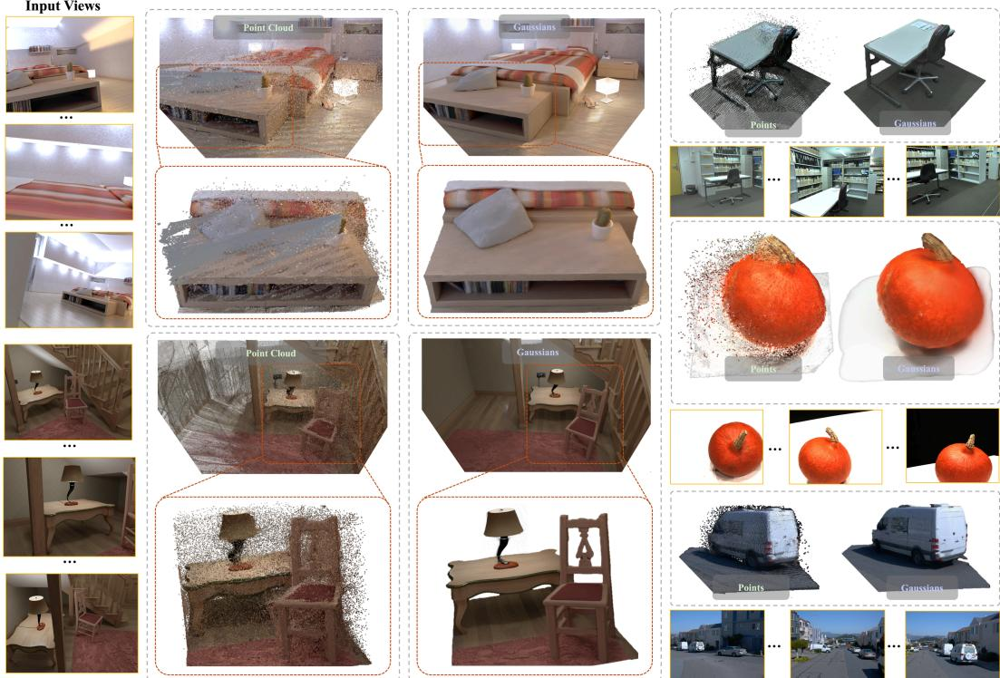  
Figure 1: From point clouds to Gaussian scenes. InfiniSplat v2 retains point positions from a geometry foundation model and learns Gaussian attributes for high-quality novel view rendering. Left: input views, point clouds, and corresponding Gaussian renderings, with enlarged regions outlined in orange. Right: additional examples comparing point clouds with the resulting Gaussian scenes.

## ABSTRACT

Feed-forward Gaussian reconstruction builds 3D scenes directly from input images for novel view rendering, but learning Gaussian attributes from predicted geometry for high-quality rendering under large viewpoint changes remains challenging. We analyze limitations in Gaussian attribute learning and introduce InfiniSplat v2, which improves rendering quality through architectural and training changes. Our method decouples geometry and attribute prediction with a frozen geometry branch, aligns predicted Gaussians using ground-truth camera poses during training, and adopts large-angle target view supervision. Across six datasets, the feed-forward outputs of the same trained model achieve state-of-the-art mean LPIPS and DISTS among the evaluated methods in both pose-conditioned and pose-free settings. In the pose-conditioned setting, mean LPIPS and DISTS decrease by 25.8% and 32.9%, respectively, compared with the strongest evaluated baselines. We further find that opacity learned with only image reconstruction supervision suppresses geometrically inconsistent points. Project page: https://zju3dv.github. io/InfiniSplat2.

## 1 INTRODUCTION

Image-based 3D scene reconstruction aims to recover a renderable 3D scene from input images to support novel view rendering for applications such as simulation, content creation, and autonomous driving. 3D Gaussian Splatting (3DGS) (Kerbl et al., 2023) enables efficient rendering through an explicit scene representation. Building on this representation, recent feed-forward methods (Charatan et al., 2024; Chen et al., 2024a; Zhang et al., 2024; Xu et al., 2025b) directly predict Gaussian scenes from input images, eliminating the need for per-scene representation optimization at inference time.

Pretrained multi-view geometry models (Wang et al., 2024; Leroy et al., 2024; Wang et al., 2025a; Yang et al., 2025; Lin et al., 2025; Wang et al., 2026d) provide a useful starting point for constructing renderable scenes from images. They predict depth maps and cameras for each input view. Backprojecting these depth maps with the corresponding camera estimates into a common coordinate frame yields a predicted point cloud. This point cloud captures coherent scene geometry overall, but typically also contains spatially isolated clusters or clusters that are inconsistent across views. Such issues become particularly apparent after 3D aggregation, as illustrated in Fig. 1.

Existing feed-forward methods (Lin et al., 2025; Jiang et al., 2025; Liu et al., 2025; Team et al., 2026) combine geometry prediction from multiple views with Gaussian attribute prediction to construct renderable scenes from input images. For example, DA3-GS (Lin et al., 2025) learns Gaussian attributes on top of the geometry predicted by DA3. However, as shown in Figs. 3 and 4, renderings from DA3-GS and the other evaluated methods still exhibit blur, ghosting, and missing detail. Our work focuses on using these imperfect geometry predictions to construct Gaussian scenes that support high-quality novel view rendering.

As shown in Fig. 1, InfiniSplat v2 reconstructs Gaussian scenes from predicted multi-view geometry and supports high-quality novel-view rendering at extreme viewpoints. We identify key factors that affect Gaussian learning and introduce three corresponding architectural and training improvements. First, we investigate why prior methods struggle to eliminate flying-point artifacts and find that jointly optimizing geometry and Gaussian attributes leads to geometric degradation. We therefore redesign the architecture to decouple geometry prediction from Gaussian attribute prediction while keeping the geometry branch frozen. Second, we find that using predicted camera poses during training (Lin et al., 2025) introduces pose errors. Under large-angle supervision, these errors can misguide the network during training. We therefore use GT camera poses to align the predicted Gaussians. Third, inspired by InfiniSplat’s strong performance under large viewpoint changes (Wang et al., 2026b), we introduce large-angle target view supervision for feed-forward Gaussian reconstruction from arbitrary input views. Our experiments show that these three improvements enhance novel view rendering quality under large viewpoint changes, even when the predicted point clouds contain numerous outliers.

We evaluate the same trained model on six datasets, both with and without camera pose inputs. Our method achieves the lowest mean LPIPS and DISTS across the six datasets among the evaluated base lines in both settings. With camera pose inputs, our feed-forward reconstruction reduces LPIPS and DISTS by 25.8% and 32.9%, respectively, relative to the strongest evaluated baseline for each metric. Additionally, we find that, with only image reconstruction supervision, the trainable attribute branch learns to assign lower opacity to outliers that are geometrically inconsistent across views. These points consequently contribute less to the rendered images, reducing visible artifacts in novel views (Fig. 7).

Our contributions are threefold:

• We introduce InfiniSplat v2, a feed-forward Gaussian reconstruction method for arbitrary input views. It freezes the geometry branch to decouple geometry prediction from Gaussian attribute prediction, aligns predicted Gaussians using GT camera poses during training, and adopts large-angle target view supervision.

• We evaluate the method on six datasets in both pose-conditioned and pose-free settings. The feed-forward outputs of the same trained model achieve the lowest mean LPIPS and DISTS among the evaluated baselines in both settings.

• We find that opacity learned with only image reconstruction supervision selectively suppresses the rendering contributions of geometrically inconsistent points across views.

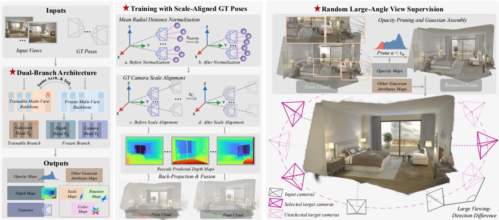  
Figure 2: Training pipeline of InfiniSplat v2’s feed-forward reconstructor. A frozen geometry branch predicts depth and cameras, while a trainable branch predicts Gaussian attributes. Scale-aligned GT cameras construct the point cloud; after opacity pruning, input and large-angle target views supervise Gaussian learning.

## 2 RELATED WORK

## 2.1 FEED-FORWARD 3D GEOMETRY ESTIMATION

Geometry foundation models recover scene structure from images and provide a geometric basis for feed-forward Gaussian reconstruction. DUSt3R (Wang et al., 2024), MASt3R (Leroy et al., 2024), VGGT (Wang et al., 2025a), Fast3R (Yang et al., 2025), and π3 (Wang et al., 2026d) advance learned geometric reconstruction. Depth Anything 3 (DA3) (Lin et al., 2025) reconstructs geometry from varying numbers of images, with or without supplied poses. VGGT-Long (Deng et al., 2025), VGG-T3 (Elflein et al., 2026), and Scal3R (Xie et al., 2026) extend learned reconstruction to longer sequences and larger scenes. These predictions provide a useful starting point, but constructing renderable Gaussian scenes also requires learning attributes such as opacity, scale, and appearance.

## 2.2 FEED-FORWARD GAUSSIAN SPLATTING

Generalizable view synthesis learns to predict novel views or renderable representations across scenes (Wang et al., 2021; Hong et al., 2024; Jin et al., 2024). Feed-forward Gaussian methods pursue this goal by directly predicting explicit Gaussian scenes. SHARP (Mescheder et al., 2026) and InfiniSplat (Wang et al., 2026b) reconstruct scenes from a single image, while GS-LRM (Zhang et al., 2024) combines multiple views. NoPoSplat (Ye et al., 2025) and FLARE (Zhang et al., 2025) support reconstruction without supplied camera poses. Long-LRM (Ziwen et al., 2025) and tttLRM (Wang et al., 2026a) further extend reconstruction to long input sequences. Work on Gaussian representations also explores different ways to organize and predict primitives: C3G (An et al., 2025) and TokenGS (Ren et al., 2026) use learnable queries or tokens, while VolSplat (Wang et al., 2025b) predicts voxel-aligned Gaussians.

More directly related to our work is how geometry is estimated and used for Gaussian prediction. pixelSplat (Charatan et al., 2024) establishes cross-view correspondences through epipolar attention, while MVSplat (Chen et al., 2024a) estimates depth using multi-view cost volumes. DepthSplat (Xu et al., 2025b) augments multi-view depth estimation with pretrained monocular depth features. Learned geometric priors also support Gaussian prediction in AnySplat (Jiang et al., 2025), World-Mirror (Liu et al., 2025; Team et al., 2026), and DA3-GS (Lin et al., 2025). Building on such priors, SplatAnything (Anonymous, 2027) scales up training with diverse synthetic and real-world data. QuerySplat (Li et al., 2026) separately decodes geometry and appearance from frozen geometric features. Our work focuses on learning Gaussian attributes from imperfect predicted point clouds to support high-quality novel view rendering.

After the initial prediction, learned refinement uses rendering feedback to update the Gaussian scene. G3R (Chen et al., 2024b) and the refinement module of Flux4D (Wang et al., 2026c) use explicit rendering gradients to guide learned updates. ReSplat (Xu et al., 2025a) instead uses feature-space rendering errors without explicit gradient feedback. Our refiner uses input-view rendering gradients to learn updates to Gaussian attributes while keeping centers fixed.

## 3 METHOD

Overview. Given input images and optional camera conditions, InfiniSplat v2 constructs a point cloud from predicted depth maps and corresponding cameras, then learns Gaussian attributes for its points to regulate their rendering contributions. A frozen DA3 branch provides the depth and camera estimates, while a trainable attribute branch adapts to rendering through image reconstruction supervision (Fig. 2). We then refine the scene attributes using input-view rendering feedback.

## 3.1 BACKGROUND: DA3-BASED GAUSSIAN RECONSTRUCTION

Given N input RGB images $\mathcal { T } _ { C } = \{ \mathbf { I } _ { i } \} _ { i \in \mathcal { C } }$ and optional pose conditions $\mathbf { Q } _ { \mathcal { C } }$ , our goal is to predict a Gaussian scene for novel view rendering. Here C indexes the input views. In the pose-free setting, our model receives only RGB images, with no supplied camera intrinsics or poses, and $\mathbf { Q } _ { \mathcal { C } } = \varnothing$ . We represent the scene as M Gaussians, separating each center $\pmb { \mu } _ { m }$ from its remaining attributes $\xi _ { m } .$ :

$$
\mathcal { G } = \{ ( \pmb { \mu _ { m } } , \pmb { \xi _ { m } } ) \} _ { m = 1 } ^ { M } , \qquad \pmb { \xi _ { m } } = ( \alpha _ { m } , \mathbf { s } _ { m } , \mathbf { q } _ { m } , \mathbf { c } _ { m } ) .\tag{1}
$$

Here $\pmb { \mu _ { m } } \in \mathbb { R } ^ { 3 }$ specifies position, while $\xi _ { m }$ contains opacity $\alpha _ { m }$ , three-axis scale $\mathbf { s } _ { m } .$ , rotation $\mathbf { q } _ { m }$ and zeroth-order spherical-harmonic (SH) color $\mathbf { c } _ { m } .$ . Scale and rotation determine the covariance and thus the Gaussian’s shape. For camera $\mathbf { I I } = ( \mathbf { K } , \mathbf { P } )$ with intrinsics K and camera-to-world pose P, the Gaussian renderer (Kerbl et al., 2023) produces $\widehat { \mathbf { I } } = \mathcal { R } ( \mathcal { G } ; \mathbf { I I } )$

DA3-GS builds on Depth Anything 3 (DA3) (Lin et al., 2025), using shared multi-view features for depth, camera, and per-pixel Gaussian prediction. Its DPT-style Gaussian head (Ranftl et al., 2021) is trained on a frozen backbone, and an adapter combines predicted geometry and attributes into a renderable scene.

## 3.2 FEED-FORWARD GAUSSIAN RECONSTRUCTION

Our goal is to improve Gaussian attributes through image reconstruction supervision without compensating for attribute errors by moving point positions. We therefore freeze the geometry branch and keep Gaussian centers fixed at the back-projected point positions. Constructing points with predicted input poses while supervising them from GT target poses can also introduce camera-induced residuals; we use scale-aligned GT cameras for both operations during training. Finally, targets near the input viewing directions may leave Gaussian shape insufficiently constrained. We favor large-angle target views to constrain scales and orientations through projections from different directions. Figure 2 illustrates the resulting training pipeline.

(1) Dual-branch architecture for attribute learning. To preserve DA3’s depth and camera estimates while adapting Gaussian attributes for rendering, we use two independently parameterized branches initialized from the same pretrained DA3 weights. Given the same input images and optional pose conditions, the frozen geometry branch predicts depths and cameras, whereas the attribute branch produces multi-layer patch features:

$$
\begin{array} { r } { ( \widehat { D } \boldsymbol { c } , \widehat { \mathbf { I } } \boldsymbol { c } ) = \Phi _ { \mathrm { g e o } } ( \mathcal { T } \boldsymbol { c } ; \mathbf { Q } \boldsymbol { c } ) , } \\ { \mathbf { F } \boldsymbol { c } = \Phi _ { \mathrm { a t t r } } ( \mathcal { T } \boldsymbol { c } ; \mathbf { Q } \boldsymbol { c } ) . } \end{array}\tag{2}
$$

Only the last K Transformer blocks of $\Phi _ { \mathrm { a t t r } }$ are fine-tuned; $\Phi _ { \mathrm { g e o } } .$ , including its depth and camera heads, remains frozen. A DPT Gaussian decoder maps $\mathbf { F } _ { \mathcal { C } }$ to per-pixel attributes $\xi \left( \mathrm { E q . 1 } \right)$ . The points are obtained by the back-projection described below, without predicted positional offsets; scales and rotations remain learnable to adjust Gaussian shape.

(2) Scale-aligned training. Errors in predicted back-projection poses introduce misalignment with GT supervision cameras and add camera-induced residuals to the attribute-learning objective. We therefore use GT cameras for training-time back-projection and align their translation scale with the predicted depths. We first express predicted and GT poses relative to their respective reference cameras, using the same input view as reference. Let $\mathbf { x } _ { j }$ be a point back-projected using predicted depth, intrinsics, and pose, with $\smash { \gamma _ { \mathrm { p t s } } }$ indexing all input pixels. Mean Radial Distance Normalization sets the reconstruction scale:

$$
s _ { \mathrm { n o r m } } = \frac { 1 } { | \mathcal { V } _ { \mathrm { p t s } } | } \sum _ { j \in \mathcal { V } _ { \mathrm { p t s } } } \| \mathbf { x } _ { j } \| _ { 2 } , \qquad \bar { D } _ { i } = \frac { \widehat { D } _ { i } } { s _ { \mathrm { n o r m } } } .\tag{3}
$$

Both predicted depths and camera translations are divided by $s _ { \mathrm { n o r m } } ,$ preserving their relative scale. To bring GT cameras to this scale, we fit a similarity transform from GT input-camera centers to the corresponding normalized predicted camera centers using Umeyama (Umeyama, 1991). We retain its scale $s _ { \mathcal { C } }$ and preserve GT intrinsics and reference-relative rotations; GT translations become $\widetilde { \mathbf { t } } _ { v } ^ { \star } =$ $s _ { C } \mathbf { t } _ { v } ^ { \star }$ . The same scale is applied to input and target cameras, with only input cameras contributing to the fit. Thus, $s _ { \mathrm { n o r m } }$ defines the unit of the predicted reconstruction, while $s _ { \mathcal { C } }$ expresses GT camera translations in that unit.

Here stars denote GT quantities and tildes denote scale alignment, with $\widetilde { \mathbf { R } } _ { i } ^ { \star } = \mathbf { R } _ { i } ^ { \star }$ . For each input pixel $\mathbf { u } = ( u _ { x } , u _ { y } , 1 ) ^ { \top }$ , we back-project the normalized predicted z-depth $\bar { D } _ { i }$ using the scale-aligned GT camera:

$$
\pmb { \mu } _ { i , \mathbf { u } } ^ { \mathrm { c a n d } } = \bar { D } _ { i } ( \mathbf { u } ) \widetilde { \mathbf { R } } _ { i } ^ { \star } ( \mathbf { K } _ { i } ^ { \star } ) ^ { - 1 } \mathbf { u } + \widetilde { \mathbf { t } } _ { i } ^ { \star } .\tag{4}
$$

The intrinsics $\mathbf { K } _ { i } ^ { \star }$ account for image preprocessing. Using scale-aligned GT cameras for both inputview back-projection and target-view rendering preserves their GT relative poses within a common reconstruction frame. This avoids the mismatch caused by constructing points with predicted input poses while supervising them from GT target poses.

We pair these centers with predicted per-pixel attributes and merge redundant points into $\mathcal { G } _ { \mathrm { v o x } }$ using the voxel-based strategy of AnySplat (Jiang et al., 2025) and WorldMirror 2.0 (Team et al., 2026).

(3) Random large-angle view supervision. Before applying rendering supervision, we prune Gaussians with opacity below $\tau _ { \alpha }$ from $\mathcal { G } _ { \mathrm { v o x } } .$ , yielding the initial scene $\mathcal { G } ^ { 0 } = \ d \{ ( \mu _ { m } ^ { 0 } , \pmb { \xi } _ { m } ^ { 0 } ) \} _ { m = 1 } ^ { M }$ , where M is the retained count. The same merging and pruning are used at inference.

Supervision concentrated near the input viewing directions may leave Gaussian scales and orientations insufficiently constrained. To guide shape learning through projections across views, we favor target cameras whose optical axes differ more from those of the input cameras. For a candidate target $v \not \in { \mathcal { C } } ,$ , let $\mathbf f _ { v } = \mathbf R _ { v } ^ { \star } ( 0 , 0 , 1 ) ^ { \top }$ denote its unit optical axis in the common reference frame. We score its angular separation from the nearest input direction by

$$
a ( v , \mathcal { C } ) = \operatorname* { m i n } _ { i \in \mathcal { C } } \operatorname { a r c c o s } ( \mathbf { f } _ { v } ^ { \top } \mathbf { f } _ { i } ) .\tag{5}
$$

We sample the target set $\tau$ with a bias toward larger scores, which measure camera orientation differences.

We supervise renderings of $\mathcal { G } ^ { 0 }$ from both input views and the sampled target set $\tau .$ For target views, GT-depth warp masks restrict the loss to valid regions with depth-consistent support from at least one input view. Target images, cameras, and GT depth serve only sampling and supervision; scene construction and scale estimation use input views alone.

## 3.3 LEARNED RENDERING-FEEDBACK REFINEMENT

Starting from $\mathcal { G } ^ { 0 }$ , a learned refiner updates Gaussian attributes using input-view rendering feedback. Let $\mathcal { G } ^ { t }$ denote the scene after t updates. At each step, we render it into all input views, ${ \bar { \mathcal { F } } } = { \mathcal { C } }$ , and compute

$$
\begin{array} { r l } & { \mathbf { g } ^ { t } = \mathrm { R e n d e r G r a d } ( \mathcal { G } ^ { t } ; \mathcal { T } _ { \mathcal { F } } , \mathbf { \Pi } _ { \mathcal { F } } ^ { \mathrm { f b } } ) , } \\ & { \mathbf { h } ^ { t } = E ( \mathcal { G } ^ { t } , \mathrm { s g } ( \mathbf { g } ^ { t } ) , \mathbf { f } ) . } \end{array}\tag{6}
$$

Here $\Pi _ { \mathcal { F } } ^ { \mathrm { f b } }$ are the input cameras used for feedback. RenderGrad aggregates reconstruction-loss gradients with respect to Gaussian attributes across these views, and sg denotes stop-gradient. The encoder $E$ combines this feedback with the current scene and projected DPT features f to form per-Gaussian features $\mathbf { h } ^ { t } = \{ \mathbf { h } _ { m } ^ { t } \} _ { m = 1 } ^ { M }$ . Projected DPT features are merged using the same voxel groups and weights as the Gaussians to obtain f, which also initializes the recurrent hidden state. The DPT features provide image-derived context and remain fixed across steps, while gradient feedback is recomputed from the current scene. Feedback uses only input observations during both training and inference.

A shared recurrent KNN Transformer U aggregates features across spatial neighbors and predicts attribute residuals and the next hidden state:

$$
\begin{array} { r l } { ( \Delta \pmb { \xi } _ { m } ^ { t } , \mathbf { b } _ { m } ^ { t + 1 } ) = { \cal U } ( \pmb { \xi } _ { m } ^ { t } , \mathbf { h } _ { m } ^ { t } , \mathbf { b } _ { m } ^ { t } ) , \quad } & { } \\ { \pmb { \xi } _ { m } ^ { t + 1 } = \mathrm { A p p l y } ( \pmb { \xi } _ { m } ^ { t } , \Delta \pmb { \xi } _ { m } ^ { t } ) , \quad } & { \pmb { \mu } _ { m } ^ { t + 1 } = \pmb { \mu } _ { m } ^ { 0 } . } \end{array}\tag{7}
$$

Here $\mathbf { b } _ { m } ^ { t }$ is the recurrent hidden state, and Apply applies residuals in each attribute’s parameterization space. Gaussian centers and counts remain fixed. Rendering gradients serve as inputs to learned updates rather than direct gradient-descent steps. The fixed centers allow the spatial KNN graph to be reused across steps. The final scene is denoted $\mathcal { G } ^ { \mathrm { r e f } }$

## 3.4 TRAINING AND INFERENCE

Training. In Stage I, both branches receive input RGB and GT pose conditions. We supervise input and sampled target renderings with equally weighted masked $L _ { 1 }$ and LPIPS (Zhang et al., 2018) losses, updating only the attribute branch’s last K Transformer blocks and Gaussian decoder. Stage II freezes the reconstructor and trains the feature projection and refiner. Input-view losses provide feedback, while input and disjoint target views supervise the updated scene.

Inference. The same trained model supports pose-conditioned and pose-free inference. In the pose-conditioned setting, we construct centers using the supplied intrinsics and poses, rescaling their translations to match the normalized predicted depths. In the pose-free setting, we use the geometry branch’s predicted cameras, normalizing their translations by $s _ { \mathrm { n o r m } } .$ . In either setting, these cameras also render the input views for refinement feedback. The refiner updates scene attributes while network weights remain fixed.

The appendix specifies network architectures, gradient handling, camera conventions, sampling, losses, and training hyperparameters.

## 4 EXPERIMENTS

## 4.1 EXPERIMENTAL SETUP

Datasets and baselines. We train InfiniSplat v2 on a mixture of Hypersim (Roberts et al., 2021), Raw3D (Team, 2026), and ScanNet++ (Yeshwanth et al., 2023), using disjoint scenes for training and validation. We evaluate on six datasets: DL3DV (Ling et al., 2024), ETH3D (Schops et al., 2017), NRGBD (Azinovic et al., 2022), Mip-NeRF 360 (Barron et al., 2022), RealEstate10K (RE10K) (Zhou´ et al., 2018), and DTU (Aanæs et al., 2016). We compare with tttLRM (Wang et al., 2026a), AnySplat (Jiang et al., 2025), C3G (An et al., 2025), DA3-GS (Lin et al., 2025), DepthSplat (Xu et al., 2025b), QuerySplat (Li et al., 2026), ReSplat (Xu et al., 2025a), TokenGS (Ren et al., 2026), VolSplat (Wang et al., 2025b), and WorldMirror 2.0 (Team et al., 2026).

Evaluation protocol. We use $N \in \{ 4 , 8 , 1 6 \}$ input views and four held-out target views per example, with the same view splits for all methods. We evaluate methods separately in poseconditioned and pose-free settings. We use the same trained model for both settings. Ours denotes the feed-forward output, and Ours∗ includes three learned refinement steps. Evaluation-camera alignment is separate from reconstruction and uses only input-camera correspondences. Following SHARP (Mescheder et al., 2026), we use LPIPS (Zhang et al., 2018) and DISTS (Ding et al., 2020) as our primary metrics for perceptual quality. Within each dataset, scores are computed on the same target views and valid regions. Per-dataset scores average equally over the three input-view counts, and the overall mean weights the six datasets equally. The complete camera and scoring protocol is provided in the appendix.

Table 1: Novel view synthesis on six datasets. Scores average N = 4, 8, 16 equally; Mean weights datasets equally. Ours/Ours∗: feed-forward/refined. First , second , and third are highlighted per input setting; best in bold.
<table><tr><td colspan="2">Input Method</td><td colspan="2">DL3DV</td><td colspan="2">ETH3D</td><td colspan="2">NRGBD</td><td colspan="2">Mip-NeRF 360</td><td colspan="2">RE10K</td><td colspan="2">DTU</td><td colspan="2">Mean</td></tr><tr><td colspan="2"></td><td>LPIPS↓ DISTS↓</td><td>LPIPS↓</td><td></td><td>DISTS↓ LPIPS↓ DISTS↓ LPIPS↓</td><td></td><td></td><td></td><td></td><td> DISTS↓ LPIPS↓ DISTS↓ LPIPS↓ DISTS↓</td><td></td><td></td><td>LPIPS↓</td><td>DISTS↓</td></tr><tr><td rowspan="8">Posee-fe</td><td>AnySplat</td><td>0.5985</td><td>0.2490</td><td>0.5473</td><td>0.2297</td><td>0.1895</td><td>0.1131</td><td>0.5512</td><td>0.2259</td><td>0.2454</td><td>0.1113</td><td>0.4800</td><td>0.2345</td><td>0.4353</td><td>0.1939</td></tr><tr><td>C3G</td><td>0.7503</td><td>0.3694</td><td>0.6722</td><td>0.3471</td><td>0.5393</td><td>0.2708</td><td>0.7390</td><td>0.3878</td><td>0.4600</td><td>0.2145</td><td>0.7115</td><td>0.3704</td><td>0.6454</td><td>0.3267</td></tr><tr><td>QuerySplat</td><td>0.5601</td><td>0.2260</td><td>0.5805</td><td>0.2750</td><td>0.2586</td><td>0.1405</td><td>0.6076</td><td>0.2678</td><td>0.2158</td><td>0.1113</td><td>0.5199</td><td>0.2722</td><td>0.4571</td><td>0.2155</td></tr><tr><td>DA3-GS</td><td>0.5146</td><td>0.2179</td><td>0.4950</td><td>0.2435</td><td>0.3456</td><td>0.1777</td><td>0.4738</td><td>0.2303</td><td>0.2526</td><td>0.1434</td><td>0.4108</td><td>0.2336</td><td>0.4154</td><td>0.2077</td></tr><tr><td>WorldMirror 2.0</td><td>0.4800</td><td>0.2148</td><td>0.4917</td><td>0.2310</td><td>0.2099</td><td>0.1556</td><td>0.4701</td><td>0.2169</td><td>0.2210</td><td>0.1323</td><td>0.3812</td><td>0.2106</td><td>0.3757</td><td>0.1935</td></tr><tr><td>Ours</td><td>0.3773</td><td>0.1293</td><td>0.4145</td><td>0.1710</td><td>0.1096</td><td>0.0788</td><td>0.3784</td><td>0.1504</td><td>0.1459</td><td>0.0819</td><td>0.3898</td><td>0.1932</td><td>0.3026</td><td>0.1341</td></tr><tr><td>Ours*</td><td>0.3698</td><td>0.1306</td><td>0.4020</td><td>0.1738</td><td>0.1033</td><td>0.0776</td><td>0.3788</td><td>0.1595</td><td>0.1445</td><td>0.0808</td><td>0.3835</td><td>0.2048</td><td>0.2970</td><td>0.1379</td></tr><tr><td>tttLRM</td><td>0.4955</td><td>0.2574</td><td>0.4984</td><td>0.2296</td><td>0.2857</td><td>0.1979</td><td>0.3835</td><td>0.2036</td><td>0.2193</td><td>0.1404</td><td>0.3933</td><td>0.2662</td><td>0.3793</td><td>0.2159</td></tr><tr><td rowspan="8">Pposn-cned</td><td>DA3-GS</td><td>0.5235</td><td>0.2138</td><td>0.5776</td><td>0.2443</td><td>0.3593</td><td>0.1557</td><td>0.4965</td><td>0.2390</td><td>0.2315</td><td>0.1263</td><td>0.3536</td><td>0.2000</td><td>0.4237</td><td>0.1965</td></tr><tr><td>DepthSplat</td><td>0.5766</td><td>0.2707</td><td>0.5615</td><td>0.2874</td><td>0.0867</td><td>0.0673</td><td>0.4504</td><td>0.2448</td><td>0.1297</td><td>0.0840</td><td>0.4263</td><td>0.2413</td><td>0.3718</td><td>0.1993</td></tr><tr><td>ReSplat</td><td>0.4198</td><td>0.2123</td><td>0.5266</td><td>0.2309</td><td>0.1204</td><td>0.0962</td><td>0.3655</td><td>0.1747</td><td>0.1191</td><td>0.0842</td><td>0.4485</td><td>0.2781</td><td>0.3333</td><td>0.1794</td></tr><tr><td>TokenGS</td><td>0.6911</td><td>0.3239</td><td>0.6704</td><td>0.2913</td><td>0.5589</td><td>0.3025</td><td>0.6456</td><td>0.3095</td><td>0.3955</td><td>0.2094</td><td>0.5057</td><td>0.3221</td><td>0.5779</td><td>0.2931</td></tr><tr><td>VolSplat</td><td>0.7049</td><td>0.3539</td><td>0.6715</td><td>0.3149</td><td>0.2342</td><td>0.1911</td><td>0.5071</td><td>0.2585</td><td>0.3552</td><td>0.1985</td><td>0.6424</td><td>0.3370</td><td>0.5192</td><td>0.2756</td></tr><tr><td>WorldMirror 2.00.4673</td><td></td><td>0.2126</td><td>0.5201</td><td>0.2079</td><td>0.1056</td><td>0.0717</td><td>0.4689</td><td>0.2194</td><td>0.2174</td><td>0.1359</td><td>0.3306</td><td>0.1930</td><td>0.3517</td><td>0.1734</td></tr><tr><td>Ours</td><td>0.3363</td><td>0.1209</td><td>0.4339</td><td>0.1661</td><td>0.0653</td><td>0.0535</td><td>0.3206</td><td>0.1405</td><td>0.1202</td><td>0.0798</td><td>0.2070</td><td>0.1368</td><td>0.2472</td><td>0.1163</td></tr><tr><td>Ours*</td><td>0.3276</td><td>0.1197</td><td>0.4176</td><td>0.1631</td><td>0.0612</td><td>0.0524</td><td>0.3099</td><td>0.1380</td><td>0.1176</td><td>0.0802</td><td>0.2014</td><td>0.1422</td><td>0.2392</td><td>0.1159</td></tr></table>

Ours  
DA3-GS  
WorldMirror 2.0  
tttLRM  
ReSplat  
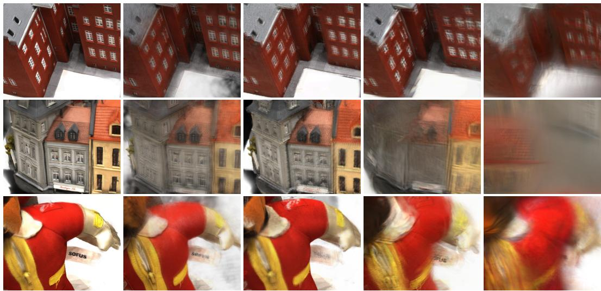  
Figure 3: Object-level qualitative comparisons under multi-view input settings.

## 4.2 COMPARISON WITH STATE-OF-THE-ART METHODS

Quantitative comparison. Across six datasets, our feed-forward model achieves the best mean LPIPS and DISTS among evaluated baselines in both settings (Table 1). With pose conditioning, LPIPS improves by 25.8% over ReSplat and DISTS by 32.9% over WorldMirror 2.0; without poses, the gains over WorldMirror 2.0 are 19.5% and 30.7%, respectively. Results for all four metrics and a comparison of learned refinement with Adam are provided in the appendix.

Qualitative evaluation. Figures 3 and 4 show that our method preserves fine textures and structural details in both object-level and scene-level reconstructions. More qualitative results are provided in the appendix.

WorldMirror 2.0  
DA3-GS  
tttLRM  
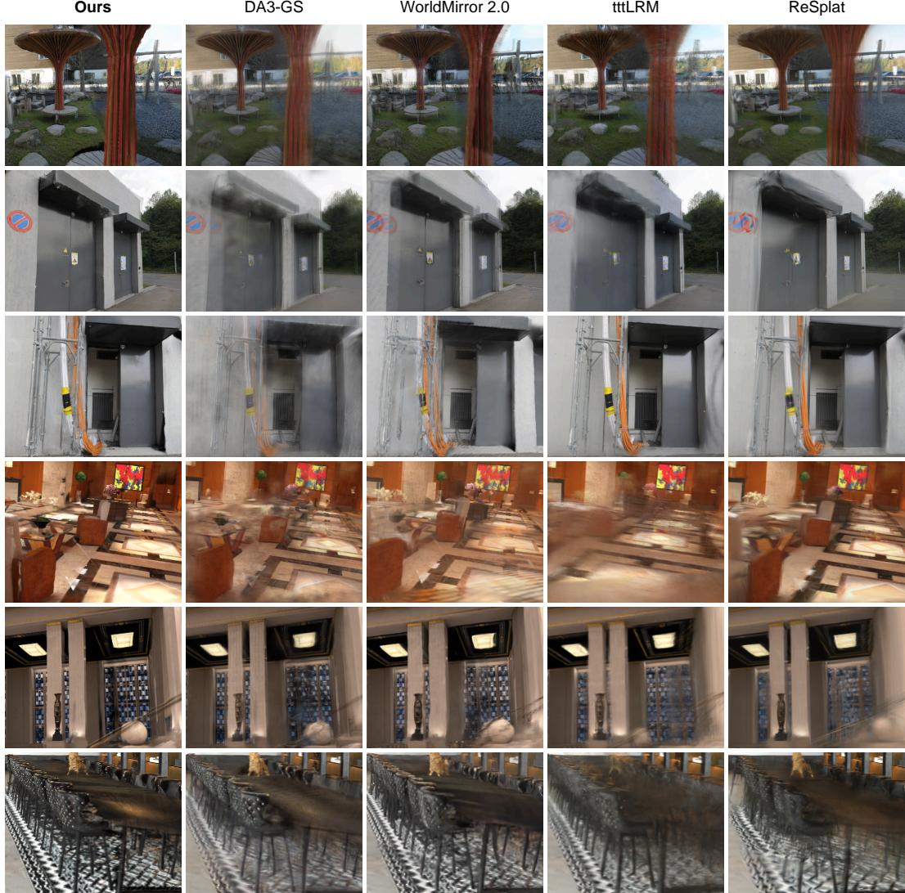  
Figure 4: Scene-level qualitative comparisons under multi-view input settings.

## 4.3 ABLATIONS AND ANALYSIS

We evaluate attribute-backbone fine-tuning (A), geometry freezing (G), GT-camera backprojection (C), and large-angle supervision (V) on ETH3D and DTU, averaging pre-refinement results over N = 4, 8, 16 input views. We additionally evaluate learned positional offsets (w/ O). Ours uses K = 10; w/o A uses K = 0.

Under image reconstruction supervision, geometry fine-tuning (w/o G) and learned offsets (w/ O) worsen both metrics on ETH3D and DTU (Table 2). Freezing geometry instead of fine-tuning reduces LPIPS by 16.6% and 23.2%, respectively. We interpret this degradation as positional updates compensating for attribute errors, a pathway blocked by fixed centers. With the geometry backbone frozen, w/ O predicts 3D offsets to back-projected centers through the Gaussian head, producing local blur and depth distortions in the NRGBD kitchen example (Fig. 5).

Fine-tuning the last K = 10 attribute-backbone blocks, compared with K = 0 (w/o A), reduces LPIPS by 1.1% on ETH3D and 20.8% on DTU, with lower DISTS on both datasets. GT-camera backprojection reduces DTU LPIPS by 36.1% relative to predicted cameras (w/o C). Large-angle target view supervision improves both LPIPS and DISTS on ETH3D and DTU compared with local interpolation-view supervision (w/o V).

<table><tr><td rowspan=1 colspan=4>ETH3D          DTUVariantLPIPS↓DISTS↓LPIPS↓DISTS↓</td></tr><tr><td rowspan=1 colspan=1>Ours</td><td rowspan=1 colspan=3>0.4339 0.1661 0.2070 0.1368</td></tr><tr><td rowspan=1 colspan=1>w/o A</td><td rowspan=1 colspan=1>0.4388</td><td rowspan=1 colspan=1>0.2019</td><td rowspan=1 colspan=1>0.26120.1663</td></tr><tr><td rowspan=1 colspan=1>w/o G</td><td rowspan=1 colspan=1>0.5204</td><td rowspan=1 colspan=1>0.1938</td><td rowspan=1 colspan=1>0.2695 0.1841</td></tr><tr><td rowspan=1 colspan=1>w/0</td><td rowspan=1 colspan=1>0.4998</td><td rowspan=1 colspan=1>0.2082</td><td rowspan=2 colspan=1>0.2826 0.18870.3237 0.1758</td></tr><tr><td rowspan=1 colspan=1>w/o C</td><td rowspan=1 colspan=1>0.5017</td><td rowspan=1 colspan=1>0.1863</td></tr><tr><td rowspan=1 colspan=1>w/o V</td><td rowspan=1 colspan=1>0.4533</td><td rowspan=1 colspan=1>0.1763</td><td rowspan=1 colspan=1>0.22950.1508</td></tr></table>

GT  
Ours  
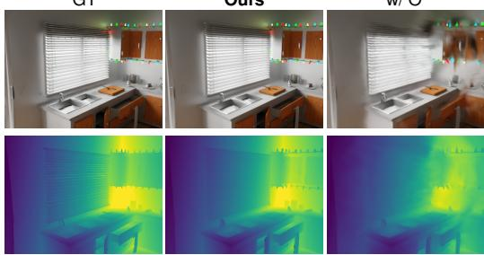  
w/ O  
Figure 5: Effect of positional offsets on rendering and depth in an NRGBD scene.

Table 2: Ablation study of reconstruction components on ETH3D and DTU.  
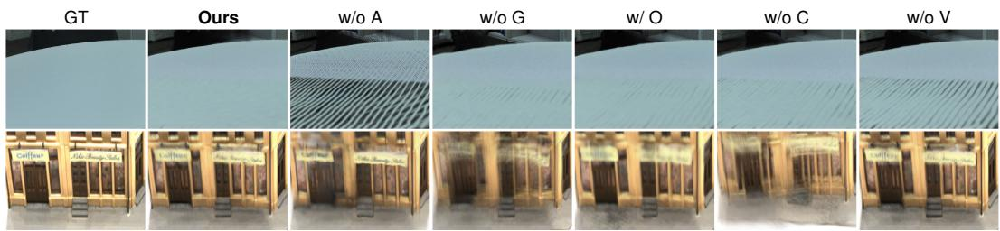  
Figure 6: Effect of reconstruction components on surface artifacts and structural detail.

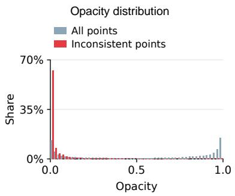

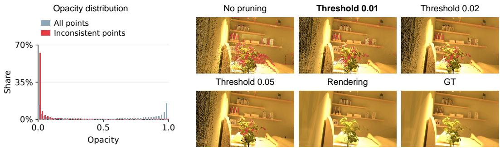  
Figure 7: Opacity distributions and the effect of pruning on geometrically inconsistent points. GT depth independently defines the inconsistent subset; distributions are normalized separately.

Qualitative ablations. In Fig. 6, w/o A and w/o V produce pronounced cracks on the tabletop in the upper row; w/o G, w/ O, and w/o C exhibit milder cracks. In the lower row, w/o G and w/o C blur the door frames, which remain more distinct in the full model.

Opacity and geometric consistency. Using GT-depth labels on held-out Hypersim (Roberts et al., 2021) validation scenes, we analyze opacity learned with only image reconstruction supervision. Labels are independent of opacity: inconsistent points violate GT-observed free space in at least two views and agree with no observed surface depth. At threshold 0.01, pruning removes 51.8% of geometrically inconsistent points but only 7.5% of all points, retaining 93.3% of surface-consistent points. This selective removal links opacity to geometric reliability while preserving the main scene structure and appearance (Fig. 7).

## 5 CONCLUSION

InfiniSplat v2 improves mean LPIPS and DISTS across six datasets in both pose settings. ETH3D and DTU ablations support fixed centers and attribute adaptation under reconstruction supervision. Learned opacity preferentially suppresses geometrically inconsistent points.

## AI USE STATEMENT

Generative AI tools were used to assist with language polishing of author-written text and with code development and debugging. The authors reviewed and approved the revised text and inspected and tested the AI-assisted code. Generative AI tools were not used to originate the research ideas or core technical contributions, or to generate experimental or training data. References were independently identified, collected, and selected by the authors. The authors take full responsibility for the final content of this work, including its text, claims, experimental results, and code.

## REFERENCES

Henrik Aanæs, Rasmus Ramsbøl Jensen, George Vogiatzis, Engin Tola, and Anders Bjorholm Dahl. Large-scale data for multiple-view stereopsis. International Journal ofComputer Vision, 120(2): 153–168, 2016.

Honggyu An, Jaewoo Jung, Mungyeom Kim, Sunghwan Hong, Chaehyun Kim, Kazumi Fukuda, Minkyeong Jeon, Jisang Han, Takuya Narihira, Hyuna Ko, et al. C3g: Learning compact 3d representations with 2k gaussians. arXiv preprint arXiv:2512.04021, 2025.

Anonymous. Splatanything: Gaussian spacing normalization for feed-forward 3d gaussian splatting across arbitrary scenes, 2027. Manuscript under review at ICLR 2027.

Dejan Azinovic, Ricardo Martin-Brualla, Dan B Goldman, Matthias Nießner, and Justus Thies.´ Neural rgb-d surface reconstruction. In Proceedings ofthe IEEE/CVF Conference on Computer Vision and Pattern Recognition (CVPR), pp. 6290–6301, June 2022.

Jonathan T Barron, Ben Mildenhall, Dor Verbin, Pratul P Srinivasan, and Peter Hedman. Mip-nerf 360: Unbounded anti-aliased neural radiance fields. In 2022 IEEE/CVF Conference on Computer Vision and Pattern Recognition (CVPR), pp. 5460–5469. IEEE, 2022.

David Charatan, Sizhe Lester Li, Andrea Tagliasacchi, and Vincent Sitzmann. pixelsplat: 3d gaussian splats from image pairs for scalable generalizable 3d reconstruction. In 2024 IEEE/CVF Conference on Computer Vision and Pattern Recognition (CVPR), pp. 19457–19467. IEEE, 2024.

Yuedong Chen, Haofei Xu, Chuanxia Zheng, Bohan Zhuang, Marc Pollefeys, Andreas Geiger, Tat-Jen Cham, and Jianfei Cai. Mvsplat: Efficient 3d gaussian splatting from sparse multi-view images. In European conference on computer vision, pp. 370–386. Springer, 2024a.

Yun Chen, Jingkang Wang, Ze Yang, Sivabalan Manivasagam, and Raquel Urtasun. G3r: Gradient guided generalizable reconstruction. In European Conference on Computer Vision, pp. 305–323. Springer, 2024b.

Kai Deng, Zexin Ti, Jiawei Xu, Jian Yang, and Jin Xie. Vggt-long: Chunk it, loop it, align it–pushing vggt’s limits on kilometer-scale long rgb sequences. arXiv preprint arXiv:2507.16443, 2025.

Keyan Ding, Kede Ma, Shiqi Wang, and Eero P Simoncelli. Image quality assessment: Unifying structure and texture similarity. IEEE transactions on pattern analysis and machine intelligence, 44(5):2567–2581, 2020.

Sven Elflein, Ruilong Li, Sérgio Agostinho, Zan Gojcic, Laura Leal-Taixé, Qunjie Zhou, and Aljosa Osep. VGG-T3: Offline feed-forward 3d reconstruction at scale. arXiv preprint arXiv:2602.23361, 2026.

Andreas Geiger, Philip Lenz, Christoph Stiller, and Raquel Urtasun. Vision meets robotics: The kitti dataset. International Journal ofRobotics Research (IJRR), 2013

Vitor Guizilini, Rares Ambrus, Sudeep Pillai, Allan Raventos, and Adrien Gaidon. 3d packing for self-supervised monocular depth estimation. In Proceedings of the IEEE/CVF conference on computer vision and pattern recognition, pp. 2485–2494, 2020.

Yicong Hong, Kai Zhang, Jiuxiang Gu, Sai Bi, Yang Zhou, Difan Liu, Feng Liu, Kalyan Sunkavalli, Trung Bui, and Hao Tan. Lrm: Large reconstruction model for single image to 3d. In International Conference on Learning Representations, volume 2024, pp. 50678–50702, 2024.

Lihan Jiang, Yucheng Mao, Linning Xu, Tao Lu, Kerui Ren, Yichen Jin, Xudong Xu, Mulin Yu, Jiangmiao Pang, Feng Zhao, et al. Anysplat: Feed-forward 3d gaussian splatting from unconstrained views. ACM Transactions on Graphics (TOG), 44(6):1–16, 2025.

Haian Jin, Hanwen Jiang, Hao Tan, Kai Zhang, Sai Bi, Tianyuan Zhang, Fujun Luan, Noah Snavely, and Zexiang Xu. Lvsm: A large view synthesis model with minimal 3d inductive bias. arXiv preprint arXiv:2410.17242, 2024.

Bernhard Kerbl, Georgios Kopanas, Thomas Leimkühler, George Drettakis, et al. 3d gaussian splatting for real-time radiance field rendering. ACM Trans. Graph., 42(4):139–1, 2023.

Vincent Leroy, Yohann Cabon, and Jérôme Revaud. Grounding image matching in 3d with mast3r. In European conference on computer vision, pp. 71–91. Springer, 2024.

Yinglong Li, Donghui Shen, Xiaoyu Zhang, Zhichao Ye, Hongyu Wu, Aimin Hao, Guofeng Zhang, and Haomin Liu. Querysplat: Decoupling geometry and appearance representations in 3dgs prediction. arXiv preprint arXiv:2608.01186, 2026.

Haotong Lin, Sili Chen, Junhao Liew, Donny Y Chen, Zhenyu Li, Guang Shi, Jiashi Feng, and Bingyi Kang. Depth anything 3: Recovering the visual space from any views. arXiv preprint arXiv:2511.10647, 2025.

Lu Ling, Yichen Sheng, Zhi Tu, Wentian Zhao, Cheng Xin, Kun Wan, Lantao Yu, Qianyu Guo, Zixun Yu, Yawen Lu, et al. Dl3dv-10k: A large-scale scene dataset for deep learning-based 3d vision. In 2024 IEEE/CVF Conference on Computer Vision and Pattern Recognition (CVPR), pp. 22160–22169. IEEE, 2024.

Yifan Liu, Zhiyuan Min, Zhenwei Wang, Junta Wu, Tengfei Wang, Yixuan Yuan, Yawei Luo, and Chunchao Guo. Worldmirror: Universal 3d world reconstruction with any-prior prompting. arXiv preprint arXiv:2510.10726, 2025.

Lars Mescheder, Wei Dong, Shiwei Li, Xuyang Bai, Marcel Santos, Peiyun Hu, Bruno Lecouat, Mingmin Zhen, Amaël Delaunoy, Tian Fang, et al. Sharp monocular view synthesis in less than a second. In International Conference on Learning Representations, volume 2026, pp. 24192–24230, 2026.

René Ranftl, Alexey Bochkovskiy, and Vladlen Koltun. Vision transformers for dense prediction. In 2021 IEEE/CVF International Conference on Computer Vision (ICCV), pp. 12159–12168. IEEE, 2021.

Jiawei Ren, Michal Jan Tyszkiewicz, Jiahui Huang, and Zan Gojcic. Tokengs: Decoupling 3d gaussian prediction from pixels with learnable tokens. arXiv preprint arXiv:2604.15239, 2026.

Mike Roberts, Jason Ramapuram, Anurag Ranjan, Atulit Kumar, Miguel Angel Bautista, Nathan Paczan, Russ Webb, and Joshua M Susskind. Hypersim: A photorealistic synthetic dataset for holistic indoor scene understanding. In 2021 IEEE/CVF International Conference on Computer Vision (ICCV), pp. 10892–10902. IEEE, 2021.

Thomas Schops, Johannes L Schonberger, Silvano Galliani, Torsten Sattler, Konrad Schindler, Marc Pollefeys, and Andreas Geiger. A multi-view stereo benchmark with high-resolution images and multi-camera videos. In Proceedings of the IEEE conference on computer vision and pattern recognition, pp. 3260–3269, 2017.

Pei Sun, Henrik Kretzschmar, Xerxes Dotiwalla, Aurelien Chouard, Vijaysai Patnaik, Paul Tsui, James Guo, Yin Zhou, Yuning Chai, Benjamin Caine, et al. Scalability in perception for autonomous driving: Waymo open dataset. In 2020 IEEE/CVF Conference on Computer Vision and Pattern Recognition (CVPR), pp. 2443–2451. IEEE, 2020.

HY Team, Chenjie Cao, Xuhui Zuo, Zhenwei Wang, Yisu Zhang, Junta Wu, Zhenyang Liu, Yuning Gong, Yang Liu, Bo Yuan, et al. Hy-world 2.0: A multi-modal world model for reconstructing, generating, and simulating 3d worlds. arXiv e-prints, pp. arXiv–2604, 2026.

Rawmantic Team. Rawmantic 3d training field: From the real world, for the real world. Rawmantic, 2026.

Haithem Turki, Deva Ramanan, and Mahadev Satyanarayanan. Mega-nerf: Scalable construction of large-scale nerfs for virtual fly-throughs. In 2022 IEEE/CVF Conference on Computer Vision and Pattern Recognition (CVPR), pp. 12912–12921. IEEE, 2022.

Shinji Umeyama. Least-squares estimation of transformation parameters between two point patterns. IEEE Transactions on pattern analysis and machine intelligence, 13(4):376–380, 1991.

Chen Wang, Hao Tan, Wang Yifan, Zhiqin Chen, Yuheng Liu, Kalyan Sunkavalli, Sai Bi, Lingjie Liu, and Yiwei Hu. tttlrm: Test-time training for long context and autoregressive 3d reconstruction. arXiv preprint arXiv:2602.20160, 2026a.

Jianyuan Wang, Minghao Chen, Nikita Karaev, Andrea Vedaldi, Christian Rupprecht, and David Novotny. Vggt: Visual geometry grounded transformer. In 2025 IEEE/CVF Conference on Computer Vision and Pattern Recognition (CVPR), pp. 5294–5306. IEEE, 2025a.

Jiawei Wang, Hao Yu, Yongzhen Hu, Xinyi Yang, Tao Ni, Xin Zhan, Junbo Chen, Xiaowei Zhou, Ruizhen Hu, and Sida Peng. Infinisplat: Implicit gaussian decoding for large-baseline monocular view synthesis. arXiv preprint arXiv:2608.02437, 2026b.

Jingkang Wang, Henry Che, Yun Chen, Ze Yang, Lily Goli, Sivabalan Manivasagam, and Raquel Urtasun. Flux4d: Flow-based unsupervised 4d reconstruction. Advances in Neural Information Processing Systems, 38:105673–105693, 2026c.

Qianqian Wang, Zhicheng Wang, Kyle Genova, Pratul P Srinivasan, Howard Zhou, Jonathan T Barron, Ricardo Martin-Brualla, Noah Snavely, and Thomas Funkhouser. Ibrnet: Learning multi-view image-based rendering. In Proceedings of the IEEE/CVF conference on computer vision and pattern recognition, pp. 4690–4699, 2021.

Shuzhe Wang, Vincent Leroy, Yohann Cabon, Boris Chidlovskii, and Jerome Revaud. Dust3r: Geometric 3d vision made easy. In 2024 IEEE/CVF Conference on Computer Vision and Pattern Recognition (CVPR), pp. 20697–20709. IEEE, 2024.

Weijie Wang, Yeqing Chen, Zeyu Zhang, Hengyu Liu, Haoxiao Wang, Zhiyuan Feng, Wenkang Qin, Feng Chen, Jia-Wang Bian, Zheng Zhu, et al. Volsplat: Rethinking feed-forward 3d gaussian splatting with voxel-aligned prediction. arXiv preprint arXiv:2509.19297, 2025b.

Yifan Wang, Jianjun Zhou, Haoyi Zhu, Wenzheng Chang, Yang Zhou, Zizun Li, Junyi Chen, Jiangmiao Pang, Chunhua Shen, and Tong He. Pi3: Permutation-equivariant visual geometry learning. In International Conference on Learning Representations, volume 2026, pp. 10481– 10497, 2026d.

Tao Xie, Peishan Yang, Yudong Jin, Yingfeng Cai, Wei Yin, Weiqiang Ren, Qian Zhang, Wei Hua, Sida Peng, Xiaoyang Guo, et al. Scal3r: Scalable test-time training for large-scale 3d reconstruction. arXiv preprint arXiv:2604.08542, 2026.

Haofei Xu, Daniel Barath, Andreas Geiger, and Marc Pollefeys. Resplat: Learning recurrent gaussian splatting. arXiv preprint arXiv:2510.08575, 2025a.

Haofei Xu, Songyou Peng, Fangjinhua Wang, Hermann Blum, Daniel Barath, Andreas Geiger, and Marc Pollefeys. Depthsplat: Connecting gaussian splatting and depth. In 2025 IEEE/CVF Conference on Computer Vision and Pattern Recognition (CVPR), pp. 16453–16463. IEEE, 2025b.

Jianing Yang, Alexander Sax, Kevin J Liang, Mikael Henaff, Hao Tang, Ang Cao, Joyce Chai, Franziska Meier, and Matt Feiszli. Fast3r: Towards 3d reconstruction of 1000+ images in one forward pass. In 2025 IEEE/CVF Conference on Computer Vision and Pattern Recognition (CVPR), pp. 21924–21935. IEEE, 2025.

Botao Ye, Sifei Liu, Haofei Xu, Xueting Li, Marc Pollefeys, Ming-Hsuan Yang, and Songyou Peng. No pose, no problem: Surprisingly simple 3d gaussian splats from sparse unposed images. In International Conference on Learning Representations, volume 2025, pp. 54009–54033, 2025.

Chandan Yeshwanth, Yueh-Cheng Liu, Matthias Nießner, and Angela Dai. Scannet++: A high-fidelity dataset of 3d indoor scenes. In 2023 IEEE/CVF International Conference on Computer Vision (ICCV), pp. 12–22. IEEE, 2023.

Kai Zhang, Sai Bi, Hao Tan, Yuanbo Xiangli, Nanxuan Zhao, Kalyan Sunkavalli, and Zexiang Xu. Gs-lrm: Large reconstruction model for 3d gaussian splatting. In European Conference on Computer Vision, pp. 1–19. Springer, 2024.

Richard Zhang, Phillip Isola, Alexei A Efros, Eli Shechtman, and Oliver Wang. The unreasonable effectiveness of deep features as a perceptual metric. In 2018 IEEE/CVF conference on computer vision and pattern recognition, pp. 586–595. IEEE, 2018.

Shangzhan Zhang, Jianyuan Wang, Yinghao Xu, Nan Xue, Christian Rupprecht, Xiaowei Zhou, Yujun Shen, and Gordon Wetzstein. Flare: Feed-forward geometry, appearance and camera estimation from uncalibrated sparse views. In 2025 IEEE/CVF Conference on Computer Vision and Pattern Recognition (CVPR), pp. 21936–21947. IEEE, 2025.

Tinghui Zhou, Richard Tucker, John Flynn, Graham Fyffe, and Noah Snavely. Stereo magnification: Learning view synthesis using multiplane images. arXiv preprint arXiv:1805.09817, 2018.

Chen Ziwen, Hao Tan, Kai Zhang, Sai Bi, Fujun Luan, Yicong Hong, Li Fuxin, and Zexiang Xu. Long-lrm: Long-sequence large reconstruction model for wide-coverage gaussian splats. In 2025 IEEE/CVF International Conference on Computer Vision (ICCV), pp. 4349–4359. IEEE, 2025.

## A DETAILED EXPERIMENTAL SETUP

## A.1 DATA AND VIEW SAMPLING

Training data and inputs. Both stages sample Hypersim (Roberts et al., 2021), Raw3D (Team, 2026), and ScanNet++ (Yeshwanth et al., 2023) with probabilities of 60%, 10%, and 30%, using disjoint training and validation scenes. Each sample contains four target views and $N \in \{ 4 , \ldots , 1 2 \}$ input views. The processed image’s longer side is 1022 pixels for $\bar { N } \leq 8 ,$ 756 for $N = 9 , 1 0 \quad$ , and 518 for $N = 1 1 , \bar { 1 2 }$

Target-view sampling. We rank non-input views by decreasing minimum optical-axis angle $a ( v , \mathcal { C } )$ (Eq. 5), assigning the upper and lower halves to large- and small-angle pools. Each sample selects the large-angle pool with probability 0.7 or the small-angle pool with probability 0.3, then draws four target views uniformly without replacement. The selected pool must contain at least four candidates. Figure 8 shows the sampled angular distributions.

Training masks. Target supervision uses visibility masks constructed from GT depth. A target pixel must have finite GT depth greater than $1 0 ^ { - 6 }$ and pass the supplied validity mask. After backprojection, it is retained if at least one input view places it in front of the camera and within the image bounds, has valid sampled depth, and satisfies

$$
| z _ { \mathrm { p r o j } } - d _ { \mathrm { s r c } } | \leq \operatorname* { m a x } ( \tau _ { \mathrm { a b s } } , \tau _ { \mathrm { r e l } } d _ { \mathrm { s r c } } ) .\tag{8}
$$

Here $z _ { \mathrm { p r o j } }$ is the point depth in that input camera and $d _ { \mathrm { s r c } }$ is the sampled depth. The mask function defaults to $\tau _ { \mathrm { a b s } } = 0 . 0 3$ and $\tau _ { \mathrm { r e l } } = 0 . 0 1$

Local-view control. The w/o V variant samples local interpolation views between input views, retaining target supervision and the full model’s mask construction.

Evaluation views. We evaluate on six datasets with $N = 4 , 8$ , 16 input views.

## A.2 ARCHITECTURE, RENDERING, AND COORDINATE CONVENTIONS

Initialization and rendering. Both branches are initialized from DA3NESTED-GIANT-LARGE-1.1 with independent parameters. Feature projection and a DPT decoder predict Gaussian attributes. Voxel merging uses a side length of 0.004 in the scale-normalized reconstruction frame. During training and inference, Gaussians with opacity below $\tau _ { \alpha } = 0 . 0 1$ are pruned after merging and before refinement. All experiments use gsplat with eps $2 \mathrm { d } { = } 1 0 ^ { - 2 }$

Scale alignment and point construction. Camera alignment applies only a scale factor, not the full similarity transform. Predicted and GT poses are expressed relative to their respective reference cameras, using the first input view in sorted order. Predicted depths and translations are normalized by $s _ { \mathrm { n o r m } } > 0$ from Eq. 3. Using only input-camera center correspondences, we fit an Umeyama similarity transform (Umeyama, 1991) from the GT trajectory to the normalized predicted trajectory and retain its scale s . This scale applies to both input and target translations, preserving GT intrinsics and reference-relative rotations:

$$
\widetilde { \mathbf { R } } _ { v } ^ { \star } = \mathbf { R } _ { v } ^ { \star } , \qquad \widetilde { \mathbf { t } } _ { v } ^ { \star } = s _ { C } \mathbf { t } _ { v } ^ { \star } .\tag{9}
$$

During training, Gaussian centers are constructed from normalized predicted z-depth, GT intrinsics, and scale-aligned GT poses.

## A.3 OPTIMIZATION SETTINGS

Both stages use GT pose conditions and AdamW on 16 H20 GPUs, with $\beta = ( 0 . 9 , 0 . 9 5 )$ , a global batch size of 16, and global $L _ { 2 }$ gradient clipping at 1.0. Each GPU processes one multi-view sample without gradient accumulation. Stage I trains only the last ten attribute-backbone Transformer blocks and the Gaussian head, with peak learning rates of $1 0 ^ { - 6 }$ and $2 \times 1 0 ^ { - 4 }$ , respectively. Training runs for 25,000 steps, with 2,000 steps of linear warmup followed by cosine decay to 0.1 times the peaks, taking about 48 hours. Stage II freezes the reconstructor and trains the DPT feature projection and refiner for 5,000 steps. The learning rate starts at $2 \times 1 0 ^ { - 4 }$ without warmup and decays by a cosine schedule to 0.1 times its initial value, taking about 13 hours.

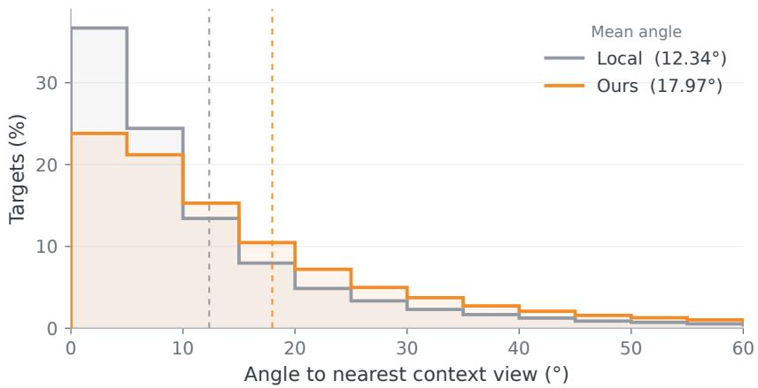  
Figure 8: Target-view angle distributions. Dashed lines mark the mean minimum angle to input views: $1 2 . 3 4 ^ { \circ }$ for local sampling and $1 7 . 9 7 ^ { \circ }$ for ours.

## A.4 STAGE-I RECONSTRUCTION LOSS

We render the initial scene $\mathcal { G } ^ { 0 }$ into input and target views $v \in \mathcal { V } = \mathcal { C } \cup \mathcal { T }$

$$
\widehat { \mathbf { I } } _ { v } = \mathcal { R } ( \mathcal { G } ^ { 0 } ; \widetilde { \mathbf { I } } _ { v } ^ { \star } ) .\tag{10}
$$

Let $M _ { v }$ be the valid supervision mask and $e _ { v } ( p )$ the RGB-channel-averaged absolute error at pixel p. LPIPS (Zhang et al., 2018) uses VGG features, with invalid regions zeroed before input normalization, yielding the spatial distance map

$$
d _ { v } = \mathrm { L P I P S } _ { \mathrm { s p a t i a l } } ( M _ { v } \odot \widehat { \mathbf { I } } _ { v } , M _ { v } \odot \mathbf { I } _ { v } ) .\tag{11}
$$

The two losses receive equal weights and are aggregated over valid pixels:

$$
\mathcal { L } _ { \mathrm { I } } = \frac { \sum _ { v \in \mathcal { V } } \sum _ { p } M _ { v } ( p ) [ e _ { v } ( p ) + d _ { v } ( p ) ] } { \operatorname* { m a x } ( 1 , \sum _ { v \in \mathcal { V } } \sum _ { p } M _ { v } ( p ) ) } .\tag{12}
$$

## A.5 STAGE-II LEARNED REFINEMENT

Features and architecture. DPT features are projected to eight channels by a learnable $1 \times 1$ convolution, merged using the Gaussian voxel groups and weights, and reused across steps. A linear projection initializes the 16-dimensional hidden state. Image features, current attributes, gradient feedback, neighbor distances, and hidden states are concatenated and projected to 64 dimensions, then processed by four KNN Transformer blocks. Each block contains single-head attention over eight neighbors, LayerNorm, an MLP, and residual connections. The output is concatenated with the original input, and an MLP predicts attribute and hidden-state increments.

Feedback and attribute updates. During training and inference, all input views provide feedback. At each step, the current scene is rendered into these views with feedback loss

$$
\ell _ { \mathrm { f b } } = 0 . 8 L _ { 1 } + 0 . 2 L _ { \mathrm { D S S I M } } , \qquad L _ { \mathrm { D S S I M } } = ( 1 - \mathrm { S S I M } ) / 2 .\tag{13}
$$

DSSIM is computed over valid image regions. Gradients with respect to Gaussian attributes are normalized and detached before entering the shared updater. Gaussian centers, counts, and correspondence remain fixed. Scales update as $s _ { \mathrm { n e w } } = s _ { \mathrm { o l d } } \exp ( \Delta \log s )$ without residual clipping. Opacity-logit, local rotation-vector, and RGB-logit increments use elementwise a tanh(raw), with $a = 0 . 1$ , 0.25, and 1.0, respectively; hidden-state increments use 0.1 tanh(raw). Logit inputs are clamped to $[ 1 0 ^ { - 6 } , 1 - \mathrm { 1 0 ^ { - 6 } } ]$ , with no additional cross-step residual decay. Both stages use zerothorder SH colors; the refiner updates colors in RGB-logit coordinates before converting them back to SH coefficients.

Training unroll and supervision. Stage II uses the same input-view counts and resolutions as Stage I, sampling $K _ { \mathrm { r } }$ uniformly from {1, 2, 3} updates during training and using three updates at inference. Input and target views supervise updated scenes. Feedback gradients and cross-step

Gaussian attribute paths are detached, while hidden-state residual updates remain differentiable for recurrent backpropagation. The outer loss for each supervised view is

$$
\ell _ { \mathrm { o u t } } = 0 . 8 L _ { 1 } + 0 . 2 L _ { \mathrm { D S S I M } } + 0 . 5 L _ { \mathrm { L P I P S } } .\tag{14}
$$

Input and target groups each receive weight 0.5, with equal weights within each group; invalid views are skipped and remaining weights renormalized. Let $\mathcal { L } _ { \mathrm { r e n d e r } } ^ { k }$ denote the grouped outer loss after update k. The multi-step objective is

$$
\mathcal { L } _ { \mathrm { I I } } = \sum _ { k = 1 } ^ { K _ { \mathrm { r } } } 0 . 9 ^ { K _ { \mathrm { r } } - k } \mathcal { L } _ { \mathrm { r e n d e r } } ^ { k } + 0 . 1 \mathcal { L } _ { \mathrm { o p a c i t y } } .\tag{15}
$$

Step weights are not normalized. Opacity regularization penalizes the change in logits between final and initial Gaussians:

$$
{ \mathcal { L } } _ { \mathrm { o p a c i t y } } = { \frac { 1 } { M } } \sum _ { m = 1 } ^ { M } [ \mathrm { l o g i t } _ { \epsilon } ( \alpha _ { m } ^ { K _ { \mathrm { r } } } ) - \mathrm { l o g i t } _ { \epsilon } ( \alpha _ { m } ^ { 0 } ) ] ^ { 2 } , \qquad \epsilon = 1 0 ^ { - 6 } .\tag{16}
$$

First-order surrogate loss. Let $x ^ { k }$ collect updated log-scale, opacity-logit, local-rotation, and RGB-logit parameters. Rendering gradients are computed on independent leaf copies $z ^ { k } = \operatorname { s g } ( x ^ { k } )$ to form

$$
\begin{array} { r l } & { r ^ { k } = \mathrm { s g } ( \nabla _ { z } \mathcal { L } _ { \mathrm { r e n d e r } } ( z ^ { k } ) ) , } \\ & { \mathcal { L } _ { \mathrm { p r o x y } } ^ { k } = \mathrm { s g } ( \mathcal { L } _ { \mathrm { r e n d e r } } ( z ^ { k } ) ) + \langle x ^ { k } - \mathrm { s g } ( x ^ { k } ) , r ^ { k } \rangle . } \end{array}\tag{17}
$$

Here sg preserves values while stopping gradients. The surrogate equals the rendering loss in value, with gradient

$$
\nabla _ { \boldsymbol { \theta } } { \mathcal { L } } _ { \mathrm { p r o x y } } ^ { k } = \left( { \frac { \partial x ^ { k } } { \partial { \boldsymbol { \theta } } } } \right) ^ { \top } { \boldsymbol { r } } ^ { k }\tag{18}
$$

for trainable parameters θ. Per-step surrogates follow the multi-step objective weights without second-order differentiation.

Chunked execution. The global KNN graph is reused across steps. After stable sorting along the longest voxel-coordinate axis, core sets of at most 200,000 points are expanded with four-hop neighborhoods. Chunks exceeding 300,000 points are recursively bisected by point count along their core sets’ longest axes, with neighborhoods recomputed. Only core-point outputs are retained; training uses gradient checkpointing.

## A.6 CAMERA PROTOCOL AND EVALUATION METRICS

Camera inputs and rendering. Pose-conditioned and pose-free results are reported and ranked separately. In the pose-free setting, reference input cameras are not reconstruction inputs; they only establish the evaluation reference frame and estimate translation scale from input-camera correspondences. The scene is constructed before evaluation-camera alignment and remains unchanged. Target poses define rendering queries without entering the fit. Alignment rescales reference-relative translations only, rather than applying a full Sim(3) transform. For methods predicting intrinsics, target focal lengths are the component-wise median of predicted input focal lengths, scaled to the target resolution, with the reference principal point retained. In the pose-conditioned setting, reference input cameras are available for reconstruction and target intrinsics are fixed to GT. Evaluation target RGB is never used for reconstruction or refinement feedback.

Metrics and aggregation. We evaluate novel view rendering with PSNR, SSIM, LPIPS, and DISTS. Both settings average equally at each successive level: target views within each example, examples within each scene, scenes, the three input configurations, and the six datasets.

## B ADDITIONAL EXPERIMENTS AND RESULTS

## B.1 FULL QUANTITATIVE RESULTS

Six-dataset means. Tables 3 and 4 summarize PSNR, SSIM, LPIPS, and DISTS on DL3DV, ETH3D, NRGBD, Mip-NeRF 360, RE10K, and DTU. Our refined output ranks first on all four mean metrics in the pose-conditioned setting. In the pose-free setting, refinement gives the best mean PSNR, SSIM, and LPIPS, while the feed-forward output has the lowest mean DISTS.

Table 3: Pose-free results averaged over six datasets.
<table><tr><td>Method</td><td>PSNR↑(dB)</td><td>SSIM↑</td><td>LPIPS↓</td><td>DISTS↓</td></tr><tr><td>AnySplat</td><td>15.6668</td><td>0.5531</td><td>0.4353</td><td>0.1939</td></tr><tr><td>C3G</td><td>13.2165</td><td>0.5653</td><td>0.6454</td><td>0.3267</td></tr><tr><td>QuerySplat</td><td>17.0532</td><td>0.6404</td><td>0.4571</td><td>0.2155</td></tr><tr><td>DA3-GS</td><td>17.7144</td><td>0.6463</td><td>0.4154</td><td>0.2077</td></tr><tr><td>WorldMirror 2.0</td><td>17.0031</td><td>0.6089</td><td>0.3757</td><td>0.1935</td></tr><tr><td>Ours</td><td>18.4002</td><td>0.6423</td><td>0.3026</td><td>0.1341</td></tr><tr><td>Ours*</td><td>18.8483</td><td>0.6523</td><td>0.2970</td><td>0.1379</td></tr></table>

Table 4: Pose-conditioned results averaged over six datasets.
<table><tr><td>Method</td><td>PSNR↑ (dB)</td><td>SSIM↑</td><td>LPIPS↓</td><td>DISTS↓</td></tr><tr><td>tttLRM</td><td>17.8632</td><td>0.6518</td><td>0.3793</td><td>0.2159</td></tr><tr><td>DA3-GS</td><td>16.8535</td><td>0.6100</td><td>0.4237</td><td>0.1965</td></tr><tr><td>DepthSplat</td><td>18.9085</td><td>0.6602</td><td>0.3718</td><td>0.1993</td></tr><tr><td>ReSplat</td><td>20.9139</td><td>0.7117</td><td>0.3333</td><td>0.1794</td></tr><tr><td>TokenGS</td><td>15.9149</td><td>0.5990</td><td>0.5779</td><td>0.2931</td></tr><tr><td>VolSplat</td><td>14.2476</td><td>0.5060</td><td>0.5192</td><td>0.2756</td></tr><tr><td>WorldMirror 2.0</td><td>17.7222</td><td>0.6192</td><td>0.3517</td><td>0.1734</td></tr><tr><td>Ours</td><td>20.2824</td><td>0.6988</td><td>0.2472</td><td>0.1163</td></tr><tr><td>Ours*</td><td>20.9334</td><td>0.7131</td><td>0.2392</td><td>0.1159</td></tr></table>

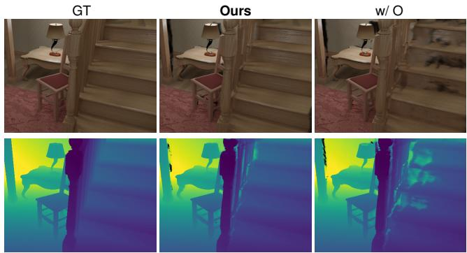  
Figure 9: Positional offsets on NRGBD with eight input views. Top: RGB; bottom: depth. Rendered depth is alpha-normalized expected camera-z depth, without fitting to target GT. Colors indicate near (purple), far (yellow), and invalid (gray) pixels.

Results by input-view count. Tables 5, 6, and 7 report per-dataset LPIPS and DISTS with four, eight, and sixteen input views. All tables follow the colors of Table 1, ranking unrounded scores within each pose setting and bolding the best; dataset means are equally weighted.

## B.2 FEED-FORWARD RECONSTRUCTOR ABLATIONS

All variants are evaluated on ETH3D and DTU before refinement, averaging equally over $N =$ $4 , 8 , 1 6 ,$ with other training settings unchanged. The w/o A variant freezes the attribute backbone $( K = 0 )$ , shares backbone features across branches, and trains only the Gaussian head. The w/o G variant fine-tunes the geometry backbone at $1 0 ^ { - 6 }$ , keeping the Gaussian head learning rate at $2 \times 1 0 ^ { - 4 }$ . The w/ O variant keeps the geometry backbone frozen and predicts 3D offsets added to back-projected centers in the scale-aligned frame. The w/o C variant uses predicted cameras for training-time back-projection. The w/o V variant uses local-view sampling, retaining target supervision and the same training masks. Figure 9 provides an NRGBD staircase comparison, where the offset variant shows stronger surface artifacts and depth deviations than the fixed-center model.

## B.3 LEARNED REFINEMENT VERSUS DIRECT GRADIENT DESCENT

We compare feed-forward outputs, Adam, and learned refinement on ETH3D, averaging equally over $N = 4 , 8$ , 16. Both refinements start from the same scene and perform three updates to scales,

Table 5: Per-dataset results with N = 4 input views. Mean weights datasets equally.
<table><tr><td rowspan=1 colspan=15>Input Method         DL3DV      ETH3D      NRGBD   Mip-NeRF 360   RE10K       DTU       MeanLPIPS↓ DISTS↓ LPIPS↓ DISTS↓ LPIPS↓ DISTS↓ LPIPS↓ DISTS↓ LPIPS↓ DISTS↓ LPIPS↓ DISTS↓ LPIPS↓ DISTS↓</td></tr><tr><td rowspan=1 colspan=1>AnySplat</td><td rowspan=1 colspan=3>0.60040.25270.5244</td><td rowspan=1 colspan=1>0.2245</td><td rowspan=1 colspan=1>0.1917</td><td rowspan=1 colspan=1>0.1153</td><td rowspan=1 colspan=1>0.5259</td><td rowspan=1 colspan=1>0.2187</td><td rowspan=1 colspan=1>0.2386</td><td rowspan=1 colspan=1>0.1084</td><td rowspan=1 colspan=1>0.4995</td><td rowspan=1 colspan=1>0.2452</td><td rowspan=1 colspan=1>0.4301</td><td rowspan=1 colspan=1>0.1941</td></tr><tr><td rowspan=1 colspan=1>C3G</td><td rowspan=1 colspan=1>0.7565</td><td rowspan=1 colspan=1>0.3785</td><td rowspan=1 colspan=1>0.6090</td><td rowspan=1 colspan=1>0.2877</td><td rowspan=1 colspan=1>0.6137</td><td rowspan=1 colspan=1>0.3191</td><td rowspan=1 colspan=1>0.6849</td><td rowspan=1 colspan=1>0.3448</td><td rowspan=1 colspan=1>0.5080</td><td rowspan=1 colspan=1>0.2671</td><td rowspan=1 colspan=1>0.7031</td><td rowspan=1 colspan=1>0.3680</td><td rowspan=1 colspan=1>0.6459</td><td rowspan=1 colspan=1>0.3275</td></tr><tr><td rowspan=1 colspan=1>QuerySplat</td><td rowspan=1 colspan=1>0.5453</td><td rowspan=1 colspan=1>0.2191</td><td rowspan=1 colspan=1>0.5315</td><td rowspan=1 colspan=1>0.2425</td><td rowspan=1 colspan=1>0.2580</td><td rowspan=1 colspan=1>0.1410</td><td rowspan=1 colspan=1>0.5621</td><td rowspan=1 colspan=1>0.2429</td><td rowspan=1 colspan=1>0.2172</td><td rowspan=1 colspan=1>0.1117</td><td rowspan=1 colspan=1>0.5243</td><td rowspan=1 colspan=1>0.2759</td><td rowspan=1 colspan=1>0.4397</td><td rowspan=1 colspan=1>0.2055</td></tr><tr><td rowspan=1 colspan=1>DA3-GS</td><td rowspan=1 colspan=1>0.5347</td><td rowspan=1 colspan=1>0.2145</td><td rowspan=1 colspan=1>0.4937</td><td rowspan=1 colspan=1>0.2291</td><td rowspan=1 colspan=1>0.3352</td><td rowspan=1 colspan=1>0.1703</td><td rowspan=1 colspan=1>0.4933</td><td rowspan=1 colspan=1>0.2199</td><td rowspan=1 colspan=1>0.2412</td><td rowspan=1 colspan=1>0.1393</td><td rowspan=1 colspan=1>0.4287</td><td rowspan=1 colspan=1>0.2411</td><td rowspan=1 colspan=1>0.4211</td><td rowspan=1 colspan=1>0.2024</td></tr><tr><td rowspan=1 colspan=1>WorldMirror 2.0</td><td rowspan=1 colspan=1>0.4647</td><td rowspan=1 colspan=1>0.2021</td><td rowspan=1 colspan=1>0.4484</td><td rowspan=1 colspan=1>0.2107</td><td rowspan=1 colspan=1>0.1793</td><td rowspan=1 colspan=1>0.1386</td><td rowspan=1 colspan=1>0.4432</td><td rowspan=1 colspan=1>0.1957</td><td rowspan=1 colspan=1>0.1903</td><td rowspan=1 colspan=1>0.1166</td><td rowspan=1 colspan=1>0.3924</td><td rowspan=1 colspan=1>0.2076</td><td rowspan=1 colspan=1>0.3530</td><td rowspan=1 colspan=1>0.1786</td></tr><tr><td rowspan=1 colspan=1>Ours</td><td rowspan=1 colspan=1>0.3862</td><td rowspan=1 colspan=1>0.1322</td><td rowspan=1 colspan=1>0.3850</td><td rowspan=1 colspan=1>0.1596</td><td rowspan=1 colspan=1>0.1078</td><td rowspan=1 colspan=1>0.0779</td><td rowspan=1 colspan=1>0.3583</td><td rowspan=1 colspan=1>0.1390</td><td rowspan=1 colspan=1>0.1438</td><td rowspan=1 colspan=1>0.0806</td><td rowspan=1 colspan=1>0.4162</td><td rowspan=1 colspan=1>0.1938</td><td rowspan=1 colspan=1>0.2995</td><td rowspan=1 colspan=1>0.1305</td></tr><tr><td rowspan=1 colspan=1>Ours*</td><td rowspan=1 colspan=1>0.3774</td><td rowspan=1 colspan=1>0.1309</td><td rowspan=1 colspan=1>0.3718</td><td rowspan=1 colspan=1>0.1596</td><td rowspan=1 colspan=1>0.1009</td><td rowspan=1 colspan=1>0.0765</td><td rowspan=1 colspan=1>0.3547</td><td rowspan=1 colspan=1>0.1422</td><td rowspan=1 colspan=1>0.1416</td><td rowspan=1 colspan=1>0.0800</td><td rowspan=1 colspan=1>0.4176</td><td rowspan=1 colspan=1>0.2029</td><td rowspan=1 colspan=1>0.2940</td><td rowspan=1 colspan=1>0.1320</td></tr><tr><td rowspan=2 colspan=1>tttLRM</td><td rowspan=2 colspan=1>0.5957</td><td rowspan=2 colspan=1>0.2962</td><td></td><td></td><td></td><td></td><td></td><td></td><td></td><td></td><td></td><td></td><td></td><td></td></tr><tr><td rowspan=1 colspan=1>0.5477</td><td rowspan=1 colspan=1>0.2476</td><td rowspan=1 colspan=1>0.3496</td><td rowspan=1 colspan=1>0.2262</td><td rowspan=1 colspan=1>0.4451</td><td rowspan=1 colspan=1>0.2349</td><td rowspan=1 colspan=1>0.2554</td><td rowspan=1 colspan=1>0.1541</td><td rowspan=1 colspan=1>0.4803</td><td rowspan=1 colspan=1>0.3105</td><td rowspan=1 colspan=1>0.4456</td><td rowspan=1 colspan=1>0.2449</td></tr><tr><td rowspan=1 colspan=1>DA3-GS</td><td rowspan=1 colspan=1>0.5265</td><td rowspan=1 colspan=1>0.2098</td><td rowspan=1 colspan=1>0.6205</td><td rowspan=1 colspan=1>0.2595</td><td rowspan=1 colspan=1>0.3678</td><td rowspan=1 colspan=1>0.1548</td><td rowspan=1 colspan=1>0.4851</td><td rowspan=1 colspan=1>0.2200</td><td rowspan=1 colspan=1>0.2320</td><td rowspan=1 colspan=1>0.1248</td><td rowspan=1 colspan=1>0.3731</td><td rowspan=1 colspan=1>0.2083</td><td rowspan=1 colspan=1>0.4342</td><td rowspan=1 colspan=1>0.1962</td></tr><tr><td rowspan=1 colspan=1>DepthSplat</td><td rowspan=1 colspan=1>0.5986</td><td rowspan=1 colspan=1>0.2723</td><td rowspan=1 colspan=1>0.5085</td><td rowspan=1 colspan=1>0.2316</td><td rowspan=1 colspan=1>0.0639</td><td rowspan=1 colspan=1>0.0550</td><td rowspan=1 colspan=1>0.3872</td><td rowspan=1 colspan=1>0.1952</td><td rowspan=1 colspan=1>0.1066</td><td rowspan=1 colspan=1>0.0734</td><td rowspan=1 colspan=1>0.4907</td><td rowspan=1 colspan=1>0.2622</td><td rowspan=1 colspan=1>0.3592</td><td rowspan=1 colspan=1>0.1816</td></tr><tr><td rowspan=1 colspan=1>ReSplat</td><td rowspan=1 colspan=1>0.4309</td><td rowspan=1 colspan=1>0.2062</td><td rowspan=1 colspan=1>0.5511</td><td rowspan=1 colspan=1>0.2439</td><td rowspan=1 colspan=1>0.0708</td><td rowspan=1 colspan=1>0.0755</td><td rowspan=1 colspan=1>0.3676</td><td rowspan=1 colspan=1>0.1760</td><td rowspan=1 colspan=1>0.1073</td><td rowspan=1 colspan=1>0.0788</td><td rowspan=1 colspan=1>0.4884</td><td rowspan=1 colspan=1>0.2923</td><td rowspan=1 colspan=1>0.3360</td><td rowspan=1 colspan=1>0.1788</td></tr><tr><td rowspan=1 colspan=1>TokenGS</td><td rowspan=1 colspan=1>0.7631</td><td rowspan=1 colspan=1>0.3685</td><td rowspan=1 colspan=1>0.6764</td><td rowspan=1 colspan=1>0.2972</td><td rowspan=1 colspan=1>0.5966</td><td rowspan=1 colspan=1>0.3103</td><td rowspan=1 colspan=1>0.6393</td><td rowspan=1 colspan=1>0.3097</td><td rowspan=1 colspan=1>0.4131</td><td rowspan=1 colspan=1>0.2165</td><td rowspan=1 colspan=1>0.5752</td><td rowspan=1 colspan=1>0.3505</td><td rowspan=1 colspan=1>0.6106</td><td rowspan=1 colspan=1>0.3088</td></tr><tr><td rowspan=1 colspan=1>VolSplat</td><td rowspan=1 colspan=1>0.6951</td><td rowspan=1 colspan=1>0.3593</td><td rowspan=1 colspan=1>0.6539</td><td rowspan=1 colspan=1>0.3219</td><td rowspan=1 colspan=1>0.2528</td><td rowspan=1 colspan=1>0.2053</td><td rowspan=1 colspan=1>0.4740</td><td rowspan=1 colspan=1>0.2413</td><td rowspan=1 colspan=1>0.4248</td><td rowspan=1 colspan=1>0.2277</td><td rowspan=1 colspan=1>0.6663</td><td rowspan=1 colspan=1>0.3312</td><td rowspan=1 colspan=1>0.5278</td><td rowspan=1 colspan=1>0.2811</td></tr><tr><td rowspan=1 colspan=1>WorldMirror 2.0</td><td rowspan=1 colspan=1>0.4557</td><td rowspan=1 colspan=1>0.2009</td><td rowspan=1 colspan=1>0.5264</td><td rowspan=1 colspan=1>0.2041</td><td rowspan=1 colspan=1>0.1003</td><td rowspan=1 colspan=1>0.0705</td><td rowspan=1 colspan=1>0.4356</td><td rowspan=1 colspan=1>0.1974</td><td rowspan=1 colspan=1>0.1886</td><td rowspan=1 colspan=1>0.1213</td><td rowspan=1 colspan=1>0.3520</td><td rowspan=1 colspan=1>0.1954</td><td rowspan=1 colspan=1>0.3431</td><td rowspan=1 colspan=1>0.1649</td></tr><tr><td rowspan=1 colspan=1>Ours</td><td rowspan=1 colspan=1>0.3523</td><td rowspan=1 colspan=1>0.1259</td><td rowspan=1 colspan=1>0.4646</td><td rowspan=1 colspan=1>0.1759</td><td rowspan=1 colspan=1>0.0634</td><td rowspan=1 colspan=1>0.0527</td><td rowspan=1 colspan=1>0.3166</td><td rowspan=1 colspan=1>0.1387</td><td rowspan=1 colspan=1>0.1189</td><td rowspan=1 colspan=1>0.0784</td><td rowspan=1 colspan=1>0.2226</td><td rowspan=1 colspan=1>0.1436</td><td rowspan=1 colspan=1>0.2564</td><td rowspan=1 colspan=1>0.1192</td></tr><tr><td rowspan=1 colspan=1>Ours*</td><td rowspan=1 colspan=1>0.3409</td><td rowspan=1 colspan=1>0.1215</td><td rowspan=1 colspan=1>0.4462</td><td rowspan=1 colspan=1>0.1732</td><td rowspan=1 colspan=1>0.0579</td><td rowspan=1 colspan=1>0.0499</td><td rowspan=1 colspan=1>0.3078</td><td rowspan=1 colspan=1>0.1351</td><td rowspan=1 colspan=1>0.1134</td><td rowspan=1 colspan=1>0.0771</td><td rowspan=1 colspan=1>0.2124</td><td rowspan=1 colspan=1>0.1448</td><td rowspan=1 colspan=1>0.2464</td><td rowspan=1 colspan=1>0.1169</td></tr></table>

Table 6: Per-dataset results with N = 8 input views. Mean weights datasets equally.
<table><tr><td rowspan=1 colspan=14>Input Method         DL3DV      ETH3D     NRGBD   Mip-NeRF 360   RE10K       DTU       MeanLPIPS↓ DISTS↓ LPIPS↓ DISTS↓ LPIPS↓ DISTS↓ LPIPS↓ DISTS↓ LPIPS↓ DISTS↓ LPIPS↓ DISTS↓ LPIPS↓ DISTS↓</td></tr><tr><td rowspan=1 colspan=14>AnySplat     0.59920.24990.55860.23310.18950.11280.55730.22570.24860.11340.47590.23320.43820.1947</td></tr><tr><td rowspan=1 colspan=1>C3G</td><td rowspan=1 colspan=1>0.7374</td><td rowspan=1 colspan=1>0.3521</td><td rowspan=1 colspan=1>0.7020</td><td rowspan=1 colspan=1>0.3616</td><td rowspan=1 colspan=1>0.52100.2536</td><td rowspan=1 colspan=1>0.7347</td><td rowspan=1 colspan=1>0.3706</td><td rowspan=1 colspan=1>0.4404</td><td rowspan=1 colspan=1>0.1951</td><td rowspan=1 colspan=1>0.6952</td><td rowspan=1 colspan=1>0.3710</td><td rowspan=1 colspan=1>0.6384</td><td rowspan=1 colspan=1>0.3173</td></tr><tr><td rowspan=1 colspan=1>QuerySplat</td><td rowspan=1 colspan=1>0.5581</td><td rowspan=1 colspan=1>0.2246</td><td rowspan=1 colspan=1>0.5953</td><td rowspan=1 colspan=1>0.2840</td><td rowspan=1 colspan=1>0.25780.1394</td><td rowspan=1 colspan=1>0.6096</td><td rowspan=1 colspan=1>0.2652</td><td rowspan=1 colspan=1>0.2148</td><td rowspan=1 colspan=1>0.1106</td><td rowspan=1 colspan=1>0.5234</td><td rowspan=1 colspan=1>0.2737</td><td rowspan=1 colspan=1>0.4599</td><td rowspan=1 colspan=1>0.2163</td></tr><tr><td rowspan=1 colspan=1>DA3-GS</td><td rowspan=1 colspan=1>0.5137</td><td rowspan=1 colspan=1>0.2117</td><td rowspan=1 colspan=1>0.4897</td><td rowspan=1 colspan=1>0.2431</td><td rowspan=1 colspan=1>0.35140.1794</td><td rowspan=1 colspan=1>0.4796</td><td rowspan=1 colspan=2>0.23620.2592</td><td rowspan=1 colspan=1>0.1467</td><td rowspan=1 colspan=1>0.4152</td><td rowspan=1 colspan=1>0.2337</td><td rowspan=1 colspan=1>0.4181</td><td rowspan=1 colspan=1>0.2084</td></tr><tr><td rowspan=1 colspan=1>WorldMirror 2.0</td><td rowspan=1 colspan=1>0.4796</td><td rowspan=1 colspan=1>0.2154</td><td rowspan=1 colspan=1>0.4908</td><td rowspan=1 colspan=1>0.2317</td><td rowspan=1 colspan=1>0.20490.1536</td><td rowspan=1 colspan=1>0.4701</td><td rowspan=1 colspan=1>0.2143</td><td rowspan=1 colspan=1>0.2218</td><td rowspan=1 colspan=1>0.1334</td><td rowspan=1 colspan=1>0.3690</td><td rowspan=1 colspan=1>0.2074</td><td rowspan=1 colspan=1>0.3727</td><td rowspan=1 colspan=1>0.1926</td></tr><tr><td rowspan=1 colspan=1>Ours</td><td rowspan=1 colspan=1>0.3719</td><td rowspan=1 colspan=1>0.1276</td><td rowspan=1 colspan=1>0.4024</td><td rowspan=1 colspan=1>0.1654</td><td rowspan=1 colspan=1>0.11010.0787</td><td rowspan=1 colspan=1>0.3768</td><td rowspan=1 colspan=1>0.1482</td><td rowspan=1 colspan=1>0.1451</td><td rowspan=1 colspan=1>0.0813</td><td rowspan=1 colspan=1>0.3782</td><td rowspan=1 colspan=1>0.1910</td><td rowspan=1 colspan=1>0.2974</td><td rowspan=1 colspan=1>0.1320</td></tr><tr><td rowspan=1 colspan=1>Ours*</td><td rowspan=1 colspan=1>0.3646</td><td rowspan=1 colspan=1>0.1292</td><td rowspan=1 colspan=1>0.3899</td><td rowspan=1 colspan=1>0.1698</td><td rowspan=1 colspan=1>0.10370.0777</td><td rowspan=1 colspan=2>0.37780.1563</td><td rowspan=1 colspan=1>0.1439</td><td rowspan=1 colspan=1>0.0807</td><td rowspan=1 colspan=1>0.3707</td><td rowspan=1 colspan=1>0.2036</td><td rowspan=1 colspan=1>0.2917</td><td rowspan=1 colspan=1>0.1362</td></tr><tr><td rowspan=4 colspan=1>tttLRM</td><td rowspan=4 colspan=1>0.4910</td><td rowspan=4 colspan=1>0.2639</td><td></td><td></td><td></td><td></td><td></td><td></td><td></td><td></td><td></td><td></td><td></td></tr><tr><td rowspan=3 colspan=1>0.5081</td><td rowspan=3 colspan=1>0.2385</td><td></td><td></td><td></td><td></td><td></td><td></td><td></td><td></td><td></td></tr><tr><td rowspan=2 colspan=1>0.25220.1825</td><td rowspan=2 colspan=1>0.3617</td><td></td><td></td><td></td><td></td><td></td><td></td><td></td></tr><tr><td rowspan=1 colspan=1>0.1922</td><td rowspan=1 colspan=1>0.2032</td><td rowspan=1 colspan=1>0.1338</td><td rowspan=1 colspan=1>0.3605</td><td rowspan=1 colspan=1>0.2488</td><td rowspan=1 colspan=1>0.3628</td><td rowspan=1 colspan=1>0.2099</td></tr><tr><td rowspan=1 colspan=1>DA3-GS</td><td rowspan=1 colspan=1>0.5156</td><td rowspan=1 colspan=1>0.2042</td><td rowspan=1 colspan=1>0.5857</td><td rowspan=1 colspan=1>0.2505</td><td rowspan=1 colspan=1>0.35690.1555</td><td rowspan=1 colspan=1>0.5018</td><td rowspan=1 colspan=1>0.2420</td><td rowspan=1 colspan=1>0.2310</td><td rowspan=1 colspan=1>0.1264</td><td rowspan=1 colspan=1>0.3656</td><td rowspan=1 colspan=1>0.2060</td><td rowspan=1 colspan=1>0.4261</td><td rowspan=1 colspan=1>0.1974</td></tr><tr><td rowspan=1 colspan=1>DepthSplat</td><td rowspan=1 colspan=1>0.5897</td><td rowspan=1 colspan=1>0.2753</td><td rowspan=1 colspan=1>0.5814</td><td rowspan=1 colspan=1>0.3046</td><td rowspan=1 colspan=1>0.07980.0656</td><td rowspan=1 colspan=1>0.4595</td><td rowspan=1 colspan=1>0.2477</td><td rowspan=1 colspan=1>0.1261</td><td rowspan=1 colspan=1>0.0815</td><td rowspan=1 colspan=1>0.4242</td><td rowspan=1 colspan=1>0.2381</td><td rowspan=1 colspan=1>0.3768</td><td rowspan=1 colspan=1>0.2021</td></tr><tr><td rowspan=1 colspan=1>ReSplat</td><td rowspan=1 colspan=1>0.4240</td><td rowspan=1 colspan=1>0.2175</td><td rowspan=1 colspan=1>0.5472</td><td rowspan=1 colspan=1>0.2454</td><td rowspan=1 colspan=1>0.09240.0887</td><td rowspan=1 colspan=1>0.3662</td><td rowspan=1 colspan=1>0.1740</td><td rowspan=1 colspan=1>0.1214</td><td rowspan=1 colspan=1>0.0860</td><td rowspan=1 colspan=1>0.4437</td><td rowspan=1 colspan=1>0.2732</td><td rowspan=1 colspan=1>0.3325</td><td rowspan=1 colspan=1>0.1808</td></tr><tr><td rowspan=1 colspan=1>TokenGS</td><td rowspan=1 colspan=1>0.6907</td><td rowspan=1 colspan=1>0.3120</td><td rowspan=1 colspan=1>0.6730</td><td rowspan=1 colspan=1>0.2944</td><td rowspan=1 colspan=1>0.54100.2987</td><td rowspan=1 colspan=1>0.6388</td><td rowspan=1 colspan=1>0.3032</td><td rowspan=1 colspan=1>0.3896</td><td rowspan=1 colspan=1>0.2076</td><td rowspan=1 colspan=1>0.5043</td><td rowspan=1 colspan=1>0.3189</td><td rowspan=1 colspan=1>0.5729</td><td rowspan=1 colspan=1>0.2891</td></tr><tr><td rowspan=1 colspan=1>VolSplat</td><td rowspan=1 colspan=1>0.7064</td><td rowspan=1 colspan=1>0.3528</td><td rowspan=1 colspan=1>0.6813</td><td rowspan=1 colspan=1>0.3165</td><td rowspan=1 colspan=1>0.25030.2035</td><td rowspan=1 colspan=1>0.4964</td><td rowspan=1 colspan=1>0.2514</td><td rowspan=1 colspan=1>0.3848</td><td rowspan=1 colspan=1>0.2121</td><td rowspan=1 colspan=1>0.7307</td><td rowspan=1 colspan=1>0.3831</td><td rowspan=1 colspan=1>0.5416</td><td rowspan=1 colspan=1>0.2866</td></tr><tr><td rowspan=1 colspan=1>WorldMirror 2.0</td><td rowspan=1 colspan=1>0.4657</td><td rowspan=1 colspan=1>0.2135</td><td rowspan=1 colspan=1>0.5273</td><td rowspan=1 colspan=1>0.2118</td><td rowspan=1 colspan=1>0.10610.0710</td><td rowspan=1 colspan=1>0.4711</td><td rowspan=1 colspan=2>0.21860.2175</td><td rowspan=1 colspan=1>0.1367</td><td rowspan=1 colspan=1>0.3265</td><td rowspan=1 colspan=1>0.1921</td><td rowspan=1 colspan=1>0.3524</td><td rowspan=1 colspan=1>0.1740</td></tr><tr><td rowspan=1 colspan=1>Ours</td><td rowspan=1 colspan=1>0.3280</td><td rowspan=1 colspan=1>0.1191</td><td rowspan=1 colspan=1>0.4383</td><td rowspan=1 colspan=1>0.1711</td><td rowspan=1 colspan=1>0.06560.0533</td><td rowspan=1 colspan=1>0.3158</td><td rowspan=1 colspan=2>0.13740.1207</td><td rowspan=1 colspan=1>0.0803</td><td rowspan=1 colspan=1>0.2041</td><td rowspan=1 colspan=1>0.1382</td><td rowspan=1 colspan=1>0.2454</td><td rowspan=1 colspan=1>0.1166</td></tr><tr><td rowspan=1 colspan=1>Ours*</td><td rowspan=1 colspan=1>0.3191</td><td rowspan=1 colspan=1>0.1179</td><td rowspan=1 colspan=1>0.4216</td><td rowspan=1 colspan=1>0.1669</td><td rowspan=1 colspan=1>0.06180.0529</td><td rowspan=1 colspan=1>0.3068</td><td rowspan=1 colspan=2>0.13560.1184</td><td rowspan=1 colspan=1>0.0812</td><td rowspan=1 colspan=1>0.2006</td><td rowspan=1 colspan=1>0.1455</td><td rowspan=1 colspan=1>0.2380</td><td rowspan=1 colspan=1>0.1167</td></tr></table>

Table 7: Per-dataset results with N = 16 input views. Mean weights datasets equally.
<table><tr><td rowspan=1 colspan=15>Input Method         DL3DV      ETH3D     NRGBD   Mip-NeRF 360   RE10K       DTU       MeanLPIPS↓ DISTS↓ LPIPS↓ DISTS↓ LPIPS↓ DISTS↓ LPIPS↓ DISTS↓ LPIPS↓ DISTS↓ LPIPS↓ DISTS↓ LPIPS↓ DISTS↓</td></tr><tr><td rowspan=1 colspan=1>AnySplat</td><td rowspan=1 colspan=3>0.59580.24450.5588</td><td rowspan=1 colspan=1>0.2315</td><td rowspan=1 colspan=2>0.18730.1112</td><td rowspan=1 colspan=1>0.5705</td><td rowspan=1 colspan=1>0.2334</td><td rowspan=1 colspan=1>0.2490</td><td rowspan=1 colspan=1>0.1120</td><td rowspan=1 colspan=1>0.4646</td><td rowspan=1 colspan=1>0.2251</td><td rowspan=1 colspan=1>0.4377</td><td rowspan=1 colspan=1>0.1929</td></tr><tr><td rowspan=1 colspan=1>C3G</td><td rowspan=1 colspan=1>0.7571</td><td rowspan=1 colspan=1>0.3775</td><td rowspan=1 colspan=1>0.7056</td><td rowspan=1 colspan=1>0.3921</td><td rowspan=1 colspan=1>0.4833</td><td rowspan=1 colspan=1>0.2398</td><td rowspan=1 colspan=1>0.7973</td><td rowspan=1 colspan=1>0.4479</td><td rowspan=1 colspan=1>0.4315</td><td rowspan=1 colspan=1>0.1813</td><td rowspan=1 colspan=1>0.7362</td><td rowspan=1 colspan=1>0.3722</td><td rowspan=1 colspan=1>0.6518</td><td rowspan=1 colspan=1>0.3351</td></tr><tr><td rowspan=1 colspan=1>QuerySplat</td><td rowspan=1 colspan=1>0.5769</td><td rowspan=1 colspan=1>0.2342</td><td rowspan=1 colspan=1>0.6146</td><td rowspan=1 colspan=1>0.2986</td><td rowspan=1 colspan=1>0.2599</td><td rowspan=1 colspan=1>0.1411</td><td rowspan=1 colspan=1>0.6510</td><td rowspan=1 colspan=1>0.2954</td><td rowspan=1 colspan=1>0.2156</td><td rowspan=1 colspan=1>0.1116</td><td rowspan=1 colspan=1>0.5121</td><td rowspan=1 colspan=1>0.2669</td><td rowspan=1 colspan=1>0.4717</td><td rowspan=1 colspan=1>0.2246</td></tr><tr><td rowspan=1 colspan=1>DA3-GS</td><td rowspan=1 colspan=1>0.4953</td><td rowspan=1 colspan=1>0.2276</td><td rowspan=1 colspan=1>0.5017</td><td rowspan=1 colspan=1>0.2581</td><td rowspan=1 colspan=1>0.3501</td><td rowspan=1 colspan=1>0.1835</td><td rowspan=1 colspan=1>0.4483</td><td rowspan=1 colspan=1>0.2350</td><td rowspan=1 colspan=1>0.2574</td><td rowspan=1 colspan=1>0.1441</td><td rowspan=1 colspan=1>0.3885</td><td rowspan=1 colspan=1>0.2262</td><td rowspan=1 colspan=1>0.4069</td><td rowspan=1 colspan=1>0.2124</td></tr><tr><td rowspan=1 colspan=1>WorldMirror 2.0</td><td rowspan=1 colspan=1>0.4956</td><td rowspan=1 colspan=1>0.2269</td><td rowspan=1 colspan=1>0.5360</td><td rowspan=1 colspan=1>0.2506</td><td rowspan=1 colspan=1>0.2457</td><td rowspan=1 colspan=1>0.1746</td><td rowspan=1 colspan=1>0.4971</td><td rowspan=1 colspan=1>0.2408</td><td rowspan=1 colspan=1>0.2511</td><td rowspan=1 colspan=1>0.1470</td><td rowspan=1 colspan=1>0.3821</td><td rowspan=1 colspan=1>0.2168</td><td rowspan=1 colspan=1>0.4013</td><td rowspan=1 colspan=1>0.2095</td></tr><tr><td rowspan=1 colspan=1>Ours</td><td rowspan=1 colspan=1>0.3736</td><td rowspan=1 colspan=1>0.1280</td><td rowspan=1 colspan=1>0.4560</td><td rowspan=1 colspan=1>0.1881</td><td rowspan=1 colspan=1>0.1109</td><td rowspan=1 colspan=1>0.0799</td><td rowspan=1 colspan=1>0.4000</td><td rowspan=1 colspan=1>0.1641</td><td rowspan=1 colspan=1>0.1489</td><td rowspan=1 colspan=1>0.0838</td><td rowspan=1 colspan=1>0.3751</td><td rowspan=1 colspan=1>0.1948</td><td rowspan=1 colspan=1>0.3107</td><td rowspan=1 colspan=1>0.1398</td></tr><tr><td rowspan=1 colspan=1>Ours*</td><td rowspan=1 colspan=1>0.3673</td><td rowspan=1 colspan=1>0.1318</td><td rowspan=1 colspan=1>0.4444</td><td rowspan=1 colspan=1>0.1919</td><td rowspan=1 colspan=1>0.1055</td><td rowspan=1 colspan=1>0.0787</td><td rowspan=1 colspan=1>0.4038</td><td rowspan=1 colspan=1>0.1799</td><td rowspan=1 colspan=1>0.1480</td><td rowspan=1 colspan=1>0.0818</td><td rowspan=1 colspan=1>0.3623</td><td rowspan=1 colspan=1>0.2079</td><td rowspan=1 colspan=1>0.3052</td><td rowspan=1 colspan=1>0.1454</td></tr><tr><td rowspan=3 colspan=1>tttLRM</td><td rowspan=3 colspan=1>0.3998</td><td rowspan=3 colspan=1>0.2123</td><td rowspan=3 colspan=1>0.4395</td><td rowspan=3 colspan=1>0.2027</td><td rowspan=3 colspan=1>0.2554</td><td rowspan=3 colspan=1>0.1850</td><td rowspan=3 colspan=1>0.3437</td><td rowspan=3 colspan=1>0.1837</td><td></td><td></td><td></td><td></td><td></td><td></td></tr><tr><td rowspan=2 colspan=1>0.1993</td><td></td><td></td><td></td><td></td><td></td></tr><tr><td rowspan=1 colspan=1>0.1333</td><td rowspan=1 colspan=1>0.3392</td><td rowspan=1 colspan=1>0.2393</td><td rowspan=1 colspan=1>0.3295</td><td rowspan=1 colspan=1>0.1927</td></tr><tr><td rowspan=1 colspan=1>DA3-GS</td><td rowspan=1 colspan=1>0.5284</td><td rowspan=1 colspan=1>0.2274</td><td rowspan=1 colspan=1>0.5267</td><td rowspan=1 colspan=1>0.2228</td><td rowspan=1 colspan=1>0.3531</td><td rowspan=1 colspan=1>0.1569</td><td rowspan=1 colspan=1>0.5025</td><td rowspan=1 colspan=1>0.2550</td><td rowspan=1 colspan=1>0.2316</td><td rowspan=1 colspan=1>0.1276</td><td rowspan=1 colspan=1>0.3220</td><td rowspan=1 colspan=1>0.1858</td><td rowspan=1 colspan=1>0.4107</td><td rowspan=1 colspan=1>0.1959</td></tr><tr><td rowspan=1 colspan=1>DepthSplat</td><td rowspan=1 colspan=1>0.5413</td><td rowspan=1 colspan=1>0.2646</td><td rowspan=1 colspan=1>0.5945</td><td rowspan=1 colspan=1>0.3260</td><td rowspan=1 colspan=1>0.1163</td><td rowspan=1 colspan=1>0.0814</td><td rowspan=1 colspan=1>0.5044</td><td rowspan=1 colspan=1>0.2915</td><td rowspan=1 colspan=1>0.1563</td><td rowspan=1 colspan=1>0.0972</td><td rowspan=1 colspan=1>0.3640</td><td rowspan=1 colspan=1>0.2235</td><td rowspan=1 colspan=1>0.3795</td><td rowspan=1 colspan=1>0.2140</td></tr><tr><td rowspan=1 colspan=1>ReSplat</td><td rowspan=1 colspan=1>0.4043</td><td rowspan=1 colspan=1>0.2133</td><td rowspan=1 colspan=1>0.4815</td><td rowspan=1 colspan=1>0.2034</td><td rowspan=1 colspan=1>0.1980</td><td rowspan=1 colspan=1>0.1245</td><td rowspan=1 colspan=1>0.3627</td><td rowspan=1 colspan=1>0.1741</td><td rowspan=1 colspan=1>0.1287</td><td rowspan=1 colspan=1>0.0877</td><td rowspan=1 colspan=1>0.4133</td><td rowspan=1 colspan=1>0.2687</td><td rowspan=1 colspan=1>0.3314</td><td rowspan=1 colspan=1>0.1786</td></tr><tr><td rowspan=1 colspan=1>TokenGS</td><td rowspan=1 colspan=1>0.6196</td><td rowspan=1 colspan=1>0.2913</td><td rowspan=1 colspan=1>0.6618</td><td rowspan=1 colspan=1>0.2822</td><td rowspan=1 colspan=1>0.5392</td><td rowspan=1 colspan=1>0.2984</td><td rowspan=1 colspan=1>0.6586</td><td rowspan=1 colspan=1>0.3155</td><td rowspan=1 colspan=1>0.3838</td><td rowspan=1 colspan=1>0.2043</td><td rowspan=1 colspan=1>0.4377</td><td rowspan=1 colspan=1>0.2969</td><td rowspan=1 colspan=1>0.5501</td><td rowspan=1 colspan=1>0.2814</td></tr><tr><td rowspan=1 colspan=1>VolSplat</td><td rowspan=1 colspan=1>0.7132</td><td rowspan=1 colspan=1>0.3495</td><td rowspan=1 colspan=1>0.6792</td><td rowspan=1 colspan=1>0.3064</td><td rowspan=1 colspan=1>0.1996</td><td rowspan=1 colspan=1>0.1644</td><td rowspan=1 colspan=1>0.5509</td><td rowspan=1 colspan=1>0.2826</td><td rowspan=1 colspan=1>0.2560</td><td rowspan=1 colspan=1>0.1558</td><td rowspan=1 colspan=1>0.5301</td><td rowspan=1 colspan=1>0.2966</td><td rowspan=1 colspan=1>0.4882</td><td rowspan=1 colspan=1>0.2592</td></tr><tr><td rowspan=1 colspan=1>WorldMirror 2.0</td><td rowspan=1 colspan=1>0.4805</td><td rowspan=1 colspan=1>0.2234</td><td rowspan=1 colspan=1>0.5066</td><td rowspan=1 colspan=1>0.2078</td><td rowspan=1 colspan=1>0.1104</td><td rowspan=1 colspan=1>0.0735</td><td rowspan=1 colspan=1>0.5001</td><td rowspan=1 colspan=1>0.2423</td><td rowspan=1 colspan=1>0.2461</td><td rowspan=1 colspan=1>0.1496</td><td rowspan=1 colspan=1>0.3134</td><td rowspan=1 colspan=1>0.1914</td><td rowspan=1 colspan=1>0.3595</td><td rowspan=1 colspan=1>0.1813</td></tr><tr><td rowspan=1 colspan=1>Ours</td><td rowspan=1 colspan=1>0.3285</td><td rowspan=1 colspan=1>0.1176</td><td rowspan=1 colspan=1>0.3989</td><td rowspan=1 colspan=1>0.1514</td><td rowspan=1 colspan=1>0.0669</td><td rowspan=1 colspan=1>0.0544</td><td rowspan=1 colspan=1>0.3292</td><td rowspan=1 colspan=1>0.1453</td><td rowspan=1 colspan=1>0.1211</td><td rowspan=1 colspan=1>0.0808</td><td rowspan=1 colspan=1>0.1942</td><td rowspan=1 colspan=1>0.1287</td><td rowspan=1 colspan=1>0.2398</td><td rowspan=1 colspan=1>0.1130</td></tr><tr><td rowspan=1 colspan=1>Ours*</td><td rowspan=1 colspan=1>0.3227</td><td rowspan=1 colspan=1>0.1196</td><td rowspan=1 colspan=1>0.3850</td><td rowspan=1 colspan=1>0.1491</td><td rowspan=1 colspan=2>0.06400.0543</td><td rowspan=1 colspan=1>0.3150</td><td rowspan=1 colspan=1>0.1433</td><td rowspan=1 colspan=1>0.1210</td><td rowspan=1 colspan=1>0.0823</td><td rowspan=1 colspan=1>0.1911</td><td rowspan=1 colspan=1>0.1362</td><td rowspan=1 colspan=1>0.2331</td><td rowspan=1 colspan=1>0.1141</td></tr></table>

Table 8: Three-step refinement on ETH3D, averaged over N = 4, 8, 16 input views.
<table><tr><td>Variant</td><td>PSNR↑ (dB)</td><td>SSIM↑</td><td>LPIPS↓</td><td>DISTS↓</td></tr><tr><td>Ours</td><td>16.9643</td><td>0.5836</td><td>0.4339</td><td>0.1661</td></tr><tr><td>Ours + Adam</td><td>16.9890</td><td>0.5864</td><td>0.4312</td><td>0.1656</td></tr><tr><td>Ours*</td><td>17.6074</td><td>0.6067</td><td>0.4176</td><td>0.1631</td></tr></table>

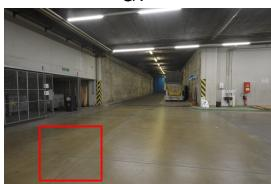

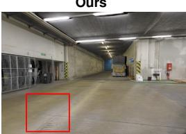

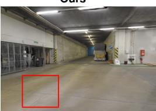

FGS + Adam (3 steOurs + Adam  
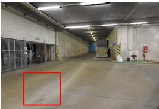  
Figure 10: Three-step refinement on ETH3D with eight input views. Red boxes highlight the compared floor region.

Table 9: Feed-forward network latency: mean and min–max over five runs.
<table><tr><td>Input resolution  $( W \times H )$ </td><td>Mean (s)</td><td>Min-max (s)</td></tr><tr><td>1022×756</td><td>5.619</td><td>5.617–5.621</td></tr><tr><td>756×560</td><td>2.533</td><td>2.532–2.535</td></tr><tr><td>504×378</td><td>1.032</td><td>1.031-1.034</td></tr><tr><td>378×280</td><td>0.564</td><td>0.563-0.564</td></tr></table>

opacities, rotations, and colors with centers fixed. Adam uses a learning rate of 0.01. Learned refinement and Adam improve PSNR by 0.64 dB and 0.02 dB, respectively; the learned refiner also performs better on the other three metrics. Figure 10 provides a qualitative comparison.

## B.4 OPACITY AND GEOMETRIC CONSISTENCY

We analyze feed-forward outputs on held-out Hypersim (Roberts et al., 2021) validation scenes. Geometric labels are assigned independently of opacity using GT depth, with tolerance max(0.03 m, 0.01d) and depth-edge samples excluded. A point is geometrically inconsistent if it violates GT-observed free space in at least two views and agrees with no observed surface depth. Surface-consistent points agree with at least two views and have no free-space violations; others remain uncertain. This identifies 36,125 inconsistent points. Opacity distributions and pruning statistics at threshold 0.01 are shown in Fig. 7.

## B.5 INPUT RESOLUTION AND FEED-FORWARD NETWORK LATENCY

We measure feed-forward neural-module latency at four resolutions on one H20, using the same ETH3D scene and eight input views. Each resolution uses one warmup followed by five synchronized CUDA-event measurements.

## B.6 ADDITIONAL QUALITATIVE RESULTS

Pose-free comparisons. Figure 11 compares pose-free reconstructions on ETH3D. The selected crops show fewer repetitive stripe artifacts and better-preserved relief structures than several baselines.

Diverse scenes. Figure 12 shows feed-forward reconstructions on DDAD (Guizilini et al., 2020), Waymo (Sun et al., 2020), ETH3D (Schops et al., 2017), Hypersim (Roberts et al., 2021), DTU (Aanæs et al., 2016), Mip-NeRF 360 (Barron et al., 2022), and Mill19 (Mega-NeRF) (Turki et al., 2022), covering streets, buildings, interiors, and objects.

Large-scale reconstruction. We apply the feed-forward reconstructor to a KITTI (Geiger et al., 2013) street sequence of over 1,000 frames using sliding windows to construct a large-scale Gaussian scene (Fig. 13).

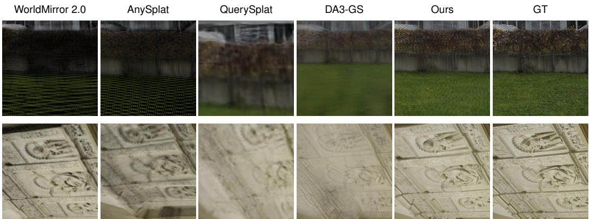

Figure 11: Pose-free rendering on ETH3D: grass textures and relief details.  
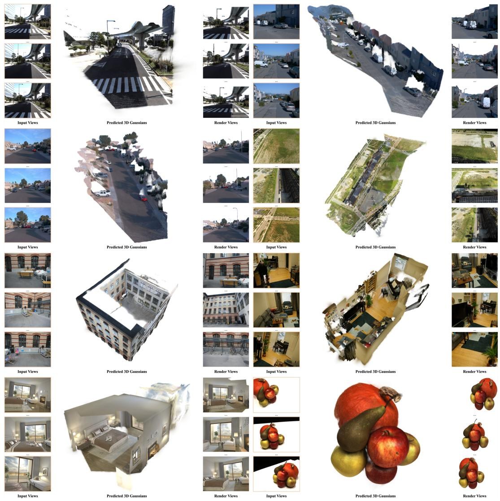  
Figure 12: Feed-forward reconstructions and renderings with 12–64 input views.

## C LIMITATIONS AND FUTURE WORK

Opacity learning and pruning can suppress unreliable Gaussians, but fixed centers cannot correct severe errors in predicted geometry. Reconstruction quality therefore remains limited by the geometric prior. Pixel-aligned prediction also produces redundancy not fully removed by voxel merging, while limited input coverage can leave holes in unobserved regions. Future work will explore stronger geometric priors and more compact Gaussian representations, as well as generative models and camera-trajectory design to address limited coverage.

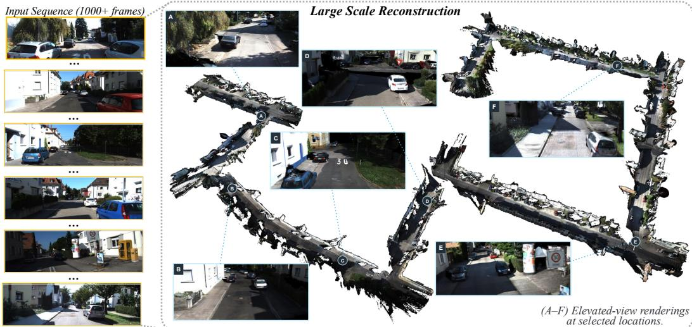  
Figure 13: Large-scale reconstruction on KITTI. Insets show elevated-view renderings at locations A–F.