# Infant Fingerprints: Quality Assessment & Recognition

Joao L. H. Dall Agnol, Dalcimar Casanova, Rodrigo Minetto,˜

Luiz F. P. Southier, Marcelo Teixeira, Marcelo Filipak, and Anil K. Jain

Abstract—Infant fingerprint recognition is hindered by a combination of physiological characteristics, such as small ridge width and spacing, and acquisition challenges that include involuntary motion, skin residue, and uneven fingertip pressure. These factors undermine fingerprint quality standards originally designed for adults, which assume feature distributions that do not hold for infants. To address this gap, this paper evaluates ten fingerprint quality assessment methods on a longitudinal dataset that spans six age groups from newborns to three months, alongside a parameter tuning routine that uncovers age-specific fingerprint characteristics to recalibrate methods with domaindependent assumptions. Both default and tuned configurations are compared through recognition experiments assessing the effectiveness of quality-guided gallery selection. Template-fusion strategies and latent fingerprint recognition technologies are further examined to identify the best possible matching rates achievable by the top-performing method. Results show that tuned parameter sets outperform default configurations for the majority of methods and age groups, indicating that targeted recalibration of existing frameworks improves gallery utility and contributes to more reliable infant fingerprint recognition.

Index Terms—Infant Biometrics, Infant Fingerprint, Quality Assessment, Parameter tuning, Longitudinal Analysis

## I. INTRODUCTION

Infant and adult fingerprints exhibit substantially different structural patterns. Infant ridges are markedly thinner and inter-ridge spacing may be up to four times smaller [1], [2], which directly motivates the use of high-resolution (1200- 5000 PPI) scanners to preserve sufficient discriminative detail for recognition [1]–[5]. In addition, infant fingers are softer and more elastic than those of adults, increasing susceptibility to deformation during image capture [3]. Figure 1 illustrates the acquisition process, alongside sample images that exhibit common capture degradations, including motion and residual contaminants such as lint and fiber residues.

Solutions aiming to provide infants with reliable recognition systems must grapple with these physiological challenges; particular to this work is the problem of defining an acceptance criteria in structural conformity to quantify the quality of an infant fingerprint sample. In other words, the properties that constitute an acceptable sample for adult fingerprints may not hold for infants, and the structural bounds that define ridge and valley conformity must be reconsidered according to the subject’s age.

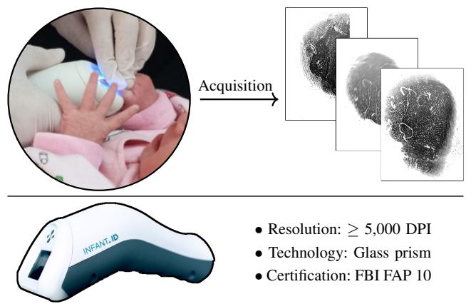  
Fig. 1: Infant fingerprint acquisition process: top-left shows capture procedure used for the UTFPR-IFD dataset [5]; topright contains examples of fingerprint video frames obtained from a single newborn fingerprint; bottom shows the InfantID scanner used to acquire the images, alongside its key characteristics such as sampling rate and technology [6].

Quality assessment plays a critical role within the biometric pipeline. By bridging the capture and processing stages, it influences the reliability of all subsequent operations. For adult biometrics, fingerprint quality assessment has been extensively investigated over the past decades, leading to the development of standardized methodologies such as ISO/IEC 29794-1 [7] and the widely adopted National Institute of Standards and Technology (NIST) Fingerprint Image Quality 2 (NFIQ2) package [8], which is integrated into modern comparators such as VeriFinger [9]. In contrast, quality assessment for infants is a relatively unexplored area, remaining largely restricted to the direct application of NFIQ (1 and/or 2) to infant fingerprint data [1], [10], [11]. Recent works on the topic of infant biometrics have focused on producing alternative highresolution scanners [2], [3] and the development of image enhancement techniques, including binarization [12], [13] and super-resolution methods [4], [14].

To address fingerprint quality assessment for infants, this study reviews established ISO/IEC 29794-1 [7] methods and more recent advancements [8], [15], selected according to their primary underlying features (e.g., ridge spacing, orientation), to determine whether existing solutions can reliably identify informative infant fingerprint samples, and explores age-sensitive parameter search to improve recognition rates. Both standard and tuned configurations are evaluated through a gallery selection problem: given a set of images from an identity, methods must rank samples according to their matching potential — a property commonly formalized in terms of utility for identification systems [16]. Experiments are repeated for six age-based subsets, spanning from newborns to three months of age, drawn from the UTFPR-IFD [5] longitudinal infant database.

The main contributions of this paper are as follows:

(i) We review and evaluate ten fingerprint quality assessment methods, encompassing classical signal-processing, structure-driven, and learning-based approaches, that capture complementary fingerprint properties through both local and global image features.

(ii) A systematic parameter search routine is introduced to identify optimal infant ridge and valley property (width, distance, etc) ranges. This process is performed independently for each parameter-dependent method and age group, aiming to maximize the biometric utility of galleries selected through quality ranking.

(iii) To assess the effectiveness of quality-driven fingerprint selection across age groups, identity galleries are composed using the top-ranked samples selected by each quality assessment method, separately. Using VeriFinger 2025.2 [9], quantitative and qualitative analyses compare standard and optimized parameter configurations for infant fingerprints.

(iv) A complementary analysis examines a practical deployment scenario, combining a template-fusion strategy with a state-of-the-art latent comparator (MegaMatcher 2025.2 [9]) to investigate the best possible matching rates achieved by a top-performing quality method identified in this study.

To the best of the authors’ knowledge, this is the first study to evaluate and tune fingerprint quality assessment methods in the context of infant biometrics.

This paper is structured as follows: Section II reviews related work, including quality assessment methods evaluated for parameter optimization in infant fingerprint recognition, as described in Section III. Section IV evaluates the impact of these methods on recognition performance, with and without tuned parameters; finally, Section V discusses the implications of these findings, and Section VI summarizes the contributions and outlines future research directions.

## II. FINGERPRINT QUALITY ESTIMATION METHODS

Fingerprint quality estimation has been addressed through a broad range of methodologies that differ both in features used to characterize ridge patterns (orientation, width, frequency, pores, minutiae) and in how such features are extracted, from handcrafted descriptors to deep learning representations. Existing surveys [17]–[19] focus on adult fingerprints, leaving infant fingerprint quality assessment largely unexplored.

Figure 2 organizes the methods reviewed here into a taxonomy structured around their adaptability to infant fingerprints, degree of parameterization, dependence on domain-specific assumptions, and feature scope. From left to right, the first division in the taxonomy distinguishes between methods that can be explicitly tuned to infant fingerprints through parameter optimization, and those that rely on fixed configurations, learned models, or intrinsic image statistics. This distinction is particularly relevant because infants exhibit substantially different ridge spatial characteristics compared to adults [3], [4], [10], [11].

Methods subjected to parameter optimization are grouped into two categories:

• Strong domain assumptions: methods whose parameters are directly associated to fingerprint morphology, including ridge frequency, ridge width, and orientation consistency. Representative examples include Gabor-based methods [20], gray-level analysis for Local Clarity Score (LCS [21]), and Radial Power Analysis (RPS [22]). Their dependence on expected ridge-valley patterns makes them particularly relevant for domain-specific optimization in infant fingerprints.

• Weak domain assumptions: comprises methods — Orientation Certanty Level (OCL [23]), Ridge-Valley Uniformity (RVU [23]) and Directional Filter Bands (DFB [15]) — whose parameters are exclusively related to the size of a local analysis region. Although these methods rely less on explicit assumptions about ridge morphology, their performance may still depend on the appropriate spatial scale for the finer ridge patterns found in infant fingerprints.

Methods with minimal or implicit parameterization form the remaining group: (i) purely statistical approaches, mean graylevel intensity (MU [7]) and the standard deviation of graylevel intensities (SIG [7]), that need no explicit parameters; and (ii) data-driven COTS solutions (MQCDA [6] model, NFIQ2 [8]) trained on fixed configurations. The simpler statistical methods, which assess quality from global greylevel intensity, are more readily applicable to infants, but are correspondingly less sensitive to fine structural detail. The current obstacle is thus to determine the expected ranges for ridge and valley thickness or dominant frequency that best suit infant fingerprints.

Sampling rate intensifies this barrier: most solutions assume a sampling rate near 500 PPI, while infant fingerprints require higher rates to resolve sufficient detail. One exception is [24], which uses pores as quality indicators for high-resolution images; however, infant pores are rarely visible, particularly in the first months of life. As later detailed in Section III-A, this study is limited to analyses of 5000 PPI images downsampled to 500 PPI to maintain compatibility with COTS comparators and spatial correspondence with adult fingerprints.

Lastly, all methods are further categorized as either global, assigning a single score to the entire image, or local, scoring regions separately. Though localized representations are generally preferred [19], global approaches remain widely adopted largely due to NFIQ2. Local scoring is, however, useful for applications such as image enhancement [25], [26] and composition [27], potentially benefiting the broader infant fingerprint recognition pipeline.

To the best of the authors’ knowledge, no existing study targets infant fingerprint quality specifically. This gap is reasonably explained by the scarcity of infant fingerprint datasets [28] and by the lack of robust synthetic fingerprint generation even for adults [29]. Consequently, how well current quality assessment methods transfer to infants depends heavily on their underlying assumptions and adaptability to age-related biometric differences.

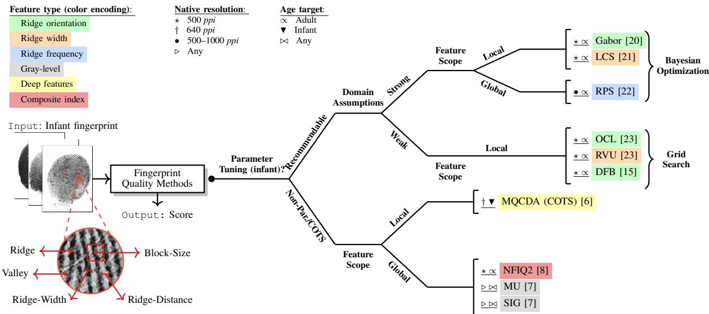  
Fig. 2: Fingerprint quality estimation taxonomy. Methods are classified according to their primary feature, resolution and the age they target. Features directly related to visible patterns are also showcased.

The following section proposes a parameter search for reviewed methods, using a longitudinal database [5] to capture the patterns of different infant age groups.

## III. PARAMETER SEARCH FOR INFANTS

Given that several quality assessment methods rely on intrinsic fingerprint features such as ridge width and spacing, a natural question arises as to whether, and to what extent, parameters originally derived from adult distributions appropriately capture infant features. To investigate this scenario, a parameter search is performed over infant subjects from hours after birth to 3 months of age.

## A. Infant Dataset and Experimental Protocol

The UTFPR infant fingerprint dataset (UTFPR-IFD) [5] spans longitudinal video acquisitions captured using the highresolution (∼5000 PPI) InfantID optical fingerprint scanner. The dataset includes recordings from infants at multiple age milestones, beginning with an initial acquisition in the Sao˜ Lucas hospital (city of Pato Branco, Parana state, Brazil),´ within 3–24 hours after birth, followed by scheduled follow-up in-house visitations (see Figure 3). The data collection protocol was approved by the Brazilian research ethics committee under Certificate of Ethical Appreciation Presentation (CAAE) 73791023.7.0000.0177 via Plataforma Brasil. This dataset is not currently available to the general public due to ethical restrictions related to the age of the subjects. Consent for collection was provided by their legal guardians.

This study considers a curated subset of the UTFPR-IFD, which was selected according to two inclusion criteria: (i) subjects must have complete longitudinal coverage across all acquisition milestones up to three months of age; and (ii) each session must contain the full set of 14 expected video samples, as acquisition artifacts may occasionally lead to missing data.

Based on the longest currently available observation window (March 2024 to September 2025), a total of 45 infants met these criteria. In total, this subset comprises 3,780 highresolution video sequences $( 4 5 \times 1 4 \times 6 )$ acquired from 450 distinct digits across 6 sessions over time, and containing 135,382 video frames in total.

A 5-fold cross-validation is applied to the selected subjects, partitioning five different subsets for each age group that contains 36 subjects for training and 9 for testing. The same subject partition is applied to all six age groups to prevent identity leakage. Training data is further subsampled using a minimum inter-frame distance of three frames to reduce the temporal redundancy inherent to video-based acquisitions. This limits correlation and computational overhead while preserving sufficient variability for parameter search.

Neurotechnology’s VeriFinger 2025.2 and MegaMatcher SDK 2025.2 [9] are employed to evaluate frame selection performance. Because these technologies are designed to operate on 500 PPI images, which remains the de facto standard for most operational systems, prior to template extraction all video frames were downsampled from 5000 to 500 PPI using bilinear interpolation with pixel area relation, while preserving the original aspect ratio. This preprocessing step reflects a practical limitation of computation and current fingerprint matching technology, as support for high-resolution (>500 PPI) fingerprint matching remains limited in commercial-grade SDKs. Similar protocols have been adopted in previous studies on infant fingerprints, where high-resolution acquisitions were resampled to standard resolutions to ensure compatibility with existing matchers [2].

## B. Parameter Search Space

A parameter search is proposed in order to adapt existing fingerprint quality assessment methods to infant biometrics, tuning input values that directly influence the analysis of ridge structure, spatial scale, and frequency content. Methods that do not expose tunable parameters are excluded from this routine. Table I summarizes the parameters considered during tuning, with their corresponding search spaces.

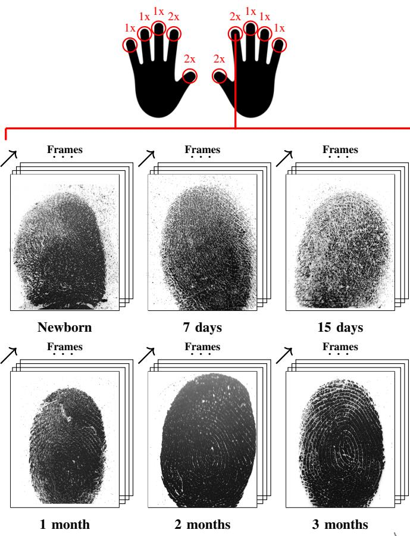  
Data from a longitudinal acquisition of a single infant right index fingerprint  
Fig. 3: Overview of the UTFPR-IFD dataset [5]. A total of 14 fingerprint videos are acquired per session from both hands, with thumbs and index fingers captured twice due to their higher recognition utility. Stacked images represent the videobased frames collected at each stage of life

TABLE I: Summary of methods subjected to parameter tuning and their corresponding search variables.
<table><tr><td>Method</td><td>Parameters tuned</td></tr><tr><td>Gabor</td><td>m,  ${ \overline { { f , \sigma , } } }$  Gaussian window (σθ)</td></tr><tr><td>LCS</td><td> $W _ { r } ^ { \mathrm { { m i n } } } , W _ { r } ^ { \Delta } , W _ { v } ^ { \mathrm { { m i n } } } , W _ { v } ^ { \Delta }$  block size</td></tr><tr><td>RPS</td><td>rmin, r∆, ∆r, θ</td></tr><tr><td>OCL</td><td>block size</td></tr><tr><td>RVU</td><td>block size</td></tr><tr><td>DFB</td><td>block size</td></tr></table>

1) Gabor: Assesses quality by measuring how strongly a bank of orientation- and frequency-tuned filters responds to the local ridge-valley pattern. If the frequency f is mismatched to the true ridge periodicity, filter responses weaken across all orientations, flattening the response distribution and undermining orientation as a reliable quality indicator.

The search space for the frequency parameter f spans [2, 20] pixels, corresponding to [0.05, 0.5] cycles per pixel. For reference, [7] uses 10 pixels $( f = 0 . 1 )$ for adults. The

Gaussian deviation $\sigma ,$ , which defines the spatial extent of the Gaussian envelope, is not tuned directly, but rather computed from the chosen $f$ using

$$
\sigma = { \frac { 1 . 5 } { \sqrt { 6 \ln ( 1 0 ) } } } p\tag{1}
$$

where $p$ is the spatial frequency in cycles per pixel. This parameterization links the envelope width to the ridge spacing, maintaining a consistent filter scale as the ridge period varies. The number of filter orientations $m \in [ 4 , 8 ]$ and the Gaussian window deviation $\sigma _ { \theta } \in [ 1 , 1 0 ]$ are also tuned.

2) LCS: Evaluates fingerprints based on the clarity of ridgevalley separation, over image blocks, using the average widths of ridges $( \overline { { W _ { r } } } )$ and valleys $( \overline { { W _ { v } } } )$ . As such, two width intervals are tuned: the ridge-width bounds $( W _ { r } ^ { \operatorname* { m i n } } , W _ { r } ^ { \operatorname* { m a x } } )$ and the valley-width bounds $( W _ { v } ^ { \operatorname* { m i n } } , W _ { v } ^ { \operatorname* { m a x } } )$

To reduce redundancy in the search space, the upper bound of each interval is encoded as a displacement $W _ { \mathrm { m a x } } = W _ { \mathrm { m i n } } +$ $W _ { \Delta }$ , with bounds ranging from 1 to 20 pixels. This search space encompasses and extends the nominal adult ranges specified in [7] for 500 PPI fingerprints, accommodating narrower valleys and relative increase in ridge width observed in infant fingerprints downsampled to this scale.

3) RPS: Applies the Discrete Fourier Transform (DFT) to quantify the concentration of energy around the dominant ridge frequency. The parameters that represent the bounds of this dominant frequency, $r _ { \mathrm { m i n } }$ and $r _ { \mathrm { m a x } } ,$ adopt the same displacement encoding used for LCS, with $r _ { \operatorname* { m a x } } = r _ { \operatorname* { m i n } } + r _ { \Delta } .$ relative to the expected image dimensions at 500 PPI. Accordingly, the search space is defined by $r _ { \mathrm { m i n } }$ and $r _ { \Delta } .$ both constrained to the interval [0.01, 0.69]. This range extends well beyond the reference value $( r _ { \mathrm { m i n } } \approx 0 . 0 7 7 \ [ 7 ] )$ , covering frequencies from 0.01 (seven times lower than an adult) up to 0.70 (the maximum admissible frequency), while ensuring that $r _ { \mathrm { m a x } }$ remains greater than $r _ { \mathrm { m i n } }$

The remaining parameters, radial distance $\Delta r$ and angular resolution $\theta ,$ are tuned over [1, 100], spanning one order of magnitude below and above the adult standard of 10 [7], and [60, 180] degrees, respectively.

4) Grid-search methods: OCL, RVU, and DFB are not dependent on external bounds or parameters besides the size of local image blocks. These values are evaluated via gridsearch, alongside LCS own block size parameter, ranging from 4 × 4 to $1 2 8 \times 1 2 8$ pixels. For RVU and LCS, rectangular blocks (aligned to ridge orientation) are updated accordingly and require no direct optimization.

Although these values are not directly related to fingerprint structures such as ridge width and spacing, larger block sizes can reduce computation time, and may also improve robustness for infant fingerprints since broader regions capture more ridges and valleys, which can stabilize orientation estimation in OCL and DFB and yield more representative width averages in RVU, particularly given the lower local clarity of infant fingerprint images.

Block size of 256 × 256 and above were excluded, as they would cover approximately one quarter of the total fingerprint area at 500 PPI, compromising local analysis. DFB requires an additional evaluation of all multiples of 2 from 4 to 128, as its base block size is 4 × 4.

## C. Parameter Optimization

The parameter optimization procedure depends on the dimensionality of each method’s parameter space (Figure 2). Grid search was used only for block size, a single-parameter space small enough to evaluate exhaustively. Bayesian Optimization [30] was employed for methods with multiple parameters, where exhaustive search is impractical, because it uses previous observations to choose next evaluations.

False Non-Match Rate (FNMR) was chosen as the loss for both strategies because sample quality is more strongly associated with genuine comparisons than with impostor ones [16]. A high-quality genuine pair is expected to match, whereas an impostor match can occur at any quality level through incidental similarity between different fingerprints. FNMR (Equation 2) is the fraction of genuine pairs $( i , j )$ in the set $\mathcal { G } _ { x }$ whose comparison score $s ( i , j )$ falls below the decision threshold $\tau { : }$

$$
\mathrm { F N M R } ( x , \tau ) = \frac { 1 } { | \mathcal { G } _ { x } | } \sum _ { ( i , j ) \in \mathcal { G } _ { x } } \mathbb { 1 } \left[ s ( i , j ) < \tau \right]\tag{2}
$$

Quality assessment defines $\mathcal { G } _ { x }$ by discarding the 20% of genuine pairs with the lowest combined quality, where the combined quality of a pair is the minimum of the quality scores of its two images under configuration x. A 20% discard rate is typical in operational biometric systems [31]. The threshold τ is fixed as the value at which 80% of the genuine pairs in the initial training set $\mathcal { G }$ are matched (i.e., FNMR = 20% before discarding). Under this threshold, a quality method that better predicts biometric utility discards more of the false nonmatches, yielding a lower FNMR on $\mathcal { G } _ { x }$

As such, Bayesian optimization maximizes the complement of FNMR (Equation 3), which is equivalent to minimizing FNMR (Equation 4):

$$
f ( x ) = 1 - \mathrm { F N M R } ( x , \tau )\tag{3}
$$

$$
x ^ { * } = \arg \operatorname* { m a x } _ { x \in \mathcal { X } } f ( x )\tag{4}
$$

This work utilized 10 initial observations and 20 subsequent iterations (30 evaluations in total). Up to 100 iterations were tested, but 30 evaluations gave comparable results while limiting overfitting to the training set. Grid search evaluated block sizes from 4 to 128 in powers of 2.

## IV. EXPERIMENTAL RESULTS

This section presents the parameter tuning results and extends the fingerprint comparison analysis to True and False Matching Rates (TMR@FMR), encompassing all methods across the observed age groups. A complementary analysis examines template fusion with a latent comparator to improve matching rates.

## A. Parameter Tuning

Table II summarizes the final parameter intervals for relevant fingerprint characteristics, namely the dominant ridge frequency (RPS) and the ridge/valley width parameters used by LCS. The reported intervals were obtained over in a separate execution that used the full 450 digits dataset to obtain a representative characterization of the entire available cohort. Although these quantities are used as algorithmic parameters in fingerprint enhancement and quality assessment, they are closely related to underlying ridge-valley features and therefore provide insights into the image properties that mostly influence matching performance across different ages.

TABLE II: Tuned RPS and LCS parameter intervals for each age group (in pixels). Adult reference ranges reported in [7] are included for comparison.
<table><tr><td>Age</td><td>Dom. Frequency</td><td>Rid. Width</td><td>Val. Width</td></tr><tr><td>Newborn</td><td>0.211 - 0.397</td><td>2-11</td><td>1-3</td></tr><tr><td>7-day</td><td>0.379 - 0.560</td><td>3-6</td><td>1-3</td></tr><tr><td>15-day</td><td>0.440 - 0.700</td><td>2-14</td><td>2-3</td></tr><tr><td>1-month</td><td>0.240 - 0.700</td><td>2-9</td><td>2-5</td></tr><tr><td>2-month</td><td>0.440 - 0.700</td><td>2-9</td><td>2-5</td></tr><tr><td>3-month</td><td>0.440 - 0.700</td><td>2-9</td><td>1-6</td></tr><tr><td>Adult</td><td>0.077 - 0.143 [7]</td><td>3-10 [7]</td><td>2-10 [7]</td></tr></table>

The dominant ridge frequency is algorithmically found to be consistently higher for infants. It is also shown to increase with age over the observed period, which can be attributed to improvements in ridge–valley delineation as illustrated in Figure 3: poorly defined valleys in younger subjects artificially widen ridges, reducing the measured frequency.

However, progression is not strictly harmonious across all methods. At 15 days, dominant frequency estimates already align with those of older age groups, while at 1 month the lower ridge-width bound decreases. Similar fluctuations across early infant age groups have been reported in prior work [10], [11]. Furthermore, the ridge-to-valley width ratios inferred for newborns are consistent with [2], where ridges were approximately four times larger than valleys, and the valleywidth intervals for the 1 to 3 month groups align with the averages reported by [10], [11], noting that direct numerical correspondence is not expected as the present framework operates on integer-valued pixel intervals.

The resulting effect of parameter tuning in the crossvalidation experiment is an accelerated decay of FNMR for the tuned (opt.) configurations compared to the default (def.) values. Figure 4 presents the FNMR obtained on the heldout subjects of each cross-validation fold, using parameters optimized exclusively on the corresponding training folds. The results show that tuned configurations consistently reduce FNMR relative to the default settings, although the magnitude of the improvement varies across methods. In particular, LCS is more responsive to parameter tuning, whereas Gabor and OCL achieve only minor performance gains.

Figure 5 illustrates how the different default (def.) and tuned (opt.) scores behave over videos using LCS and a newborn thumb captured hours after birth. Tuned LCS assigns its highest score to a more informative frame, whereas the default configuration selects a blurred mid-movement frame. The key difference in gallery selection is that tuning produces more discriminative quality scores because the parameter bounds are adapted to the feature distribution of newborn fingerprints, thereby enabling more effective filtering.

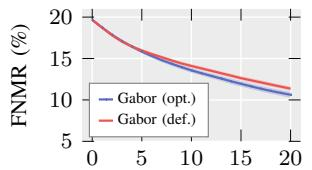  
Pairs removed (%)

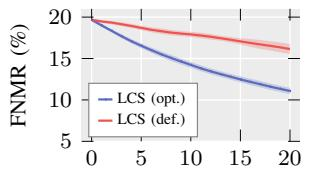

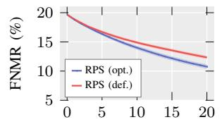

Pairs removed (%)  
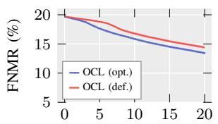

Pairs removed (%)  
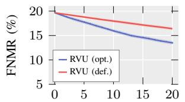

Pairs removed (%)  
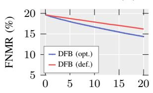  
Pairs removed (%)  
Pairs removed (%)  
Fig. 4: FNMR plots for default (def.) and tuned (opt.) parameters for all methods (one per panel), accumulated across all six age groups and all 30 folds. Lower values indicate better performance.

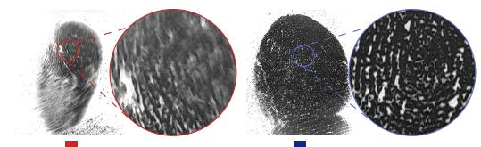

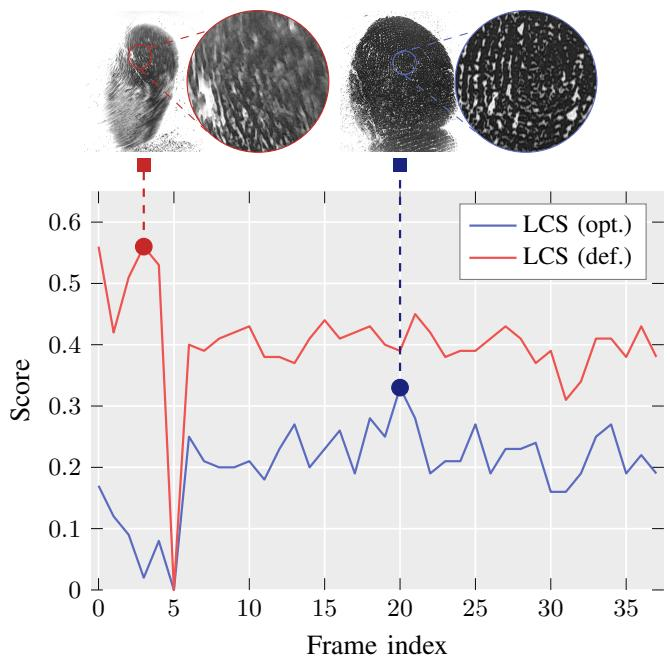  
Fig. 5: LCS scoring of a newborn thumb (test only subset). The fingerprint core region is showcased for the best frames selected by the default and tuned configurations.

## B. Recognition Results

To evaluate the performance of the quality assessment methods across age group subsets, each method independently constructs a 5-frame gallery for every digit, selecting frames according to its own quality score ranking while enforcing a minimum inter-frame distance of three frames, as described in Section III-A. Similar to the FVC protocol [32], each identity then contributes a single sample (highest average genuine comparison score) to compose the gallery of impostors, which is fixed per age group and invariant across methods to ensure that differences in performance reflect only the genuine gallery composition. This is made possible because genuine comparisons are restricted to frames within the same video. Accordingly, each frame is subject to 4 genuine and 89 impostor comparisons, totaling 1,800 genuine and 40,050 impostor pairs per method/age group and fold. NFIQ2 is used as the reference baseline, being the most consolidated adult quality method; the default configurations of the remaining methods provide a second baseline.

Table III presents VeriFinger 2025.2 TMR@FMR=0.1% and 1.0% results for each quality estimation method across all age groups in our test subset of UTFPR-IFD. An accept is defined as the successful matching of individual frames to enable a detailed evaluation of gallery utility, though higher rates can be achieved with stricter protocols as Section IV-C later explores.

A complementary Friedman analysis, followed by the posthoc Nemenyi test [33], was conducted to compare the quality assessment methods across age groups and folds (6 age groups × 5 folds = 30 blocks). Table IV reports the mean ranks at FMR=1.0%, adopted as the reference operating point because single-frame comparisons are inherently more error-prone than the decisions of biometric systems, which can aggregate several fingers. Two methods are considered significantly different only if their mean ranks differ by more than the critical difference (CD = 4.2, α = 0.05).

Tuned configurations obtained higher mean TMR than their defaults in every method-age combination (36/36), at FMR=1.0%, and in 32 of 36 at FMR=0.1% (Table III). The exceptions at 0.1% were Gabor (three age groups), and LCS (1-month). Out of all the evaluated methods, tuned RPS obtained the lowest mean rank (2.8), although it was not significantly different from the other top-five methods of Table IV. It obtained the highest mean TMR for the 2- and 3-month groups at both FMRs, and for the 15-day group at FMR=0.1%, but was less competitive for newborns (47.5% vs. 53.6% for LCS at FMR=1.0%). Tuning contributed to this outcome: tuned RPS ranks 5.0 units better than its default configuration at FMR=1.0%, exceeding the CD, and its TMR gains at FMR=0.1% range from 0.7 to 6.9 points (tuned vs. default).

Tuned LCS also improved significantly over its default configuration, with a mean-rank difference of $\Delta = 5 . 6 $ , above the CD. This is consistent with expectations regarding LCS’s dependence on ridge and valley width ranges, which differ between infants and the adult standard and vary with age. In Table III, tuned LCS obtained the highest mean TMR at FMR=1.0% for infants aged 15 days or younger, although its margins over the next best method (2.4, 0.7 and 0.7 points for newborn, 7-day and 15-day) are within the fold standard deviation. At FMR=0.1%, its gains over the default configuration reached 7.8 points (15-day), with the 1-month

TABLE III: Mean matching performance (TMR@FMR=0.1% and 1.0%) by age and method (90 digits per fold, 5 folds) with standard deviation. Bold values indicate best results per method, underlined values indicate best results for each age.
<table><tr><td rowspan="2">Method</td><td rowspan="2">Setting</td><td colspan="2">Newborn</td><td colspan="2"> $\mathrm { 7 - d a y }$ </td><td colspan="2"> $1 5 \mathrm { - d a y }$ </td><td colspan="2">1-month</td><td colspan="2">2-month</td><td colspan="2">3-month</td></tr><tr><td>0.1%</td><td>1.0%</td><td>0.1%</td><td>1.0%</td><td>0.1%</td><td>1.0%</td><td>0.1%</td><td>1.0%</td><td>0.1%</td><td>1.0%</td><td>0.1%</td><td>1.0%</td></tr><tr><td rowspan="2">Gabor</td><td>tuned</td><td> ${ \bf 3 0 . 6 \ \pm } 6 . 6$ </td><td> ${ \bf 4 6 . 8 \pm } 6 . 5$ </td><td> $5 3 . 3 \pm 5 . 5$ </td><td> $7 5 . 8 \pm 4 . 2$ </td><td> ${ \bf 7 0 . 7 \ \pm 6 . 7 }$ </td><td> ${ \bf 8 6 . 3 \ \pm } 3 . 8$ </td><td> $7 7 . 9 \pm 6 . 4$ </td><td> ${ \bf 8 7 . 3 \pm } 4 . 5 $ </td><td> ${ \bf 8 0 . 2 \ \pm 5 . 3 }$ </td><td> ${ \bf 8 8 . 4 _ { \Delta \pm 2 . 4 } }$ </td><td> $7 2 . 7 \pm 7 . 5$ </td><td> ${ \bf 8 4 . 7 \pm } 4 . 8 $ </td></tr><tr><td>default</td><td> $2 9 . 4 \pm 6 . 7$  </td><td> $4 4 . 2 \pm 8 . 3$ </td><td>54.1 ±8.1</td><td> $7 3 . 8 \pm 5 . 9$ </td><td> $6 8 . 2 \pm 7 . 4$ </td><td> $8 3 . 0 \pm 4 . 9$ </td><td> $7 8 . 4 \pm 6 . 9$ </td><td> $8 7 . 0 \pm 4 . 9$ </td><td> $8 0 . 0 \pm 6 . 2$ </td><td> $8 8 . 1 \pm 3 . 6 $ </td><td> $7 3 . 6 \pm 6 . 5$ </td><td> $8 4 . 2 \pm 4 . 4$ </td></tr><tr><td rowspan="2">LCS</td><td>tuned</td><td> $3 4 . 5 \pm 5 . 7$ </td><td> $\underline { { 5 3 . 6 } } \pm 6 . 9$ </td><td>57.1 ±7.2</td><td> $\underline { { 7 8 . 7 } } \pm 5 . 4$ </td><td> ${ \bf 7 3 . 1 \pm } 4 . 5 $ </td><td> $\underline { { 8 8 . 0 } } \pm 3 . 1$ </td><td> $7 5 . 8 \pm 7 . 4$ </td><td> ${ \bf 8 6 . 7 \pm 5 . 0 }$ </td><td> $\mathbf { 7 9 . 9 \ \pm 5 . 6 }$ </td><td> ${ \bf 8 7 . 3 \pm } 3 . 6 $ </td><td> $7 1 . 8 \pm 1 0 . 0$ </td><td> ${ \bf 8 2 . 8 \pm } 6 . 3$ </td></tr><tr><td>default</td><td> $2 7 . 5 \pm 4 . 9$ </td><td> $4 5 . 3 \pm 6 . 3$ </td><td>50.5 ±7.1</td><td>72.1 ±4.9</td><td> $6 5 . 3 \pm 5 . 5$ </td><td> $8 2 . 0 \pm 4 . 1$ </td><td> $7 6 . 5 \pm 6 . 6$ </td><td> $8 4 . 9 \pm 4 . 9$ </td><td> $7 5 . 8 \pm 6 . 3$ </td><td> $8 3 . 8 \pm 5 . 3$ </td><td> $6 8 . 1 \pm 8 . 7$ </td><td> $8 0 . 3 \pm 6 . 6$ </td></tr><tr><td rowspan="2">RPS</td><td>tuned</td><td> ${ \bf 3 0 . 2 \mit \ \pm 6 . 0 }$ </td><td> $4 7 . 5 \pm 6 . 2$ </td><td>53.8 ±7.2</td><td>77.3 ±5.0</td><td> $\underline { { 7 ^ { 3 . 8 } } } \pm 7 . 3$ </td><td> ${ \bf 8 7 . 3 \pm } 4 . 1 $ </td><td> ${ \bf 8 0 . 1 \ \pm 6 . 6 }$ </td><td> ${ \bf 8 8 . 4 \ \pm } 3 . 7$ </td><td> $8 3 . 2 \pm 6 . 2 $  </td><td> $\underline { { 9 0 . 5 } } \pm 2 . 9$ </td><td> $\underline { { 7 8 . 4 } } \pm 6 . 3$ </td><td> $\mathbf { 8 8 . 8 \ : \pm 3 . 7 }$ </td></tr><tr><td>default</td><td> $2 8 . 9 \pm 6 . 8$ </td><td> $4 4 . 4 \pm 6 . 5$ </td><td>53.1 ±6.8</td><td>74.1 ±6.4</td><td> $6 6 . 9 \pm 7 . 8$ </td><td> $8 2 . 7 \pm 5 . 7$ </td><td> $7 6 . 6 \pm 7 . 8$ </td><td>85.5 ±4.9</td><td> $7 6 . 9 \pm 6 . 6$ </td><td> $8 5 . 4 \pm 5 . 0$ </td><td> $7 1 . 5 \pm 6 . 4$ </td><td> $8 3 . 0 \pm 4 . 5$ </td></tr><tr><td rowspan="2">OCL</td><td>tuned</td><td> $2 4 . 1 \pm 6 . 4$ </td><td> ${ \bf 3 8 . 0 \ \pm 9 . 3 }$ </td><td>53.9 ±7.9</td><td>72.5 ±5.6</td><td> ${ \bf 6 7 . 7 \pm 6 . 0 }$ </td><td> ${ \bf 8 1 . 9 \pm } 4 . 0$ </td><td> $7 3 . 7 \pm 4 . 8$ </td><td> ${ \bf 8 3 . 5 \ \pm } 2 . 2$ </td><td> $7 4 . 2 \pm 8 . 3$ </td><td> ${ \bf 8 2 . 5 \ \pm 6 . 6 }$ </td><td>62.7 ±9.3</td><td> $7 3 . 0 \pm 8 . 1$ </td></tr><tr><td>default</td><td> $2 3 . 2 \pm 6 . 6$ </td><td> $3 5 . 7 \pm 8 . 6 $ </td><td>53.6 ±8.1</td><td>71.9 ±5.4</td><td> $6 5 . 6 \pm 7 . 0$ </td><td> $8 0 . 9 \pm 4 . 6 $ </td><td> $7 2 . 4 \pm 5 . 6$ </td><td> $8 2 . 0 \pm 2 . 4$ </td><td>73.1 ±9.1</td><td> $8 1 . 8 \pm 6 . 9$ </td><td>61.9 ±10.9</td><td> $7 1 . 9 \pm 9 . 1$ </td></tr><tr><td rowspan="2">RVU</td><td>tuned</td><td> ${ \bf 2 6 . 2 \pm 7 . 2 }$ </td><td> ${ \bf 4 1 . 9 \pm 8 . 4 }$ </td><td>50.8 ±8.7</td><td> $7 1 . 5 \pm 5 . 9$ </td><td> ${ \bf 6 5 . 5 \pm 5 . 5 }$ </td><td> ${ \bf 8 2 . 1 \_ 3 . 6 }$ </td><td> $\mathbf { 7 3 . 9 \_ 5 . }$ </td><td> ${ \bf 8 3 . 5 \pm } 2 . 8 $ </td><td> $7 4 . 5 \ \pm 9 . 1$  </td><td> ${ \bf 8 3 . 3 \pm 5 . 9 }$ </td><td> ${ \bf 6 9 . 2 \pm 7 . 1 }$ </td><td> ${ \bf 8 1 . 4 \pm } 4 . 4$ </td></tr><tr><td>default</td><td> $2 0 . 1 \pm 7 . 1$ </td><td> $3 3 . 2 \pm 9 . 5$ </td><td>47.9 ±7.8</td><td> $6 8 . 3 \pm 5 . 7$ </td><td> $5 9 . 9 \pm 7 . 0$ </td><td> $7 6 . 8 \pm 4 . 5$ </td><td> $7 1 . 2 \pm 5 . 7$ </td><td> $7 9 . 7 \pm 2 . 9$ </td><td> $7 0 . 5 \pm 8 . 7$ </td><td> $7 8 . 0 \pm 6 . 8$ </td><td> $6 0 . 5 \pm 1 0 . 5$ </td><td>70.0 ±9.7</td></tr><tr><td rowspan="2">DFB</td><td>tuned</td><td> ${ \bf 2 9 . 6 \pm } 1 1 . 1$ </td><td> ${ 4 4 . 3 \ \pm } 1 4 . 1$ </td><td> ${ \bf 5 3 . 8 \ \pm } 6 . 2$ </td><td> ${ \bf 7 6 . 1 \pm 5 . 2 }$ </td><td> ${ \bf 6 8 . 7 \ \pm 5 . 2 }$ </td><td> ${ \bf 8 5 . 5 \ \pm } 4 . 2$ </td><td> $7 5 . 5 \pm 6 . 8$ </td><td> ${ \bf 8 5 . 4 \pm } 4 . 4$ </td><td> $7 8 . 7 \pm 6 . 3$ </td><td> ${ \bf 8 6 . 9 \pm } 4 . 7$ </td><td> ${ \bf 6 7 . 7 \pm 1 1 . 4 }$ </td><td> $\mathbf { 7 9 . 0 \ \pm 9 . 0 }$ </td></tr><tr><td>default</td><td> $2 4 . 3 \ \pm 9 . 0$ </td><td> $3 7 . 4 \pm 1 4 . 2$ </td><td>52.8 ±6.4</td><td> $7 2 . 6 \pm 6 . 4$ </td><td> $6 7 . 6 \pm 5 . 4$ </td><td> $8 2 . 0 \pm 3 . 8$ </td><td> $7 3 . 0 \pm 4 . 3$ </td><td> $8 1 . 7 \pm 2 . 1$ </td><td> $7 1 . 3 \pm 9 . 5$ </td><td> $7 9 . 8 \ \pm 6 . 5$ </td><td> $6 2 . 2 \pm 1 1 . 1$ </td><td> $7 1 . 6 \pm 9 . 1$ </td></tr><tr><td>NFIQ2</td><td></td><td> $2 6 . 9 \pm 6 . 9$ </td><td> $4 2 . 5 \pm 8 . 6 $ </td><td> $5 2 . 3 \pm 6 . 6$ </td><td> $7 4 . 1 \pm 5 . 9$ </td><td> $6 8 . 8 \pm 6 . 1$ </td><td> $8 4 . 5 \ \pm 5 . 1$ </td><td> $7 7 . 8 \pm 5 . 1$ </td><td> $8 5 . 7 \pm 3 . 2$ </td><td> $7 6 . 9 \pm 7 . 3$  </td><td> $8 5 . 6 \pm 5 . 2$ </td><td> $6 8 . 9 \pm 9 . 1$ </td><td> $8 0 . 5 \pm 5 . 9$ </td></tr><tr><td>Mean</td><td></td><td> $2 7 . 7 \pm 5 . 2$ </td><td> $4 2 . 2 \pm 6 . 5$ </td><td> $4 9 . 6 \pm 7 . 5$ </td><td> $6 9 . 4 \pm 6 . 4$ </td><td> $6 2 . 2 \pm 8 . 0$ </td><td> $7 7 . 4 \pm 5 . 3$ </td><td> $7 1 . 6 \pm 6 . 9$ </td><td> $8 0 . 5 \pm 4 . 1$ </td><td> $7 3 . 5 \pm 7 . 8$ </td><td> $8 1 . 1 \pm 5 . 3$ </td><td> $6 9 . 1 \ \pm 8 . 5$ </td><td> $7 8 . 6 \pm 6 . 6$ </td></tr><tr><td>SIG</td><td></td><td> $2 7 . 7 \pm 7 . 3$ </td><td> $4 5 . 9 \pm 9 . 5$ </td><td> ${ \underline { { 5 9 . 1 } } } \pm 7 . 8$ </td><td> $7 8 . 0 \pm 4 . 8$ </td><td> $7 2 . 4 \pm 4 . 3$ </td><td> $8 6 . 8 \pm 2 . 2$ </td><td> $7 9 . 1 \ \pm 5 . 6$ </td><td> $8 7 . 5 \pm 3 . 5$ </td><td> $7 8 . 0 \pm 6 . 5$ </td><td> $8 6 . 6 \pm 4 . 5$ </td><td> $7 0 . 8 \ \pm 9 . 6$ </td><td> $8 1 . 8 \pm 6 . 9$ </td></tr><tr><td>MQCDA</td><td></td><td> $\underline { { 3 5 . 0 \pm 4 . 6 } }$ </td><td> $5 1 . 2 \pm 4 . 5$ </td><td> $5 7 . 6 \pm 8 . 8$ </td><td> $7 6 . 2 \pm 6 . 5$ </td><td> $7 2 . 5 \pm 5 . 5$ </td><td> $8 6 . 5 \pm 4 . 3$ </td><td> $\mathbf { 8 0 . 5 \ : \pm 6 . 9 }$ </td><td> $\underline { { 8 8 . 5 } } \pm 3 . 4$ </td><td> $8 0 . 9 \pm 6 . 1$ </td><td> $8 8 . 2 \pm 3 . 9$ </td><td> $7 6 . 5 \pm 7 . 8$ </td><td> $8 5 . 8 \pm 4 . 8$ </td></tr></table>

CD = 4.2 (α = 0.05 Nemenyi test), $\chi _ { F } ^ { 2 } ( 1 5 ) = 3 0 0 . 8 5 , p <$ 0.001.

<table><tr><td>Method</td><td>Setting</td><td>Mean Rank</td></tr><tr><td>RPS</td><td>tuned</td><td>2.8</td></tr><tr><td>MQCDA</td><td></td><td>3.6</td></tr><tr><td>LCS</td><td>tuned</td><td>4.4</td></tr><tr><td>Gabor</td><td>tuned</td><td>4.6</td></tr><tr><td>SIG</td><td></td><td>4.9</td></tr><tr><td>DFB</td><td>tuned</td><td>6.8</td></tr><tr><td>Gabor</td><td>default</td><td>6.9</td></tr><tr><td>RPS</td><td>default</td><td>7.8</td></tr><tr><td>NFIQ2</td><td></td><td>8.3</td></tr><tr><td>LCS</td><td>default</td><td>10.0</td></tr><tr><td>RVU</td><td>tuned</td><td>10.3</td></tr><tr><td>OCL</td><td>tuned</td><td>11.7</td></tr><tr><td>DFB</td><td>default</td><td>12.1</td></tr><tr><td>MU</td><td></td><td>13.0</td></tr><tr><td>OCL</td><td>default</td><td>13.2</td></tr><tr><td>RVU</td><td>default</td><td>15.5</td></tr></table>

TABLE IV: Friedman-Nemenyi ranking analysis of quality methods (lower rank = better performance) at FMR=1.0%.

Gabor tuning, however, presented mixed results. It did not obtain the highest mean TMR in any age group of Table III, and tuning did not consistently improve on the default setting at FMR=0.1%: the default configuration achieved higher mean TMR for the 7-day, 1-month and 3-month groups, with differences of at most 0.9 point. At FMR=1.0%, tuned Gabor obtained higher mean TMR in all six age groups (by 0.3 to 3.3 points). This was sufficient to place it among the top five methods at FMR=1.0% in Table IV, however the mean rank difference of $\Delta = 2 . 3$ remained below the CD.

group as the only exception (−0.7). It also obtained the third lowest mean rank at FMR=1.0% (4.4).

MQCDA and SIG, which underwent no optimization, complete the top five rank of Table IV. MQCDA is a commercial deep-learning model whose architecture and training data are not publicly documented, and it is the only method evaluated that specifically targets children, which may explain its competitive performance across age groups. At FMR=0.1%, it obtained the highest mean TMR for newborns (35.0%) and 1-month infants (80.5%), with margins of 0.5 and 0.4 points over the next best method. SIG, the standard deviation of pixel gray-level intensities, is independent of age and resolution and makes no assumptions about fingerprint-specific traits, making it a plausible alternative for datasets with variable characteristics such as evolving infant fingerprints. It obtained the highest mean TMR for the 7-day group at FMR=0.1% (59.1%, 1.5 points over MQCDA).

Within the top five methods, no pair differs significantly at FMR=1.0% (Table IV), as the largest rank gap (2.1) is below the CD (4.2). The remaining methods produced mixed results.

Tuned DFB performed significantly better than its default setting $( \Delta ~ = ~ 5 . 3 )$ , obtaining higher mean TMR than its default in all six age groups at FMR=0.1%, and ranked above NFIQ2 (6.8 vs. 8.3), although not significantly. Considering its performance against standard methods, it may represent a strong filter-based alternative to more traditional quality measures. Block-size tuning of OCL and RVU also improved their results, but not sufficiently to improve rankings above the NFIQ2 baseline. For RVU the rank gain was significant $( \Delta = 5 . 2 )$ , which translated to TMR gains ranging from 2.7 to 11.4 points at both FMR thresholds. For OCL results were modest, with gains to TMR means capped at 2.1 points and a mean rank difference of 1.5, below the CD.

Lastly, NFIQ2 ranked above its constituent features with the notable exception of SIG and tuned LCS. This difference was significant for MU, and default OCL and RVU (rank gaps of 4.7, 4.9 and 7.2, respectively). However, incorporating tuned versions of these features into an infant focused index could still improve its performance on infant fingerprints. In particularly LCS, which obtained higher mean TMR than NFIQ2 in all six age groups at FMR=1.0% (five of six at FMR=0.1%), although its rank gap to NFIQ2 at $\Delta = 3 . 9$ was slightly below the CD. In addition to current NFIQ2 features, overall recognition results suggest that a composite quality measure designed specifically for children might benefit from combining additional methods such as RPS and Gabor.

Figure 6 further illustrates the recognition results with the Receiver Operating Characteristic (ROC) curves for the best-performing methods at FMR=1.0% (Table III), selected separately for each age group. Two key observations follow: (i) newborn and 7-day samples exhibit considerably lower recognition rates than the older age groups, even at the relatively lenient $\mathrm { F M R } { = } 1 0 \%$ operating point; and (ii) after 15 days, performance differences become comparatively small, with fluctuations causing the 3-month group to exhibit slightly lower rates despite being comprised of the oldest samples.

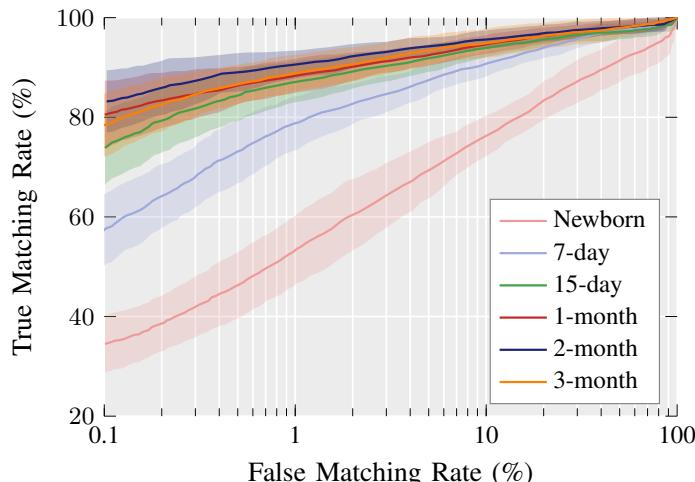  
Fig. 6: TMR@FMR curves by age group. Each curve corresponds to the top-performing quality assessment method at $\mathrm { F M R } { = } 1 . 0 \%$ for its respective age group.

## C. Improvements to Matching Rates

In order to improve TMR values, the top-ranked quality methods of Table III are combined with a simple frame-fusion strategy. Under this strategy, an “accept” requires the probe frame to match at least two frames of the same digits gallery. As such, a genuine probe is compared with the other four frames of its own gallery (all others besides itself), whereas an impostor probe frame is compared with all five gallery frames. This process is less strict than a fusion between two or more digits because it limits combinations to images of the same finger, rather than fingers of the same person.

Additionally, the state-of-the-art comparator MegaMatcher [9] (COTS) is employed alongside VeriFinger for latent fingerprint feature extraction and template matching, as comparisons in the literature for similar age groups tend to favor latent solutions [4], due to their capability of handling degraded impressions. Table V presents the TMR values achieved by frame-fusion at FMR=1.0%, using the top ranked quality method of Table IV. Upward arrows denote the relative gain over VeriFinger alone, using the corresponding results reported in Table III as reference.

As shown, frame-fusion improved upon the corresponding single-frame results of Table III in every age group, and latent matching also obtained higher TMR than the Verifinger baseline for all cases. For the 2-month group, fusion and latent matching elevated the top performance from a 90.5% mean (single-frame, VeriFinger) to 97.6%, the highest mean value encountered across tables, with a standard deviation of only 0.9 points. Newborns obtained the largest gains (29.7 points with MegaMatcher; e.g., RPS from 47.5% to 77.2%) from this strategy, but remained the most challenging group as MegaMatcher TMR mean remains at least 16 points below the other age groups.

TABLE V: Matching performance with frame-fusion over VeriFinger and MegaMatcher (Latent) comparators using RPS (tuned) (90 digits per fold, 5 folds).
<table><tr><td>Age</td><td>VeriFinger TMR@FMR=1.0%</td><td>MegaMatcher TMR@FMR=1.0%</td></tr><tr><td>Newborn</td><td> $6 0 . 1 \pm 7 . 8 ( \uparrow 1 2 . 6 )$ </td><td> $7 7 . 2 \pm 6 . 4 ( \uparrow 2 9 . 7 )$ </td></tr><tr><td>7-day</td><td> $8 5 . 6 \pm 2 . 6 ( \uparrow 0 8 . 3 )$ </td><td> $9 3 . 2 \pm 1 . 4 ( \uparrow 1 5 . 9 )$ </td></tr><tr><td>15-day</td><td> $9 2 . 1 \pm 3 . 1 \ ( \uparrow 0 4 . 8 )$ </td><td> $9 6 . 4 \pm 1 . 6 ( \uparrow 0 9 . 1 )$ </td></tr><tr><td>1-month</td><td> $9 2 . 8 \pm 2 . 5 ( \uparrow 0 4 . 4 )$ </td><td> $9 6 . 4 \pm 2 . 8 ( \uparrow 0 8 . 0 )$ </td></tr><tr><td>2-month</td><td> $9 4 . 5 \pm 1 . 0 ( \uparrow 0 4 . 0 )$ </td><td> $9 7 . 6 \pm 0 . 9 ( \uparrow 0 7 . 1 )$ </td></tr><tr><td>3-month</td><td> $9 3 . 9 \pm 2 . 8 ( \uparrow 0 5 . 1 )$ </td><td> $9 7 . 5 \pm 1 . 6 ( \uparrow 0 8 . 7 )$ </td></tr></table>

From 15 days onward, MegaMatcher TMR exceeded 96% for all listed methods, which supports video sampling as a viable strategy for capturing high-utility fingerprints from the earliest stages of life, and is compatible with the tuned methods selecting useful frames. Since Table V does not include default or NFIQ2-selected galleries, this experiment does not isolate the contribution of tuning to the fusion gains.

Nevertheless, challenges remain in reliably capturing and evaluating fingerprints during the first week after birth, including verification at maternity. Even with thousands of video frames available, 100% TMR may not be achievable at reasonable FMR operating points without a Failure-To-Enroll (FTE) rule. Real-time quality evaluation and feedback to collection agents could therefore help identify cases requiring additional acquisitions. Figure 7 illustrates this limitation using two genuine newborn sample pairs: a successfully matched thumb pair (top) and a false reject involving the little fingers (bottom). The pairs were selected using RPS quality scores and evaluated with frame-fusion and latent matching with a threshold of 70, which yields FMR=1.0% for RPS.

Although the thumb samples are visually more distinct, involuntary movement, acquisition noise, and the lack of suitable pairings can prevent successful matching, even for relatively clear frames such as the bottom-left image. In such cases, low-quality samples could be excluded using qualityscore thresholds that balance TMR gains against exclusion rates, as observed during the FNMR validation in Figure 4.

## V. DISCUSSION

The comparison between default and tuned configurations indicates that parameters derived from adult fingerprint norms limit the applicability of otherwise suitable methods to infants. $\mathrm { A t \ F M R { = } } 1 . 0 \%$ , tuned configurations obtained higher mean TMR than their defaults in every method-age combination.

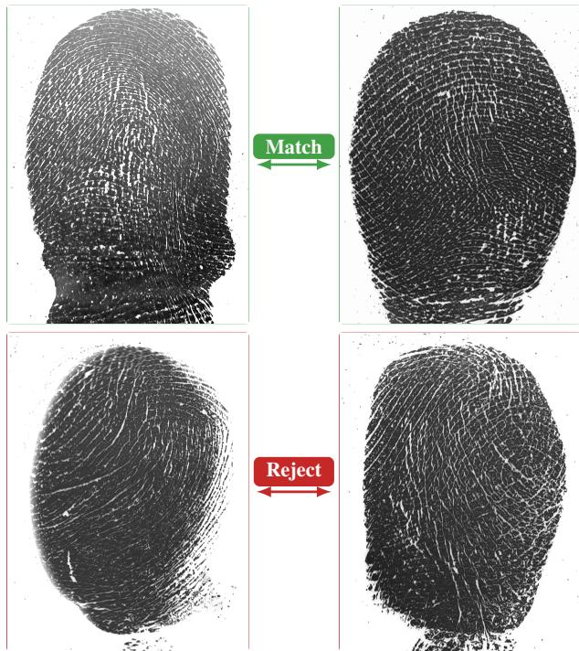  
Fig. 7: Examples of genuine newborn sample pairs. The thumb pair (top) exceeded the MegaMatcher threshold, whereas the little-finger pair (bottom) did not.

The effect is clearest for the methods with strong fingerprintspecific assumptions, LCS and RPS, whose rank gains over their defaults exceeded the CD at both operating points. Together, these two methods obtained the highest mean TMR at FMR=1.0% in five of six age groups, with margins within the fold standard deviation, however neither differed significantly from the other top-five methods.

Nevertheless, not all methods benefited equally from tuning. Gabor results were mixed, with consistent gains at FMR=1.0% but not FMR=0.1%. The simpler block-size tuning produced varying gains for RVU and OCL, but neither method was lifted above the adult-oriented standard NFIQ2. Methods which have no tunable inputs, namely SIG and MQCDA, were also shown to be competitive, ranking among the top five at FMR=1.0%, and together obtained the highest TMR mean at FMR=0.1% for three out of the six observed age groups.

In regards to subject age, matching rates was notably lower for newborns, consistent with the well-established difficulty of acquiring high-quality fingerprint images at this age. Performance was also shown to generally improve with age, with only minor variations between the 15-day and 1-month groups and between the 2- and 3-month groups. Within the evaluated subset of UTFPR-IFD, the 2-month group reached the highest TMR mean in frame comparisons, 90.5% (RPS), which rose to 97.6 once frame-fusion was combined with a COTS latent comparator (Table V). Critically, differences across the 15- day to 3-month age groups (97.4–97.5%) are within the fold standard deviation. Further improvements could be obtained as this fusion rule, which requires two matching frames of the same finger, is less strict than multi-finger acceptance protocols, which could yield further gains.

Finally, the Friedman–Nemenyi analysis does not identify a single superior method among the top five, as the differences in their average ranks do not exceed the critical difference. However, these methods rank consistently above most of the remaining methods and configurations, which suggests that they are the most appropriate solutions for infant fingerprints. A combinatorial approach akin to NFIQ2, assimilating complementary ridge properties such as orientation, width and frequency into a unified quality index, therefore appears to be the most promising direction for practical infant fingerprint quality assessment.

In summary, the findings yield several conclusions:

• Infant fingerprint patterns differ substantially from adults, such that standard parameters (devised for adults) are illsuited to capture the characteristic ridge widths, frequencies, and structural properties of infant samples;

• Parameterized quality assessment methods can be adapted to infant fingerprints through parameter search, and the resulting configurations establish a baseline for future comparisons;

• Matching rates remain relatively low for infants in sample-to-sample comparisons. However, frame fusion and latent comparators substantially improve results. Newborns nevertheless remain the most challenging age group as Table V reports;

• A composite index, such as NFIQ2, that integrates complementary features and extends this concept to incorporate age-adaptive components, represents a promising direction for quality-guided infant biometric enrollment.

## VI. CONCLUSIONS

This study examined the applicability of available fingerprint quality assessment methods for infants, initially enrolled as newborns and accompanied until 3-month of age. The majority of these methods were designed around adult fingerprint characteristics and are currently part of an international standard [7]. A parameter search strategy was proposed to reduce the gap between adult and infant fingerprint recognition, using a longitudinal dataset that tracks subjects from birth onward [5]. The final parameter set produced in this work (separate execution, full database) is available as supplementary material in Appendix A.

By directing the parameter search toward recognition performance, optimal ranges for algorithm features, including ridge and valley width, were identified. These tuned parameters produced measurable improvements in matching rates (TMR@FMR) across all evaluated age groups, demonstrating that parameters derived from adult standards are insufficient when applied to infant fingerprints. Additionally, a stricter recognition protocol could yield further improvements in matching rates, such as requiring the successful match of two or more fingers as recommended by ISO/IEC 2382-37 [34]. Section IV-C explores a similar frame-fusion solution that is shown to substantially improve TMR values across all ages.

Collectively, these results indicate that existing international standards do not adequately account for the biometric characteristics of infant fingerprints, which differ measurably from those of adults in feature scale and distribution. Nevertheless, the proposed parameter search demonstrates that existing biometric frameworks can be adapted to infant subjects when representative data is available. The optimized parameter sets identified in this work provide a practical foundation for future work aiming to propose solutions to infant fingerprint recognition in maternity settings, where reliable biometric validation helps ensure the identity of newborns to their parents.

Several directions remain open for future research: further investigation into how aging affects ridge and valley widths beyond the observed age groups, potentially up to adulthood; the proposal of international standards that explicitly account for age-dependent pattern characteristics and resolution variability; and the proposal of composite quality indexes for infants. The development of quality estimation, enhancement, feature extraction, and matching methods for high-resolution fingerprints could also yield significant improvements for infant biometrics.

## VII. ACKNOWLEDGEMENTS

We sincerely thank InfantID, CAPES (Finance Code 001), CNPq, Araucaria Foundation, and FINEP, for their financial´ support.

## REFERENCES

[1] A. K. Jain, S. S. Arora, K. Cao, L. Best-Rowden, and A. Bhatnagar, “Fingerprint recognition of young children,” IEEE Transactions on Information Forensics and Security, vol. 12, no. 7, pp. 1501–1514, 2017.

[2] S. Saggese, Y. Zhao, T. Kalisky, C. Avery, D. Forster, L. E. Duarte-Vera, L. A. Almada-Salazar, D. Perales-Gonzalez, A. Hubenko, M. Kleeman et al., “Biometric recognition of newborns and infants by non-contact fingerprinting: Lessons learned,” Gates Open Research, vol. 3, 2019.

[3] Y. Moolla, A. De Kock, G. Mabuza-Hocquet, C. S. Ntshangase, N. Nelufule, and P. Khanyile, “Biometric recognition of infants using fingerprint, iris, and ear biometrics,” IEEE Access, vol. 9, pp. 38 269–38 286, 2021.

[4] J. J. Engelsma, D. Deb, K. Cao, A. Bhatnagar, P. S. Sudhish, and A. K. Jain, “Infant-id: Fingerprints for global good,” IEEE Transactions on Pattern Analysis and Machine Intelligence, vol. 44, no. 7, pp. 3543– 3559, 2022.

[5] L. F. P. Southier, M. Filipak, L. A. Zanlorensi, I. Wasilevski, F. Favarim, J. T. Oliva, M. Teixeira, and D. Casanova, “An onproduction high-resolution longitudinal neonatal fingerprint database in brazil,” https://natosafe.com.br/, 2025. [Online]. Available: https: //arxiv.org/abs/2504.20104

[6] Natosafe, “Infantid,” 2026, [Online; accessed 2026-02-20].

[7] 29794-1, “Information technology — biometric sample quality,” International Organization for Standardization, Geneva, CH, Standard, 2024.

[8] E. Tabassi, M. Olsen, O. Bausinger, C. Busch, A. Figlarz, G. Fiumara, O. Henniger, J. Merkle, T. Ruhland, C. Schiel et al., “Nfiq 2 nist fingerprint image quality,” 2021.

[9] Neurotechnology, “Megamatcher sdk,” https://www.neurotechnology. com/megamatcher.html, software development kit.

[10] V. Camacho, G. Garella, F. Franzoni, L. Di Martino, G. Carbajal, J. Preciozzi, and A. Fernandez, “Recognizing infants and toddlers over an´ on-production fingerprint database,” in 2017 International Conference of the Biometrics Special Interest Group (BIOSIG). Darmstadt, Germany: IEEE, 2017, pp. 1–5.

[11] J. Preciozzi, G. Garella, V. Camacho, F. Franzoni, L. Di Martino, G. Carbajal, and A. Fernandez, “Fingerprint biometrics from newborn to adult: A study from a national identity database system,” IEEE Transactions on Biometrics, Behavior, and Identity Science, vol. 2, no. 1, pp. 68–79, 2020.

[12] Y. Shi and M. Liu, “A dense pyramid convolution network for infant fingerprint super-resolution and enhancement,” in 2021 IEEE International Joint Conference on Biometrics (IJCB), 2021, pp. 1–6.

[13] J. L. H. D. Agnol, L. F. P. Southier, J. T. Oliva, M. Teixeira, R. Minetto, M. Filipak, D. Casanova, and E. O. Rodrigues, “Recursive class con-´ nectivity classification (r3c) applied to binary image segmentation for improved infant fingerprint enhancement,” IEEE Access, vol. 13, pp. 136 087–136 100, 2025.

[14] J. H. Machado, B. d. O. Koop, M. Filipak, M. A. Barbosa, J. T. Oliva, L. F. Southier, D. Casanova, and M. Teixeira, “A super-resolution approach for image resizing of infant fingerprints with vision transformers,” IEEE Access, 2025.

[15] M. Hendre, S. Patil, and A. Abhyankar, “Directional filter bank-based fingerprint image quality,” Pattern Anal. Appl., vol. 25, no. 2, p. 379–393, 2022.

[16] P. Grother and E. Tabassi, “Performance of biometric quality measures,” IEEE Transactions on Pattern Analysis and Machine Intelligence, vol. 29, no. 4, pp. 531–543, 2007.

[17] F. Alonso-Fernandez, J. Fierrez, J. Ortega-Garcia, J. Gonzalez-Rodriguez, H. Fronthaler, K. Kollreider, and J. Bigun, “A comparative study of fingerprint image-quality estimation methods,” Trans. Info. For. Sec., vol. 2, no. 4, p. 734–743, Dec. 2007.

[18] M. A. Olsen, V. Smida, and C. Busch, “Finger image quality assessmentˇ features – definitions and evaluation,” IET Biometrics, vol. 5, no. 2, pp. 47–64, 2016.

[19] D. Maltoni, D. Maio, A. Jain, and J. Feng, Handbook of Fingerprint Recognition. Springer International Publishing, 2022.

[20] L. Shen, A. Kot, and W. Koo, “Quality measures of fingerprint images,” in International Conference on Audio-and Video-Based Biometric Person Authentication. Springer, 2001, pp. 266–271.

[21] T. P. Chen, X. Jiang, and W.-Y. Yau, “Fingerprint image quality analysis,” in 2004 International Conference on Image Processing, 2004. ICIP’04., vol. 2. IEEE, 2004, pp. 1253–1256.

[22] Y. Chen, S. C. Dass, and A. K. Jain, “Fingerprint quality indices for predicting authentication performance,” in International conference on audio-and video-based biometric person authentication. Springer, 2005, pp. 160–170.

[23] E. Lim, X. Jiang, and W. Yau, “Fingerprint quality and validity analysis,” in International Conference on Image Processing, vol. 1, 2002, pp. I–I.

[24] R. F. S. Teixeira and N. J. Leite, “A new framework for quality assessment of high-resolution fingerprint images,” IEEE Transactions on Pattern Analysis and Machine Intelligence, vol. 39, no. 10, p. 1905–1917, Oct. 2017.

[25] F. Turroni, R. Cappelli, and D. Maltoni, “Fingerprint enhancement using contextual iterative filtering,” in 2012 5th IAPR International Conference on Biometrics (ICB), 2012, pp. 152–157.

[26] K. Panetta, S. Rajeev, S. S. Agaian et al., “Lqm: Localized quality measure for fingerprint image enhancement,” Ieee Access, vol. 7, pp. 104 567–104 576, 2019.

[27] Y. Yu, H. Wang, X. Tan, Y. Zhang, P. Chen, and R. Liang, “A fingerprint quality driven transformer-cnn hybrid model for external and internal fingerprint fusion,” IEEE Transactions on Information Forensics and Security, vol. 20, 2025.

[28] L. F. P. Southier, G. A. T. Nunes, J. a. H. P. Machado, M. Buratti, P. H. d. V. Trentin, W. A. C. d. Bona, B. d. O. Koop, E. Diniz, J. a. V. C. Mazzochin, J. a. L. H. Dall Agnol, L. C. de Oliveira, M. Filipak, L. A. Zanlorensi, M. Belanc¸on, J. Oliva, M. Teixeira, and D. Casanova, “A systematic literature review on neonatal fingerprint recognition,” ACM Comput. Surv., 2025.

[29] A. Peng and R. Huang, “Research progress on the application of deep learning in fingerprint recognition,” Pattern Recognition, vol. 171, p. 112216, 2026.

[30] F. Nogueira, “Bayesian Optimization: Open source constrained global optimization tool for Python,” 2014–. [Online]. Available: https://github.com/bayesian-optimization/BayesianOptimization

[31] T. Schlett, C. Rathgeb, J. Tapia, and C. Busch, “Considerations on the evaluation of biometric quality assessment algorithms,” IEEE Transactions on Biometrics, Behavior, and Identity Science, vol. 6, no. 1, pp. 54–67, 2024.

[32] D. Maio, D. Maltoni, R. Cappelli, J. Wayman, and A. Jain, “Fvc2002: Second fingerprint verification competition,” in 2002 International Conference on Pattern Recognition, vol. 3, 2002, pp. 811–814 vol.3.

[33] J. Demsar, “Statistical comparisons of classifiers over multiple data sets,”ˇ Journal of Machine learning research, vol. 7, no. Jan, pp. 1–30, 2006.

[34] 2382-37:2022, “Information technology — vocabulary — part 37: Biometrics,” Int. Organization for Standardization, Geneva, CH, Standard, 2022.

## APPENDIX A

COMPLETE PARAMETER SET  
TABLE VI: Tuned parameter sets (Part I).
<table><tr><td>Age Group</td><td>Gabor  $( m , f , \sigma , \sigma _ { g } )$ </td><td>LCS  $W r { - } W v , \mathbf { B } . \mathbf { S i z e }$ </td><td>RVU B. Size</td></tr><tr><td>Newborn</td><td>8, 0.500, 0.807, 1</td><td> $\overline { { 2 \mathrm { - } 1 1 , 1 \mathrm { - } 3 , 6 4 \times 6 4 } }$ </td><td> $\overline { { 1 2 8 \times 1 2 8 } }$ </td></tr><tr><td>7-day</td><td> $8 , 0 . 5 0 0 , 0 . 8 0 7 , 5$ </td><td> $3 – 6 , 1 – 3 , 6 4 \times 6 4$ </td><td> $6 4 \times 6 4$ </td></tr><tr><td>15-day</td><td>8, 0.050, 8.071, 5</td><td> $2 \mathrm { - } 1 4 , 2 \mathrm { - } 3 , 6 4 \times 6 4$ </td><td> $6 4 \times 6 4$ </td></tr><tr><td>1-month</td><td> $8 , 0 . 5 0 0 , 0 . 8 0 7 , 1$ </td><td> $2 \mathrm { - } 9 , 2 \mathrm { - } 5 , 6 4 \times 6 4$ </td><td> $6 4 \times 6 4$ </td></tr><tr><td>2-month</td><td> $8 , 0 . 5 0 0 , 0 . 8 0 7 , 2$ </td><td> $2 \mathrm { - } 9 , 2 \mathrm { - } 5 , 6 4 \times 6 4$ </td><td> $6 4 \times 6 4$ </td></tr><tr><td>3-month</td><td> $8 , 0 . 5 0 0 , 0 . 8 0 7 ,$  1</td><td> $2 { - } 9 , 1 { - } 6 , 6 4 \times 6 4$ </td><td> $6 4 \times 6 4$ </td></tr><tr><td>Adult</td><td> $\overline { { 4 , 0 . 1 0 0 , 6 . 0 0 0 , 1 \ [ 7 ] } }$ </td><td> $3 – 1 0 , 2 – 1 0 , 3 2 \times 3 2 \ [ 7 ]$ </td><td> $\overline { { 6 4 \times 6 4 \ : [ 7 ] } }$ </td></tr></table>

TABLE VII: Tuned parameter sets (Part II).
<table><tr><td>Age Group</td><td>RPS  $( r _ { m i n } - r _ { m a x } , \Delta r , \theta )$ </td><td>OCL B. Size</td><td>DFB B. Size</td></tr><tr><td>Newborn</td><td>0.211–0.397, 10, 100</td><td> $\overline { { 1 2 8 \times 1 2 8 } }$ </td><td> $6 4 \times 6 4$ </td></tr><tr><td>7-day</td><td>0.379–0.560, 22, 79</td><td> $1 2 8 \times 1 2 8$ </td><td> $6 4 \times 6 4$ </td></tr><tr><td>15-day</td><td>0.440–0.700, 17, 132</td><td> $1 2 8 \times 1 2 8$ </td><td> $6 4 \times 6 4$ </td></tr><tr><td>1-month</td><td>0.240–0.700, 57, 132</td><td> $1 2 8 \times 1 2 8$ </td><td> $6 4 \times 6 4$ </td></tr><tr><td>2-month</td><td>0.440–0.700, 81, 81</td><td> $1 2 8 \times 1 2 8$ </td><td> $6 4 \times 6 4$ </td></tr><tr><td>3-month</td><td>0.440–0.700, 2, 114</td><td> $1 2 8 \times 1 2 8$ </td><td> $6 4 \times 6 4$ </td></tr><tr><td>Adult</td><td>0.077–0.143, 10, 180 [7], [18]</td><td> $\overline { { 3 2 \times 3 2 \ [ 7 ] } }$ </td><td> $\overline { { 4 \times 4 \left[ 1 5 \right] } }$ </td></tr></table>