# LOOK BEFORE YOU RESTORE: LEARNING TO PREDICT BEFORE ACTING FOR AGENTIC IMAGE RESTORATION

Xu Zhang1 Jun Wan2 Lefei Zhang1,∗ Liangpei Zhang1

1Wuhan University

2Zhongnan University of Economics and Law

zhangx0802@whu.edu.cn

## ABSTRACT

Agents for mixed-degradation image restoration typically learn what a tool does to an image only after running it: failed calls waste computation and harmful outputs go unnoticed until too late. We propose PreActIR, an agentic restoration framework that predicts tool consequences before execution. For each candidate tool, a tool-conditioned world model forecasts changes in residual degradation, image quality, and fidelity, together with the risk of harm and the uncertainty of the prediction. The agent executes the top-ranked candidate, and an independent verifier commits or rolls back its output before the agent replans from the observed state. PreActIR also audits whether performance is limited by the selector or by the candidate space, and studies targeted tool adaptation as a controlled way to expand that space. In a controlled evaluation that fixes the candidate pool, verifier, and budget and employs reference-annotated degradation states, PreActIR uses 42.5% fewer real tool calls and 63.4% fewer rejected calls than reactive, executethen-evaluate trial and error, while improving Y-PSNR by 0.92 dB.

## 1 INTRODUCTION

Image restoration has advanced rapidly for individual degradations such as noise, blur, rain, haze, low light, compression, and low resolution (Zhang et al., 2017; 2018a; Wei et al., 2018; Chen et al., 2018; Zamir et al., 2020; Chen et al., 2021; Zamir et al., 2021; 2022; Chen et al., 2022; Liang et al., 2021; Tu et al., 2022; Wang et al., 2021; Zhang et al., 2021). In practice, however, several degradations often coexist and interact, making restoration a sequential decision problem in which each intervention changes both the image state and the value of later actions. Recent agentic systems coordinate specialized tools through perception, planning, execution, and feedback (Zhu et al., 2025; Zuo et al., 2025; Li et al., 2026; Shao et al., 2026). Most of them follow an execute–observe–replan loop (Yao et al., 2023): a tool’s effect on a given image is known only after it has run, failed calls still cost computation, and harmful side effects go unnoticed until afterwards.

Recent agents reduce the number of trials with trained planners and stored experience (Jia et al., 2026; Zhu et al., 2026a; Wang et al., 2026), and a few methods score actions in advance: DiTTo (Choi and Oh, 2026) learns a simulator and a per-action quality predictor for trajectory construction, and the concurrent Causal-AgentIR (Gao et al., 2026) estimates plan utility from a causal memory of past executions. Neither trains a tool-conditioned consequence model for deploymenttime decisions. A separate question is whether the tool set itself is the limit: even a perfect selector fails if no reachable tool sequence yields a good result. Agents can add experts (Choi and Oh, 2026) or fine-tune tools together with the planner (Zhu et al., 2026a), but a poor result alone does not tell whether the selector chose badly or no good candidate was reachable—two cases that call for different fixes. As illustrated in Fig. 1, reactive execution pays for an outcome before seeing it, and it is usually unclear whether the selector or the tool set is the binding limit.

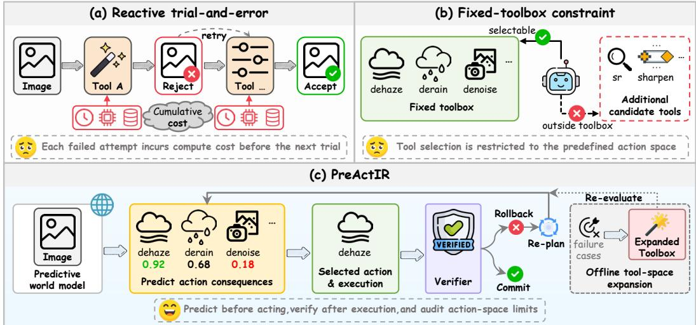  
Figure 1: Motivation of PreActIR. Existing agentic restoration is largely reactive: tool effects are observed only after execution, while decisions remain restricted to the available action space. Pre-ActIR predicts action consequences before execution.

We propose PreActIR, an agentic restoration framework built around the idea that an agent should predict what a tool will do before calling it. A tool-conditioned world model takes each candidate tool and predicts the changes in residual degradation, image quality, and fidelity, along with content damage, the probabilities of benefit and harm, and the uncertainty of these predictions. The agent ranks candidates by these predictions and executes only the top one. Because predictions can be wrong, an independent post-execution verifier checks the actual output and commits or rolls it back; the agent then replans from the observed state. We call this the predict–act–verify loop.

A separate diagnostic asks whether the selector or the tool set is binding. An offline candidatefrontier audit uses test references post hoc to find the best result reachable from the fixed candidate pool, separating selector headroom from tool-space limits. We then adapt one existing tool on external replay data and measure how it shifts both the attainable frontier and the deployed system.

Our contributions are as follows:

• A tool-conditioned world model that predicts how each candidate tool changes residual degradation, quality, and fidelity, along with benefit and harm probabilities and uncertainty, so that tools can be ranked and their risk estimated before execution.

• A predict–act–verify loop that executes only the top-ranked tool and lets an independent verifier commit or roll back its output; in a matched replay with reference-annotated states, it makes 42.5% fewer real calls and 63.4% fewer rejections than reactive trial and error.

• A candidate-frontier audit that distinguishes tool-selection limitations from candidatespace constraints by characterizing attainable fidelity–perception trade-offs. It quantifies the headroom available through better selection within a fixed pool and examines how targeted tool adaptation expands the attainable frontier.

## 2 RELATED WORK

All-in-One and Agentic Image Restoration. All-in-one image restoration addresses multiple degradations within a unified model using degradation-aware representations, multimodal guidance, or adaptive expert routing (Li et al., 2022; Potlapalli et al., 2023; Kong et al., 2024; Luo et al., 2024; Conde et al., 2024; Zhang et al., 2025; Jiang et al., 2024; Cui et al., 2025; Zamfir et al., 2025; Zhang et al., 2026). These methods learn a fixed policy without predicting tool effects before execution. Agentic restoration instead coordinates specialized models through perception, planning, execution, and feedback, building on reinforcement-learned toolchains (Yu et al., 2018; 2022). MLLM controllers reason about degradations and coordinate experts (Chen et al., 2024a; Lin et al., 2025; Zhou et al., 2025; Wei et al., 2026); AgenticIR, MAIR, 4KAgent, SEAR, HybridAgent, and FAPE-IR add exploration with rollback, multi-agent or recursive execution, tree search, fast–slow coordination, and frequency-aware planning (Zhu et al., 2025; Jiang et al., 2026; Zuo et al., 2025; Cui et al., 2026; Li et al., 2026; Liu et al., 2026); and others target rain, inscriptions, or photo retouching (Yu et al., 2026; Zhu et al., 2026b; Xiong et al., 2026). In these systems a tool’s effect is observed only after it runs, and SEAR’s tree search scores candidates by real rollouts.

Learned Tool Selection and Pre-Execution Estimation. Restore-R1, TIR-Agent, and OPERA train the planner with perceptual or metric rewards (Lu et al., 2026; Jia et al., 2026; Zhu et al., 2026a), and OPERA also fine-tunes the tools; SkillIR reuses skills from past executions (Shao et al., 2026), and PaAgent retrieves tool-specific experience from a portrait bank of restoration tools (Wang et al., 2026). These methods improve the choice of tool but do not predict what it will do. DiTTo (Cho and Oh, 2026) learns a restoration simulator and a per-action quality predictor, but uses them to build order-aware training trajectories. The concurrent Causal-AgentIR (Gao et al., 2026) keeps a causal memory graph of past executions, curated by a learned memory-operation policy, and scores plans before execution by multi-hop reasoning over retrieved memory paths, with a critic and rollback afterwards. Pre-execution scoring and rollback are therefore not new on their own. PreActIR differs in that it trains a consequence model on real transitions and queries it for every candidate at deployment time, predicting separate outcomes rather than collapsing them into a single score; it also audits whether the selector or the tool set limits performance.

World Models and Predict-before-Act Agents. World models learn action-conditioned dynamics so that an agent can evaluate actions in imagination before acting (Ha and Schmidhuber, 2018; Hafner et al., 2019). Probabilistic models quantify their own uncertainty (Chua et al., 2018), short rollouts limit compounding model error (Janner et al., 2019), and a model need not reconstruct observations if it predicts only decision-relevant quantities (Schrittwieser et al., 2020). Among language agents, PreAct predicts action results before acting (Fu et al., 2025), and WebDreamer uses an LLM to simulate each candidate web action before choosing one (Gu et al., 2025). Those predictions are free-form text from a pretrained model, whereas restoration tool outcomes are continuous and multidimensional, and fidelity to the unknown clean image is unobservable at test time. Our consequence heads are instead supervised with uncertainty estimates on real tool transitions; we plan one step ahead by default and rely on a post-execution verifier to catch the remaining prediction errors.

## 3 METHOD

## 3.1 PROBLEM FORMULATION

Given a degraded image $I _ { 0 }$ , a restoration-tool set ${ \mathcal { A } } ,$ and a real-execution budget B, we formulate agentic image restoration as a budgeted sequential decision problem. At step t, the agent maintains a restoration state

$$
\boldsymbol { s } _ { t } = \left[ f ( I _ { t } ) , \mathbf { z } _ { t } ^ { \mathrm { d e g } } \right] ,\tag{1}
$$

where $f ( I _ { t } )$ denotes the visual representation of the current image and ${ \bf z } _ { t } ^ { \mathrm { d e g } }$ characterizes its residual degradations. A candidate generator constructs a feasible action set

$$
\begin{array} { r } { \mathcal { A } _ { t } = G ( \mathbf { z } _ { t } ^ { \mathrm { d e g } } , \mathbf { M } _ { t } ; \mathcal { A } ) , } \end{array}\tag{2}
$$

where $\mathbf { M } _ { t }$ are spatial degradation maps (Sec. 3.3); the agent selects $a _ { t } \in \mathcal A _ { t }$ or terminates.

Executing $a _ { t }$ invokes the corresponding restoration operator $T _ { a _ { i } }$ and consumes one unit of the realexecution budget, even if the output is rejected and rolled back $\left( I _ { t + 1 } = I _ { t } \right)$ ). Let $N _ { T }$ denote the total number of real tool calls and $C ( \boldsymbol a )$ a relative execution-cost proxy. The restoration objective is

$$
\operatorname* { m a x } _ { a _ { 0 : T - 1 } } \ \Phi ( \mathbf { q } ( I _ { T } ) ) - \lambda _ { c } \sum _ { t = 0 } ^ { T - 1 } C ( a _ { t } ) , \qquad \mathrm { s . t . } \ N _ { T } \leq B ,\tag{3}
$$

where $\Phi$ maps the quality measures $\mathbf { q } ( I _ { T } )$ of the final image to a terminal utility. The difficulty is that an action’s outcome is unknown until its tool has run.

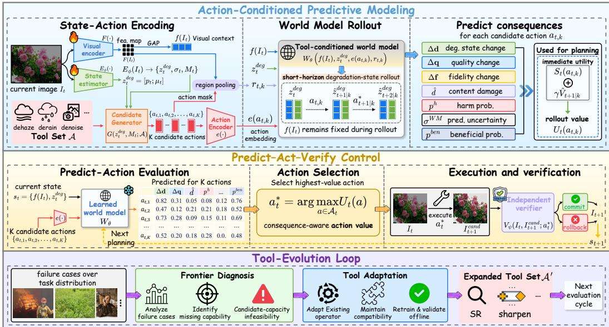  
Figure 2: Overview of PreActIR. The world model predicts action consequences before execution, while the predict–act–verify controller executes and verifies the selected action with commit or rollback. A tool-evolution loop performs candidate-frontier audit and targeted tool adaptation.

## 3.2 OVERVIEW

PreActIR follows a predict–act–verify loop (Fig. 2). A tool-conditioned world model predicts structured action consequences before execution (Sec. 3.3), and an independent verifier commits or rolls back each executed action (Sec. 3.4). An offline candidate-frontier audit then checks whether the candidate space limits performance, and targeted tool adaptation is studied as a controlled way to expand it (Sec. 3.5).

## 3.3 TOOL-CONDITIONED WORLD MODEL

For D degradation types, the degradation estimator predicts

$$
\begin{array} { r } { \{ \mathbf { p } _ { t } , \pmb { \mu } _ { t } , \pmb { \sigma } _ { t } ^ { \mathrm { e s t } } , \mathbf { M } _ { t } \} = E _ { \phi } ( I _ { t } ) , } \end{array}\tag{4}
$$

where $\mathbf { p } _ { t } , \pmb { \mu } _ { t } .$ , and $\pmb { \sigma } _ { t } ^ { \mathrm { e s t } }$ denote degradation presence, severity, and estimation uncertainty, respectively, and $\mathbf { M } _ { t }$ holds spatial degradation maps. The compact degradation state is $\mathbf { z } _ { t } ^ { \mathrm { { d e g } } } = \left[ { \bf { p } } _ { t } ; { \boldsymbol { \mu } } _ { t } \right]$

For each candidate action $a _ { t , k } , k = 1 , \ldots , K$ , its spatial mask $\mathbf { M } _ { t , k }$ is used for action-conditioned region pooling to obtain the regional feature $\mathbf { r } _ { t , k }$ (the OOF experiments in Secs. 4.3–4.4 use global masks; Appendix A.1), and $e ( a _ { t , k } )$ encodes the action. The world model predicts

$$
\begin{array} { r } { W _ { \theta } \big ( f ( I _ { t } ) , \mathbf { r } _ { t , k } , \mathbf { z } _ { t } ^ { \mathrm { d e g } } , e ( a _ { t , k } ) \big ) = \left\{ \widehat { \Delta \mathbf { d } } _ { t , k } , \widehat { \Delta \mathbf { q } } _ { t , k } , \widehat { \Delta \mathbf { f } } _ { t , k } , \widehat { d } _ { t , k } , p _ { t , k } ^ { \mathrm { h a r m } } , p _ { t , k } ^ { \mathrm { s e v } } , p _ { t , k } ^ { \mathrm { b e n } } , \sigma _ { t , k } ^ { \mathrm { W M } } \right\} , } \end{array}\tag{5}
$$

where $\widehat { \Delta \mathbf { d } } _ { t , k }$ is the predicted degradation reduction $( \Delta d _ { j } = \mu _ { j } ^ { \mathrm { b e f o r e } } - \mu _ { j } ^ { \mathrm { a f t e r } } ) , \widehat { \Delta \mathbf { q } } _ { t , k }$ and $\widehat { \Delta \mathbf { f } } _ { t , k }$ are changes in proxy quality and Y-channel fidelity, $\hat { d } _ { t , k }$ denotes content damage, $p _ { t , k } ^ { \mathrm { h a r m } } , p _ { t , k } ^ { \mathrm { s e v } }$ , and $p _ { t , k } ^ { \mathrm { b e n } }$ denote harm, severe-harm, and benefit probabilities, and $\sigma _ { t , k } ^ { \mathrm { W M } }$ denotes predictive uncertainty.

The same predictions can drive a short-horizon rollout. Starting from the imagined state $\widehat { \mathbf { z } } ^ { ( 0 ) } = \mathbf { z } _ { t } ^ { \mathrm { d e g } }$ an imagined action updates the residual degradation severity as

$$
\begin{array} { r } { \widehat { \pmb { \mu } } ^ { ( h + 1 ) } = \mathrm { c l i p } _ { [ 0 , 1 ] } \left( \widehat { \pmb { \mu } } ^ { ( h ) } - \mathbb { E } _ { \pmb { \theta } } \left[ \Delta \mathbf { d } \ | \ f ( I _ { t } ) , \widehat { \mathbf { z } } ^ { ( h ) } , a ^ { ( h ) } \right] \right) . } \end{array}\tag{6}
$$

Here, $a ^ { ( h ) }$ denotes the full action conditioning, including its encoded attributes and regional feature;   
the visual features of $I _ { t }$ and the presence estimate $\mathbf { p } _ { t }$ stay fixed, and only the severity is propagated.

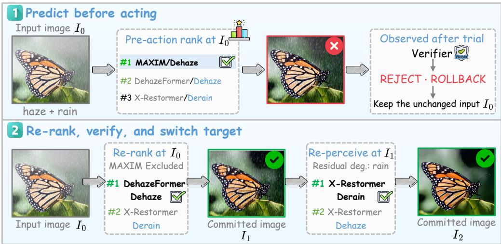  
Figure 3: An illustrative predict–act–verify trajectory under haze and rain.

World-model learning. The world model is trained on observed before–after tool transitions, supervised for degradation, quality, and fidelity changes, content damage, and beneficial, harmful, and severely harmful outcomes. Continuous heads use Gaussian negative log-likelihood, binary heads use cross-entropy, and pairwise ranking losses on a proxy utility and on the fidelity gain encourage correct within-state action ordering:

$$
\begin{array} { r } { \mathcal { L } _ { W } = \sum _ { c \in \{ \Delta d , \Delta q , d \} } \beta _ { c } \mathcal { L } _ { c } + \sum _ { b \in \{ \mathrm { b e n } , \mathrm { h a r m } , \mathrm { s e v } \} } \beta _ { b } \mathcal { L } _ { b } + \beta _ { f } \mathcal { L } _ { \Delta f } + \beta _ { \mathrm { r a n k } } ^ { f } \mathcal { L } _ { \mathrm { r a n k } } ^ { f } + \beta _ { \mathrm { r a n k } } \mathcal { L } _ { \mathrm { r a n k } } . } \end{array}\tag{7}
$$

Supervision construction, architecture, and loss weights are detailed in Appendix A.

## 3.4 PREDICT–ACT–VERIFY PLANNING

For each candidate action a targeting degradation ℓ, the world model yields target-degradation gain g, proxy-quality gain q, fidelity gain v, non-target side effect $\xi ,$ content damage d, predictive uncertainty u, and benefit probability $\bar { p } ^ { \mathrm { b e n } }$ , forming a planning score $S _ { t }$ and structured utility $U _ { t }$

$$
\begin{array} { r l } & { S _ { t } ( a ) = \lambda _ { g } g + \lambda _ { q } q + \lambda _ { v } v - \lambda _ { \xi } \xi - \lambda _ { d } d - \lambda _ { u } u - \lambda _ { c } C ( a ) , } \\ & { U _ { t } ( a ) = p ^ { \mathrm { b e n } } S _ { t } ( a ) - ( 1 - p ^ { \mathrm { b e n } } ) \rho , } \end{array}\tag{8}
$$

where $v = \widehat { \Delta \mathrm { P S N R } _ { Y } } + 1 0 \widehat { \Delta \mathrm { S S I M } _ { Y } }$ predicts the fidelity gain $\Delta F _ { Y } = \Delta \mathrm { P S N R } _ { Y } + 1 0 \Delta \mathrm { S S I M } _ { Y }$ $\begin{array} { r } { \xi = \sum _ { j \neq \ell } [ - \widehat { \Delta d } _ { j } ] _ { + } } \end{array}$ + measures predicted degradation increases outside the target, $C ( \boldsymbol a )$ is a relative cost prior, and ρ is the cost of a rejected call. The planner selects $a _ { t } ^ { * } = \arg \operatorname* { m a x } _ { a \in \mathcal { A } _ { t } } U _ { t } ( a )$ . Optional variants add harm penalties or an $H \ : = \ : 2$ lookahead via Eq. (6), executing only the first action (Appendix B.1); neither improved consistently in our ablation (Table 5), so Secs. 4.3–4.4 use the one-step score.

After execution, a separately trained verifier $V _ { \psi }$ evaluates the observed transition (Appendix B.3): verified candidates are committed, others rolled back, and the state is re-estimated from the observed image before the agent replans. Fig. 3 shows an example: the top-ranked MAXIM dehazing action is rejected and rolled back; re-ranking without it commits DehazeFormer (Song et al., 2023); the re-estimated $I _ { 1 }$ has only rain left, which X-Restormer (Chen et al., 2024b) removes.

## 3.5 CANDIDATE-FRONTIER AUDIT AND TARGETED TOOL ADAPTATION

No controller can outperform the best candidates reachable from the tool set A, so we audit this candidate space offline. Let $\mathcal { C } _ { i } ( \mathcal { A } )$ denote the frozen candidate outputs reachable for state $i \ =$ $1 , \ldots , N$ . The audit selects one candidate per state to maximize a dataset-level fidelity metric $m _ { F }$ subject to floors on other metrics:

$$
m _ { F } ^ { \star } ( \tau ) = \operatorname* { m a x } _ { c _ { i } \in \mathcal { C } _ { i } ( \mathcal { A } ) } \ \frac { 1 } { N } \sum _ { i = 1 } ^ { N } m _ { F } ( c _ { i } ) \quad \mathrm { s . t . } \quad \frac { 1 } { N } \sum _ { i = 1 } ^ { N } m _ { r } ( c _ { i } ) \geq \tau _ { r } , \quad \forall r \in \mathcal { M } ,\tag{9}
$$

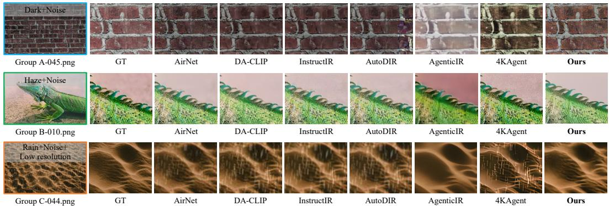  
Figure 4: Qualitative comparison on representative examples from MiO100 Groups A–C.

where $\tau _ { r }$ is the floor on metric $m _ { r } .$ . Sweeping τ traces the attainable frontier of the frozen pool, and a set of targets is jointly attainable if and only if it lies on or below this frontier. Reference images are used only for this post-hoc analysis and are never available to the deployment-time controller.

To test whether extending the tool set can improve the attainable operating point, we adapt an existing restoration operator on external training pairs constructed with task-matched degradation processes and add it to the tool set, $\mathcal { A } ^ { \prime } = \mathcal { A } \cup \{ a _ { \mathrm { a d a p t } } \}$ . Adaptation and validation are performed offline without benchmark references; we then re-audit the expanded pool and incorporate the adapted operator into the deployed system (Sec. 4.5).

## 4 EXPERIMENTS

## 4.1 DATASETS AND EXPERIMENTAL SETUP

PreActIR is evaluated on MiO100 (Kong et al., 2024) under the AgenticIR protocol (Zhu et al., 2025), with 160 official compound-degradation states from 20 clean-image identities for training and 1,440 test images across Groups A–C. We use five-fold cross-fitting with disjoint clean-image identities between fitting and outer validation. The base tool set A contains 33 restoration actions covering eight degradation types. Sec. 4.2 (Tables 1–2) reports the full system, in which the world model preranks root actions, only high-value roots are executed and expanded, and cross-fitted candidate-value models select the output, with a fixed output blend for Groups A and B (Appendix C). For Group C, it also includes a HAT-S operator (Chen et al., 2023) adapted on 4,000 external degradation-matched pairs, without MiO100 HQ images or test references (Appendix G). Controlled planner comparisons (Secs. 4.3–4.4) use matched candidate pools and tool sets.

Metrics are PSNR, SSIM (Wang et al., 2004), LPIPS (Zhang et al., 2018b), MANIQA (Yang et al., 2022), CLIP-IQA (Wang et al., 2023), and MUSIQ (Ke et al., 2021); PSNR and SSIM are computed on the Y channel of YCbCr.

## 4.2 MIO100 MAIN RESULTS

Table 1 compares PreActIR with representative all-in-one and agentic methods on MiO100. PreActIR achieves the highest SSIM on all three groups and the highest PSNR on Groups A and C. On Group A it also leads in LPIPS and MANIQA (22.61 dB, 0.292, and 0.383; SSIM 0.717), and on Group B it leads in MANIQA, CLIP-IQA, and MUSIQ. On Group C it leads in PSNR and SSIM (21.05 dB and 0.604) but trails 4KAgent on the three perceptual metrics. Qualitative comparisons in Fig. 4 show similar trends (more examples in Appendix D).

On the paired real-world set (Table 2), PreActIR leads on MANIQA, CLIP-IQA, and MUSIQ (0.389, 0.525, and 57.33), but its PSNR (22.64 dB) falls behind all other agents (SEAR reaches 24.41 dB), pointing to a fidelity–perception trade-off on this set that deserves further investigation. Qualitative results are in Fig. 5.

## 4.3 OPEN-LOOP PRE-EXECUTION RANKING

This section evaluates the world model before any tool is executed. On 160 clean-identity-disjoint out-of-fold (OOF) states, each method scores the same ranker-independent pool of 2,147 executed candidates and selects one action without verifier, retry, or lookahead. We evaluate top-1 headroom recovery (HR), harmful selections, within-state ranking, and harm discrimination. HR is the ratio of the mean realized $\Delta F _ { Y }$ (Sec. 3.4) of the selected action to that of the per-state best action. All CIs are 95% clean-identity cluster-bootstrap intervals of paired differences.

Table 1: Quantitative comparison on the three compound-degradation subsets of MiO100. Best and second-best results are marked in bold and underlined, respectively.
<table><tr><td>Group</td><td>Type</td><td>Method</td><td>PSNR↑</td><td>SSIM↑</td><td>LPIPS↓</td><td>MANIQA↑</td><td>CLIP-IQA↑</td><td>MUSIQ↑</td></tr><tr><td rowspan="7">A</td><td rowspan="6">All-in-One</td><td>AirNetCVPR&#x27;22</td><td>19.13</td><td>0.602</td><td>0.428</td><td>0.258</td><td>0.393</td><td>42.46</td></tr><tr><td>PromptIRNeurIPS&#x27;23</td><td>20.06</td><td>0.609</td><td>0.413</td><td>0.263</td><td>0.401</td><td>42.62</td></tr><tr><td>MiOÍR arXiv&#x27;24</td><td>20.84</td><td>0.656</td><td>0.372</td><td>0.245</td><td>0.393</td><td>47.82</td></tr><tr><td>DA-CLIP ICLR&#x27;24</td><td>19.58</td><td>0.603</td><td>0.427</td><td>0.242</td><td>0.414</td><td>42.51</td></tr><tr><td>InstructIRECCV&#x27;24</td><td>18.03</td><td>0.575</td><td>0.443</td><td>0.266</td><td>0.353</td><td>45.77</td></tr><tr><td>AutoDIR ECCV&#x27;24</td><td>19.64</td><td>0.629</td><td>0.397</td><td>0.250</td><td>0.377</td><td>47.01</td></tr><tr><td rowspan="4">Agent</td><td>AgenticIRICLR&#x27;25</td><td>21.04</td><td>0.682</td><td>0.315</td><td>0.307</td><td>0.447</td><td>56.88</td></tr><tr><td>MAIRIJCV&#x27;26</td><td>21.02</td><td>0.672</td><td>0.296</td><td>0.333</td><td>0.475</td><td>59.19</td></tr><tr><td>4KAgentNeurIPS&#x27;25 SEAR ECCV&#x27;26</td><td>21.48</td><td>0.672</td><td>0.302</td><td>0.375</td><td>0.554</td><td>63.19</td></tr><tr><td>PreActIR</td><td>21.80 22.61</td><td>0.696 0.717</td><td>0.302 0.292</td><td>0.341 0.383</td><td>0.504 0.540</td><td>61.29 62.78</td></tr><tr><td colspan="2"></td><td></td><td></td><td></td><td></td><td></td><td></td><td></td></tr><tr><td rowspan="8">B</td><td rowspan="5">All-in-One</td><td>AirNetCVPR&#x27;22 PromptIRNeurIPS&#x27;23</td><td>19.31 20.47</td><td>0.657 0.670</td><td>0.367 0.337</td><td>0.288 0.289</td><td>0.427 0.429</td><td>47.88 48.10</td></tr><tr><td>MiOIRarXiv&#x27;24</td><td>20.56</td><td>0.691</td><td>0.324</td><td>0.264</td><td>0.433</td><td>51.87</td></tr><tr><td>DA-CLIP ICLR&#x27;24</td><td>18.56</td><td>0.595</td><td>0.441</td><td>0.244</td><td>0.415</td><td>43.70</td></tr><tr><td>InstructIR ECCV&#x27;24</td><td>18.34</td><td>0.624</td><td>0.407</td><td>0.302</td><td>0.379</td><td>50.94</td></tr><tr><td>AutoDIRECCV&#x27;24</td><td>19.90</td><td>0.664</td><td>0.354</td><td>0.253</td><td>0.399</td><td></td></tr><tr><td></td><td></td><td></td><td></td><td></td><td></td><td>49.64</td></tr><tr><td rowspan="4">Agent</td><td>AgenticIRICLR&#x27;25</td><td>20.55</td><td>0.701</td><td>0.307</td><td>0.320</td><td>0.465</td><td>57.57</td></tr><tr><td>MAIRIJCV&#x27;26 4KAgentNeurIPS&#x27;25</td><td>20.92 20.95</td><td>0.700</td><td>0.279</td><td>0.354</td><td>0.508</td><td>60.98</td></tr><tr><td>SEARECCV&#x27;26</td><td>22.13</td><td>0.673</td><td>0.302</td><td>0.373 0.345</td><td>0.551</td><td>62.69</td></tr><tr><td>PreActIR</td><td>22.00</td><td>0.725 0.730</td><td>0.289 0.280</td><td>0.388</td><td>0.513</td><td>60.65 63.31</td></tr><tr><td colspan="2"></td><td></td><td></td><td></td><td></td><td>0.555</td><td></td></tr><tr><td rowspan="8">C</td><td rowspan="5">All-in-One</td><td>AirNetCVPR&#x27;22</td><td>17.95</td><td>0.515</td><td>0.578</td><td>0.185</td><td>0.311</td><td>30.12</td></tr><tr><td>PromptIRNeurIPS&#x27;23 MiOIR</td><td>18.51</td><td>0.517</td><td>0.576</td><td>0.191</td><td>0.310</td><td>29.71</td></tr><tr><td>arXiv&#x27;24</td><td>15.63</td><td>0.490</td><td>0.538</td><td>0.172</td><td>0.289</td><td>37.95</td></tr><tr><td>DA-CLIP ICLR&#x27;24</td><td>18.53</td><td>0.532</td><td>0.534</td><td>0.192</td><td>0.348</td><td>33.87</td></tr><tr><td>InstructIRECCV&#x27;24</td><td>17.09</td><td>0.514</td><td>0.558</td><td>0.173</td><td>0.254</td><td>33.69</td></tr><tr><td>AutoDIR ECCV&#x27;24</td><td>18.61</td><td>0.544</td><td>0.502</td><td>0.205</td><td>0.294</td><td>37.86</td></tr><tr><td rowspan="5">Agent</td><td>AgenticIRICLR&#x27;25</td><td>18.82</td><td>0.547</td><td>0.449</td><td>0.270</td><td>0.395</td><td>48.68</td></tr><tr><td>MAIRIJCV&#x27;26</td><td>19.42</td><td>0.554</td><td>0.414</td><td>0.280</td><td>0.424</td><td>51.36</td></tr><tr><td>4KAgentNeurIPS&#x27;25</td><td>19.77</td><td>0.563</td><td>0.427</td><td>0.355</td><td>0.523</td><td>55.56</td></tr><tr><td>SEARECCV&#x27;26</td><td>20.61</td><td>0.593</td><td>0.417</td><td>0.274</td><td>0.442</td><td>52.73</td></tr><tr><td>PreActIR</td><td>21.05</td><td>0.604</td><td>0.418</td><td>0.332</td><td>0.505</td><td>54.78</td></tr></table>

Table 2: Quantitative comparison on the paired real-world 100-image set used in MAIR.
<table><tr><td>Method</td><td>PSNR↑</td><td>SSIM↑</td><td>LPIPS↓</td><td>MANIQA↑</td><td>CLIP-IQA↑</td><td>MUSIQ↑</td></tr><tr><td rowspan="4">AirNet PromptIR MiOIR DA-CLIP</td><td>23.31</td><td>0.747</td><td>0.448 0.434</td><td>0.236</td><td>0.327</td><td>35.27</td></tr><tr><td>23.86 24.00</td><td>0.754 0.747</td><td>0.424</td><td>0.241</td><td>0.327</td><td>35.48</td></tr><tr><td>23.73</td><td>0.744</td><td>0.427</td><td>0.239</td><td>0.351</td><td>36.85</td></tr><tr><td>20.75</td><td>0.664</td><td>0.479</td><td>0.251 0.247</td><td>0.333 0.315</td><td>36.41 42.68</td></tr><tr><td rowspan="3">AutoDIR AgenticIR 4KAgent</td><td>23.93</td><td>0.721</td><td>0.373</td><td>0.315</td><td></td><td></td></tr><tr><td>23.63</td><td>0.724</td><td>0.357</td><td>0.320</td><td>0.451</td><td>52.91</td></tr><tr><td>24.41</td><td>0.743</td><td>0.337</td><td>0.317</td><td>0.451</td><td>54.46</td></tr><tr><td>SEAR PreActIR</td><td>22.64</td><td>0.731</td><td>0.370</td><td>0.389</td><td>0.452 0.525</td><td>54.67 57.33</td></tr></table>

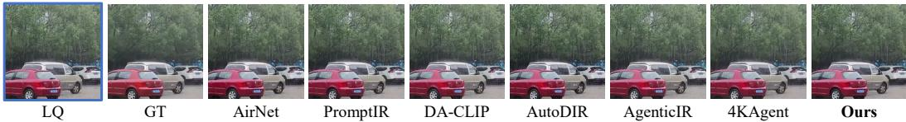  
Figure 5: Qualitative comparison on a representative example from the paired real-world dataset.

The world model’s main advantage is not higher one-shot fidelity, but richer pre-execution consequence information. Its HR is similar to Direct (34.6% vs. 36.7%; difference −2.1 points, CI [−15.5, 11.8]), while it better preserves within-state candidate ordering $( r _ { s } ~ = ~ 0 . 3 0 9 ~ \mathrm { v s . } ~ 0 . 2 4 7 ;$ difference 0.062, CI [0.009, 0.120]). More clearly, its harm probability distinguishes harmful from non-harmful candidates better than Direct or WM-F (ROC-AUC 0.729 vs. 0.612 and 0.656; Fig. 6a). At matched harm rates of 5, 10, and 15%, harm-based abstention recovers +0.0, +3.5, and +10.7 points more HR than gain-based abstention, although all CIs include zero (Fig. 6b). Overall, the world model contributes most through candidate ordering and risk information rather than top-1 fidelity prediction alone. Appendix E gives the full paired comparisons.

Table 3: Open-loop top-1 selection on 160 OOF states with 2,147 executed candidates. HR: share of oracle headroom recovered. Harm: the selected action lowers Y-PSNR by more than 0.05 dB, Y-SSIM by more than 0.005, or mean proxy quality. Severe: Y-PSNR drop ≥1 dB or Y-SSIM drop ≥0.05. rs: mean within-state Spearman correlation of scores with realized $\Delta F _ { Y }$ . WM-F: fidelity head alone.
<table><tr><td>Method</td><td>HR (%)↑</td><td>Harm (%)↓</td><td>Severe (%)↓</td><td> $\Delta \mathrm { P S N R } _ { Y } \uparrow$ </td><td> $\Delta S S \mathrm { I M } _ { Y } \uparrow$ </td><td>∆LPIPS↓</td><td> $r _ { \mathrm { s } } \uparrow$ </td></tr><tr><td>Random</td><td>1.1</td><td>55.7</td><td>28.2</td><td>-0.10</td><td>0.015</td><td>-0.038</td><td></td></tr><tr><td>Tool prior</td><td>31.9</td><td>40.6</td><td>13.8</td><td>0.98</td><td>0.058</td><td>-0.067</td><td>0.284</td></tr><tr><td>Degrâdation routing</td><td>36.6</td><td>35.6</td><td>15.0</td><td>1.27</td><td>0.052</td><td>-0.079</td><td>0.378</td></tr><tr><td>Direct scorer</td><td>36.7</td><td>48.8</td><td>27.5</td><td>1.26</td><td>0.053</td><td>-0.056</td><td>0.247</td></tr><tr><td>World model (WM)</td><td>34.6</td><td>42.5</td><td>21.9</td><td>1.14</td><td>0.055</td><td>-0.069</td><td>0.309</td></tr><tr><td>WM-F</td><td>31.9</td><td>46.2</td><td>23.1</td><td>1.05</td><td>0.051</td><td>-0.057</td><td>0.314</td></tr><tr><td>Oracle</td><td>100.0</td><td>5.0</td><td>0.0</td><td>3.86</td><td>0.102</td><td>-0.116</td><td></td></tr></table>

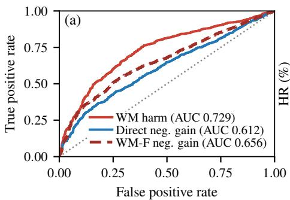

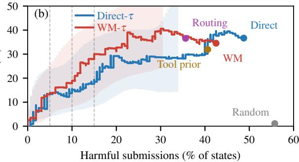  
Figure 6: Risk information from pre-execution prediction; brackets and bands are 95% clean-identity cluster-bootstrap intervals. (a) ROC for detecting harmful actions among 2,147 candidates. Paired AUC gains of $\bar { p } ^ { \mathrm { h a r m } }$ : 0.118 [0.091, 0.146] over Direct and 0.073 [0.054, 0.093] over WM-F. (b) HR versus harmful submissions when the top action may be replaced by a no-op. Lines sweep an abstention threshold on predicted harm (WM-τ) or gain (Direct-τ), with bands shown where all draws have support; dots: top-1 results of Table 3; dashed lines: 5/10/15% harm.

Table 4: Matched closed-loop comparison on the 160 OOF states with a shared candidate pool, verifier, and budget $B = 4 .$ Calls and rejects are per image; time counts restoration-tool execution only. Rejects, PreActIR minus reactive: −1.49 per image, CI [−1.78, −1.21].
<table><tr><td>Policy</td><td>Calls↓</td><td>Rejects↓</td><td>Time (s)↓</td><td>PSNRY↑</td><td> $\mathrm { S S I M } _ { Y } \uparrow$ </td><td>LPIPS↓</td><td>Harm (%)↓</td></tr><tr><td>Reactive trial-and-error</td><td>2.97</td><td>2.36</td><td>39.6</td><td>21.16</td><td>0.676</td><td>0.422</td><td>15.6</td></tr><tr><td>Fidelity-head ranking</td><td>1.75</td><td>0.90</td><td>25.8</td><td>22.27</td><td>0.689</td><td>0.420</td><td>18.1</td></tr><tr><td>PreActIR (structured)</td><td>1.71</td><td>0.86</td><td>25.3</td><td>22.08</td><td>0.690</td><td>0.416</td><td>14.4</td></tr></table>

## 4.4 PREDICT-BEFORE-ACT VERSUS REACTIVE TRIAL-AND-ERROR

The previous section evaluated ranking from frozen outcomes; here we test whether better ranking saves real tool calls when failures are costly. In a controlled replay on the same 160 OOF states, three policies share the candidate pool, an annotated degradation state, the post-execution verifier, and a budget of four real calls; each executes candidates in its own order, rolls back rejected outputs, and stops at the first verified one. The pool contains the 1,415 candidates executed when constructing the training transitions: all tools for each state’s annotated degradation types, plus up to two randomly drawn tools from other types (7–12 per state). Because the shared state uses annotated degradation types and severities computed from the clean reference, the replay isolates execution order under an accurate state rather than estimating deployment performance (Sec. 4.3). Reactive trial-and-error orders targets by presence times severity (floored at 0.05) and tools by a per-target route fitted on two inner identities; fidelity-head ranking (WM-F) and PreActIR order the same candidates by predicted fidelity gain v and by structured utility Ut, respectively. With the verifier threshold fixed per fold, only the ordering differs.

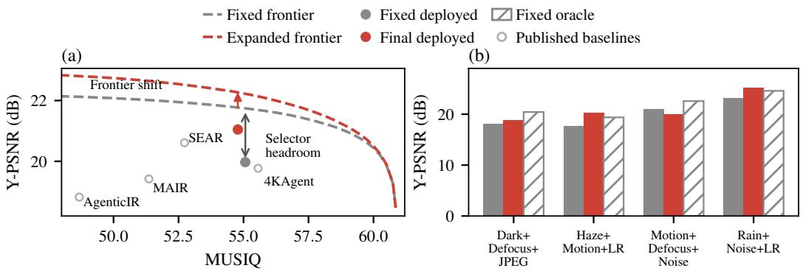  
Figure 7: Group C frontier audit (post hoc, using test references). (a) Attainable mean Y-PSNR vs. MUSIQ for the fixed and expanded pools (dashed); gray: deployed fixed-pool system; red: final system, built on a different fixed-pool configuration (Sec. 4.5); hollow: baselines of Table 1. (b) Per-combination Y-PSNR (LR: low resolution); oracle at the fixed system’s MUSIQ level.

Pre-execution ranking reduces wasted calls by a large margin (Table 4). Against reactive trial-anderror, PreActIR uses 42.5% fewer real calls (paired difference −1.26 per image, CI [−1.50, −1.02]) and 63.4% fewer rejected calls, and improves Y-PSNR by 0.92 dB (CI [0.49, 1.34]), partly because it more often finds a verified candidate within budget (no-commit rate 23.1 points lower, CI [15.6, 30.6]). Fidelity-head ranking achieves similar savings, so the efficiency gain comes mainly from ranking candidates before execution rather than from the structured utility specifically. Against fidelity-head ranking, the structured utility does reduce harm by 3.75 points (CI [0.6, 7.5]), consistent with the open-loop ablation of pben. Other paired intervals and budget sensitivity are in Appendix F.

## 4.5 CANDIDATE-FRONTIER AUDIT AND TARGETED TOOL ADAPTATION

No amount of better prediction helps if no reachable candidate is good enough. We therefore audit whether Group C is limited by selection or by what the 33-action tool set can produce. Using test references post hoc, we score all 21,385 frozen Group C candidates and solve an exact one-candidate-per-state mixed-integer program that maximizes mean Y-PSNR subject to a floor on mean MUSIQ; sweeping the floor traces the attainable fidelity–perception frontier of the fixed pool (Fig. 7a). This oracle is not deployable, but it shows where the ceiling is. The deployed fixed-pool configuration lies well inside the frontier: at its MUSIQ level, a reference-assisted selection from the same pool reaches 21.74 versus 19.97 dB Y-PSNR, leaving 1.77 dB of selector headroom. Adapting HAT-S on 4,000 external replay pairs expands the pool for the 200 low-resolution states and raises the attainable frontier by 0.50 dB at the final MUSIQ level. Our final Group C system builds on a different fixed-pool configuration and fuses the adapted tool’s output into the low-resolution states; it reaches 21.05/0.604 Y-PSNR/Y-SSIM at MUSIQ 54.78 but still lies 0.7 dB below the fixed-pool frontier. On the two low-resolution combinations it exceeds the fixed-pool oracle, while the other two retain 1.6–2.6 dB of selector headroom (Fig. 7b). Tool adaptation is one practical route to a better operating point, but closing the selector headroom offers a larger gain.

## 5 CONCLUSION

We presented PreActIR, an agentic restoration framework that looks before it restores: a toolconditioned world model predicts the consequences of each candidate tool before execution, and an independent verifier commits or rolls back the executed one. In controlled replays with matched candidates, verifier, and budget, predicting before acting substantially reduces real and rejected tool calls while improving restoration quality, and on MiO100 the full system achieves the best overall performance on all three compound-degradation groups. The candidate-frontier audit shows where the remaining gains lie: the existing tool set holds considerable headroom for better selection, and targeted adaptation can push the frontier further. Two directions remain open: validating these gains under estimated degradation states and establishing whether multi-step imagination adds value beyond single-step ranking.

## AI USE STATEMENT

In this work, generative AI tools were used to edit the manuscript and improve readability and language. All AI-suggested edits were reviewed against the original text by the authors, who take full responsibility for the final content, including all text, claims, and AI-assisted artifacts.

## REFERENCES

Chen Chen, Qifeng Chen, Jia Xu, and Vladlen Koltun. Learning to see in the dark. In IEEE/CVF Conference on Computer Vision and Pattern Recognition, 2018.

Haoyu Chen, Wenbo Li, Jinjin Gu, Jingjing Ren, Sixiang Chen, Tian Ye, Renjing Pei, Kaiwen Zhou, Fenglong Song, and Lei Zhu. RestoreAgent: Autonomous image restoration agent via multimodal large language models. In Advances in Neural Information Processing Systems (NeurIPS), volume 37, pages 110643–110666, 2024a.

Liangyu Chen, Xin Lu, Jie Zhang, Xiaojie Chu, and Chengpeng Chen. HINet: Half instance normalization network for image restoration. In Proceedings of the IEEE/CVF Conference on Computer Vision and Pattern Recognition Workshops (CVPRW), pages 182–192, 2021.

Liangyu Chen, Xiaojie Chu, Xiangyu Zhang, and Jian Sun. Simple baselines for image restoration. In European Conference on Computer Vision, 2022.

Xiangyu Chen, Xintao Wang, Jiantao Zhou, Yu Qiao, and Chao Dong. Activating more pixels in image super-resolution transformer. In IEEE/CVF Conference on Computer Vision and Pattern Recognition, 2023.

Xiangyu Chen, Zheyuan Li, Yuandong Pu, Yihao Liu, Jiantao Zhou, Yu Qiao, and Chao Dong. A comparative study of image restoration networks for general backbone network design. In European Conference on Computer Vision (ECCV), 2024b.

Seungho Choi and Jihyong Oh. Ditto: Scalable order-aware all-in-one image restoration agent. arXiv preprint arXiv:2605.30915, 2026.

Kurtland Chua, Roberto Calandra, Rowan McAllister, and Sergey Levine. Deep reinforcement learning in a handful of trials using probabilistic dynamics models. In Advances in Neural Information Processing Systems (NeurIPS), volume 31, 2018.

Marcos V. Conde, Gregor Geigle, and Radu Timofte. InstructIR: High-quality image restoration following human instructions. In European Conference on Computer Vision, 2024.

Shuang Cui, Fan Ji, Guanglong Sun, Yufei Guo, Xiongxin Tang, Jiangmeng Li, and Fanjiang Xu. Self-evolving agentic image restoration via deliberate planning and intuitive execution. In European Conference on Computer Vision, 2026.

Yuning Cui, Syed Waqas Zamir, Salman Khan, Alois Knoll, Mubarak Shah, and Fahad Shahbaz Khan. AdaIR: Adaptive all-in-one image restoration via frequency mining and modulation. In International Conference on Learning Representations, 2025.

Dayuan Fu, Jianzhao Huang, Siyuan Lu, Guanting Dong, Yejie Wang, Keqing He, and Weiran Xu. PreAct: Prediction enhances agent’s planning ability. In International Conference on Computational Linguistics, 2025.

Hu Gao, Yulong Chen, and Lizhuang Ma. Causal-AgentIR: Self-evolving causal memory for adaptive image restoration agents. arXiv preprint arXiv:2607.21125, 2026.

Pierre Geurts, Damien Ernst, and Louis Wehenkel. Extremely randomized trees. Machine Learning, 63(1):3–42, 2006.

Yu Gu, Kai Zhang, Yuting Ning, Boyuan Zheng, Boyu Gou, Tianci Xue, Cheng Chang, Sanjari Srivastava, Yanan Xie, Peng Qi, Huan Sun, and Yu Su. Is your LLM secretly a world model of the internet? Model-based planning for web agents. Transactions on Machine Learning Research, 2025.

David Ha and Jurgen Schmidhuber. Recurrent world models facilitate policy evolution. In¨ Advances in Neural Information Processing Systems, 2018.

Danijar Hafner, Timothy Lillicrap, Ian Fischer, Ruben Villegas, David Ha, Honglak Lee, and James Davidson. Learning latent dynamics for planning from pixels. In Proceedings of the 36th International Conference on Machine Learning, volume 97 of Proceedings of Machine Learning Research, pages 2555–2565. PMLR, 2019.

Michael Janner, Justin Fu, Marvin Zhang, and Sergey Levine. When to trust your model: Modelbased policy optimization. In Advances in Neural Information Processing Systems (NeurIPS), volume 32, 2019.

Guoli Jia, Yisheng Zhang, Haote Hu, Shanxu Zhao, Kaikai Zhao, Long Sun, Xinwei Long, Kai Tian, Che Jiang, Zhaoxiang Liu, Kai Wang, Shiguo Lian, Kaiyan Zhang, and Bowen Zhou. TIR-Agent: Training an explorative and efficient agent for image restoration. In European Conference on Computer Vision, pages 523–540, 2026.

Xu Jiang, Gehui Li, Bin Chen, and Jian Zhang. Multi-agent image restoration. International Journal ofComputer Vision, 134(5):205, 2026.

Yitong Jiang, Zhaoyang Zhang, Tianfan Xue, and Jinwei Gu. AutoDIR: Automatic all-in-one image restoration with latent diffusion. In European Conference on Computer Vision, 2024.

Junjie Ke, Qifei Wang, Yilin Wang, Peyman Milanfar, and Feng Yang. MUSIQ: Multi-scale image quality transformer. In IEEE/CVF International Conference on Computer Vision, 2021.

Xiangtao Kong, Chao Dong, and Lei Zhang. Towards effective multiple-in-one image restoration: A sequential and prompt learning strategy. arXiv preprint arXiv:2401.03379, 2024.

Bingchen Li, Xin Li, Yiting Lu, and Zhibo Chen. Hybrid agents for image restoration. In Proceedings of the IEEE/CVF Conference on Computer Vision and Pattern Recognition, pages 22636– 22647, 2026.

Boyun Li, Xiao Liu, Peng Hu, Zhongqin Wu, Jiancheng Lv, and Xi Peng. All-in-one image restoration for unknown corruption. In IEEE/CVF Conference on Computer Vision and Pattern Recognition, 2022.

Jingyun Liang, Jiezhang Cao, Guolei Sun, Kai Zhang, Luc Van Gool, and Radu Timofte. SwinIR: Image restoration using swin transformer. In IEEE/CVF International Conference on Computer Vision Workshops, 2021.

Xinqi Lin, Jingwen He, Ziyan Chen, Zhaoyang Lyu, Bo Dai, Fanghua Yu, Yu Qiao, Wanli Ouyang, and Chao Dong. DiffBIR: Toward blind image restoration with generative diffusion prior. In European Conference on Computer Vision (ECCV), 2024.

Yunlong Lin, Zixu Lin, Haoyu Chen, Panwang Pan, Chenxin Li, Sixiang Chen, Kairun Wen, Yeying Jin, Wenbo Li, and Xinghao Ding. JarvisIR: Elevating autonomous driving perception with intelligent image restoration. In IEEE/CVF Conference on Computer Vision and Pattern Recognition, pages 22369–22380, 2025.

Jingren Liu, Shuning Xu, Qirui Yang, Yun Wang, Xiangyu Chen, and Zhong Ji. FAPE-IR: Frequency-aware planning and execution framework for all-in-one image restoration. In IEEE/CVF Conference on Computer Vision and Pattern Recognition, pages 15561–15573, 2026.

Jianglin Lu, Yuanwei Wu, Ziyi Zhao, Hongcheng Wang, Felix Jimenez, Abrar Majeedi, and Yun Fu. Restore-R1: Efficient image restoration agents via reinforcement learning with multimodal LLM perceptual feedback. In IEEE/CVF Conference on Computer Vision and Pattern Recognition Findings, pages 8629–8639, 2026.

Ziwei Luo, Fredrik K. Gustafsson, Zheng Zhao, Jens Sjolund, and Thomas B. Sch ¨ on. Controlling ¨ vision-language models for multi-task image restoration. In International Conference on Learning Representations, 2024.

Vaishnav Potlapalli, Syed Waqas Zamir, Salman Khan, and Fahad Shahbaz Khan. PromptIR: Prompting for all-in-one blind image restoration. In Advances in Neural Information Processing Systems, 2023.

Julian Schrittwieser, Ioannis Antonoglou, Thomas Hubert, Karen Simonyan, Laurent Sifre, Simon Schmitt, Arthur Guez, Edward Lockhart, Demis Hassabis, Thore Graepel, Timothy Lillicrap, and David Silver. Mastering atari, go, chess and shogi by planning with a learned model. Nature, 588: 604–609, 2020.

Jie Shao, Shengkai Hu, Xu Zhang, Beihang Song, Yongcheng Jing, Xu Wu, and Jun Wan. Skillir: Evolving scene-aware skills for agentic image restoration. arXiv preprint arXiv:2609.21468, 2026.

Yuda Song, Zhuqing He, Hui Qian, and Xin Du. Vision transformers for single image dehazing. IEEE Transactions on Image Processing, 32:1927–1941, 2023.

Zhengzhong Tu, Hossein Talebi, Han Zhang, Feng Yang, Peyman Milanfar, Alan Bovik, and Yinxiao Li. MAXIM: Multi-axis MLP for image processing. In IEEE/CVF Conference on Computer Vision and Pattern Recognition, 2022.

Jianyi Wang, Kelvin C. K. Chan, and Chen Change Loy. Exploring CLIP for assessing the look and feel of images. In AAAI Conference on Artificial Intelligence, 2023.

Xintao Wang, Liangbin Xie, Chao Dong, and Ying Shan. Real-ESRGAN: Training real-world blind super-resolution with pure synthetic data. In IEEE/CVF International Conference on Computer Vision Workshops, 2021.

Yijian Wang, Qingsen Yan, Jiantao Zhou, Duwei Dai, and Wei Dong. PaAgent: Portraitaware image restoration agent via subjective-objective reinforcement learning. arXiv preprint arXiv:2603.17055, 2026.

Zhou Wang, Alan C. Bovik, Hamid R. Sheikh, and Eero P. Simoncelli. Image quality assessment: From error visibility to structural similarity. IEEE Transactions on Image Processing, 13(4): 600–612, 2004.

Chen Wei, Wenjing Wang, Wenhan Yang, and Jiaying Liu. Deep retinex decomposition for low-light enhancement. In British Machine Vision Conference, 2018.

Yanyan Wei, Yilin Zhang, Huan Zheng, Jiahuan Ren, Xiaogang Xu, Zenglin Shi, Zhao Zhang, and Meng Wang. IAMAgent: Toward an interactive and adaptive multi-agent system for image restoration. IEEE Transactions on Image Processing, 35:3127–3140, 2026. doi: 10.1109/TIP. 2026.3671594.

Honglin Xiong, Chenjie Zhu, Jianbiao Ding, Zixuan Ni, Wei Li, Zhenpeng Mi, and Qian Wang. Beyond sequential tools: A unified VLM agent system for photographic post-processing via dynamic multi-expert fusion. In IEEE/CVF Conference on Computer Vision and Pattern Recognition, pages 41521–41530, 2026.

Sidi Yang, Tianhe Wu, Shuwei Shi, Shanshan Lao, Yuan Gong, Mingdeng Cao, Jiahao Wang, and Yujiu Yang. MANIQA: Multi-dimension attention network for no-reference image quality assessment. In IEEE/CVF Conference on Computer Vision and Pattern Recognition Workshops, 2022.

Shunyu Yao, Jeffrey Zhao, Dian Yu, Nan Du, Izhak Shafran, Karthik Narasimhan, and Yuan Cao. ReAct: Synergizing reasoning and acting in language models. In International Conference on Learning Representations, 2023.

Ke Yu, Chao Dong, Liang Lin, and Chen Change Loy. Crafting a toolchain for image restoration by deep reinforcement learning. In IEEE/CVF Conference on Computer Vision and Pattern Recognition, 2018.

Ke Yu, Xintao Wang, Chao Dong, Xiaoou Tang, and Chen Change Loy. Path-Restore: Learning network path selection for image restoration. IEEE Transactions on Pattern Analysis and Machine Intelligence, 44(10):7078–7092, 2022. doi: 10.1109/TPAMI.2021.3096255.

Zhaocheng Yu, Xiang Chen, Runzhe Li, Zihan Geng, Guanglu Sun, Haipeng Li, and Kui Jiang. Derain-Agent: A plug-and-play agent framework for rainy image restoration. arXiv preprint arXiv:2603.11866, 2026.

Eduard Zamfir, Zongwei Wu, Nancy Mehta, Yuedong Tan, Danda Pani Paudel, Yulun Zhang, and Radu Timofte. Complexity experts are task-discriminative learners for any image restoration. In IEEE/CVF Conference on Computer Vision and Pattern Recognition, 2025.

Syed Waqas Zamir, Aditya Arora, Salman Khan, Munawar Hayat, Fahad Shahbaz Khan, Ming-Hsuan Yang, and Ling Shao. Learning enriched features for real image restoration and enhancement. In European Conference on Computer Vision, 2020.

Syed Waqas Zamir, Aditya Arora, Salman Khan, Munawar Hayat, Fahad Shahbaz Khan, Ming-Hsuan Yang, and Ling Shao. Multi-stage progressive image restoration. In Proceedings of the IEEE/CVF Conference on Computer Vision and Pattern Recognition (CVPR), pages 14821– 14831, 2021.

Syed Waqas Zamir, Aditya Arora, Salman Khan, Munawar Hayat, Fahad Shahbaz Khan, and Ming-Hsuan Yang. Restormer: Efficient transformer for high-resolution image restoration. In IEEE/CVF Conference on Computer Vision and Pattern Recognition, 2022.

Kai Zhang, Wangmeng Zuo, Yunjin Chen, Deyu Meng, and Lei Zhang. Beyond a gaussian denoiser: Residual learning of deep CNN for image denoising. IEEE Transactions on Image Processing, 26(7):3142–3155, 2017.

Kai Zhang, Wangmeng Zuo, and Lei Zhang. FFDNet: Toward a fast and flexible solution for CNNbased image denoising. IEEE Transactions on Image Processing, 27(9):4608–4622, 2018a.

Kai Zhang, Jingyun Liang, Luc Van Gool, and Radu Timofte. Designing a practical degradation model for deep blind image super-resolution. In IEEE/CVF International Conference on Computer Vision, 2021.

Richard Zhang, Phillip Isola, Alexei A. Efros, Eli Shechtman, and Oliver Wang. The unreasonable effectiveness of deep features as a perceptual metric. In IEEE/CVF Conference on Computer Vision and Pattern Recognition, 2018b.

Xu Zhang, Jiaqi Ma, Guoli Wang, Qian Zhang, Huan Zhang, and Lefei Zhang. Perceive-IR: Learning to perceive degradation better for all-in-one image restoration. IEEE Transactions on Image Processing, 2025. doi: 10.1109/TIP.2025.3566300.

Xu Zhang, Huan Zhang, Guoli Wang, Qian Zhang, and Lefei Zhang. ClearAIR: A human-visualperception-inspired all-in-one image restoration. In AAAI Conference on Artificial Intelligence, 2026.

Yingjie Zhou, Jiezhang Cao, Farong Wen, Zicheng Zhang, Yu Zhou, Yue Shi, Xiaohong Liu, Radu Timofte, Luc Van Gool, and Guangtao Zhai. Q-Agent: Quality-driven chain-of-thought image restoration agent through robust multimodal large language model. arXiv preprint arXiv:2504.07148, 2025.

Feng Zhu, Shuyang Xie, Yihan Zeng, Ming Liu, and Wangmeng Zuo. OPERA: An agent for image restoration with end-to-end joint planning-execution optimization. arXiv preprint arXiv:2605.22104, 2026a.

Kaiwen Zhu, Jinjin Gu, Zhiyuan You, Yu Qiao, and Chao Dong. An intelligent agentic system for complex image restoration problems. In International Conference on Learning Representations, 2025.

Shipeng Zhu, Ang Chen, Na Nie, Pengfei Fang, Min-Ling Zhang, and Hui Xue. EpiAgent: An agent-centric system for ancient inscription restoration. In IEEE/CVF Conference on Computer Vision and Pattern Recognition, pages 39304–39313, 2026b.

Yushen Zuo, Qi Zheng, Mingyang Wu, Xinrui Jiang, Renjie Li, Jian Wang, Yide Zhang, Gengchen Mai, Lihong V. Wang, James Y. Zou, Xiaoyu Wang, Ming-Hsuan Yang, and Zhengzhong Tu. 4KAgent: Agentic any image to 4K super-resolution. In Advances in Neural Information Processing Systems, 2025.

## A ADDITIONAL METHOD DETAILS

## A.1 WORLD-MODEL ARCHITECTURE

The world model receives a $2 5 6 \times 2 5 6$ image, the degradation-state estimates for the $D = 8$ degradation types, and one of the $| { \mathcal { A } } | = 3 3$ tool actions. The image encoder contains four stages with channel dimensions [32, 64, 128, 256]. The first stage uses a $\bar { 5 } \times 5$ stride-2 convolution, while the remaining stages use $3 \times 3$ stride-2 convolutions. Each stage is followed by a two-layer residual block with GroupNorm and SiLU activations.

The deepest visual features are aggregated using global-average pooling and action-mask-weighted pooling, and both are projected to 256 dimensions. They are concatenated with 16-dimensional presence/severity features, a 48-dimensional tool embedding, a 24-dimensional target-degradation embedding, and three scalar inputs for action strength, mask area, and relative compute cost. The resulting 603-dimensional representation is processed by two width-384 Linear–LayerNorm–SiLU– Dropout blocks with dropout 0.15. Separate heads on these shared features output Gaussian means and log variances for the eight-dimensional degradation change $\Delta \mathbf { d }$ , the four-dimensional proxyquality change $\Delta \mathbf { q } .$ , the two-dimensional Y-channel fidelity change $\Delta \mathbf { f } .$ , and the scalar content damage $d ,$ together with binary logits for beneficial, harmful, and severely harmful outcomes. The damage mean is passed through a sigmoid, and all predicted log variances are clipped to $[ - 6 , 2 ]$

The action mask, region area, and strength are retained as a general action interface. The OOF experiments in Secs. 4.3–4.4, however, use global actions with fixed strength $\omega = 1$ . We therefore do not claim independently validated regional control or strength generalization in the current experiments.

## A.2 SUPERVISION LABEL CONSTRUCTION

Training data are generated from real restoration-tool interventions, retaining the image before and after each action. Degradation labels follow the sign convention of Sec. 3.3: $\bar { \Delta } d _ { j } = \mu _ { j } ^ { \mathrm { { b e f o r e } } } - \mu _ { j } ^ { \mathrm { { a f t e r } } }$ so positive values denote improvement. A general action is represented as

$$
a = ( m , \ell , \omega , { \bf M } _ { a } ) ,\tag{10}
$$

where m denotes a specific restoration tool, ℓ its compatible target degradation, ω the action strength, and ${ { \bf { M } } _ { a } }$ the affected region. Tool–target pairs are restricted to compatible combinations.

For a reference image $I ^ { * }$ , we define pixel and gradient errors as

$$
\begin{array} { r } { \operatorname { e r r } ( I ) = \operatorname { m e a n } _ { c } | I - I ^ { * } | , \qquad \operatorname { e r r } _ { \nabla } ( I ) = | \nabla I - \nabla I ^ { * } | . } \end{array}\tag{11}
$$

The content-damage label, measured outside the action region, is

$$
d = \mathrm { c l i p } _ { [ 0 , 1 ] } \left( \mathbb { E } _ { 1 - { \bf M } _ { a } } [ \mathrm { e r r } ( I ^ { \prime } ) - \mathrm { e r r } ( I ) ] _ { + } + \frac { 1 } { 2 } \mathbb { E } _ { 1 - { \bf M } _ { a } } [ \mathrm { e r r } _ { \nabla } ( I ^ { \prime } ) - \mathrm { e r r } _ { \nabla } ( I ) ] _ { + } \right) ,\tag{12}
$$

where $I ^ { \prime }$ denotes the image after applying the action. For a global action, ${ \bf M } _ { a } \equiv { \bf 1 }$ , the region outside the action is empty and we set $d = 0$ by convention. The four-dimensional proxy-quality change is

$$
\Delta \mathbf { q } = \mathbf { q } ( I ^ { \prime } ) - \mathbf { q } ( I ) ,\tag{13}
$$

where $\mathbf { q }$ is an RGB-fidelity proxy used only for constructing training supervision. Its components are RGB-PSNR clipped at 50 dB and divided by 50, RGB-SSIM, $1 - \ell _ { 1 }$ similarity, and e $\mathrm { x p ( - 5 e r r _ { e d g e } ) }$ edge similarity. The fidelity head is supervised with a separate label, computed from the input, output, and clean reference using Y-channel PSNR and SSIM:

$$
\mathbf { y } _ { f } = \left( \Delta \mathrm { P S N R } _ { Y } / 1 0 , \Delta \mathrm { S S I M } _ { Y } \right) ,\tag{14}
$$

so that $1 0 \left( y _ { f , 1 } + y _ { f , 2 } \right) = \Delta F _ { Y }$ . At test time, the fidelity-head means $( \mu _ { f , 1 } , \mu _ { f , 2 } )$ are mapped back to the original units,

$$
\begin{array} { r } { \widehat { \Delta \mathrm { P S N R } _ { Y } } = 1 0 \mu _ { f , 1 } , \qquad \widehat { \Delta \mathrm { S S I M } _ { Y } } = \mu _ { f , 2 } , } \end{array}\tag{15}
$$

so the fidelity gain of Eq. (8) is $v = \widehat { \Delta \mathrm { P S N R } _ { Y } } + 1 0 \widehat { \Delta \mathrm { S S I M } _ { Y } } = 1 0 ( \mu _ { f , 1 } + \mu _ { f , 2 } ) .$

For the base intervention data, an action is labeled beneficial if the target degradation score improves by at least 0.01, the damage score satisfies $d \leq 0 . 0 2$ , and the mean four-dimensional quality change is no smaller than −0.025. For the added OOF candidates, an action is labeled beneficial if all of

$$
\Delta \mathrm { P S N R } _ { \mathrm { R G B } } \geq 0 . 0 5 \ \mathrm { d B } , \qquad \Delta \mathrm { S S I M } _ { \mathrm { R G B } } \geq - 0 . 0 0 5 , \qquad \mathrm { m e a n } ( \Delta \mathbf { q } ) > 0 \quad \mathrm { ~ a n d } \quad \mathbf { A } \in \mathbb { Z } .\tag{16}
$$

hold. The online verifier decision is retained only as an audit field and is not used as supervision.

An action is labeled harmful $( y _ { \mathrm { h a r m } } = 1 )$ if any of

$$
\Delta \mathrm { P S N R } _ { Y } < - 0 . 0 5 \ \mathrm { d B } , \qquad \Delta \mathrm { S S I M } _ { Y } < - 0 . 0 0 5 , \qquad \mathrm { m e a n } ( \Delta \mathbf { q } ) < 0 . 0 0 5 \ \mathrm { ~ d } { \bf q } .\tag{17}
$$

holds; the first two conditions are computed on the Y channel and the third uses the RGB proxy above. An action that is not beneficial is therefore not necessarily harmful; neutral transitions remain possible. We separately define a severe event as

$$
\Delta \mathrm { P S N R } _ { Y } \leq - 1 \mathrm { d B ~ o r ~ } \Delta \mathrm { S S I M } _ { Y } \leq - 0 . 0 5 .\tag{18}
$$

This label supervises the separate severe-harm head (Appendix A.3) and defines the severe rates in Appendix E; it is not merged into the harm label. Because the OOF candidates are global actions, their content-damage label is zero by this convention; risk evidence for these samples therefore comes from the harm prediction and the post-execution verifier.

## A.3 WORLD-MODEL TRAINING OBJECTIVE

For a Gaussian target y with predicted mean $\mu$ and variance $\sigma ^ { 2 }$ , we use

$$
\mathrm { N L L } ( \mu , \log \sigma ^ { 2 } ; y ) = \frac { 1 } { 2 } \left[ \log \sigma ^ { 2 } + \frac { ( y - \mu ) ^ { 2 } } { \sigma ^ { 2 } } \right] .\tag{19}
$$

The frozen world model (configuration V8) minimizes

$$
\begin{array} { r l } & { { \mathcal { L } _ { W } } = \beta _ { \Delta d } { \mathcal { L } _ { \Delta d } } + \beta _ { \Delta q } { \mathcal { L } _ { \Delta q } } + \beta _ { d } { \mathcal { L } _ { d } } + \beta _ { \mathrm { b e n } } { \mathcal { L } _ { \mathrm { b e n } } } + \beta _ { \mathrm { h a r m } } { \mathcal { L } _ { \mathrm { h a r m } } } + \beta _ { \mathrm { s e v } } { \mathcal { L } _ { \mathrm { s e v } } } } \\ & { \qquad + \beta _ { f } { \mathcal { L } _ { \Delta f } } + \beta _ { \mathrm { r a n k } } ^ { f } { \mathcal { L } _ { \mathrm { r a n k } } } + \beta _ { \mathrm { r a n k } } { \mathcal { L } _ { \mathrm { r a n k } } } , } \end{array}\tag{20}
$$

where $\mathcal { L } _ { \Delta d } , \mathcal { L } _ { \Delta q } , \mathcal { L } _ { d } ,$ , and $\mathcal { L } _ { \Delta f }$ are Gaussian NLLs on $\Delta \mathbf { d } , \Delta \mathbf { q } , d ,$ and the fidelity label ${ \bf y } _ { f } ~ ( { \bf A } { \bf p } \cdot { \bf \Lambda }$ pendix A.2), and $\mathcal { L } _ { \mathrm { b e n } } , \mathcal { L } _ { \mathrm { h a r m } } .$ and $\mathcal { L } _ { \mathrm { s e v } }$ are binary cross-entropies on the beneficial, harmful, and severe labels, with positive-class weights of 1.4 for harm and 5.0 for severe harm. Both ranking losses compare only actions originating from the same state: $\mathcal { L } _ { \mathrm { r a n k } } ^ { f }$ encourages the predicted $\Delta F _ { Y }$ to follow the within-state order of the realized $\Delta F _ { Y }$ , and $\mathcal { L } _ { \mathrm { r a n k } }$ applies a softplus pairwise loss to signed differences of a ranking utility that combines target-degradation improvement, 0.5 times the mean proxy-quality improvement, and −2 times the content damage, computed from both the targets and the predictions. The weights are

$$
\begin{array} { r l } & { ( \beta _ { \Delta d } , \beta _ { \Delta q } , \beta _ { d } , \beta _ { \mathrm { b e n } } , \beta _ { \mathrm { h a r m } } , \beta _ { \mathrm { s e v } } , \beta _ { f } , \beta _ { \mathrm { r a n k } } ^ { f } , \beta _ { \mathrm { r a n k } } ) } \\ & { \qquad = ( 0 . 5 , 0 . 2 5 , 0 . 5 , 0 . 7 5 , 0 . 7 5 , 1 . 5 , 3 . 0 , 1 . 0 , 0 . 0 5 ) . } \end{array}\tag{21}
$$

V8 initializes its shared trunk from the V7 world-model checkpoint, which was trained with a different weighting and without the two fidelity terms.

## B ADDITIONAL PLANNING AND VERIFICATION DETAILS

## B.1 PLANNING SCORE AND OPTIONAL TWO-STEP EXTENSION

For a candidate action a targeting degradation ℓ, let $g = \widehat { \Delta d _ { \ell } }$ denote the predicted improvement of the target degradation, q the mean of $\widehat { \Delta \mathbf { q } } , v = 1 0 \left( \mu _ { f , 1 } + \mu _ { f , 2 } \right)$ the predicted $\Delta F _ { Y }$ obtained from the two fidelity-head means,

$$
\xi = \sum _ { j \neq \ell } [ - \widehat { \Delta d } _ { j } ] _ { + }\tag{22}
$$

the side effect on non-target degradations, d the predicted content damage, and u the mean predictive standard deviation across $\widehat { \Delta \mathbf { d } } , \widehat { \Delta \mathbf { q } } ,$ , and $d .$ The harm, severe-harm, and benefit probabilities are $p ^ { \mathrm { h a r m } } , p ^ { \mathrm { s e v } }$ , and $p ^ { \mathrm { b e n } }$

Table 5: Controlled pre-action ranking ablation on the 160 OOF states. Every policy ranks the shared frozen pool of the closed-loop replay (Sec. 4.4: annotated degradation states, 1,415 cached candidates) and executes exactly one real action per state; $H \ : = \ : 2$ uses only virtual lookahead. Harm rates are therefore not comparable with Table 3, which uses estimated beliefs and the 2,147- candidate pool. $\Delta F _ { Y } = \Delta \mathrm { P S N R } _ { Y } + 1 0 \Delta \mathrm { S S I M } _ { Y }$ is the realized fidelity gain, and Regret is the oracle $\Delta \bar { F _ { Y } }$ minus the realized one.
<table><tr><td>Policy</td><td>PSNRY ↑</td><td>SSIMY ↑</td><td>LPIPS↓</td><td> $\Delta F _ { Y }$  ↑</td><td>Harm (%)↓</td><td>Regret↓</td></tr><tr><td>Degradation routing</td><td>20.7006</td><td>0.6593</td><td>0.3974</td><td>1.1212</td><td>48.1</td><td>3.9618</td></tr><tr><td>Direct scorer</td><td>22.6932</td><td>0.6883</td><td>0.4174</td><td>3.4042</td><td>21.2</td><td>1.6788</td></tr><tr><td>World model  $( H = 1 )$ </td><td>22.5510</td><td>0.6958</td><td>0.4045</td><td>3.3364</td><td>15.6</td><td>1.7466</td></tr><tr><td>World model  $\left( H = 2 \right)$ </td><td>22.4985</td><td>0.6910</td><td>0.4094</td><td>3.2361</td><td>17.5</td><td>1.8469</td></tr><tr><td>w/o state rollout</td><td>22.5285</td><td>0.6938</td><td>0.4086</td><td>3.2939</td><td>16.2</td><td>1.7891</td></tr><tr><td>+ harm/severe penalties</td><td>22.5604</td><td>0.6909</td><td>0.4050</td><td>3.2974</td><td>18.8</td><td>1.7857</td></tr></table>

The complete one-step planning score and structured utility are

$$
\begin{array} { r l } & { S _ { t } ( a ) = \lambda _ { g } g + \lambda _ { q } q + \lambda _ { v } v - \lambda _ { \xi } \xi - \lambda _ { d } d - \lambda _ { u } u } \\ & { \qquad - \lambda _ { \mathrm { h a r m } } p ^ { \mathrm { h a r m } } - \lambda _ { \mathrm { s e v } } p ^ { \mathrm { s e v } } - \lambda _ { c } C ( a ) , } \\ & { U _ { t } ( a ) = p ^ { \mathrm { b e n } } S _ { t } ( a ) - ( 1 - p ^ { \mathrm { b e n } } ) \rho . } \end{array}\tag{23}
$$

The frozen configuration uses

$$
( \lambda _ { g } , \lambda _ { q } , \lambda _ { v } , \lambda _ { \xi } , \lambda _ { d } , \lambda _ { u } , \lambda _ { \mathrm { h a r m } } , \lambda _ { \mathrm { s e v } } , \lambda _ { c } ) = ( 0 . 2 5 , 0 . 1 0 , 1 . 0 , 0 . 7 5 , 1 . 0 , 0 . 2 0 , 0 . 7 5 , 2 . 0 , 0 . 0 2 ) .\tag{24}
$$

with rejection cost $\rho = 0 . 0 5$ . Here $p ^ { \mathrm { b e n } }$ is the world model’s predicted probability that the action is beneficial (Appendix A.2); it is not the verifier’s acceptance probability $p ^ { \mathrm { a c c } }$ (Appendix B.3), which is trained and used differently (Table 9). $U _ { t }$ is therefore a benefit-weighted planning utility, not an expected commit value. The one-step score of Eq. (8), used in Secs. 4.3–4.4, sets $\lambda _ { \mathrm { h a r m } } =$ $\lambda _ { \mathrm { s e v } } = 0 ;$ the harm-penalty variant in Table 5 uses the values above. No calibrated risk threshold (Appendix B.2) is applied in these experiments.

The relative compute prior $C ( \boldsymbol a )$ is manually specified and is not a measured latency. Simple brightness operators receive values around 0.02–0.05, conventional neural restoration models around 0.6– 1.3, and DiffBIR (Lin et al., 2024) uses 4.0. It acts only as a weak ranking preference when predicted gains are similar.

The optional two-step extension (Sec. 3.4) solves

$$
\operatorname* { m a x } _ { a _ { t : t + H - 1 } } \sum _ { h = 0 } ^ { H - 1 } \gamma ^ { h } U _ { t + h } \big ( a _ { t + h } \big ) ,\tag{25}
$$

with horizon $H = 2$ , discount factor $\gamma = 0 . 8 5$ , and beam size 4. Each planning round expands only the three active degradation types with highest confidence. The imagined second step keeps the current visual features fixed and updates only the residual degradation state (Eq. (6)). We use receding-horizon control: only the first action of the selected sequence is executed, and the real output is then verified, re-encoded, and used to restart planning.

Table 5 compares these options in a controlled replay in which every policy executes exactly one real action per state. The two-step extension does not improve over the one-step score (Y-PSNR 22.50 vs. 22.55 dB; harm 17.5% vs. 15.6%), and holding the degradation state fixed during lookahead narrows but does not close the gap. The soft harm penalties give the highest Y-PSNR among the world-model variants (22.56 dB) but also the highest harm (18.8%). We therefore use the one-step score without penalties in Secs. 4.3–4.4; the settings above document the implementation rather than support a multi-step effectiveness claim.

## B.2 EMPIRICAL RISK-THRESHOLD DIAGNOSTIC

As a separate diagnostic that no reported controller uses, we estimate thresholds on the predicted harm probability $\bar { p } ^ { \mathrm { h a r m } }$ independently for each outer fold, using a calibration set $\mathcal { D } _ { f }$ isolated by

clean-image identity. Candidate thresholds are evaluated by both coverage and empirical harm rate. For each threshold $\nu _ { f }$ , we report the one-sided Clopper–Pearson upper confidence bound

$$
\mathrm { U C B } _ { \mathrm { C P } } \left( \sum _ { i \in \mathcal { D } _ { f } } \mathbf { 1 } [ p _ { i } ^ { \mathrm { h a r m } } \le \nu _ { f } ] y _ { \mathrm { h a r m } , i } , \sum _ { i \in \mathcal { D } _ { f } } \mathbf { 1 } [ p _ { i } ^ { \mathrm { h a r m } } \le \nu _ { f } ] ; \delta \right) .\tag{26}
$$

We use an empirical screening target $\epsilon = 0 . 2 5$ and confidence parameter $\delta = 0 . 0 5$ . A candidate threshold must cover at least 10 actions and a tool-level threshold at least 20 actions; otherwise, the procedure falls back to the global threshold. The five calibration folds contain 229, 215, 216, 215, and 222 transitions (1,097 in total), and the resulting global thresholds are 0.4953, none (no threshold is eligible), 0.6596, 0.5929, and 0.4563. No temperature scaling or other recalibration is applied, so a predicted value such as $p ^ { \mathrm { h a r m } } = 0 . 2$ should not be read as a 20% harm rate (see Fig. 9b). These thresholds are empirical references rather than distribution-free safety guarantees. Because no reported controller uses them, the negative result for the soft harm penalties in Table 5 does not bear on threshold-based filtering.

## B.3 POST-EXECUTION VERIFICATION

The verifier $V _ { \psi }$ is trained separately from the world model $W _ { \theta }$ and shares no parameters with it or with the degradation estimator $E _ { \phi } ;$ it is trained on observed transitions. Given the before/after images $( I _ { t } , \widetilde { I } _ { t + 1 } )$ and the executed tool, it predicts an acceptance probability $p ^ { \mathrm { a c c } }$ and the Y-PSNR and Y-SSIM gains of the transition; it does not receive the degradation state or any reference image. In the replays of Sec. 4.4 and Appendix $\mathrm { F , }$ a candidate is committed if

$$
p ^ { \mathrm { a c c } } \geq \eta _ { f } , \qquad \widehat { \Delta \mathrm { P S N R } _ { Y } } > 0 , \qquad \widehat { \Delta \mathrm { S S I M } _ { Y } } > - 0 . 0 0 5 ,\tag{27}
$$

where $\eta _ { f }$ is a fold-specific threshold selected by $F _ { 0 . 5 }$ on inner-validation identities and the hatted gains are the verifier’s predictions, used without an uncertainty margin; otherwise, it is rolled back to $I _ { t } .$ . After every commit, the degradation estimator is rerun on the real output, so subsequent decisions rely on observed rather than imagined residual degradations. In the online trajectory of Fig. 3, the rejected action (MAXIM for dehazing) is excluded when the unchanged image is re-ranked. The verifier rejects many, though not all, harmful outcomes, and its errors are partly correlated with the world model’s (Appendix F).

## C ADDITIONAL CANDIDATE-SELECTION DETAILS

## C.1 SCENE-AWARE CANDIDATE VALUE MODELS

World-model planning first pre-ranks root actions, and only high-value roots are expanded through real tool execution and second-step candidate generation. Complementary outputs may additionally be combined using fixed convex blends.

Each generated candidate is represented using deployment-visible features, including degradationstate estimates before and after processing, world-model predictions, tool and trajectory encodings, self-reference image-change features, frozen visual representations, and no-reference quality signals such as MANIQA, CLIP-IQA, and MUSIQ. Reference images are used only to construct training targets and never enter test-time features.

We train ExtraTrees (Geurts et al., 2006) and a scene-conditioned MLP using identity-disjoint crossfitting. The former models heterogeneous tabular features and non-smooth tool branches, while the latter captures continuous scene–action interactions. The models predict the candidate quality vector or relative quality change, which is converted into target-normalized robust utility for final selection.

For Groups A and B, the final frozen RGB output-level ensemble is

$$
I _ { \mathrm { e n s } } = 0 . 1 8 7 5 I _ { \mathrm { t r e e } } + 0 . 5 6 2 5 I _ { \mathrm { s c e n e + t r e e } } + 0 . 2 5 I _ { \mathrm { s c e n e } } .\tag{28}
$$

The weights are frozen from cross-fitted results on the training identities and remain unchanged at test time.

This post-execution value model serves a different role from the world model. The candidate-value model operates only after an image has been generated, whereas the world model predicts action

consequences before execution. Its predicted next state permits counterfactual rollout, but our abla tion (Table 5) supports only the one-step use of these predictions.

## D ADDITIONAL QUALITATIVE RESULTS

Figure 8 gives further MiO100 examples from Groups A–C in the same format as Fig. 4; the first column shows the degraded input and its degradation combination.

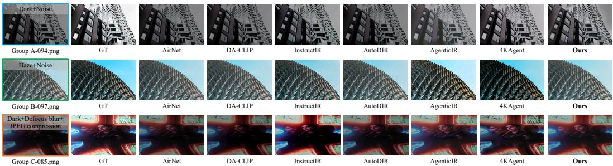  
Figure 8: Additional qualitative comparisons on MiO100 Groups A–C.

## E OPEN-LOOP RANKING: PROTOCOL AND ADDITIONAL RESULTS

This appendix complements Sec. 4.3. All results use the same 160 clean-identity-disjoint OOF states. These states were also used during policy development, so they serve as a controlled mechanism test rather than an untouched test-set estimate.

## E.1 PROTOCOL

Candidate pool. For each state, the pool contains every eligible action under the four degradation targets with the highest OOF presence probability; low resolution is always among the four targets when the long side of the input is at most 512 pixels. Five slow actions are excluded: MAXIM for haze, motion blur, noise, and rain, and DiffBIR (Lin et al., 2024) for low resolution. This yields 2,147 executed candidates (13.4 per state on average). The pool is fixed before any ranker is applied and is not prescreened by the world model or any scalar scorer. Realized outcomes are used only for evaluation.

Methods. All deployable methods score the same pool from pre-execution inputs and commit their top-ranked action; ties are broken by action name. Tool prior ranks each tool by its mean realized $\Delta F _ { Y }$ on the 14 fit identities of the fold, ignoring the image and the degradation state. Degradation routing selects the target with the highest predicted presence and then the tool with the highest mean realized $\Delta F _ { Y }$ for that target on the fit identities. The Direct scorer is a separately trained network with a single output head that regresses the same Y-channel fidelity target $\mathbf { y } _ { f }$ as the world model’s fidelity head (Appendix A.2); it shares the world model’s folds, inputs, backbone, training rows, and optimization protocol (one seed per fold), but is trained with the Gaussian NLL only, without $\mathcal { L } _ { \mathrm { r a n k } } ^ { f }$ . The world model ranks candidates by the frozen one-step utility $U _ { t } ( a )$ of $\operatorname { E q . }$ (8); WM-F ranks them by the fidelity head’s prediction v alone. Oracle selects the candidate with the highest realized $\Delta F _ { Y }$ . Random is the analytic expectation of a uniform choice within each state.

Outcome labels. A selection is harmful if $\Delta \mathrm { P S N R } _ { Y } < - 0 . 0 5 \mathrm { d B } , \Delta \mathrm { S S I M } _ { Y } < - 0 . 0 0 5$ , or the mean RGB proxy-quality change is negative, which is exactly the label used to train the harm head (Appendix A.2). It is severe if $\bar { \Delta } \mathrm { P S N R } _ { Y } \leq - 1$ dB or $\Delta \mathrm { S S I M } _ { Y } \leq - 0 . 0 5$

Statistics. Intervals are 95% percentile intervals from 10,000 clean-identity cluster-bootstrap draws that resample the 20 identities with replacement; HR is recomputed as a ratio of means in every draw. The rank correlation $r _ { \mathrm { s } }$ is the Spearman correlation between predicted scores and realized $\Delta F _ { Y }$ , computed within each state and then averaged.

Table 6: Paired differences to the Direct scorer with 95% clean-identity cluster-bootstrap intervals. Rates are in percentage points.
<table><tr><td>Metric</td><td>World model – Direct</td><td>WM-F – Direct</td></tr><tr><td>HR</td><td>-2.1 [−15.5, 11.8]</td><td>-4.8 [15.1, 6.0]</td></tr><tr><td>Harm</td><td>-6.2[−13.8, 1.2]</td><td>-2.5 [–10.0, 5.0]</td></tr><tr><td>Severe</td><td>-5.6[–16.2, 4.4]</td><td>-4.4 [-13.8, 5.0]</td></tr><tr><td>∆PSNRY (dB)</td><td>-0.13[-0.68, 0.41]</td><td>-0.21[-0.65, 0.23]</td></tr><tr><td> $\Delta \mathsf { S S I M } _ { Y }$ </td><td>0.002 [-0.013, 0.019]</td><td>-0.002 [-0.017, 0.012]</td></tr><tr><td>∆LPIPS</td><td>-0.013 [-0.033, 0.006]</td><td>-0.001 [-0.018, 0.018]</td></tr><tr><td> $r _ { \mathrm { s } }$ </td><td>0.062 [0.009, 0.120]</td><td>0.067 [0.014, 0.122]</td></tr></table>

Table 7: Utility-term ablation (one term removed at a time, other coefficients frozen). Terms follow Eq. (8): v fidelity gain, $p ^ { \mathrm { b e n } }$ benefit probability, ξ non-target side effects, g target gain, q proxyquality gain, d content damage, u uncertainty, $\dot { C }$ cost prior.
<table><tr><td>Utility</td><td>HR (%)</td><td>Harm (%)</td><td>Severe (%)</td><td>∆PSNRY</td><td>∆SSIMY</td><td>∆LPIPS</td><td> $r _ { \mathrm { s } }$ </td></tr><tr><td>Full</td><td>34.6</td><td>42.5</td><td>21.9</td><td>1.14</td><td>0.055</td><td>-0.069</td><td>0.309</td></tr><tr><td> $\scriptstyle { \mathrm { w } } / \mathrm { o } v$ </td><td>-14.5</td><td>58.1</td><td>35.6</td><td>-0.66</td><td>-0.005</td><td>-0.019</td><td>-0.092</td></tr><tr><td>w/o  $p ^ { \mathrm { b e n } }$ </td><td>32.4</td><td>46.2</td><td>21.9</td><td>1.08</td><td>0.050</td><td>-0.058</td><td>0.310</td></tr><tr><td>w/o ξ</td><td>36.1</td><td>41.9</td><td>20.6</td><td>1.17</td><td>0.060</td><td>-0.072</td><td>0.311</td></tr><tr><td>w/o g, q, d, u, or C</td><td>34.6</td><td>42.5</td><td>21.9</td><td>1.14</td><td>0.055</td><td>-0.069</td><td>0.309–0.312</td></tr></table>

## E.2 FULL RESULTS

Table 3 in the main text reports all top-1 metrics, including severe harm, LPIPS, within-state rank correlation, and WM-F; Table 6 gives paired differences to the Direct scorer. Neither world-model score differs significantly from Direct in HR or harm. Both order candidates within a state better than Direct (the $r _ { \mathrm { s } }$ intervals exclude zero), but this does not translate into a better top-1 choice.

Table 7 removes one term of the frozen utility at a time without re-tuning the others. The fidelity-gain term v drives the ranking: without it, HR falls to −14.5%. Removing the benefit probability $\bar { p } ^ { \mathrm { b e n } }$ raises harm from 42.5% to 46.2%. Removing g, q, d, u, or C leaves every top-1 metric unchanged; d is identically zero for the global actions used here (Appendix A.2). Removing the side-effect term ξ slightly improves all top-1 metrics; we nevertheless report the frozen utility unchanged.

## E.3 RANKING DEPTH, HARM CALIBRATION, AND SECONDARY SCAN

Figure 9a reports the share of positive oracle headroom obtained when an ideal selector keeps the best of the top-k ranked candidates. The smallest k reaching 90% is 7 for routing and Direct, 8 for the world model, 9 for Random, and 10 for Tool prior. Figure 9b shows the reliability of the world model’s harm probability over ten equal-count bins (ECE 0.106, Brier 0.222). No recalibration is applied. In the lowest-probability bins the observed harm rate (about 0.3) exceeds the prediction, so the probabilities should be read as a ranking signal rather than as calibrated risks.

Paired AUC differences for the world-model harm probability are +0.118 [0.091, 0.146] versus negative Direct gain and +0.073 [0.054, 0.093] versus negative WM-F gain. In Fig. 6b, intervals are evaluated on a 0.5% grid of harm rates. At matched harm rates of 5%, 10%, and 15%, WM-τ minus Direct-τ HR is +0.0 [−11.0, 11.9], +3.5 [−10.4, 19.3], and +10.7 [−7.8, 21.2] points.

The pre-declared secondary scan WM-λ subtracts $\lambda _ { \mathrm { h a r m } } p ^ { \mathrm { h a r m } }$ from the utility and abstains when the maximum utility is negative. It attains higher HR than both τ -scans at harm rates above about 25%, but its range does not reach the matched rates of 5–15%, so it is not used for inference.

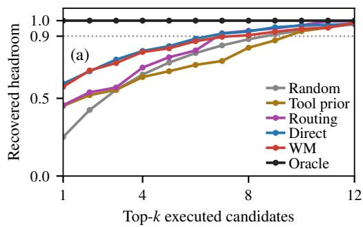

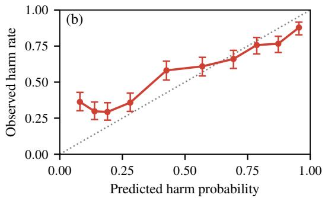  
Figure 9: Supplementary open-loop diagnostics on the 160 OOF states. (a) Share of positive oracle headroom recovered by an ideal selector over the top-k ranked candidates; the dotted line marks 90%. (b) Reliability of the world model’s harm probability in ten equal-count bins with Wilson 95% intervals.

## F CLOSED-LOOP REPLAY: ADDITIONAL RESULTS

Paired differences. Paired PreActIR-minus-reactive differences (95% clean-identity clusterbootstrap intervals) are −1.26 calls/image $[ - 1 . 5 0 , - 1 . 0 2 ] , \quad - 1 . 4 9$ rejected calls/image [−1.78, −1.21], −14.4 s tool time [−24.7, −4.2], +0.92 dB Y-PSNR [0.49, 1.34], +0.015 Y-SSIM [0.003, 0.027], and −23.1 points no-commit rate $[ - 3 0 . 6 , - 1 5 . 6 ] ;$ LPIPS and harm differences include zero. Against fidelity-head ranking, PreActIR reduces harm by 3.75 points (95% CI for the reduction: 0.6–7.5), while the PSNR, SSIM, and LPIPS differences include zero.

Budget. Table 8 reports PreActIR for $B \in \{ 1 , 2 , 4 \}$ , and Figure 10 (top) compares all policies for $B \in \left\{ 1 , 2 , 3 , 4 , 6 \right\}$ , with the pool and verifier fixed. At every budget, pre-execution ranking reaches a given Y-PSNR gain with fewer real calls than reactive trial-and-error and routing, largely because it finds a verified candidate earlier (panel b). For PreActIR, harm rises from 8.8% to 14.4% between $B = 1$ and $B = 4$ as the no-commit rate falls from 31.2% to 15.6%, so the lower harm at small budgets largely reflects abstention.

Routing and the two candidate pools. Routing fits its tool order on the 14 fit identities of each fold, rather than on the two inner identities used by reactive trial-and-error, yet it performs almost identically to it. The contrast with Sec. 4.3 reflects two differences between the settings: the openloop test uses estimated beliefs and a belief-based pool, whereas the closed-loop replay uses annotated states and an annotation-based pool that includes the five slow actions excluded from the open-loop pool. Routing’s first choice coincides with its open-loop choice in only 34 of 160 states. Because the world model is trained on annotated states, estimated beliefs introduce an input shift, and the larger advantage of pre-execution ranking in the closed loop may partly reflect the accurate state.

Verifier agreement. At $B = 1$ , the learned verifier accepts 72% of the beneficial first choices of PreActIR but only 57% of those of routing, and it also accepts 62% of PreActIR’s harmful first choices versus 11% of routing’s (Table 9). Its errors are therefore correlated with the world model’s ranking. To test whether the closed-loop advantage merely reflects this agreement, we replay all policies with a ground-truth verifier (Fig. 10, bottom). The gap widens rather than closes: at $B = 4$ routing needs 1.01 more calls per image (CI [0.75, 1.26]) and gains 1.58 dB less $( \mathbf { C I } \left[ - 1 . 8 9 , - 1 . 2 8 \right] )$ than PreActIR, compared with 1.20 calls and 0.95 dB under the learned verifier. The ordering advantage is thus not an artifact of verifier agreement, but the learned verifier catches fewer of the world model’s harmful choices than of routing’s.

Table 8: Sensitivity of PreActIR to the real-execution budget on the 160 OOF states, with the candidate pool and verifier fixed. Harm counts no-commit outcomes as non-harmful; time counts restoration-tool execution only. The $B = 4$ row is the PreActIR row of Table 4.
<table><tr><td>Budget</td><td> $\mathrm { P S N R } _ { Y } \uparrow$ </td><td> $\mathsf { S S I M } _ { Y }$ </td><td>↑ LPIPS↓</td><td>Harm (%)↓</td><td>No commit (%)↓</td><td>Calls↓</td><td>Time (s)↓</td></tr><tr><td> $B = 1$ </td><td>21.88</td><td>0.683</td><td>0.423</td><td>8.8</td><td>31.2</td><td>1.00</td><td>18.5</td></tr><tr><td> $B = 2$ </td><td>22.02</td><td>0.687</td><td>0.419</td><td>11.2</td><td>21.2</td><td>1.31</td><td>21.0</td></tr><tr><td> $B = 4$ </td><td>22.08</td><td>0.690</td><td>0.416</td><td>14.4</td><td>15.6</td><td>1.71</td><td>25.3</td></tr></table>

Reactive Routing Fidelity-head PreActIR Oracle order

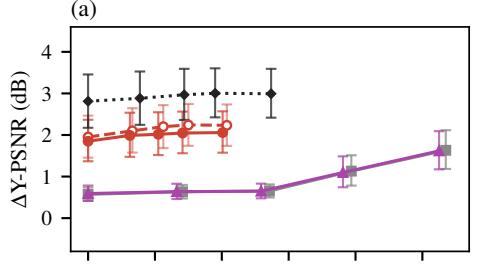

(b)  
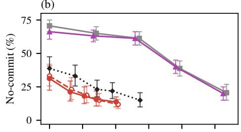

(c)  
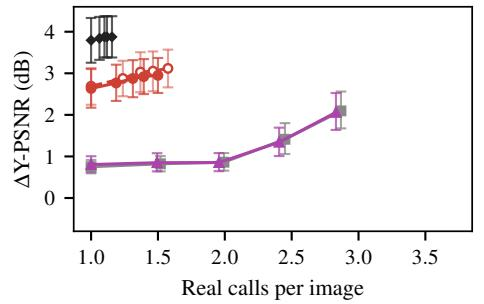

(d)  
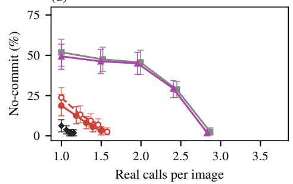  
Figure 10: Quality versus real tool calls on the 160 OOF states with a shared candidate pool. Top: learned verifier; bottom: ground-truth verifier that commits exactly the candidates labeled beneficial (Appendix A.2). Points from left to right correspond to $B = \bar { 1 , 2 , 3 , 4 , 6 } ;$ axes are shared across rows. (a,c) Y-PSNR gain over the input. (b,d) Share of states with no committed candidate within budget. Error bars are 95% clean-identity cluster-bootstrap intervals; the oracle order uses realized outcomes and is shown only as a reference.

Table 9: Learned-verifier decisions on each policy’s first choice at $B = 1$ , using the cached groundtruth labels.
<table><tr><td>Policy</td><td>Accepted</td><td>Beneficial accepted</td><td>Harmful accepted</td></tr><tr><td>Reactive</td><td>47/160</td><td>43/77 (55.8%)</td><td>4/78 (5.1%)</td></tr><tr><td>Routing</td><td>54/160</td><td>46/81 (56.8%)</td><td>8/74 (10.8%)</td></tr><tr><td>Fidelity-head</td><td>107/160</td><td>88/122 (72.1%)</td><td>19/34 (55.9%)</td></tr><tr><td>PreActIR</td><td>110/160</td><td>94/130 (72.3%)</td><td>16/26 (61.5%)</td></tr><tr><td>Oracle order</td><td>98/160</td><td>97/150 (64.7%)</td><td>1/7 (14.3%)</td></tr></table>

## G CANDIDATE-FRONTIER AUDIT AND TARGETED TOOL ADAPTATION

## G.1 CANDIDATE-FRONTIER AUDIT

Sec. 4.5 solves $\operatorname { E q . } \left( 9 \right)$ exactly as a mixed-integer program that selects one frozen option per state and constrains dataset averages. The audit is post hoc and reference-assisted: it reads test references only to score frozen options, never changes a candidate or model, and is not a deployable policy.

A descriptive distortion–perception trend fitted across the outputs of different controllers can motivate such an audit, but it cannot establish that the candidate space is insufficient; only the exact program can. For the target check below, the options comprise the 21,385 protocol-compatible candidates of the complete 33-action Group C pool and the outputs of four fixed-pool controller configurations (F1–F4; 1,600 outputs), i.e., 22,985 options for 400 states. The pre-specified Group C targets (PSNR 20.59, SSIM 0.6039, MANIQA 0.3047, CLIP-IQA 0.4503, and MUSIQ 54.57) are jointly attainable. After raising them by 0.01/0.0001/0.001/0.001/0.01, respectively, the PSNRmaximizing selection subject to the three perceptual floors attains 21.79/0.617/0.325/0.460/54.58, whereas interpolating the four controller aggregates F1–F4 at the target MUSIQ level gives only 20.05/0.571 Y-PSNR/Y-SSIM. The fixed pool is therefore not the binding constraint.

## G.2 EXTERNAL REPLAY CONSTRUCTION

To expand the Group C candidate frontier, we construct 4,000 training pairs from external images using the official AgenticIR degradation operators. The replay set consists of

• 2,518 rain+noise+×4 degradation pairs;

• 1,228 clean-image ×4 pairs; and

• 254 real paired hazy images with additional official motion-blur and ×4 degradation.

No MiO100 HQ image is used during tool adaptation.

## G.3 REPLAY-ADAPTED SUPER-RESOLUTION TOOL

We use HAT-S (Chen et al., 2023) as the expandable super-resolution tool and further train it for 4,000 iterations on the external replay data.

On a fixed external validation set of 120 pairs, Y-PSNR/Y-SSIM improve from 24.84/0.7432 before adaptation to 26.85/0.7692 after 4,000 iterations.

The frozen adapted tool is applied only to the 200 Group C states that contain low resolution; other states retain the original high-perceptual-quality candidates.

## G.4 FINAL GROUP C CANDIDATE FUSION

For Group C, the final candidate is constructed as

$$
I _ { C } = ( 1 - \alpha ) I _ { p } + \alpha I _ { \mathrm { s r } } + \kappa \left( I _ { p } - G _ { \sigma } ( I _ { p } ) \right) ,\tag{29}
$$

where $I _ { p }$ denotes the original high-perceptual-quality candidate, $I _ { \mathrm { s r } }$ the replay-adapted superresolution candidate, and $\bar { G } _ { \sigma }$ a Gaussian smoothing operator.

## We use

$$
\alpha = 0 . 6 2 , \qquad \kappa = 0 . 1 2 , \qquad \sigma = 1 . 5 .
$$

This expanded candidate moves the deployed Group C operating point beyond the descriptive F1–F4 trend (Appendix G.1). It does not exceed the reference-assisted fixed-pool oracle, so it demonstrates a practical intervention rather than a necessary capacity expansion.