# Learnable Hodge–Laplacian Driven Mixture of Experts for Steady-PDE Surrogates on Coarse Unstructured Meshes

Stavros Nousias1, Akis Nousias2, Konstantinos Gkrispanis1

1Technical University of Munich, {stavros.nousias, k.gkrispanis}@tum.de 2K3Y Labs, akis.nousias@k3y.bg

## Abstract

Current approaches for steady partial differential equations surrogate models on unstructured meshes apply a single mixing mechanism to the whole solution. This paper proposes an architecture that partitions the solution among vanilla transformer experts, each focused on a different spectral scale. The partition is built from a discrete Hodge Laplacian ${ L _ { 0 } } = \star _ { 0 } ^ { - 1 } \bar { d _ { 0 } ^ { \top } } \star _ { 1 } d _ { 0 } .$ , that serves as a fitting layer measuring high-frequency content. A gating mechanism takes the mesh as input and produces the per-vertex weights that recombine the expert outputs. AirFRANS is a steady Reynolds-averaged Navier–Stokes (RANS) airfoil benchmark. We evaluate our approach in a reduced remeshed version of the benchmark with each unstructured mesh counting 9.6K faces and 4.9K vertices. We compare our approach with the Transolver on the same dataset and dataset slit. Our approach reduces relative $L _ { 2 }$ error by 31% and interior mean squared error by 47% .

## 1 Introduction

Computational fluid dynamics is central to aerodynamic design. Solving Reynolds-averaged Navier– Stokes (RANS) equations for steady turbulent flows [1] on a discretisation of the domain allows engineers to evaluate a candidate geometry’s pressure, velocity and turbulence fields. Evaluating many candidates this way is computationally expensive, which limits how many a design loop can explore [2, 3].

Deep learning has recently emerged as a surrogate [4], where a learned model replaces the solution with a direct map from the geometry, the boundary data and the flow parameters to the solution fields, computed in one forward pass and orders of magnitude faster at inference. Physics-informed networks encode the governing equations in the training objective, so the output satisfies the PDE residual and the boundary conditions [5, 6]. This approach requires an explicit closure model, which is restrictive for industrial RANS turbulence. Neural operators instead learn the input-output map from simulation data to achieve discretisation invariance [7, 8]. The Fourier neural operator [9] approximates the kernel by a pointwise multiplication in the Fourier domain, and extensions to irregular domains use message passing [10]. Mesh deformation [11], or message passing directly on the mesh [12], local kernels approximate the global coupling of elliptic problems poorly, and Fourier bases lose accuracy on complex geometries. Transformer solvers address this coupling directly, at the cost of a quadratic attention complexity [13–16]. Among these, Transolver [17] assigns mesh points to physics slices and attends among the resulting tokens, decoupling cost from mesh size. These architectures share a common trait, in that information is mixed through a single mechanism.

A separate line of work grounds the architecture in the discrete differential operators of the mesh, using discrete exterior calculus [18]. In HodgeNet [19], hodge stars are learned as diagonal matrices and in DiffusionNet as learned diffusion times [20]. HodgeFormer [21] proposes attention-parametrised stars on all three cochain degrees. In all of these constructions, the learned operator lies on the Preprint.

prediction path, computing the field directly. Since a discrete Hodge Laplacian ${ \cal L } _ { 0 } = \star _ { 0 } ^ { - 1 } \bar { d } _ { 0 } ^ { \top } \star _ { 1 } d _ { 0 }$ i a Dirichlet-energy operator, a layer built on it smooths the field it predicts.

Sparsely gated mixtures of experts are normally used to scale capacity at roughly constant compute, with a router implemented as a linear probe on the token embedding, under which the specialisation the experts acquire is not fixed by the construction [22, 23]. Geometry-gated mixtures of experts for multi-scale PDE problems are available in the literature. GNOT [15] gates a mixture of experts with a network that takes query coordinates as input, and GAOT [24] combines a ladder of scale-specific branches with a learned per-point softmax gate. We adopt this pattern and use a Hodge-Laplacian controller, and propose a mixture of plain transformer experts, each biased towards one spectral scale. To bind each expert to a scale, we supervise it with a second, diagonal-star Hodge Laplacian applied to the training target, which decomposes the target into a sequence of components

The contributions of this paper can be summarized as follows: (i) We discuss a Gaussian star construction (section 3.5.1) that is symmetric positive definite whenever its neighbour support is mutual, and under which the assembled operator then has a real non-negative spectrum; the supports used here do not meet that condition (section 3.2). (ii) We propose an architecture that removes the learned discrete Hodge Laplacian from the prediction path and uses it only to compute routing weights. (iii) We introduce a supervision scheme in which a second, diagonal-star Hodge Laplacian that decomposes the target into a sequence of components (section 3.7). (iii) We evaluate the approach on the official AirFRANS split against a Transolver baseline, trained natively on the same working mesh with identical data, loss and metric code (section 4.2). Section S1 lists every symbol used below, with its type and its meaning. The remainder of this paper is organized as follows: section 2 reviews related work, section 3 presents the method, section 4 describes the simulation setup and reports the results, and section 5 discusses the lift gap and the limits of the comparison.

## 2 Related Work

Physics-informed and data-driven surrogates. Physics-informed neural networks learn PDE solution fields by incorporating the governing equations and boundary conditions into training [5, 6]. Physics-informed neural operators extend this approach to learning solution operators across families of PDE inputs [25]. For RANS flows, this requires specifying the mean-flow equations and a turbulence closure. Our model learns directly from simulated solution fields, following data-driven airfoil surrogates [4] and the AirFRANS benchmark [1]. Related work extends data-driven CFD modelling to high-fidelity automotive aerodynamics [26].

Neural operators on irregular domains. Neural operators learn maps between function spaces using parameters shared across discretisations [7, 8]. DeepONet represents an operator through branch and trunk networks [27], whereas the Fourier neural operator (FNO) uses learned spectral multipliers to implement global convolutions [9]. Graph kernel networks [10], learned coordinate deformations (Geo-FNO) [11], and graph-to-grid encoding with a latent FNO (GINO) [28] accommodate irregular sampling and variable geometry. MeshGraphNets instead learn local interactions along mesh edges [12]. For local message passing, long-range communication depends on depth or additional multiscale mechanisms where spectral and latent-grid methods provide alternative ways to exchange global information. These choices concern how features propagate, rather than explicitly supervising separate predictors at different mesh spectral scales.

Transformer PDE solvers. Dense attention enables global interactions but has quadratic cost in the number of mesh points. Galerkin attention [13], OFormer [14], GNOT [15], and FactFormer [16] use linear or factorised attention, while inducing-point and anchored-branched architectures process reduced token sets [29, 30]. Transolver [17] softly assigns points to learned physics slices, applies attention among slice tokens, and maps the result back to the points. For a fixed slice count, its cost grows linearly with mesh size. We use Transolver as the principal baseline under a shared remeshing and training protocol. Our dense transformer experts retain quadratic attention cost; the proposed controller addresses expert specialisation rather than removing this scaling limitation.

Geometric gating and multiscale mixtures. Sparsely gated mixtures of experts increase capacity by activating only a subset of experts per token [22, 23]. Geometric and multiscale gating already appear in PDE operator learning: GNOT mixes feed-forward experts using query-coordinate-dependent weights, interpreting the gate as soft domain decomposition [15]. GAOT combines graph operator branches at different neighbourhood radii through learned softmax weights, together with a latent transformer processor [24]. Our contribution builds on this precedent by using a mesh Hodge-Laplacian controller to mix full transformer experts at each vertex, and by supervising auxiliary expert heads with mesh spectral bands. All experts are evaluated, so the mixture is dense. Fourierfeature bandwidths bias the expert inputs towards different spatial scales [31]; band supervision supplies an additional constraint on their auxiliary predictions.

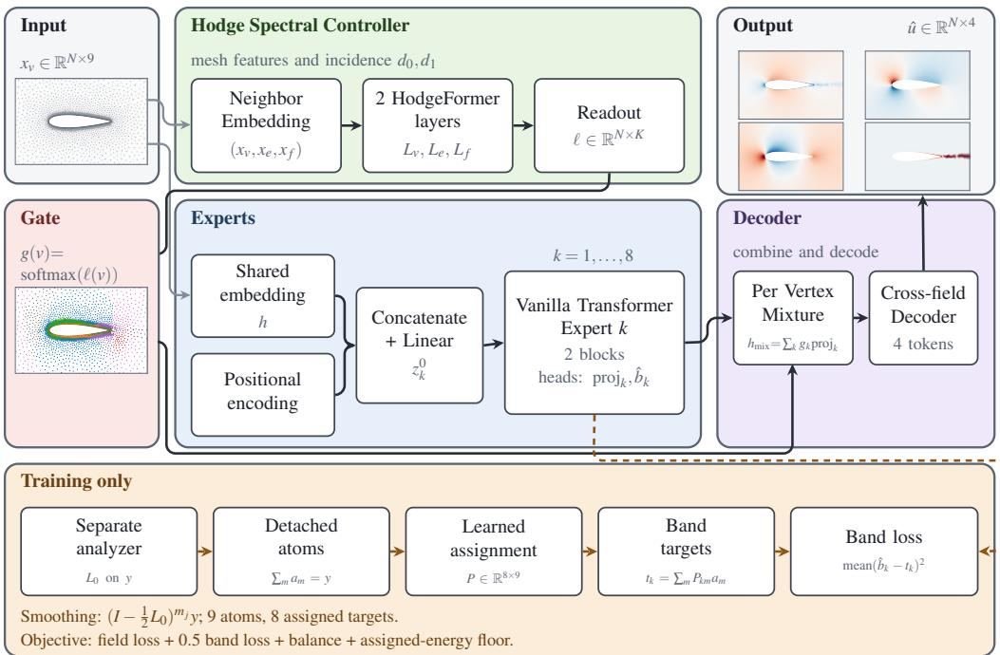  
Figure 1: Overview of the model. The Hodge controller routes transformer experts that combine shared vertex embeddings with positional encodings at different frequency scales. Their representations are mixed and decoded into four fields. During training, a separate analyzer decomposes the reference fields into atoms, which a learned assignment combines into targets for the auxiliary expert heads (dashed path).

Learned differential operators and spectral analysis. Discrete exterior calculus separates incidencebased topology from metric information encoded in Hodge stars [18]. Hodge Laplacians extend graph differential operators to higher-degree cochains [32, 33].The seminal work of HodgeNet learns discrete Hodge stars for spectral geometry processing [19], DiffusionNet learns diffusion times for surface feature propagation [20], and DiffGCN constructs graph convolutions from differential operators [34]. HodgeFormer parameterises stars through local attention to construct operators on vertices, edges, and faces [21]. Related neural PDE models use structure-preserving finite element formulations [35], Hodge-decomposed solution spaces [36], or cross-dimensional interactions on cell complexes [37]. We use the learned Hodge operator to compute routing weights, while transformer experts produce the predictive features. A separate diagonal-star vertex Laplacian supplies training targets through successive smoothing differences and learned atom-to-expert assignments (section 3.7). This construction relates to graph spectral filtering and wavelets [38, 39], and preserves the sum of the target bands exactly. These bands separate spatial scales of vertex fields; they are not the exact, coexact, and harmonic components of a Hodge decomposition.

## 3 Methodology

## 3.1 Overview

The reported model uses a vertex-only Hodge controller. The description below presents the VEF extension, which additionally updates edge and face streams; their comparison is reported in table S6.

The prediction path consists of a shared vertex embedding, a Hodge controller, transformer experts, and a field decoder. The controller produces routing weights from vertex, edge, and face features together with the mesh incidence matrices and neighborhood indices. Each expert combines the shared embedding with fixed Fourier positional features and produces both a latent representation and an auxiliary band prediction. The routing weights combine the latent representations, which the decoder maps to the four output fields. During training, a separate diagonal-star vertex Laplacian smooths the reference fields to construct telescoping atoms. A learned assignment combines these atoms into expert-specific supervision targets. This analyzer is absent from inference, and its conductances receive no objective gradients because the atoms are detached before assignment.

The controller uses two Hodge-former neural blocks operating on vertices, edges, and faces. Their implementation is called the PSD-Hodge layer, reflecting the intended positive-semidefinite (PSD) construction. The spectral guarantees depend on symmetry of the effective neighborhoods and compatibility of the star operators, as discussed in sections 3.5.1 and 3.5.2.

## 3.2 Simplicial complex and neighborhoods

The mesh is the simplicial complex $\mathcal { M } = ( V , E , F )$ , with $N = | V | , N _ { e } = | E |$ , and $N _ { f } = | F |$ . The signed incidence matrices supplied to the model are $d _ { 0 } \in \mathbb { R } ^ { N _ { e } \times \dot { N } }$ and $d _ { 1 } \in \mathbb { R } ^ { N _ { f } \times N _ { e } }$ , with non zero entries 1 or +1. The operators map vertex values to edges and edge values to faces, respectively.

For each mesh element $i ,$ its neighborhood is the set of elements of the same type whose features contribute to the learned star at i. Thus, a vertex neighborhood contains vertices, an edge neighborhood contains edges, and a face neighborhood contains faces. We call this set the operator support because it specifies the entries that may be nonzero in row i of the star matrix. The stored neighbor list is $\mathcal { N } ^ { \mathrm { f u l l } } ( i )$ , while ${ \mathcal { N } } ( i ) \subseteq { \mathcal { N } } ^ { \mathrm { f u l l } } ( { \check { i } } )$ denotes the subset used by the controller. Vertex and edge neighbor lists are initially generated from graph-hop rings, with at most eight hops, decay parameter 0.55, and up to 256 stored entries per element.

The VEF controller uses the first 64 entries of each stored vertex list and the first 32 entries of each stored edge list; the reported vertex-only controller uses an edge cap of 64. These lists are ordered by element index after symmetrization, so the retained entries are not necessarily the nearest neighbors. Truncation can also remove the reverse of a retained neighbor relation. Each face neighborhood contains only the face itself. Unused positions in the stored lists are padded with 1; these positions are not neighbors and do not contribute to the operator.

## 3.3 Input features

The input feature tensors are $x _ { v } \in \mathbb R ^ { N \times { c _ { v } } } , x _ { e } \in \mathbb R ^ { N _ { e } \times { c _ { e } } }$ , and $\boldsymbol { x } _ { f } \in \mathbb { R } ^ { N _ { f } \times c _ { f } }$ , with $( c _ { v } , c _ { e } , c _ { f } ) =$ (9, 21, 13). Before standardization, the vertex array contains nine columns:

$$
\boldsymbol { x } _ { v } ^ { \mathrm { r a w } } = [ \mathrm { p o s } _ { 1 } ^ { \mathrm { r a w } } , \mathrm { p o s } _ { 2 } ^ { \mathrm { r a w } } , \boldsymbol { A } _ { v } ^ { \mathrm { d u a l } } , \boldsymbol { u } _ { \mathrm { i n } } , \boldsymbol { v } _ { \mathrm { i n } } , \mathrm { S D F } , n _ { x } , n _ { y } , \mathrm { i s } _ { - } \mathrm { w a l l } ] ,\tag{1}
$$

where $\mathrm { p o s _ { 1 } ^ { r a w } , p o s _ { 2 } ^ { r a w } }$ are physical coordinate columns, $A _ { v } ^ { \mathrm { { d u a l } } }$ is the barycentric dual area, computed as one third of the sum of incident triangle areas, and SDF denotes signed distance. The columns $u _ { \mathrm { i n } } , v _ { \mathrm { i n } }$ contain inlet velocity components, $n _ { x } , n _ { y }$ contain normal components, and is\_wall is the wall indicator. Every column, including the wall indicator, is standardized using training-set statistics. Edge and face features are not standardized at dataset level.

The standardized position columns are denoted by pos $\in \mathbb R ^ { N \times 2 }$ and are used to evaluate the expert Fourier features. The prediction and controller embeddings applied to these input arrays are described in section 3.4.

The freestream speed is obtained from the unstandardized inlet velocity components at the first vertex:

$$
U _ { \infty } = \sqrt { u _ { \mathrm { i n } } ^ { 2 } + v _ { \mathrm { i n } } ^ { 2 } } .\tag{2}
$$

For velocity components $u _ { x } , u _ { y } .$ , pressure $p ,$ and turbulent kinematic viscosity $\nu _ { t } .$ , the dataset applies

$$
\widetilde { y } = \left[ \frac { u _ { x } } { U _ { \infty } } , \frac { u _ { y } } { U _ { \infty } } , \frac { p } { U _ { \infty } ^ { 2 } } , \frac { \nu _ { t } } { U _ { \infty } } \right] , \qquad y _ { v c } = \frac { \widetilde { y } _ { v c } - \mu _ { c } ^ { \mathrm { n o r m } } } { s _ { c } ^ { \mathrm { n o r m } } + 1 0 ^ { - 8 } } .\tag{3}
$$

Here v indexes vertices, c indexes output channels, and $\mu _ { c } ^ { \mathrm { n o r m } } , s _ { c } ^ { \mathrm { n o r m } }$ are global normalization statistics. The standardized target is $\boldsymbol { y } ^ { \star } \in \mathbb { R } ^ { N \times 4 }$ and the model output is $\overset { \smile } { \hat { u } } \in \mathbb { R } ^ { N \times 4 }$ . Physical reference fields are denoted by $y ^ { \mathrm { { \bar { p h y s } } } }$

The turbulent kinematic viscosity target remains linear, without a logarithmic transformation. Dividing $\nu _ { t }$ by $U _ { \infty }$ leaves units of length. A dimensionless target therefore also requires a reference length, which is not explicit in this scaling.

## 3.4 Input Embedding

The prediction and controller branches use separate input embeddings. The prediction branch maps the input features to one token per vertex through a shared two-layer perceptron with GELU activation:

$$
h = W _ { 2 } \mathrm { G E L U } ( W _ { 1 } x _ { v } ) \in \mathbb { R } ^ { N \times d } , \qquad d = 1 9 2 .\tag{4}
$$

All eight experts receive the same token array h. The controller uses a separate neighbor embedding for vertex, edge, and face features. It first applies normalized adjacency aggregation to the vertex and edge inputs, then maps each stream through its own three-layer perceptron, with ReLU after every linear layer. Face features pass directly through their perceptron. The resulting streams are $h _ { v } \in \mathbb { R } ^ { N \times d _ { c } } , \dot { h } _ { e } \in \mathbb { R } ^ { N _ { e } \times d _ { c } }$ , and $\dot { h } _ { f } \in \mathbb { R } ^ { N _ { f } \times \check { d } _ { c } }$ . Neighbor aggregation does not perform feature-wise standardization of the raw edge or face features; layer normalization is applied inside the subsequent HodgeFormer blocks.

## 3.5 Hodge controller

## 3.5.1 Learned star operators

The controller learns Hodge Stars that combine features within the neighborhood of each mesh element. Using the streams defined in section $3 . 4 ,$ , each head first projects the normalized features to $\varphi _ { i } = W _ { \varphi } \mathrm { L N } ( h _ { s } ) _ { \mathrm { : } }$ , where $s \in \{ v , e , f \}$ and $\varphi _ { i } \in \mathbb { R } ^ { d _ { h } }$ . These projected features determine the interaction between element i and each neighbor $j \in \mathcal { N } ( i )$ through a Gaussian kernel:

$$
w _ { i j } = \exp \left( - \frac { \lVert \varphi _ { i } - \varphi _ { j } \rVert _ { 2 } ^ { 2 } } { 2 \sigma ^ { 2 } } \right) , \qquad \sigma = \mathrm { s o f t p l u s } ( \gamma ) + 1 0 ^ { - 8 } .\tag{5}
$$

Neighbors with similar projected features receive larger weights, while the learned bandwidth $\sigma$ controls how quickly the weights decrease with feature distance.

The matrix Ω collects these weights on the effective support and is zero elsewhere, including at padded entries. We normalize the weights using the row sums $\begin{array} { r } { D _ { i } = \sum _ { j } \Omega _ { i j } } \end{array}$ , with $D = \mathrm { d i a g } ( D _ { i } )$ and combine the resulting operator with the identity:

$$
\hat { S } _ { i j } = \frac { \Omega _ { i j } } { \sqrt { D _ { i } D _ { j } + 1 0 ^ { - 8 } } } , \qquad \star x = ( 1 - \beta ) x + \beta \hat { S } x , \qquad \beta = \textstyle { \frac { 1 } { 2 } } \operatorname { s i g m o i d } ( \alpha ) .\tag{6}
$$

The identity term retains the element’s own values, while $\hat { S } x$ aggregates values from its neighbors. The learned coefficient $\beta$ controls their relative contribution and remains below $\textstyle { \frac { 1 } { 2 } }$

The spectral properties of this construction depend on the neighborhood relation. A neighborhood is reciprocal when $j \in \mathcal { N } ( i )$ implies $i \in \mathcal { N } ( j )$ . Under this condition, the ideal normalized matrix $D ^ { - 1 / \bar { 2 } } \Omega D ^ { - 1 / 2 }$ is symmetric and has eigenvalues in $[ - 1 , 1 ]$ . The star formed with this ideal normalization is therefore symmetric positive-definite (SPD), with eigenvalues in $[ 1 - 2 \beta , 1 ]$ . This guarantee requires reciprocity of the effective support used by the operator.

Face neighborhoods contain only the face itself. For such a support, psd\_star uses a diagonal alternative that allows the star to depend on the face features:

$$
z _ { i } = \frac { \| \varphi _ { i } \| _ { 2 } ^ { 2 } } { d _ { h } \sigma ^ { 2 } } , \qquad ( \star _ { 2 } x ) _ { i } = ( 1 - \beta + \beta e ^ { - z _ { i } } ) x _ { i } ,\tag{7}
$$

Here $d _ { h } \ : = \ : d _ { c } / H$ is the kernel-feature dimension, with controller width $d _ { c }$ and head count $H$ This star scales each face independently, and its diagonal remains positive even if the exponential underflows to zero. The learned scaling is not constrained to equal a physical face area or its reciprocal. Stars labeled as inverse operators have their own learnable parameters and they are not calculated matrix inverses.

## 3.5.2 Operator composition

We denote the learned operators on vertices, edges, and faces by $L _ { v } , L _ { e }$ , and $L _ { f }$ . For one attention head, let $x _ { v } , x _ { e } , x _ { f }$ denote the normalized latent features supplied to that head. The Gaussian Hodge Stars defined above give

$$
\begin{array} { r l } & { L _ { v } : = \star _ { 0 } ^ { - 1 } ( x _ { v } ) \cdot d _ { 0 } ^ { T } \cdot \star _ { 1 } ( x _ { e } ) \cdot d _ { 0 } , } \\ & { L _ { e } : = d _ { 0 } \cdot \star _ { 0 } ^ { - 1 } ( x _ { v } ) \cdot d _ { 0 } ^ { T } \cdot \star _ { 1 } ( x _ { e } ) + \star _ { 1 } ^ { - 1 } ( x _ { e } ) \cdot d _ { 1 } ^ { T } \cdot \star _ { 2 } ( x _ { f } ) \cdot d _ { 1 } , } \\ & { L _ { f } : = d _ { 1 } \cdot \star _ { 1 } ^ { - 1 } ( x _ { e } ) \cdot d _ { 1 } ^ { T } \cdot \star _ { 2 } ( x _ { f } ) . } \end{array}\tag{8}
$$

The vertex operator reads vertex and edge features, the edge operator reads all three feature arrays, and the face operator reads edge and face features. $\star _ { 0 } ^ { - 1 }$ and $\star _ { 1 } ^ { - 1 }$ have dedicated learnable parameters. The two terms of $L _ { e }$ act on the same projected edge values and their outputs are added. The head outputs are concatenated and projected back to the embedding dimension, as described below.

If the stars in $L _ { v }$ are symmetric positive definite, then $Q = d _ { 0 } ^ { T } \star _ { 1 } ( x _ { e } ) d _ { 0 }$ is symmetric positive semidefinite and

$$
L _ { v } = \star _ { 0 } ^ { - 1 } ( x _ { v } ) Q \sim \star _ { 0 } ^ { - 1 / 2 } ( x _ { v } ) Q \star _ { 0 } ^ { - 1 / 2 } ( x _ { v } ) .\tag{9}
$$

Here $\star _ { 0 } ^ { - 1 / 2 } ( x _ { v } )$ denotes the symmetric square root of the independently learned $\star _ { 0 } ^ { - 1 } ( x _ { v } )$ . Under this assumption, $L _ { v }$ has a real, nonnegative spectrum, although it is generally not symmetric in the Euclidean inner product. The independently parameterized stars in $L _ { e }$ do not establish the sharedmetric compatibility of a conventional Hodge Laplacian, so positive definiteness of the individual stars alone does not guarantee a real, nonnegative spectrum for their summed edge operator. Projections, nonlinearities, and residual updates also mean that the complete neural block is not a PSD linear operator.

## 3.5.3 Overall Controller Architecture

The controller applies two HodgeFormer[21] layers to the width-64 streams from section 3.4, followed by a vertex readout. Each layer has four heads of width 16 and feedforward width 256. Layer and head indices on the projections and stars are omitted below for readability. Their parameters are independent. After the second HodgeFormer layer, the controller reads only $h _ { v }$ and computes

$$
\ell = \operatorname { L i n e a r } _ { 6 4 \to 8 } ( \operatorname { G E L U } ( \operatorname { L i n e a r } _ { 6 4 \to 6 4 } ( \operatorname { L N } ( h _ { v } ) ) ) ) \in \mathbb { R } ^ { N \times K } , \qquad K = 8 .\tag{10}
$$

The mixture module converts these logits into routing weights through a softmax without temperature scaling. With the batch axis included, the logit tensor has shape $( \breve { B _ { \mathrm { b a t c h } } } , N , K )$ .

## 3.6 Transformer experts and decoder

Each expert receives an input constructed from the shared vertex embedding h and processes it through transformer blocks with global self-attention over the vertices. Separate output heads produce the representation $\mathrm { p r o j } _ { k } ( z _ { k } )$ and the auxiliary band prediction $\hat { b } _ { k }$ . The controller weights combine the expert representations as $\begin{array} { r } { h _ { \operatorname* { m i x } } ( v ) = \sum _ { k = 1 } ^ { K } g _ { k } ( v ) \operatorname { p r o j } _ { k } ( z _ { k } ) ( v ) } \end{array}$ . The decoder forms field tokens from the mixed representation using learned field embeddings, applies self-attention across the fields at each vertex, and maps the resulting tokens to the predictions uˆ through a shared readout. The auxiliary predictions are supervised against the assigned band targets and do not enter the final field reconstruction. The expert architecture, mixture, and decoder are specified in sections S3.4 and S3.5.

## 3.7 Auxiliary band targets

## 3.7.1 Analyzer

The analyzer constructs conductances from unstandardized edge features:

$$
w _ { e } = \mathrm { s o f t p l u s } ( \mathrm { M L P } _ { e } ( x _ { e } ) ) + \epsilon _ { w } , \qquad \epsilon _ { w } = 1 0 ^ { - 4 } ,\tag{11}
$$

$$
\star _ { 1 } = \mathrm { d i a g } ( w ) , \qquad \mu = | d _ { 0 } | ^ { \top } w , \qquad \star _ { 0 } = \mathrm { d i a g } ( \mu ) , \qquad L _ { 0 } = \star _ { 0 } ^ { - 1 } d _ { 0 } ^ { \top } \star _ { 1 } d _ { 0 } .\tag{12}
$$

Here w collects the conductances $w _ { e }$ , and $\mu$ collects the degrees $\begin{array} { r } { \mu _ { v } = \sum _ { e \ni v } w _ { e } } \end{array}$ . These diagonal stars are separate from the controller stars in section 3.5. The analyzer $\mathbf { \bar { s } } \star _ { 0 } ^ { - 1 }$ is the reciprocal diagonal mass matrix.

The perceptron $\mathrm { M L P } _ { e }$ has widths $c _ { e }  6 4  1$ with GELU activation. Vertex masses are clamped below by $\epsilon _ { w }$ . With unit incidence and learn\_mass=false, $\mu _ { v }$ is the weighted graph degree. The resulting random-walk $L _ { 0 }$ is self-adjoint and PSD in the degree-weighted inner product. It is generally not symmetric in the Euclidean inner product, but is similar to a symmetric PSD normalized Laplacian and has eigenvalues in [0, 2].

One smoothing step is $\bar { y }  ( I - \tau L _ { 0 } ) \bar { y }$ , with $\begin{array} { r } { \tau = \frac { 1 } { 2 } } \end{array}$ . The spectrum of $I - \tau L _ { 0 }$ lies in $[ 0 , 1 ]$ , so repeated application suppresses higher graph frequencies. Power iteration is available for diagnostics but is not used in band construction.

## 3.7.2 Decomposition and assignment

The ladder has $L = 8$ rungs,

$$
( m _ { 0 } , \ldots , m _ { L - 1 } ) = ( 2 , 4 , 6 , 8 , 1 2 , 1 6 , 2 4 , 3 2 ) , \qquad \bar { y } ^ { ( j ) } = ( I - \tau L _ { 0 } ) ^ { m _ { j } } y , \quad j = 0 , \ldots , L - 1 .\tag{13}
$$

The $M = L + 1 = 9$ atoms are

$$
a _ { 0 } = \bar { y } ^ { ( L - 1 ) } , \qquad a _ { i } = \bar { y } ^ { ( L - 1 - i ) } - \bar { y } ^ { ( L - i ) } \quad ( 1 \leq i \leq L - 1 ) , \qquad a _ { M - 1 } = y - \bar { y } ^ { ( 0 ) } .\tag{14}
$$

They sum to $y$ algebraically, subject to floating-point rounding. These are overlapping spectral-filter components rather than orthogonal projections onto disjoint frequency intervals.

The assignment logits are $\boldsymbol { \theta } \in \mathbb { R } ^ { K \times M }$ , and

$$
P _ { k m } = \frac { \exp ( \theta _ { k m } / T ) } { \sum _ { k ^ { \prime } = 1 } ^ { K } \exp ( \theta _ { k ^ { \prime } m } / T ) } , \qquad T = 1 , \qquad t _ { k } = \sum _ { m = 0 } ^ { M - 1 } P _ { k m } a _ { m } .\tag{15}
$$

Each column of $P$ sums to one, so $\textstyle \sum _ { k = 1 } ^ { K } t _ { k } = y$ algebraically. Each expert’s auxiliary prediction $\hat { b } _ { k }$ is supervised against the four-channel target $t _ { k }$ . The analyzer atoms are detached before forming these targets, so auxiliary supervision updates the assignment logits without updating the analyzer conductances. The learned assignment is not constrained to preserve a strict low-to-high expert ordering.

In paper indexing, the constructor initially favors expert k for atom $a k _ { - 1 }$ , for $k = 1 , \ldots , K$ , with no favored expert for $a _ { M - 1 }$ . The later global Xavier initialization overwrites these logits; this grouping is therefore not the assembled model’s effective initialization.

## 3.8 Training Objective

The training objective combines field reconstruction, auxiliary band prediction, routing balance, and a floor on assigned-band energy:

$$
\begin{array} { l } { \displaystyle { \mathcal { L } = \mathcal { L } _ { \mathrm { v o l } } + \mathcal { L } _ { \mathrm { s u r f } } + \lambda _ { b } \mathrm { m e a n } _ { v , c , k } ( \hat { b } _ { v c k } - t _ { v c k } ) ^ { 2 } } } \\ { \displaystyle \quad + \lambda _ { \mathrm { b a l } } K \sum _ { k = 1 } ^ { K } \bigg ( \bar { g } _ { k } - \frac { 1 } { K } \bigg ) ^ { 2 } + \lambda _ { \mathrm { f o o r } } \sum _ { k = 1 } ^ { K } [ \mathrm { R e L U } ( \rho - p _ { k } ) ] ^ { 2 } . }  \end{array}\tag{16}
$$

Here $\bar { g } _ { k }$ is the routing weight averaged over batch and vertices, and $p _ { k }$ is the normalized squared norm of expert $k ' \mathrm { s }$ assigned target. We use $( \lambda _ { b } , \lambda _ { \mathrm { b a l } } , \lambda _ { \mathrm { f l o o r } } ) = ( 0 . 5 , 0 . 0 1 , 1 . 0 )$ and $\rho = 0 . 0 2$ . The field terms are mean squared errors on disjoint non-wall and wall vertex sets, using residuals

$$
e _ { v c } = \frac { \hat { u } _ { v c } - y _ { v c } } { \operatorname* { m a x } ( \mathrm { s t d } _ { v } ( y _ { v c } ) , 0 . 1 ) } , \qquad \mathscr { L } _ { \mathrm { v o l } } = \operatorname* { m e a n } _ { v \in V _ { \mathrm { v o l } } , c } e _ { v c } ^ { 2 } , \quad \mathscr { L } _ { \mathrm { s u r f } } = \operatorname* { m e a n } _ { v \in V _ { \mathrm { s u r f } } , c } e _ { v c } ^ { 2 } .\tag{17}
$$

Table 1: Comparison on the official AirFRANS 800/200 split. Every row is evaluated on the same ≈ 4.9kvertex working meshes and evaluation metrics. Baselines use their full input-feature arms; training and checkpoint-selection differences are specified in section 4.1. Mesh use names how mesh structure reaches the prediction: none for a point-set model, operator when a learned Hodge Laplacian computes the fields, router when it computes only the mixing weights. $C _ { L }$ is the relative error of the mesh-native lift over the 200 test cases and $\rho _ { L }$ its Spearman correlation with the reference.
<table><tr><td>model</td><td>params</td><td>mesh use</td><td> $\operatorname { r e l - } L _ { 2 } \downarrow$ </td><td> $R ^ { 2 } \uparrow$ </td><td>Volume↓</td><td>Surf↓</td><td> $C _ { L \downarrow }$ </td><td> $\rho _ { L } \uparrow$ </td></tr><tr><td>Transolver [17]</td><td>6.00M</td><td>none</td><td>0.0436</td><td>0.9953</td><td>0.00265</td><td>0.00143</td><td>0.0103</td><td>0.99989</td></tr><tr><td>PointNet [43]</td><td>0.08M</td><td>none</td><td>0.0689</td><td>0.9904</td><td>0.00451</td><td>0.00440</td><td>0.0149</td><td>0.99965</td></tr><tr><td>Pointwise MLP</td><td>0.02M</td><td>none</td><td>0.1743</td><td>0.9404</td><td>0.03576</td><td>0.03969</td><td>0.0860</td><td>0.99338</td></tr><tr><td>PSD-star HodgeFormer [21]</td><td>0.47M</td><td>operator</td><td>0.0800</td><td>0.9885</td><td>0.01028</td><td>0.01048</td><td>0.0681</td><td>0.99883</td></tr><tr><td>Hodge-routed MoE (ours)</td><td>3.02M</td><td>router</td><td>0.0300</td><td>0.9983</td><td>0.00140</td><td>0.00164</td><td>0.0225</td><td>0.99988</td></tr></table>

The band term supervises each auxiliary expert prediction against the target of eq. (15). For $E _ { k } =$ $\textstyle \sum _ { v , c } t _ { v c k } ^ { 2 }$ , the energy share is $p _ { k } = E _ { k } \mathrm { \bar { / } m a x ( \sum _ { \ell ^ { \prime } } } E _ { k ^ { \prime } } , 1 0 ^ { - 5 } )$ . These shares describe overlapping targets rather than an orthogonal partition of field energy. Analyzer atoms are detached before assignment, so the band loss and floor penalty train the assignment without updating the analyzer conductances. Band-energy entropy is logged but is not included in the objective.

## 4 Experiments

## 4.1 Simulation Setup

AirFRANS [1] provides node positions, input features, and four solution fields. We generate anisotropic triangular working meshes with gmsh [40], using approximately 4.9k vertices with refinement near the airfoil, and interpolate the reference fields onto them. Coordinates are embedded at z = 0 to construct the incidence matrices and geometric features.

The nine vertex inputs are defined in section 3.3. They encode geometry, inlet velocity, signed distance, supplied normals, and wall membership. Boundary conditions enter through these features; wall vertices define the surface loss and Surf metric. Edge features also determine the analyzer conductances. The reported vertex-only controller uses edge features in its vertex operator, while the VEF variant additionally updates edge and face streams.

We use the official 800/200 split. Each training access selects one of up to eight available remeshes; evaluation uses a fixed mesh per case. Targets are scaled by the sample’s freestream speed and standardized using training statistics, as specified in eq. (3).

Per-field relative $L _ { 2 }$ and $R ^ { 2 }$ are evaluated in physical units. Volume and Surf are globally normalized mean squared errors on non-wall and wall vertices, respectively. We also report mesh-native relative lift-coefficient error and its Spearman correlation across test cases. All models are evaluated against interpolated targets on the same working meshes; these results are not directly comparable with original-mesh benchmark scores.

Our checkpoint is selected from 20 checkpoints using test-set error, whereas the baselines use validation-based selection. Our models train on all 800 training cases; the baselines reserve 80 for validation. These protocol differences limit attribution of the reported gains to architecture alone.

Training uses AdamW [41] and a one-cycle schedule [42] for 400 epochs, with one mesh per batch. We use bfloat16 autocast and fp32 incidence and analyzer operations on one NVIDIA RTX 4090 with 24 GB memory. Full settings are given in section S4.

## 4.2 Results

Table 1 compares the models on the official split. Our model has the lowest relative $L _ { 2 }$ error and the lowest interior mean squared error of the five, 31% and 47% below Transolver at half its parameter count. Transolver has the lower error on the two wall quantities, by a factor of 1.14 on the surface error and 2.2 on the lift coefficient. The fourth row is a HodgeFormer surrogate, which keeps the learned Hodge Laplacian in the prediction path. The per-field breakdown is given in full in the supplementary material: our model has the lowest relative $L _ { 2 }$ error on three of the four fields and the second lowest on $u _ { y } ,$ and the largest difference is on the eddy viscosity, the least accurate output of every model, where our error is $4 6 \%$ below Transolver’s. The aggregate is the mean over the four fields. The fixed reference decomposition is illustrated for pressure in fig. S6. The design was selected through ablations over the source of the gate, the width of the predictor, fixed against learned band boundaries, the guard against an empty band, and the number of cochain degrees the controller operates on, given in the supplementary material.

Figure 2 places the four models beside the CFD reference on a common colour scale. The models separate more on the turbulent viscosity than on the pressure: the mean relative $L _ { 2 }$ over the 200 test cases is 0.063, 0.116, 0.144 and 0.155 on $\nu _ { t }$ for (a)–(d), against 0.026, 0.030, 0.066 and 0.085 on p. The reference carries fine-scale structure in the $\nu _ { t }$ wake, and the ordering of the panels on that field follows the ordering of those errors.

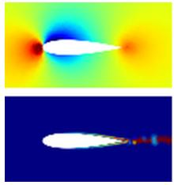  
CFD reference

  
rel-L2(p) = 0.026  
rel-L2(νt) = 0.063

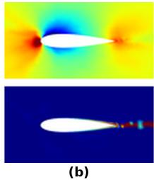  
rel-L2(p) = 0.030  
rel-L2(νt) = 0.116

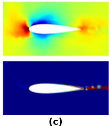  
rel-L2(p) = 0.066  
rel-L2(νt) = 0.144

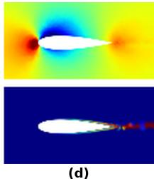  
rel-L2(p) = 0.085  
rel-L2(νt) = 0.155  
Figure 2: Pressure p (top) and turbulent viscosity νt (bottom) on the reference colour scales; left to right, the CFD reference, (a) our model, (b) Transolver, (c) PointNet, and (d) the best PSD-star HodgeFormer. Values beneath each model panel are mean relative $L _ { 2 }$ errors over the 200 test cases. The models differ more on $\nu _ { t }$ than on p; the reference panel shows fine-scale structure in the $\nu _ { t }$ wake.

## 5 Discussion and Conclusion

We propose a Hodge-routed mixture of transformer experts for steady-PDE prediction on unstructured meshes. A learned Hodge Laplacian computes the routing weights, and a separate analyzer constructs multiscale supervision targets. On the AirFRANS working mesh, mean relative $L _ { 2 }$ and interior mean squared errors decrease by 31% and 47% relative to Transolver, from 0.0436 to 0.0300 and from 0.00265 to 0.00140, respectively. The largest per-field improvement is in turbulent viscosity, whose relative $L _ { 2 }$ error decreases by approximately 46%, from 0.1158 to 0.0629 (table S7). Introducing the Hodge controller into the learned-band mixture reduces mean relative $L _ { 2 }$ error from 0.0345 to 0.0300 (table S6), with larger additional gains in velocity and pressure than in turbulent viscosity (table S7).

The mean relative $L _ { 2 }$ error for pressure is lower than Transolver’s, while surface and relative liftcoefficient errors are higher: 0.00164 versus 0.00143 and 0.0225 versus 0.0103, respectively (table 1). Both models retain lift rank correlations above 0.9998, preserving case ordering more accurately than force magnitudes. Pressure errors along the airfoil contour therefore require further examination.

We follow Transolver’s evaluation format on the official AirFRANS 800/200 split, with one training run per configuration and evaluation on a remeshed working mesh of approximately 4.9K vertices. The results do not establish accuracy at the original CFD resolution or robustness across random seeds. The analyzer’s algebraic target reconstruction holds independently of the controller’s conditional spectral guarantee. The implementation does not enforce the reciprocal neighborhoods required by that guarantee, and prediction accuracy does not validate it. Every expert is evaluated, and dense attention scales quadratically with mesh size. Future work should enforce the controller’s structural conditions and evaluate efficient expert architectures across mesh resolutions and PDE families.

## References

[1] Florent Bonnet et al. AirFRANS: High fidelity computational fluid dynamics dataset for approximating Reynoldsaveraged Navier–Stokes solutions. In Adv. Neural Inform. Process. Syst., 2022.

[2] Steven L. Brunton, Bernd R. Noack, and Petros Koumoutsakos. Machine learning for fluid mechanics. Annual Review ofFluid Mechanics, 52:477–508, 2020.

[3] Ricardo Vinuesa and Steven L. Brunton. Enhancing computational fluid dynamics with machine learning. Nature Computational Science, 2(6):358–366, 2022.

[4] Nils Thuerey, Konstantin Weißenow, Lukas Prantl, and Xiangyu Hu. Deep learning methods for Reynolds-averaged Navier–Stokes simulations of airfoil flows. AIAA Journal, 58(1):25–36, 2020.

[5] Maziar Raissi, Paris Perdikaris, and George Em Karniadakis. Physics-informed neural networks: A deep learning framework for solving forward and inverse problems involving nonlinear partial differential equations. J. Comput. Phys., 378:686–707, 2019. doi: 10.1016/j.jcp.2018.10.045.

[6] George Em Karniadakis, Ioannis G. Kevrekidis, Lu Lu, Paris Perdikaris, Sifan Wang, and Liu Yang. Physics-informed machine learning. Nature Reviews Physics, 3(6):422–440, 2021.

[7] Nikola Kovachki, Zongyi Li, Burigede Liu, Kamyar Azizzadenesheli, Kaushik Bhattacharya, Andrew Stuart, and Anima Anandkumar. Neural operator: Learning maps between function spaces with applications to PDEs. J. Mach. Learn. Res., 24(89):1–97, 2023. doi: 10.5555/3648699.3648788.

[8] Kamyar Azizzadenesheli, Nikola Kovachki, Zongyi Li, Miguel Liu-Schiaffini, Jean Kossaifi, and Anima Anandkumar. Neural operators for accelerating scientific simulations and design. arXiv preprint arXiv:2309.15325, 2023.

[9] Zongyi Li et al. Fourier neural operator for parametric partial differential equations. In Int. Conf. Learn. Represent., 2021.

[10] Zongyi Li et al. Neural operator: Graph kernel network for partial differential equations. In ICLR Workshop on Integration ofDeep Neural Models and Differential Equations, 2020.

[11] Zongyi Li, Daniel Zhengyu Huang, Burigede Liu, and Anima Anandkumar. Fourier neural operator with learned deformations for PDEs on general geometries. J. Mach. Learn. Res., 24(388):1–26, 2023.

[12] Tobias Pfaff and others. Learning mesh-based simulation with graph networks. In Int. Conf. Learn. Represent., 2021.

[13] Shuhao Cao. Choose a transformer: Fourier or Galerkin. In Adv. Neural Inform. Process. Syst., 2021.

[14] Zijie Li, Kazem Meidani, and Amir Barati Farimani. Transformer for partial differential equations’ operator learning. Trans. Mach. Learn. Res., 2022. arXiv:2205.13671.

[15] Zhongkai Hao et al. GNOT: A general neural operator transformer for operator learning. In Int. Conf. Mach. Learn., 2023.

[16] Zijie Li, Dule Shu, and Amir Barati Farimani. Scalable transformer for PDE surrogate modeling. arXiv preprint arXiv:2305.17560, 2023.

[17] Haixu Wu, Huakun Luo, Haowen Wang, Jianmin Wang, and Mingsheng Long. Transolver: A fast transformer solver for PDEs on general geometries. In Int. Conf. Mach. Learn., 2024

[18] Mathieu Desbrun, Anil N. Hirani, Melvin Leok, and Jerrold E. Marsden. Discrete exterior calculus. arXiv preprint math/0508341, 2005.

[19] Dmitriy Smirnov and Justin Solomon. HodgeNet: Learning spectral geometry on triangle meshes. ACM Trans. Graph., 40(4):1–11, 2021.

[20] Nicholas Sharp, Souhaib Attaiki, Keenan Crane, and Maks Ovsjanikov. DiffusionNet: Discretization agnostic learning on surfaces. ACM Trans. Graph., 41(3):1–16, 2022.

[21] Akis Nousias and Stavros Nousias. HodgeFormer: Transformers for learnable operators on triangular meshes through data-driven hodge matrices. In IEEE/CVF Winter Conf. on Applications ofComputer Vision (WACV), 2026. arXiv:2509.01839.

[22] Noam Shazeer et al. Outrageously large neural networks: The sparsely-gated mixture-of-experts layer. In Int. Conf. Learn. Represent., 2017.

[23] William Fedus, Barret Zoph, and Noam Shazeer. Switch transformers: Scaling to trillion parameter models with simple and efficient sparsity. Journal ofMachine Learning Research, 23(120):1–39, 2022.

[24] Shizheng Wen, Arsh Kumbhat, Levi Lingsch, Sepehr Mousavi, Yizhou Zhao, Praveen Chandrashekar, and Siddhartha Mishra. Geometry aware operator transformer as an efficient and accurate neural surrogate for PDEs on arbitrary domains. arXiv preprint arXiv:2505.18781, 2025.

[25] Zongyi Li, Hongkai Zheng, Nikola Kovachki, David Jin, Haoxuan Chen, Burigede Liu, Kamyar Azizzadenesheli, and Anima Anandkumar. Physics-informed neural operator for learning partial differential equations. ACM/IMS J. Data Sci., 2024. doi: 10.1145/3648506.

[26] Maurits Bleeker, Matthias Dorfer, Tobias Kronlachner, Reinhard Sonnleitner, Benedikt Alkin, and Johannes Brandstetter. NeuralCFD: Deep learning on high-fidelity automotive aerodynamics simulations. arXiv preprint arXiv:2502.09692, 2025.

[27] Lu Lu, Pengzhan Jin, Guofei Pang, Zhongqiang Zhang, and George Em Karniadakis. Learning nonlinear operators via DeepONet based on the universal approximation theorem of operators. Nature Machine Intelligence, 3(3):218–229, 2021. doi: 10.1038/s42256-021-00302-5.

[28] Zongyi Li, Nikola Kovachki, Chris Choy, Boyi Li, Jean Kossaifi, Shourya Otta, Mohammad Amin Nabian, Maximilian Stadler, Christian Hundt, Kamyar Azizzadenesheli, and Anima Anandkumar. Geometry-informed neural operator for large-scale 3D PDEs. In Adv. Neural Inform. Process. Syst., 2023.

[29] Seungjun Lee and Taegon Oh. Inducing point operator transformer: A flexible and scalable architecture for solving PDEs. In AAAI, 2024. doi: 10.1609/aaai.v38i1.27766.

[30] Maurits Bleeker, Matthias Dorfer, Tobias Kronlachner, Reinhard Sonnleitner, Benedikt Alkin, and Johannes Brandstetter. AB-UPT: Scaling neural CFD surrogates for high-fidelity automotive aerodynamics simulations via anchored-branched universal physics transformers. Trans. Mach. Learn. Res., 2025.

[31] Matthew Tancik, Pratul P. Srinivasan, Ben Mildenhall, Sara Fridovich-Keil, Nithin Raghavan, Utkarsh Singhal, Ravi Ramamoorthi, Jonathan T. Barron, and Ren Ng. Fourier features let networks learn high frequency functions in low dimensional domains. In Adv. Neural Inform. Process. Syst., 2020

[32] Lek-Heng Lim. Hodge Laplacians on graphs. SIAM Review, 62(3):685–715, 2020.

[33] Michael T. Schaub, Austin R. Benson, Paul Horn, Gábor Lippner, and Ali Jadbabaie. Random walks on simplicial complexes and the normalized hodge 1-Laplacian. SIAM Review, 62(2):353–391, 2020. doi: 10.1137/18m1201019.

[34] Moshe Eliasof and Eran Treister. DiffGCN: Graph convolutional networks via differential operators and algebraic multigrid pooling. In Advances in Neural Information Processing Systems (NeurIPS), 2020.

[35] Benjamin Shaffer, Shawn Koohy, Brooks Kinch, M. Ani Hsieh, and Nathaniel Trask. Structure-preserving learning improves geometry generalization in neural PDEs. arXiv preprint arXiv:2602.02788, 2026.

[36] Dongzhe Zheng, Tao Zhong, and Christine Allen-Blanchette. Topology-preserving neural operator learning via hodge decomposition. arXiv:2605.13834, 2026.

[37] Lennart Bastian, Samuel Leventhal, Mustafa Hajij, and Tolga Birdal. Topological neural operators. arXiv preprint arXiv:2606.09806, 2026.

[38] David I. Shuman, Sunil K. Narang, Pascal Frossard, Antonio Ortega, and Pierre Vandergheynst. The emerging field of signal processing on graphs: Extending high-dimensional data analysis to networks and other irregular domains. IEEE Signal Processing Magazine, 30(3):83–98, 2013.

[39] David K. Hammond, Pierre Vandergheynst, and Rémi Gribonval. Wavelets on graphs via spectral graph theory. Applied and Computational Harmonic Analysis, 30(2):129–150, 2011.

[40] Christophe Geuzaine and Jean-François Remacle. Gmsh: A 3-D finite element mesh generator with built-in pre- and post-processing facilities. Int. J. Numer. Methods Eng., 79(11):1309–1331, 2009.

[42] Leslie N. Smith and Nicholay Topin. Super-convergence: Very fast training of neural networks using large learning rates. In Artificial Intelligence and Machine Learningfor Multi-Domain Operations Applications, 2019.

[41] Ilya Loshchilov and Frank Hutter. Decoupled weight decay regularization. In Int. Conf. Learn. Represent., 2019.

[43] Charles R. Qi, Hao Su, Kaichun Mo, and Leonidas J. Guibas. PointNet: Deep learning on point sets for 3D classification and segmentation. In IEEE Conf. Comput. Vis. Pattern Recog., 2017.

## Supplementary Material

## S1 Notation

Table S1 defines the principal symbols used in the main paper and supplementary material. Shared constants and VEF-specific quantities are listed together. Arrays are written without the batch axis. The same symbols $x _ { v } , x _ { e } , x _ { f }$ denote input features in section 3.3 and normalized latent features within the operator composition; their local dimensions are stated where they are used. Controller stars and analyzer stars are separate operators. Superscripts on decoder tokens indicate block depth, whereas subscripts on assigned targets identify experts. In the embedding notation, $\delta _ { s } = \mathrm { d i a g } ( d _ { s } ^ { \top } d _ { s } )$ with $d _ { v } = d _ { 0 }$ and $d _ { e } = d _ { 1 }$ , and $A _ { s }$ denotes its normalized off-diagonal adjacency. The original HodgeFormer notation in section S2.1 is retained locally: there h counts heads and σ denotes softmax, rather than the shared embedding and Gaussian bandwidth used elsewhere.

Table S1: Notation. Principal symbols grouped by their role. Array shapes omit the batch axis; local uses in the HodgeFormer preliminaries and transformer equations are identified explicitly.
<table><tr><td>symbol</td><td>type</td><td>meaning</td><td>symbol</td><td>type</td><td>meaning</td></tr><tr><td colspan="6">The discretisation</td></tr><tr><td> $\mathcal { M }$ </td><td> $( V , E , F )$ </td><td>the working mesh as a simplicial complex</td><td> $e = ( i , j )$ </td><td>index</td><td>an edge with end- points  $i , j$ </td></tr><tr><td> $V , E , F$ </td><td>sets</td><td>vertices, edges, faces</td><td> $i , j , k , m , s$ </td><td>indices</td><td>elements  $i , j ;$  expert  $k ;$  atom m; stream s</td></tr><tr><td> $N , N _ { e } , N _ { f }$ </td><td>integers</td><td> $| V | , | E | , | F | ; \ N \ \approx$  4900</td><td>C</td><td>index</td><td>output channel in  $y _ { v c }$ </td></tr><tr><td>v</td><td>index</td><td>a vertex</td><td></td><td></td><td></td></tr><tr><td colspan="6">Input features</td></tr><tr><td> $x _ { v }$ </td><td> $\mathbb R ^ { N \times c _ { v } }$ </td><td>standardized vertex inputs</td><td> $\left( c _ { v } , c _ { e } , c _ { f } \right)$ </td><td></td><td>(9, 21, 13) channel counts</td></tr><tr><td> $x _ { e }$ </td><td> $\mathbb { R } ^ { N _ { e } \times c _ { e } }$ </td><td>raw edge geometry in- puts</td><td>pos</td><td> $\mathbb { R } ^ { N \times 2 }$ </td><td>standardized position columns of  $x _ { v }$ </td></tr><tr><td> $x _ { f }$ </td><td> $\mathbb { R } ^ { N _ { f } \times c _ { f } }$ </td><td>raw face geometry in- puts</td><td></td><td></td><td></td></tr><tr><td colspan="6">Target and prediction</td></tr><tr><td> $u _ { x } , u _ { y }$ </td><td>fields</td><td>velocity components</td><td> $U _ { \infty }$ </td><td>scalar</td><td>freestream speed of a sample</td></tr><tr><td> $p$ </td><td>field</td><td>kinematic pressure</td><td> $_ y$ </td><td> $\mathbb { R } ^ { N \times 4 }$ </td><td>training target, stan- dardised</td></tr><tr><td> $\nu _ { t }$ </td><td>field</td><td>turbulent kinematic viscosity</td><td> $\hat { u }$ </td><td> $\mathbb { R } ^ { N \times 4 }$ </td><td>standardized field pre- diction</td></tr><tr><td colspan="6">Discrete operators</td></tr><tr><td> $d _ { 0 }$ </td><td>incidence</td><td> $\begin{array} { r l } { \mathbb { R } ^ { N _ { e } \times N } , } & { { } ( d _ { 0 } x ) _ { e } } & { = } \end{array}$   $x _ { j } - x _ { i }$ </td><td> $L _ { 0 }$ </td><td> $\mathbb { R } ^ { N \times N }$ </td><td>vertex operator; stars depend on context</td></tr><tr><td> $d _ { 1 }$ </td><td>incidence</td><td> $\mathbb { R } ^ { N _ { f } \times N _ { \epsilon } }$   $d _ { 1 } d _ { 0 } = 0$ </td><td> $Q$ </td><td> $\mathbb { R } ^ { N \times N }$ </td><td>controller stiffness  $d _ { 0 } ^ { \top } \star _ { 1 } d _ { 0 }$ </td></tr><tr><td> $\star _ { 0 } , \star _ { 1 } , \star _ { 2 }$ </td><td>matrices</td><td>stars on 0-, 1-, 2- cochains</td><td>M</td><td>integer</td><td>atom count,  $M = 9$ </td></tr><tr><td> $\star _ { 0 } ^ { - 1 } , \star _ { 1 } ^ { - 1 }$ </td><td>matrices</td><td>controller: indepen- dent learned opera- tors</td><td></td><td></td><td></td></tr><tr><td colspan="6">Neighbourhoods and supports</td></tr><tr><td> $\mathcal { N } ^ { \mathrm { f u l l } } ( i )$ </td><td>set</td><td>stored neighbors: vertex/edge cap 256, face cap 1</td><td>support</td><td>pairs</td><td>the (i, j) with  $j \in$   $\mathcal { N } ( i )$ </td></tr><tr><td> $\mathcal { N } ( i )$ </td><td>set</td><td>effective neighbors; caps in table S3</td><td>mutual</td><td>property</td><td> $j \ \in \ \mathcal { N } ( i ) \ \Rightarrow \ i \ \in$   $\mathcal { N } ( j )$ </td></tr><tr><td colspan="6">The controller (section 3.5)</td></tr><tr><td> $\ell$ </td><td> $\mathbb { R } ^ { N \times K }$ </td><td>vertex routing logits</td><td> $V ^ { ( i ) }$ </td><td>array</td><td>projected values of head i; shape depends on stream</td></tr><tr><td> $h _ { v } , h _ { e } , h _ { f }$ </td><td>arrays</td><td>controller streams, each of width  $d _ { c }$ </td><td> $W _ { V } ^ { ( i ) } , W _ { \mathrm { o u t } }$ </td><td>matrices</td><td>per-head value; per- layer output</td></tr><tr><td> $d _ { c } , L _ { c } , H$ </td><td>64,2,4</td><td>width, layers, heads</td><td> $W _ { a } , W _ { b }$ </td><td>matrices</td><td>read-out,  $d _ { c }  6 4  K$ </td></tr><tr><td> $d _ { h }$ </td><td>16</td><td> $d _ { c } / H ,$  per-head width</td><td> $\operatorname { E m b } _ { s } , \operatorname { F F N } _ { s }$ </td><td>networks</td><td>embedding; forward</td></tr><tr><td> $A _ { s }$ </td><td>matrix</td><td>normalized off- diagonal embedding</td><td> $\delta _ { s } , \tilde { D } _ { s }$ </td><td></td><td>vector/matrix incidence degrees;  $\tilde { D } _ { s } = \mathrm { d i a g } ( \delta _ { s } ) + I$ </td></tr><tr><td colspan="6">adjacency The Gaussian star (section 3.5.1)</td></tr><tr><td> $\varphi _ { i }$ </td><td> $\mathbb { R } ^ { d _ { h } }$ </td><td>kernel feature,  $W _ { \varphi } \mathrm { L N } ( h ) _ { i }$ </td><td> $N _ { c }$ </td><td>integer</td><td>cells of the degree acted on</td></tr><tr><td> $W _ { \varphi }$ </td><td> $\mathbb { R } ^ { d _ { h } \times d _ { c } }$ </td><td>shared kernel projec-</td><td></td><td> $> 0$ </td><td>bandwidth,</td></tr><tr><td> $w _ { i j }$ </td><td>(0,1]</td><td>tion for elements  $i , j$  Gaussian kernel</td><td></td><td> $( 0 , \textstyle { \frac { 1 } { 2 } } )$ </td><td> $\mathrm { s o f t p l u s } ( \gamma ) + 1 0 ^ { - 8 }$   $\textstyle { \frac { 1 } { 2 } } \operatorname { s i g m o i d } ( \alpha )$ </td></tr><tr><td> $\Omega$ </td><td> $\mathbb { R } ^ { N _ { c } \times N _ { c } }$ </td><td>weight  $w _ { i j }$  on the support,  $\mathrm { e l s e 0 }$ </td><td> $\gamma , \alpha$ </td><td>scalars</td><td>raw parameters; init  $0 . 5 4 \bar { 1 } 3 , - 0 . 8 5$ </td></tr><tr><td> $D , D _ { i }$ </td><td>matrix/scalar</td><td> $\begin{array} { r l r } { D } & { { } = } & { \mathrm { d i a g } ( D _ { i } ) ; } \end{array}$   $D _ { i } = \textstyle \sum _ { j } \Omega _ { i j }$ </td><td></td><td>matrix</td><td>unweighted vertex ad- jacency in fixed-band</td></tr><tr><td> $\hat { S }$ </td><td>matrix</td><td>implemented normal- ization in eq. (6)</td><td></td><td></td><td>decomposition</td></tr><tr><td colspan="6">Experts, gate and decoder (section 3.6)</td></tr><tr><td> $K$ </td><td> $^ 8$ </td><td>number of experts</td><td> $W _ { \mathrm { i n } } ^ { k } , W _ { b } ^ { k }$ </td><td>matrices</td><td>expert input; band head</td></tr><tr><td> $d , d _ { x }$ </td><td>192,88</td><td>token width; expert width</td><td> $\mathrm { p r o j } _ { k }$ </td><td>affine map</td><td>maps  $z _ { k }$  to an  $N \times d$  array</td></tr><tr><td> $L _ { x } , h _ { x }$ </td><td> $2 , 8$ </td><td>blocks; heads per block</td><td></td><td> $\mathbb { R } ^ { N \times 4 }$ </td><td>band-head output</td></tr><tr><td> $h$ </td><td> $\mathbb { R } ^ { N \times d }$ </td><td>token embedding, shared</td><td> $g ( v )$ </td><td> $\Delta ^ { K }$ </td><td>gate weights at vertex</td></tr><tr><td> $z _ { k } , z _ { k } ^ { 0 }$ </td><td> $\mathbb { R } ^ { N \times d _ { x } }$ </td><td>output, input of ex- pert k</td><td> $\Delta ^ { K }$ </td><td>simplex</td><td>nonnegative weights summing to</td></tr><tr><td> $n _ { F }$ </td><td> $^ 8$ </td><td>frequencies; sine/cosine give</td><td> $h _ { \mathrm { m i x } }$ </td><td> $\mathbb { R } ^ { N \times d }$ </td><td>one mixed latent</td></tr><tr><td> $\sigma _ { k }$ </td><td>constants</td><td>2nF channels fixed Fourier scales</td><td> $E _ { \mathrm { f i e l d } }$ </td><td> $\mathbb { R } ^ { 4 \times d }$ </td><td>decoder field embed-</td></tr><tr><td> $G _ { k } , B _ { k }$ </td><td> $\mathbb { R } ^ { 2 \times n _ { F } }$ </td><td>1.0 to 38.0 (table S3) fixed Gaussian draw;</td><td></td><td></td><td>ding</td></tr><tr><td colspan="6"></td></tr><tr><td>The analyzer (section 3.7)</td><td></td><td></td><td></td><td></td><td></td></tr><tr><td> $w _ { e }$   $\epsilon _ { w }$ </td><td> $\sum _ { 1 0 ^ { - 4 } } \epsilon _ { w }$ </td><td>edge conductance keeps  $w _ { e }$  positive</td><td> $\bar { y } ^ { ( j ) }$   $m _ { j } , L$ </td><td> $\mathbb { R } ^ { N \times 4 }$  integers</td><td>target after  $m _ { j }$  steps rung count  $m _ { j } ; L =$  8 rungs</td></tr><tr><td> $\mu _ { v }$ </td><td> $> 0$ </td><td>incident conductance sum; mass uses floor</td><td> $a _ { i }$ </td><td> $\mathbb { R } ^ { N \times 4 }$ </td><td>atom i;  $\textstyle \sum _ { i } a _ { i } = y$ </td></tr><tr><td> $\mathrm { M L P } _ { e }$ </td><td> $2 1  6 4  1$ </td><td> $\epsilon _ { w }$  edge-conductance</td><td> $P , \theta$ </td><td> $\mathbb { R } ^ { K \times M }$ </td><td>column-normalized assignment and its</td></tr><tr><td>T</td><td>1-2</td><td>forward-Euler step</td><td> $t _ { k }$ </td><td> $\mathbb { R } ^ { N \times 4 }$ </td><td>logits band target;  $\textstyle \sum _ { k } t _ { k } = y$ </td></tr><tr><td colspan="6">The objective (section 3.8)</td></tr><tr><td> $\mathcal { L }$ </td><td>scalar</td><td>the training objective</td><td> $\bar { g } _ { k }$ </td><td>scalar</td><td>mean gate mass of ex- pert k</td></tr><tr><td> $\mathcal { L } _ { \mathrm { v o l } } , \mathcal { L } _ { \mathrm { s u r f } }$ </td><td>scalars</td><td>interior, wall field terms</td><td> $p _ { k }$ </td><td>[0, 1]</td><td>assigned-target squared-norm share, denominator floored</td></tr><tr><td colspan="6">Metrics</td></tr><tr><td> $\mathrm { r e l - } L _ { 2 }$ </td><td> $\geq 0$ </td><td>mean case/field rel- ative  $L _ { 2 } ,$  physical units</td><td> $C _ { L }$ </td><td> $\geq 0$ </td><td>relative  $L _ { 2 }$  of lift- coefficient vectors</td></tr><tr><td> $R ^ { 2 }$ </td><td> $\leq 1$ </td><td>coefficient of determi- nation</td><td> $\rho _ { L }$ </td><td>[−1,1]</td><td>Spearman correlation of lift</td></tr><tr><td>Volume, Surf</td><td> $\geq 0$ </td><td>globally normalized MSE, non-wall and wall</td><td></td><td></td><td></td></tr><tr><td colspan="6">Generic operators</td></tr><tr><td>LN</td><td>operator</td><td>layer normalisation</td><td>λ(·)</td><td>set</td><td>the spectrum of a ma- trix</td></tr><tr><td>Drop</td><td>operator</td><td>dropout, probability 0.1</td><td> $\sim$ </td><td>relation</td><td>similarity of matrices</td></tr><tr><td>GELU, MHSA operators</td><td></td><td>activation; self- attention</td><td>[·]</td><td>operator</td><td>concatenation; axis specified locally</td></tr><tr><td>diag(·)</td><td>matrix</td><td>diagonal from a vec- tor</td><td></td><td>operator</td><td>elementwise product</td></tr><tr><td colspan="6">Additional local notation</td></tr><tr><td> $L _ { v } , L _ { e } , L _ { f }$ </td><td>operators</td><td>vertex, edge, face op- erators in eq. (8)</td><td> $B _ { \mathrm { b a t c h } }$ </td><td>integer</td><td>batch size</td></tr><tr><td> $x _ { v } ^ { \mathrm { r a w } }$ </td><td> $\mathbb { R } ^ { N \times 9 }$ </td><td>vertex features before standardization</td><td> $A _ { v } ^ { \mathrm { { d u a l } } }$ </td><td>area</td><td>barycentric dual ver- tex area</td></tr><tr><td> $\mu _ { c } ^ { \mathrm { n o r m } } , s _ { c } ^ { \mathrm { n o r m } }$ </td><td>scalars</td><td>target training mean and standard devia- tion</td><td> $\widetilde { y }$ </td><td> $\mathbb { R } ^ { N \times 4 }$ </td><td>freestream-scaled tar- gets</td></tr><tr><td> $T$ </td><td>1</td><td>assignment tempera- ture in eq. (15)</td><td> $E _ { k }$ </td><td>scalar</td><td> $\textstyle \sum _ { v , c } t _ { v c k } ^ { 2 }$ </td></tr><tr><td> $\lambda _ { b } , \lambda _ { \mathrm { b a l } } , \lambda _ { \mathrm { f l o o r } }$ </td><td>scalars</td><td>loss weights 0.5, 0.01, 1.0</td><td> $\rho$ </td><td>0.02</td><td>minimum assigned- target norm share</td></tr><tr><td> $e _ { v c }$ </td><td>scalar</td><td>normalized field residual in eq. (17)</td><td> $V _ { \mathrm { v o l } } , V _ { \mathrm { s u r f } }$ </td><td>sets</td><td>non-wall and wall ver- tices</td></tr><tr><td> $t _ { v c } ^ { r } , T _ { v } ^ { r }$ </td><td>vector/array</td><td>decoder field token and four-token array</td><td> $m ( v )$ </td><td> $\mathbb { R } ^ { d }$ </td><td>normalized, dropped- out mixed latent</td></tr><tr><td> $X , n , D , J , q$ </td><td>local notation</td><td>at depth r transformer tokens, count, width, heads,</td><td> $Q _ { a } , K _ { a } , V _ { a }$ </td><td>arrays</td><td>query, key, value of transformer head a</td></tr><tr><td> $A _ { a } , O _ { a }$ </td><td>matrices</td><td>head width  $q = D / J$  head attention weights and output in</td><td> $z _ { i }$ </td><td>scalar</td><td>diagonal-face kernel score in eq. (7)</td></tr></table>

## S2 Preliminaries

## S2.1 HodgeFormer

HodgeFormer [21] extends the Transformer layer to operate on vertex, edge, and face features. Following the notation of the original paper, the feature arrays are

$$
\begin{array} { r } { x _ { k } \in \mathbb { R } ^ { n _ { k } \times d _ { k } } , \qquad k \in \{ v , e , f \} . } \end{array}\tag{S1}
$$

For a common embedding dimension $d _ { k } \ = \ d$ and h attention heads, each head has dimension $d _ { h } = d / h$ . Learnable projection matrices define the query, key, and value representations,

$$
\begin{array} { r l r } { Q _ { k } = x _ { k } W _ { Q _ { k } } , } \\ { K _ { k } = x _ { k } W _ { K _ { k } } , } & { } & { W _ { Q _ { k } } , W _ { K _ { k } } , W _ { V _ { k } } \in \mathbb { R } ^ { d \times d _ { h } } . } \\ { V _ { k } = x _ { k } W _ { V _ { k } } , } \end{array}\tag{S2}
$$

The original HodgeFormer parameterizes a Hodge Star through row-wise softmax attention,

$$
\star _ { k } ( x _ { k } ) = \sigma \left( { \frac { Q _ { k } K _ { k } ^ { T } } { \sqrt { d _ { h } } } } \right) ,\tag{S3}
$$

where $\sigma ( \cdot )$ denotes the row-wise softmax. Dedicated linear maps are used for the inverse Hodge Stars. Composing these stars with the signed incidence matrices gives the learned operators

$$
\begin{array} { r l } & { L _ { v } : = \star _ { 0 } ^ { - 1 } ( x _ { v } ) \cdot d _ { 0 } ^ { T } \cdot \star _ { 1 } ( x _ { e } ) \cdot d _ { 0 } , } \\ & { L _ { e } : = d _ { 0 } \cdot \star _ { 0 } ^ { - 1 } ( x _ { v } ) \cdot d _ { 0 } ^ { T } \cdot \star _ { 1 } ( x _ { e } ) } \\ & { \qquad + \star _ { 1 } ^ { - 1 } ( x _ { e } ) \cdot d _ { 1 } ^ { T } \cdot \star _ { 2 } ( x _ { f } ) \cdot d _ { 1 } , } \\ & { L _ { f } : = d _ { 1 } \cdot \star _ { 1 } ^ { - 1 } ( x _ { e } ) \cdot d _ { 1 } ^ { T } \cdot \star _ { 2 } ( x _ { f } ) . } \end{array}\tag{S4}
$$

For one head, the attention updates apply each operator to the corresponding projected values,

$$
\begin{array} { r l } & { ~ A _ { v } ( x _ { v } , x _ { e } ) = L _ { v } ( x _ { v } , x _ { e } ) \cdot V _ { v } ( x _ { v } ) , } \\ & { A _ { e } ( x _ { v } , x _ { e } , x _ { f } ) = L _ { e } ( x _ { v } , x _ { e } , x _ { f } ) \cdot V _ { e } ( x _ { e } ) , } \\ & { ~ A _ { f } ( x _ { e } , x _ { f } ) = L _ { f } ( x _ { e } , x _ { f } ) \cdot V _ { f } ( x _ { f } ) . } \end{array}\tag{S5}
$$

Head outputs are concatenated and projected back to the embedding dimension to form Multi-head Hodge Attention $A _ { H _ { l } }$ . The HodgeFormer layer is

$$
\begin{array} { r l } & { H _ { l } ( x _ { v } , x _ { e } , x _ { f } ) : = G _ { l } \big ( A _ { H _ { l } } ( x _ { v } , x _ { e } , x _ { f } ) } \\ & { ~ + ( x _ { v } , x _ { e } , x _ { f } ) \big ) , } \end{array}\tag{S6}
$$

where $G _ { l }$ transforms each form independently through separate two-layer feedforward networks with residual connections. These equations describe the original HodgeFormer; the Gaussian-star controller used in this work is specified in section 3.5.

## S3 Methodology

This section provides the detailed controller, expert input construction, transformer blocks, mixture, and field decoder accompanying section 3. Widths and counts are those of table S3.

## S3.1 Overall Controller Architecture

The three-stream equations below describe the VEF extension. The reported vertex-only model enables only the vertex update; edge features enter its vertex operator, while edge and face streams are not evolved. The controller applies two HodgeFormer[21] layers to the width-64 streams from section 3.4, followed by a vertex readout. Each layer has four heads of width 16 and feedforward width 256. Layer and head indices on the projections and stars are omitted below for readability. Their parameters are independent.

All three streams are normalized before attention. Writing $x _ { v } = \mathrm { L N } ( h _ { v } ) , x _ { e } = \mathrm { L N } ( h _ { e } )$ , and $x _ { f } = \mathrm { L N } ( h _ { f } )$ , one head computes

$$
\begin{array} { r l } & { ~ A _ { v } ( x _ { v } , x _ { e } ) = L _ { v } ( x _ { v } , x _ { e } ) \cdot V _ { v } ( x _ { v } ) , } \\ & { A _ { e } ( x _ { v } , x _ { e } , x _ { f } ) = L _ { e } ( x _ { v } , x _ { e } , x _ { f } ) \cdot V _ { e } ( x _ { e } ) , } \\ & { ~ A _ { f } ( x _ { e } , x _ { f } ) = L _ { f } ( x _ { e } , x _ { f } ) \cdot V _ { f } ( x _ { f } ) , } \end{array}\tag{S7}
$$

where $V _ { s } ( x _ { s } ) = x _ { s } W _ { V _ { s } }$ is the learned value projection for stream $s \in \{ v , e , f \}$ . The operators are those of eq. (8); their stars use the normalized features supplied to the same layer. The four head

outputs are concatenated, passed through dropout, and projected back to width 64. We denote this combined output for stream s by $A _ { H _ { l } , s } .$ . The layer updates are

$$
\begin{array} { r } { \widetilde { h } _ { s } = h _ { s } + \mathrm { D r o p } ( A _ { H _ { l } , s } ( x _ { v } , x _ { e } , x _ { f } ) ) , \qquad } \\ { h _ { s } ^ { \mathrm { o u t } } = \widetilde { h } _ { s } + \mathrm { D r o p } ( \mathrm { F F N } _ { s } ( \mathrm { L N } ( \widetilde { h } _ { s } ) ) ) , \qquad } \\ { \mathrm { F F N } _ { s } ( x ) = \mathrm { L i n e a r } _ { 2 5 6 \to 6 4 } ( \mathrm { R e L U } ( \mathrm { L i n e a r } _ { 6 4 \to 2 5 6 } ( x ) ) ) . } \end{array}\tag{S8}
$$

Each stream has its own normalization layers, projections, and feedforward network. The residual feedforward updates form $G _ { l } ,$ , while dropout has probability 0.1. The first sublayer exchanges information through the mesh operators; the second transforms each mesh element independently. All attention outputs use the same pre-update streams, so a layer performs simultaneous vertex, edge, and face updates.

The vertex operator reads edge features through $\star _ { 1 }$ , and the edge operator reads vertex and face features through $\star _ { 0 } ^ { - 1 }$ and $\star _ { 2 }$ . Consequently, face-dependent changes to the edge stream in the first layer can affect the vertex stream in the second layer. The final face-stream update is not directly used by the vertex readout.

After the second HodgeFormer layer, the controller reads only $h _ { v }$ and computes

$$
\ell = \operatorname { L i n e a r } _ { 6 4 \to 8 } ( \operatorname { G E L U } ( \operatorname { L i n e a r } _ { 6 4 \to 6 4 } ( \operatorname { L N } ( h _ { v } ) ) ) ) \in \mathbb { R } ^ { N \times K } , \qquad K = 8 .\tag{S9}
$$

The mixture module converts these logits into routing weights through a softmax without temperature scaling. With the batch axis included, the logit tensor has shape $( \bar { B _ { \mathrm { b a t c h } } } , N , K )$

## S3.2 Expert Fourier Bandwidths

Each expert receives Fourier features of the standardized vertex coordinates $\mathrm { p o s } \in \mathbb { R } ^ { N \times 2 }$ . For expert $k = 1 , \ldots , K$ , the frequency matrix is $B _ { k } = \sigma _ { k } G _ { k } \in \mathbb { R } ^ { 2 \times n _ { F } }$ , where $n _ { F } = 8$ and the entries of $G _ { k }$ are sampled independently from a standard normal distribution. The matrices are sampled at initialization and remain fixed during training. The configured scales are

$$
( \sigma _ { 1 } , \ldots , \sigma _ { K } ) = ( 1 . 0 , 1 . 7 , 2 . 8 , 4 . 8 , 8 . 0 , 1 3 . 5 , 2 2 . 6 , 3 8 . 0 ) .\tag{S10}
$$

The product pos $B _ { k } \in \mathbb { R } ^ { N \times n _ { F } }$ gives eight coordinate projections per vertex. Applying sine and cosine elementwise produces the Fourier features

$$
[ \sin ( 2 \pi \mathrm { p o s } B _ { k } ) ; \cos ( 2 \pi \mathrm { p o s } B _ { k } ) ] \in \mathbb { R } ^ { N \times 2 n _ { F } } .\tag{S11}
$$

Here, the semicolon denotes concatenation along the feature dimension. Larger $\sigma _ { k }$ scale the sampled frequencies upward, giving the experts different positional inputs. These scales do not restrict an expert to a particular frequency band: the learned atom assignment determines its auxiliary target and is not constrained to follow the ordering of the Fourier scales. These features enter the prediction experts; the analyzer constructs its targets separately through the smoothing operators and telescoping atoms described in section 3.

## S3.3 Expert Input Construction

Bias terms in affine projections are omitted from the equations for readability. The $2 n _ { F } = 1 6$ Fourier features in eq. (S11) are concatenated with the shared embedding h and projected to $d _ { x } = 8 8 $

$$
z _ { k } ^ { 0 } = W _ { \mathrm { i n } } ^ { k } [ h ; \sin ( 2 \pi \mathrm { p o s } B _ { k } ) ; \cos ( 2 \pi \mathrm { p o s } B _ { k } ) ] .\tag{S12}
$$

## S3.4 Transformer experts and mixture

Each expert processes the input $z _ { k } ^ { 0 }$ defined in section S3.3.

Each expert contains $L _ { x } = 2$ pre-normalized transformer blocks with full softmax attention over all vertices, $h _ { x } = 8$ heads of width $d _ { x } / h _ { x } = 1 1$ , and feed-forward width $4 d _ { x } = 3 5 2$ . The experts receive no direct incidence input or attention mask. All eight experts are evaluated for every vertex; routing does not reduce expert computation.

Each vanilla transformer block consists of multi-head softmax self-attention followed by a positionwise feed-forward network, with pre-normalization and a residual connection around each sublayer. For a token array $\boldsymbol { X } \in \mathbb { R } ^ { n \times D }$ and J heads of width $q = D / J$ , the attention sublayer computes

$$
\begin{array} { r l } & { \bar { X } = \mathrm { L N } _ { 1 } ( X ) , \qquad Q _ { a } = \mathrm { L i n e a r } _ { Q , a } ( \bar { X } ) , \quad K _ { a } = \mathrm { L i n e a r } _ { K , a } ( \bar { X } ) , \quad V _ { a } = \mathrm { L i n e a r } _ { V , a } ( \bar { X } ) , } \\ & { A _ { a } = \mathrm { s o f t m a x } _ { \mathrm { r o w } } \left( \frac { Q _ { a } K _ { a } ^ { \top } } { \sqrt { q } } \right) , \qquad O _ { a } = \mathrm { D r o p } ( A _ { a } ) V _ { a } , } \\ & { \tilde { X } = X + \mathrm { D r o p } ( \mathrm { L i n e a r } _ { O } [ O _ { 1 } ; . . . ; O _ { J } ] ) . } \end{array}\tag{S13}
$$

The row-wise softmax assigns one distribution over all tokens to each query. The feed-forward sublayer then gives

$$
\begin{array} { r l } & { X ^ { + } = \widetilde { X } + \mathrm { D r o p } ( \mathrm { F F N } ( \mathrm { L N } _ { 2 } ( \widetilde { X } ) ) ) , } \\ & { \mathrm { F F N } ( x ) = \mathrm { L i n e a r } _ { 4 D  D } ( \mathrm { G E L U } ( \mathrm { L i n e a r } _ { D  4 D } ( x ) ) ) . } \end{array}\tag{S14}
$$

All projections are affine, and each block has its own parameters. Attention mixes tokens globally, whereas the feed-forward network acts independently on each token. Attention-weight and residual dropout both use probability 0.1. In an expert, $X = z _ { k } ^ { \bar { r } } , n = N , D = 8 8$ , and $J = 8 ;$ two applications of this block produce $z _ { k } ^ { L _ { x } }$

After final layer normalization, $z _ { k } = \mathrm { L N } ( z _ { k } ^ { L _ { x } } ) \in \mathbb { R } ^ { N \times d _ { x } }$ . Each expert has two output heads, producing $\mathrm { p r o j } _ { k } ( z _ { k } ) \in \mathbb { R } ^ { N \times d }$ and the band prediction $\hat { b } _ { k } \in \mathbb { R } ^ { N \times 4 }$ . Routing and mixing are

$$
g _ { k } ( v ) = \frac { \exp ( \ell _ { k } ( v ) ) } { \sum _ { k ^ { \prime } = 1 } ^ { K } \exp ( \ell _ { k ^ { \prime } } ( v ) ) } , \qquad h _ { \mathrm { m i x } } ( v ) = \sum _ { k = 1 } ^ { K } g _ { k } ( v ) \operatorname { p r o j } _ { k } ( z _ { k } ) ( v ) .\tag{S15}
$$

The mixture module applies dropout to the combined representation. The model then applies layer normalization and a second dropout before decoding. The dropout probability is 0.1. There is no residual connection around the mixture.

Auxiliary band predictions are supervised against the assigned targets of eq. (15) and are not summed to produce the final fields. Completeness of the band targets therefore does not impose an additive reconstruction identity on the final prediction.

## S3.5 Field decoder

The decoder creates four field tokens per vertex by adding learned embeddings $E _ { \mathrm { f i e l d } } \in \mathbb { R } ^ { 4 \times d }$ to the mixed latent after layer normalization and dropout. Two transformer blocks attend across the four fields at each vertex, with width 192, four heads, and feed-forward width 768. They do not attend across vertices. A shared readout, LayerNorm Linear(192,64) GELU Linear(64,1), returns $\hat { u } \in \mathbb { R } ^ { N \times 4 }$ in standardized target space, with implementation shape $( B _ { \mathrm { b a t c h } } , N , 4 )$

More explicitly, let $m ( v )$ denote the mixed latent after the normalization and dropout described above. Decoder input tokens are

$$
t _ { v c } ^ { 0 } = m ( v ) + E _ { \mathrm { f i e l d } , c } , \qquad T _ { v } ^ { 0 } = [ t _ { v 1 } ^ { 0 } ; \dots ; t _ { v 4 } ^ { 0 } ] \in \mathbb { R } ^ { 4 \times 1 9 2 } .\tag{S16}
$$

At each vertex, the decoder applies two independently parameterized instances of eqs. (S13) and (S14) with $n = 4 , D = 1 9 2$ , and $J = 4 .$ , so each attention head has width 48. Thus attention relates output fields at a fixed vertex. The final token for channel c is read out as

$$
\begin{array} { r } { \hat { u } _ { v c } = \mathrm { L i n e a r } _ { 6 4 \to 1 } \big ( \mathrm { G E L U } \big ( \mathrm { L i n e a r } _ { 1 9 2 \to 6 4 } ( \mathrm { L N } ( t _ { v c } ^ { 2 } ) ) \big ) \big ) . } \end{array}\tag{S17}
$$

The same readout parameters are used for all vertices and fields; the field embeddings distinguish the four channels.

## S3.6 Initialization and parameter counts

After assembly, the builder applies Xavier-uniform initialization to every parameter tensor with more than one dimension, including field embeddings and assignment logits. Fourier matrices are buffers

and are not overwritten. Evaluation logs report 3,106,490 registered trainable parameters for the VEF extension and 3,023,962 for the reported vertex-only model. These totals include unused parameters and analyzer parameters without an active objective-gradient path.

## S4 Experimental Protocol

The data, the split, the augmentation pool and the normalisation are given in section 4.1; table S2 gives the full training configuration, and this section records what that description leaves out. The lift coefficient uses the same mesh-native contour for every model, and both contour conventions are reported in section S7.

Table S2: Base training configuration. The VEF variant adds a 200-epoch continuation at learning rate $2 \times 1 0 ^ { - 4 } .$  
optimiser AdamW [41], weight decay $1 0 ^ { - 4 }$   
schedule OneCycleLR per batch [42], with m $\mathrm { \Delta \ a x _ { l r } = 1 0 ^ { - 3 } }$ , pct\_start= 0.3, div= 25, final $\lrcorner \mathtt { d i v } = 1 0 ^ { 4 }$ , that is   
$4 \times \dot { 1 0 } ^ { - 5 } \stackrel { . } {  } 1 0 ^ { - 3 }$ over the first 30% and cosine decay thereafter   
epochs / batch 400 / one whole mesh   
precision bfloat16 autocast; incidence products and the whole analyzer forced to fp32   
dropout 0.1 throughout   
initialisation Xavier uniform on every parameter of dimension greater than one   
checkpoints every 20 epochs; per-epoch metrics appended to metrics.jsonl   
hardware one NVIDIA RTX 4090 with 24 GB memory

Table S3: Architecture. Shared settings of the reported vertex-only model and the VEF extension. Dropout is 0.1 everywhere and every parameter of dimension greater than one is Xavier-uniform initialised.
<table><tr><td>part</td><td>symbol</td><td>value</td></tr><tr><td>inputs</td><td> $( c _ { v } , c _ { e } , c _ { f } )$ </td><td>(9, 21, 13) channels on vertices, edges and faces</td></tr><tr><td>embedding</td><td>d</td><td> $1 9 2 ; W _ { 1 } : 9  1 9 2 , { \tt G E L U } , W _ { 2 } : 1 9 2  1 9 2 ( { \tt e q . } ( 4 ) )$ </td></tr><tr><td>experts</td><td> $K$ </td><td>8</td></tr><tr><td></td><td> $d _ { x }$ </td><td>88, with  $W _ { \mathrm { i n } } ^ { k } : ( d + 2 n _ { F } ) = 2 0 8 $  88 and pro  $\mathrm { j } _ { k } : 8 8 \to 1 9 2$ </td></tr><tr><td></td><td> $L _ { x } , h _ { x }$ </td><td>2 pre-norm blocks, 8 heads of dimension 11, feed-forward  $4 d _ { x } = 3 5 2$ </td></tr><tr><td></td><td> $n _ { F } , \sigma$ </td><td>8 Fourier features;  $\sigma = ( 1 . 0 , 1 . 7 , 2 . 8 , 4 . 8 , 8 . 0 , 1 3 . 5 , 2 2 . 6 , 3 8 . 0 )$ </td></tr><tr><td>controller</td><td> $d _ { c } , L _ { c }$ </td><td>64, 2 Gaussian-Hodge layers</td></tr><tr><td></td><td> $H$ </td><td>4 heads, feed-forward  $4 d _ { c } = 2 5 6 ,$  read-out  $6 4  K$ </td></tr><tr><td></td><td> $\mathcal { N }$ </td><td>first 64 vertex entries; edge cap 64 (V), 32 (VEF); VEF face cap 1</td></tr><tr><td>analyzer</td><td>hidden</td><td>64</td></tr><tr><td></td><td>ladder</td><td> $( 2 , 4 , 6 , 8 , 1 2 , 1 6 , 2 4 , 3 2 )$  smoothing counts, giving 9 atoms</td></tr><tr><td></td><td> $\star _ { 0 }$ </td><td>a conductance-induced degree rather than a free mass, so the operator is in random-walk form and  $\lambda _ { \operatorname* { m a x } } \le 2$ </td></tr><tr><td>decoder</td><td>blocks</td><td>2 pre-norm blocks, 4 heads over the four-token field axis, feed-forward 768</td></tr><tr><td></td><td>read-out</td><td> $\dot { E _ { \mathrm { f i e l d } } } \in \mathbb { R } ^ { 4 \times 1 9 2 }$  and a shared MLP : 192 → 64 → 1</td></tr><tr><td>parameters</td><td>total</td><td> $3 , 0 2 3 , 9 6 2 ( V ) ; 3 , 1 0 6 , 4 9 0 ( \mathrm { V E F } )$ </td></tr></table>

## Neighbour supports

The neighbourhood systems are determined once per mesh and held fixed for every epoch and for evaluation. Fix a stream, write m for the bound on $| \mathcal { N } ( i ) |$ and R for the largest ring index retained, with $m = 2 5 6$ and R = 8 on the vertex and edge streams. Ring r of a cell i is the set of cells of the same degree at graph distance exactly r from i, measured on the same-stream mesh adjacency; ring 0 is i .

Ring 0 contributes its single member and the remaining places are divided among rings 1 to R in proportion to $\delta ^ { r - 1 }$ , with $\delta \ = \ 0 . 5 5$ and at least one place per ring, giving the quotas $( 1 1 6 , 6 4 , 3 5 , 1 9 , 1 1 , 6 , 3 , 2 )$ . A ring no larger than its quota contributes all of its members, and a larger ring contributes a uniformly random subset of its quota. Places left over, where the near rings are smaller than their quotas, are filled with the unselected cells of least graph distance. The resulting set is then closed under exchange,

$$
{ \mathcal { N } } ( i ) \gets { \mathcal { N } } ( i ) \cup \{ j : i \in { \mathcal { N } } ( j ) \} ,\tag{S18}
$$

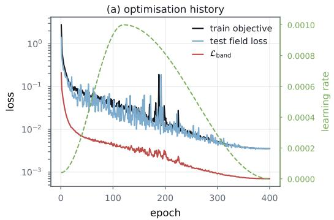

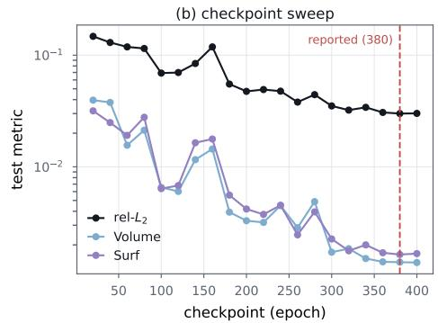  
Figure S1: Training the reported model. (a) Training objective, test-set field loss, and auxiliary band loss, with the learning rate on the right axis. The training objective includes auxiliary terms absent from the test-set field loss. (b) The 20-checkpoint test sweep, with the selected checkpoint marked. Selection uses the unrounded mean relative $L _ { 2 }$ error.

and reduced to m members again if the closure overflows. The face system is built the same way with $m = 1$ , so each face sees only itself. Under ideal normalization, a Gaussian star on this support is the identity. The implementation includes a small denominator offset. The VEF face star instead uses the learned positive diagonal scaling in eq. (7).

Two properties of this construction bear on the rest of the paper. The random subset in the outer rings, where membership exceeds the quota, is drawn from a seed fixed by the identity of the mesh, so $\mathcal { N }$ is a property of the cached discretisation rather than of the geometry alone, and it does not vary between epochs. And the closure of eq. (S18) is applied before the cap to m members, so the cap removes pairs the closure added and the resulting system is not mutual; the controller then sums over index-sorted prefixes rather than all 256 members: 64 vertex entries, with an edge cap of 64 for V and 32 for VEF. These prefixes need not contain complete inner hop rings. Section 3.5.1 reports the consequence for the spectrum.

## Training behaviour

Figure S1 shows the optimisation history of the reported run. The learning rate reaches $1 0 ^ { - 3 }$ at epoch 120 and decays to approximately $4 \times 1 0 ^ { - 9 }$ by epoch 400. The training curve includes auxiliary objective terms, whereas the test-set field-loss curve excludes them. The latter is computed on the official test loader, despite the original logging key val\_loss. The auxiliary band loss decreases approximately 300-fold. The checkpoint sweep gives relative L errors of 0.0307, 0.0300, and 0.0301 at epochs 360, 380, and 400, with corresponding Volume errors 0.00141, 0.00140, and 0.00139. Checkpoint selection uses test-set error, as stated in section 4.1.

## S5 The Model Family

The tables that follow compare the model variants in Table S4; this section names them first and states what each one is. Every model in the study is one of four kinds, distinguished by how, if at all, mesh structure reaches the prediction. Table S4 describes the variants considered in the study; table S6 reports the evaluated comparisons.

Mesh-free predictors. The internal plain-transformer variants read the nine per-vertex channels of section 3.3, with no incidence operator, no neighbour list and no adjacency. The plain transformer is a four-layer pre-norm softmax transformer of width 64 that treats the whole mesh as one attention sequence; it is the reference point of the whole study, because it is exactly what remains when the Hodge operator is deleted from the HodgeFormer surrogate, with everything else, meaning features, loss, schedule and data, held fixed. Two probes modify only its attention, where the mesh-windowed variant restricts attention to the same geodesic-ring support (section 3.1) the Hodge operator uses, and the locality-biased variant keeps global attention but adds a learned soft distance bias to the logits. The wide plain transformer is the same architecture at width 192, and is the width ablation; adding a differentiable lift term to its loss gives the + lift loss variant.

Frequency mixtures of experts with a feature-space router. These replace the single backbone by K band-specialised transformer experts recombined by a per-vertex gate, with the prediction path described in section 3.6, but the gate logits come from an MLP on the mesh-blind latent. Mesh structure enters only through the supervisory band decomposition of the target, never through the forward pass. The fixed-band MoE uses four experts and a fixed adjacency ladder (2, 8, 32) with no learned operator: the target is low-passed by powers of the symmetric normalised adjacency $D ^ { - 1 / 2 } ( A + \dot { I } ) D ^ { - 1 / 2 }$ , with A the vertex adjacency of the mesh graph and D its degree matrix, and the four bands are the successive differences of those low-passes, telescoping to the target as the atoms of eq. (14) do. This operator is not the analyzer of section 3.7 with its conductances held fixed: it carries a different normalisation and no step size. The two entropy-balanced variants replace that fixed operator by the learned Hodge analyzer of section 3.7 but guard it by maximising the entropy of the band energy shares, in one case with the band targets differentiable and in the other with them detached. The learned-band MoE is the immediate parent of our model, with eight experts, the learned Hodge analyzer, learned band boundaries through the assignment of eq. (15), whose per-atom softmax splits each atom’s weight across experts and always sums to one, and the one-sided floor in place of the entropy guard. Adding true-surface input channels, a one-dimensional boundary transformer along the wall and a lift-weighted surface loss gives the + wall-surface branch variant, which is the boundary-engineering control of section S7.

Hodge-routed mixtures. Our model, the Hodge-routed MoE, is a learned-band MoE plus the spectral controller of section 3.5: the only change is that the gate logits are produced by two Gaussian-Hodge layers reading the simplicial complex instead of by an MLP reading the latent. Two single-axis variants control it from opposite directions. Wide experts increases the total model size to 5.68M (d = 256, expert width 128) with the router held fixed, to test whether the difference was simply capacity. The reported controller runs its Hodge Laplacian on vertices alone, denoted V; the VEF router instead runs a Hodge Laplacian on all three cochain degrees, vertices, edges and faces, inside the controller (section S8), to test whether the difference grows when the controller operates on more cochain degrees.

Hodge predictors. Unlike the controller of section 3.5, this line keeps the learned Hodge operator in the prediction path, as in HodgeFormer [21]. The PSD-star HodgeFormer learns Gaussian stars, symmetric positive definite under a mutual support (section 3.5.1), and assembles $L _ { 0 }$ from them, with per-field MLP read-out heads. Adding a cross-field attention decoder, two global block and per-case normalisation gives the + cross-field decoder variant, and replacing its loss by the disjoint volume/surface field terms of eq. (17) gives the + disjoint surface loss variant, which is the best member of the family and the base model for the operator measurements in the extended supplementary material. Six further probes change exactly one thing in that best model.

External baselines. Transolver [17], PointNet [43] and a pointwise MLP are trained natively on the working meshes and evaluated using the same metric definitions. Training-set allocations and checkpoint selection differ as stated in section 4.1. Their input arms are named by which channels they receive, where all inputs is position, dual area, inlet velocity, signed distance and wall normals; pos+inlet is the minimal arm; and +SDF+normals omits the dual area. These baseline arms have eight channels for all inputs, four for position plus inlet, and seven with SDF and normals; they do not include the ninth wall-indicator channel supplied to our predictor.

Table S4: The model family. Every trained variant in this paper, grouped by how mesh structure reaches the prediction. Router means the operator produces only gate logits; bands means the mesh enters only through the supervisory decomposition of the target; operator means the mesh is in the prediction path; none means a point-set model.
<table><tr><td>name used in this paper</td><td>what it is</td><td>params</td></tr><tr><td colspan="3">mesh-free predictors, where mesh use is none</td></tr><tr><td>Plain transformer</td><td>4-layer pre-norm softmax transformer, width 64, global attention over all vertices; the Hodge operator deleted</td><td>0.31M</td></tr><tr><td>windowed</td><td>attention restricted to the geodesic-ring support used by the operator</td><td>0.31M</td></tr><tr><td>+ locality bias</td><td>global attention + a learned soft distance bias on the logits</td><td>0.31M</td></tr><tr><td>Wide plain transformer</td><td>the same at width 192 (FFN 768, 12 heads); the width ablation</td><td>2.72M</td></tr><tr><td>+ lift loss</td><td>+ a differentiable  $C _ { L }$  contour integral in the objective</td><td>2.72M</td></tr><tr><td colspan="3">frequency MoE, feature-space (MLP) router, where mesh use is bands</td></tr><tr><td>Fixed-band MoE</td><td>4 band experts, per-vertex gate, fixed adjacency ladder (2, 8, 32)</td><td>2.75M</td></tr><tr><td>entropy-balanced</td><td>learned Hodge analyzer, band shares guarded by entropy maximisation</td><td>2.75M</td></tr><tr><td>entropy-balanced, detached</td><td>the same with the band targets stop-gradiented</td><td>2.75M</td></tr><tr><td>Learned-band MoE</td><td>8 experts, learned analyzer, learned band boundaries, one-sided floor</td><td>2.75M</td></tr><tr><td>+ wall-surface branch</td><td>+ true-surface channels, a 1-D wall transformer and a lift-weighted surface</td><td>3.00M</td></tr><tr><td>loss Hodge-routed MoE, where mesh use is router</td><td></td><td></td></tr><tr><td colspan="3"></td></tr><tr><td>Hodge-routed MoE</td><td>learned-band MoE with the gate produced by a 2-layer Gaussian-Hodge con-</td><td>3.02M</td></tr><tr><td>wide experts</td><td>troller fitting branch scaled to d = 256, expert width 128; router unchanged</td><td>5.68M</td></tr><tr><td>VEF router</td><td>the controller evolves  $L _ { 0 } , L _ { 1 }$  and  $\dot { L } _ { 2 } ^ { \mathrm { d o w n } }$  instead of  $L _ { 0 }$  alone</td><td>3.11M</td></tr><tr><td colspan="3">Hodge predictors, where mesh use is operator</td></tr><tr><td>PSD-star HodgeFormer</td><td>Gaussian stars,  $L _ { 0 }$  in the prediction path, per-field heads</td><td>0.45M</td></tr><tr><td>+ cross-field decoder</td><td>+ cross-field attention decoder, 2 global blocks, per-case normalisation</td><td>0.47M</td></tr><tr><td>+ disjoint surface loss</td><td>+ the disjoint volume/wall MSE of eq. (16) and a wall tag; best of the family</td><td>0.47M</td></tr><tr><td>symmetric support</td><td>mutual-neighbour support, so the spectrum is exactly real</td><td>0.47M</td></tr><tr><td>no vertex star</td><td> $\star _ { 0 } ^ { - 1 }$  dropped, operator = d0 *1 d0</td><td>0.47M</td></tr><tr><td>unbound β</td><td>the  $\beta < \textstyle { \frac { 1 } { 2 } }$  cap released (β climbs to 0.86)</td><td>0.47M</td></tr><tr><td>dot-product kernel</td><td>the RBF diffusion kernel replaced by attention on the same support</td><td>0.47M</td></tr><tr><td>1 / 4 layers</td><td>the depth sweep of the same operator</td><td>0.35/0.72M</td></tr><tr><td colspan="3">external baselines, where mesh use is none</td></tr><tr><td>Transolver [17]</td><td>physics-slice attention; arms differ only in input channels</td><td>6.00M</td></tr><tr><td>PointNet [43]</td><td>shared per-point MLP with permutation-invariant pooling</td><td>0.08M</td></tr><tr><td>Pointwise MLP</td><td>per-vertex MLP, no interaction between vertices, all inputs</td><td>0.02M</td></tr></table>

## S6 Input-Feature Ablation of the Baseline

The Transolver baseline was retrained on the working mesh at four input arms, so that its row in the main comparison can be read against the features it was given. The arms differ only in the per-vertex channels, where pi is position and inlet velocity, pia adds the dual-cell area, pisn adds the signed distance and the wall normals instead, and pisna is all of them, which is the arm reported in the main paper. All four use the same architecture, the same split and the same metric code.

Table S5: Transolver by input arm, own-grid metrics on the official 800/200 split.
<table><tr><td>arm</td><td>channels</td><td>params</td><td> $\operatorname { r e l - } L _ { 2 } \downarrow$ </td><td> $R ^ { 2 } \uparrow$ </td><td>Volume↓</td><td>Surf↓</td><td> $C _ { L \downarrow }$ </td><td> $\rho _ { L } \uparrow$ </td></tr><tr><td> $\mathtt { p i }$ </td><td>pos + inlet</td><td>5,995,332</td><td>0.0439</td><td>0.9954</td><td>0.00270</td><td>0.00140</td><td>0.0078</td><td>0.99988</td></tr><tr><td>pia</td><td>+ area</td><td>5,995,844</td><td>0.0592</td><td>0.9922</td><td>0.00418</td><td>0.00282</td><td>0.0115</td><td>0.99980</td></tr><tr><td>pisn</td><td> ${ } + { \mathrm { S D F } } + { \mathrm { n o r m a l s } }$ </td><td>5,996,868</td><td>0.0440</td><td>0.9952</td><td>0.00286</td><td>0.00137</td><td>0.0098</td><td>0.99977</td></tr><tr><td>pisna</td><td> $+ \ S _ { Ḋ } \mathrm { Ḋ F Ḍ + n o r m a l s + a r e a Ḍ }$ </td><td>5,997,380</td><td>0.0436</td><td>0.9953</td><td>0.00265</td><td>0.00143</td><td>0.0103</td><td>0.99989</td></tr></table>

The spread across arms on the field metrics is 0.0436 to 0.0592; the highest relative $L _ { 2 }$ is pia, which adds the dual area without the signed distance and the wall normals. The all-input arm has the lowest relative $L _ { 2 }$ and Volume errors. The position-plus-inlet arm has the highest $R ^ { \dot { 2 } }$ and lowest lift error, and the SDF-plus-normals arm has the lowest Surf error. The four arms contain 4, 5, 7, and 8 channels, respectively; none includes the wall-indicator input used by our predictor.

## S7 Complete Results

Figure S2 shows one test case at the reported checkpoint, with the reference, prediction, and absolute error for each field. Its per-field relative $L _ { 2 }$ errors are 0.0047, 0.0260, 0.0281, and 0.0676, compared with test-set means of 0.0056, 0.0259, 0.0255, and 0.0629. This single case does not establish representativeness of the test set. Visible errors occur near the airfoil and along the turbulent-viscosity wake.

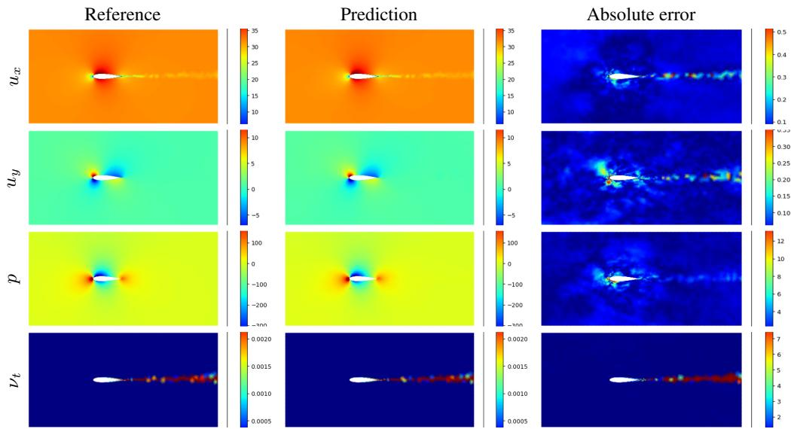  
Figure S2: One test case at the reported checkpoint (epoch 380). Columns are the reference, the prediction and the absolute error; rows are $u _ { x } , u _ { y } , p$ and $\nu _ { t } . ~ \mathrm { A l l }$ panels are on the model’s own working mesh in physical units, with the reference and the prediction sharing each field’s colour scale. The per-field relative $L _ { 2 }$ for this case is 0.0047, 0.0260, 0.0281 and 0.0676. Test-set means are listed in table S7; the panel illustrates one case rather than a test-set average.

Table S6 is the ablation the main paper refers to, listing every variant of table S4 together with all baselines. Table S7 gives the per-field breakdown for selected models, table S8 decomposes the two AirFRANS-native metrics per field, table S9 reports the checkpoint sweep, and fig. S2 shows one test case in full.

The two headline metrics peak at adjacent checkpoints, with the best rel $\boldsymbol { \cdot } \boldsymbol { L } _ { 2 }$ at epoch 380 and the best Volume at epoch 400. The reported mesh-native lift error is $C _ { L } = 0 . 0 2 2 5$ with ${ \rho _ { L } } = \mathrm { { 0 } } \mathrm { { . 9 9 9 8 8 } }$ over 200 test cases. A separate 10-case contour comparison gives relative lift errors of 0.0220 for the mesh-native band and 0.0205 for the surface loop, approximately 6.6% lower on that subset. These subset values do not establish a full-test-set comparison of the contour conventions. Completecomparison rows use the checkpoint selected by unrounded mean relative $L _ { 2 } ;$ the sweep table lists separate minima for relative $L _ { 2 }$ and Volume.

## S8 The Router and the Full Cochain Complex

The VEF controller applies $L _ { 0 }$ to vertices, $L _ { 1 } = L _ { 1 } ^ { \mathrm { d o w n } } + L _ { 1 } ^ { \mathrm { u p } }$ to edges, and $L _ { 2 } ^ { \mathrm { d o w n } }$ to faces, using the incidence composition in eq. (8). All updates read the pre-update streams and are computed simultaneously. Compared with the reported vertex-only model, the VEF run also reduces the edge support cap from 64 to 32, adds a 200-epoch continuation, and evaluates 30 checkpoints rather than 20. The comparison therefore does not isolate cochain degree alone. Table S10 reports the selected runs.

Face supports contain one entry. Under ideal normalization, the self-only Gaussian star is the identity; the implemented denominator offset gives an approximately identity operator. VEF uses the learned positive diagonal face star of eq. (7), with $z _ { i } = \| \varphi _ { i } \| ^ { 2 } / ( \dot { d } _ { h } \sigma ^ { 2 } )$ . This scaling is not constrained to equal a geometric face-area star. Incidence applications flatten head and channel axes before sparse multiplication, avoiding a separate sparse call for each head.

Table S6: Complete comparison. Official AirFRANS 800/200 split, own-grid evaluation on the ≈4.9k-vertex mesh, the same test meshes and evaluation metrics for every row. Objectives differ across loss ablations; training and selection protocols are specified in section 4.1. Models are described in section S5. Best per column in bold.
<table><tr><td>model</td><td>mesh use</td><td>params</td><td> $\mathrm { r e l } { - } L _ { 2 } \downarrow$ </td><td> $R ^ { 2 } \uparrow$ </td><td>Volume↓</td><td>Surf↓</td><td> $C _ { L } \downarrow$ </td></tr><tr><td>Hodge-routed MoE</td><td>router</td><td>3.02M</td><td>0.0300</td><td>0.9983</td><td>0.00140</td><td>0.00164</td><td>0.0225</td></tr><tr><td>wide experts</td><td>router</td><td>5.68M</td><td>0.0341</td><td>0.9979</td><td>0.00163</td><td>0.00219</td><td>0.0286</td></tr><tr><td>VEF router</td><td>router</td><td>3.11M</td><td>0.0359</td><td>0.9978</td><td>0.00182</td><td>0.00180</td><td>0.0277</td></tr><tr><td>Learned-band MoE</td><td>bands</td><td>2.75M</td><td>0.0345</td><td>0.9979</td><td>0.00165</td><td>0.00192</td><td>0.0265</td></tr><tr><td>Fixed-band MoE</td><td>bands</td><td>2.75M</td><td>0.0351</td><td>0.9978</td><td>0.00178</td><td>0.00184</td><td>0.0280</td></tr><tr><td>+ wall-surface branch</td><td>bands</td><td>3.00M</td><td>0.0378</td><td>0.9973</td><td>0.00196</td><td>0.00227</td><td>0.0247</td></tr><tr><td>entropy-balanced, detached</td><td>bands</td><td>2.75M</td><td>0.0402</td><td>0.9973</td><td>0.00206</td><td>0.00214</td><td>0.0270</td></tr><tr><td>entropy-balanced</td><td>bands</td><td>2.75M</td><td>0.0412</td><td>0.9972</td><td>0.00198</td><td>0.00233</td><td>0.0322</td></tr><tr><td>Transolver, all inputs [17]</td><td>none</td><td>6.0M</td><td>0.0436</td><td>0.9953</td><td>0.00265</td><td>0.00143</td><td>0.0103</td></tr><tr><td>Transolver, pos+inlet</td><td>none</td><td>6.00M</td><td>0.0439</td><td>0.9954</td><td>0.00270</td><td>0.00140</td><td>0.0078</td></tr><tr><td>Transolver, +SDF+normals</td><td>none</td><td>6.00M</td><td>0.0440</td><td>0.9952</td><td>0.00286</td><td>0.00137</td><td>0.0098</td></tr><tr><td>Wide plain transformer</td><td>none</td><td>2.72M</td><td>0.0446</td><td>0.9960</td><td>0.00265</td><td>0.00192</td><td>0.0245</td></tr><tr><td>+ lift loss</td><td>none</td><td>2.72M</td><td>0.0458</td><td>0.9960</td><td>0.00248</td><td>0.00296</td><td>0.0378</td></tr><tr><td>Plain transformer</td><td>none</td><td>0.31M</td><td>0.0544</td><td>0.9943</td><td>0.00374</td><td>0.00300</td><td>0.0173</td></tr><tr><td>PointNet, all inputs [43]</td><td>none</td><td>0.08M</td><td>0.0689</td><td>0.9904</td><td>0.00451</td><td>0.00440</td><td>0.0149</td></tr><tr><td>Pointwise MLP, all inputs</td><td>none</td><td>0.02M</td><td>0.1743</td><td>0.9404</td><td>0.03576</td><td>0.03969</td><td>0.0860</td></tr><tr><td>PSD-star HodgeFormer, + surface loss</td><td>operator</td><td>0.47M</td><td>0.0800</td><td>0.9885</td><td>0.01028</td><td>0.01048</td><td>0.0681</td></tr><tr><td>PSD-star HodgeFormer, + decoder</td><td>operator</td><td>0.47M</td><td>0.0822</td><td>0.9884</td><td>0.00803</td><td>0.01205</td><td>0.0567</td></tr><tr><td>PSD-star HodgeFormer</td><td>operator</td><td>0.45M</td><td>0.1154</td><td>0.9769</td><td>0.01446</td><td>0.03174</td><td>0.1747</td></tr></table>

Table S7: Per-field relative $L _ { 2 }$ for selected models. Between the learned-band MoE and the Hodge-routed MoE, the three smooth fields $u _ { x } , u _ { y }$ and p decrease by 17%, 10% and 30%, and $\nu _ { t }$ decreases by 4%.
<table><tr><td>model</td><td> $u _ { x }$ </td><td> $u _ { y }$ </td><td> $p$ </td><td> $\nu _ { t }$ </td></tr><tr><td>Hodge-routed MoE</td><td>0.0056</td><td>0.0259</td><td>0.0255</td><td>0.0629</td></tr><tr><td>wide experts</td><td>0.0072</td><td>0.0319</td><td>0.0337</td><td>0.0638</td></tr><tr><td>VEF router</td><td>0.0067</td><td>0.0348</td><td>0.0380</td><td>0.0642</td></tr><tr><td>Learned-band MoE</td><td>0.0068</td><td>0.0288</td><td>0.0365</td><td>0.0658</td></tr><tr><td>Fixed-band MoE</td><td>0.0068</td><td>0.0312</td><td>0.0346</td><td>0.0679</td></tr><tr><td>+ wall-surface branch</td><td>0.0064</td><td>0.0293</td><td>0.0342</td><td>0.0812</td></tr><tr><td>Transolver, all inputs</td><td>0.0067</td><td>0.0220</td><td>0.0298</td><td>0.1158</td></tr><tr><td>Wide plain transformer</td><td>0.0059</td><td>0.0330</td><td>0.0326</td><td>0.1068</td></tr><tr><td>Plain transformer</td><td>0.0067</td><td>0.0554</td><td>0.0349</td><td>0.1205</td></tr><tr><td>PSD-star HodgeFormer, best</td><td>0.0149</td><td>0.0650</td><td>0.0852</td><td>0.1548</td></tr><tr><td>PointNet, all inputs</td><td>0.0125</td><td>0.0540</td><td>0.0655</td><td>0.1435</td></tr><tr><td>Pointwise MLP, all inputs</td><td>0.0518</td><td>0.1865</td><td>0.1765</td><td>0.2825</td></tr></table>

Table S8: Per-field Volume and Surf (AirFRANS-native normalised MSE, best checkpoint). For the Hodgerouted MoE, νt accounts for 83% of the summed Volume error over the four fields.
<table><tr><td rowspan="2">model</td><td colspan="4">Volume (interior)</td><td colspan="4">Surf (wall)</td></tr><tr><td> $u _ { x }$ </td><td> $u _ { y }$ </td><td> $p$ </td><td> $\nu _ { t }$ </td><td> $u _ { x }$ </td><td> $u _ { y }$ </td><td>p</td><td>Vt</td></tr><tr><td>Hodge-routed MoE</td><td>0.00011</td><td>0.00052</td><td>0.00031</td><td>0.00466</td><td>0.00073</td><td>0.00174</td><td>0.00248</td><td>0.00160</td></tr><tr><td>VEF router</td><td>0.00019</td><td>0.00096</td><td>0.00077</td><td>0.00534</td><td>0.00079</td><td>0.00197</td><td>0.00272</td><td>0.00173</td></tr><tr><td>Learned-band MoE</td><td>0.00019</td><td>0.00063</td><td>0.00072</td><td>0.00506</td><td>0.00087</td><td>0.00195</td><td>0.00307</td><td>0.00181</td></tr><tr><td>Fixed-band MoE</td><td>0.00019</td><td>0.00086</td><td>0.00069</td><td>0.00539</td><td>0.00090</td><td>0.00198</td><td>0.00296</td><td>0.00152</td></tr><tr><td>Wide plain transformer</td><td>0.00017</td><td>0.00109</td><td>0.00074</td><td>0.00859</td><td>0.00062</td><td>0.00191</td><td>0.00313</td><td>0.00201</td></tr><tr><td>Plain transformer</td><td>0.00019</td><td>0.00279</td><td>0.00060</td><td>0.01140</td><td>0.00088</td><td>0.00403</td><td>0.00431</td><td>0.00278</td></tr><tr><td>PSD-star HodgeFormer, best</td><td>0.00114</td><td>0.00476</td><td>0.00420</td><td>0.03103</td><td>0.00406</td><td>0.00609</td><td>0.01801</td><td>0.01378</td></tr></table>

The selected VEF run has higher errors than the selected vertex-only run. The per-field increases are approximately 18.5%, 34.1%, 48.9%, and 2.0% for $u _ { x } , u _ { y } , p ,$ and $\nu _ { t } .$ respectively. Differences in support, training duration, and checkpoint selection, together with one run per configuration, limit attribution of the change to the routing operators. Among the reported variants, the vertex-only Hodge-routed MoE has the lowest mean relative $L _ { 2 }$ error; other models have lower surface and lif errors.

Table S9: Checkpoint sweep. Both headline metrics with the epoch at which each is lowest. † the VEF router was trained for 400 epochs plus a 200-epoch continuation at lr $\stackrel { \cdot } { = } 2 \times 1 0 ^ { - 4 }$ and swept at 30 checkpoints rather than 20.
<table><tr><td>model</td><td>checkpoints</td><td>best rel-L2 (epoch)</td><td>best Volume (epoch)</td></tr><tr><td>Hodge-routed MoE</td><td>20</td><td>0.0300 (380)</td><td>0.00139 (400)</td></tr><tr><td>wide experts</td><td>20</td><td>0.0341 (400)</td><td>0.00163 (400)</td></tr><tr><td>VEF router†</td><td>30</td><td>0.0359 (560)</td><td>0.00182 (560)</td></tr><tr><td>Learned-band MoE</td><td>20</td><td>0.0345 (380)</td><td>0.00165 (380)</td></tr><tr><td>Fixed-band MoE</td><td>20</td><td>0.0351 (400)</td><td>0.00178 (380)</td></tr><tr><td>Plain transformer</td><td>20</td><td>0.0544 (320)</td><td>0.00339 (400)</td></tr><tr><td>PSD-star HodgeFormer, best</td><td>20</td><td>0.0800 (320)</td><td>0.00651 (400)</td></tr></table>

Table S10: V versus VEF routing. The reported controller updates vertices alone (V); VEF updates vertices, edges, and faces. VEF has 2.7% more parameters and was trained 50% longer, with a different edge support cap. Errors are evaluated at the checkpoint selected by mean relative $L _ { 2 }$ over 200 test cases. Percentage changes use unrounded metrics.
<table><tr><td></td><td>Hodge-routed MoE (V)</td><td>VEF router (V EF)</td><td>change</td></tr><tr><td>operators supports params</td><td> $L _ { 0 }$  vertex/edge 64/64 3,023,962</td><td> $L _ { 0 } , L _ { 1 } ^ { \mathrm { d o w n } } { + } L _ { 1 } ^ { \mathrm { u p } } , L _ { 2 } ^ { \mathrm { d o w n } }$  vertex/edge/face 64/32/1 3,106,490</td><td>+82,528 (+2.7%)</td></tr><tr><td>epochs / checkpoints best checkpoint</td><td>400 / 20 380</td><td>400 + 200 / 30 560</td><td></td></tr><tr><td>rel  $\cdot L _ { 2 } \downarrow$   $R ^ { 2 }$  ←</td><td>0.0300 0.9983</td><td>0.0359 0.9978</td><td>+19.7%</td></tr><tr><td>Volume↓</td><td>0.00140</td><td>0.00182</td><td>+29.7%</td></tr><tr><td>Surf↓</td><td>0.00164</td><td>0.00180</td><td>+10.1%</td></tr><tr><td> $C _ { L }$  (band)↓</td><td>0.0225</td><td>0.0277</td><td>+23.5%</td></tr><tr><td></td><td></td><td></td><td></td></tr><tr><td> $u _ { x }$ </td><td>0.0056</td><td>0.0067</td><td>+18.5%</td></tr><tr><td> $u _ { y }$ </td><td>0.0259</td><td>0.0348</td><td>+34.1%</td></tr><tr><td> $p$ </td><td>0.0255</td><td>0.0380</td><td>+48.9%</td></tr><tr><td> $\nu _ { t }$ </td><td>0.0629</td><td>0.0642</td><td>+2.0%</td></tr><tr><td></td><td></td><td></td><td></td></tr></table>

## S9 Properties of the Trained Router

The constructions of section 3.7 fix the form of the decomposition and not its content. This section reports the content measured from the trained checkpoint at epoch 380. The analyzer’s diagonal stars are

$$
\star _ { 1 } = \mathrm { d i a g } ( w _ { e } ) , \quad w _ { e } = \mathrm { s o f t p l u s } \big ( \mathrm { M L P } _ { e } ( x _ { e } ) \big ) + \epsilon _ { w } ; \qquad \star _ { 0 } = \mathrm { d i a g } ( \mu _ { v } ) , \quad \mu _ { v } = \sum _ { e \ni v } w _ { e } ,\tag{S19}
$$

where $w _ { e }$ , the edge conductance, is the analyzer’s only parameterised content. The atoms are the telescoping differences of the forward-Euler smoothing ladder $\bar { y } ^ { ( j ) } = ( I - \tau L _ { 0 } ) ^ { m _ { j } } y$

$$
a _ { 0 } = \bar { y } ^ { ( L - 1 ) } , \qquad a _ { i } = \bar { y } ^ { ( L - 1 - i ) } - \bar { y } ^ { ( L - i ) } \quad ( 1 \leq i \leq L - 1 ) , \qquad a _ { M - 1 } = y - \bar { y } ^ { ( 0 ) } ,\tag{S20}
$$

ordered smoothest $\left( a _ { 0 } \right)$ to sharpest $\left( a _ { M - 1 } \right)$ , and the assignment $P$ groups them into per-expert band targets $t _ { k }$

$$
P _ { k m } = \frac { \exp ( \theta _ { k m } / T ) } { \sum _ { k ^ { \prime } } \exp ( \theta _ { k ^ { \prime } m } / T ) } , \qquad \sum _ { k } P _ { k m } = 1 \ \forall m , \qquad t _ { k } = \sum _ { m = 0 } ^ { M - 1 } P _ { k m } a _ { m } .\tag{S21}
$$

The analyzer receives no gradient from eq. (16), so its conductance network remains at its initialized values in the configured run. Conductance is a function of edge geometry. Its contribution to smoothing is normalized by the incident degree: the weight of neighbor $j$ at vertex i is proportional to $w _ { i j } / \mu _ { i }$ . Larger unnormalized conductance alone does not establish faster removal of local field structure.

Figures S3 and S4 illustrate the pressure decomposition and assignment at the epoch-380 checkpoint. The plotted atom shares are normalized squared norms, $\begin{array} { r l } {  { \big \| \boldsymbol { a } _ { m } \big \| ^ { 2 } / \sum _ { m ^ { \prime } } \mathopen { } \mathclose \bgroup \| \boldsymbol { a } _ { m ^ { \prime } } \aftergroup \egroup \| ^ { 2 } } } \end{array}$ , for the illustrated field. The rounded shares are [0.812, 0.003, 0.006, 0.003, 0.006, 0.003, 0.006, 0.019, 0.143]. Atoms overlap, so these values are not an orthogonal partition of the target’s energy. Approximately 81% of the summed squared atom norms is in the coarsest atom and 14% in the finest residual. These case-level diagnostics do not establish corresponding test-set means.

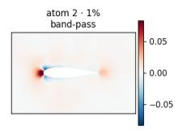

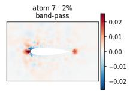

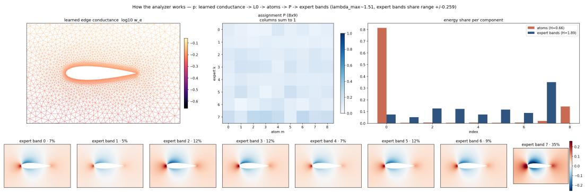

The energy-floor penalty acts on assigned targets $t _ { k } ,$ not raw atoms $a _ { m } .$ . Its activation therefore depends on the assigned-target norm shares. The reported run’s training log records a zero floor penalty at epoch 380. The constructor’s preferred atom-to-expert grouping is overwritten by global Xavier initialization, so no prescribed ordering is imposed on the learned assignment.

Atoms of the LEARNED Hodge analyzer (L0=\*0^-1 d0^T \*1 d0, tau=1/2, ladder (2, 4, 6, 8, 12, 16, 24, 32)) — atom energy entropy 0.66/2.20

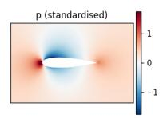

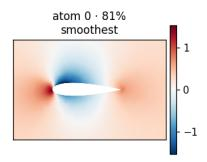

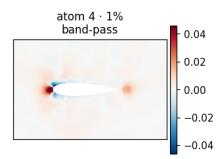

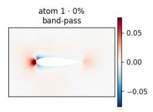

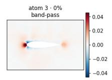

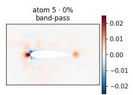

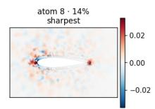  
Figure S3: The nine telescoping atoms of the analyzer for the illustrated pressure field. Atom 0 is the coarsest remainder; atoms 1–7 are differences between smoothing levels, and atom 8 is the finest residual. The coarsest and finest components account for approximately 81% and 14% of the summed squared atom norms. Their sum reconstructs the field algebraically, subject to floating-point rounding (eq. (14)).  
Figure S4: The analyzer and assignment for the illustrated case. Edge conductance $w _ { e } ;$ the 8 × 9 assignment P (eq. (15)); the eight assigned targets on a shared symmetric colour range; and normalized squared component norms before and after assignment. Global Xavier initialization overwrites the constructor’s preferred assignment logits.

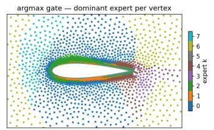  
Gate g per vertex — the Hodge spectral controller's routing

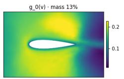

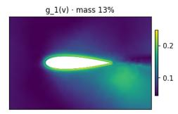

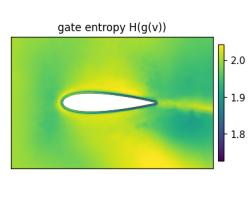

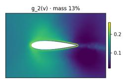

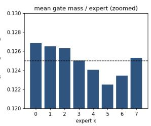

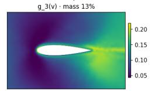

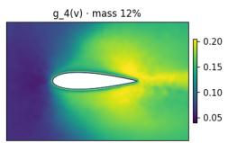

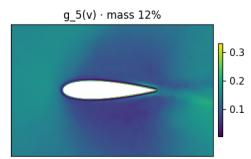

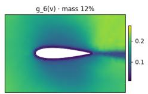

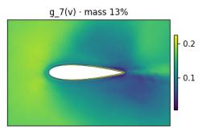  
Figure S5: The gate g(v) for the illustrated case. Top: dominant expert at each vertex, per-vertex gate entropy, and mean gate mass per expert against the uniform $1 / K$ line (vertical axis restricted to 0.120–0.130). Bottom: the eight weight fields g (v). These panels describe routing for the displayed mesh rather than averages over the test set.

Frequency bands (fixed mesh-graph smoothing, ladder (2, 8, 32)) — sum = field  
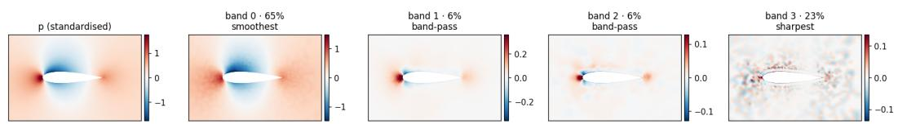  
Figure S6: The fixed reference decomposition of the pressure field with the ladder (2, 8, 32) on the unweighted adjacency, for comparison with fig. S3. The normalized squared component norms for this illustrated field are [0.65, 0.06, 0.06, 0.23]; the components overlap.