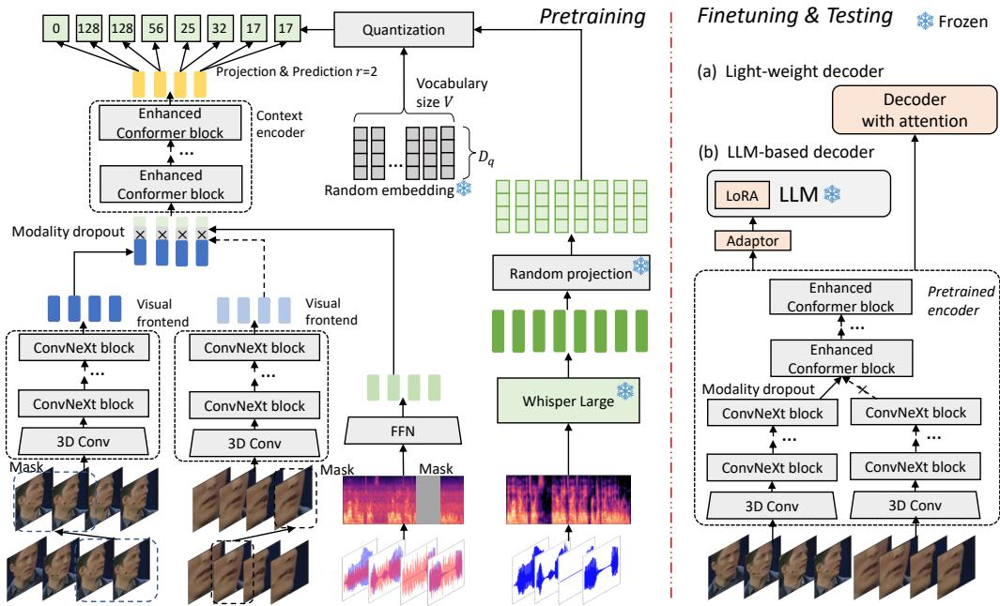
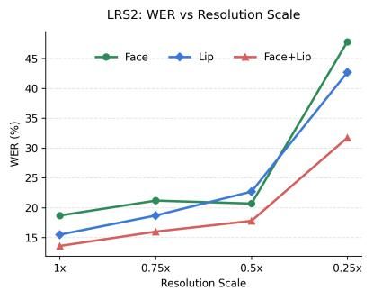
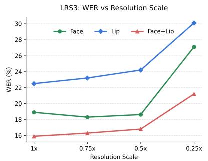
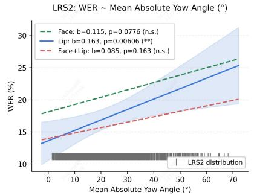
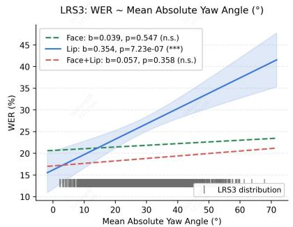
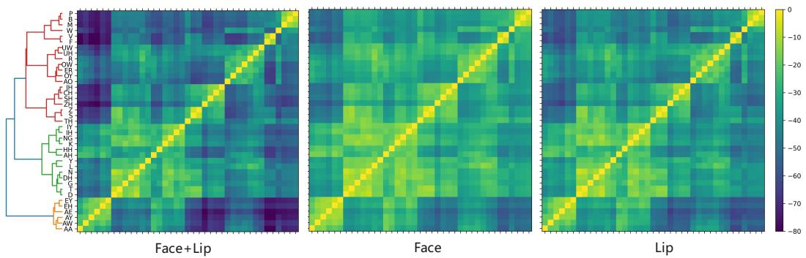
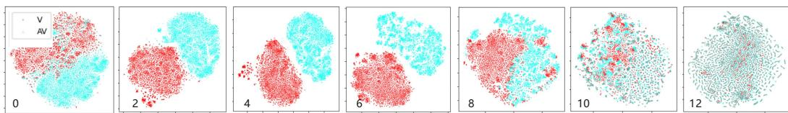

# Learning Visual Speech Representations via Cross-Modal Distillation and Joint Face-Lip Modeling

Jing-Xuan Zhang1∗, Genshun Wan2, Jianqing Gao2, Jia Pan2, Yumei Zhang1,3, Lichen Zhang1

1School of Artificial Intelligence and Computer Science, Shaanxi Normal University 2iFLYTEK Research, iFLYTEK Co., Ltd.

3Key Laboratory of Intelligent Computing and Service Technology for Folk Song, Ministry of Culture and Tourism {jxzhanggg, zhanglichen, zym0910}@snnu.edu.cn, {gswan, jqgao, jiapan}@iflytek.com

## Abstract

Lipreading remains challenging due to the inherent ambiguity of visual speech cues and their sensitivity to head pose and video resolution. In this work, we propose FLARE, a framework for robust visual speech representation learning via cross-modal distillation and joint face-lip modeling. FLARE leverages semantically rich Whisper representations as the acoustic teacher signal, converting them into discrete distillation targets through a random-projection quantizer and pretraining the model with a masked prediction objective. To capture complementary visual information, FLARE employs a dual-stream architecture that jointly processes lip region-of-interest (ROI) and full-face inputs, where the lip stream captures finegrained articulatory motion and the face stream encodes broader facial dynamics. During pretraining, auxiliary audio input is incorporated to facilitate cross-modal alignment, and modality dropout is applied to encourage robust visual-only representations. For downstream lipreading, FLARE serves as a visual encoder coupled with either a lightweight Transformer decoder or an LLM-based decoder. Evaluated on LRS2, LRS3, and the out-of-domain WildVSR benchmark, FLARE achieves strong lipreading performance, with word error rates of 11.7%, 13.2%, and 34.3%, respectively. A progressive design study confirms the contribution of each major component. Further analyses demonstrate that joint face-lip modeling improves robustness under degraded video resolution and large head pose variation, while yielding more phoneme-discriminative visual representations. Code and pretrained models are available at https://github.com/jxzhanggg/FLARE.

## 1 Introduction

Lipreading, also known as visual speech recognition (VSR), refers to the recognition of spoken content from lip movement sequences without relying on acoustic signals. It serves as a complement to audio-based speech recognition, particularly when audio signals are degraded or unavailable. It thus finds wide applications in areas such as human–computer interaction, intelligent device control, and assistive communication systems.

Learning visual speech representations remains challenging, as viseme-to-phoneme mappings are inherently ambiguous and visual inputs are sensitive to head pose and video resolution. Early approaches relied on visual bottleneck feature extraction [1, 2, 3], but research has since shifted to end-to-end lipreading models trained directly with text supervision, covering both isolated-word [4,

5, 6, 7] and sentence-level recognition [8, 9, 10]. More recently, audio-visual self-supervised learning (AV-SSL) has emerged as a promising paradigm for visual speech representation learning [11, 12, 13, 14, 15, 16]. By pretraining on unlabeled paired audio-visual speech with objectives such as masked prediction [12, 17, 16] or contrastive learning [18], these methods learn representations both within and across modalities. The resulting pretrained encoders can then be adapted for lipreading via task-specific decoders [19, 20], integrated with large language models [21, 22, 23], or used to provide visual features for speech-model reprogramming approaches [24, 25].

However, existing AV-SSL approaches are subject to several limitations. First, most methods [12, 26, 14, 17, 16, 15, 19] are pretrained from scratch to jointly learn audio, visual, and audio-visual representations within a unified framework. While this paradigm has proven effective, it does not directly address how supervision should be structured to most effectively strengthen visual representation learning. Second, most prior work relies solely on a cropped lip region-ofinterest (ROI), which can become unreliable under large head pose variation, low video resolution, or imperfect cropping. Although recent studies [27, 28, 20] suggest that full-face input can improve lipreading performance, the complementarity between face-level and lip-level cues remains insufficiently exploited and not fully understood.

In this work, we propose FLARE, a framework for visual speech representation learning that leverages cross-modal distillation and joint face-lip modeling. To exploit fine-grained, semantically rich acoustic knowledge, we adopt Whisper [29] as the teacher model to provide deep audio representations, from which discrete target labels are derived via a random-projection quantizer [30]. FLARE is then pretrained with a masked prediction objective, enabling effective knowledge transfer from large-scale audio models to the visual modality. To capture complementary visual cues, FLARE takes both the full face and the lip region of interest (ROI) as input, processing each through dedicated frontend encoders before fusing the two streams via channel-wise concatenation with dropout regularization. During pretraining, auxiliary audio input is incorporated to facilitate cross-modal alignment, while modality dropout is applied at a carefully selected probability to encourage robust visual-only representation learning. To enhance both local and long-range temporal modeling, we further strengthen the model architecture with a ConvNeXt [31]-inspired frontend and a modified Conformer [32] backbone. For downstream lipreading, we employ a lightweight Transformer decoder to enable fair comparison with existing baselines, as well as a large language model (LLM) decoder to investigate the scalability of the learned representations.

We train FLARE on multiple public audio-visual speech datasets and evaluate it on LRS2 [8], LRS3 [33], and the out-of-domain WildVSR [34] benchmark. Our best model achieves word error rates (WERs) of 11.7%, 13.2%, and 34.3% on the three benchmarks, respectively, demonstrating strong lipreading performance. Beyond the main results, we conduct a progressive design study to quantify the contribution of each major component. We further analyze the complementarity of the face and lip streams under varying visual quality and head pose conditions, and visualize the learned representations to provide deeper insight into the proposed framework.

## 2 Related Works

## 2.1 Audio-Visual Cross-Modal Distillation

Many studies have explored cross-modal distillation for audio-visual speech data, leveraging the inherent synergy between audio signals and lip movements. Afouras et al. [35] propose distilling a lipreading model from a pretrained ASR model using the KL-divergence between the teacher and student CTC posterior distributions. LIBS [36] enhances lipreading models by distilling multi-scale knowledge from speech recognizers. Rather than optimizing a specific lipreading model, audio-visual self-supervised learning (AV-SSL) aims to learn general speech representations through pretraining. For instance, LiRA [11] uses the PASE+ [37] model for the cross-modal self-supervised learning of visual representations. AV-HuBERT [12, 26], AV-data2vec [38], and AV2vec [16] adopt audio-visual derived targets and share the encoder across the audio, visual, and audio-visual modalities. In contrast, RAVEn [14] and BRAVEn [15] employ modality-specific encoders and an asymmetric distillation strategy between audio and video. The most closely related work is Zhang et al. [39], which also leverages multiple speech foundation models for cross-modal distillation. However, FLARE differs in two key respects. First, we adopt a simpler and more targeted distillation strategy using a single largescale external model. Second, rather than jointly optimizing representations across all modalities, an objective that can complicate optimization [38], we explicitly focus on strengthening visual speech representations.

  
Figure 1: Overview of our proposed method.

## 2.2 Visual Input Selection for Lipreading

Lipreading systems traditionally use a cropped lip region-of-interest (ROI) as the standard visual input. However, recent studies [27, 28] suggest that this practice may discard useful extraoral cues. In particular, using the full face can improve lipreading performance by incorporating complementary information such as head pose and broader facial dynamics. Existing efforts [40, 20] to exploit such multi-scale visual information, however, mainly rely on training separate models and combining them at the decision level. In contrast, our work focuses on early-stage joint modeling of face and lip inputs to learn more integrated visual speech representations.

## 3 Proposed Method

An overview of FLARE is shown in Figure 1, and each component is described in the following sections.

## 3.1 Model Inputs

During pretraining, FLARE takes full-face videos, lip region-of-interest (ROI) videos, and auxiliary audio features as inputs. The face and lip inputs are denoted as $\mathbf { V } ^ { f } \in \mathbb { R } ^ { T \times } \mathbf { \dot { H } } \times \mathbf { \dot { W } }$ and $\mathbf { V } ^ { i } \in \mathbb { R } ^ { T \times H \times W }$ respectively, where T, H, and W represent the number of frames, frame height, and frame width. For the audio modality, Mel-filterbank features are extracted from the input waveform and denoted as $\mathbf { A } \in \mathbb { R } ^ { T \times D _ { a } }$ . Auxiliary audio input is incorporated to facilitate cross-modal alignment, while the input waveform is randomly corrupted with additive noise to prevent over-reliance on acoustic cues.

Before being fed into the model, the inputs are corrupted using span-based masking. For visual inputs, following [12], we randomly replace a span of frames with another span from the same utterance, producing $\mathbf { \bar { V } } _ { m } ^ { f } = \mathcal { M } _ { v } ( \bar { \mathbf { V } } ^ { f } )$ and $\mathbf { V } _ { m } ^ { l } = \mathcal { M } _ { v } ( \mathbf { V } ^ { l } )$ . Empirically, this strategy performs better than embedding-level feature masking or noise-based input masking. For audio input, we randomly replace selected frames with a learned embedding, yielding $\mathbf { A } _ { m } = \mathcal { M } _ { a } ( \mathbf { A } )$ .

## 3.2 Model Architecture

Frontend: Face and lip videos are encoded by two parallel ConvNeXt [31]-inspired visual frontends $\mathrm { V F } _ { f } ( \cdot )$ and $\mathrm { V F } _ { l } ( \cdot )$ , respectively, while the audio features are projected by a feed-forward layer:

$$
\mathbf { H } ^ { f } = \mathrm { V F } _ { f } \big ( \mathbf { V } _ { m } ^ { f } \big ) \in \mathbb { R } ^ { T \times D } , \quad \mathbf { H } ^ { l } = \mathrm { V F } _ { l } \big ( \mathbf { V } _ { m } ^ { l } \big ) \in \mathbb { R } ^ { T \times D } , \quad \mathbf { H } ^ { a } = \mathrm { F F N } \big ( \mathbf { A } _ { m } \big ) \in \mathbb { R } ^ { T \times D } .\tag{1}
$$

In each visual frontend, the input video first passes through a 3D convolutional layer to model local spatiotemporal dynamics, followed by four 2D-ConvNeXt blocks. Relative to the widely used 3D-ResNet [8, 12], our design replaces batch normalization with layer normalization, adopts large-kernel depthwise separable convolutions instead of standard small-kernel convolutions, and uses GELU activations [41].

Modality dropout and fusion: Before fusion, we apply modality dropout to improve robustness to missing or unreliable modalities. The probabilities of using audio-only features, video-only features and audio-visual features are $p _ { a } , p _ { v } , p _ { a v } ,$ respectively, where $p _ { a } + p _ { v } + p _ { a v } = 1$ . For the visual features, the probabilities of using face-only, lip-only, and joint face-lip modeling are $p _ { f } , p _ { l }$ , and $p _ { f l }$ respectively, where $p _ { f } + p _ { l } + p _ { f l } = 1$ . In scenarios where only lip ROI videos are available, such as due to privacy constraints, our framework naturally accommodates missing face inputs by setting the corresponding features to zero during both training and inference.

The remaining audio and visual features are then concatenated along the channel dimension and linearly projected:

$$
\mathbf { H } ^ { a v } = \operatorname { L N } \big ( \operatorname { C o n c a t } ( \mathbf { H } ^ { a } , \mathbf { H } ^ { l } , \mathbf { H } ^ { f } ) W \big ) \in \mathbb { R } ^ { T \times D } ,\tag{2}
$$

where $\mathrm { C o n c a t } ( \cdot )$ denotes channel-wise concatenation, $W \in \mathbb { R } ^ { 3 D \times D }$ is a trainable projection matrix, and $\operatorname { L N } ( \cdot )$ denotes layer normalization.

Context encoder: The context encoder processes the fused local representations for long-range temporal modeling:

$$
\mathbf { H } ^ { o } = \mathrm { E n c } ( \mathbf { H } ^ { a v } ) \in \mathbb { R } ^ { T \times D } .\tag{3}
$$

It is critical for lipreading, as sequential context helps reduce the ambiguity of viseme-to-phoneme mapping. We propose an enhanced Conformer as the context encoder. Each block follows the standard Conformer design, consisting of a feed-forward module, a convolution module, a selfattention module, and a second feed-forward module. To strengthen the encoder, we incorporate several architectural improvements inspired by recent large language models. Specifically, we replace relative positional encoding with rotary positional encoding (RoPE) [42], adopt grouped-query attention (GQA) [43] for self-attention, use SwiGLU [44] in the feed-forward modules, and replace layer normalization with RMSNorm [45]. Together, these modifications improve the encoder’s ability to model temporally extended visual patterns while maintaining efficient and stable optimization.

## 3.3 Cross-Modal Distillation Loss

We use the audio-only Whisper model as the teacher to extract deep audio representations from clean speech, denoted by $\mathbf { \check { H } } ^ { \mathcal { T } } \in \mathbf { \check { \mathbb { R } } } ^ { r T \times D \tau }$ , where r is the ratio between the Whisper frame rate and the video frame rate. The teacher representations are globally normalized to zero mean and unit variance, yielding $\bar { \mathbf { H } } ^ { T }$ . To obtain discrete supervision targets, we follow a random-projection quantization scheme [30]. Specifically, the normalized teacher representations are first projected into a code space using a random projection matrix $U \in \mathbb { R } ^ { D \tau \times D _ { q } }$ , and then assigned to the nearest code in a random codebook $C = [ \mathbf { \bar { c } } _ { 1 } , \dots , \mathbf { c } _ { V } ] \in \mathbb { R } ^ { D _ { q } \times V }$

$$
y _ { i } = \arg \operatorname* { m i n } _ { j } \left\| \mathrm { N o r m } ( \mathbf { c } _ { j } ) - \mathrm { N o r m } \big ( ( \bar { \mathbf { H } } ^ { \mathcal { T } } U ) _ { i } \big ) \right\| _ { 2 } ,\tag{4}
$$

where $\operatorname { N o r m } ( { \mathord { \cdot } } )$ denotes $\ell _ { 2 }$ normalization, $V$ is the codebook size, and $D _ { q }$ is the code dimension. Both $U$ and $\dot { C }$ are randomly initialized and kept frozen during training. This produces a sequence of discrete target labels $\mathbf { y } = [ y _ { 1 } , y _ { 2 } , \dots , y _ { r T } ]$

To predict these target codes, the model output $\mathbf { H } ^ { o }$ is projected to the code vocabulary and reshaped to match the teacher frame rate:

$$
P = \mathrm { S o f t m a x } \left( \mathrm { R e s h a p e } ( \mathbf { H } ^ { o } W _ { \mathrm { p r o j } } ) \right) \in \mathbb { R } ^ { r T \times V } ,\tag{5}
$$

where $W _ { \mathrm { p r o j } } \in \mathbb { R } ^ { D \times r V }$ is a trainable projection matrix. The Reshape(·) operation unfolds the channel dimension into r consecutive frames so that the predictions align with the frame rate of the teacher codes. The model is trained with a cross-entropy loss:

$$
L _ { \mathrm { p r e t r a i n } } = - \frac { 1 } { r T } \sum _ { i = 1 } ^ { r T } \sum _ { j = 1 } ^ { V } { \bf y } _ { i , j } \log P _ { i , j } ,\tag{6}
$$

where ${ \bf y } _ { i , : }$ is the one-hot encoding of the target code at frame i. Notably, target codes are predicted for both masked and unmasked regions, as the teacher’s deep audio representations provide supervision beyond mere masked reconstruction. Despite its simplicity, random-projection quantization [30] preserves the geometric structure of the continuous representation space. Predicting the quantized codes under masking encourages the model to learn the sequential and structural regularities of the teacher representations, facilitating cross-modal knowledge transfer. Unlike BEST-RQ [30], which quantizes Mel-spectrogram features, we quantize deep Whisper representations that encode richer phonetic and linguistic information, providing more informative supervision for cross-modal distillation and yielding stronger visual representations, as validated in Section 4.3.

## 3.4 Lipreading Task Finetuning

We consider two decoding settings for downstream lipreading: a lightweight Transformer decoder and an LLM-based decoder. The former is used for direct comparison with prior AV-SSL methods, while the latter is adopted to explore the potential of the learned visual representations with a stronger decoder.

For the lightweight setting, the pretrained model serves as the encoder and is paired with a randomly initialized Transformer decoder. We first train the decoder with the encoder frozen, and then jointly finetune both modules. Following most prior AV-SSL work, no auxiliary objective such as CTC loss is used. For the LLM-based setting, we connect the encoder to the LLM through a lightweight adaptor and adopt low-rank adaptation (LoRA) [46] for parameter-efficient tuning. The encoder is initialized from the model finetuned with the lightweight decoder. A multistage finetuning strategy is used for progressively aligning the encoder outputs with the LLM embedding space. Details are provided in the Appendix A.

## 4 Experiments and Results

## 4.1 Experimental Setup

For pretraining, we use a large-scale audio-visual corpus including LRS2 [8], LRS3 [33], VoxCeleb2- English [12], AVSpeech-English [47], and AVYT-talking [48], totaling 4966 hours after preprocessing. Following prior work, we finetune the pretrained models on both the 30-hour subset and the full set of LRS3, using the LRS3 validation set for hyperparameter tuning. We report results on the test sets of LRS2, LRS3, and the out-of-domain WildVSR benchmark [34]. For datasets that only provide lip ROIs, including AVYT-talking and WildVSR, the face features in the modality fusion are set to zero.

We implement two model variants: a Base model with about 117M parameters, using a hidden size of 512 and 12 context encoder blocks, and a Large model with about 342M parameters, using a hidden size of 768 and 18 blocks. For downstream lipreading, we consider both a lightweight Transformer decoder and an LLM-based decoder (FLARE-LLM). The lightweight setting uses a 6-layer Transformer decoder, whereas the LLM-based setting adopts Qwen-2.5-7B with an adaptor and LoRA for efficient tuning. Additional training details are provided in Appendix B.

## 4.2 Comparison with Baselines

We pretrain the Base model on a combined LRS3 and VoxCeleb2-En corpus (1759 hours) and finetune it on the 30-hour and 433-hour LRS3 subsets to evaluate performance in a low-resource setting. As reported in Table 1, our Base model consistently outperforms previous AV-SSL approaches, including those employing encoders of comparable or larger sizes. Notably, it achieves this performance without relying on an external language model, auxiliary CTC supervision, or joint CTC-attention decoding, further demonstrating its effectiveness in visual representation learning.

Table 1: Lipreading word error rate (WER, %) on the LRS3 test set, compared with previous AV-SSL baselines under the low-resource setting. All methods are pretrained on a combined LRS3 and VoxCeleb2-En corpus.
<table><tr><td rowspan="2">Method</td><td rowspan="2">Encoder size</td><td rowspan="2">Ft. criterion</td><td rowspan="2">Visual inputs</td><td colspan="2">Ft. data</td></tr><tr><td>30h</td><td>433h</td></tr><tr><td colspan="6">Base size</td></tr><tr><td>AV-HuBERT [12]</td><td>103M</td><td>CE</td><td>Lip</td><td>46.1</td><td>34.8</td></tr><tr><td>AV-data2vec [38]</td><td>103M</td><td>CE</td><td>Lip</td><td>37.8</td><td>32.7</td></tr><tr><td>RAVEn [14]</td><td>97M</td><td>CE+CTC</td><td>Lip</td><td>40.2</td><td>33.1</td></tr><tr><td>VATLM [17]</td><td>103M</td><td>CE</td><td>Lip</td><td>42.6</td><td>34.2</td></tr><tr><td>DistillAV [39]</td><td>103M</td><td>CE+KD</td><td>Face</td><td>36.9</td><td>31.4</td></tr><tr><td colspan="6">Large size</td></tr><tr><td>AV-HuBERT [12]</td><td>325M</td><td>CE</td><td>Lip</td><td>32.5</td><td>28.6</td></tr><tr><td>AV-data2vec [38]</td><td>325M</td><td>CE</td><td>Lip</td><td>31.6</td><td>28.5</td></tr><tr><td>RAVEn [14]</td><td>336M</td><td>CE+CTC</td><td>Lip</td><td>33.1</td><td>28.2</td></tr><tr><td>BRAVEn [15]</td><td>336M</td><td>CE+CTC</td><td>Lip</td><td>30.8</td><td>26.6</td></tr><tr><td>VATLM [17]]</td><td>325M</td><td>CE</td><td>Lip</td><td>31.6</td><td>28.4</td></tr><tr><td>DistillAV [39]</td><td>325M</td><td>CE+KD</td><td>Face</td><td>30.2</td><td>26.2</td></tr><tr><td colspan="6">Proposed Method</td></tr><tr><td>FLARE (ours)</td><td>117M</td><td>CE</td><td>Face+Lip</td><td>29.3</td><td>24.0</td></tr></table>

Table 2: Comparison of lipreading WER (%) with state-of-the-art baselines on LRS2, LRS3, and the out-of-domain WildVSR dataset under the high-resource setting. F+L denotes joint face-lip inputs.
<table><tr><td>Method</td><td>Encoder size</td><td>Visual input</td><td>Data size</td><td>LLM</td><td>LRS2 WER (%)</td><td>LRS3 WER (%)</td><td>WildVSR WER (%)</td><td>WildVSR  $\mathrm { R a n k } _ { w e r } \downarrow$ </td></tr><tr><td colspan="9">Baselines</td></tr><tr><td>TM-Seq2seq [8]</td><td></td><td>Lip</td><td>1391h</td><td>x</td><td>48.3</td><td>58.9</td><td></td><td></td></tr><tr><td>ViD 3D [49]</td><td>135M</td><td>Lip</td><td>90kh</td><td>x</td><td>一</td><td>17.0</td><td></td><td></td></tr><tr><td>LP-Conformer [50]</td><td>410M</td><td>Lip</td><td>100kh</td><td>x</td><td></td><td>12.8</td><td></td><td></td></tr><tr><td>VTP [51]</td><td></td><td>Lip</td><td>2676h</td><td>x</td><td>22.6</td><td>30.7</td><td></td><td></td></tr><tr><td>Auto-AVSR [10]</td><td>186M</td><td>Lip</td><td>1902h</td><td>x</td><td>31.2</td><td>23.5</td><td>49.3</td><td>53.2</td></tr><tr><td>Auto-AVSR [10]</td><td>186M</td><td>Lip</td><td>3448h</td><td>x</td><td>14.6</td><td>19.1</td><td>38.6</td><td>41.8</td></tr><tr><td>AV-HuBERT [12]</td><td>325M</td><td>Lip</td><td>1759h</td><td>x</td><td>25.5 [17]</td><td>26.9</td><td>48.7</td><td>53.0</td></tr><tr><td>RAVEn [14]</td><td>336M</td><td>Lip</td><td>1759h</td><td>x</td><td>30.2</td><td>23.1</td><td>46.7</td><td>49.8</td></tr><tr><td>BRAVEn [15]</td><td>336M</td><td>Lip</td><td>2649h</td><td>x</td><td>24.4</td><td>20.1</td><td>38.2‡</td><td>41.5</td></tr><tr><td>Llama-AVSR [22]</td><td>325M</td><td>Lip</td><td>1759h</td><td>√</td><td>26.9 [52]</td><td>24.0</td><td>49.1</td><td>52.5</td></tr><tr><td>Omni-AVSR [52]</td><td>325M</td><td>Lip</td><td>433h</td><td>√</td><td>29.5</td><td>27.1</td><td>52.9</td><td>55.6</td></tr><tr><td>UASR-LLM [53]</td><td>325M</td><td>Face</td><td>1759h</td><td>√</td><td>24.6</td><td>20.9</td><td></td><td></td></tr><tr><td colspan="9">Proposed Method</td></tr><tr><td>FLARE</td><td>117M</td><td>F+L</td><td>1759h</td><td>x</td><td>20.7</td><td>23.4</td><td>47.9†</td><td>52.8</td></tr><tr><td>FLARE</td><td>117M</td><td>F+L</td><td>4966h</td><td>x</td><td>17.3</td><td>18.5</td><td>41.1†</td><td>44.2</td></tr><tr><td>FLARE</td><td>342M</td><td>F+L</td><td>4966h</td><td>x</td><td>13.6</td><td>15.9</td><td>36.9†</td><td>39.5</td></tr><tr><td>FLARE-LLM</td><td>117M</td><td>F+L</td><td>4966h</td><td>√</td><td>13.1</td><td>14.4</td><td>39.7†</td><td>44.6</td></tr><tr><td>FLARE-LLM</td><td>342M</td><td>F+L</td><td>4966h</td><td>√</td><td>11.7</td><td>13.2</td><td>34.3†</td><td>37.6</td></tr></table>

†For WildVSR, only lip ROI inputs are used because full-face videos are unavailable. ‡These results are obtained by evaluating the publicly released models.

We further compare our approach with baselines trained on high-resource labeled corpora. For our method, the same amount of data (either 1759 or 4966 hours) is used for both pretraining and finetuning. To provide a more comprehensive evaluation, we also report results on LRS2 and the out-of-domain WildVSR benchmark. In addition to word error rate (WER), we include ${ \mathrm { R a n k } } _ { w e r }$ [34], which jointly reflects the mean and variance of WER across test utterances. As summarized in Table 2, FLARE delivers strong performance on both in-domain benchmarks (LRS2 and LRS3) and generalizes effectively to the out-of-domain WildVSR dataset. For WildVSR, we use lip ROI videos as input, since full-face videos are unavailable. Incorporating an LLM-based decoder further improves lipreading accuracy, allowing our method to surpass most previously reported results. Notably, FLARE achieves a WER of 13.2% on LRS3, approaching the previous best result of 12.8% reported by [50], despite being trained on dramatically less data than that system, which uses 100k hours of training data.

## 4.3 Progressive Design Study

Table 3: Lipreading WER (%) results of the progressive design study. Selected configurations are incorporated into subsequent stages. All models are pretrained for 200k updates to reduce experimental time.
<table><tr><td rowspan="2">Stage</td><td colspan="2">Setting</td><td colspan="2">Ft. data</td></tr><tr><td></td><td></td><td>30h</td><td>433h</td></tr><tr><td rowspan="8">Cross-modal distillation</td><td>Teacher</td><td>Distillation method</td><td></td><td></td></tr><tr><td>WavLM+Conformer ASR [39]</td><td>Reg+KLD [39]</td><td>43.7</td><td>36.5</td></tr><tr><td>Whisper</td><td>Reg+KLD [39]</td><td>43.5</td><td>36.3</td></tr><tr><td>Whisper</td><td>Reg</td><td>44.3</td><td>37.3</td></tr><tr><td>AV-HuBERT</td><td>K-means [12]</td><td>45.4</td><td>37.0</td></tr><tr><td>Whisper</td><td>K-means [12]</td><td>44.1</td><td>36.9</td></tr><tr><td>Mel fbank</td><td>Random Projection</td><td>47.8</td><td>42.5</td></tr><tr><td>Whisper</td><td>Random Projection</td><td>43.3</td><td>36.4</td></tr><tr><td rowspan="6">Modality dropout</td><td> ${ p _ { a } } / { p _ { v } } / { p _ { a v } }$ </td><td></td><td></td><td></td></tr><tr><td>0.25 / 0.25 / 0.5</td><td></td><td>43.3</td><td>36.4</td></tr><tr><td>0.25 / 0.5 / 0.25</td><td></td><td>42.7</td><td>35.9</td></tr><tr><td>0 / 1.0 /0</td><td></td><td>42.3</td><td>36.2</td></tr><tr><td>0 / 0.75 / 0.25 0 / 0 / 1.0 → 0 / 0.75 / 0.25</td><td></td><td>41.0</td><td>34.5</td></tr><tr><td></td><td></td><td>41.3</td><td>35.2</td></tr><tr><td rowspan="6">Context encoder</td><td>Encoder architecture</td><td></td><td></td><td></td></tr><tr><td>Transformer</td><td></td><td>43.3</td><td>36.4</td></tr><tr><td>Conformer</td><td></td><td>39.2</td><td>32.3</td></tr><tr><td>Enhanced Transformer</td><td></td><td>40.0</td><td>33.8</td></tr><tr><td>Enhanced Conformer</td><td></td><td>38.1</td><td>31.8</td></tr><tr><td>Enhanced Conformer + Transferred modality dropout</td><td></td><td>37.0</td><td>32.6</td></tr><tr><td rowspan="4">Masking</td><td>Masking strategy</td><td></td><td></td><td></td></tr><tr><td>Feature mask</td><td></td><td>37.0</td><td>32.6</td></tr><tr><td>Input mask (noise)</td><td></td><td>38.3</td><td>31.9</td></tr><tr><td>Input mask (replacement)</td><td></td><td>36.3</td><td>30.7</td></tr><tr><td rowspan="4">Visual inputs &amp; Frontend</td><td>Visual frontend</td><td>Visual inputs†</td><td></td><td></td></tr><tr><td>3D-ResNet</td><td>Face</td><td>36.3</td><td>30.7</td></tr><tr><td>3D-ConvNeXt</td><td>Face</td><td>36.3</td><td>30.0</td></tr><tr><td>3D-ConvNeXt</td><td>Face+Lip</td><td>30.9</td><td>25.4</td></tr></table>

†More results on visual inputs configuration are reported in Table 4.

We conduct a progressive design study to disentangle the contributions of key architectural and methodological components. At each stage, we progressively refine the system by incorporating selected configurations from preceding stages. To reduce computational cost, all experiments are conducted using the base model, pretrained on LRS3 and VoxCeleb2-En for 200k updates and then finetuned on the 30h and 433h splits of LRS3.

Table 3 summarizes the performance at each stage of this study. We begin by examining crossmodal distillation strategies, comparing Whisper with the WavLM and Conformer ASR ensemble proposed in [39] as teacher models. We additionally consider AV-HuBERT [12] as a source of self-supervised audio-visual representations for distillation. We further investigate several distillation objectives, including regression with KL divergence (Reg+KLD) [39], standard regression, and target prediction based on either k-means clustering [12] or random projection. The results indicate that different teacher models and distillation objectives lead to broadly comparable performance. However, replacing high-level audio representations with raw Mel filterbanks causes a substantial drop in accuracy, highlighting the importance of semantically richer acoustic supervision. Among the variants, Whisper combined with random-projection quantization achieves the best or similarly strong performance relative to the alternatives.

Figure 2: Word error rate (WER) comparison across different video resolutions.  

  
Figure 3: Linear regression analysis of word error rate (WER) as a function of the mean absolute yaw angle.

We then study the effect of modality dropout, parameterized by $p _ { a } / p _ { v } / p _ { a v }$ . The visual-dominant setting (0/0.75/0.25) performs best, surpassing both the balanced setting and the strictly visual-only setting. This finding suggests that although audio provides useful auxiliary guidance during pretraining, stronger emphasis on the visual branch leads to more effective visual speech representations. Introducing a modality-scheduling curriculum from 0/0/1.0 to 0/0.75/0.25 does not yield further gains.

For context modeling, Conformer-based architectures consistently outperform standard Transformers, with our enhanced Conformer achieving the largest improvements. When combined with the transferred modality dropout strategy, VSR performance improves under the 30h finetuning setting but slightly degrades under the 433h setting. However, after extending pretraining to 400k updates, the transferred modality dropout strategy achieves WERs of 34.0/30.7%, compared with 35.2/30.6% for the baseline strategy. These results indicate that the visual-dominant modality dropout strategy remains beneficial with the enhanced contextual encoder under limited finetuning data, while yielding comparable performance with more extensive finetuning data.

We next compare several visual masking strategies, including feature-level masking with a learned mask embedding, input-level masking with Gaussian noise, and input-level masking through intrautterance span replacement. Among these, span replacement proves to be the most effective by a clear margin. Finally, replacing the 3D-ResNet visual frontend with 3D-ConvNeXt yields a modest additional improvement. After extending pretraining to 400k steps, the advantage of 3D-ConvNeXt becomes more pronounced, achieving WERs of 32.2/27.7%, compared with 33.9/29.5% for 3D-ResNet. We therefore adopt 3D-ConvNeXt as our visual frontend.

Most notably, jointly modeling face and lip inputs substantially reduces recognition errors, demonstrating that global facial information and fine-grained lip articulation provide highly complementary cues. Additional experimental results on visual input configuration are reported in Appendix C and Table 4. We further analyze this complementarity in the following section.

## 4.4 Robustness to Video Quality and Head Pose

This section examines the robustness of different visual input configurations under reduced spatial resolution and large head poses. We use the FLARE-Large model pretrained and finetuned on 4966 hours of data, which supports face-only, lip-only, and joint face-lip inputs.

  
Figure 4: Pairwise negative-distance matrices of phoneme representations for joint face-lip, face-only, and lip-only inputs. Brighter colors indicate smaller distances.

  
Figure 5: t-SNE visualization of visual and audio-visual representations across context encoder blocks. “V” and “AV” denote visual-only and audio-visual representations, respectively. The numbers indicate the context encoder depth (0–12).

To evaluate robustness to reduced video resolution, we downsample the original test videos to 0.75×, 0.5×, and 0.25× of their original spatial resolution. The results in Figure 2 show that face input consistently outperforms lip input on LRS3, whereas lip input generally achieves lower WER on LRS2. This suggests that the relative advantage of face and lip inputs depends strongly on dataset characteristics. Although the broader facial region provides additional dynamic cues beyond the mouth area, its benefit may vary with factors such as pose distribution, visual quality, and background variability. In contrast, joint face-lip input consistently achieves the lowest WER across all settings, indicating that these two input types provide complementary information for robust lipreading.

We next analyze the effect of head pose on recognition accuracy. For each video, we estimate the mean absolute yaw angle and fit a linear regression between yaw and WER, as shown in Figure 3. When using lip-only input, larger head poses are associated with significantly higher WER on both LRS2 and LRS3. By contrast, face-only and joint face-lip inputs do not show a statistically significant association between WER and head pose. Moreover, joint face-lip input consistently outperforms the individual input types across the full range of head poses. These results suggest that incorporating broader facial information improves robustness under large-pose conditions, where lip region observations alone become less reliable. Finally, we find that the average mean absolute yaw angle is significantly higher in LRS3 than in LRS2 (28.7◦ vs. 22.6◦, $p = 3 \times 1 \mathbf { \bar { 0 } } ^ { - 3 3 } )$ . This difference in pose distribution may partly account for why face input is more advantageous on LRS3, while lip input remains comparatively stronger on LRS2.

## 4.5 Visualization of Representations

We use the FLARE-Base model pretrained on 4966 hours of data in this section. We first compare the visual representations obtained from face, lip, and joint face-lip inputs on the LRS3 test set. The representations are extracted before the context encoder. To analyze their phoneme-level discriminability, we first apply forced alignment to the audio and phoneme transcripts to obtain frame-level phoneme labels. We then compute pairwise phoneme distances in the representation space and visualize the resulting phoneme similarity structure using hierarchical clustering, as shown in Figure 4. The results indicate that joint face-lip input produces the most phoneme-discriminative representations, exhibiting a clearer and more structured separation among phoneme categories than face-only or lip-only input.

We further visualize the visual and audio-visual representations from different context encoder blocks using t-SNE, as shown in Figure 5. The results show that, as the depth increases, the visual and audio-visual representations become progressively better aligned. This observation suggests that the context encoder effectively promotes cross-modal consistency, which is conducive to learning stronger visual representations.

## 5 Conclusion

We presented FLARE, a visual speech representation learning framework via cross-modal distillation with joint face-lip modeling. By leveraging semantically rich Whisper representations as supervision and employing random-projection quantization with a masked prediction objective, FLARE learns effective and robust visual representations for lipreading. Parallel face and lip frontends with lightweight fusion further enable the model to exploit complementary information from global facial dynamics and fine-grained articulatory motion. Experiments demonstrate that FLARE delivers strong lipreading performance, with progressive design studies confirming the contribution of each major component. These results establish FLARE as a strong foundation for future research on visual speech understanding, audio-visual speech recognition, and broader multimodal speech tasks.

## Acknowledgments and Disclosure of Funding

This work was supported by the National Natural Science Foundation of China under Grant No. 62401348, Fundamental Research Funds for the Central Universities under Grant No. GK202406005, Young Talent Fund of Association for Science and Technology in Shaanxi, China under Grant No. 20250126.

## References

[1] Satoshi Tamura, Hiroshi Ninomiya, Norihide Kitaoka, Shin Osuga, Yurie Iribe, Kazuya Takeda, and Satoru Hayamizu. Audio-visual speech recognition using deep bottleneck features and high-performance lipreading. In 2015 Asia-Pacific Signal and Information Processing Association Annual Summit and Conference (APSIPA), pages 575–582. IEEE, 2015.

[2] Kuniaki Noda, Yuki Yamaguchi, Kazuhiro Nakadai, Hiroshi G Okuno, and Tetsuya Ogata. Lipreading using convolutional neural network. In Interspeech, pages 1149–1153, 2014.

[3] Chao Sui, Roberto Togneri, and Mohammed Bennamoun. Extracting deep bottleneck features for visual speech recognition. In 2015 IEEE International Conference on Acoustics, Speech and Signal Processing (ICASSP), pages 1518–1522. IEEE, 2015.

[4] Stavros Petridis, Themos Stafylakis, Pingehuan Ma, Feipeng Cai, Georgios Tzimiropoulos, and Maja Pantic. End-to-end audiovisual speech recognition. In 2018 IEEE International Conference on Acoustics, Speech and Signal Processing (ICASSP), pages 6548–6552, 2018.

[5] Brais Martinez, Pingchuan Ma, Stavros Petridis, and Maja Pantic. Lipreading using temporal convolutional networks. In ICASSP 2020-2020 IEEE International Conference on Acoustics, Speech and Signal Processing (ICASSP), pages 6319–6323. IEEE, 2020.

[6] Michael Wand, Jan Koutník, and Jürgen Schmidhuber. Lipreading with long short-term memory. In 2016 IEEE International Conference on Acoustics, Speech and Signal Processing (ICASSP), pages 6115–6119. IEEE, 2016.

[7] Pingchuan Ma, Yujiang Wang, Stavros Petridis, Jie Shen, and Maja Pantic. Training strategies for improved lip-reading. In IEEE International Conference on Acoustics, Speech and Signal Processing (ICASSP), pages 8472–8476, 2022.

[8] T. Afouras, J. S. Chung, A. Senior, O. Vinyals, and A. Zisserman. Deep audio-visual speech recognition. IEEE Transactions on Pattern Analysis and Machine Intelligence, 44(12):8717–8727, 2022.

[9] Pingchuan Ma, Stavros Petridis, and Maja Pantic. End-to-end audio-visual speech recognition with conformers. In ICASSP 2021-2021 IEEE International Conference on Acoustics, Speech and Signal Processing (ICASSP), pages 7613–7617. IEEE, 2021.

[10] Pingchuan Ma, Alexandros Haliassos, Adriana Fernandez-Lopez, Honglie Chen, Stavros Petridis, and Maja Pantic. Auto-avsr: Audio-visual speech recognition with automatic labels. In ICASSP 2023-2023 IEEE International Conference on Acoustics, Speech and Signal Processing (ICASSP), pages 1–5. IEEE, 2023.

[11] Pingchuan Ma, Rodrigo Mira, Stavros Petridis, Björn W Schuller, and Maja Pantic. LiRA: Learning visual speech representations from audio through self-supervision. In Proceedings of the Annual Conference of the International Speech Communication Association, pages 3011–3015, 2021.

[12] B. Shi, W.-N. Hsu, K. Lakhotia, and A. Mohamed. Learning audio-visual speech representation by masked multimodal cluster prediction. In Proceedings ofthe International Conference on Learning Representations, pages 1–12, 2022.

[13] Bowen Shi, Wei-Ning Hsu, and Abdelrahman Mohamed. Robust self-supervised audio-visual speech recognition. In Proceedings of the Annual Conference of the International Speech Communication Association, pages 2118–2122, 2022.

[14] Alexandros Haliassos, Pingchuan Ma, Rodrigo Mira, Stavros Petridis, and Maja Pantic. Jointly learning visual and auditory speech representations from raw data. In Proceedings ofthe International Conference on Learning Representations, pages 1–15, 2023.

[15] Alexandros Haliassos, Andreas Zinonos, Rodrigo Mira, Stavros Petridis, and Maja Pantic. BRAVEn: Improving self-supervised pre-training for visual and auditory speech recognition. In Proceedings of the IEEE International Conference on Acoustics, Speech and Signal Processing, pages 11431–11435. IEEE, 2024.

[16] Jing-Xuan Zhang, Genshun Wan, Zhen-Hua Ling, Jia Pan, Jianqing Gao, and Cong Liu. Self-supervised audio-visual speech representations learning by multimodal self-distillation. In Proceedings ofthe Interna tional Conference on Acoustics, Speech and Signal Processing, pages 1–5, 2023.

[17] Qiushi Zhu, Long Zhou, Ziqiang Zhang, Shujie Liu, Binxing Jiao, Jie Zhang, Lirong Dai, Daxin Jiang, Jinyu Li, and Furu Wei. VATLM: Visual-audio-text pre-training with unified masked prediction for speech representation learning. IEEE Transactions on Multimedia, 26:1055–1064, 2024.

[18] Shuang Ma, Zhaoyang Zeng, Daniel McDuff, and Yale Song. Contrastive learning of global and local video representations. Advances in Neural Information Processing Systems, 34:7025–7040, 2021.

[19] Alexandros Haliassos, Rodrigo Mira, Honglie Chen, Zoe Landgraf, Stavros Petridis, and Maja Pantic. Unified speech recognition: A single model for auditory, visual, and audiovisual inputs. In Proceedings of Annual Conference on Neural Information Processing Systems, 2024.

[20] Jing-Xuan Zhang, Tingzhi Mao, Longjiang Guo, Jin Li, and Lichen Zhang. Target speaker lipreading by audio–visual self-distillation pretraining and speaker adaptation. Expert Systems with Applications, 272:126741, 2025.

[21] Jeonghun Yeo, Seunghee Han, Minsu Kim, and Yong Man Ro. Where visual speech meets language: Vsp-llm framework for efficient and context-aware visual speech processing. In Findings ofthe Association for Computational Linguistics: EMNLP 2024, pages 11391–11406, 2024.

[22] Umberto Cappellazzo, Minsu Kim, Honglie Chen, Pingchuan Ma, Stavros Petridis, Daniele Falavigna, Alessio Brutti, and Maja Pantic. Large language models are strong audio-visual speech recognition learners. In ICASSP 2025-2025 IEEE International Conference on Acoustics, Speech and Signal Processing (ICASSP), pages 1–5. IEEE, 2025.

[23] Marshall Thomas, Edward Fish, and Richard Bowden. Vallr: Visual asr language model for lip reading. In Proceedings ofthe IEEE/CVF International Conference on Computer Vision, pages 2846–2856, 2025.

[24] Yasser Abdelaziz Dahou Djilali, Sanath Narayan, Haithem Boussaid, Ebtessam Almazrouei, and Merouane Debbah. Lip2vec: Efficient and robust visual speech recognition via latent-to-latent visual to audio representation mapping. In Proceedings ofthe IEEE/CVF International Conference on Computer Vision, pages 13790–13801, 2023.

[25] K R Prajwal, Triantafyllos Afouras, and Andrew Zisserman. Speech Recognition Models are Strong Lip-readers. In Interspeech 2024, pages 2425–2429, 2024.

[26] Wei-Ning Hsu and Bowen Shi. u-HuBERT: Unified mixed-modal speech pretraining and zero-shot transfer to unlabeled modality. Proceedings ofthe Advances in Neural Information Processing Systems, 35:21157–21170, 2022.

[27] Yuanhang Zhang, Shuang Yang, Jingyun Xiao, Shiguang Shan, and Xilin Chen. Can we read speech beyond the lips? rethinking roi selection for deep visual speech recognition. In 2020 15th IEEE International Conference on Automatic Face and Gesture Recognition (FG 2020), pages 356–363. IEEE, 2020.

[28] Jing-Xuan Zhang, Genshun Wan, and Jia Pan. Is lip region-of-interest sufficient for lipreading? In Proceedings ofthe International Conference on Multimodal Interaction, pages 368–372, 2022.

[29] Alec Radford, Jong Wook Kim, Tao Xu, Greg Brockman, Christine McLeavey, and Ilya Sutskever. Robust speech recognition via large-scale weak supervision. In Proceedings of the International Conference on Machine Learning, pages 28492–28518. PMLR, 2023.

[30] Chung-Cheng Chiu, James Qin, Yu Zhang, Jiahui Yu, and Yonghui Wu. Self-supervised learning with random-projection quantizer for speech recognition. In International Conference on Machine Learning, pages 3915–3924. PMLR, 2022.

[31] Zhuang Liu, Hanzi Mao, Chao-Yuan Wu, Christoph Feichtenhofer, Trevor Darrell, and Saining Xie. A convnet for the 2020s. In Proceedings of the IEEE/CVF conference on computer vision and pattern recognition, pages 11976–11986, 2022.

[32] Anmol Gulati, James Qin, Chung-Cheng Chiu, Niki Parmar, Yu Zhang, Jiahui Yu, Wei Han, Shibo Wang, Zhengdong Zhang, Yonghui Wu, and Ruoming Pang. Conformer: Convolution-augmented Transformer for Speech Recognition. In Interspeech 2020, pages 5036–5040, 2020.

[33] Triantafyllos Afouras, Joon Son Chung, and Andrew Zisserman. LRS3-TED: a large-scale dataset for visual speech recognition. arXiv preprint arXiv:1809.00496, 2018.

[34] Yasser Abdelaziz Dahou Djilali, Sanath Narayan, Eustache LeBihan, Haithem Boussaid, Ebtesam Almazrouei, and Merouane Debbah. Do vsr models generalize beyond lrs3? In Proceedings of the IEEE/CVF Winter Conference on Applications of Computer Vision, pages 6635–6644, 2024.

[35] Triantafyllos Afouras, Joon Son Chung, and Andrew Zisserman. Asr is all you need: Cross-modal distillation for lip reading. In ICASSP 2020-2020 IEEE International Conference on Acoustics, Speech and Signal Processing (ICASSP), pages 2143–2147. IEEE, 2020.

[36] Ya Zhao, Rui Xu, Xinchao Wang, Peng Hou, Haihong Tang, and Mingli Song. Hearing lips: Improving lip reading by distilling speech recognizers. In Proceedings of the AAAI conference on artificial intelligence, volume 34, pages 6917–6924, 2020.

[37] Mirco Ravanelli, Jianyuan Zhong, Santiago Pascual, Pawel Swietojanski, Joao Monteiro, Jan Trmal, and Yoshua Bengio. Multi-task self-supervised learning for robust speech recognition. In ICASSP 2020-2020 IEEE International Conference on Acoustics, Speech and Signal Processing (ICASSP), pages 6989–6993. IEEE, 2020.

[38] Jiachen Lian, Alexei Baevski, Wei-Ning Hsu, and Michael Auli. AV-data2vec: Self-supervised learning of audio-visual speech representations with contextualized target representations. In Proceedings ofthe IEEE Automatic Speech Recognition and Understanding Workshop, pages 1–8, 2023.

[39] Jing-Xuan Zhang, Genshun Wan, Jianqing Gao, and Zhen-Hua Ling. Audio-visual representation learning via knowledge distillation from speech foundation models. Pattern Recognition, 162:111432, 2025.

[40] He Wang, Pengcheng Guo, Xucheng Wan, Huan Zhou, and Lei Xie. Enhancing lip reading with multi-scale video and multi-encoder. In 2024 IEEE International Conference on Multimedia and Expo Workshops (ICMEW), pages 1–6. IEEE, 2024.

[41] Dan Hendrycks and Kevin Gimpel. Gaussian error linear units (gelus). arXiv preprint arXiv:1606.08415, 2016.

[42] Jianlin Su, Murtadha Ahmed, Yu Lu, Shengfeng Pan, Wen Bo, and Yunfeng Liu. Roformer: Enhanced transformer with rotary position embedding. Neurocomputing, 568:127063, 2024.

[43] Joshua Ainslie, James Lee-Thorp, Michiel De Jong, Yury Zemlyanskiy, Federico Lebrón, and Sumit Sanghai. GQA: Training generalized multi-query transformer models from multi-head checkpoints. In Proceedings of the 2023 Conference on Empirical Methods in Natural Language Processing, pages 4895–4901, 2023.

[44] Noam Shazeer. GLU variants improve transformer. arXiv preprint arXiv:2002.05202, 2020.

[45] Biao Zhang and Rico Sennrich. Root mean square layer normalization. Advances in neural information processing systems, 32, 2019.

[46] Edward J Hu, Yelong Shen, Phillip Wallis, Zeyuan Allen-Zhu, Yuanzhi Li, Shean Wang, Lu Wang, and Weizhu Chen. LoRA: Low-rank adaptation of large language models. In International Conference on Learning Representations, 2022.

[47] Ariel Ephrat, Inbar Mosseri, Oran Lang, Tali Dekel, Kevin Wilson, Avinatan Hassidim, William T. Freeman, and Michael Rubinstein. Looking to listen at the cocktail party: a speaker-independent audio-visual model for speech separation. ACM Trans. Graph., 37(4), July 2018.

[48] Thai-Binh Nguyen, Ngoc-Quan Pham, and Alexander Waibel. Cocktail-Party Audio-Visual Speech Recognition. In Interspeech 2025, pages 1828–1832, 2025.

[49] Dmitriy Serdyuk, Otavio Braga, and Olivier Siohan. Transformer-Based Video Front-Ends for Audio-Visual Speech Recognition for Single and Muti-Person Video. In Interspeech 2022, pages 2833–2837, 2022.

[50] Oscar Chang, Hank Liao, Dmitriy Serdyuk, Ankit Shah, and Olivier Siohan. Conformer is all you need for visual speech recognition. In ICASSP 2024-2024 IEEE International Conference on Acoustics, Speech and Signal Processing (ICASSP), pages 10136–10140. IEEE, 2024.

[51] KR Prajwal, Triantafyllos Afouras, and Andrew Zisserman. Sub-word level lip reading with visual attention. In Proceedings of the IEEE/CVF conference on Computer Vision and Pattern Recognition, pages 5162–5172, 2022.

[52] Umberto Cappellazzo, Xubo Liu, Pingchuan Ma, Stavros Petridis, and Maja Pantic. Omni-AVSR: Towards unified multimodal speech recognition with large language models. In IEEE International Conference on Acoustics, Speech and Signal Processing (ICASSP), pages 17772–17776, 2026.

[53] Jing-Xuan Zhang, Genshun Wan, Jin Li, Jianqing Gao, Duo Zhao, and Zhen-Hua Ling. Adapting speech foundation models for unified multimodal speech recognition with large language models. arXiv preprint arXiv:2510.22961, 2025.

[54] David Snyder, Guoguo Chen, and Daniel Povey. MUSAN: A music, speech, and noise corpus. arXiv preprint arXiv:1510.08484, 2015.

## A Lipreading Task Finetuning Details

We investigate two approaches for adapting the pretrained model to the lipreading task: a lightweight Transformer decoder with cross-attention, and an LLM-based decoder.

## A.1 Lightweight Decoder

In this setting, the pretrained model serves as the encoder, while the Transformer decoder is randomly initialized. We first freeze the encoder and train only the decoder for the initial k updates, after which the encoder and decoder are jointly optimized. This setting is widely used in prior AV-SSL studies and enables direct comparison with previous methods. To better reflect the quality of the pretrained visual representations, we do not use auxiliary objectives such as CTC loss.

## A.2 LLM Decoder

This setting is designed to further explore the potential of the learned visual representations with a stronger decoder. We adopt a multi-stage training strategy. First, we use the encoder obtained after joint finetuning with the lightweight Transformer decoder. Second, we connect the encoder to the LLM through a randomly initialized adaptor. At this stage, both the encoder and the LLM are frozen, and only the adaptor is trained to map visual representations to the LLM embedding space. Third, we introduce low-rank adaptation (LoRA) weights into the LLM and jointly optimize the adaptor and LoRA parameters while keeping all other components fixed.

This stage-wise design gradually aligns the pretrained encoder, adaptor, and decoder, allowing the different components to adapt to one another progressively. Empirically, we find that it stabilizes training and yields better final performance than single-stage optimization.

## B Experimental Setup Details

For pretraining, we use a large-scale audio-visual corpus consisting of LRS2 (∼223 h, available for non-commercial academic research under a BBC Research & Development data sharing agreement) [8], LRS3 (∼436 h, CC BY 4.0) [33], VoxCeleb2-English (∼1322 h, CC BY-SA 4.0) [12], AVSpeech-English (∼1549 h, CC BY 4.0) [47], and AVYT-talking (∼1437 h, lip-only, non-commercial academic research only; no redistribution) [48], resulting in approximately 4966 hours of data after preprocessing. The absence of full-face videos is a dataset-level characteristic. AVYT-talking provides only cropped lip ROIs and accounts for approximately 29% of the total pretraining hours, while the remaining data contain both full-face and lip ROI videos. For the AVSpeech dataset, we exclude videos whose YouTube IDs overlap with those in the LRS3 test set. We use MUSAN [54] (CC BY 4.0) for noise augmentation during pretraining. To obtain text supervision for finetuning, we use Whisper-Large-v22 (MIT License) to identify English utterances and generate transcriptions for VoxCeleb2 and AVSpeech. These transcriptions are used as text labels in the finetuning stage. Since AVYT-talking provides only cropped lip ROIs, we set the face representation $\mathbf { H } ^ { f }$ in Equation 2 to zero. For LRS2, LRS3, and VoxCeleb2, we directly use the provided face videos. For datasets that contain only raw videos, we first detect and crop the speaker’s face, and then normalize its scale and spatial alignment to match the preprocessing protocol used in LRS3. To obtain lip inputs, we further detect facial landmarks, align each frame to a canonical face via an affine transformation, and crop the central lip region following prior work [10, 12]. Both the full-face and lip ROI streams are resized to $9 6 \times 9 6$ pixels and randomly cropped to 88 × 88 pixels before being fed into their respective visual frontends. Despite having the same input size, the two streams capture different spatial regions.

For the low-resource setting, following previous work [12]], we finetune on both the 30-hour subset and the full set of LRS3. For the high-resource setting, pretraining and finetuning use the same amount of data (either 1,759 or 4,966 hours). The LRS3 validation set is used for hyperparameter tuning. We evaluate on the test sets of LRS2 and LRS3, and further report results on WildVSR [34] (CC BY-NC-ND 4.0), a recently introduced out-of-domain lipreading benchmark. Since WildVSR is also lip-only, we likewise set $\dot { \mathbf { H } } ^ { f }$ to zero during evaluation.

For the visual frontend, we use a reduced ConvNeXt-Tiny variant with 14M parameters and 24 layers, which is slightly larger than a typical 3D-ResNet backbone (11M parameters and 18 layers). We implement two model variants, namely Base and Large. The Base model uses a hidden size of 512 and 12 enhanced Conformer blocks, with 8 query heads and 2 key-value heads in grouped-query attention (GQA), resulting in approximately 117M parameters. The Large model uses a hidden size of 768 and 18 enhanced Conformer blocks, with 12 query heads and 2 key-value heads in GQA, resulting in approximately 342M parameters. During pretraining, the modality sampling probabilities $p _ { a } , p _ { v }$ , and $p _ { a \ i }$ are set to 0, 0.75, and 0.25, respectively, while $p _ { f } , p _ { l }$ , and $p _ { f l }$ are set to 0.25, 0.25, and 0.5. V and $D _ { q }$ are 8192 and 32 respectively. We optimize the model with Adam. The learning rate is linearly warmed up over the first 10% of training steps to $5 \times 1 0 ^ { - 4 }$ , kept constant for the main training phase, and exponentially decayed over the final 10%. We train for 600k updates on the smaller LRS3+VoxCeleb2 subset (1759 h), and for 800k updates on the full 4966-hour corpus.

For lightweight finetuning, we use a 6-layer Transformer decoder with hidden size 768, resulting in 58M parameters. Training lasts 180k steps, with the encoder frozen for the first 90k steps. The learning rate is linearly warmed up to $1 \times \bar { 1 } 0 ^ { - 3 }$ and then exponentially decayed. For LLM-based finetuning, we use Qwen- $2 . 5 – 7 \mathbf { B } ^ { 3 }$ (Apache 2.0) with a two-layer FFN adaptor and rank-16 LoRA, resulting in 51M trainable parameters. The peak learning rate is set to $1 ^ { ^ { \bullet } \times 1 0 ^ { - 3 } }$ during adaptor training and reduced to $2 \times 1 0 ^ { - 4 }$ when LoRA is introduced. The second stage and the third stage finetuning last for 10k updates and 60k updates, respectively. Training is conducted on 8 NVIDIA Tesla A100 GPUs. Pretraining requires approximately 3 weeks for the large model and 2 weeks for the base model. Finetuning with a lightweight Transformer decoder takes about 5 and 3 days for the large and base models, respectively. Further finetuning with the LLM requires around 3 and 2 days, respectively.

Table 4: Lipreading WER (%) on the LRS3 test set for different visual input configurations in the pretraining, finetuning, and testing phases.
<table><tr><td rowspan="2">Pretraining</td><td rowspan="2">Finetuning</td><td rowspan="2">Testing</td><td colspan="2">Ft. data</td></tr><tr><td>30h</td><td>433h</td></tr><tr><td>Face</td><td>Face</td><td>Face</td><td>36.3</td><td>30.0</td></tr><tr><td>Face+Lip</td><td>Face</td><td>Face</td><td>33.8</td><td>29.4</td></tr><tr><td>Face+Lip</td><td>Lip</td><td>Lip</td><td>38.3</td><td>32.6</td></tr><tr><td>Face+Lip</td><td>Face+Lip</td><td>Face</td><td>34.1</td><td>29.4</td></tr><tr><td>Face+Lip</td><td>Face+Lip</td><td>Lip</td><td>38.9</td><td>32.9</td></tr><tr><td>Face+Lip</td><td>Face+Lip</td><td>Face+Lip</td><td>30.9</td><td>25.4</td></tr></table>

Table 5: Computational comparison of different model architectures and visual frontend configurations. GFLOPs and RTF are measured using a 6-second utterance on a single NVIDIA Tesla P40 GPU.
<table><tr><td>Model</td><td>Encoder</td><td>Visual input</td><td>Encoder GFLOPs</td><td>Total GFLOPs</td><td>RTF↓</td></tr><tr><td rowspan="2">DistillAV [39]</td><td>Base</td><td>Face</td><td>60.6</td><td>63.2</td><td>0.18</td></tr><tr><td>Large</td><td>Face</td><td>92.1</td><td>95.1</td><td>0.21</td></tr><tr><td rowspan="4">FLARE</td><td>Base</td><td>Face</td><td>66.7</td><td>69.0</td><td>0.19</td></tr><tr><td>Large</td><td>Face</td><td>99.5</td><td>102.1</td><td>0.23</td></tr><tr><td>Base</td><td>Face+Lip</td><td>119.3</td><td>121.6</td><td>0.22</td></tr><tr><td>Large</td><td>Face+Lip</td><td>152.3</td><td>154.9</td><td>0.23</td></tr><tr><td rowspan="4">FLARE-LLM</td><td>Base</td><td>Face</td><td>66.7</td><td>2611.7</td><td>1.31</td></tr><tr><td>Large</td><td>Face</td><td>99.5</td><td>2644.5</td><td>1.36</td></tr><tr><td>Base</td><td>Face+Lip</td><td>119.3</td><td>2664.3</td><td>1.37</td></tr><tr><td>Large</td><td>Face+Lip</td><td>152.3</td><td>2697.3</td><td>1.42</td></tr></table>

## C Effect of Visual Input Configurations

Table 4 reports the WER results on the LRS3 test set under different visual input configurations used in pretraining, finetuning, and testing. Several observations can be made. First, using joint face-lip inputs during pretraining consistently provides a stronger initialization than using face-only inputs. Second, when combined with our proposed modality dropout, joint face-lip finetuning allows the model to be evaluated with face-only or lip-only inputs at test time while maintaining performance comparable to models finetuned and tested with the corresponding matched inputs. This indicates that joint face-lip training improves input flexibility without sacrificing performance under single-input test conditions. Finally, models finetuned and evaluated with joint face-lip inputs achieve the best overall results, yielding 30.9% WER on the 30h setting and 25.4% WER on the 433h setting.

## D Computational Cost

We further compare the computational cost of FLARE and FLARE-LLM with that of DistillAV [39], which shares the same encoder architecture and computational cost as AV-HuBERT [12]. All measurements are conducted using a 6-second utterance on a single NVIDIA Tesla P40 GPU. The real-time factor (RTF) is defined as the ratio of inference time to input duration, with lower values indicating faster inference. The results are summarized in Table 5.

The single-frontend FLARE models exhibit computational costs comparable to those of DistillAV, with only marginal increases in GFLOPs and RTF. Incorporating an additional lip frontend substantially increases the computational cost despite a relatively modest increase in model parameters. Nevertheless, this additional computation brings notable improvements in recognition accuracy, as demonstrated in the preceding experiments, while maintaining an RTF below 0.24 for both Base and Large configurations. For FLARE-LLM, the integration of the LLM substantially increases the overall computational cost, with the LLM accounting for the majority of the computation. Consequently, the relative contribution of the encoder becomes considerably smaller, with overall RTF values ranging from 1.31 to 1.42 across different configurations. As FLARE-LLM employs a 7B-parameter LLM without token compression, improving its computational efficiency remains an important direction for future research.

## E Limitations

This work has several limitations. First, joint face-lip modeling introduces an additional visual branch, which increases model complexity and computational cost relative to conventional lip-only approaches. Second, the current study mainly focuses on lipreading accuracy and robustness, without investigating whether the proposed framework transfers effectively to broader audio-visual speech tasks or whether the learned visual representations capture other relevant information, such as speaker characteristics and additional non-linguistic cues. We leave these directions to future work.

## F Broader Impacts

This work studies visual speech representation learning for lipreading. The positive impact of this research is to improve speech recognition in acoustically challenging environments, such as noisy public spaces, industrial settings, or scenarios where audio is unavailable or severely corrupted. It may also benefit assistive communication technologies for people with hearing or speech impairments, and support more robust multimodal human-computer interaction systems.

At the same time, improved lipreading systems may introduce potential societal risks. For example, such technology could be misused for covert surveillance or unauthorized inference of speech content from visual recordings, raising privacy concerns. In addition, like other speech and vision systems, lipreading models may perform unevenly across different real-world conditions, such as variations in head pose, visual quality, occlusion, recording devices, or demographic and linguistic characteristics. Model errors in practical deployments may therefore lead to incorrect transcriptions, unreliable assistance, or unfair performance disparities across users and environments.

## NeurIPS Paper Checklist

## 1. Claims

Question: Do the main claims made in the abstract and introduction accurately reflect the paper’s contributions and scope?

Answer: [Yes]

Justification: The abstract and introduction reflect the paper’s main contributions, including the FLARE framework, Whisper-based cross-modal distillation, joint face-lip modeling, architectural refinements, and empirical evaluation on LRS2/LRS3/WildVSR. These claims are supported by the method and experiments in Sections 3 and 4.

Guidelines:

• The answer [N/A] means that the abstract and introduction do not include the claims made in the paper.

• The abstract and/or introduction should clearly state the claims made, including the contributions made in the paper and important assumptions and limitations. A [No] or [N/A] answer to this question will not be perceived well by the reviewers.

• The claims made should match theoretical and experimental results, and reflect how much the results can be expected to generalize to other settings.

• It is fine to include aspirational goals as motivation as long as it is clear that these goals are not attained by the paper.

## 2. Limitations

Question: Does the paper discuss the limitations of the work performed by the authors?

Answer: [Yes]

Justification: We discuss the limitations of our work in Appendix E.

Guidelines:

• The answer [N/A] means that the paper has no limitation while the answer [No] means that the paper has limitations, but those are not discussed in the paper.

• The authors are encouraged to create a separate “Limitations” section in their paper.

• The paper should point out any strong assumptions and how robust the results are to violations of these assumptions (e.g., independence assumptions, noiseless settings, model well-specification, asymptotic approximations only holding locally). The authors should reflect on how these assumptions might be violated in practice and what the implications would be.

• The authors should reflect on the scope of the claims made, e.g., if the approach was only tested on a few datasets or with a few runs. In general, empirical results often depend on implicit assumptions, which should be articulated.

• The authors should reflect on the factors that influence the performance of the approach. For example, a facial recognition algorithm may perform poorly when image resolution is low or images are taken in low lighting. Or a speech-to-text system might not be used reliably to provide closed captions for online lectures because it fails to handle technical jargon.

• The authors should discuss the computational efficiency of the proposed algorithms and how they scale with dataset size.

• If applicable, the authors should discuss possible limitations of their approach to address problems of privacy and fairness.

• While the authors might fear that complete honesty about limitations might be used by reviewers as grounds for rejection, a worse outcome might be that reviewers discover limitations that aren’t acknowledged in the paper. The authors should use their best judgment and recognize that individual actions in favor of transparency play an important role in developing norms that preserve the integrity of the community. Reviewers will be specifically instructed to not penalize honesty concerning limitations.

## 3. Theory assumptions and proofs

Question: For each theoretical result, does the paper provide the full set of assumptions and a complete (and correct) proof?

## Answer: [N/A]

Justification: The paper does not present formal theoretical results, theorems, or proofs. Guidelines:

• The answer [N/A] means that the paper does not include theoretical results.

• All the theorems, formulas, and proofs in the paper should be numbered and crossreferenced.

• All assumptions should be clearly stated or referenced in the statement of any theorems.

• The proofs can either appear in the main paper or the supplemental material, but if they appear in the supplemental material, the authors are encouraged to provide a short proof sketch to provide intuition.

• Inversely, any informal proof provided in the core of the paper should be complemented by formal proofs provided in appendix or supplemental material.

• Theorems and Lemmas that the proof relies upon should be properly referenced.

## 4. Experimental result reproducibility

Question: Does the paper fully disclose all the information needed to reproduce the main experimental results of the paper to the extent that it affects the main claims and/or conclusions of the paper (regardless of whether the code and data are provided or not)?

Answer: [Yes]

Justification: The paper discloses the model architecture, datasets, training pipeline, ablation setup, and many implementation choices in the main text and appendices, which supports reproduction of the main claims.

Guidelines:

• The answer [N/A] means that the paper does not include experiments.

• If the paper includes experiments, a [No] answer to this question will not be perceived well by the reviewers: Making the paper reproducible is important, regardless of whether the code and data are provided or not.

• If the contribution is a dataset and/or model, the authors should describe the steps taken to make their results reproducible or verifiable.

• Depending on the contribution, reproducibility can be accomplished in various ways. For example, if the contribution is a novel architecture, describing the architecture fully might suffice, or if the contribution is a specific model and empirical evaluation, it may be necessary to either make it possible for others to replicate the model with the same dataset, or provide access to the model. In general. releasing code and data is often one good way to accomplish this, but reproducibility can also be provided via detailed instructions for how to replicate the results, access to a hosted model (e.g., in the case of a large language model), releasing of a model checkpoint, or other means that are appropriate to the research performed.

• While NeurIPS does not require releasing code, the conference does require all submissions to provide some reasonable avenue for reproducibility, which may depend on the nature of the contribution. For example

(a) If the contribution is primarily a new algorithm, the paper should make it clear how to reproduce that algorithm.

(b) If the contribution is primarily a new model architecture, the paper should describe the architecture clearly and fully.

(c) If the contribution is a new model (e.g., a large language model), then there should either be a way to access this model for reproducing the results or a way to reproduce the model (e.g., with an open-source dataset or instructions for how to construct the dataset).

(d) We recognize that reproducibility may be tricky in some cases, in which case authors are welcome to describe the particular way they provide for reproducibility. In the case of closed-source models, it may be that access to the model is limited in some way (e.g., to registered users), but it should be possible for other researchers to have some path to reproducing or verifying the results.

## 5. Open access to data and code

Question: Does the paper provide open access to the data and code, with sufficient instructions to faithfully reproduce the main experimental results, as described in supplemental material?

Answer: [Yes]

Justification: The codebase has been prepared in a double-blind manner for the review process (https://anonymous.4open.science/r/FLARE-522C) and will be publicly released upon acceptance. All datasets used in this work are public audio-visual speech datasets, and their details are provided in Appendix B.

## Guidelines:

• The answer [N/A] means that paper does not include experiments requiring code.

• Please see the NeurIPS code and data submission guidelines (https://neurips.cc/ public/guides/CodeSubmissionPolicy) for more details.

• While we encourage the release of code and data, we understand that this might not be possible, so [No] is an acceptable answer. Papers cannot be rejected simply for not including code, unless this is central to the contribution (e.g., for a new open-source benchmark).

• The instructions should contain the exact command and environment needed to run to reproduce the results. See the NeurIPS code and data submission guidelines (https: //neurips.cc/public/guides/CodeSubmissionPolicy) for more details.

• The authors should provide instructions on data access and preparation, including how to access the raw data, preprocessed data, intermediate data, and generated data, etc.

• The authors should provide scripts to reproduce all experimental results for the new proposed method and baselines. If only a subset of experiments are reproducible, they should state which ones are omitted from the script and why.

• At submission time, to preserve anonymity, the authors should release anonymized versions (if applicable).

• Providing as much information as possible in supplemental material (appended to the paper) is recommended, but including URLs to data and code is permitted.

## 6. Experimental setting/details

Question: Does the paper specify all the training and test details (e.g., data splits, hyperparameters, how they were chosen, type of optimizer) necessary to understand the results?

Answer: [Yes]

Justification: The paper specifies the datasets, train/test settings, model variants, decoder settings, optimizer, learning-rate schedules, update counts, modality probabilities, and several hyperparameters in Section 4.1 and Appendix B.

Guidelines:

• The answer [N/A] means that the paper does not include experiments.

• The experimental setting should be presented in the core of the paper to a level of detail that is necessary to appreciate the results and make sense of them.

• The full details can be provided either with the code, in appendix, or as supplemental material.

## 7. Experiment statistical significance

Question: Does the paper report error bars suitably and correctly defined or other appropriate information about the statistical significance of the experiments?

Answer: [No]

Justification: The main benchmark tables report only word error rate (WER), following common practice in prior work. We do not report statistical significance or repeated-run variance because repeating these large-scale pretraining and finetuning experiments would be computationally very expensive.

Guidelines:

• The answer [N/A] means that the paper does not include experiments.

• The authors should answer [Yes] if the results are accompanied by error bars, confidence intervals, or statistical significance tests, at least for the experiments that support the main claims of the paper.

• The factors of variability that the error bars are capturing should be clearly stated (for example, train/test split, initialization, random drawing of some parameter, or overall run with given experimental conditions).

• The method for calculating the error bars should be explained (closed form formula, call to a library function, bootstrap, etc.)

• The assumptions made should be given (e.g., Normally distributed errors).

• It should be clear whether the error bar is the standard deviation or the standard error of the mean.

• It is OK to report 1-sigma error bars, but one should state it. The authors should preferably report a 2-sigma error bar than state that they have a 96% CI, if the hypothesis of Normality of errors is not verified.

• For asymmetric distributions, the authors should be careful not to show in tables or figures symmetric error bars that would yield results that are out of range (e.g., negative error rates).

• If error bars are reported in tables or plots, the authors should explain in the text how they were calculated and reference the corresponding figures or tables in the text.

## 8. Experiments compute resources

Question: For each experiment, does the paper provide sufficient information on the computer resources (type of compute workers, memory, time of execution) needed to reproduce the experiments?

Answer: [Yes]

Justification: The hardware used in our experiments and the corresponding training time are reported in Appendix B.

Guidelines:

• The answer [N/A] means that the paper does not include experiments.

• The paper should indicate the type of compute workers CPU or GPU, internal cluster, or cloud provider, including relevant memory and storage.

• The paper should provide the amount of compute required for each of the individual experimental runs as well as estimate the total compute.

• The paper should disclose whether the full research project required more compute than the experiments reported in the paper (e.g., preliminary or failed experiments that didn’t make it into the paper).

## 9. Code of ethics

Question: Does the research conducted in the paper conform, in every respect, with the NeurIPS Code of Ethics https://neurips.cc/public/EthicsGuidelines?

Answer: [Yes]

Justification: We fully comply with the NeurIPS Code of Ethics.

Guidelines:

• The answer [N/A] means that the authors have not reviewed the NeurIPS Code of Ethics.

• If the authors answer [No], they should explain the special circumstances that require a deviation from the Code of Ethics.

• The authors should make sure to preserve anonymity (e.g., if there is a special consideration due to laws or regulations in their jurisdiction).

## 10. Broader impacts

Question: Does the paper discuss both potential positive societal impacts and negative societal impacts of the work performed?

Answer: [Yes]

Justification: Broader impacts are discussed in Appendix F.

## Guidelines:

• The answer [N/A] means that there is no societal impact of the work performed.

• If the authors answer [N/A] or [No], they should explain why their work has no societal impact or why the paper does not address societal impact.

• Examples of negative societal impacts include potential malicious or unintended uses (e.g., disinformation, generating fake profiles, surveillance), fairness considerations (e.g., deployment of technologies that could make decisions that unfairly impact specific groups), privacy considerations, and security considerations.

• The conference expects that many papers will be foundational research and not tied to particular applications, let alone deployments. However, if there is a direct path to any negative applications, the authors should point it out. For example, it is legitimate to point out that an improvement in the quality of generative models could be used to generate Deepfakes for disinformation. On the other hand, it is not needed to point out that a generic algorithm for optimizing neural networks could enable people to train models that generate Deepfakes faster.

• The authors should consider possible harms that could arise when the technology is being used as intended and functioning correctly, harms that could arise when the technology is being used as intended but gives incorrect results, and harms following from (intentional or unintentional) misuse of the technology.

• If there are negative societal impacts, the authors could also discuss possible mitigation strategies (e.g., gated release of models, providing defenses in addition to attacks, mechanisms for monitoring misuse, mechanisms to monitor how a system learns from feedback over time, improving the efficiency and accessibility of ML).

## 11. Safeguards

Question: Does the paper describe safeguards that have been put in place for responsible release of data or models that have a high risk for misuse (e.g., pre-trained language models, image generators, or scraped datasets)?

Answer: [No]

Justification: We do not consider this work to present unusually high misuse risks requiring dedicated technical safeguards. Nevertheless, any future release of code or models will be intended for legitimate research use, subject to applicable dataset licenses and relevant privacy considerations.

Guidelines:

• The answer [N/A] means that the paper poses no such risks.

• Released models that have a high risk for misuse or dual-use should be released with necessary safeguards to allow for controlled use of the model, for example by requiring that users adhere to usage guidelines or restrictions to access the model or implementing safety filters.

• Datasets that have been scraped from the Internet could pose safety risks. The authors should describe how they avoided releasing unsafe images.

• We recognize that providing effective safeguards is challenging, and many papers do not require this, but we encourage authors to take this into account and make a best faith effort.

## 12. Licenses for existing assets

Question: Are the creators or original owners of assets (e.g., code, data, models), used in the paper, properly credited and are the license and terms of use explicitly mentioned and properly respected?

Answer: [Yes]

Justification: We adhere to the usage restrictions of all assets and cite their sources and include their licenses in Appendix B.

Guidelines:

• The answer [N/A] means that the paper does not use existing assets.

• The authors should cite the original paper that produced the code package or dataset.

• The authors should state which version of the asset is used and, if possible, include a URL.

• The name of the license (e.g., CC-BY 4.0) should be included for each asset.

• For scraped data from a particular source (e.g., website), the copyright and terms of service of that source should be provided.

• If assets are released, the license, copyright information, and terms of use in the package should be provided. For popular datasets, paperswithcode.com/datasets has curated licenses for some datasets. Their licensing guide can help determine the license of a dataset.

• For existing datasets that are re-packaged, both the original license and the license of the derived asset (if it has changed) should be provided.

• If this information is not available online, the authors are encouraged to reach out to the asset’s creators.

## 13. New assets

Question: Are new assets introduced in the paper well documented and is the documentation provided alongside the assets?

Answer: [Yes]

Justification: Our released code and pretrained models are well documented, and the accompanying README files provide detailed instructions for reproducing our results.

Guidelines:

• The answer [N/A] means that the paper does not release new assets.

• Researchers should communicate the details of the dataset/code/model as part of their submissions via structured templates. This includes details about training, license, limitations, etc.

• The paper should discuss whether and how consent was obtained from people whose asset is used.

• At submission time, remember to anonymize your assets (if applicable). You can either create an anonymized URL or include an anonymized zip file.

## 14. Crowdsourcing and research with human subjects

Question: For crowdsourcing experiments and research with human subjects, does the paper include the full text of instructions given to participants and screenshots, if applicable, as well as details about compensation (if any)?

Answer: [N/A]

Justification: We do not involve any crowdsourcing or research with human subjects.

Guidelines:

• The answer [N/A] means that the paper does not involve crowdsourcing nor research with human subjects.

• Including this information in the supplemental material is fine, but if the main contribution of the paper involves human subjects, then as much detail as possible should be included in the main paper.

• According to the NeurIPS Code of Ethics, workers involved in data collection, curation, or other labor should be paid at least the minimum wage in the country of the data collector.

## 15. Institutional review board (IRB) approvals or equivalent for research with human subjects

Question: Does the paper describe potential risks incurred by study participants, whether such risks were disclosed to the subjects, and whether Institutional Review Board (IRB) approvals (or an equivalent approval/review based on the requirements of your country or institution) were obtained?

Answer: [N/A]

Justification: The paper does not involve new human-subject data collection, intervention, or participant studies by the authors.

## Guidelines:

• The answer [N/A] means that the paper does not involve crowdsourcing nor research with human subjects.

• Depending on the country in which research is conducted, IRB approval (or equivalent) may be required for any human subjects research. If you obtained IRB approval, you should clearly state this in the paper.

• We recognize that the procedures for this may vary significantly between institutions and locations, and we expect authors to adhere to the NeurIPS Code of Ethics and the guidelines for their institution.

• For initial submissions, do not include any information that would break anonymity (if applicable), such as the institution conducting the review.

## 16. Declaration of LLM usage

Question: Does the paper describe the usage of LLMs if it is an important, original, or non-standard component of the core methods in this research? Note that if the LLM is used only for writing, editing, or formatting purposes and does not impact the core methodology, scientific rigor, or originality of the research, declaration is not required.

Answer: [Yes]

Justification: LLM usage is part of the technical method. The paper includes an LLM-based decoder using Qwen-2.5-7B with an adaptor and LoRA, and this is described in both the main paper and Appendix.

Guidelines:

• The answer [N/A] means that the core method development in this research does not involve LLMs as any important, original, or non-standard components.

• Please refer to our LLM policy in the NeurIPS handbook for what should or should not be described.