# Learning to Select Features with Manifold Deep Unfolding PCA

Jingjing Liu, Pei Tai, Xianchao Xiu, and Wanquan Liu, Senior Member, IEEE

Abstract—Unsupervised feature selection (UFS) is of great significance in image processing and pattern recognition. Nevertheless, existing model-based methods often rely on manually tuned hyperparameters, while deep learning-based methods generally require massive training data. To address these issues, this paper proposes an efficient manifold deep unfolding feature selection network (MDUFS-Net). Technically, we first incorporate the $\ell _ { 2 , 0 } \cdot$ norm into the classic principal component analysis (PCA) framework, then unfold the alternating direction method of multipliers (ADMM)-based iterative algorithm into an end-to-end trainable network, thereby enabling automatic parameter learning. Moreover, a manifold optimization strategy is developed to improve the numerical robustness. On this basis, we further extend MDUFS-Net into an enhanced variant called MDUFS-Net+ by introducing the $\mathbf { \ell _ { 0 } - n o r m }$ for more discriminative feature representations. Extensive experiments validate that our proposed MDUFS-Net and MDUFS-Net+ outperform state-of-the-art methods in the UFS task, with promising performance in clustering. Our code is available at https://github.com/xianchaoxiu/MDUFS.

Index Terms—Unsupervised feature selection, principal component analysis, deep unfolding, alternating direction method of multipliers, manifold optimization

## I. INTRODUCTION

High-dimensional data have become increasingly prevalent in numerous practical applications such as machine learning, computer vision, and industrial engineering [1]. However, such data often contain redundant features, which not only increase storage and computational costs but may also degrade the performance of subsequent learning tasks [2]. Therefore, selecting an informative and representative feature subset from the original feature space without access to class labels has emerged as a critical issue in unsupervised feature selection (UFS); see, e.g., [3], [4], [5], [6] for recent surveys.

According to [7], existing UFS methods can be generally categorized into three types: filter-based, wrapper-based, and embedded-based methods. Among them, filter-based methods evaluate feature importance by using statistical characteristics or structural information. One typical example is the Laplacian score (LapScore) [8], which offers the advantage of high computational efficiency. Embedded-based methods integrate feature selection with the learning process and demonstrate excellent performance. Representatives include unsupervised discriminative feature selection (UDFS) [9], structured optimal graph feature selection (SOGFS) [10], robust neighborhood embedding (RNE) [11], and others [12], [13], [14], [15].

Recently, principal component analysis (PCA)-based UFS methods have received increasing attention. From a representation perspective, PCA aims to seek a low-dimensional subspace that preserves the dominant information [16]. However, conventional PCA usually constructs data representations through linear combinations of original features, which limits its interpretability to some extent [17]. In order to alleviate this limitation, sparse PCA introduces sparsity constraints or regularization terms into PCA [18]. For example, Li et al. [19] incorporated an $\ell _ { 2 , p } { \mathrm { - n o r m } }$ regularization term with $p \in ( 0 , 1 )$ into the PCA model and proposed sparse PCA feature selection (SPCAFS), which achieves feature sparsity while retaining the principal information. Nie et al. [20] proposed featuresparsity constrained PCA (FSPCA) by imposing an $\ell _ { 2 , 0 }$ -norm constraint to enhance the row sparsity of the projection matrix, thereby selecting representative feature subsets. It should be noted that the aforementioned $\ell _ { 2 , p } { \mathrm { - n o r m } }$ and $\ell _ { 2 , 0 } { \ - } \mathrm { n o r m }$ are not norms in the strict sense, but we still refer to them as norms in this paper. Recently, Gao et al. [21] combined the $\ell _ { 2 , 1 ^ { - } }$ norm with the $\ell _ { 2 , p } { \mathrm { - n o r m } }$ to better characterize the structure of the projection matrix, which is called FEN-PCAFS. Xiu et al. [22] explored multiple sparsity patterns by integrating the $\ell _ { 2 , p } { \mathrm { - n o r m } }$ with $\ell _ { q } { \mathrm { - n o r m } }$ to develop bi-sparse UFS (BSUFS), where $p , q \in [ 0 , 1 ]$ . Liu et al. [23] introduced an $\ell _ { 2 , 0 } { \ - } \mathrm { n o r m }$ constraint and proposed a bi-level UFS method for hierarchical feature selection. Although these sparse modeling methods offer effective pathways for feature selection [24], [25], they suffer from a significant drawback: the involved regularization parameters in the mathematical models or the penalty parameters in the iterative algorithms should be determined manually rather than adjusted automatically, which limits their generalization capability.

Deep neural networks have been increasingly considered to UFS by exploiting representation learning to uncover latent structures from unlabeled data [26], [27], [28]. However, these methods often lack an explicit connection with the mathematical models, making it difficult to maintain prior knowledge within the network. In contrast, deep unfolding, also known as deep unrolling, provides a model-driven learning framework to bridge this gap by mapping iterative optimization procedures into stage-wise trainable networks, thereby preserving model interpretability while enabling adaptive parameter learning [29], [30], [31]. In the past decades, deep unfolding has gained encouraging performance in various tasks, including compressed sensing [32], image restoration [33], and wireless communication [34]. However, to the best of our knowledge, it has not been investigated in the field of UFS. Furthermore, for PCA-based models with the $\ell _ { 2 , 0 } { \ - } \mathrm { n o r m } .$ , the induced nonconvex property remains largely unexplored in deep unfolding. Another issue concerns the orthogonality constraint, which can be naturally formulated as an optimization problem on the stiefel manifold but requires high computational complexity [35], [36]. Therefore, how to incorporate the $\ell _ { 2 , 0 } { - } n o r m ,$ adaptive parameter learning, and manifold preservation into a deep unfolding UFS framework remains a challenging problem.

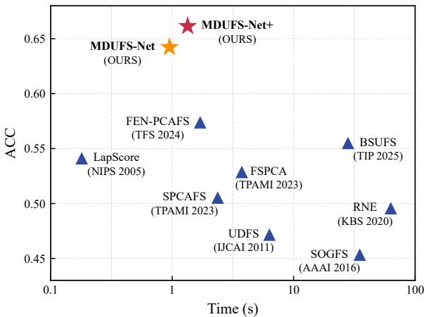  
Fig. 1. Performance-efficiency comparison of different methods based on average accuracy (ACC) and runtime (s) across eight real-world datasets.

Motivated by the above observations, this paper first constructs an $\ell _ { 2 , 0 } { \ - } \mathrm { n o r m }$ regularized PCA-based UFS model and then develops an efficient deep unfolding framework according to the alternating direction method of multipliers (ADMM), thereby reducing the dependence on manual parameter tuning. Moreover, an effective manifold optimization technique is leveraged to preserve the orthogonality of the PCA projection matrix, resulting in the proposed MDUFS-Net. Building upon this, MDUFS-Net+ introduces an element-wise sparsity regularization term, which makes feature selection more robust. As demonstrated in Fig. 1, compared with existing benchmark UFS methods, our proposed methods achieve high clustering performance with relatively low computational costs.

The main contributions of this paper can be summarized in the following three aspects:

• We propose the first deep unfolding-based UFS method called MDUFS-Net, where the ADMM iterative algorithm is unfolded into a stage-wise trainable deep network, enabling end-to-end parameter learning.

• We develop a manifold optimization mechanism into the stage-wise deep network updates, allowing the projection matrix to remain orthogonal throughout the unfolding process and enhancing network stability.

• We further extend MDUFS-Net into a general variant named MDUFS-Net+, where both row-wise and elementwise sparsity are enforced to improve feature selection performance in real-world scenarios.

The structure of this paper is outlined as follows. Section II introduces the related works. Section III presents our proposed models and deep unfolding networks. Section IV provides the numerical results and ablation studies, and discussions. Section V concludes this paper and outlines future directions.

## II. RELATED WORKS

## A. Sparse PCA

Given the data matrix $A \in \mathbb { R } ^ { d \times n }$ , sparse PCA is formulated as the following mathematical model

$$
\begin{array} { r l } { \underset { X } { \operatorname* { m i n } } } & { \frac { 1 } { 2 } \| A - X X ^ { \top } A \| _ { \mathrm { F } } ^ { 2 } + \lambda \| X \| _ { 2 , 1 } } \\ { \mathrm { s . t . } } & { X ^ { \top } X = I _ { m } , } \end{array}\tag{1}
$$

where $X \in \mathbb { R } ^ { d \times m }$ denotes the projection matrix, $\| X \| _ { 2 , 1 }$ is the $\ell _ { 2 , 1 } { \mathrm { - n o r m } }$ (defined as the sum of the $\ell _ { \mathrm { { 2 } } } { \cdot } \mathrm { { n o r m s } }$ of the rows), $\lambda > 0$ is the parameter to determine the sparsity, and $X ^ { \top } X =$ $I _ { m }$ is the orthogonal constraint. In this paper, m is omitted when there is no ambiguity. The first term in the objective is used for data reconstruction, while the second term induces row sparsity in the projection matrix for feature-level selection.

To obtain more discriminative feature representations, one can replace the $\ell _ { 2 , 1 }$ -norm in (1) with $\ell _ { 2 , p }$ -norm, defined as

$$
\| X \| _ { 2 , p } = \left( \sum _ { i = 1 } ^ { m } \| \mathbf { x } _ { i } \| ^ { p } \right) ^ { 1 / p } , \ p \in ( 0 , 1 ) ,
$$

where $\mathbf { x } _ { i }$ is the i-th row of $X$ . Then, problem (1) leads to the following SPCAFS model

$$
\begin{array} { r l } { \underset { X } { \operatorname* { m i n } } } & { \frac { 1 } { 2 } \| A - X X ^ { \top } A \| _ { \mathrm { F } } ^ { 2 } + \lambda \| X \| _ { 2 , p } ^ { p } } \\ { \mathrm { s . t . } } & { X ^ { \top } X = I . } \end{array}\tag{2}
$$

Note that the $\ell _ { 2 , p } .$ -norm is non-convex, yet explicit solutions exist in special cases, such as $p = 1 / 2 \ [ 3 7 ]$ , [38]. Moreover, $\ell _ { 2 , p }$ -norm facilitates obtaining sparser solutions than $\ell _ { 2 , 1 }$ -norm [39]. Although SPCAFS achieves satisfactory feature selection results, the regularization parameter λ must be carefully selected by cross-validation, and the corresponding optimization algorithm also involves tuning parameters, making the method difficult to implement on large-scale datasets.

## B. Deep Unfolding

Deep unfolding has emerged as an effective strategy for solving sparse and structured optimization problems by designing trainable deep networks from iterative optimization procedures. Gregor and LeCun [40] first unfolded the iterative process of sparse coding into a learnable network architecture. Yang et al. [41] further extended this idea by unfolding ADMM iterations and proposed deep ADMM-Net. Subsequent studies explored deep unfolding to various structured optimization models, including group-sparse nonnegative matrix factorization [42], robust PCA [43], [44], and low-rank sparse representation [45]. Interestingly, although deep unfolding has achieved significant success in image and signal processing, it has not been considered in the field of UFS, particularly in the context of PCA with non-convex sparsity regularization terms. In light of this, we attempt to introduce deep unfolding with the aim of achieving superior feature selection performance.

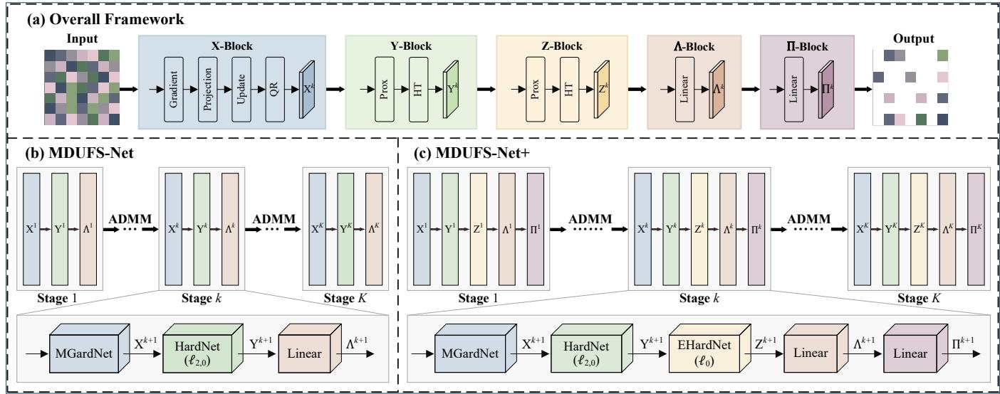  
Fig. 2. Illustration of our proposed MDUFS-Net and MDUFS-Net+.

## III. THE PROPOSED METHODS

This section presents the mathematical models and deep unfolding networks of MDUFS-Net and MDUFS-Net+, whose overall frameworks are given in Fig. 2.

## A. MDUFS-Net

Given the excellent feature selection capability of the $\ell _ { 2 , 0 ^ { - } }$ norm, this part considers the following model

$$
\begin{array} { r l } { \underset { X } { \operatorname* { m i n } } } & { \frac { 1 } { 2 } \| A - X X ^ { \top } A \| _ { \mathrm { F } } ^ { 2 } + \lambda \| X \| _ { 2 , 0 } } \\ { \mathrm { s . t . } } & { X ^ { \top } X = I , } \end{array}\tag{3}
$$

where $\| X \| _ { 2 , 0 }$ is defined as the number of nonzero rows in $X .$ As mentioned before, although problem (3) can be solved via iterative optimization, it is sensitive to parameter settings and lacks stability. Therefore, we explore below how to transform it into an end-to-end network using deep unfolding techniques.

We first define

$$
f ( X ) = { \frac { 1 } { 2 } } \| A - X X ^ { \top } A \| _ { \mathrm { F } } ^ { 2 } ,\tag{4}
$$

and introduce the auxiliary variable $Y = X$ , then problem (3) is transformed to

$$
\begin{array} { r l } { \underset { X , Y } { \operatorname* { m i n } } } & { { } f ( X ) + \lambda \| Y \| _ { 2 , 0 } } \\ { \mathrm { s . t . } } & { { } X ^ { \top } X = I , \ X = Y . } \end{array}\tag{5}
$$

The corresponding augmented Lagrangian function is

$$
\begin{array} { l } { \displaystyle \mathcal { L } ( X , Y , \Lambda ) = f ( X ) + \lambda \| Y \| _ { 2 , 0 } } \\ { \displaystyle + \left. \Lambda , X - Y \right. + \frac { \alpha } { 2 } \| X - Y \| _ { \mathrm { F } } ^ { 2 } , } \end{array}\tag{6}
$$

with $X ^ { \top } X = I .$ where Λ denotes the Lagrange multiplier and $\alpha > 0$ is the penalty parameter. Under the ADMM framework [46], variables are updated via alternating minimization and unfolded into multiple network stages with learnable parameters. Specifically, the parameters λ, α at the k-th stage are denoted as $\lambda _ { k } , \alpha _ { k } .$ whereas in iterative optimization algorithms, these parameters are typically predefined.

1) Update $X ^ { k + 1 }$ : At the k-th stage, with $Y ^ { k }$ and $\Lambda ^ { k }$ fixed, the X-subproblem is written as

$$
\begin{array} { r l } { \underset { X } { \operatorname* { m i n } } } & { F _ { k } ( X ) = f ( X ) + \frac { \alpha _ { k } } { 2 } \| X - Y ^ { k } + \Lambda ^ { k } / \alpha _ { k } \| _ { \mathrm { F } } ^ { 2 } } \\ { \mathrm { s . t . } } & { X ^ { \top } X = I . } \end{array}\tag{7}
$$

Since the orthogonality constraint $X ^ { \top } X = I$ prevents direct Euclidean updates from preserving feasibility, an effective manifold projection-based update strategy is employed during the deep unfolding process.

Let $G = A A ^ { \top }$ . Then (4) is expressed as

$$
f ( X ) = { \frac { 1 } { 2 } } \| A \| _ { \mathrm { F } } ^ { 2 } - { \frac { 1 } { 2 } } \mathrm { T r } ( X ^ { \top } G X ) .\tag{8}
$$

Its Euclidean gradient is

$$
\nabla f ( X ) = - G X ,\tag{9}
$$

and the gradient of the stage-wise objective function is

$$
\nabla F _ { k } ( X ) = - G X + \alpha _ { k } ( X - Y ^ { k } + \Lambda ^ { k } / \alpha _ { k } ) .\tag{10}
$$

To obtain an orthogonality-preserving update direction, the Euclidean gradient is projected onto a subspace-compatible tangent direction by

$$
\mathcal { P } _ { X } ( Z ) = ( I - X X ^ { \top } ) Z ,\tag{11}
$$

where $Z$ denotes an arbitrary direction in the Euclidean space. Therefore, the constraint-preserving search direction is

$$
\begin{array} { r l } & { D _ { k } = \mathcal { P } _ { X ^ { k } } ( \nabla F _ { k } ( X ^ { k } ) ) } \\ & { \quad \quad = ( I - X ^ { k } ( X ^ { k } ) ^ { \top } ) \nabla F _ { k } ( X ^ { k } ) . } \end{array}\tag{12}
$$

This projection enforces the orthogonality property of the search direction. Similar projection-based strategies have been explored for optimization problems with orthogonality constraints [47]. Subsequently, a stage-specific learnable step-size $\eta _ { k }$ is introduced

$$
\widetilde { X } ^ { k + 1 } = X ^ { k } - \eta _ { k } D _ { k } .\tag{13}
$$

Algorithm 1 Deep unfolding for MDUFS-Net   
Input: Data A, stage-wise parameters $\lambda _ { k } , \alpha _ { k } , \eta _ { k }$   
Initialize: $X ^ { 0 } , Y ^ { 0 } , \bar { \Lambda } ^ { 0 }$   
For $k = 0 , 1 , \ldots , K - 1$ do   
1: Update $X ^ { k + 1 }$ according to   
$X ^ { k + 1 } = \mathtt { M G r a d N e t } ( X ^ { k } , Y ^ { k } , \Lambda ^ { k } , G , \alpha _ { k } , \eta _ { k } )$   
2: Update $Y ^ { k + 1 }$ according to   
$Y ^ { k + 1 } = \mathrm { H a r d N e t } ( U ^ { k } , \tau _ { k } )$   
3: Update $\Lambda ^ { k + 1 }$ according to   
$\Lambda ^ { k + 1 } = \mathtt { L i n e a r } ( \Lambda ^ { k } , X ^ { k + 1 } , Y ^ { k + 1 } , \alpha _ { k } )$   
End While   
Output: $X ^ { K } , Y ^ { K }$

However, $\widetilde X ^ { k + 1 }$ may not exactly satisfy the orthogonality constraint. Let $\widetilde { X } ^ { k + 1 } = Q R ,$ where Q denotes the orthogonal factor satisfying $Q ^ { \top } Q = I .$ Then

$$
X ^ { k + 1 } = Q .\tag{14}
$$

Overall, the solution of problem (7) is obtained by

$$
X ^ { k + 1 } = \mathtt { M G r a d N e t } ( X ^ { k } , Y ^ { k } , \Lambda ^ { k } , G , \alpha _ { k } , \eta _ { k } ) ,\tag{15}
$$

where MGradNet denotes the manifold gradient network. It embeds the orthogonality-preserving update into each unfolding stage, enabling optimization under the orthogonality constraint within the deep unfolding framework.

2) Update $Y ^ { k + 1 }$ : Once $X ^ { k + 1 }$ has been updated, the $Y -$ subproblem is given by

$$
\operatorname* { m i n } _ { Y } \quad \lambda _ { k } \| Y \| _ { 2 , 0 } + \frac { \alpha _ { k } } { 2 } \| X ^ { k + 1 } - Y + \Lambda ^ { k } / \alpha _ { k } \| _ { \mathrm { F } } ^ { 2 } ,\tag{16}
$$

which yields the closed-form solution

$$
\begin{array} { r } { Y ^ { k + 1 } = \operatorname { p r o x } _ { \frac { \lambda _ { k } } { \alpha _ { k } } \parallel \cdot \parallel _ { 2 , 0 } } ( X ^ { k + 1 } + \Lambda ^ { k } / \alpha _ { k } ) , } \end{array}\tag{17}
$$

see [48] for more details. For ease of description, denote

$$
U ^ { k } = X ^ { k + 1 } + \Lambda ^ { k } / \alpha _ { k } ,\tag{18}
$$

then for the i-th row vector $\mathbf { u } _ { i } ^ { k }$ , the row-wise update is

$$
\mathbf { y } _ { i } ^ { k + 1 } = \left\{ \begin{array} { l l } { \mathbf { 0 } , } & { \| \mathbf { u } _ { i } ^ { k } \| _ { 2 } \leq \tau _ { k } , } \\ { \mathbf { u } _ { i } ^ { k } , } & { \| \mathbf { u } _ { i } ^ { k } \| _ { 2 } > \tau _ { k } , } \end{array} \right.\tag{19}
$$

where $\tau _ { k } = \sqrt { 2 \lambda _ { k } / \alpha _ { k } }$ is the threshold to control the sparsity. Therefore, the solution of problem (16) is characterized by

$$
Y ^ { k + 1 } = { \mathrm { H a r d N e t } } ( U ^ { k } , \tau _ { k } ) ,\tag{20}
$$

where HardNet denotes the row-wise hard-thresholding operation at the k-th unfolding stage.

3) Update $\Lambda ^ { k + 1 }$ : When $X ^ { k + 1 }$ and $Y ^ { k + 1 }$ have been calculated, the Lagrange multiplier is updated according to

$$
\Lambda ^ { k + 1 } = \Lambda ^ { k } + \alpha _ { k } ( X ^ { k + 1 } - Y ^ { k + 1 } ) ,\tag{21}
$$

which can be solved by the following network

$$
\Lambda ^ { k + 1 } = \mathtt { L i n e a r } ( \Lambda ^ { k } , X ^ { k + 1 } , Y ^ { k + 1 } , \alpha _ { k } ) ,\tag{22}
$$

where $\mathtt { L i n e a r } ( \cdot )$ represents the linear combination module for updating the dual variable at the k-th unfolding stage.

To sum up, our deep unfolding framework for MDUFS-Net is presented in Algorithm 1.

## B. MDUFS-Net+

From the perspective of model-driven methods, the solution to problem (3) may still contain redundant elements. Therefore, this part introduces an additional $\ell _ { 0 } \cdot$ -norm regularization term, which is described by

$$
\begin{array} { r l } { \underset { X } { \operatorname* { m i n } } } & { \frac { 1 } { 2 } \| A - X X ^ { \top } A \| _ { \mathrm { F } } ^ { 2 } + \lambda \| X \| _ { 2 , 0 } + \mu \| X \| _ { 0 } } \\ { \mathrm { s . t . } } & { X ^ { \top } X = I , } \end{array}\tag{23}
$$

where $\| X \| _ { 0 }$ is the lo-norm, which counts the number of nonzero elements in X, and $\lambda , \mu > 0$ are the parameters.

Recall the notation in (4), then the above problem (23) is equivalently restated as

$$
\begin{array} { r l } { \underset { X , Y , Z } { \operatorname* { m i n } } } & { f ( X ) + \lambda \| Y \| _ { 2 , 0 } + \mu \| Z \| _ { 0 } } \\ { \mathrm { s . t . } } & { X ^ { \top } X = I , X = Y , X = Z , } \end{array}\tag{24}
$$

and the augmented Lagrangian function is

$$
\begin{array} { l } { \displaystyle \mathcal { L } ( X , Y , Z , \Lambda , \Pi ) = f ( X ) + \lambda \| Y \| _ { 2 , 0 } + \mu \| Z \| _ { 0 } } \\ { \displaystyle ~ + \left. \Lambda , X - Y \right. + \frac { \alpha } { 2 } \| X - Y \| _ { \mathrm { F } } ^ { 2 } } \\ { \displaystyle ~ + \left. \Pi , X - Z \right. + \frac { \beta } { 2 } \| X - Z \| _ { \mathrm { F } } ^ { 2 } , } \end{array}\tag{25}
$$

where Λ, II are the corresponding Lagrange multipliers, and $\alpha , \beta \ge 0$ are the penalty parameters. It is observed that the update rule for variable Y follows the same procedure as that in MDUFS-Net. Thus, its derivation is not repeated here.

1) Update $X ^ { k + 1 }$ : At the k-th stage, the $X \cdot$ -subproblem is

$$
\begin{array} { l } { \displaystyle \operatorname* { m i n } _ { X } \quad \hat { F } _ { k } ( X ) = f ( X ) + \frac { \alpha _ { k } } { 2 } \| X - Y ^ { k } + \Lambda ^ { k } / \alpha _ { k } \| _ { \mathrm { F } } ^ { 2 } } \\ { \displaystyle \qquad + \frac { \beta _ { k } } { 2 } \| X - Z ^ { k } + \Pi ^ { k } / \beta _ { k } \| _ { \mathrm { F } } ^ { 2 } } \\ { \mathrm { s . t . } \quad X ^ { \top } X = I . } \end{array}\tag{26}
$$

Compared with MDUFS-Net, the above subproblem introduces an additional quadratic penalty term associated with the newly introduced variable $Z ^ { k }$ . Therefore, the Euclidean gradient is modified as

$$
\begin{array} { r l } & { \nabla \hat { F } _ { k } ( X ) = - G X + \alpha _ { k } \big ( X - Y ^ { k } + \Lambda ^ { k } / \alpha _ { k } \big ) } \\ & { \qquad + \beta _ { k } \big ( X - Z ^ { k } + \Pi ^ { k } / \beta _ { k } \big ) , } \end{array}\tag{27}
$$

and the projected search direction is

$$
\begin{array} { r l } & { D _ { k } = \mathcal { P } _ { X ^ { k } } ( \nabla \hat { F } _ { k } ( X ^ { k } ) ) } \\ & { \quad \quad = ( I - X ^ { k } ( X ^ { k } ) ^ { \top } ) \nabla \hat { F } _ { k } ( X ^ { k } ) . } \end{array}\tag{28}
$$

Algorithm 2 Deep unfolding for MDUFS-Net+   
Input: Data A, stage-wise parameters $\lambda _ { k } , \mu _ { k } , \alpha _ { k } , \beta _ { k } , \eta _ { k }$   
Initialize: $X ^ { 0 } , Y ^ { 0 } , \overline { { { Z ^ { 0 } } } } , \Lambda ^ { 0 } , \dot { \Pi } ^ { 0 }$   
For $k = 0 , 1 , \ldots , K - 1$ do   
1: Update $X ^ { k + 1 }$ according to   
$X ^ { k + 1 } = \mathtt { M G r a d N e t } + ( X ^ { k } , Y ^ { k } , Z ^ { k } , \Lambda ^ { k } , \Pi ^ { k } , G , \alpha _ { k } , \beta _ { k } , \eta _ { k } )$   
2: Update $Y ^ { k + 1 }$ according to   
$Y ^ { k + 1 } = \mathrm { H a r d N e t } ( U ^ { k } , \tau _ { k } )$   
3: Update $Z ^ { k + 1 }$ according to   
$\boldsymbol { Z } ^ { k + 1 } = \mathtt { E H a r d N e t } ( V ^ { k } , \gamma _ { k } )$   
4: Update $\Lambda ^ { k + 1 }$ according to   
$\Lambda ^ { k + 1 } = \mathtt { L i n e a r } ( \Lambda ^ { k } , X ^ { k + 1 } , Y ^ { k + 1 } , \alpha _ { k } )$   
5: Update $\Pi ^ { k + 1 }$ according to   
$\Pi ^ { k + 1 } = \mathtt { L i n e a r } ( \Pi ^ { k } , X ^ { k + 1 } , Z ^ { k + 1 } , \beta _ { k } )$   
End While   
Output: $X ^ { K } , Y ^ { K } , Z ^ { K }$

The subsequent manifold gradient update with the learnable step-size $\eta _ { k }$ and QR-based retraction follows the same procedure as MDUFS-Net. This extended update is

$$
X ^ { k + 1 } = \mathtt { M G r a d N e t } + ( X ^ { k } , Y ^ { k } , Z ^ { k } , \Lambda ^ { k } , \Pi ^ { k } , G , \alpha _ { k } , \beta _ { k } , \eta _ { k } ) .\tag{29}
$$

2) Update $Z ^ { k + 1 } ,$ : It is simplified to

$$
\operatorname* { m i n } _ { Z } \quad \mu _ { k } \| Z \| _ { 0 } + \frac { \beta _ { k } } { 2 } \| X ^ { k + 1 } - Z + \Pi ^ { k } / \beta _ { k } \| _ { \mathrm { F } } ^ { 2 } .\tag{30}
$$

According to the element-wise hard thresholding [49], problem (30) admits the following solution

$$
\begin{array} { r } { Z ^ { k + 1 } = \operatorname { p r o x } _ { \frac { \mu _ { k } } { \beta _ { k } } \| \cdot \| _ { 0 } } ( X ^ { k + 1 } + \Pi ^ { k } / \beta _ { k } ) . } \end{array}\tag{31}
$$

Specifically, denote

$$
V ^ { k } = X ^ { k + 1 } + \Pi ^ { k } / \beta _ { k } ,\tag{32}
$$

and let $v _ { i , j } ^ { k }$ be the $( i , j )$ -th element of $V ^ { k }$ . Then, the elementwise update is

$$
z _ { i , j } ^ { k + 1 } = \left\{ \begin{array} { l l } { 0 , } & { | v _ { i , j } ^ { k } | \leq \gamma _ { k } , } \\ { v _ { i , j } ^ { k } , } & { | v _ { i , j } ^ { k } | > \gamma _ { k } . } \end{array} \right.\tag{33}
$$

where $\gamma _ { k } = \sqrt { 2 \mu _ { k } / \beta _ { k } }$ . In the deep unfolding, this operation is formulated as

$$
Z ^ { k + 1 } = \operatorname { E H a r d N e t } ( V ^ { k } , \gamma _ { k } ) .\tag{34}
$$

3) Update $\Lambda ^ { k + 1 }$ and $\Pi ^ { k + 1 } .$ : The update of $\Lambda ^ { k + 1 }$ remains the same as that in MDUFS-Net, and II is updated via

$$
\Pi ^ { k + 1 } = \Pi ^ { k } + \beta _ { k } ( X ^ { k + 1 } - Z ^ { k + 1 } ) ,\tag{35}
$$

which is represented by

$$
\Pi ^ { k + 1 } = \mathtt { L i n e a r } ( \Pi ^ { k } , X ^ { k + 1 } , Z ^ { k + 1 } , \beta _ { k } ) .\tag{36}
$$

Finally, the deep unfolding scheme for our MDUFS-Net+ is summarized in Algorithm 2.

TABLE I  
STATISTICAL INFORMATION OF SELECTED DATASETS.
<table><tr><td rowspan=1 colspan=1>Types</td><td rowspan=1 colspan=1>Datasets</td><td rowspan=1 colspan=1>Features</td><td rowspan=1 colspan=1>Samples</td><td rowspan=1 colspan=1>Classes</td></tr><tr><td rowspan=2 colspan=1>Synthetic</td><td rowspan=1 colspan=1>Dartboard1</td><td rowspan=1 colspan=1>9</td><td rowspan=1 colspan=1>1000</td><td rowspan=1 colspan=1>4</td></tr><tr><td rowspan=1 colspan=1>Diamond9</td><td rowspan=1 colspan=1>9</td><td rowspan=1 colspan=1>3000</td><td rowspan=1 colspan=1>9</td></tr><tr><td rowspan=8 colspan=1>Real-world</td><td rowspan=1 colspan=1>COIL20</td><td rowspan=1 colspan=1>1024</td><td rowspan=1 colspan=1>1440</td><td rowspan=1 colspan=1>20</td></tr><tr><td rowspan=1 colspan=1>ISOLET</td><td rowspan=1 colspan=1>617</td><td rowspan=1 colspan=1>1560</td><td rowspan=1 colspan=1>26</td></tr><tr><td rowspan=1 colspan=1>USPS</td><td rowspan=1 colspan=1>256</td><td rowspan=1 colspan=1>1000</td><td rowspan=1 colspan=1>10</td></tr><tr><td rowspan=1 colspan=1>PIE</td><td rowspan=1 colspan=1>1024</td><td rowspan=1 colspan=1>1166</td><td rowspan=1 colspan=1>53</td></tr><tr><td rowspan=1 colspan=1>LUNG</td><td rowspan=1 colspan=1>3312</td><td rowspan=1 colspan=1>203</td><td rowspan=1 colspan=1>5</td></tr><tr><td rowspan=1 colspan=1>MSTAR</td><td rowspan=1 colspan=1>1024</td><td rowspan=1 colspan=1>2425</td><td rowspan=1 colspan=1>10</td></tr><tr><td rowspan=1 colspan=1>MNIST</td><td rowspan=1 colspan=1>784</td><td rowspan=1 colspan=1>10000</td><td rowspan=1 colspan=1>10</td></tr><tr><td rowspan=1 colspan=1>HAR</td><td rowspan=1 colspan=1>561</td><td rowspan=1 colspan=1>10299</td><td rowspan=1 colspan=1>6</td></tr></table>

## C. Loss Function

Given that the original mathematical models involve the $\ell _ { 2 , 0 } \mathrm { { - n o r m } \ o r \ \ell _ { 0 } \mathrm { { - n o r m } } }$ it cannot be directly optimized via gradient-based backpropagation. Therefore, we employ differentiable surrogate functions to approximate these regularization terms. Specifically, the differentiable surrogate function of the $\ell _ { 2 , 0 } { \ - } \mathrm { n o r m }$ is defined as

$$
\varphi _ { 2 , 0 } ( Y ) = \sum _ { i = 1 } ^ { d } ( 1 - \exp ( - \| \mathbf { y } _ { i } \| _ { 2 } ^ { 2 } / ( 2 \sigma ^ { 2 } ) ) ) ,\tag{37}
$$

where $\sigma ~ > ~ 0$ is a smoothing parameter controlling the approximation of the surrogate function to the original norm. In our implementation, σ is gradually adjusted during training. Consequently, the loss function for MDUFS-Net is

$$
{ \mathcal { L } } _ { \mathrm { M D U F S - N e t } } = f ( X ) + \lambda \varphi _ { 2 , 0 } ( Y ) .\tag{38}
$$

Similarly, the differentiable surrogate function of the $\ell _ { 0 } -$ norm is defined as

$$
\varphi _ { 0 } ( Z ) = \sum _ { i = 1 } ^ { d } \sum _ { j = 1 } ^ { m } ( 1 - \exp ( - z _ { i j } ^ { 2 } / ( 2 \sigma ^ { 2 } ) ) ) ,\tag{39}
$$

and the loss function for MDUFS-Net+ is

$$
{ \mathcal { L } } _ { \mathrm { M D U F S - N e t + } } = f ( X ) + \lambda \varphi _ { 2 , 0 } ( Y ) + \mu \varphi _ { 0 } ( Z ) .\tag{40}
$$

## IV. NUMERICAL STUDIES

To evaluate the performance of our proposed MDUFS-Net and MDUFS-Net+, extensive experiments are conducted against several representative UFS methods, including Lap-Score [8], SOGFS [10], RNE [11], UDFS [9], SPCAFS [19], FSPCA [20], FEN-PCAFS [21], and BSUFS [22]. The source codes of LapScore, SOGFS, RNE, and UDFS are obtained from the AutoUFSTool toolbox1. For SPCAFS2, FSPCA³, FEN-PCAFS4, and BSUFS5, the publicly available implementations released by the corresponding authors are adopted.

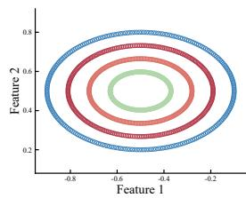  
(a) LapScore

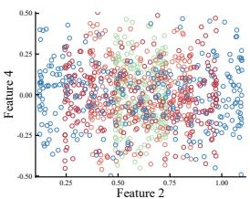  
(b) SOGFS

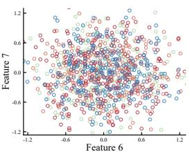  
(c) RNE

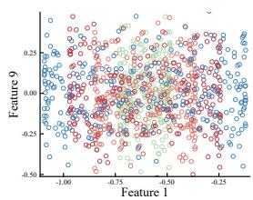  
(f) FSPCA

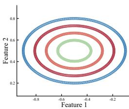  
(g) FEN-PCAFS

(e) SPCAFS  
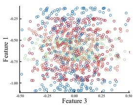  
(h) BSUFS  
(d) UDFS  
Fig. 3. Visual comparisons on the Dartboard1 dataset, where (a)-(j) are the feature selection results.  
(i) MDUFS-Net

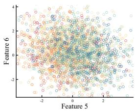

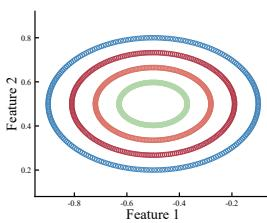

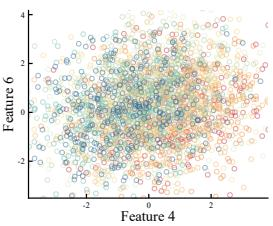  
(a) LapScore  
(b) SOGFS

(j) MDUFS-Net+  
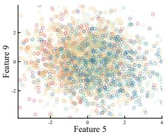  
(c) RNE

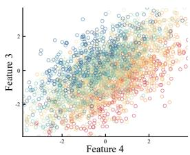  
(f) FSPCA

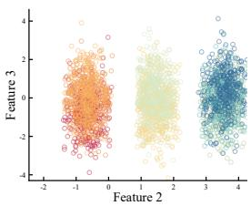

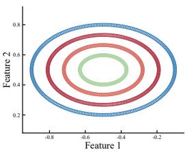

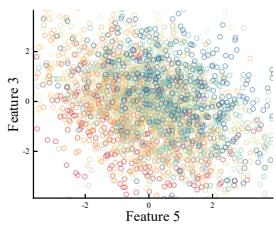

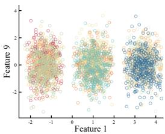  
(g) FEN-PCAFS

(e) SPCAFS  
(h) BSUFS  
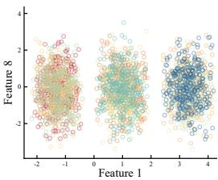

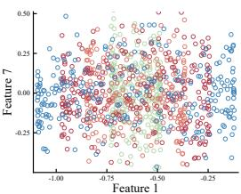

(d) UDFS  
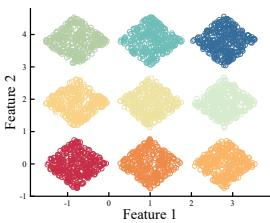  
(i) MDUFS-Net  
Fig. 4. Visual comparisons on the Diamond9 dataset, where (a)-(j) are the feature selection results.

Subsection IV-A describes the datasets, parameter settings, and evaluation metrics. Subsections IV-B and IV-C present the experimental results on synthetic and real-world datasets, respectively. Subsection IV-D reports the ablation experiments. Subsection IV-E provides further discussions.

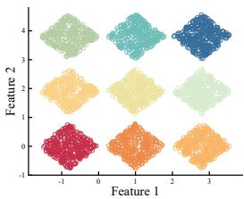  
(j) MDUFS-Net+

1) Dataset Descriptions: Two synthetic datasets and eight real-world datasets are used to evaluate the performance of the proposed methods, as summarized in Table I. Specifically, the synthetic datasets6 are generated by assigning specific distributions to the first two features, while the remaining seven features are filled with Gaussian noise. The eight realworld datasets cover a variety of application domains, where Isolet7 for spoken letter recognition, MSTAR\_SOC\_CNN8

## A. Experimental Setup

(referred to as MSTAR) for deep learning, lung\_discrete7 (referred to as LUNG) for biological information, $\mathrm { C O I L } 2 0 ^ { 7 }$ 2 $\mathrm { U S P S } ^ { 7 } , \mathrm { P I E } ^ { 9 }$ , and $\mathrm { M N I S T ^ { 1 0 } }$ for image processing, $\mathrm { H A R } ^ { 1 1 }$ for time-series analysis.

2) Parameter Settings: For LapScore, SOGFS, UDFS, and RNE, the value of k-neighbors is determined as 5. For SOGFS, SPCAFS, FEN-PCAFS, and BSUFS, the regularization parameters are selected from the candidate set $\{ 1 0 ^ { - 6 } , 1 0 ^ { - \hat { 4 } } , 1 0 ^ { - 2 } , 1 0 ^ { 0 } , 1 0 ^ { 2 } , 1 0 ^ { 4 } , 1 0 ^ { 6 } \}$ . To ensure a fair comparison, the proposed MDUFS-Net and MDUFS-Net+ use the same network architecture and training strategy across all datasets. The number of unfolding stages is set to 15, and the models are trained for 100 epochs using the Adam optimizer with an initial learning rate of $1 \times 1 0 ^ { - 4 }$ . The learnable parameters are properly initialized and optimized automatically through gradient-based learning during training. The lower bounds of sparse regularization parameters are set according to the feature dimensionality of each dataset.

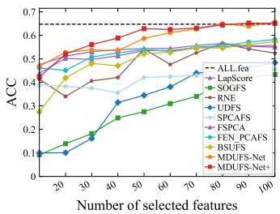  
(a) COIL20

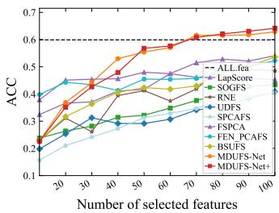  
(b) ISOLET

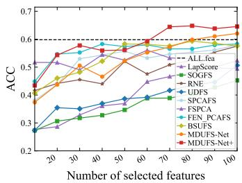  
(c) USPS

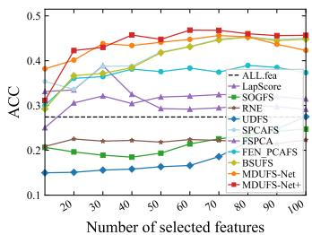  
(d) PIE

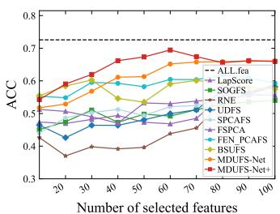  
(e) LUNG

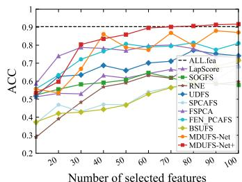  
(f) MSTAR

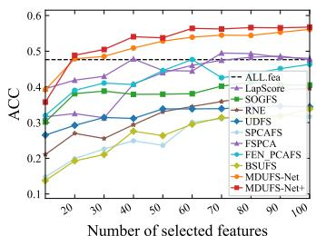  
(g) MNIST

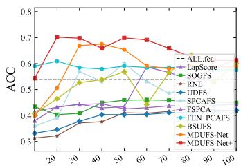  
(h) HAR

Fig. 5. Visual comparisons of the ACC metric under different real-world datasets with different numbers of selected features.  
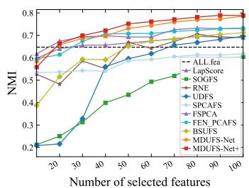  
(a) COIL20

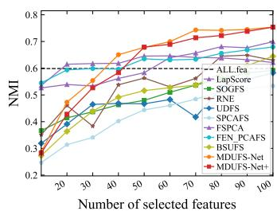  
(b) ISOLET

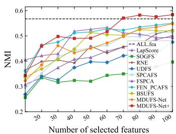  
(c) USPS

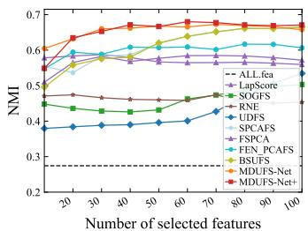  
(d) PIE

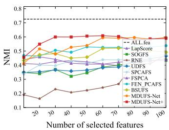  
(e) LUNG

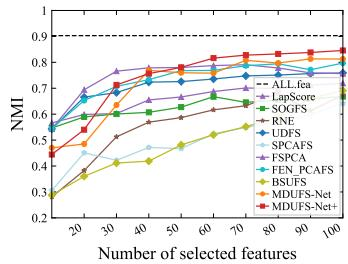  
(f) MSTAR

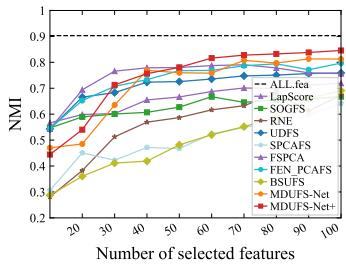  
(g) MNIST

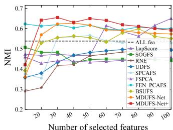  
(h) HAR  
Fig. 6. Visual comparisons of the NMI metric under different real-world datasets with different numbers of selected features.

3) Evaluation Metrics: Two key metrics are applied to evaluate these compared methods, including clustering accuracy (ACC) and normalized mutual information (NMI) [50]. Following a similar setting in [22], the number of selected features is varied from 10 to 100 in increments of 10 across all datasets. To reduce the variability caused by different initial conditions, the k-means clustering algorithm is independently repeated 50 times. The final results are reported in terms of the mean and standard deviation over these 50 runs.

## B. Synthetic Results

In this experiment, all compared methods are evaluated on two synthetic datasets. For each method, features are ranked according to their selection scores, and the top two features are selected. Afterwards, the selected features and corresponding sample distributions are visualized using scatter plots.

Fig. 3 shows that for the Dartboard1 dataset, LapScore, UDFS, FEN-PCAFS, MDUFS-Net, and MDUFS-Net+ are capable of identifying the appropriate features, compared with other methods. Furthermore, Fig. 4 demonstrates that for the Diamond9 dataset, only MDUFS-Net and MDUFS-Net+ successfully identify the two most discriminative features, while the compared methods fail to accurately identify them. Overall, our MDUFS-Net and MDUFS-Net+ consistently yield reliable feature selection results, which validate the effectiveness of the proposed methods on synthetic datasets.

TABLE II  
AVERAGE ACC (MEAN % ± STD %) AND NUMBER OF SELECTED FEATURES (IN BRACKETS) OF k-MEANS CLUSTERING, WHERE THE BEST RESULTS ARE MARKED IN BOLD.
<table><tr><td rowspan=1 colspan=1>Methods</td><td rowspan=1 colspan=1>COIL20</td><td rowspan=1 colspan=1>ISOLET</td><td rowspan=1 colspan=1>USPS</td><td rowspan=1 colspan=1>PIE</td><td rowspan=1 colspan=1>LUNG</td><td rowspan=1 colspan=1>MSTAR</td><td rowspan=1 colspan=1>MNIST</td><td rowspan=1 colspan=1>HAR</td><td rowspan=1 colspan=1>Average</td></tr><tr><td rowspan=1 colspan=1>ALLfea</td><td rowspan=1 colspan=1>64.73±7.63(10)</td><td rowspan=1 colspan=1>59.87±2.78(10)</td><td rowspan=1 colspan=1>59.82±1.29(10)</td><td rowspan=1 colspan=1>27.43±0.96(10)</td><td rowspan=1 colspan=1>72.57±7.63(10)</td><td rowspan=1 colspan=1>90.29±3.94(10)</td><td rowspan=1 colspan=1>47.69±2.78(10)</td><td rowspan=1 colspan=1>53.79±0.99(10)</td><td rowspan=1 colspan=1>59.52±3.50</td></tr><tr><td rowspan=1 colspan=1>LapScore</td><td rowspan=1 colspan=1>55.36±1.58(90)</td><td rowspan=1 colspan=1>54.07±1.80(100)</td><td rowspan=1 colspan=1>52.31±2.68(100)</td><td rowspan=1 colspan=1>33.90±0.97(30)</td><td rowspan=1 colspan=1>58.40±0.75(100)</td><td rowspan=1 colspan=1>68.67±3.32(100)</td><td rowspan=1 colspan=1>48.62±0.15(80)</td><td rowspan=1 colspan=1>61.59±0.09(100)</td><td rowspan=1 colspan=1>54.12±1.42</td></tr><tr><td rowspan=1 colspan=1>SOGFS</td><td rowspan=1 colspan=1>43.32±2.96(100)</td><td rowspan=1 colspan=1>43.43±1.84(30)</td><td rowspan=1 colspan=1>45.23±1.31(100)</td><td rowspan=1 colspan=1>24.73±0.94(100)</td><td rowspan=1 colspan=1>54.02±3.19(100)</td><td rowspan=1 colspan=1>64.65±2.66(60)</td><td rowspan=1 colspan=1>41.26±1.15(80)</td><td rowspan=1 colspan=1>46.05±0.38(100)</td><td rowspan=1 colspan=1>45.34±1.80</td></tr><tr><td rowspan=1 colspan=1>RNE</td><td rowspan=1 colspan=1>56.64±3.40(80)</td><td rowspan=1 colspan=1>50.29±1.77(100)</td><td rowspan=1 colspan=1>57.51±2.01(100)</td><td rowspan=1 colspan=1>22.39±0.61(60)</td><td rowspan=1 colspan=1>58.90±5.79(100)</td><td rowspan=1 colspan=1>69.11±1.02(80)</td><td rowspan=1 colspan=1>39.58±0.19(100)</td><td rowspan=1 colspan=1>42.16±0.03(60)</td><td rowspan=1 colspan=1>49.57±1.85</td></tr><tr><td rowspan=1 colspan=1>UDFS</td><td rowspan=1 colspan=1>48.38±2.41(100)</td><td rowspan=1 colspan=1>40.84±1.83(100)</td><td rowspan=1 colspan=1>50.63±1.93(100)</td><td rowspan=1 colspan=1>27.49±0.94(100)</td><td rowspan=1 colspan=1>58.19±5.29(100)</td><td rowspan=1 colspan=1>75.24±3.37(90)</td><td rowspan=1 colspan=1>34.57±1.37(80)</td><td rowspan=1 colspan=1>42.03±0.03(100)</td><td rowspan=1 colspan=1>47.17±2.15</td></tr><tr><td rowspan=1 colspan=1>SPCAFS</td><td rowspan=1 colspan=1>45.72±2.07(80)</td><td rowspan=1 colspan=1>40.55±1.76(100)</td><td rowspan=1 colspan=1>57.95±1.57(80)</td><td rowspan=1 colspan=1>45.41±1.74(80)</td><td rowspan=1 colspan=1>56.32±4.29(90)</td><td rowspan=1 colspan=1>67.96±2.81(100)</td><td rowspan=1 colspan=1>31.71±0.91(90)</td><td rowspan=1 colspan=1>58.67±0.01(90)</td><td rowspan=1 colspan=1>50.54±1.90</td></tr><tr><td rowspan=1 colspan=1>FSPCA</td><td rowspan=1 colspan=1>56.57±1.89(80)</td><td rowspan=1 colspan=1>47.99±1.31(50)</td><td rowspan=1 colspan=1>56.05±1.96(60)</td><td rowspan=1 colspan=1>32.45±1.18(80)</td><td rowspan=1 colspan=1>55.74±1.90(90)</td><td rowspan=1 colspan=1>80.09±5.55(70)</td><td rowspan=1 colspan=1>49.49±1.43(70)</td><td rowspan=1 colspan=1>44.54±0.05(40)</td><td rowspan=1 colspan=1>52.87±1.91</td></tr><tr><td rowspan=1 colspan=1>FEN-PCAFS</td><td rowspan=1 colspan=1>58.20±2.24(100)</td><td rowspan=1 colspan=1>52.28±2.11(100)</td><td rowspan=1 colspan=1>58.28±2.31(100)</td><td rowspan=1 colspan=1>38.94±1.64(80)</td><td rowspan=1 colspan=1>61.77±1.53(80)</td><td rowspan=1 colspan=1>81.07±3.84(80)</td><td rowspan=1 colspan=1>47.66±0.02(60)</td><td rowspan=1 colspan=1>60.91±0.04(20)</td><td rowspan=1 colspan=1>57.39±1.72</td></tr><tr><td rowspan=2 colspan=1>BSUFS</td><td rowspan=2 colspan=1>57.26±2.37(100)</td><td rowspan=2 colspan=1>53.59±2.12(100)</td><td rowspan=2 colspan=1>59.33±0.96(80)</td><td rowspan=2 colspan=1>45.25±1.74(80)</td><td rowspan=1 colspan=1>60.13±2.42</td><td rowspan=2 colspan=1>71.45±1.81(100)</td><td rowspan=2 colspan=1>33.80±0.89(100)</td><td rowspan=2 colspan=1>63.27±0.05(90)</td><td rowspan=2 colspan=1>55.51±1.55</td></tr><tr><td rowspan=1 colspan=1>(70)</td></tr><tr><td rowspan=1 colspan=1>MDUFS-Net</td><td rowspan=1 colspan=1>65.60±2.83(100)</td><td rowspan=1 colspan=1>62.84±2.27(100)</td><td rowspan=1 colspan=1>62.02±1.69(100)</td><td rowspan=1 colspan=1>45.61±1.73(70)</td><td rowspan=1 colspan=1>66.12±1.86(100)</td><td rowspan=1 colspan=1>88.00±1.83(90)</td><td rowspan=1 colspan=1>56.10±0.05(100)</td><td rowspan=1 colspan=1>67.53±0.25(40)</td><td rowspan=1 colspan=1>64.23±1.56</td></tr><tr><td rowspan=1 colspan=1>MDUFS-Net+</td><td rowspan=1 colspan=1>65.23±1.89(90)</td><td rowspan=1 colspan=1>64.16±2.04(100)</td><td rowspan=1 colspan=1>64.79±1.65(80)</td><td rowspan=1 colspan=1>46.82±1.65(60)</td><td rowspan=1 colspan=1>69.46±1.35(60)</td><td rowspan=1 colspan=1>91.70±0.15(100)</td><td rowspan=1 colspan=1>56.75±0.03(100)</td><td rowspan=1 colspan=1>70.19±0.13(20)</td><td rowspan=1 colspan=1>66.14±1.11</td></tr></table>

TABLE III

AVERAGE NMI (MEAN % ± STD %) AND NUMBER OF SELECTED FEATURES (IN BRACKETS) OF k-MEANS CLUSTERING, WHERE BEST RESULTS ARE MARKED IN BOLD.
<table><tr><td rowspan=1 colspan=1>Methods</td><td rowspan=1 colspan=1>COIL20</td><td rowspan=1 colspan=1>ISOLET</td><td rowspan=1 colspan=1>USPS</td><td rowspan=1 colspan=1>PIE</td><td rowspan=1 colspan=1>LUNG</td><td rowspan=1 colspan=1>MSTAR</td><td rowspan=1 colspan=1>MNIST</td><td rowspan=1 colspan=1>HAR</td><td rowspan=1 colspan=1>Average</td></tr><tr><td rowspan=1 colspan=1>ALLfea</td><td rowspan=1 colspan=1>77.43±1.10(10)</td><td rowspan=1 colspan=1>74.57±1.40(10)</td><td rowspan=1 colspan=1>56.73±1.10(10)</td><td rowspan=1 colspan=1>52.42±0.92(10)</td><td rowspan=1 colspan=1>60.04±3.59(10)</td><td rowspan=1 colspan=1>87.39±1.10(10)</td><td rowspan=1 colspan=1>50.65±0.26(10)</td><td rowspan=1 colspan=1>55.63±1.67(10)</td><td rowspan=1 colspan=1>64.36±1.39</td></tr><tr><td rowspan=1 colspan=1>LapScore</td><td rowspan=1 colspan=1>69.47±0.85(80)</td><td rowspan=1 colspan=1>69.92±0.83(100)</td><td rowspan=1 colspan=1>50.10±1.54(100)</td><td rowspan=1 colspan=1>58.74±0.63(30)</td><td rowspan=1 colspan=1>44.62±0.99(100)</td><td rowspan=1 colspan=1>71.60±0.46(100)</td><td rowspan=1 colspan=1>50.67±0.22(80)</td><td rowspan=1 colspan=1>64.95±0.09(100)</td><td rowspan=1 colspan=1>60.01±0.70</td></tr><tr><td rowspan=1 colspan=1>SOGFS</td><td rowspan=1 colspan=1>60.42±1.40(100)</td><td rowspan=1 colspan=1>59.18±1.04(30)</td><td rowspan=1 colspan=1>39.67±1.41(100)</td><td rowspan=1 colspan=1>50.31±0.88(100)</td><td rowspan=1 colspan=1>43.50±3.32(100)</td><td rowspan=1 colspan=1>66.78±0.65(100)</td><td rowspan=1 colspan=1>40.49±1.15(100)</td><td rowspan=1 colspan=1>48.22±0.01(30)</td><td rowspan=1 colspan=1>51.07±1.23</td></tr><tr><td rowspan=1 colspan=1>RNE</td><td rowspan=1 colspan=1>70.57±1.55(80)</td><td rowspan=1 colspan=1>64.87±0.89(90)</td><td rowspan=1 colspan=1>52.35±1.15(100)</td><td rowspan=1 colspan=1>47.41±0.62(20)</td><td rowspan=1 colspan=1>47.46±4.07(100)</td><td rowspan=1 colspan=1>67.38±1.91(80)</td><td rowspan=1 colspan=1>30.27±0.21(100)</td><td rowspan=1 colspan=1>49.78±0.01(100)</td><td rowspan=1 colspan=1>53.76±1.30</td></tr><tr><td rowspan=1 colspan=1>UDFS</td><td rowspan=1 colspan=1>69.57±1.07(100)</td><td rowspan=1 colspan=1>58.26±1.35(100)</td><td rowspan=1 colspan=1>47.56±1.28(100)</td><td rowspan=1 colspan=1>53.42±0.80(100)</td><td rowspan=1 colspan=1>46.45±3.57(100)</td><td rowspan=1 colspan=1>75.89±0.67(90)</td><td rowspan=1 colspan=1>36.71±0.33(100)</td><td rowspan=1 colspan=1>49.33±0.03(100)</td><td rowspan=1 colspan=1>54.65±1.14</td></tr><tr><td rowspan=1 colspan=1>SPCAFS</td><td rowspan=1 colspan=1>61.78±1.12(100)</td><td rowspan=1 colspan=1>53.36±1.03(100)</td><td rowspan=1 colspan=1>51.56±0.53(90)</td><td rowspan=1 colspan=1>66.36±0.91(70)</td><td rowspan=1 colspan=1>47.73±2.86(100)</td><td rowspan=1 colspan=1>64.20±2.27(100)</td><td rowspan=1 colspan=1>30.72±1.28(90)</td><td rowspan=1 colspan=1>56.57±0.15(50)</td><td rowspan=1 colspan=1>54.04±1.27</td></tr><tr><td rowspan=1 colspan=1>FSPCA</td><td rowspan=1 colspan=1>73.24±0.86(80)</td><td rowspan=1 colspan=1>64.54±0.66(40)</td><td rowspan=1 colspan=1>53.33±0.89(60)</td><td rowspan=1 colspan=1>58.47±0.67(80)</td><td rowspan=1 colspan=1>43.79±1.71(100)</td><td rowspan=1 colspan=1>79.06±2.03(100)</td><td rowspan=1 colspan=1>50.38±0.36(70)</td><td rowspan=1 colspan=1>45.77±0.22(100)</td><td rowspan=1 colspan=1>58.57±0.93</td></tr><tr><td rowspan=1 colspan=1>FEN-PCAFS</td><td rowspan=1 colspan=1>73.16±1.08(100)</td><td rowspan=1 colspan=1>67.93±1.04(100)</td><td rowspan=1 colspan=1>55.03±1.27(100)</td><td rowspan=1 colspan=1>61.68±1.16(80)</td><td rowspan=1 colspan=1>53.78±0.79(100)</td><td rowspan=1 colspan=1>79.70±1.47(80)</td><td rowspan=1 colspan=1>47.66±0.02(60)</td><td rowspan=1 colspan=1>61.92±0.01(30)</td><td rowspan=1 colspan=1>62.61±0.86</td></tr><tr><td rowspan=1 colspan=1>BSUFS</td><td rowspan=1 colspan=1>71.18±1.39(100)</td><td rowspan=1 colspan=1>64.46±1.35(100)</td><td rowspan=1 colspan=1>52.46±0.64(80)</td><td rowspan=1 colspan=1>66.55±0.94(100)</td><td rowspan=1 colspan=1>52.00±1.48(70)</td><td rowspan=1 colspan=1>69.09±1.06(100)</td><td rowspan=1 colspan=1>33.80±0.89(100)</td><td rowspan=1 colspan=1>59.83±0.12(80)</td><td rowspan=1 colspan=1>58.67±0.98</td></tr><tr><td rowspan=1 colspan=1>MDUFS-Net</td><td rowspan=1 colspan=1>78.63±1.20(100)</td><td rowspan=1 colspan=1>75.38±0.87(100)</td><td rowspan=1 colspan=1>54.80±1.60(100)</td><td rowspan=1 colspan=1>67.26±1.10(70)</td><td rowspan=1 colspan=1>59.60±1.46(100)</td><td rowspan=1 colspan=1>81.32±1.18(90)</td><td rowspan=1 colspan=1>50.27±0.02(100)</td><td rowspan=1 colspan=1>62.70±0.09(40)</td><td rowspan=1 colspan=1>66.25±0.94</td></tr><tr><td rowspan=1 colspan=1>MDUFS-Net+</td><td rowspan=1 colspan=1>78.96±1.02(90)</td><td rowspan=1 colspan=1>75.36±1.16(100)</td><td rowspan=1 colspan=1>58.39±0.54(100)</td><td rowspan=1 colspan=1>68.00±0.79(60)</td><td rowspan=1 colspan=1>60.84±1.42(60)</td><td rowspan=1 colspan=1>84.57±0.21(100)</td><td rowspan=1 colspan=1>50.86±0.02(90)</td><td rowspan=1 colspan=1>65.44±0.65(30)</td><td rowspan=1 colspan=1>67.80±0.73</td></tr></table>

## C. Real-world Results

In this section, numerical experiments are conducted on eight real-world datasets to evaluate the effectiveness of the proposed methods. Besides, ALLfea is introduced to serve as a baseline for comparison.

Regarding the ACC metric, the performance variations of different methods with respect to the number of selected features are illustrated in Fig. 5. It can be observed that our MDUFS-Net and MDUFS-Net+ generally maintain higher ACC curves than other comparison methods under different feature selection settings. The results in Table II further verify this observation, where MDUFS-Net+ achieves the highest average ACC in most cases, followed by MDUFS-Net. The advantage mainly stems from the deep unfolding framework, which transforms the iterative ADMM optimization into a trainable network and enables adaptive parameters at different stages. Meanwhile, the orthogonality constraint helps preserve the structural information of the feature space, leading to more discriminative feature representations. Furthermore, compared with MDUFS-Net, MDUFS-Net+ increases the average ACC by 1.91% and decreases the average standard deviation from 1.56% to 1.11%, demonstrating improved clustering performance and stability.

TABLE IV  
ABLATION STUDIES OF SPARSITY REGULARIZATION TERMS, WHERE THE BEST RESULTS ARE MARKED IN BOLD.
<table><tr><td rowspan=1 colspan=1> $\ell _ { 2 , 0 } { \mathrm { - n o r m } }$ </td><td rowspan=1 colspan=1>l0-norm</td><td rowspan=1 colspan=1>Metrics</td><td rowspan=1 colspan=1>COIL20</td><td rowspan=1 colspan=1>ISOLET</td><td rowspan=1 colspan=1>USPS</td><td rowspan=1 colspan=1>PIE</td><td rowspan=1 colspan=1>LUNG</td><td rowspan=1 colspan=1>MSTAR</td><td rowspan=1 colspan=3>MNIST</td><td rowspan=1 colspan=1>HAR</td></tr><tr><td rowspan=2 colspan=1>X</td><td rowspan=2 colspan=1>X</td><td rowspan=2 colspan=1>ACCNMI</td><td rowspan=2 colspan=1>44.4263.16</td><td rowspan=1 colspan=1>40.20</td><td rowspan=1 colspan=1>61.62</td><td rowspan=1 colspan=1>45.46</td><td rowspan=1 colspan=1>63.09</td><td rowspan=2 colspan=1>81.4679.76</td><td rowspan=2 colspan=3>42.2241.99</td><td rowspan=2 colspan=1>45.1654.13</td></tr><tr><td rowspan=1 colspan=1>52.00</td><td rowspan=1 colspan=1>53.52</td><td rowspan=1 colspan=1>66.37</td><td rowspan=1 colspan=1>58.51</td><td rowspan=1 colspan=1>1.99</td></tr><tr><td rowspan=2 colspan=1>X</td><td rowspan=2 colspan=1>V</td><td rowspan=2 colspan=1>ACCNMI</td><td rowspan=2 colspan=1>45.3462.88</td><td rowspan=1 colspan=1>40.31</td><td rowspan=1 colspan=1>59.21</td><td rowspan=1 colspan=1>44.52</td><td rowspan=1 colspan=1>60.43</td><td rowspan=1 colspan=1>81.48</td><td rowspan=1 colspan=2></td><td rowspan=1 colspan=1>41.83</td><td rowspan=2 colspan=1>50.9354.14</td></tr><tr><td rowspan=1 colspan=1>51.79</td><td rowspan=1 colspan=1>52.91</td><td rowspan=1 colspan=1>65.87</td><td rowspan=1 colspan=1>57.64</td><td rowspan=1 colspan=1>79.66</td><td rowspan=1 colspan=3>42.06</td></tr><tr><td rowspan=2 colspan=1>√</td><td rowspan=2 colspan=1>X</td><td rowspan=2 colspan=1>ACCNMI</td><td rowspan=2 colspan=1>63.7977.27</td><td rowspan=1 colspan=1>62.84</td><td rowspan=1 colspan=1>66.58</td><td rowspan=1 colspan=1>44.76</td><td rowspan=1 colspan=1>65.18</td><td rowspan=1 colspan=1>87.05</td><td rowspan=1 colspan=3>56.10</td><td rowspan=2 colspan=1>50.6062.24</td></tr><tr><td rowspan=1 colspan=1>75.38</td><td rowspan=1 colspan=1>57.29</td><td rowspan=1 colspan=1>66.52</td><td rowspan=1 colspan=1>59.40</td><td rowspan=1 colspan=1>81.26</td><td rowspan=1 colspan=3>49.66</td></tr><tr><td rowspan=2 colspan=1>√</td><td rowspan=2 colspan=1>√</td><td rowspan=2 colspan=1>ACCNMI</td><td rowspan=2 colspan=1>65.2378.96</td><td rowspan=2 colspan=1>64.1675.36</td><td rowspan=2 colspan=1>68.3559.10</td><td rowspan=1 colspan=1>46.82</td><td rowspan=1 colspan=1>69.46</td><td rowspan=1 colspan=1>91.70</td><td rowspan=1 colspan=3>56.75</td><td rowspan=2 colspan=1>70.1965.44</td></tr><tr><td rowspan=1 colspan=1>68.00</td><td rowspan=1 colspan=1>60.84</td><td rowspan=1 colspan=1>84.57</td><td rowspan=1 colspan=3>50.25</td></tr></table>

TABLE V

ABLATION STUDIES OF MANIFOLD OPTIMIZATION, WHERE THE BEST RESULTS ARE MARKED IN BOLD.
<table><tr><td>Projection</td><td>Retraction</td><td>Metrics</td><td>COIL20</td><td>ISOLET</td><td>USPS</td><td>PIE</td><td>LUNG</td><td>MSTAR</td><td>MNIST</td><td>HAR</td></tr><tr><td rowspan="2">X</td><td rowspan="2">X</td><td>ACC</td><td>56.23</td><td>21.57</td><td>44.30</td><td>20.49</td><td>49.67</td><td>52.15</td><td>42.39</td><td>37.77</td></tr><tr><td>NMI</td><td>66.51</td><td>36.13</td><td>39.23</td><td>41.77</td><td>38.52</td><td>55.68</td><td>41.55</td><td>47.47</td></tr><tr><td rowspan="2">X</td><td rowspan="2">V</td><td>ACC</td><td>54.02</td><td>49.91</td><td>49.85</td><td>32.77</td><td>50.81</td><td>72.55</td><td>43.54</td><td>53.53</td></tr><tr><td>NMI</td><td>68.86</td><td>61.94</td><td>46.18</td><td>59.33</td><td>41.23</td><td>73.08</td><td>45.22</td><td>52.64</td></tr><tr><td rowspan="2">√</td><td rowspan="2">X</td><td>ACC</td><td>59.48</td><td>49.71</td><td>60.04</td><td>32.31</td><td>58.39</td><td>78.83</td><td>49.80</td><td>49.99</td></tr><tr><td>NMI</td><td>72.21</td><td>62.53</td><td>54.23</td><td>56.35</td><td>49.49</td><td></td><td></td><td></td></tr><tr><td rowspan="2">V</td><td rowspan="2">√</td><td>ACC</td><td>65.23</td><td>64.16</td><td>68.35</td><td>46.82</td><td></td><td>74.52</td><td>47.02</td><td>49.03</td></tr><tr><td>NMI</td><td>78.96</td><td>75.36</td><td>59.10</td><td>68.00</td><td>69.46 60.84</td><td>91.70 84.57</td><td>56.75 50.25</td><td>70.19 65.44</td></tr></table>

For the NMI metric, similar results can be observed, where the proposed MDUFS-Net and MDUFS-Net+ generally outperform other competitors. As shown in Fig. 6, the curves of MDUFS-Net and MDUFS-Net+ are overall higher than those of the other methods, indicating that the proposed methods achieve better performance in terms of clustering consistency. In Table III, compared with the best-performing comparison method, MDUFS-Net and MDUFS-Net+ improve the average NMI by 3.64% and 5.19%, respectively. It is worth noting that the relatively lower NMI values of MDUFS-Net on the MNIST and HAR datasets may be attributed to the strong feature correlations and overlapping class distributions in these datasets. In contrast, our MDUFS-Net+ benefits from the introduced double sparsity structure, which helps preserve more discriminative information.

## D. Ablation Experiments

1) Effect of Sparsity Regularization Terms: In this part, ablation studies are conducted on MDUFS-Net+ in problem (23) with four different combinations of sparsity regularization terms considered. As shown in Table IV, MDUFS-Net+ incorporating both the $\ell _ { 2 , 0 } { \ - } \mathrm { n o r m }$ and $\ell _ { 0 } { \cdot } \mathrm { n o r m }$ regularization terms achieves the best performance across all datasets in terms of ACC. Specifically, on the COIL20 and ISOLET datasets, the ACC values improve from 44.42% to 65.23% and from 40.20% to 64.16%, respectively. Compared with the settings that incorporate only one type of sparsity regularization term, the complete model demonstrates superior clustering performance in the vast majority of cases, indicating that row sparsity and element-wise sparsity are complementary.

TABLE VI  
ABLATION STUDIES OF THE NETWORK, WHERE THE BEST RESULTS AREMARKED IN BOLD.
<table><tr><td rowspan=1 colspan=1>Network</td><td rowspan=1 colspan=1>Metrics</td><td rowspan=1 colspan=1>COIL20</td><td rowspan=1 colspan=1>ISOLET</td><td rowspan=1 colspan=1>PIE</td><td rowspan=1 colspan=1>LUNG</td><td rowspan=1 colspan=1>MNIST</td></tr><tr><td rowspan=1 colspan=1>X</td><td rowspan=1 colspan=1>ACCNMI</td><td rowspan=1 colspan=1>60.8174.77</td><td rowspan=1 colspan=1>55.7070.27</td><td rowspan=1 colspan=1>40.0264.81</td><td rowspan=1 colspan=1>58.8349.78</td><td rowspan=1 colspan=1>49.9148.96</td></tr><tr><td rowspan=1 colspan=1>√</td><td rowspan=1 colspan=1>ACCNMI</td><td rowspan=1 colspan=1>65.2378.96</td><td rowspan=1 colspan=1>64.1675.36</td><td rowspan=1 colspan=1>46.8268.00</td><td rowspan=1 colspan=1>69.4660.84</td><td rowspan=1 colspan=1>56.7550.86</td></tr></table>

TABLE VII

ABLATION STUDIES OF PARAMETER LEARNING, WHERE THE BESTRESULTS ARE MARKED IN BOLD.
<table><tr><td rowspan=1 colspan=1>Strategy</td><td rowspan=1 colspan=1>Metrics</td><td rowspan=1 colspan=1>COIL20</td><td rowspan=1 colspan=1>ISOLET</td><td rowspan=1 colspan=1>PIE</td><td rowspan=1 colspan=1>LUNG</td><td rowspan=1 colspan=1>MNIST</td></tr><tr><td rowspan=1 colspan=1>X</td><td rowspan=1 colspan=1>ACCNMI</td><td rowspan=1 colspan=1>61.2674.56</td><td rowspan=1 colspan=1>53.6868.35</td><td rowspan=1 colspan=1>43.1466.08</td><td rowspan=1 colspan=1>61.2755.14</td><td rowspan=1 colspan=1>51.7747.44</td></tr><tr><td rowspan=2 colspan=1>√</td><td rowspan=2 colspan=1>ACCNMI</td><td rowspan=2 colspan=1>65.2378.96</td><td rowspan=2 colspan=1>64.1675.36</td><td rowspan=1 colspan=1>46.82</td><td rowspan=2 colspan=1>69.4660.84</td><td rowspan=2 colspan=1>56.7550.86</td></tr><tr><td rowspan=1 colspan=1>68.00</td></tr></table>

2) Effect of Manifold Optimization: To investigate the contribution of the proposed manifold mechanism, ablation studies are compared by removing the projection operation and QR-based retraction. As reported in Table V, MDUFS-Net+ incorporating the complete manifold mechanism achieves the best performance on all eight datasets. In contrast, removing either the projection operation or the QR-based retraction leads to performance degradation, indicating that both components play important roles in maintaining effective feature selection.

3) Effect of Deep Unfolding: Table VI reports the ablation results of the deep unfolding network in five selected datasets.

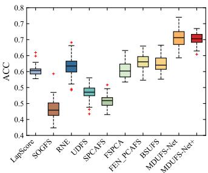  
(a) COIL20

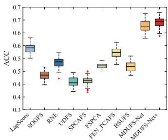  
(b) ISOLET

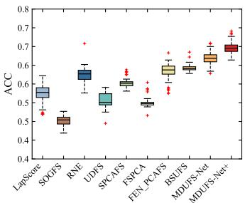  
(c) USPS

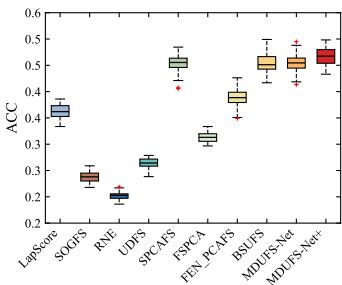  
(d) PIE

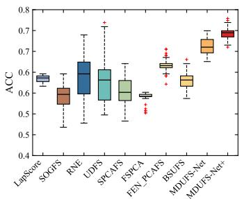  
(e) LUNG

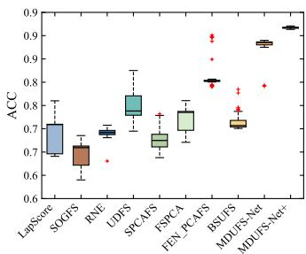  
(f) MSTAR

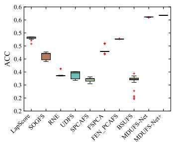  
(g) MNIST

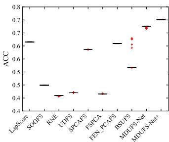  
(h) HAR

Fig. 7. Model stability comparisons of all compared methods on eight real-world datasets.  
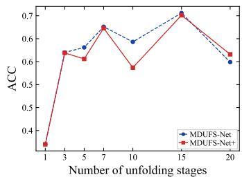  
(a) COIL20

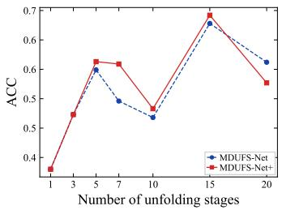  
(b) ISOLET

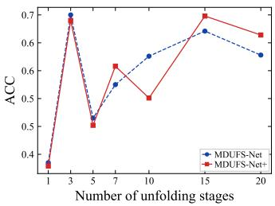

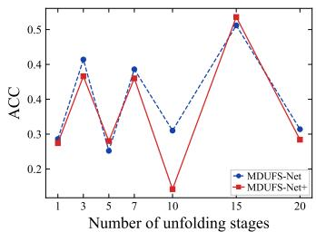

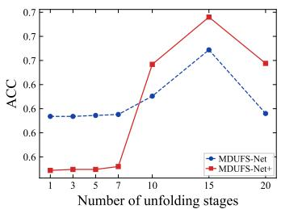  
(e) LUNG

(d) PIE  
  
(f) MSTAR

(c) USPS  
  
(g) MNIST

  
(h) HAR  
Fig. 8. Unfolding sensitivity of stages K on eight real-world datasets.

Here, $" \times "$ indicates the conventional ADMM optimization with fixed parameters, while $" \checkmark "$ denotes our MDUFS-Net+. The results demonstrate that the integration of the deep unfolding strategy leads to consistent improvements in both ACC and NMI across all datasets. Taking the COIL20 dataset as an example, the ACC is improved from 60.81% to 65.23%. Similar gains are observed on the remaining datasets, further validating the effectiveness of the proposed deep unfolding mechanism for feature selection and clustering tasks.

4) Effect of Parameter Learning: To evaluate parameter learning strategies, ablation studies compare shared and stagewise independent parameters, where × and √ denote shared and independent learning, respectively. As shown in Table VII, stage-wise independent learning consistently outperforms parameter sharing. This improvement benefits from the flexible parameter adaptation at different unfolding stages, validating the effectiveness of stage-wise parameter learning in the proposed deep unfolding framework.

## E. Discussions

This section presents a further analysis of our MDUFS-Net and MDUFS-Net+ from three aspects, including model stability, unfolding sensitivity, and computational complexity.

  
(a) COIL20

  
(b) ISOLET

  
(e) LUNG

  
(f) MSTAR  
Fig. 9. Runtime comparisons among different methods on eight real-world datasets.

1) Model Stability: In this experiment, box plots of 50 clustering results are presented in Fig. 7. Our MDUFS-Net and MDUFS-Net+ achieve better ACC performance with more compact result distributions than compared methods. Furthermore, MDUFS-Net+ exhibits improved stability, especially on datasets such as ISOLET and PIE. This improvement is attributed to the $\ell _ { 0 } { \cdot } \mathrm { n o r m }$ , which promotes sparse feature selection and reduces the influence of redundant features.

2) Unfolding Sensitivity: Different numbers of unfolding stages are compared, and the results are shown in Fig. 8. As the number of unfolding stages increases, the performance generally tends to improve and gradually stabilizes when sufficient stages are employed. On most datasets, 15 unfolding stages achieve the best or comparable performance, while some datasets can also obtain competitive results with fewer stages, indicating that fewer unfolding stages are sufficient to obtain effective feature selection results for these datasets. Considering the performance and computational cost, 15 unfolding stages are selected as the default setting.

3) Runtime: Note that the compared methods are implemented in MATLAB and executed on CPU, whereas our methods are implemented in Python with GPU acceleration. As shown in Fig. 9, the computational costs of different methods vary significantly across datasets. Some optimizationbased methods involve iterative optimization procedures, leading to relatively higher runtime. For example, BSUFS and SOGFS exhibit higher computational costs on the PIE and MNIST datasets, respectively, which may be related to factors such as iterative optimization procedures, parameter settings, and implementation environments. In contrast, our proposed MDUFS-Net and MDUFS-Net+ maintain acceptable computational costs across all datasets.

## V. CONCLUSION

This paper presents two novel UFS methods, MDUFS-Net and MDUFS-Net+, by introducing the $\ell _ { 2 , 0 } { \cdot } \mathrm { n o r m }$ and $\ell _ { 0 } -$ norm into PCA. Specifically, the $\ell _ { 2 , 0 } { \ - } \mathrm { n o r m }$ enables feature selection, while the $\ell _ { 0 } { \cdot } \mathrm { n o r m }$ suppresses the influence of redundant feature elements. Moreover, the classical ADMM framework is integrated with deep unfolding to convert the iterative optimization process into a trainable network, thereby reducing the manual parameter tuning required by conventional model-driven methods. Furthermore, the incorporation of the manifold optimization mechanism enhances the stability of the network. Therefore, the proposed methods preserve the advantages of both sparse modeling and deep learning. Experimental results demonstrate that our MDUFS-Net and MDUFS-Net+ achieve effective feature selection performance in terms of ACC and NMI.

  
(c) USPS

  
(d) PIE

  
(g) MNIST

  
(h) HAR

Future work will extend the proposed methods to spiking neural networks [51] to improve the computational efficiency. Furthermore, exploring the integration of large language models with UFS [52] holds the potential to enhance feature selection capabilities on complex datasets.

## REFERENCES

[1] P. Ray, S. S. Reddy, and T. Banerjee, "Various dimension reduction techniques for high dimensional data analysis: A review," Artificial Intelligence Review, vol. 54, no. 5, pp. 3473–3515, 2021.

[2] M. Erhard, M. Krenn, and A. Zeilinger, "Advances in high-dimensional quantum entanglement," Nature Reviews Physics, vol. 2, no. 7, pp. 365– 381, 2020.

[3] G. Li, Z. Yu, K. Yang, M. Lin, and C. P. Chen, "Exploring feature selection with limited labels: A comprehensive survey of semi-supervised and unsupervised approaches," IEEE Transactions on Knowledge and Data Engineering, vol. 36, no. 11, pp. 6124–6144, 2024.

[4] R. Jiao, B. H. Nguyen, B. Xue, and M. Zhang, "A survey on evolutionary multiobjective feature selection in classification: approaches, applications, and challenges," IEEE Transactions on Evolutionary Computation, vol. 28, no. 4, pp. 1156–1176, 2024.

[5] J. Li, K. Cheng, S. Wang, F. Morstatter, R. P. Trevino, J. Tang, and H. Liu, “Feature selection: A data perspective," ACM computing surveys, vol. 50, no. 6, pp. 1–45, 2017.

[6] D. Theng and K. K. Bhoyar, “"Feature selection techniques for machine learning: a survey of more than two decades of research," Knowledge and Information Systems, vol. 66, no. 3, pp. 1575–1637, 2024.

[7] S. Solorio-Fernández, J. A. Carrasco-Ochoa, and J. F. Martínez-Trinidad, “A review of unsupervised feature selection methods," Artificial Intelligence Review, vol. 53, no. 2, pp. 907–948, 2020.

[8] X. He, D. Cai, and P. Niyogi, "Laplacian score for feature selection," Advances in Neural Information Processing Systems, vol. 18, 2005.

[9] Y. Yang, H. T. Shen, Z. Ma, Z. Huang, and X. Zhou, $^ { \dag } \ell _ { 2 , 1 }$ -norm regularized discriminative feature selection for unsupervised learning," in IJCAI International Joint Conference on Artificial Intelligence, 2011.

[10] F. Nie, W. Zhu, and X. Li, "Unsupervised feature selection with structured graph optimization," in Proceedings of the AAAI Conference on Artificial Intelligence, vol. 30, no. 1, 2016.

[11] Y. Liu, D. Ye, W. Li, H. Wang, and Y. Gao, "Robust neighborhood embedding for unsupervised feature selection," Knowledge-Based Systems, vol. 193, p. 105462, 2020.

[12] Z. Li and J. Tang, “Unsupervised feature selection via nonnegative spectral analysis and redundancy control," IEEE Transactions on Image Processing, vol. 24, no. 12, pp. 5343–5355, 2015.

[13] Q. Zhou, Q. Wang, Q. Gao, M. Yang, and X. Gao, "Unsupervised discriminative feature selection via contrastive graph learning," IEEE Transactions on Image Processing, vol. 33, pp. 972–986, 2024.

[14] Y. Li, D. Sun, and L. Zhang, "Unsupervised feature selection via nonnegative orthogonal constrained regularized minimization,"Journal of Machine Learning Research, vol. 27, no. 39, pp. 1–44, 2026.

[15] Z. Shen, Y. Huang, D. Wang, M. Ma, F. Lv, and T. Li, "Causally-aware unsupervised feature selection learning," IEEE Transactions on Image Processing, vol. 35, pp. 1011–1024, 2026.

[16] M. Greenacre, P. J. Groenen, T. Hastie, A. I. d'Enza, A. Markos, and E. Tuzhilina, "Principal component analysis," Nature Reviews Methods Primers, vol. 2, no. 1, p. 100, 2022.

[17] X. Xiu, Z. Miao, and W. Liu, “A sparsity-aware fault diagnosis framework focusing on accurate isolation," IEEE Transactions on Industrial Informatics, vol. 19, no. 2, pp. 1356–1365, 2023.

[18] H. Zou, T. Hastie, and R. Tibshirani, "Sparse principal component analysis," Journal of Computational and Graphical Statistics, vol. 15, no. 2, pp. 265–286, 2006.

[19] Z. Li, F. Nie, J. Bian, D. Wu, and X. Li, "Sparse PCA via $\ell _ { 2 , p } .$ -norm regularization for unsupervised feature selection," IEEE Transactions on Pattern Analysis and Machine Intelligence, vol. 45, no. 4, pp. 5322– 5328, 2023.

[20] F. Nie, L. Tian, R. Wang, and X. Li, "Learning feature-sparse principal subspace," IEEE Transactions on Pattern Analysis and Machine Intelligence, vol. 45, no. 4, pp. 4858–4869, 2023.

[21] Y. Gao, Q. Wu, Z. Xu, C. Cao, J. Pan, G. Shao, F. Nie, and Q. Zhu, "Principal component analysis with fuzzy elastic net for feature selection," IEEE Transactions on Fuzzy Systems, vol. 32, no. 12, pp. 6878–6890, 2024.

[22] X. Xiu, C. Huang, P. Shang, and W. Liu, “Bi-sparse unsupervised feature selection," IEEE Transactions on Image Processing, vol. 34, pp. 7407– 7421, 2025.

[23] J. Liu, X. Ju, X. Xiu, and W. Liu, "Bi-level unsupervised feature selection with $\ell _ { 2 , 0 }$ -norm," Pattern Recognition, p. 114687, 2026.

[24] X. Zhang, J. Zheng, D. Wang, G. Tang, Z. Zhou, and Z. Lin, "Structured sparsity optimization with non-convex surrogates of $\ell _ { 2 , \cdot }$ 0-norm: A unified algorithmic framework,"IEEE Transactions on Pattern Analysis and Machine Intelligence, vol. 45, no. 5, pp. 6386–6402, 2023.

[25] H. Zhang, Y. Gu, F. Nie, and X. Li, “"Top-k feature selection in sparse learning via accelerated coordinate descent method," IEEE Transactions on Pattern Analysis and Machine Intelligence, vol. 48, no. 6, pp. 6880– 6896, 2026.

[26] A. Mirzaei, V. Pourahmadi, M. Soltani, and H. Sheikhzadeh, "Deep feature selection using a teacher-student network," Neurocomputing, vol. 383, pp. 396–408, 2020.

[27] W. Hassanieh and A. Chehade, "Selective deep autoencoder for unsupervised feature selection," in Proceedings of the AAAI Conference on Artificial Intelligence, vol. 38, no. 11, 2024, pp. 12 322–12 330.

[28] Y. Ling, F. Nie, W. Yu, and X. Li, "Self-labeling and self-knowledge distillation unsupervised feature selection,"IEEE Transactions on Knowledge and Data Engineering, vol. 37, no. 7, pp. 4270–4284, 2025.

[29] V. Monga, Y. Li, and Y. C. Eldar, "Algorithm unrolling: Interpretable, efficient deep learning for signal and image processing," IEEE Signal Processing Magazine, vol. 38, no. 2, pp. 18–44, 2021.

[30] T. Chen, X. Chen, W. Chen, H. Heaton, J. Liu, Z. Wang, and W. Yin, "Learning to optimize: A primer and a benchmark," Journal of Machine Learning Research, vol. 23, no. 189, pp. 1–59, 2022.

[31] N. Shlezinger and Y. C. Eldar, "Model-based deep learning," Foundations and Trends in Signal Processing, vol. 17, no. 4, pp. 291–416, 2023.

[32] Z. Guo and H. Gan, "USB-Net: Unfolding split Bregman method with multi-phase feature integration for compressive imaging," IEEE Transactions on Image Processing, vol. 34, pp. 925–938, 2025.

[33] J. Liu, J. Jin, X. Xiu, J. Zhang, and W. Liu, "STAR-Net: An interpretable model-aided network for remote sensing image denoising," Pattern Recognition, p. 112496, 2025.

[34] S. Deka, K. Deka, N. T. Nguyen, S. Sharma, V. Bhatia, and N. Rajatheva, “Comprehensive review of deep unfolding techniques for nextgeneration wireless communication systems," IEEE Internet of Things Journal, vol. 13, no. 6, pp. 10 379–10 406, 2026.

[35] N. Boumal, “An introduction to optimization on smooth manifolds," Cambridge University Press, 2023.

[36] Y. Zhu, W. Liu, X. Xiu, and J. Sun, "Sparse tensor CCA via manifold optimization for multi-view learning," IEEE Transactions on Circuits and Systems for Video Technology, vol. 36, no. 5, pp. 6299–6313, 2026.

[37] Z. Xu, H. Zhang, Y. Wang, X. Chang, and Y. Liang, $^ { * } l _ { 1 / 2 }$ regularization," Science China Information Sciences, vol. 53, no. 6, pp. 1159–1169, 2010.

[38] J. Fan, A. Yan, X. Xiu, and W. Liu, "Robust sparse phase retrieval: statistical guarantee, optimality theory and convergent algorithm," Inverse Problems, vol. 42, no. 4, p. 045014, 2026.

[39] M. Wan, T. Chen, H. Tan, M. Tang, and G. Yang, "Manifold regularized non-negative PCA with robust $\ell _ { 2 , p } .$ -norm enhancement," Pattern Recognition, p. 113195, 2026.

[40] K. Gregor and Y. LeCun, "Learning fast approximations of sparse coding," in Proceedings of the 27th International Conference on International Conference on Machine Learning, 2010, pp. 399–406.

[41] Y. Yang, J. Sun, H. Li, and Z. Xu, "Deep ADMM-Net for compressive sensing MRI," in Advances in Neural Information Processing Systems, 2016, pp. 10–18.

[42] C. Cui, X. Wang, S. Wang, L. Zhang, and Y. Zhong, "Unrolling nonnegative matrix factorization with group sparsity for blind hyperspectral unmixing," IEEE Transactions on Geoscience and Remote Sensing, vol. 61, pp. 1–12, 2023.

[43] B. Joukovsky, Y. C. Eldar, and N. Deligiannis, "Interpretable neural networks for video separation: Deep unfolding RPCA with foreground masking," IEEE Transactions on Image Processing, vol. 33, pp. 108– 122, 2024.

[44] F. Wu, Y. Dai, T. Zhang, Y. Ding, J. Yang, M.-M. Cheng, and Z. Peng, "RPCANet++: Deep interpretable robust PCA for sparse object segmentation," IEEE Transactions on Pattern Analysis and Machine Intelligence, vol. 48, no. 10, pp. 12 420–12 440, 2026.

[45] C. Zhou, Z. He, J. Dong, Y. Li, J. Ren, and A. Plaza, "Low-rank and sparse representation meet deep unfolding: A new interpretable network for hyperspectral change detection," IEEE Transactions on Geoscience and Remote Sensing, vol. 63, pp. 1–16, 2025.

[46] S. Boyd, N. Parikh, E. Chu, B. Peleato, and J. Eckstein, "Distributed optimization and statistical learning via the alternating direction method of multipliers," Foundations and Trends® in Machine learning, vol. 3, no. 1, pp. 1–122, 2011.

[47] S. Schechtman, D. Tiapkin, M. Muehlebach, and E. Moulines, "Orthogonal directions constrained gradient method: from non-linear equality constraints to Stiefel manifold," in The Thirty Sixth Annual Conference on Learning Theory. PMLR, 2023, pp. 1228–1258.

[48] Y. Zhu, X. Xiu, W. Liu, and C. Yin, "Joint sparse subspace clustering via fast l2,0-norm constrained optimization," Expert Systems with Applications, vol. 265, p. 125845, 2025.

[49] S. Foucart, "Hard thresholding pursuit: an algorithm for compressive sensing," SIAM Journal on Numerical Analysis, vol. 49, no. 6, pp. 2543– 2563, 2011.

[50] N. X. Vinh, J. Epps, and J. Bailey, "Information theoretic measures for clusterings comparison: is a correction for chance necessary?" in Proceedings of the 26th Annual International Conference on Machine Learning, 2009, pp. 1073–1080.

[51] Y. Xiao, Q. Yuan, K. Jiang, W. Huang, Q. Zhang, T. Zheng, C.-W. Lin, and L. Zhang, “Spiking meets attention: Efficient remote sensing image super-resolution with attention spiking neural networks," Advances in Neural Information Processing Systems, vol. 38, pp. 65 240–65 259, 2026.

[52] D. P. Jeong, Z. C. Lipton, and P. K. Ravikumar, "LLM-select: Feature selection with large language models," Transactions on Machine Learning Research, 2025.