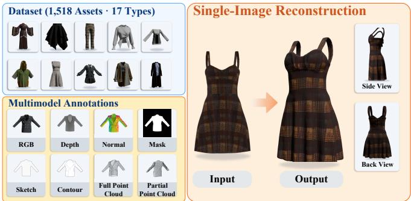
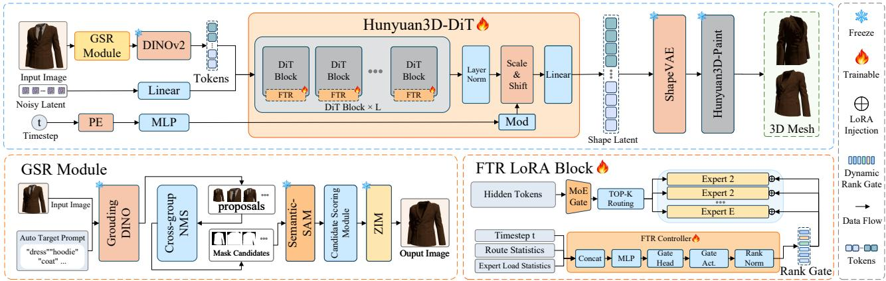
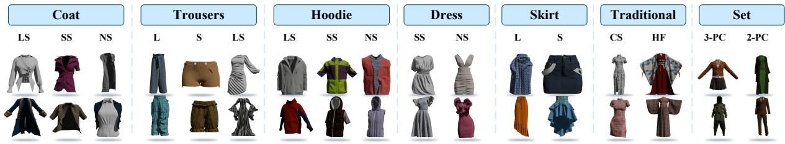
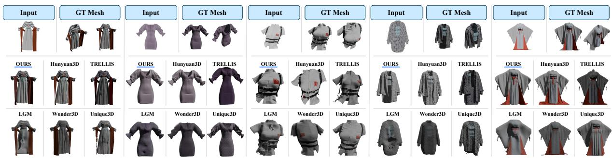

# MAGICGARMENT: BENCHMARKING SINGLE-IMAGE STANDALONE 3D GARMENT RECONSTRUCTION

Jia Chen1,2 Ruyang Zhao1 Jun Bai3∗ Chao Huang1 Saishang Zhong1 Xinrong Hu1

1 School of Computer Science and Artificial Intelligence, Wuhan Textile University, Wuhan 430200, China

2 Engineering Research Center of Hubei Province for Clothing Information, Wuhan Textile University, Wuhan 430200, China 3 School of Computer Science, McGill University, Montreal, QC H3A 0E9, Canada

## ABSTRACT

Single-image 3D reconstruction has advanced rapidly, yet standalone garments remain challenging due to thin-shell geometry, open boundaries, and layered structures. Existing datasets and evaluation protocols provide limited support for systematic evaluation in this setting. We introduce MagicGarment, a benchmark for single-image standalone 3D garment reconstruction with 1,518 professionally constructed assets across 17 composite garment types, aligned multimodal annotations, and a unified evaluation protocol. We further establish a garment-aware reference baseline by adapting a pretrained image-to-3D backbone at two levels: Grounded Semantic Refinement (GSR) provides garmentfocused visual conditioning, while Flow-Time-Route LoRA (FTR-LoRA) adapts the frozen 3D generative backbone using flowtimestep, token-routing, and expert-load information. Experiments demonstrate MagicGarment’s benchmark utility and the effectiveness of garment-aware adaptation. Project page: https: //1019538157.github.io/MagicGarment/.

Index Terms— 3D garment reconstruction, single-image reconstruction, benchmark, low-rank adaptation

## 1. INTRODUCTION

Single-image 3D reconstruction has advanced rapidly through multiview diffusion [1], large reconstruction models [2], and 3D generative priors [3]. However, reconstructing standalone garments from a single image remains particularly challenging. Unlike general rigid objects or clothed humans, garments exhibit thin-shell surfaces, open boundaries, hollow structures, wrinkles, and layered or multi-piece configurations. These properties conflict with generic watertightobject priors, often leading to incorrectly closed necklines, cuffs, and hems. Moreover, clothed-human reconstruction methods [4, 5] typically model garments jointly with the underlying body, making them less suitable for standalone garment reconstruction.

Progress is further constrained by the lack of a unified benchmark for single-image standalone garment reconstruction. Existing datasets, including MGN [6], DeepFashion3D [7], CLOTH3D [8], 4D-DRESS [9], and GarVerseLOD [10], support related tasks such as clothed-human reconstruction and garment modeling, but remain limited for this setting in garment-type coverage, stylized and multi-piece designs, and the consistency of geometry, texture, and multimodal annotations. Differences in task definitions and evaluation protocols further hinder systematic comparison between general-purpose and garment-specific reconstruction methods.

  
Fig. 1. Overview of MagicGarment. Left: representative garment assets and aligned multimodal annotations. Right: the single-image standalone 3D garment reconstruction task.

To address this gap, we introduce MagicGarment, a benchmark for single-image standalone 3D garment reconstruction as illustrated in Fig. 1. It contains 1,518 professionally constructed garment assets across 17 composite garment types, with aligned RGB, mask, depth, normal, text, point-cloud, and 2D-pattern annotations. We further establish a unified benchmark protocol covering geometric accuracy, appearance fidelity, surface orientation, and crossmodal semantic consistency. To provide a strong reference baseline, we adapt a pretrained image-to-3D backbone at two complementary levels: Grounded Semantic Refinement (GSR) refines garmentfocused input conditioning by suppressing human and background interference, while Flow-Time-Route LoRA (FTR-LoRA) transfers the frozen image-to-3D backbone with strong 3D generative priors to the garment domain.

The main contributions of this work are threefold:

• We introduce MagicGarment, a benchmark for single-image standalone 3D garment reconstruction, comprising 1,518 professionally constructed garment assets across 17 composite garment types, aligned multimodal annotations, and a unified evaluation protocol.

• We develop a garment-aware reference baseline that transfers a general-purpose image-to-3D backbone with strong 3D generative priors to the garment domain through GSR and FTR-LoRA at the input and model levels, respectively.

• We systematically benchmark representative garment-specific and general-purpose 3D reconstruction methods under a common protocol, providing evaluation across geometry, appearance, surface orientation, and semantic consistency.

Fig. 2. Overview of the garment-aware reference baseline built on pretrained Hunyuan3D. GSR performs input-level garment refinement, while FTR-LoRA provides model-level adaptation of the frozen Hunyuan3D-DiT backbone.  
  
Fig. 3. Representative 3D garment assets across the 17 composite types in MagicGarment.

Table 1. Comparison of representative 3D garment datasets.
<table><tr><td>Dataset</td><td>Avg. #Vertices #Faces #Types</td><td>Avg.</td><td></td><td>Method</td><td>#Annotations</td></tr><tr><td>MagicGarment</td><td>375,817 665,488</td><td></td><td>17</td><td>Professional 3D artist</td><td>9</td></tr><tr><td>SewFactory</td><td>8,813</td><td>16,834</td><td>13</td><td>modeling Simulation</td><td>3</td></tr><tr><td>CLOTH3D</td><td>7,473</td><td>14,329</td><td>6</td><td>Simulation</td><td>3</td></tr><tr><td>DeepFashion3D</td><td>21,782</td><td>42,613</td><td>10</td><td>Real scans</td><td>4</td></tr><tr><td>GarmentCode v2 14,035</td><td></td><td>26,384</td><td>N/A</td><td>Simulation</td><td>4</td></tr></table>

## 2. MAGICGARMENT BENCHMARK AND REFERENCE BASELINE

## 2.1. MagicGarment Benchmark

Dataset Construction. MagicGarment contains 1,518 standalone 3D garment assets across 17 composite garment types, with representative examples shown in Fig. 3. All assets are professionally constructed using CLO [11]. Specifically, 500 human body models with diverse body shapes and poses are used as supporting forms for garment design and cloth simulation. Professional 3D garment artists create 2D patterns, specify sewing relationships and fabric properties, and perform physically based draping simulation. Only the garment geometry is retained in the final assets, ensuring that the target representation is independent of the human body.

All exported assets undergo manual quality inspection. Samples with missing structures, severe self-intersections, abnormal interpenetrations, or unstable geometry are removed. The retained meshes are converted to a unified right-handed coordinate system and spatially normalized. As summarized in Table 1, MagicGarment provides substantially denser garment geometry and broader garmenttype coverage than several representative existing datasets.

Multimodal Annotations. For each garment asset, MagicGarment provides aligned multi-view RGB images, masks, depth maps, normal maps, contours, sketches, textual descriptions, complete and partial point clouds, and 2D pattern-related information. These annotations jointly characterize garment appearance, geometry, structure, and semantics, enabling both reconstruction benchmarking and downstream garment understanding tasks.

Benchmark Protocol. We define single-image standalone 3D garment reconstruction as the benchmark task. Given a single garment image, a method is required to reconstruct the corresponding standalone 3D garment without access to additional views at inference time. Training, validation, and test sets are split at the garmentasset level to prevent instance overlap. All reconstructed outputs are converted into evaluable meshes and processed using the same coordinate, scale, surface-sampling, and alignment procedures. Evaluation covers four aspects: geometric accuracy, appearance fidelity, surface orientation, and cross-modal semantic consistency.

## 2.2. Garment-Aware Reference Baseline

As illustrated in Fig. 2, our reference baseline is built upon the pretrained Hunyuan3D image-to-3D framework. Given a single garment image, GSR first refines the visual input to obtain garmentfocused conditioning, which is encoded into visual tokens by DI-NOv2. Together with the noisy shape latent and flow timestep, these tokens condition the Hunyuan3D-DiT backbone to generate a 3D shape latent. The resulting latent is decoded by ShapeVAE and further processed by Hunyuan3D-Paint to produce the final textured garment mesh. Within this pipeline, we introduce garmentspecific adaptation at two complementary levels: GSR refines the input conditioning, while FTR-LoRA dynamically adapts the frozen Hunyuan3D-DiT backbone to garment-specific geometry.

  
Fig. 4. Qualitative comparison on MagicGarment. Each example shows the input image, ground-truth mesh, and reconstructions from our garment-aware baseline and representative image-to-3D methods.

Grounded Semantic Refinement (GSR). Natural garment images often contain interference from the human body, background, and shadows, which can bias visual conditioning toward non-garment regions. GSR therefore extracts a garment-focused conditioning image before visual encoding. Given an input image and an automatically generated garment-category prompt, Grounding DINO [12] first localizes candidate garment regions, after which Semantic-SAM [13] generates multi-granularity mask candidates. Rather than relying on a single confidence score, GSR selects the foreground mask by jointly considering semantic consistency, segmentation stability, localization confidence, spatial consistency, and garment structural completeness:

$$
i ^ { \star } = \arg \operatorname* { m a x } _ { i } \left[ w _ { q } q _ { i } + w _ { u } u _ { i } + w _ { b } \psi _ { \mathrm { b o x } } ( C _ { i } ) + w _ { \rho } \rho _ { i } + w _ { s } \psi _ { \mathrm { s t r } } ( C _ { i } ) \right] ,\tag{1}
$$

where $C _ { i }$ is the i-th mask candidate; $q _ { i } , u _ { i } ,$ and $\rho _ { i }$ denote semantic consistency, segmentation stability, and localization confidence, respectively; and $\psi _ { \mathrm { { b o x } } }$ and $\psi _ { \mathrm { s t r } }$ r measure localization consistency and garment structural plausibility.

The selected mask $M ^ { \star } = C _ { i } ,$ is further refined using ZIM (Zero-Shot Image Matting) [14], which produces fine-grained alpha mattes for detailed boundaries such as necklines, cuffs, hems, and cutouts. Among the refinement candidates $A _ { h } ,$ , the final alpha mask is selected as

$$
h ^ { \star } = \arg \operatorname* { m a x } _ { h } \left[ 0 . 7 \mathrm { I o U } ( \mathbb { I } ( A _ { h } > \tau ) , M ^ { \star } ) + 0 . 3 \eta _ { h } \right] ,\tag{2}
$$

where $\eta _ { h }$ denotes the confidence of candidate $A _ { h }$ . The refined alpha mask is combined with the original RGB image to form garmentfocused conditioning, reducing interference from non-garment content during 3D reconstruction.

Flow-Time-Route LoRA (FTR-LoRA). Built upon the pretrained Hunyuan3D-DiT backbone, FTR-LoRA performs lightweight garment-domain adaptation while preserving its generic 3D generative priors. Most backbone parameters are frozen, and adaptation is restricted to low-rank branches and lightweight controller-related parameters. Unlike standard LoRA [15], which applies a static low-rank residual, FTR-LoRA dynamically modulates individual rank channels using the flow timestep, token-level routing state, and sample-level expert-load statistics. We adopt the rank-stabilized scaling of rsLoRA [16].

For token representation $h _ { n } ,$ the MoE router predicts expert probabilities $\pi _ { n }$ and the Top-K expert set $\mathcal { E } _ { n }$ . We summarize token-level routing and sample-level expert usage as

$$
\begin{array} { r l r } & { \pi _ { n } = \mathrm { s o f t m a x } ( W _ { g } h _ { n } ) , \quad } & { \mathcal { E } _ { n } = \mathrm { T o p K } ( \pi _ { n } ) , } \\ & { R _ { n } = [ \pi _ { n } , \mathcal { H } ( \pi _ { n } ) , \pi _ { n , ( 1 ) } - \pi _ { n , ( 2 ) } ] , } \\ & { L _ { b } = [ \hat { \pi } _ { b } , \hat { e } _ { b } ] , \quad } & { \hat { \pi } _ { b } = \displaystyle \frac { 1 } { N } \sum _ { m = 1 } ^ { N } \pi _ { m } , \quad \hat { e } _ { b } = \displaystyle \frac { 1 } { N } \sum _ { m = 1 } ^ { N } e _ { m } . } \end{array}\tag{3}
$$

where $\mathcal { H } ( \cdot )$ denotes routing entropy, $\pi _ { n , ( 1 ) }$ and $\pi _ { n , ( 2 ) }$ are the two largest routing probabilities, and $e _ { m }$ is the multi-hot indicator of the experts selected for token m.

Given the flow timestep $t ,$ token-level route feature $R _ { n } ,$ and sample-level expert-load feature $L _ { b } ,$ a lightweight controller generates the rank-wise gate:

$$
\begin{array} { l } { { c _ { \ell , n } = [ \phi _ { t } ( t ) , \phi _ { r } ( R _ { n } ) , \phi _ { e } ( L _ { b } ) ] , } } \\ { { \displaystyle \Gamma _ { \ell , n } = \sqrt { r _ { \ell } } \frac { 1 + \beta \operatorname { t a n h } ( U _ { \ell } \Phi _ { \ell } ( c _ { \ell , n } ) ) } { \| 1 + \beta \operatorname { t a n h } ( U _ { \ell } \Phi _ { \ell } ( c _ { \ell , n } ) ) \| _ { 2 } + \epsilon } , } } \end{array}\tag{4}
$$

where $\Phi _ { \ell }$ and $U _ { \ell }$ denote the shared controller and layer-specific head, respectively, and $r _ { \ell }$ is the LoRA rank. For a frozen target layer $W _ { \ell } ,$ FTR-LoRA computes

$$
y _ { \ell , n } = W _ { \ell } h _ { n } + \frac { \alpha _ { \ell } } { \sqrt { r _ { \ell } } } B _ { \ell } \left( \Gamma _ { \ell , n } \odot A _ { \ell } h _ { n } \right) ,\tag{5}
$$

where $A _ { \ell }$ and $B _ { \ell }$ are the trainable low-rank projections and $\alpha \ell$ is the scaling coefficient. The dynamic gate therefore adjusts rankwise adaptation according to both the flow stage and routing context, enabling the pretrained 3D prior to better accommodate thin shells, open boundaries, multilayer structures, and fine garment details.

## 3. EXPERIMENTS

## 3.1. Experimental Setup

Baselines. We benchmark representative garment-specific and general-purpose image-to-3D reconstruction methods, including AIpparel [17], ChatGarment [18], InstantMesh [19], CRM [20], LGM [2], One-2-3-45 [21], Unique3D [22], Wonder3D [1], Hunyuan3D-2.1 [23], TRELLIS [3], and TRELLIS.2 [24]. AIpparel and Chat-Garment operate within predefined garment spaces without general texture generation, but are included as garment-specific baselines. All outputs are evaluated under the unified protocol in Sec. 2.1.

Table 2. Zero-shot benchmark results on MagicGarment. U1/U2 denote ULIP-1/2, Uni denotes Uni3D, and I/T denote image/text similarity.
<table><tr><td></td><td colspan="2">Geometry</td><td colspan="3">Appearance</td><td colspan="2">Normal</td><td colspan="6">Semantic</td></tr><tr><td>Method</td><td>CD↓</td><td>F-score↑</td><td>PSNR↑</td><td>SSIM↑</td><td>LPIPS↓</td><td>PSNR-N↑</td><td>LPIPS-N↓</td><td>U1-I↑</td><td>U1-T↑</td><td>U2-I↑</td><td>U2-T↑</td><td>Uni-I↑</td><td>Uni-T↑</td></tr><tr><td>Hunyuan3D-2.1</td><td>4.2322</td><td>12.5148</td><td>17.6060</td><td>0.8193</td><td>0.2294</td><td>16.0559</td><td>0.2386</td><td>0.1139</td><td>0.0612</td><td>0.3975</td><td>0.2845</td><td>0.3411</td><td>0.2601</td></tr><tr><td>AIpparel</td><td>34.4063</td><td>5.0719</td><td>14.1433</td><td>0.7452</td><td>0.4192</td><td>9.5482</td><td>0.4608</td><td>0.0613</td><td>-0.0336</td><td>0.1276</td><td>0.0731</td><td>0.0837</td><td>0.0952</td></tr><tr><td>ChatGarment</td><td>39.4414</td><td>4.6322</td><td>14.1324</td><td>0.7617</td><td>0.4161</td><td>9.8198</td><td>0.4453</td><td>0.0607</td><td>-0.0324</td><td>0.1203</td><td>0.0696</td><td>0.0899</td><td>0.1046</td></tr><tr><td>CRM</td><td>11.5174</td><td>6.5935</td><td>18.5177</td><td>0.8252</td><td>0.2431</td><td>15.3413</td><td>0.2646</td><td>0.1253</td><td>0.0688</td><td>0.3078</td><td>0.2043</td><td>0.2712</td><td>0.1966</td></tr><tr><td>LGM</td><td>16.5124</td><td>5.2953</td><td>18.1696</td><td>0.8254</td><td>0.2531</td><td>15.5809</td><td>0.2594</td><td>0.1392</td><td>0.0599</td><td>0.2844</td><td>0.1855</td><td>0.2487</td><td>0.1987</td></tr><tr><td>One-2-3-45</td><td>31.4587</td><td>3.8417</td><td>12.7375</td><td>0.7986</td><td>0.3299</td><td>14.3821</td><td>0.2976</td><td>0.1177</td><td>0.0229</td><td>0.2248</td><td>0.1441</td><td>0.1868</td><td>0.1753</td></tr><tr><td>InstantMesh</td><td>14.0708</td><td>6.2238</td><td>15.8091</td><td>0.8218</td><td>0.2402</td><td>16.1878</td><td>0.2279</td><td>0.1376</td><td>0.0601</td><td>0.3778</td><td>0.2604</td><td>0.3141</td><td>0.2479</td></tr><tr><td>TRELLIS</td><td>5.9640</td><td>10.1691</td><td>16.4500</td><td>0.7172</td><td>0.3411</td><td>12.0796</td><td>0.3667</td><td>0.1240</td><td>0.0579</td><td>0.3557</td><td>0.2440</td><td>0.3030</td><td>0.2213</td></tr><tr><td>TRELLIS.2</td><td>4.5291</td><td>13.6206</td><td>16.1205</td><td>0.7597</td><td>0.3024</td><td>13.0309</td><td>0.3207</td><td>0.1313</td><td>0.0612</td><td>0.3526</td><td>0.2368</td><td>0.2973</td><td>0.2172</td></tr><tr><td>Unique3D</td><td>17.1257</td><td>6.5459</td><td>12.3284</td><td>0.5479</td><td>0.5425</td><td>8.4922</td><td>0.5804</td><td>0.1266</td><td>0.0583</td><td>0.3135</td><td>0.2077</td><td>0.2532</td><td>0.1796</td></tr><tr><td>Wonder3D</td><td>13.7902</td><td>7.7564</td><td>13.3405</td><td>0.8126</td><td>0.2984</td><td>15.3782</td><td>0.2583</td><td>0.1381</td><td>0.0324</td><td>0.3566</td><td>0.2493</td><td>0.3030</td><td>0.2408</td></tr></table>

Table 3. In-domain adaptation results on MagicGarment. U1/U2 denote ULIP-1/2, Uni denotes Uni3D, and I/T denote image/text similarity.
<table><tr><td></td><td colspan="2">Geometry</td><td colspan="3">Appearance</td><td colspan="2">Normal</td><td colspan="6">Semantic</td></tr><tr><td>Method</td><td>CD↓</td><td>F-score↑</td><td>PSNR↑</td><td>SSIM↑</td><td>LPIPS↓</td><td>PSNR-N↑</td><td>LPIPS-N↓</td><td>U1-I↑</td><td>U1-T↑</td><td>U2-I↑</td><td>U2-T↑</td><td>Uni-I↑</td><td>Uni-T↑</td></tr><tr><td>Hunyuan3D-2.1</td><td>2.7026</td><td>14.0527</td><td>19.0146</td><td>0.8380</td><td>0.1889</td><td>17.6048</td><td>0.2069</td><td>0.1162</td><td>0.0597</td><td>0.3900</td><td>0.2813</td><td>0.3475</td><td>0.2584</td></tr><tr><td>InstantMesh</td><td>11.3486</td><td>8.0174</td><td>17.6216</td><td>0.8475</td><td>0.1962</td><td>18.0185</td><td>0.2140</td><td>0.1402</td><td>0.0586</td><td>0.3751</td><td>0.2657</td><td>0.3198</td><td>0.2455</td></tr><tr><td>TRELLIS</td><td>4.3491</td><td>11.6548</td><td>17.9737</td><td>0.7390</td><td>0.2810</td><td>13.6614</td><td>0.2659</td><td>0.1227</td><td>0.0592</td><td>0.3629</td><td>0.2418</td><td>0.3094</td><td>0.2199</td></tr><tr><td>TRELLIS.2</td><td>3.2618</td><td>15.2347</td><td>17.8024</td><td>0.7824</td><td>0.2518</td><td>14.6542</td><td>0.2292</td><td>0.1334</td><td>0.0599</td><td>0.3588</td><td>0.2342</td><td>0.3035</td><td>0.2156</td></tr><tr><td>Wonder3D</td><td>11.0617</td><td>10.4935</td><td>16.0713</td><td>0.8296</td><td>0.2480</td><td>16.6064</td><td>0.2332</td><td>0.1359</td><td>0.0340</td><td>0.3642</td><td>0.2461</td><td>0.3008</td><td>0.2467</td></tr><tr><td>OURS</td><td>1.8325</td><td>9.0500</td><td>21.1095</td><td>0.8593</td><td>0.1216</td><td>21.7626</td><td>0.0949</td><td>0.1191</td><td>0.0555</td><td>0.4041</td><td>0.2874</td><td>0.3454</td><td>0.2651</td></tr></table>

Metrics. Geometry is evaluated using Chamfer Distance (CD) and F-score with a threshold of 0.01. Appearance fidelity is measured by multi-view PSNR, SSIM, and LPIPS, while surface orientation is evaluated using PSNR-N and LPIPS-N on rendered normal maps. We additionally report image–point-cloud and text–pointcloud similarities using ULIP, ULIP-2, and Uni3D [25, 26, 27] to evaluate cross-modal semantic consistency. All metrics are averaged over the test set.

Implementation. Our reference baseline is trained using AdamW with a learning rate of $1 \times 1 0 ^ { - 5 }$ for 700K steps on four NVIDIA A30 GPUs. At inference, we use 50-step Euler ODE sampling for shape-latent generation.

## 3.2. Zero-Shot Benchmark

Table 2 reports the zero-shot results on MagicGarment. Existing methods exhibit clear trade-offs across different evaluation dimensions. Hunyuan3D-2.1 achieves the lowest CD (4.2322) and LPIPS (0.2294), together with the strongest performance on most ULIP-2 and Uni3D metrics, while TRELLIS.2 obtains the highest F-score (13.6206). CRM performs best in RGB appearance fidelity with a PSNR of 18.5177 and an SSIM of 0.8252, whereas InstantMesh achieves the strongest normal-map reconstruction with a PSNR-N of 16.1878 and an LPIPS-N of 0.2279. These results show that no single method consistently dominates all evaluation dimensions, highlighting the complementary challenges captured by MagicGarment.

## 3.3. In-Domain Adaptation

Table 3 reports the results after adaptation on the MagicGarment training set. Our garment-aware baseline achieves the best performance on 9 of 13 metrics, including CD, PSNR, SSIM, LPIPS, both surface-orientation metrics, ULIP-2 image/text similarity, and Uni3D text similarity. Compared with the adapted Hunyuan3D-2.1 backbone, our method reduces CD from 2.7026 to 1.8325 and LPIPS from 0.1889 to 0.1216, while improving PSNR from 19.0146 to 21.1095 and PSNR-N from 17.6048 to 21.7626. These gains indicate that the proposed garment-specific adaptation substantially improves geometric fidelity, appearance consistency, and surface reconstruction. Meanwhile, TRELLIS.2 achieves the highest F-score, suggesting that different reconstruction objectives still exhibit complementary strengths.

Qualitative Comparison. As shown in Fig. 4, existing methods exhibit visible structural errors around garment openings, thin surfaces, and layered regions. Our garment-aware baseline more consistently preserves the garment silhouette, open boundaries, and local structural details across diverse examples, supporting the quantitative improvements obtained through garment-specific adaptation.

## 4. CONCLUSION

This work introduces MagicGarment, a benchmark for single-image standalone 3D garment reconstruction. Our evaluation reveals substantial performance differences among existing methods, highlighting the distinct challenges posed by garment-specific geometry and the limitations of directly transferring general-purpose 3D reconstruction models. The proposed garment-aware reference baseline further shows the value of domain-specific adaptation. Future work will extend MagicGarment with greater scale, diversity, and more challenging real-world scenarios.

## 5. COMPLIANCE WITH ETHICAL STANDARDS

This study involves no human participants or animal subjects. The human body models are synthetic template-based assets used solely for garment simulation; therefore, no ethical approval was required.

## 6. ACKNOWLEDGEMENTS

This work was supported by the National Natural Science Foundation of China under Grant No. 62202345.

## 7. REFERENCES

[1] Xiaoxiao Long, Yuan-Chen Guo, Cheng Lin, Yuan Liu, Zhiyang Dou, Lingjie Liu, Yuexin Ma, Song-Hai Zhang, Marc Habermann, Christian Theobalt, and Wenping Wang, “Wonder3D: Single image to 3D using cross-domain diffusion,” in CVPR, 2024, pp. 9970–9980.

[2] Jiaxiang Tang, Zhaoxi Chen, Xiaokang Chen, Tengfei Wang, Gang Zeng, and Ziwei Liu, “LGM: Large multi-view gaussian model for high-resolution 3D content creation,” in ECCV, 2024, pp. 1–18.

[3] Jianfeng Xiang, Zelong Lv, Sicheng Xu, Yu Deng, Ruicheng Wang, Bowen Zhang, Dong Chen, Xin Tong, and Jiaolong Yang, “Structured 3D latents for scalable and versatile 3D generation,” in CVPR, 2025, pp. 21469–21480.

[4] Boyi Jiang, Juyong Zhang, Yang Hong, Jinhao Luo, Ligang Liu, and Hujun Bao, “BCNet: Learning body and cloth shape from a single image,” in ECCV, 2020, pp. 18–35.

[5] Luca De Luigi, Ren Li, Benoˆıt Guillard, Mathieu Salzmann, and Pascal Fua, “DrapeNet: Garment generation and selfsupervised draping,” in CVPR, 2023, pp. 1451–1460.

[6] Bharat Lal Bhatnagar, Garvita Tiwari, Christian Theobalt, and Gerard Pons-Moll, “Multi-garment net: Learning to dress 3D people from images,” in ICCV, 2019, pp. 5420–5430.

[7] Heming Zhu, Yu Cao, Hang Jin, Weikai Chen, Dong Du, Zhangye Wang, Shuguang Cui, and Xiaoguang Han, “Deep Fashion3D: A dataset and benchmark for 3D garment reconstruction from single images,” in ECCV, 2020, pp. 512–530.

[8] Hugo Bertiche, Meysam Madadi, and Sergio Escalera, “CLOTH3D: Clothed 3D humans,” in ECCV, 2020, pp. 344– 359.

[9] Wenbo Wang, Hsuan-I Ho, Chen Guo, Boxiang Rong, Artur Grigorev, Jie Song, Juan Jose Zarate, and Otmar Hilliges, “4D-DRESS: A 4D dataset of real-world human clothing with semantic annotations,” in CVPR, 2024, pp. 550–560.

[10] Zhongjin Luo, Haolin Liu, Chenghong Li, Wanghao Du, Zirong Jin, Wanhu Sun, Yinyu Nie, Weikai Chen, and Xiaoguang Han, “GarVerseLOD: High-fidelity 3D garment reconstruction from a single in-the-wild image using a dataset with levels of details,” ACM Transactions on Graphics, vol. 43, no. 6, pp. 1–12, 2024.

[11] CLO Virtual Fashion, “CLO: 3D fashion design software,” https://www.clo3d.com/en/, 2026, Accessed: 2026- 09-24.

[12] Shilong Liu, Zhaoyang Zeng, Tianhe Ren, Feng Li, Hao Zhang, Jie Yang, Qing Jiang, Chunyuan Li, Jianwei Yang, Hang Su, Jun Zhu, and Lei Zhang, “Grounding DINO: Marrying DINO with grounded pre-training for open-set object detection,” in ECCV, 2024, pp. 38–55.

[13] Feng Li, Hao Zhang, Peize Sun, Xueyan Zou, Shilong Liu, Chunyuan Li, Jianwei Yang, Lei Zhang, and Jianfeng Gao, “Segment and recognize anything at any granularity,” in ECCV, 2024, pp. 467–484.

[14] Beomyoung Kim, Chanyong Shin, Joonhyun Jeong, Hyungsik Jung, Se-Yun Lee, Sewhan Chun, Dong-Hyun Hwang, and Joonsang Yu, “ZIM: Zero-shot image matting for anything,” in ICCV, 2025, pp. 23828–23838.

[15] Edward J. Hu, Yelong Shen, Phillip Wallis, Zeyuan Allen-Zhu, Yuanzhi Li, Shean Wang, Lu Wang, and Weizhu Chen, “LoRA: Low-rank adaptation of large language models,” in ICLR, 2022.

[16] Damjan Kalajdzievski, “A rank stabilization scaling factor for fine-tuning with LoRA,” arXiv preprint arXiv:2312.03732, 2023.

[17] Kiyohiro Nakayama, Jan Ackermann, Timur Levent Kesdogan, Yang Zheng, Maria Korosteleva, Olga Sorkine-Hornung, Leonidas J. Guibas, Guandao Yang, and Gordon Wetzstein, “AIpparel: A multimodal foundation model for digital garments,” in CVPR, 2025, pp. 8138–8149.

[18] Siyuan Bian, Chenghao Xu, Yuliang Xiu, Artur Grigorev, Zhen Liu, Cewu Lu, Michael J. Black, and Yao Feng, “ChatGarment: Garment estimation, generation and editing via large language models,” in CVPR, 2025, pp. 2924–2934.

[19] Jiale Xu, Weihao Cheng, Yiming Gao, Xintao Wang, Shenghua Gao, and Ying Shan, “InstantMesh: Efficient 3D mesh generation from a single image with sparse-view large reconstruction models,” arXiv preprint arXiv:2404.07191, 2024.

[20] Zhengyi Wang, Yikai Wang, Yifei Chen, Chendong Xiang, Shuo Chen, Dajiang Yu, Chongxuan Li, Hang Su, and Jun Zhu, “CRM: Single image to 3D textured mesh with convolutional reconstruction model,” in ECCV, 2024, pp. 57–74.

[21] Minghua Liu, Chao Xu, Haian Jin, Linghao Chen, Mukund Varma T, Zexiang Xu, and Hao Su, “One-2-3-45: Any single image to 3d mesh in 45 seconds without per-shape optimization,” Advances in Neural Information Processing Systems, vol. 36, 2024.

[22] Kailu Wu, Fangfu Liu, Zhihan Cai, Runjie Yan, Hanyang Wang, Yating Hu, Yueqi Duan, and Kaisheng Ma, “Unique3D: High-quality and efficient 3D mesh generation from a single image,” in NeurIPS, 2024, vol. 37, pp. 125116–125141.

[23] Tencent Hunyuan3D Team, “Hunyuan3D 2.1: From images to high-fidelity 3D assets with production-ready PBR material,” arXiv preprint arXiv:2506.15442, 2025.

[24] Jianfeng Xiang, Xiaoxue Chen, Sicheng Xu, Ruicheng Wang, Zelong Lv, Yu Deng, Hongyuan Zhu, Yue Dong, Hao Zhao, Nicholas Jing Yuan, and Jiaolong Yang, “Native and compact structured latents for 3D generation,” in CVPR, 2026, pp. 14419–14429.

[25] Le Xue, Mingfei Gao, Chen Xing, Roberto Mart´ın-Mart´ın, Jiajun Wu, Caiming Xiong, Ran Xu, Juan Carlos Niebles, and Silvio Savarese, “ULIP: Learning a unified representation of language, images, and point clouds for 3D understanding,” in CVPR, 2023, pp. 1179–1189.

[26] Le Xue, Ning Yu, Shu Zhang, Artemis Panagopoulou, Junnan Li, Roberto Mart´ın-Mart´ın, Jiajun Wu, Caiming Xiong, Ran Xu, Juan Carlos Niebles, and Silvio Savarese, “ULIP-2: Towards scalable multimodal pre-training for 3D understanding,” in CVPR, 2024, pp. 27091–27101.

[27] Junsheng Zhou, Jinsheng Wang, Baorui Ma, Yu-Shen Liu, Tiejun Huang, and Xinlong Wang, “Uni3D: Exploring unified 3D representation at scale,” in ICLR, 2024.