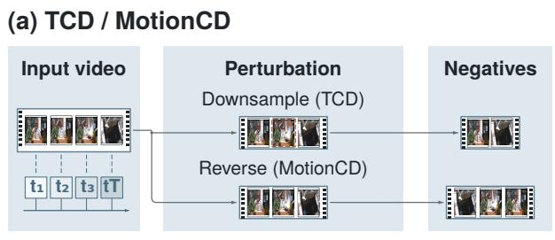
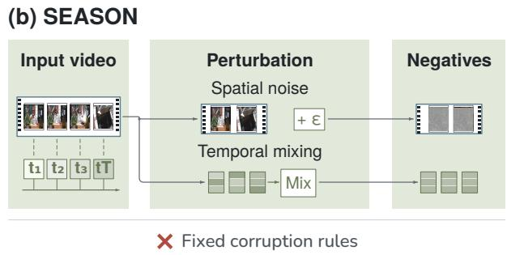
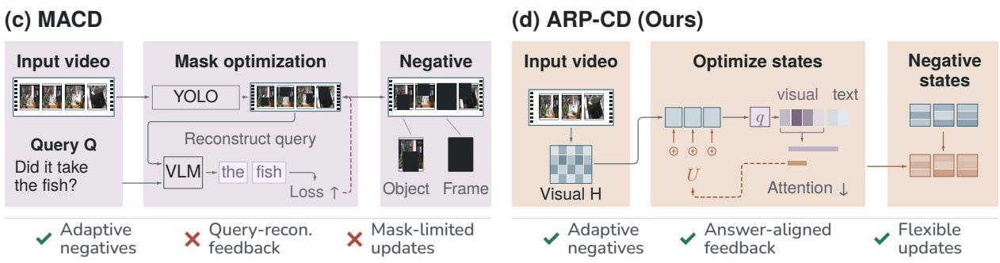
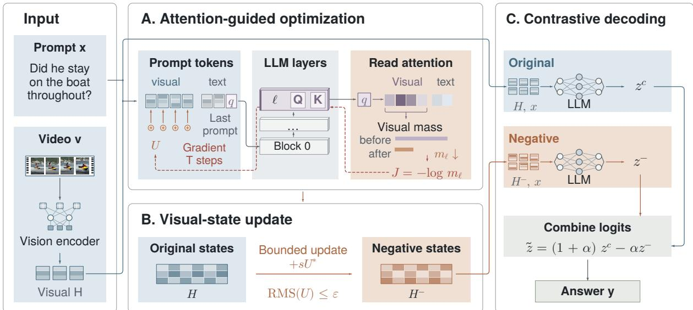

# Mitigating Video Hallucinations via Attention-Guided Representation Perturbation

Zhixin Cai1\*, Ruoqi Yuan1\*, Xinchen Yang1, Zhuofan Chen1, Jun Bai2, Chuantao Yin3, Wenge Rong1

1School of Computer Science and Engineering, Beihang University 2Beijing Institute for General Artificial Intelligence, BIGAI 3Sino-French Engineer School, Beihang University

## Abstract

Video large language models (Video LLMs) often generate responses unsupported by the input video. Contrastive decoding (CD) can mitigate these hallucinations, but its effectiveness depends on how the negative branch weakens visual evidence. Existing methods rely on predefined perturbations or masking guided by question reconstruction, offering limited control over the model’s visual reliance during answer generation. We introduce Attention-guided Representation Perturbation for Contrastive Decoding (ARP-CD), a training-free framework for constructing contrastive negatives directly in representation space. ARP-CD uses the attention mass assigned to visual tokens at the answer-prediction position to guide bounded gradient updates of the language model’s input visual hidden states. These updates reduce visual attention and produce a negative input, whose predictions are contrasted with those of the original branch throughout generation. Experiments across four Video LLMs and four benchmarks show that ARP-CD outperforms representative training-free baselines in most model– benchmark settings, reducing hallucinations while improving general video understanding. Further analyses show that attention-guided perturbation directions improve negative quality and that the resulting negatives provide effective contrastive references for correcting the original predictions.

## 1 Introduction

Video LLMs have made substantial progress in video understanding, demonstrating strong performance across tasks such as video question answering, captioning, and reasoning (Maaz et al., 2024; Bai et al., 2025). Despite this progress, they still exhibit hallucinations, producing responses that are unsupported by or inconsistent with the visual evidence in the input video (Wang et al., 2024; Li et al.,

2025). Such hallucinations undermine the reliability of video understanding and can lead to incorrect decisions in downstream applications (Zhou et al., 2026). Mitigating hallucinations and strengthening visual grounding are therefore crucial for reliable downstream use, including model-assisted evaluation of generated videos (Zhang et al., 2024a; Wu et al., 2026b).

Training-based methods mitigate hallucinations through architectural adaptations, contrastive video–text alignment, and reinforcement learning (Ma et al., 2024; Chang et al., 2026; Zhang et al., 2026). However, they incur substantial training costs and additional overhead for curating highquality supervision (Huang et al., 2025; Cai et al., 2025). This motivates training-free methods that bypass these costs through inference-time intervention (Huang et al., 2024; Li et al., 2025). Among these approaches, CD has emerged as an effective strategy for mitigating video hallucinations (Wu et al., 2026a).

CD favors predictions whose likelihood decreases under weakened visual evidence, making its effectiveness critically dependent on how the negative branch attenuates that evidence (Suo et al., 2025). As shown in Figure 1, existing methods construct negative branches through predefined spatial or temporal perturbations, with limited adaptation to the model’s visual dependencies (Kong et al., 2025). MACD introduces model feedback by using query reconstruction to guide object and frame masking (Xiao and Zhou, 2026). However, this reconstruction objective targets question-token prediction rather than directly measuring the model’s visual reliance during answer generation (Xiao and Zhou, 2026). Moreover, its object and frame masks constrain intervention to content-space transformations, offering less direct control over the hidden representations used for generation than representation-level editing (Xiao and Zhou, 2026; Liu et al., 2025; Cai et al., 2025).

  
Fixed temporal perturbations

  
Figure 1: Comparison of negative branch construction in video contrastive decoding. (a) TCD downsamples frames, while MotionCD combines predictions from forward and reversed videos (Zhang et al., 2024a; Kong et al., 2025). (b) SEASON constructs spatial and temporal negatives through noise injection and temporal feature homogenization (Wu et al., 2026a). (c) MACD optimizes object and frame masks using query reconstruction feedback (Xiao and Zhou, 2026). (d) ARP-CD uses attention gradients to optimize visual hidden states, reducing attention to visual tokens at the answer-prediction position.

Visual attention at the generation position provides an internal signal of the model’s engagement with visual evidence during answer prediction (Huo et al., 2025; Xing et al., 2026). Prior work has associated insufficient visual attention with hallucinated responses, suggesting it captures the visual reliance that CD aims to modulate (Huang et al., 2024; Liu et al., 2024). Suppressing attention to informative visual tokens can produce useful contrastive negatives by weakening visual conditioning (Huo et al., 2025; Wang et al., 2026b). Task-guided embedding transformations and targeted feature edits further demonstrate that model behavior can be shaped directly in representation space (Zhang et al., 2025; Cai et al., 2026). In vision–language models, representation-level interventions enable fine-grained adjustments to the features used for generation, including adaptations to model- and input-specific signals (Liu et al., 2025; Cai et al., 2025; Wang et al., 2026a).

Building on this insight, we introduce ARP-CD, a training-free contrastive decoding framework that constructs negative branches through attentionguided representation perturbation. For each video– prompt pair, ARP-CD uses the attention mass allocated to visual tokens at the answer-prediction position as an internal optimization signal. Using the gradients of this signal, it iteratively updates the language model’s input visual hidden states within a bounded perturbation budget to reduce visual attention. The optimized hidden states serve as the input to the negative branch. CD contrasts predictions from this branch with those of the original branch to favor responses supported by video evidence, thereby mitigating hallucinations.

We evaluate ARP-CD across four Video LLMs and four benchmarks. The results show that ARP-CD outperforms representative training-free baselines in most model–benchmark settings, reducing hallucinations while also improving general video understanding. Ablation studies show that attention-guided optimization selects perturbation directions that produce more effective contrastive negatives. Further analyses show that the optimized representations improve generation through the corrective contrast they create with the original branch. Together, these findings support using the model’s visual engagement during answer generation to guide negative construction in representation space.

## 2 Related Work

## 2.1 Video Hallucination Mitigation

Video hallucination encompasses unsupported claims about objects and events, incorrect temporal relations, and facts beyond the video evidence, motivating dedicated evaluation in VideoHallucer, EventHallusion, and VidHalluc (Wang et al., 2024; Zhang et al., 2024a; Li et al., 2025). Training-based approaches improve grounding through changes to visual attention and temporal aggregation, or through contrastive video–text alignment (Ma et al., 2024; Chang et al., 2026). VistaDPO and PaMi-VDPO use hierarchical and prompt-aware preference learning, respectively, to improve video– response alignment (Huang et al., 2025; Ding et al., 2025). Training-free approaches intervene during inference; DINO-HEAL, for example, reweights visual features using spatial saliency from DI-NOv2 (Li et al., 2025). Our work studies negative construction for contrastive decoding with frozen Video LLMs.

## 2.2 Contrastive Decoding for Video LLMs

Contrastive decoding uses differences between model predictions to adjust token preferences, with VCD applying this principle to original and noisecorrupted images (Li et al., 2023; Leng et al., 2024). Video methods adapt negative construction to temporal information, with TCD downsampling frames and MotionCD combining predictions from forward and reversed videos to suppress motion cues (Zhang et al., 2024a; Kong et al., 2025). SEASON constructs temporal negatives through feature homogenization and spatial negatives through noise injection, then uses attention divergence to weight their contrastive contributions for each generated token (Wu et al., 2026a). MACD optimizes object and frame masking strengths using gradients of query reconstruction loss, adapting the counterfactual video to the model and question (Xiao and Zhou, 2026). ARP-CD optimizes the negative in visual representation space, using attention at the answer-prediction position as the signal for bounded updates of the input visual hidden states.

## 2.3 Attention and Representation Intervention

In image-based LVLMs, PAI increases attention to image tokens, while SID retains less informative visual tokens and ASCD directly steers attention to form contrastive predictions (Liu et al., 2024; Huo et al., 2025; Wang et al., 2026b). For Video LLMs, VADER adaptively reallocates attention and constructs a contrastive branch by erasing important visual tokens within each frame (Xing et al., 2026).

Representation editing offers another form of inference-time intervention. VTI steers visual and textual latent representations, while AFTER combines factual steering vectors with queryadaptive offsets (Liu et al., 2025; Wang et al., 2026a). In video models, TA-AE selects and edits hallucination-sensitive internal modules according to temporal variation (Cai et al., 2025). ARP-CD uses attention as a differentiable objective for perinput visual-state perturbations, integrating attention guidance, bounded representation updates, and contrastive decoding in a single procedure.

## 3 Method

ARP-CD combines attention-guided representation perturbation (ARP) with contrastive decoding (CD), as shown in Figure 2. For each video–prompt pair, ARP constructs a negative representation by optimizing the input visual hidden states to reduce visual attention at the answer-prediction position. CD then combines predictions from the original and optimized representations throughout answer generation.

## 3.1 Preliminaries

Video-conditioned generation. Let v be a video and x its text prompt. The visual encoder and projection or merger module map the frames to visual hidden states $H \in \mathbb { R } ^ { N \times d }$ at the language-model input, where N is the number of visual patch tokens and d is the hidden dimension. The model with parameters $\theta$ generates an answer y autoregressively:

$$
p _ { \theta } ( y \mid H , x ) = \prod _ { t = 1 } ^ { | y | } p _ { \theta } ( y _ { t } \mid H , x , y _ { < t } ) .\tag{1}
$$

Contrastive decoding. Contrastive decoding adjusts token preferences using predictions from an original branch and an auxiliary negative branch. Let $H ^ { - }$ denote the negative visual representation, and let $\boldsymbol { z } _ { t } ^ { c }$ and $z _ { t } ^ { - }$ be the logits obtained from H and $H ^ { - }$ under the same prompt $x$ and generated prefix $y _ { < t }$ . The contrastive score is

$$
\widetilde { z } _ { t } ( w ) = ( 1 + \alpha ) z _ { t } ^ { c } ( w ) - \alpha z _ { t } ^ { - } ( w ) ,\tag{2}
$$

where $\alpha \geq 0$ controls the correction strength. A plausibility constraint retains tokens supported by

  
Figure 2: Overview of ARP-CD. (A) We reduce attention from the last prompt token to visual patches by backpropagating the attention objective from a selected decoder layer to the input perturbation. (B) Bounded perturbations of the input visual hidden states produce a negative representation. (C) CD combines predictions from the original and negative branches.

the original distribution $p _ { t } ^ { c } = \mathrm { s o f t m a x } ( z _ { t } ^ { c } )$ :

$$
\mathcal { C } _ { t } = \left\{ w : \frac { p _ { t } ^ { c } ( w ) } { \operatorname* { m a x } _ { u } p _ { t } ^ { c } ( u ) } \geq \beta \right\} , 0 < \beta \leq 1 .\tag{3}
$$

## 3.2 Visual Attention Objective

We use attention to visual patches as an internal proxy for visual engagement during answer prediction. For a candidate representation $H ^ { \prime }$ , we process the complete multimodal prompt and observe attention at decoder layer ℓ for the last valid prompt position $q ,$ which is used to predict the first answer token. Let $\textstyle { \mathcal { K } } _ { q }$ be the key positions allowed by the model’s native attention mask, and $\nu \subseteq \kappa _ { q }$ the visible visual patch positions. For head $h ,$ with query $Q _ { q } ^ { ( \ell , h ) }$ , key $K _ { j } ^ { ( \ell , h ) }$ , and head dimension $d _ { h }$ the attention weights are

$$
A _ { q j } ^ { ( \ell , h ) } = \mathrm { s o f t m a x } _ { j \in { \mathcal { K } _ { q } } } \left( \frac { Q _ { q } ^ { ( \ell , h ) } K _ { j } ^ { ( \ell , h ) \top } } { \sqrt { d _ { h } } } \right) .\tag{4}
$$

We define $m _ { \ell }$ as the fraction of attention allocated to visual patches, averaged over all $n _ { h }$ query heads:

$$
m _ { \ell } ( H ^ { \prime } , x ) = \frac { 1 } { n _ { h } } \sum _ { h = 1 } ^ { n _ { h } } \sum _ { j \in \mathcal { V } } A _ { q j } ^ { ( \ell , h ) } .\tag{5}
$$

ARP-CD seeks a nearby representation with lower visual attention by maximizing

$$
J ( H ^ { \prime } ; x ) = - \log m _ { \ell } ( H ^ { \prime } , x ) .\tag{6}
$$

Maximizing J reduces the mean visual attention mass; the logarithm is applied after averaging across heads.

## 3.3 Attention-Guided Representation Perturbation

Parameterization. We parameterize the candidate visual states as

$$
s = \operatorname { R M S } ( H ) , \qquad H ( U ) = H + s U ,\tag{7}
$$

where $\begin{array} { r } { \mathrm { R M S } ( X ) = \sqrt { \frac { 1 } { | X | } \sum _ { i } X _ { i } ^ { 2 } } } \end{array}$ and $| X |$ is the number of scalar entries in X. We optimize the dimensionless perturbation $U \in \mathbb { R } ^ { N \times d }$ subject to a budget $\epsilon > 0 :$

$$
\operatorname* { m a x } _ { U : \mathrm { R M S } ( U ) \leq \epsilon } J ( H + s U ; x ) .\tag{8}
$$

We impose this relative RMS constraint to limit excessive representational distortion and maintain an informative contrast with the original branch. Text and special-token embeddings are excluded from the perturbation.

Projected gradient updates. We backpropagate the attention objective from layer ℓ to the input perturbation U. Starting from $U _ { 0 } = 0$ , we perform up to $T$ steps of RMS-normalized projected gradient ascent:

$$
G _ { k } = \nabla _ { U _ { k } } J ( H + s U _ { k } ; x ) ,\tag{9}
$$

$$
\widehat { U } _ { k + 1 } = U _ { k } + \eta \frac { G _ { k } } { \mathrm { R M S } ( G _ { k } ) } ,\tag{10}
$$

$$
U _ { k + 1 } = \frac { \widehat { U } _ { k + 1 } } { \operatorname* { m a x } \Big ( 1 , \mathrm { R M S } ( \widehat { U } _ { k + 1 } ) / \epsilon \Big ) } ,\tag{11}
$$

<table><tr><td rowspan="2">Model</td><td rowspan="2">Method</td><td colspan="2">Hallucination</td><td colspan="2">General Understanding</td></tr><tr><td>VideoHallucer</td><td>EventHallusion</td><td>Video-MME</td><td>MVBench</td></tr><tr><td rowspan="6">Qwen2.5-VL-3B</td><td>Vanilla</td><td>46.51</td><td>40.23</td><td>51.85</td><td>58.83</td></tr><tr><td>DINO-HEAL</td><td>47.31</td><td>40.65</td><td>51.89</td><td>59.18</td></tr><tr><td>TCD</td><td>43.52</td><td>43.04</td><td>52.00</td><td>59.40</td></tr><tr><td>MotionCD</td><td>36.35</td><td>43.46</td><td>45.44</td><td>52.95</td></tr><tr><td>MACD</td><td>44.31</td><td>40.93</td><td>50.56</td><td>57.63</td></tr><tr><td>ARP-CD (Ours)</td><td>48.01</td><td>51.48</td><td>52.48</td><td>59.55</td></tr><tr><td rowspan="6">Qwen2.5-VL-7B</td><td>Vanilla</td><td>51.96</td><td>49.23</td><td>53.52</td><td>60.40</td></tr><tr><td>DINO-HEAL</td><td>52.26</td><td>49.51</td><td>53.89</td><td>60.50</td></tr><tr><td>TCD</td><td>51.62</td><td>51.34</td><td>53.93</td><td>60.60</td></tr><tr><td>MotionCD</td><td>44.39</td><td>52.74</td><td>46.48</td><td>54.35</td></tr><tr><td>MACD</td><td>47.33</td><td>51.20</td><td>52.35</td><td>58.68</td></tr><tr><td>ARP-CD (Ours)</td><td>53.30</td><td>52.32</td><td>54.59</td><td>60.73</td></tr><tr><td rowspan="6">Video-LLaVA-7B</td><td>Vanilla</td><td>27.93</td><td>23.35</td><td>26.19</td><td>43.68</td></tr><tr><td>DINO-HEAL</td><td>28.23</td><td>23.35</td><td>27.30</td><td>43.30</td></tr><tr><td>TCD</td><td>27.00</td><td>24.75</td><td>26.56</td><td>42.63</td></tr><tr><td>MotionCD</td><td>24.09</td><td>36.57</td><td>28.94</td><td>40.45</td></tr><tr><td>MACD</td><td>27.73</td><td>25.88</td><td>28.64</td><td>42.53</td></tr><tr><td>ARP-CD (Ours)</td><td>31.95</td><td>35.16</td><td>32.91</td><td>43.88</td></tr><tr><td rowspan="6">LLaVA-NeXT-Video-7B</td><td>Vanilla</td><td>26.41</td><td>32.91</td><td>29.89</td><td>43.55</td></tr><tr><td>DINO-HEAL</td><td>26.21</td><td>33.19</td><td>30.00</td><td>42.58</td></tr><tr><td>TCD</td><td>24.51</td><td>34.88</td><td>30.96</td><td>43.73</td></tr><tr><td>MotionCD</td><td>22.60</td><td>34.46</td><td>32.16</td><td>41.13</td></tr><tr><td>MACD</td><td>23.21</td><td>38.54</td><td>31.65</td><td>44.80</td></tr><tr><td>ARP-CD (Ours)</td><td>25.72</td><td>52.18</td><td>37.04</td><td>44.48</td></tr></table>

Table 1: Main results (%). EventHallusion reports the count-weighted aggregate of selection and description scores. Within each model and benchmark, the best scores are bold with darker blue shading, and the second-best are underlined with lighter blue shading.

where η is the step size. RMS normalization makes the update scale independent of the raw gradient magnitude, while projection keeps the accumulated perturbation within the budget. We form the negative representation $H ^ { - } = H { + } s U ^ { \star }$ using the iterate with the highest objective value, retaining vanilla decoding if optimization yields no improvement.

## 3.4 Contrastive Generation

For each video–prompt pair, we optimize the negative representation H− once and keep the input perturbation fixed throughout generation. At each decoding step, we combine the logits of the original and negative branches using Eq. 2 and restrict candidates using Eq. 3. After applying the checkpoint’s decoding processors, we select the highestscoring token and append it to the shared answer prefix.

## 4 Experiments

## 4.1 Experimental Setup

Backbones. We evaluate four Video LLMs spanning different model scales and architectures:

Qwen2.5-VL-3B and -7B (Bai et al., 2025), Video-LLaVA-7B (Lin et al., 2024), and LLaVA-NeXT-Video-7B (Zhang et al., 2024b).

Benchmarks. We evaluate hallucination mitigation on VideoHallucer (VH; Wang et al. 2024), which covers five hallucination categories, and EventHallusion (EH; Zhang et al. 2024a), which assesses event hallucinations through selection and description tasks. For general video understanding, Video-MME (Fu et al., 2025) spans short, medium, and long videos, while MVBench (Li et al., 2024) covers 20 diverse tasks.

Baselines. We compare ARP-CD with vanilla decoding and four representative training-free baselines: DINO-HEAL (Li et al., 2025), TCD (Zhang et al., 2024a), MotionCD (Kong et al., 2025), and MACD (Xiao and Zhou, 2026). These cover saliency-based feature enhancement, temporal perturbations, and mask-based negative construction.

<table><tr><td>Model</td><td>Method</td><td>VideoHallucer</td><td>EventHallusion</td><td>Video-MME</td><td>MVBench</td></tr><tr><td rowspan="5">Qwen2.5-VL-3B</td><td>IsoPert</td><td>46.10</td><td>41.35</td><td>51.89</td><td>59.00</td></tr><tr><td>RadCon</td><td>46.60</td><td>41.35</td><td>51.96</td><td>58.85</td></tr><tr><td>QueryRec</td><td>46.25</td><td>38.68</td><td>52.15</td><td>59.23</td></tr><tr><td>AttnCal</td><td>46.92</td><td>38.12</td><td>51.74</td><td>58.93</td></tr><tr><td>ARP-CD (Ours)</td><td>48.01</td><td>51.48</td><td>52.48</td><td>59.55</td></tr><tr><td rowspan="5">Video-LLaVA-7B</td><td>IsoPert</td><td>29.23</td><td>23.63</td><td>27.22</td><td>43.68</td></tr><tr><td>RadCon</td><td>29.15</td><td>22.36</td><td>27.11</td><td>43.65</td></tr><tr><td>QueryRec</td><td>29.01</td><td>26.72</td><td>29.34</td><td>43.65</td></tr><tr><td>AttnCal</td><td>27.11</td><td>26.02</td><td>27.33</td><td>43.65</td></tr><tr><td>ARP-CD (Ours)</td><td>31.95</td><td>35.16</td><td>32.91</td><td>43.88</td></tr></table>

Table 2: Ablation results for negative construction (%). Within each model and benchmark, the best scores are bold with blue shading.

## 4.2 Main Results

Table 1 compares ARP-CD with the baselines across four models and four benchmarks. ARP-CD achieves the best score in 12 of the 16 model– benchmark settings and ranks second in three others, demonstrating its effectiveness across models and tasks.

Hallucination mitigation. On VideoHallucer, ARP-CD exceeds the strongest baseline by 0.70, 1.04, and 3.71 percentage points (pp) for Qwen2.5- VL-3B, Qwen2.5-VL-7B, and Video-LLaVA, respectively. For LLaVA-NeXT, all evaluated interventions underperform vanilla decoding on Video-Hallucer. On EventHallusion, it leads for Qwen2.5- VL-3B and LLaVA-NeXT, with gains of 8.02 and 13.64 pp over the strongest baseline, and ranks second for the other two models.

General video understanding. ARP-CD achieves the highest Video-MME score on every backbone, improving over the strongest baseline by 0.48–4.88 pp. On MVBench, it leads for both Qwen sizes and Video-LLaVA and ranks second for LLaVA-NeXT, with gains of 0.20–0.93 pp over Vanilla.

Together, these results demonstrate the effectiveness of attention-guided negative construction across model architectures, supporting both hallucination mitigation and general video understanding.

## 4.3 Attention-Guided Negative Construction

To understand what makes ARP-CD’s negatives effective, we isolate the roles of perturbation direction, optimization objective, and attention reduction.

Perturbation direction. Isotropic Perturbation (IsoPert) replaces the optimized direction with a

Gaussian direction, while Radial Contraction (Rad-Con) scales the visual states toward the origin. Both match ARP-CD’s realized relative RMS separately for each example, isolating the effect of direction at a fixed displacement magnitude.

Optimization objective. Query Reconstruction (QueryRec) replaces the attention objective with MACD’s query-reconstruction loss, maximizing the mean next-token negative log-likelihood of the input instruction (Xiao and Zhou, 2026). This comparison tests whether targeting visual reliance during answer generation yields more effective negatives than optimizing question reconstruction.

Attention reduction. Attention Calibration (AttnCal) subtracts a scalar bias from visual-key attention logits at layer ℓ. The bias is calibrated to match ARP-CD’s visual attention mass at position q for each example and remains fixed during negative-branch decoding. This separates the observed attention reduction from the representation updates used to achieve it.

Table 2 shows that ARP-CD outperforms all four controls. The comparisons with IsoPert and Rad-Con demonstrate the value of attention-guided directions. The advantage over QueryRec further supports using answer-position attention to guide representation optimization. AttnCal matches the attention target but yields lower scores, showing that the representation changes induced by optimization contribute beyond the resulting attention mass.

Together, these comparisons show that attentionguided directions improve negative quality beyond perturbation magnitude and attention reduction.

<table><tr><td rowspan="2">Attention modulation</td><td rowspan="2">Generation</td><td colspan="2">Qwen2.5-VL-3B</td><td colspan="2">Video-LLaVA-7B</td></tr><tr><td>VideoHallucer</td><td>Video-MME</td><td>VideoHallucer</td><td>Video-MME</td></tr><tr><td>Unmodified</td><td>Direct</td><td>46.51</td><td>51.85</td><td>27.93</td><td>26.19</td></tr><tr><td>Suppress (↓)</td><td>Contrast (ARP-CD, Ours)</td><td>48.01</td><td>52.48</td><td>31.95</td><td>32.91</td></tr><tr><td>Enhance (↑)</td><td>Contrast</td><td>44.17</td><td>51.96</td><td>29.04</td><td>26.46</td></tr><tr><td>Suppress (↓)</td><td>Direct</td><td>45.02</td><td>51.21</td><td>27.86</td><td>26.08</td></tr><tr><td>Enhance (↑)</td><td>Direct</td><td>45.73</td><td>51.33</td><td>25.80</td><td>28.89</td></tr></table>

Table 3: Attention modulation and generation strategy (%). Contrast uses the optimized representations as a negative branch; Direct generates from them alone. Within each model and benchmark, the best scores are bold with blue shading.
<table><tr><td rowspan="2">Model</td><td rowspan="2">Method</td><td colspan="2">VideoHallucer</td><td colspan="2">Video-MME</td></tr><tr><td>Retained (%)</td><td>Mean D</td><td>Retained (%)</td><td>Mean D</td></tr><tr><td rowspan="5">Qwen2.5-VL-3B</td><td>IsoPert</td><td>100.00</td><td>-0.0025</td><td>100.01</td><td>-0.0030</td></tr><tr><td>RadCon</td><td>100.28</td><td>-0.0031</td><td>100.15</td><td>-0.0014</td></tr><tr><td>QueryRec</td><td>103.09</td><td>-0.0019</td><td>126.02</td><td>0.0102</td></tr><tr><td>AttnCal</td><td>44.42</td><td>-0.0036</td><td>9.69</td><td>-0.0038</td></tr><tr><td>ARP-CD (Ours)</td><td>44.42</td><td>0.0175</td><td>9.69</td><td>0.0208</td></tr><tr><td rowspan="5">Video-LLaVA-7B</td><td>IsoPert</td><td>100.00</td><td>-0.0002</td><td>100.00</td><td>0.0001</td></tr><tr><td>RadCon</td><td>100.18</td><td>-0.0002</td><td>100.20</td><td>0.0003</td></tr><tr><td>QueryRec</td><td>97.34</td><td>-0.0055</td><td>101.81</td><td>0.0244</td></tr><tr><td>AttnCal</td><td>59.12</td><td>-0.0019</td><td>54.75</td><td>0.0004</td></tr><tr><td>ARP-CD (Ours)</td><td>59.12</td><td>0.0046</td><td>54.75</td><td>0.0722</td></tr></table>

Table 4: First-token contrastive effects on candidate pairs retained by the original branch’s plausibility mask. Retained is the median negative-to-original visual attention ratio; mean D measures the logit-margin correction per unit α in raw logit units. The largest mean D values are bold with blue shading.

## 4.4 Attention Modulation and Generation Strategy

We next separate the effect of changing visual attention from the way the optimized representation is used for generation. We cross attention suppression or enhancement with contrastive decoding or direct generation. Unlike ARP-CD, which maximizes − log mℓ to suppress visual attention, the enhancement condition maximizes + log mℓ to increase it. Direct generation decodes from the optimized states alone. Vanilla decoding serves as the common reference. Table 3 summarizes the results.

In all settings, directly generating from attentionsuppressed representations underperforms Vanilla, whereas using them as the negative branch in CD (ARP-CD) outperforms all other conditions. This reversal shows that attention-guided degradation creates an informative contrast that CD can exploit to correct the original predictions.

Although using the attention-enhanced branch for CD improves over Vanilla in three of the four settings, direct generation from the same representations lowers performance in most settings. This seemingly counterintuitive result suggests that increasing total visual attention does not necessarily improve the use of relevant evidence. A plausible explanation is that the additional attention is allocated to visual content unrelated to the question, interfering with answer generation (Kang et al., 2025). The enhanced branch can still provide a useful contrastive reference for correcting the original predictions.

These results support ARP-CD’s use of attention-suppressed representations as corrective references, showing that their contrastive value differs from their standalone predictive quality.

## 4.5 Mechanistic Analysis

We examine how representation perturbation shapes the logit correction in contrastive decoding, comparing ARP-CD with the ablation controls. For each question, let a be the correct answer token and b the highest-scoring incorrect answer token under the original branch. We use the same pair across methods and define its logit margin as the score of a minus that of b. For the original and negative branches, respectively,

<table><tr><td rowspan="2">Model</td><td rowspan="2">Method</td><td colspan="2">VideoHallucer</td><td colspan="2">Video-MME</td></tr><tr><td>Time (s)</td><td>×Vanilla</td><td>Time (s)</td><td>×Vanilla</td></tr><tr><td rowspan="6">Qwen2.5-VL-3B</td><td>Vanilla</td><td>0.46</td><td>1.00</td><td>0.84</td><td>1.00</td></tr><tr><td>DINO-HEAL</td><td>0.68</td><td>1.39</td><td>1.22</td><td>1.44</td></tr><tr><td>TCD</td><td>1.09</td><td>2.27</td><td>1.74</td><td>2.09</td></tr><tr><td>MotionCD</td><td>1.33</td><td>3.12</td><td>2.58</td><td>3.00</td></tr><tr><td>MACD</td><td>8.84</td><td>22.66</td><td>19.66</td><td>19.84</td></tr><tr><td>ARP-CD (Ours)</td><td>1.58</td><td>3.76</td><td>4.27</td><td>4.87</td></tr><tr><td rowspan="6">Video-LLaVA-7B</td><td>Vanilla</td><td>0.34</td><td>1.00</td><td>0.50</td><td>1.00</td></tr><tr><td>DINO-HEAL</td><td>0.39</td><td>1.10</td><td>0.52</td><td>1.06</td></tr><tr><td>TCD</td><td>0.70</td><td>2.02</td><td>1.00</td><td>2.26</td></tr><tr><td>MotionCD</td><td>1.06</td><td>2.91</td><td>1.42</td><td>2.90</td></tr><tr><td>MACD</td><td>8.57</td><td>20.84</td><td>9.24</td><td>17.68</td></tr><tr><td>ARP-CD (Ours)</td><td>2.42</td><td>6.25</td><td>2.60</td><td>5.33</td></tr></table>

Table 5: Inference latency on sampled inputs using a single A100 40GB GPU. Time is the median latency per answer; ×Vanilla is the median per-input latency ratio to Vanilla.

$$
\begin{array} { c } { { M = z _ { 1 } ^ { c } ( a ) - z _ { 1 } ^ { c } ( b ) , } } \\ { { M ^ { - } = z _ { 1 } ^ { - } ( a ) - z _ { 1 } ^ { - } ( b ) . } } \end{array}\tag{12}
$$

A positive margin indicates that the correct candidate has the higher score. We measure the contribution of the negative branch using $D = M - M ^ { - }$ By Eq. 2, the margin after CD is $M _ { \mathrm { C D } } = M + \alpha D$ so positive D increases the correct candidate’s relative score. We analyze examples where both selected tokens pass the original branch’s plausibility mask, focusing on margin corrections between candidates that remain eligible for decoding.

Table 4 reports mean D and median attention retention. Across all settings, ARP-CD yields positive mean D values exceeding those of all ablation controls, indicating a stronger average contrastive correction toward the correct answer.

## 4.6 Computational Cost

To quantify the inference overhead of ARP-CD, we compare inference latency with the baselines on a single NVIDIA A100 40GB GPU. All methods use the same inputs sampled from VideoHallucer and Video-MME.

Table 5 shows that ARP-CD runs faster than MACD in every setting but slower than the other baselines. The additional latency over non-iterative baselines comes from the forward and backward passes used to optimize each negative. By reusing encoded visual representations, ARP-CD avoids the object detection and repeated visual encoding involved in MACD’s mask optimization. These results show that ARP-CD enables more effective model-guided negative construction at lower inference latency.

## 5 Conclusion

We presented ARP-CD, a training-free framework for mitigating video hallucinations through attention-guided representation perturbation. Experiments demonstrate improvements over representative training-free baselines in most settings, spanning hallucination mitigation and general video understanding. Controlled studies show that negative quality depends on the direction of representation perturbation and that the optimized negatives improve generation through their contrast with the original predictions. These findings demonstrate that attention-guided representation perturbation provides effective contrastive signals for mitigating video hallucinations.

## Limitations

Although ARP-CD achieves substantially lower latency than MACD for model-guided negative construction, its iterative forward and backward passes still incur higher latency than non-iterative baselines, motivating more efficient per-input optimization. The method also requires access to internal attention computations and gradients, limiting its use with black-box model services.

ARP-CD remains dependent on the pretrained backbone’s visual perception capabilities. Errors caused by missed or poorly encoded visual evidence may therefore persist after contrastive decoding.

## Ethical Considerations

ARP-CD aims to improve the reliability of video understanding by reducing hallucinations in pretrained Video LLMs. Our experiments use publicly available datasets, pretrained models, and thirdparty software in accordance with their respective licenses and terms of use.

Generative AI tools assisted with code development and analysis, literature search, manuscript organization, drafting and editing, and figure preparation. The authors retain full responsibility for the methods, results, citations, and final manuscript.

## References

Shuai Bai, Keqin Chen, Xuejing Liu, Jialin Wang, Wenbin Ge, Sibo Song, Kai Dang, Peng Wang, Shijie Wang, Jun Tang, Humen Zhong, Yuanzhi Zhu, Mingkun Yang, Zhaohai Li, Jianqiang Wan, Pengfei Wang, Wei Ding, Zheren Fu, Yiheng Xu, and 8 others. 2025. Qwen2.5-vl technical report. Preprint, arXiv:2502.13923.

Jianfeng Cai, Jiale Hong, Zongmeng Zhang, Wengang Zhou, zhannianji, and Houqiang Li. 2025. Mitigating hallucination in videollms via temporal-aware activation engineering. In Advances in Neural Information Processing Systems, volume 38, Main Conference, pages 59982–60012. Curran Associates, Inc.

Zhixin Cai, Jun Bai, Yang Liu, Jiaqi Li, Yichi Zhang, Taichuan Li, Zhuofan Chen, Zixia Jia, Zilong Zheng, and Wenge Rong. 2026. Xetrieval: Mechanistically explaining dense retrieval. arXiv preprint arXiv:2605.29507.

Kai-Po Chang, Wei-Yuan Cheng, Chi-Pin Huang, Fu-En Yang, and Yu-Chiang Frank Wang. 2026. Mitigating object and action hallucinations in multimodal llms via self-augmented contrastive alignment. In 2026 IEEE/CVF Winter Conference on Applications of Computer Vision (WACV), pages 3172–3181. IEEE.

Xinpeng Ding, Kui Zhang, Jianhua Han, Lanqing Hong, Hang Xu, and Xiaomeng Li. 2025. Pami-vdpo: Mitigating video hallucinations by prompt-aware multiinstance video preference learning. arXiv preprint arXiv:2504.05810.

Chaoyou Fu, Yuhan Dai, Yongdong Luo, Lei Li, Shuhuai Ren, Renrui Zhang, Zihan Wang, Chenyu Zhou, Yunhang Shen, Mengdan Zhang, et al. 2025. Video-mme: The first-ever comprehensive evaluation benchmark of multi-modal llms in video analysis. In 2025 IEEE/CVF Conference on Computer Vision and Pattern Recognition (CVPR), pages 24108–24118. IEEE.

Haojian Huang, Haodong Chen, Shengqiong Wu, Meng Luo, Jinlan Fu, Xinya Du, Hanwang Zhang, and

Hao Fei. 2025. Vistadpo: Video hierarchical spatialtemporal direct preference optimization for large video models. arXiv preprint arXiv:2504.13122.

Qidong Huang, Xiaoyi Dong, Pan Zhang, Bin Wang, Conghui He, Jiaqi Wang, Dahua Lin, Weiming Zhang, and Nenghai Yu. 2024. Opera: Alleviating hallucination in multi-modal large language models via over-trust penalty and retrospection-allocation. In 2024 IEEE/CVF Conference on Computer Vision and Pattern Recognition (CVPR), pages 13418–13427. IEEE.

Fushuo Huo, Wenchao Xu, Zhong Zhang, Haozhao Wang, Zhicheng Chen, and Peilin Zhao. 2025. Selfintrospective decoding: Alleviating hallucinations for large vision-language models. In International Conference on Learning Representations, volume 2025, pages 24272–24295.

Seil Kang, Jinyeong Kim, Junhyeok Kim, and Seong Jae Hwang. 2025. See what you are told: Visual attention sink in large multimodal models. In International Conference on Learning Representations, volume 2025, pages 87676–87703.

Ming Kong, Xianzhou Zeng, Luyuan Chen, Yadong Li, Bo Yan, and Qiang Zhu. 2025. Mhbench: Demystifying motion hallucination in videollms. In Proceedings of the AAAI Conference on Artificial Intelligence, volume 39, pages 4401–4409.

Sicong Leng, Hang Zhang, Guanzheng Chen, Xin Li, Shijian Lu, Chunyan Miao, and Lidong Bing. 2024. Mitigating object hallucinations in large visionlanguage models through visual contrastive decoding. In 2024 IEEE/CVF Conference on Computer Vision and Pattern Recognition (CVPR), pages 13872– 13882. IEEE.

Chaoyu Li, Eun Woo Im, and Pooyan Fazli. 2025. Vidhalluc: Evaluating temporal hallucinations in multimodal large language models for video understanding. In 2025 IEEE/CVF Conference on Computer Vision and Pattern Recognition (CVPR), pages 13723– 13733. IEEE.

Kunchang Li, Yali Wang, Yinan He, Yizhuo Li, Yi Wang, Yi Liu, Zun Wang, Jilan Xu, Guo Chen, Ping Luo, et al. 2024. Mvbench: A comprehensive multi-modal video understanding benchmark. In Proceedings of the IEEE/CVF conference on computer vision and pattern recognition, pages 22195–22206.

Xiang Lisa Li, Ari Holtzman, Daniel Fried, Percy Liang, Jason Eisner, Tatsunori B Hashimoto, Luke Zettlemoyer, and Mike Lewis. 2023. Contrastive decoding: Open-ended text generation as optimization. In Proceedings ofthe 61st annual meeting ofthe association for computational linguistics (volume 1: Long papers), pages 12286–12312.

Bin Lin, Yang Ye, Bin Zhu, Jiaxi Cui, Munan Ning, Peng Jin, and Li Yuan. 2024. Video-llava: Learning united visual representation by alignment before projection. In Proceedings of the 2024 conference on

empirical methods in natural language processing, pages 5971–5984.

Sheng Liu, Haotian Ye, and James Y Zou. 2025. Reducing hallucinations in large vision-language models via latent space steering. In International Conference on Learning Representations, volume 2025, pages 72402–72419.

Shi Liu, Kecheng Zheng, and Wei Chen. 2024. Paying more attention to image: A training-free method for alleviating hallucination in lvlms. In European Conference on Computer Vision, pages 125–140. Springer.

Fan Ma, Xiaojie Jin, Heng Wang, Yuchen Xian, Jiashi Feng, and Yi Yang. 2024. Vista-llama: Reducing hallucination in video language models via equal distance to visual tokens. In 2024 IEEE/CVF Conference on Computer Vision and Pattern Recognition (CVPR), pages 13151–13160. IEEE.

Muhammad Maaz, Hanoona Rasheed, Salman Khan, and Fahad Khan. 2024. Video-chatgpt: Towards detailed video understanding via large vision and language models. In Proceedings of the 62nd Annual Meeting ofthe Associationfor Computational Linguistics (Volume 1: Long Papers), pages 12585– 12602.

Wei Suo, Lijun Zhang, Mengyang Sun, Lin Yuanbo Wu, Peng Wang, and Yanning Zhang. 2025. Octopus: Alleviating hallucination via dynamic contrastive decoding. In 2025 IEEE/CVF Conference on Computer Vision and Pattern Recognition (CVPR), pages 29904– 29914. IEEE.

Tianbo Wang, Yuqing Ma, Kewei Liao, Zhange Zhang, Simin Li, Jinyang Guo, and Xianglong Liu. 2026a. After: Mitigating the object hallucination of lvlm via adaptive factual-guided activation editing. arXiv preprint arXiv:2601.01957.

Yujun Wang, Jinhe Bi, Soren Pirk, Yunpu Ma, et al. 2026b. Ascd: Attention-steerable contrastive decoding for reducing hallucination in mllm. In Proceedings of the AAAI Conference on Artificial Intelligence, volume 40, pages 10306–10314.

Yuxuan Wang, Yueqian Wang, Dongyan Zhao, Cihang Xie, and Zilong Zheng. 2024. Videohallucer: Evaluating intrinsic and extrinsic hallucinations in large video-language models. arXiv preprint arXiv:2406.16338.

Chang-Hsun Wu, Kai-Po Chang, Yu-Yang Sheng, Hung-Kai Chung, Kuei-Chun Wang, and Yu-Chiang Frank Wang. 2026a. Season: Mitigating temporal hallucination in video large language models via selfdiagnostic contrastive decoding. In Proceedings of the IEEE/CVF Conference on Computer Vision and Pattern Recognition, pages 11096–11105.

Meiqi Wu, Zhixin Cai, Fufangchen Zhao, Xiaokun Feng, Rujing Dang, Bingze Song, Ruitian Tian, Jiashu

Zhu, Jiachen Lei, Hao Dou, et al. 2026b. Omniworldbench: Towards a comprehensive interactioncentric evaluation for world models. arXiv preprint arXiv:2603.22212.

Qixin Xiao and Kun Zhou. 2026. Macd: Model-aware contrastive decoding via counterfactual data. arXiv preprint arXiv:2602.01740.

Dong Xing, Jiaxin Chen, Hang Yang, Peixun Liu, Qiushi Yang, and Yuqing Wang. 2026. Vader: Adaptive debiasing for hallucination mitigation in video large language models. arXiv preprint arXiv:2608.08622.

Congzhi Zhang, Zhibin Wang, Yinchao Ma, Jiawei Peng, Yihan Wang, Qiang Zhou, Jun Song, and Bo Zheng. 2026. Rewatch-r1: Boosting complex video reasoning in large vision-language models through agentic data synthesis. In International Conference on Learning Representations, volume 2026, pages 140958–140985.

Jiacheng Zhang, Yang Jiao, Shaoxiang Chen, Na Zhao, Zhiyu Tan, Hao Li, Xingjun Ma, and Jingjing Chen. 2024a. Eventhallusion: Diagnosing event hallucinations in video llms. arXiv preprint arXiv:2409.16597.

Yichi Zhang, Jun Bai, Zhixin Cai, Shuhan Qin, Zhuofan Chen, Jinghua Guan, and Wenge Rong. 2025. Your dense retriever is secretly an expeditious reasoner. arXiv preprint arXiv:2510.21727.

Yuanhan Zhang, Bo Li, haotian Liu, Yong jae Lee, Liangke Gui, Di Fu, Jiashi Feng, Ziwei Liu, and Chunyuan Li. 2024b. Llava-next: A strong zero-shot video understanding model.

Xingcheng Zhou, Hao Guo, Rui Song, Walter Zimmer, Mingyu Liu, André Schamschurko, Hu Cao, and Alois Knoll. 2026. Cctvbench: Contrastive consistency traffic videoqa benchmark for multimodal llms. In Findings of the Association for Computational Linguistics: ACL 2026, pages 21665–21684.

## A Evaluation Details

## A.1 VideoHallucer

VideoHallucer evaluates intrinsic and extrinsic hallucinations across five categories: object–relation, temporal, semantic detail, extrinsic factual, and extrinsic non-factual hallucinations (Wang et al., 2024). Our evaluation covers 948 videos and 976 paired tests, requiring 1,952 yes/no responses. Each test pairs a basic question with a hallucination question and is counted as correct only when both answers are correct. We report the macro-average of paired accuracy across the five categories.

## A.2 EventHallusion

EventHallusion probes event hallucinations through misleading questions and uncommon events that challenge language priors and learned scene–event associations (Zhang et al., 2024a). The benchmark contains 397 videos in three groups: 109 Entire videos depicting rare events throughout, 193 Mix videos interleaving common and rare events, and 95 Misleading videos with questions suggesting events absent from the video. We evaluate all 409 binary selection questions across the three groups and 302 free-form descriptions for Entire and Mix. Selection responses are scored using the benchmark’s official answer parser. All descriptions are evaluated using gpt-5.6-luna with the official judging prompt, which checks agreement with the annotated event. The overall score is the count-weighted aggregate of selection and description scores.

## A.3 Video-MME

Video-MME comprises 900 videos and 2,700 human-annotated multiple-choice questions spanning six content domains, 30 subcategories, and 12 question types (Fu et al., 2025). Each video has three questions, and each duration group contains 300 videos: short (under 2 minutes), medium (4–15 minutes), and long (30–60 minutes). We evaluate all three groups using video frames without audio or subtitles.

Scoring and answer coverage. Following the official Video-MME evaluator,1 we compute accuracy as correct/answered, where answered counts responses with a valid extracted option. Responses without an extracted option are excluded from the accuracy denominator.

<table><tr><td>Method</td><td>Correct/answered</td><td>Coverage (%)</td></tr><tr><td colspan="3">Qwen2.5-VL-3B</td></tr><tr><td>Vanilla</td><td>1400/2700</td><td>100.00</td></tr><tr><td>DINO-HEAL</td><td>1401/2700</td><td>100.00</td></tr><tr><td>TCD</td><td>1404/2700</td><td>100.00</td></tr><tr><td>MotionCD</td><td>1227/2700</td><td>100.00</td></tr><tr><td>MACD</td><td>1365/2700</td><td>100.00</td></tr><tr><td>ARP-CD</td><td>1417/2700</td><td>100.00</td></tr><tr><td colspan="3">Qwen2.5-VL-7B</td></tr><tr><td>Vanilla</td><td>1445/2700</td><td>100.00</td></tr><tr><td>DINO-HEAL</td><td>1455/2700</td><td>100.00</td></tr><tr><td>TCD</td><td>1456/2700</td><td>100.00</td></tr><tr><td>MotionCD</td><td>1255/2700</td><td>100.00</td></tr><tr><td>MACD</td><td>1413/2699</td><td>99.96</td></tr><tr><td>ARP-CD</td><td>1474/2700</td><td>100.00</td></tr><tr><td colspan="3">Video-LLaVA-7B</td></tr><tr><td>Vanilla</td><td>707/2700</td><td>100.00</td></tr><tr><td>DINO-HEAL</td><td>737/2700</td><td>100.00</td></tr><tr><td>TCD</td><td>717/2700</td><td>100.00</td></tr><tr><td>MotionCD</td><td>781/2699</td><td>99.96</td></tr><tr><td>MACD</td><td>773/2699</td><td>99.96</td></tr><tr><td>ARP-CD</td><td>888/2698</td><td>99.93</td></tr><tr><td colspan="3">LLaVA-NeXT-Video-7B</td></tr><tr><td>Vanilla</td><td>806/2697</td><td>99.89</td></tr><tr><td>DINO-HEAL</td><td>810/2700</td><td>100.00</td></tr><tr><td>TCD</td><td>836/2700</td><td>100.00</td></tr><tr><td>MotionCD</td><td>868/2699</td><td>99.96</td></tr><tr><td>MACD</td><td>852/2692</td><td>99.70</td></tr><tr><td>ARP-CD</td><td>999/2697</td><td>99.89</td></tr></table>

Table 6: Video-MME answer coverage for the main comparison, out of 2,700 questions per run. Accuracy follows the official evaluator’s correct/answered convention.

Table 6 reports answer coverage, defined as the fraction of questions with a valid extracted option. Answer coverage is nearly complete across models and methods, so excluding unparseable responses has a negligible effect on the main comparison.

## A.4 MVBench

MVBench evaluates temporal video understanding through 20 multiple-choice tasks, including action sequencing, object interaction, motion perception, episodic reasoning, and counterfactual inference (Li et al., 2024). The full evaluation set contains 4,000 questions, with 200 questions per task. Answers are scored against the ground-truth option, with unparseable responses counted as incorrect. We report overall question accuracy, equivalent to the mean task accuracy because all tasks have the same size.

## B Ablation Details

Magnitude-matched perturbations. For example i, let $r _ { i } = \mathrm { R M S } ( H _ { i } ^ { - } - H _ { i } ) / \mathrm { R M S } ( H _ { i } )$ be ARP-CD’s realized relative displacement and $s _ { i } =$ $\mathrm { R M S } ( H _ { i } )$ . IsoPert samples an isotropic Gaussian direction $G _ { i }$ and constructs $H _ { i } ^ { - } ~ = ~ H _ { i } +$ $s _ { i } r _ { i } G _ { i } / \mathrm { R M S } ( G _ { i } )$ . RadCon instead uses ${ H } _ { i } ^ { - } =$ $( 1 - r _ { i } ) H _ { i }$ . Both match the perturbation magnitude of ARP-CD, isolating the effect of its optimized direction.

Query reconstruction. QueryRec applies MACD’s question-reconstruction objective to the visual representations (Xiao and Zhou, 2026):

$$
J _ { \mathrm { r e c } } ( H ^ { \prime } ; x ) = - \frac { 1 } { | \mathcal { Z } | } \sum _ { j \in \mathcal { I } } \log p _ { \theta } ( x _ { j } \mid H ^ { \prime } , x _ { < j } ) ,\tag{13}
$$

where I indexes the user-instruction tokens, including answer options when present, but excluding chat-template and video tokens. For EventHallusion descriptions, the instruction is “Please describe this video in detail.” QueryRec uses the same perturbation constraint and projected update rule as ARP-CD, selecting the iterate with the highest reconstruction loss.

Attention calibration. AttnCal subtracts a common nonnegative bias κ from visual-key attention logits at layer ℓ in the auxiliary branch. For a head with original visual attention mass $m _ { h }$ , the adjusted mass is

$$
m _ { h } ( \kappa ) = \frac { e ^ { - \kappa } m _ { h } } { 1 - m _ { h } + e ^ { - \kappa } m _ { h } } .\tag{14}
$$

We choose κ so that $\begin{array} { r } { \frac { 1 } { n _ { h } } \sum _ { h } m _ { h } ( \boldsymbol { \kappa } ) = m _ { \ell } ( H ^ { - } , x ) } \end{array}$ matching $\mathbf { A R P - C D ' s }$ attention reduction without altering the input visual representations. The same bias is applied at the last prompt position and subsequent answer positions throughout generation.

## C Mechanistic Analysis Details

Attention retention in Table 4 is measured as $m _ { \ell } ( H ^ { - } , x ) / m _ { \ell } ( H , x )$ . At the first answer position, each answer label is represented by its highestscoring single-token form under the original branch. The margins defined in Eq. 12 use raw logits before repetition penalty. All methods share the candidate pairs and evaluation subset selected using the original branch’s plausibility mask.

## D Effect of Question Conditioning

To assess the role of question-specific optimization, we compare ARP-CD with perturbations optimized for another question about the same video. The comparison uses all 2,700 Video-MME questions for Qwen2.5-VL-3B and Video-LLaVA-7B.

<table><tr><td>Model</td><td></td><td></td><td>Vanilla Transfer ARP-CD</td><td> $\Delta$ </td></tr><tr><td>Qwen2.5-VL-3B</td><td>51.85</td><td>52.30</td><td></td><td>52.48 +0.19</td></tr><tr><td>Video-LLaVA-7B</td><td>26.19</td><td>30.02</td><td></td><td>32.91 +2.89</td></tr></table>

Table 7: Effect of question conditioning on Video-MME (%). Transfer uses perturbations optimized for another question about the same video. $\Delta$ is ARP-CD minus Transfer (pp).

Perturbation transfer. For each video, we cyclically assign each of its three questions to another as the optimization source, including the source question’s answer options. We optimize with the same attention objective and update rule, then rescale the resulting perturbation to match ARP-CD’s realized RMS for the target question. The transferred perturbation is used as the negative input when answering the target question with its original prompt. This comparison isolates question conditioning from video content and perturbation magnitude.

Results. The source and target questions concern the same video and can share semantic content and visual evidence, which helps explain why transferred perturbations remain beneficial over Vanilla. As shown in Table 7, optimizing for the target question yields further gains on both models, supporting the value of question-specific negative construction.