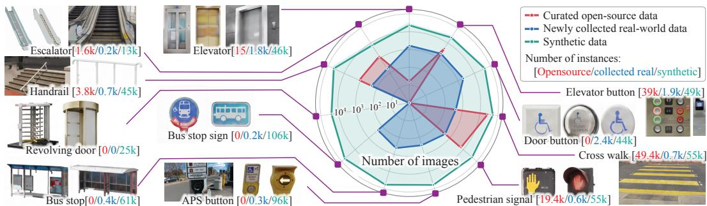
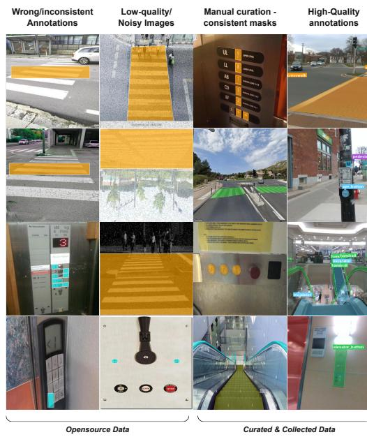
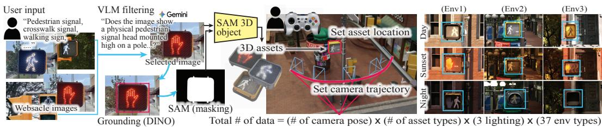
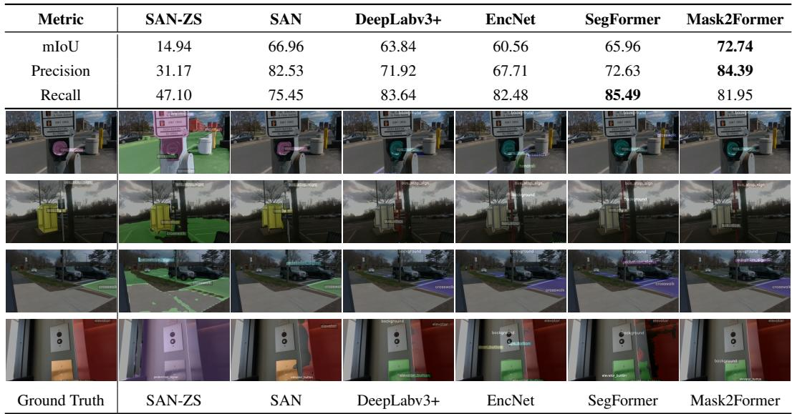
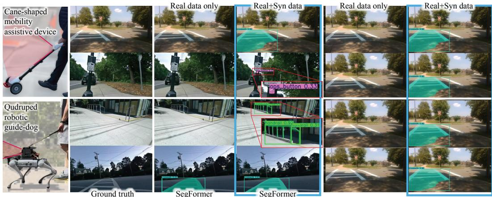
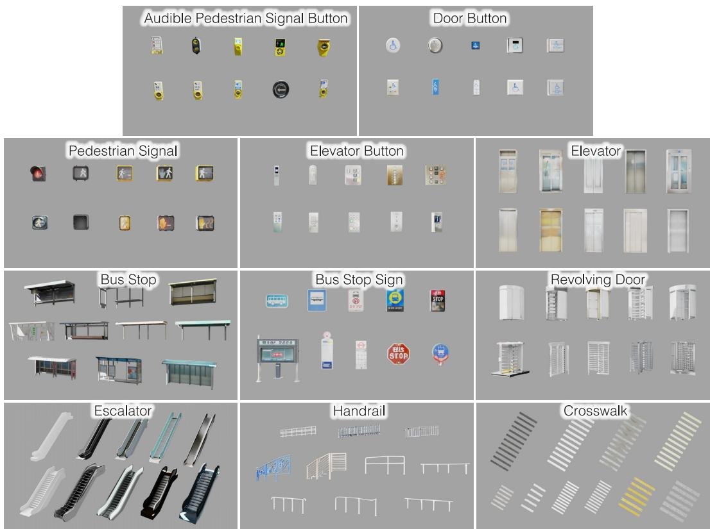

# NavAble: A Large-Scale Dataset and Synthetic Data Generation Pipeline for Blind Navigation

Hochul Hwang1∗ Jahir Sadik Monon1∗ Soowan Yang2 Shiven Umeshbhai Patel1 Anh Nhat Hong Hguyen1 Kien Nguyen1 Keshav Garg1 Dylan Gage1 Duretti Hordofaa1 Anshu Anjna1 Eshed Ohn-Bar3 Donghyun Kim1

1University of Massachusetts Amherst

2Daegu Gyeongbuk Institute of Science and Technology 3Boston University hochulhwang@umass.edu

## Abstract

Reliable recognition of accessibility-critical objects (e.g., audible pedestrian signals, door-activation buttons, and handrails) is essential for assistive navigation technologies that support safe, independent mobility for blind and low-vision (BLV) users. Yet these categories are severely underrepresented in existing large-scale vision datasets, and the few datasets that include them suffer from limited class coverage, inconsistent annotations, and poor diversity, limiting the perception reliability that BLV navigation requires. We introduce NAVABLE, a large-scale dataset spanning 11 accessibility-critical object classes, combining 36K curated open-source images with 5.5K newly collected, densely annotated real-world images. To extend scale and diversity, we develop a synthetic data generation pipeline that renders high-fidelity 3D assets across 37 environments under diverse styles and viewpoints, yielding 452K frames with rich ground-truth annotations from 500 assets. The pipeline minimizes manual effort by combining automated web image crawling, VLM-based filtering, SAM 3D-based asset generation, and convenient camera trajectory configuration, enabling large-scale data generation at a diversity unattainable through manual collection. Experiments show that fine-tuning existing segmentation models on the NAVABLE Dataset achieves reliable accessibility-object segmentation (>80% mIoU on our held-out test set). We also demonstrate the effectiveness of synthetic data augmentation, which yields up to +3.5 mIoU over real-world-only fine-tuning. Beyond benchmark evaluation, validation on egocentric data from two mobility-assistive robots demonstrates improved perception reliability in real-world navigation scenarios. Together, NAVABLE establishes a scalable foundation for BLV navigation perception, directly addressing the data scarcity and embodiment gaps that have limited progress in this domain. The dataset and pipeline are publicly available at https://huggingface.co/datasets/NavAble/NeurIPS\_2026\_BLV.

## 1 Introduction

Over 36 million people worldwide are blind, a number projected to more than double in the next 30 years [1]. In response, researchers have developed a wide range of assistive technologies, including smart white canes [2, 3], wearable computer-vision systems [4], and guide dog robot platforms [5–7], all of which rely on robust perception to alert users to hazards, identify navigational landmarks, and support route-following. In practice, however, prior work with BLV end-users shows that perception failures remain a major barrier to adoption, as missed detections and false positives interrupt navigation and erode user trust [8–11].

  
Figure 1: Overview of NAVABLE Dataset. Existing datasets limited object classes (e.g., lacking APS or door buttons). NAVABLE Dataset provides a curated multi-source collection of open-source, newly collected real-world data, and synthetic data across 11 accessibility-critical object categories.

At the core of this problem is a data bottleneck: the accessibility-critical object categories that matter most for BLV navigation—such as Accessible Pedestrian Signals (APS), handrails, and door activation buttons—are either entirely absent, coarsely defined, or severely underrepresented in largescale vision datasets such as ADE20K [12], COCO [13], and Cityscapes [14], which predominantly focus on standard categories like vehicles and buildings. As demonstrated in Section 4, many stateof-the-art open-source segmentation models [15–17] omit accessibility-critical classes from their vocabularies, and several open-vocabulary models exhibit substantial performance degradation in zero-shot settings [18].

Targeted efforts have emerged to address this data scarcity, but their impact remains limited because most operate within narrowly defined, domain-specific scopes that constrain broader downstream deployment. A large body of work has investigated obstacle detection for sidewalk navigation of BLV individuals [19–22], with an emphasis on localization and recognition of static and dynamic obstacles that obstruct safe and continuous walking. Other datasets, such as SurDis [23], target more specialized hazards, particularly surface discontinuities such as steps and drop-offs. GuideTWSI [24] focuses narrowly on tactile walking surface indicators. More recently, the literature has expanded to include VLM-based scene understanding [25] and description [26, 27]. However, despite these advances, none of these efforts provide datasets that meaningfully support dense detection or segmentation across broad BLV-relevant classes. Islam et al. [28] introduce a taxonomy of 90 BLV-critical object categories with image-level presence labels, rather than the dense pixel-level annotations required for segmentation. As a result, existing real-world datasets remain limited in scale, semantic coverage, and intra-class diversity.

Beyond these structural limitations, a fundamental viewpoint mismatch persists between existing data and deployed assistive perception platforms. Most vision datasets are curated from human-eyelevel or vehicle-mounted perspectives, whereas assistive platforms—such as chest-worn wearables [29], cane-mounted cameras [30], and quadruped robots [31, 5, 32, 33]—perceive the world from fundamentally different egocentric viewpoints. This mismatch between training distributions and embodied sensor inputs is further compounded by limited intra-class diversity and insufficient coverage of environmental variations, resulting in poor zero-shot segmentation performance [34, 11].

To bridge these gaps, we develop NAVABLE, a dataset and a generator tailored to perception for BLV-assistive navigation. NAVABLE is guided by two principles: first, reliable navigation demands large-scale real-world coverage of fine-grained accessibility-critical object categories selected through prior BLV-related human studies [32, 35]; second, robust deployment requires a controllable synthetic data generator capable of producing viewpoint-specific data that reflects the geometry, sensing perspective, and environmental variations encountered by assistive platforms in practice. This paper makes two contributions and reports four empirical findings.

## Technical Contributions:

• NavAble Dataset. A large-scale dataset of 41.5K densely annotated real-world images spanning 11 accessibility-critical object classes, comprising 5.5K newly collected egocentric images and

36K curated open-source images aggregated and re-standardized from fragmented class-specific repositories. To the best of our knowledge, this is the largest collection of high-fidelity pixel-level annotations targeting BLV-assistive perception.

• NavAble Generator. A semi-automated synthetic data generation pipeline that transforms uncurated web images into simulation-ready 3D assets and renders them in NVIDIA Isaac Sim with controllable scene composition, viewpoint, and lighting. The pipeline yields 500 class-validated assets across 11 categories and a companion Isaac Sim extension that converts one-time teleoperated trajectories into compositionally scalable supervision, producing 452K densely annotated synthetic frames $( \mathrm { N a v A b l e } _ { s y n } )$ with paired RGB, semantic segmentation, depth, surface normals, and 2D/3D bounding boxes.

## Findings:

• Benchmark gaps in existing models. Existing models either omit BLV-relevant classes from their vocabularies or exhibit substantial zero-shot performance degradation on accessibility-critical objects, quantifying the data bottleneck that motivates NavAble.

• Strong segmentation capability. Fine-tuning on NavAble Dataset across five segmentation architectures spanning convolutional [36, 37], transformer [17], and mask-classification [16, 18], providing the first reliable segmentation model for accessibility-critical perception.

• Consistent gains from synthetic augmentation. Augmenting $\mathrm { N a v } \mathrm { A b l e } _ { s y n }$ with real-world data yields consistent improvements across all evaluated architectures, with up to +3.5 mIoU and disproportionate gains compared to the model trained on real-world data alone.

• Transfer to embodied deployment. Improvements transfer to egocentric inputs collected from two BLV-assistive platforms (the quadruped robot and the cane-shaped robot [30]), with measurable gains in BLV-relevant class detection under real navigation conditions, validating that our data choices reflect deployment requirements rather than benchmark-specific overfitting.

## 2 Real-world data: curation and collection

In NAVABLE, we focus on 11 accessibility-critical object classes chosen based on three criteria: (1) high navigational utility, and (2) frequent occurrence in assistive settings. The selected 11 classes correspond to objects that directly inform mobility decisions — such as crossing streets, entering buildings, locating transit infrastructure, or navigating vertical transitions — while spanning both indoor and outdoor environments.

We first aggregate annotated images from multiple open-source repositories (e.g., Roboflow, Hugging Face, etc.), the majority of which contain single-class coverage of accessibility-related objects. While these datasets provide useful starting points, we identify several systematic limitations that constrain their direct use: 1) Inconsistent and imprecise annotations: Annotation standards vary across sources in both granularity and definition, and segmentation masks often exhibit loose or inaccurate boundaries, as shown in Figure 2, 2) Severe class imbalance: The distribution across categories is highly skewed, with a few classes heavily over-represented (e.g., 49.4K crosswalk and 39K elevator button samples) while others are entirely absent (e.g., revolving door, door button, bus stop, bus stop sign, APS button), as shown in Figure 1, 3) Fragmented semantic coverage: The majority of datasets are single-class or narrowly scoped (e.g., only bus stop without signs), lacking the co-existing context necessary for robust scene understanding, and 4) Class ambiguity and noise: Mislabeled or visually ambiguous samples introduce noise and degrade training stability. These issues motivated us to perform both substantial curation and targeted real-world collection.

  
elevator\_button Wide class coverageFigure 2: Inconsistent and low-quality frag-High-quality annotations door\_button ✗ bus\_stop\_sign ✗mented online data (left) are curated and normalized to merge with our newly collected highquality dense annotation data (right).

## 2.1 Data curation from open-source datasets

To mitigate the issues of annotation noise, class inconsistency, and unreliable supervision, we perform a rigorous curation process that yields over 36.5K annotated images. First, we standardize class definitions across datasets to align with our target taxonomy of 11 accessibility-critical classes. We then carry out careful verification to filter out low-quality and label-inconsistent samples. While the severe class imbalance problem was unavoidable, this process produces a curated dataset with precise annotations and consistent multi-class semantics, forming reliable real-world data for training.

## 2.2 Targeted real-world data collection

Despite extensive curation, several accessibility-critical categories remain underrepresented or entirely absent in existing datasets. Moreover, inconsistencies in mask definitions cannot be fully resolved without reannotation. To address the limitations of currently available open-source data, we undertake targeted real-world data collection and manually annotate a new dataset with dense pixel-level labels across all 11 target classes. The collection process is designed to capture (i) diverse environments, spanning indoor and outdoor settings relevant to navigation; (ii) embodiment-relevant viewpoints, i.e., egocentric perspectives aligned with assistive systems; and (iii) contextual co-occurrence, with objects embedded within realistic scene contexts.

We collected data using a custom capture rig equipped with an Intel RealSense D435 mounted at chest height to approximate an egocentric assistive viewpoint. Data are recorded across 50 different locations, spanning a wide range of viewpoints and both indoor (e.g., campus building) and outdoor environments (e.g., suburban area). To ensure high data quality, we first manually filtered noisy/blurry samples. We considered maximizing diversity across viewpoints, environments, lighting conditions, and intra-class variations. We then annotate the remaining data using Label Studio [38], producing polygon-level semantic segmentation labels in COCO-style format for all target object classes. We identify annotation errors and missing instances through a two-stage verification process, followed by iterative correction and refinement. The final annotations are obtained after three full passes over the collected data. Each image is densely annotated in a multi-class setting, labeling all visible instances of the target categories within the frame, as depicted in the right column of Figure 2. Dataset statistics, including per-class counts, are summarized in Figure 1.

## 3 Scalable synthetic data generation (SDG) pipeline

Real-world data alone cannot provide the scale, diversity, and viewpoint variability required for robust perception of accessibility-critical objects, due to sparse coverage of rare classes, limited viewpoints, and high annotation cost. To address this fundamental bottleneck, we introduce a scalable synthetic data generation pipeline built on NVIDIA Isaac Sim that produces large-scale, densely annotated data with controllable scene composition and viewpoint diversity. While the NAVABLE dataset integrates curated and newly collected real-world data, rare accessibility-critical categories remain inherently difficult to capture at scale, making synthetic data a necessary complement for coverage and generalization. We adopt Isaac Sim for its dynamics-aware simulation capabilities and potential to support learning across diverse robotic embodiments; in this work, we focus on its impact on training perception models.

## 3.1 From web images to simulation-ready 3D assets using foundation models

We construct a large and diverse asset library through our custom-developed pipeline that transforms web-scale image data into simulation-ready 3D meshes. Given class-specific keyword queries, images are collected from multiple search engines (e.g., Wikimedia Commons). Because keyword-based retrieval introduces substantial noise and weak semantic alignment, we use a vision-language model gemini-3-flash-preview to filter out unsuitable samples, including diagrams, CAD renderings, and heavily occluded instances. For each filtered image, we localize objects of interest using Grounding DINO [39] and suppress duplicate detections via non-maximum suppression. The remaining bounding boxes are then passed to SAM2.1 [40] to produce precise segmentation masks. We aggregate per-box masks into a single coherent object mask, which is critical for reconstructing composite objects (e.g., APS buttons with both signage and tactile interfaces) as structurally consistent assets. The resulting image–mask pairs are reconstructed into textured 3D meshes via SAM 3D Objects [41] and exported in Universal Scene Description (USD) format for direct integration into Isaac Sim as shown in Fig. 3.

  
Figure 3: Overview of NAVABLE Generator. (Left) Based on the user’s object of interest, we generate 3D assets from images by using foundation models. (Center) Our generator only requires two pieces of information from the user: the asset location and the camera trajectory. Once those are given, the generator creates augmented data. (Right) NAVABLE generator creates data in diverse scenes, lighting conditions, and environments via Isaac Sim.

This pipeline yields over 500 class-validated assets across 11 categories. After manual verification, we retain the highest-quality assets per class for simulation, while releasing the full asset set to support future research. Reconstruction quality is ultimately bounded by segmentation performance, which remains challenging for long-tail accessibility classes and highlights an important direction for domain-specialized segmentation methods.

Once assets are generated, our NAVABLE Isaac Sim extension enables users to record camera trajectories via simple teleoperation (e.g., using a remote controller). Each trajectory is stored as a sequence of poses and, given a fixed object placement (6D pose and scale) within a scene, can be replayed across different environments, lighting conditions, and asset styles. This design enables compositional scaling of synthetic data and effectively converting interactive data collection into a one-time cost. All annotations are derived directly from the scene graph, ensuring perfect consistency under variations in assets, lighting, and environments. We release this extension together with a companion command-line interface, enabling practitioners to efficiently generate large-scale, densely annotated datasets across new object classes, environments, and viewpoints with minimal additional effort. To highlight the effectiveness of the SDG pipeline, for instance, only 5 user-recorded trajectories of 100 frames each, replayed across 4 environments and 10 asset variants, produce 20,000 annotated frames from a small amount of interactive collection.

## 3.2 NavAble synthetic dataset

Using our extension, we construct the synthetic split of NAVABLE, denoted as NAVABL $. \mathrm { E } _ { s y n }$ . We curate 37 high-fidelity environments from the Fab marketplace [42], selected for visual realism and contextually appropriate placement of target classes (e.g., elevator buttons in lobbies, bus-stop signs along sidewalks). Within these environments, we define 488 locations, each populated with one of the top-10 retained assets per class from Sec. 3.1. We sampled every 50 frames during offline rendering creating. The resulting dataset contains over 25K trajectories, 452K RGB frames, and 781K instance annotations across the eleven NAVABLE classes, as shown in Figure 1. Each frame is a pixel-aligned multi-modal tuple comprising RGB, semantic segmentation, 2D and 3D bounding boxes, surface normals, and depth. For experiments, we use a subset of the data (detailed in Sec. 4.1.1), while releasing the full dataset to the community to support future research.

## 4 Experiments

We evaluate NAVABLE along four axes. First, we assess whether existing state-of-the-art segmentation systems can recognize BLV-relevant object classes in zero-shot settings. Second, we test the extent to which fine-tuning on our curated and newly collected real-world data improves segmentation performance. Third, we study whether augmenting training with large-scale synthetic data from

Table 1: Quantitative metrics and qualitative comparison across segmentation models. mIoU, precision, and recall on the held-out NAVABLE-Real test split. The lower block shows one qualitative example for different classes (APS button, bus stop sign, crosswalk, elevator, top to bottom): the leftmost panel is the ground-truth mask and the remaining panels show each model’s prediction in the same column order as the metrics above.  
  
our SDG pipeline yields additional gains beyond real data alone. Finally, we validate whether these improvements transfer to real-time embodied deployment on the Unitree Go2 platform.

## 4.1 Experimental setup

The NAVABLE dataset, covering the 11 target BLV classes, is drawn from three complementary sources: curated open-source data $( \mathrm { N A V A B L E _ { c u r } } )$ , collected real-world data $\left( \mathrm { N A V A B L E _ { c o l } } \right)$ , and our SDG-pipeline-generated synthetic data $( \mathrm { N A V A B L E _ { \mathrm { s y n } } } )$ . The dataset is partitioned into training, validation, and test splits, where the held-out test split (1,482 images) is drawn exclusively from real-world data $\left( \mathrm { N A V A B L E _ { c o l } } \right)$ to ensure unbiased evaluation of real-world generalization. In addition, we enforce location-level separation across splits, such that all test images come from locations excluded from the training and validation sets. Model performance is reported in terms of mean Intersection-over-Union (mIoU), precision, and recall. We omit mAP as a universal metric since pixel-classification models (SegFormer, DeepLabv3+, EncNet) produce no instance-level confidence scores required for its computation.

## 4.1.1 Model training and setup

Architectures. We benchmark five open-source segmentation models spanning the three dominant paradigms in modern semantic segmentation. As CNN per-pixel baselines we use DeepLabv3+ [36] and EncNet [37], both with a ResNet-101 (dilated, output stride 8) backbone. SegFormer [17] with a MiT-B5 backbone represents the transformer per-pixel family. Mask2Former [16] with a Swin-L backbone provides a query-based mask-classification head, and SAN [18] with a CLIP ViT-B/16 backbone and learned side-adapter represents the open-vocabulary mask-classification paradigm. All models are initialized from publicly released ADE20K weights, except SAN which uses COCO-Stuff-164K weights, and are fine-tuned end-to-end on multiple NVIDIA A100 and L40S GPUs. Each model’s decoder/head is reinitialized for our 12-class label space (1 background + 11 accessibility-critical foreground classes).

Training-data configurations. For each architecture we evaluate four progressively richer configurations, organized as one real-only baseline (Real), one real+curation baseline (Real+Cur), one real+synthetic ablation that isolates the contribution of curation (Real+Syn), and one full real+curation+synthetic configuration (Real+Cur+Syn). Synthetic budgets are matched by foreground instances per class rather than image count, since several classes (e.g., elevators and elevator buttons) frequently co-occur in the same frame and image-level sampling would otherwise produce highly imbalanced supervision. The validation and test splits are held identical across all four config urations, so any observed difference is attributable to training data rather than to the evaluation set. The ‘turnstile’ class is excluded from the mean metrics, as it has no real-world instances.

Additional information for reproducible model training and experiments, such as per-architecture backbones, optimizers, batch sizes, AMP settings, per-configuration iteration budgets, model-specific deviations, and training hardware are detailed in Appendix A.

## 4.2 Evaluation results

Can state-of-the-art models segment target BLV classes in zero-shot settings? We begin by evaluating the out-of-the-box capability of the models on the target BLV classes. Closed-vocabulary architectures considered in this work – Mask2Former, SegFormer, DeepLabv3+, and EncNet – are pretrained on fixed label spaces that do not include most accessibility-critical categories, making zero-shot evaluation uninformative for the majority of our targets. Among the open-source models considered, SAN is the only model that supports open-vocabulary zero-shot segmentation, enabled by its CLIP ViT backbone and language-aligned visual representations. We therefore report its zero-shot performance in Table 1 as the relevant open-source baseline and contrast it with the performance of our finetuned models.

For reference, we evaluate state-of-the-art proprietary and open-weights vision-language models (Gemini Robotics-ER 1.6, Gemini 3 Pro, Qwen3-VL-32B, MolmoPoint-8B) in Table 2. However, we treat these as indicative reference points rather than deployable baselines: cloud-API reliance is incompatible with the always-on, low-latency, privacy-preserving perception BLV navigation requires, and their closed weights preclude on-device fine-tuning or reproducible deployment.

Table 2: State-of-the-art VLMs on the NAVABLE real-world test set. N=363 images, 10 evaluable categories; turnstile is held out. Box metrics are COCO-style AP (%). Pt-in-mask (%) is the fraction of predicted points that fall inside the ground-truth segmentation polygon (RoboPoint convention). PCK $. 0 5 / \mathrm { P C K } _ { . 1 0 }$ are point-localisation accuracy at 5 % and 10 % of the image diagonal. MolmoPoint-8B does not output bounding boxes; only its point-localisation metrics apply. Best per column in bold.
<table><tr><td></td><td colspan="2">Box</td><td colspan="3">Point</td></tr><tr><td>Model</td><td>AP</td><td> $\mathrm { A P _ { 5 0 } }$ </td><td>Pt-in-mask</td><td> $\mathrm { P C K . 0 5 }$ </td><td> $\mathrm { P C K } . _ { 1 0 }$ </td></tr><tr><td>Gemini Robotics-ER 1.6</td><td>33.8</td><td>48.9</td><td>69.0</td><td>68.7</td><td>85.5</td></tr><tr><td>Gemini 3 Pro</td><td>31.5</td><td>45.9</td><td>68.6</td><td>61.2</td><td>79.4</td></tr><tr><td>Qwen3-VL-32B</td><td>20.0</td><td>29.7</td><td>59.0</td><td>59.7 55.0</td><td>79.2 73.6</td></tr><tr><td>MolmoPoint-8B</td><td>一</td><td>一</td><td>74.2</td><td></td><td></td></tr></table>

As presented in Table 3, the real-world baseline (Real) alone establishes a strong foundation, with architectures like Mask2Former and DeepLabv3+ achieving 68.84% and 63.84% mIoU, respectively. Interestingly, augmenting this baseline with curated open-source data (+Cur) yields mixed results across different model families. While modern architectures with global context mechanisms—such as Segformer, SAN and Mask2Former—successfully leverage the additional data to improve their mIoU (to 62.16%, 62.52%, and 71.29%), CNN-based per-pixel models like DeepLabv3+ and EncNet experience noticeable performance degradation (dropping to 59.49% and 52.77%). This divergence highlights the challenge of integrating fragmented, variably-annotated public datasets, which can introduce noise and inconsistencies that older architectures struggle to overcome.

Can our SDG-pipeline generated NAVABL $\bf { E _ { s y n } }$ further improve performance over the baseline? To evaluate the effectiveness of data generated by our SDG pipeline, we augment our training with synthetic datasets, specifically analyzing the impact of the Real+Syn and Real+Cur+Syn configurations, as shown in Table 3. The addition of synthetic data reaffirms the architectural divide, consistent with the pattern observed in the Real+Cur setting. For modern, global-context architectures like Segformer, SAN, and Mask2Former, synthetic augmentation yields substantial performance gains over the real-only baselines. Segformer achieves its best overall performance of 65.96% mIoU when trained on the combined Real+Cur+Syn corpus—with a +4.90 mIoU improvement over the Real baseline. Similarly, Mask2Former effectively leverages the synthetic data without curation, climbing from 68.84% (Real) to 72.67% (Real+Syn), with SAN jumping upto 68.12%. This robust improvement confirms that our synthetic data generation pipeline successfully bridges the sim-to-real gap, injecting the compositional diversity necessary to generalize beyond the geographic constraints of our collected data. Conversely, CNN-based per-pixel models (DeepLabv3+ and EncNet) struggle to capitalize on synthetic augmentation at this scale, failing to exceed their strong Real baselines. For instance, DeepLabv3+ drops from 63.84% (Real) to 52.63% (Real+Syn) and 59.84% (Real+Cur+Syn). This suggests that while advanced architectures can seamlessly assimilate synthetic diversity and overcome domain gaps, traditional per-pixel methods remain highly susceptible to the subtle domain shifts introduced by synthetic rendering.

Table 3: Quantitative results across training-data configurations. Precision, recall, and mIoU on the held-out NAVABLE-Real test split for each model under four training-data configurations: Real, Real+Cur, Real+Syn, and Real+Cur+Syn. The rightmost column reports the absolute change in mIoU of each model’s best-performing configuration versus its Real baseline.
<table><tr><td colspan="3">Real</td><td rowspan="2"></td><td colspan="3">Real + Cur</td><td colspan="3">Real + Syn</td><td colspan="3">Real + Cur + Syn</td><td>∆mIoU</td></tr><tr><td>Model</td><td>Prec</td><td>Rec</td><td>mIoU</td><td>Prec</td><td>Rec mIoU</td><td></td><td>Prec</td><td>Rec mIoU</td><td>Prec</td><td>Rec</td><td>mIoU</td><td>Best vs. Real</td></tr><tr><td>SAN</td><td>82.67</td><td>68.35</td><td>62.07</td><td>77.10</td><td>74.17</td><td>62.52</td><td>82.53</td><td>75.45</td><td>66.96</td><td>82.75</td><td>76.93</td><td>68.12</td><td>+6.05</td></tr><tr><td>Mask2Former</td><td>81.95</td><td>78.18</td><td>68.84</td><td>81.65</td><td>82.88</td><td>71.29</td><td>85.01</td><td>80.98</td><td>72.67</td><td>80.81</td><td>84.08</td><td>70.75</td><td>+3.83</td></tr><tr><td>SegFormer</td><td>67.40</td><td>83.04</td><td>61.06</td><td>67.66</td><td>84.91</td><td>62.16</td><td>72.77</td><td>84.27</td><td>65.54</td><td>72.63</td><td>85.49</td><td>65.96</td><td>+4.90</td></tr><tr><td>DeepLabv3+</td><td>71.92</td><td>83.64</td><td>63.84</td><td>67.39</td><td>84.00</td><td>59.49</td><td>55.51</td><td>88.81</td><td>52.63</td><td>63.92</td><td>88.26</td><td>59.84</td><td>-4.00</td></tr><tr><td>EncNet</td><td>67.71</td><td>82.48</td><td>60.56</td><td>72.46</td><td>69.31</td><td>52.77</td><td>63.72</td><td>84.17</td><td>57.50</td><td>60.66</td><td>86.59</td><td>56.50</td><td>-3.06</td></tr></table>

At a per-class level, synthetic augmentation proves especially critical for small or thin structural classes that are highly susceptible to real-world motion blur and lighting artifacts. For instance, augmenting with Real+Syn yields an impressive +11.18 mIoU improvement on pedestrian signals and +8.23 mIoU on elevator buttons for Segformer. Similarly, Mask2Former’s performance on crosswalks surges by +6.84 mIoU, reaching 91.95%. Across modern architectures, a synthetic-augmented configuration achieved the best performance on 10 out of 11 foreground classes, highlighting that our pipeline provides a broad-based enhancement to navigational perception rather than just fixing isolated edge cases. Per-class evaluation metrics for each model are reported in Appendix D.

## Does the model improvement meaningfully transfer to real-time embodied deployment?

To test whether benchmark gains transfer to real deployment, we evaluate on two out-of-distribution embodiment splits collected under live navigation: egocentric footage from the cane-shaped robot (157 images, 5 classes) and the quadruped (155 images, 9 classes), as shown in Figure 4. We restrict this study to SegFormer—the only architecture in our benchmark that runs in real time on the onboard compute of both platforms —to ensure a fair, hardware-equalized baseline.

As shown in Table 4, BLVspecific fine-tuning on NAVABLE-Real already exceeds SAN zeroshot on both platforms, and adding synthetic supervision (Real+Syn) yields further consistent gains in mIoU and precision, concentrated on the long-tail classes (APS button, handrail, pedestrian signal) that benefit most from synthetic data indistribution. Per-class deltas reach up to +9.64 mIoU on crosswalk

Table 4: OOD embodiment evaluation on egocentric splits from the quadruped and cane-shaped platforms. Best per platform in bold.
<table><tr><td rowspan="2">Model</td><td colspan="3">Cane-shaped</td><td colspan="3">Quadruped</td></tr><tr><td>mIoU</td><td>mPrec</td><td>mRec</td><td>mIoU</td><td>mPrec</td><td>mRec</td></tr><tr><td>SAN-ZS</td><td>10.27</td><td>10.63</td><td>45.34</td><td>9.95</td><td>10.78</td><td>32.51</td></tr><tr><td>SegFormer (R)</td><td>11.94</td><td>24.69</td><td>39.93</td><td>21.56</td><td>30.73</td><td>38.90</td></tr><tr><td>SegFormer (R+S)</td><td>16.17</td><td>31.44</td><td>38.22</td><td>23.08</td><td>34.24</td><td>39.25</td></tr></table>

(cane-shaped robot), +8.50 on APS button (quadruped robot), +7.36 on pedestrian signal (quadruped robot), and +6.63 on handrail (quadruped robot). Full per-class IoU on both platforms is reported in Appendix E. The consistent positive transfer across two structurally different platforms confirms that NAVABLE generalizes beyond held-out benchmarks to real assistive-robot viewpoints.

Notably, these gains are obtained without explicitly retargeting synthetic data to either embodiment. In principle, our SDG pipeline could further improve performance by generating platform-matched synthetic data that reflects each device’s viewpoint, thereby reducing the remaining out-of-distribution gap without additional manual data collection. This provides a scalable path for adapting NAVABLEtrained perception models to new assistive robotic platforms.

  
Figure 4: Embodiment evaluation. (Left) The two BLV-assistive platforms used for out-ofdistribution evaluation: the cane-shaped mobility assistive device and the quadruped robot, both streaming egocentric footage from onboard cameras during live navigation. (Right) Qualitative SegFormer outputs on frames from these platforms; each row shows ground truth, the Real Data Only model, and the Real + Syn Data model.

## 5 Concluding remarks

We introduced NAVABLE, a large-scale dataset and scalable synthetic data generation pipeline for accessibility-critical perception in BLV navigation. By combining carefully curated open-source data, newly collected real-world annotations, and controllable synthetic generation, NAVABLE extensively addresses the issues of severe data scarcity and annotation inconsistency. Our experiments demonstrate that the state-of-the-art segmentation models struggle to reliably recognize BLV-relevant object classes in zero-shot settings, despite their strong performance on conventional benchmarks. Once existing models are fine-tuned with NAVABLE, they achieve substantial improvements in segmentation reliability. Additionally, we validate that synthetic augmentation consistently improves detection performance, enabling deployment of the model across multiple assistive robotic platforms. These findings suggest that accessibility-critical perception constitutes a distinct long-tail vision problem that requires dedicated datasets, evaluation protocols, and embodiment-aware data generation strategies. Beyond the dataset itself, we view NAVABLE as infrastructure for future research in accessible robotics and embodied AI. By releasing the dataset, asset library, Isaac Sim extension, and generation pipeline, we aim to support scalable development of perception systems for assistive technologies, including wearable systems, robotic mobility aids, and multimodal navigation agents.

Limitations and Future Work: Although NAVABLE substantially expands the coverage of accessibility-critical classes, many important BLV-relevant objects and environmental cues remain outside the current taxonomy. In addition, despite our efforts to include diverse environments and viewpoints, the geographic diversity of our real-world data remains limited, motivating broader data collection in future iterations. Portions of the synthetic pipeline still require human intervention, including object placement and trajectory recording. Finally, although our synthetic data improves transfer robustness, real-world deployment of the model in combination with assistive mobile robot navigation systems remains an open challenge.

Looking forward, recent advances in foundation models for image understanding, language-guided scene generation, and text-to-3D asset synthesis present opportunities to further automate and scale accessibility-oriented simulation pipelines. We hope NAVABLE motivates broader research at the intersection of embodied AI and accessibility, ultimately enabling perception systems that better support safe and independent mobility for BLV individuals.

## References

[1] Peter Ackland, Serge Resnikoff, and Rupert Bourne. World blindness and visual impairment: despite many successes, the problem is growing. Community eye health, 30(100):71, 2017.

[2] Hotaka Takizawa, Shotaro Yamaguchi, Mayumi Aoyagi, Nobuo Ezaki, and Shinji Mizuno. Kinect cane: Object recognition aids for the visually impaired. In 2013 6th International Conference on Human System Interactions (HSI), pages 473–478, 2013. doi: 10.1109/HSI.20 13.6577867.

[3] Patrick Slade, Arjun Tambe, and Mykel J Kochenderfer. Multimodal sensing and intuitive steering assistance improve navigation and mobility for people with impaired vision. Science robotics, 6(59):eabg6594, 2021.

[4] Hsueh-Cheng Wang, Robert K. Katzschmann, Santani Teng, Brandon Araki, Laura Giarré, and Daniela Rus. Enabling independent navigation for visually impaired people through a wearable vision-based feedback system. In 2017 IEEE International Conference on Robotics and Automation (ICRA), pages 6533–6540, 2017. doi: 10.1109/ICRA.2017.7989772.

[5] Shaojun Cai, Ashwin Ram, Zhengtai Gou, Mohd Alqama Wasim Shaikh, Yu-An Chen, Yingjia Wan, Kotaro Hara, Shengdong Zhao, and David Hsu. Navigating real-world challenges: A quadruped robot guiding system for visually impaired people in diverse environments. In Proceedings ofthe 2024 CHI Conference on Human Factors in Computing Systems, CHI ’24, New York, NY, USA, 2024. Association for Computing Machinery. ISBN 9798400703300. doi: 10.1145/3613904.3642227. URL https://doi.org/10.1145/3613904.3642227.

[6] João Guerreiro, Daisuke Sato, Saki Asakawa, Huixu Dong, Kris M. Kitani, and Chieko Asakawa. Cabot: Designing and evaluating an autonomous navigation robot for blind people. In Proceedings of the 21st International ACM SIGACCESS Conference on Computers and Accessibility, ASSETS ’19, page 68–82, New York, NY, USA, 2019. Association for Computing Machinery. ISBN 9781450366762. doi: 10.1145/3308561.3353771. URL https://doi.org/10.1145/3308561.3353771.

[7] Shangqun Yu, Hochul Hwang, Trung M. Dang, Joydeep Biswas, Nicholas A. Giudice, Sunghoon Ivan Lee, and Donghyun Kim. Human-centered development of guide dog robots: Quiet and stable locomotion control, 2025. URL https://arxiv.org/abs/2505.11808.

[8] Nicholas A. Giudice and Gordon E. xLegge. Blind Navigation and the Role of Technology, chapter 25, pages 479–500. John Wiley & Sons, Ltd, 2008. ISBN 9780470379424. doi: https://doi.org/10.1002/9780470379424.ch25. URL https://onlinelibrary.wiley.com/ doi/abs/10.1002/9780470379424.ch25.

[9] Hochul Hwang, Hee-Tae Jung, Nicholas A Giudice, Joydeep Biswas, Sunghoon Ivan Lee, and Donghyun Kim. Towards robotic companions: Understanding handler-guide dog interactions for informed guide dog robot design. In Proceedings of the 2024 CHI Conference on Human Factors in Computing Systems, pages 1–20, 2024.

[10] Gaurav Jain, Basel Hindi, Zihao Zhang, Koushik Srinivasula, Mingyu Xie, Mahshid Ghasemi, Daniel Weiner, Sophie Ana Paris, Xin Yi Therese Xu, Michael Malcolm, Mehmet Kerem Turkcan, Javad Ghaderi, Zoran Kostic, Gil Zussman, and Brian A. Smith. Streetnav: Leveraging street cameras to support precise outdoor navigation for blind pedestrians. In Proceedings of the 37th Annual ACM Symposium on User Interface Software and Technology, UIST ’24, New York, NY, USA, 2024. Association for Computing Machinery. ISBN 9798400706288. doi: 10.1145/3654777.3676333. URL https://doi.org/10.1145/3654777.3676333.

[11] Dimitri Belli, Paolo Barsocchi, Giuseppe Lombardi, Alberto Coffrini, Francesco Furfari, and Antonino Crivello. Navigation solutions for blind and visually impaired persons: A state-ofthe-art survey. International Journal ofHuman–Computer Interaction, 0(0):1–30, 2026. doi: 10.1080/10447318.2026.2643358. URL https://doi.org/10.1080/10447318.2026.26 43358.

[12] Bolei Zhou, Hang Zhao, Xavier Puig, Sanja Fidler, Adela Barriuso, and Antonio Torralba. Scene parsing through ade20k dataset. In Proceedings of the IEEE Conference on Computer Vision and Pattern Recognition (CVPR), July 2017.

[13] Tsung-Yi Lin, Michael Maire, Serge Belongie, Lubomir Bourdev, Ross Girshick, James Hays, Pietro Perona, Deva Ramanan, C. Lawrence Zitnick, and Piotr Dollár. Microsoft coco: Common objects in context, 2015. URL https://arxiv.org/abs/1405.0312.

[14] Marius Cordts, Mohamed Omran, Sebastian Ramos, Timo Rehfeld, Markus Enzweiler, Rodrigo Benenson, Uwe Franke, Stefan Roth, and Bernt Schiele. The cityscapes dataset for semantic urban scene understanding. In Proc. of the IEEE Conference on Computer Vision and Pattern Recognition (CVPR), 2016.

[15] Rahima Khanam and Muhammad Hussain. Yolov11: An overview of the key architectural enhancements, 2024. URL https://arxiv.org/abs/2410.17725.

[16] Bowen Cheng, Ishan Misra, Alexander G. Schwing, Alexander Kirillov, and Rohit Girdhar. Masked-attention mask transformer for universal image segmentation, 2022. URL https: //arxiv.org/abs/2112.01527.

[17] Enze Xie, Wenhai Wang, Zhiding Yu, Anima Anandkumar, Jose M. Alvarez, and Ping Luo. Segformer: Simple and efficient design for semantic segmentation with transformers, 2021. URL https://arxiv.org/abs/2105.15203.

[18] Mengde Xu, Zheng Zhang, Fangyun Wei, Han Hu, and Xiang Bai. Side adapter network for open-vocabulary semantic segmentation, 2023. URL https://arxiv.org/abs/2302.122 42.

[19] Kibaek Park, Youngtaek Oh, Soomin Ham, Kyungdon Joo, Hyokyoung Kim, Hyoyoung Kum, and In So Kweon. Sideguide:a large-scale sidewalk dataset for guiding impaired people. In 2020 IEEE/RSJ International Conference on Intelligent Robots and Systems (IROS), pages 10022–10029, 2020. doi: 10.1109/IROS45743.2020.9340734.

[20] Tetsuaki Baba. Vidvip: Dataset for object detection during sidewalk travel. Journal ofRobotics and Mechatronics, 33(5):1135–1143, 2021. doi: 10.20965/jrm.2021.p1135.

[21] Haiying Xia, Cong Yao, Yumei Tan, and Shuxiang Song. A dataset for the visually impaired walk on the road. Displays, 79:102486, 2023. ISSN 0141-9382. doi: https://doi.org/10.1016/j. displa.2023.102486. URL https://www.sciencedirect.com/science/article/pii/ S0141938223001191.

[22] Chang Sun, Jia Su, Wenpeng Ren, and Yong Guan. Wide-view sidewalk dataset based pedestrian safety application. IEEE Access, 7:151399–151408, 2019. doi: 10.1109/ACCESS.2019.294716 5.

[23] Kuan Yew Leong and Siew Mooi Lim. Surdis: A surface discontinuity dataset for wearable technology to assist blind navigation in urban environments. In S. Koyejo, S. Mohamed, A. Agarwal, D. Belgrave, K. Cho, and A. Oh, editors, Advances in Neural Information Processing Systems, volume 35, pages 24117–24129. Curran Associates, Inc., 2022. URL https://proceedings.neurips.cc/paper\_files/paper/2022/file/988120df77d 6c767995febd7ff616517-Paper-Datasets\_and\_Benchmarks.pdf.

[24] Hochul Hwang, Soowan Yang, Anh N. H. Nguyen, Parth Goel, Krisha Adhikari, Sunghoon I. Lee, Joydeep Biswas, Nicholas A. Giudice, and Donghyun Kim. Guidetwsi: A diverse tactile walking surface indicator dataset from synthetic and real-world images for blind and low-vision navigation, 2026. URL https://arxiv.org/abs/2603.07060.

[25] Sagar M. Waghmare, Kimberly Wilber, Dave Hawkey, Xuan Yang, Matthew Wilson, Stephanie Debats, Cattalyya Nuengsigkapian, Astuti Sharma, Lars Pandikow, Huisheng Wang, Hartwig Adam, and Mikhail Sirotenko. Sanpo: A scene understanding, accessibility and human navigation dataset, 2024. URL https://arxiv.org/abs/2309.12172.

[26] Junhyeok Kim, Jaewoo Park, Junhee Park, Sangeyl Lee, Jiwan Chung, Jisung Kim, Ji Hoon Joung, and Youngjae Yu. Guidedog: A real-world egocentric multimodal dataset for blind and low-vision accessibility-aware guidance, 2025. URL https://arxiv.org/abs/2503.128 44.

[27] ByungOk Han, Woo han Yun, Beom-Su Seo, and Jaehong Kim. Space-aware instruction tuning: Dataset and benchmark for guide dog robots assisting the visually impaired, 2025. URL https://arxiv.org/abs/2502.07183.

[28] Md Touhidul Islam, Imran Kabir, Elena Ariel Pearce, Md Alimoor Reza, and Syed Masum Billah. A dataset for crucial object recognition in blind and low-vision individuals’ navigation, 2026. URL https://arxiv.org/abs/2407.16777.

[29] Bing Li, J. Pablo Muñoz, Xuejian Rong, Jizhong Xiao, Yingli Tian, and Aries Arditi. Isana: Wearable context-aware indoor assistive navigation with obstacle avoidance for the blind. In Gang Hua and Hervé Jégou, editors, Computer Vision – ECCV 2016 Workshops, pages 448–462, Cham, 2016. Springer International Publishing. ISBN 978-3-319-48881-3.

[30] Glidance. URL https://glidance.io/. Accessed: 2026-05-05.

[31] Anxing Xiao, Wenzhe Tong, Lizhi Yang, Jun Zeng, Zhongyu Li, and Koushil Sreenath. Robotic guide dog: Leading a human with leash-guided hybrid physical interaction. In 2021 IEEE International Conference on Robotics and Automation (ICRA), pages 11470–11476. IEEE, 2021.

[32] Hochul Hwang, Soowan Yang, Jahir Sadik Monon, Nicholas A Giudice, Sunghoon Ivan Lee, Joydeep Biswas, and Donghyun Kim. Guidenav: User-informed development of a visiononly robotic navigation assistant for blind travelers. In Proceedings of the 21st ACM/IEEE International Conference on Human-Robot Interaction, pages 1129–1139, 2026.

[33] J Taery Kim, Morgan Byrd, Jack L Crandell, Bruce N Walker, Greg Turk, and Sehoon Ha. Understanding expectations for a robotic guide dog for visually impaired people. In 2025 20th ACM/IEEE International Conference on Human-Robot Interaction (HRI), pages 262–271. IEEE, 2025.

[34] Monir Shariatinezhad, Seyyedeh Fatemeh Molaeezadeh, and Mohammad Gholami. Outdoor navigation for visually impaired people using yolov5 and transfer learning: an analytical study. Multimedia Tools and Applications, 84:24521 – 24540, 2024. URL https://api.semantic scholar.org/CorpusID:275154544.

[35] Md Touhidul Islam, Imran Kabir, Elena Ariel Pearce, Md Alimoor Reza, and Syed Masum Billah. Identifying crucial objects in blind and low-vision individuals’ navigation. In Proceedings of the 26th International ACM SIGACCESS Conference on Computers and Accessibility, pages 1–8, 2024.

[36] Liang-Chieh Chen, Yukun Zhu, George Papandreou, Florian Schroff, and Hartwig Adam. Encoder-decoder with atrous separable convolution for semantic image segmentation, 2018. URL https://arxiv.org/abs/1802.02611.

[37] Hang Zhang, Kristin Dana, Jianping Shi, Zhongyue Zhang, Xiaogang Wang, Ambrish Tyagi, and Amit Agrawal. Context encoding for semantic segmentation, 2018. URL https://arxiv. org/abs/1803.08904.

[38] Maxim Tkachenko, Mikhail Malyuk, Andrey Holmanyuk, and Nikolai Liubimov. Label Studio: Data labeling software, 2020-2025. URL https://github.com/HumanSignal/label-stu dio. Open source software available from https://github.com/HumanSignal/label-studio.

[39] Shilong Liu, Zhaoyang Zeng, Tianhe Ren, Feng Li, Hao Zhang, Jie Yang, Chunyuan Li, Jianwei Yang, Hang Su, Jun Zhu, et al. Grounding dino: Marrying dino with grounded pre-training for open-set object detection. arXiv preprint arXiv:2303.05499, 2023.

[40] Nikhila Ravi, Valentin Gabeur, Yuan-Ting Hu, Ronghang Hu, Chaitanya Ryali, Tengyu Ma, Haitham Khedr, Roman Rädle, Chloe Rolland, Laura Gustafson, Eric Mintun, Junting Pan, Kalyan Vasudev Alwala, Nicolas Carion, Chao-Yuan Wu, Ross Girshick, Piotr Dollár, and Christoph Feichtenhofer. Sam 2: Segment anything in images and videos. arXiv preprint arXiv:2408.00714, 2024. URL https://arxiv.org/abs/2408.00714.

[41] SAM 3D Team, Xingyu Chen, Fu-Jen Chu, Pierre Gleize, Kevin J Liang, Alexander Sax, Hao Tang, Weiyao Wang, Michelle Guo, Thibaut Hardin, Xiang Li, Aohan Lin, Jiawei Liu, Ziqi Ma, Anushka Sagar, Bowen Song, Xiaodong Wang, Jianing Yang, Bowen Zhang, Piotr Dollár, Georgia Gkioxari, Matt Feiszli, and Jitendra Malik. Sam 3d: 3dfy anything in images. 2025. URL https://arxiv.org/abs/2511.16624.

[42] Fab. Fab marketplace. https://www.fab.com/?lang=en, 2026. Accessed: 2026-05-04.

## A Detailed training settings

This appendix complements Sec. 4.1.1 with the shared training recipe, per-architecture hyperparameters, per-configuration iteration budgets, architecture-specific deviations, and training hardware. Throughout this appendix, the four training-data configurations are abbreviated as Real, Real+Cur, Real+Syn, and Real+Cur+Syn, where Real / Cur / Syn denote the NAVABLE-Real, NAVABLE-Curation, and NAVABLE-Synthetic subsets, respectively.

Shared training recipe. All five models share a common augmentation pipeline (random resize jittering with long-side scale ratio 0.5×–2.0×, category-balanced random cropping with cat\_max\_ratio= 0.75, horizontal flipping with p=0.5, and photometric distortion) and a linearwarmup followed by a polynomial-decay learning-rate schedule, while otherwise following each model’s standard recipe. We apply per-class loss weighting with the background class down-weighted to 0.10 and all 11 foreground classes set to 1.00. Within each architecture, the six data configurations share identical augmentation, optimizer, and schedule settings—only the training corpus and iteration budget differ—so that any change in performance is attributable to the data. Iteration budgets are scaled with corpus size to keep approximate epoch coverage roughly constant, and the final checkpoint per run is selected by best foreground mIoU on the held-out NAVABLE-Real validation split.

Per-architecture base settings. Table 5 (top) lists the backbone, input crop, optimizer (with percomponent learning-rate multipliers), weight decay, batch size, and AMP usage of each architecture. Within each architecture, these values are held fixed across all six training-data configurations.

Iteration budgets across data configurations. Table 5 (bottom) reports the iteration budget for each (architecture, configuration) pair. Budgets are chosen so that the approximate number of epochs over the training corpus is comparable across the six configurations within an architecture, ensuring that any change in test performance reflects the training data rather than the optimization budget. For DeepLabv3+, EncNet, and SegFormer, the per-GPU batch size and the number of GPUs are held fixed across all configurations, so iteration budgets are determined solely by corpus size and are identical across these three architectures. For each run, the final checkpoint is selected by best foreground mIoU on the held-out NAVABLE-Real validation split.

Mask2Former-specific deviations. Mask2Former is the one architectural outlier in our setup, and we deviate from its default recipe in two ways. Numerical stability. The Hungarian matcher emits NaN cost matrices under fp16, so we disable AMP (denoted as † in Table 5), train in full precision with gradient clipping at max-norm 0.1, and apply a backbone learning-rate multiplier of 0.1×. Memory and effective-batch scaling. Swin-L at 640×640 exceeds memory on a subset of our cluster nodes, so we adjust the per-GPU batch size and the number of GPUs per configuration, and rescale iteration counts so that the total samples seen during training (iters × effective batch) remain comparable to the non-M2F runs on the same corpus – which is why the Mask2Former column in Table 5 (bottom) differs from the other three CNN/transformer architectures.

Embodiment-viewpoint experiments. For the embodiment-viewpoint experiments (Sec. 4), all YOLOv26-seg variants are fine-tuned for 70 epochs following the corresponding official recipe, with no additional changes to the augmentation pipeline.

Hardware. All models are trained on a combination of two compute resources: a university GPU cluster equipped with 2–4× NVIDIA L40S (48 GB) nodes, and a local lab workstation with NVIDIA RTX PRO 6000 Blackwell Max-Q GPUs.

Table 5: Per-architecture training settings for NAVABLE fine-tuning. Configurations Real, Real+Cur, Real+Syn, and Real+Cur+Syn combine the NAVABLE-Real (Real), NAVABLE-Curation (Cur), and NAVABLE-Synthetic (Syn) subsets as defined in Sec. 4.1.1. (Top) Base settings per architecture. (Bottom) Iteration budget per (architecture, configuration) pair.
<table><tr><td>Model</td><td>Backbone</td><td>Crop</td><td>Optimizer (base lr)</td><td>WD</td><td>Batch</td><td>AMP</td></tr><tr><td>DeepLabv3+</td><td>R-101-d8</td><td>512</td><td>SGD  $( 5 \times 1 0 ^ { - 3 }$  , mom. 0.9)</td><td> $5 \times 1 0 ^ { - 4 }$ </td><td>8</td><td>√</td></tr><tr><td>EncNet</td><td>R-101-d8</td><td>512</td><td>SGD  $( 5 \times 1 0 ^ { - 3 }$  , mom. 0.9)</td><td> $5 \times 1 0 ^ { - 4 }$ </td><td>8</td><td>√</td></tr><tr><td>SegFormer</td><td>MiT-B5</td><td>640</td><td>AdamW  $( 1 \times 1 0 ^ { - 5 }$  , head 10×)</td><td>0.01</td><td>8</td><td>√</td></tr><tr><td>Mask2Former</td><td>Swin-L</td><td>640</td><td>AdamW (variable, backbone 0.1×)</td><td>0.05</td><td>4-8</td><td>†</td></tr><tr><td>SAN</td><td>CLIP ViT-B/16</td><td>640</td><td>AdamW  $( 1 \times 1 0 ^ { - 4 }$  , encoder 0.1×)</td><td> $1 \times 1 0 ^ { - 4 }$ </td><td>24</td><td>√</td></tr></table>

<table><tr><td>Config</td><td>DeepLabv3+</td><td>EncNet</td><td>SegFormer</td><td>Mask2Former</td><td>SAN</td></tr><tr><td>Real</td><td>16K</td><td>16K</td><td>16K</td><td>32K</td><td>6K</td></tr><tr><td>Real+Cur</td><td>80K</td><td>80K</td><td>80K</td><td>160K</td><td>30K</td></tr><tr><td>Real+Syn</td><td>220K</td><td>220K</td><td>220K</td><td>220K</td><td>180K</td></tr><tr><td>Real+Cur+Syn</td><td>324K</td><td>324K</td><td>324K</td><td>324K</td><td>3640K</td></tr></table>

## B List of generated assets

  
Figure 5: Samples of our synthetic 3D assets. NAVABLE includes synthetic assets of 15 APS buttons, 91 door buttons, 66 pedestrian signals, 74 elevator buttons, 111 elevators, 61 bus stops, 10 bus stop signs, 48 revolving doors, 5 escalators, 29 handrails, and 10 crosswalks. Except for crosswalks and escalators, all assets are generated through our synthetic data pipeline.

## C Details of expanded NAVABLEsyn

Lighting variation is incorporated as part of the environment axis. Each scene is exported from Unreal to USDZ with baked textures, preserving the original lighting fidelity. We then compose additional

lighting conditions (e.g., Day, Sunset, Night outdoors; ambient and directional variants indoors) as separate USD layers that can be toggled at render time. This design enables paired observations of the same trajectory under different illumination without additional data collection.

## D Per-class evaluation results

Tables 6–7 report per-class IoU on the held-out NAVABLE-Real test split (1,482 images) for each architecture under all four training-data configurations described in Sec. 4.1.1. The turnstile class has no real-world test instances; models that predict a turnstile mask receive IoU = 0 (penalizing false positives), while models that never predict turnstile receive no score (–). Bold marks the best configuration per class within each architecture.

Table 6: Per-class IoU (%) for Mask2Former (Swin-L). Best configuration per class in bold.
<table><tr><td>Class</td><td>Real</td><td>+Cur</td><td>+Syn</td></tr><tr><td>background</td><td>95.76</td><td>95.73</td><td>96.14</td></tr><tr><td>elevator</td><td>82.37</td><td>81.78</td><td>81.89</td></tr><tr><td>elevator_button</td><td>91.19</td><td>89.82</td><td>92.83</td></tr><tr><td>door_button</td><td>76.34</td><td>74.20</td><td>77.99</td></tr><tr><td>crosswalk</td><td>85.11</td><td>87.39</td><td>91.95</td></tr><tr><td>pedestrian_signal</td><td>42.89</td><td>56.30</td><td>51.70</td></tr><tr><td>aps_button</td><td>42.54</td><td>43.77</td><td>43.08</td></tr><tr><td>bus_stop</td><td>82.25</td><td>82.07</td><td>86.85</td></tr><tr><td>bus_stop_sign</td><td>40.23</td><td>46.59</td><td>49.98</td></tr><tr><td>handrail</td><td>48.05</td><td>52.47</td><td>53.11</td></tr><tr><td>escalator</td><td>70.50</td><td>74.07</td><td>73.87</td></tr><tr><td>turnstile</td><td></td><td></td><td></td></tr></table>

Table 7: Per-class IoU (%) for SAN (CLIP ViT-B/16). Best configuration per class in bold.
<table><tr><td>Class</td><td>Real</td><td>+Cur</td><td>+Syn</td><td>+Cur+Syn†</td></tr><tr><td>elevator</td><td>78.58</td><td>79.38</td><td>68.83</td><td>81.52</td></tr><tr><td>elevator_button</td><td>88.73</td><td>87.18</td><td>92.90</td><td>83.01</td></tr><tr><td>door_button</td><td>68.03</td><td>66.29</td><td>75.26</td><td>69.09</td></tr><tr><td>crosswalk</td><td>90.72</td><td>84.06</td><td>91.60</td><td>90.63</td></tr><tr><td>pedestrian_signal</td><td>40.14</td><td>49.01</td><td>57.92</td><td>48.38</td></tr><tr><td>aps_button</td><td>46.92</td><td>48.27</td><td>52.19</td><td>49.40</td></tr><tr><td>bus_stop</td><td>82.19</td><td>79.26</td><td>85.03</td><td>81.50</td></tr><tr><td>bus_stop_sign</td><td>22.87</td><td>27.36</td><td>29.19</td><td>25.32</td></tr><tr><td>handrail</td><td>41.98</td><td>40.77</td><td>50.78</td><td>46.46</td></tr><tr><td>escalator</td><td>60.56</td><td>63.62</td><td>65.94</td><td>63.44</td></tr><tr><td>turnstile</td><td>一</td><td></td><td></td><td></td></tr></table>

† Stage-2D mixed reference: trained on REAL $\times 4 0 + \mathrm { C U R } \times 1 + \mathrm { S Y N } _ { \mathrm { v 2 ( f u l l ) } }$ , different training budget than the other columns; included for completeness only.

## E Per-class embodiment evaluation results

This appendix complements the embodiment results in Sec. 4 (Table 4, Fig. 4) with per-class IoU on the two out-of-distribution embodiment splits: the rolling guide-cane (157 images, 5 labelled classes) and the Unitree Go2 guide-dog robot (155 images, 9 labelled classes). Following the convention used elsewhere in the paper, classes with zero ground-truth instances on a split are excluded from the per-split mean. On Go2, elevator, elevator\_button, and door\_button each have only a single ground-truth annotation; their per-class IoU is dominated by one frame and is reported for completeness only (†). Bold marks the best configuration per class.

Table 8: Per-class IoU (%) for SegFormer (MiT-B5). Best configuration per class in bold.
<table><tr><td>Class</td><td>Real</td><td>+Cur</td><td>+Syn</td><td>+Cur+Syn</td></tr><tr><td>background</td><td>93.53</td><td>93.71</td><td>93.37</td><td>94.03</td></tr><tr><td>elevator</td><td>73.07</td><td>76.29</td><td>66.76</td><td>72.21</td></tr><tr><td>elevator_button</td><td>76.18</td><td>80.75</td><td>84.41</td><td>82.60</td></tr><tr><td>door_button</td><td>72.02</td><td>73.83</td><td>77.65</td><td>77.60</td></tr><tr><td>crosswalk</td><td>79.44</td><td>81.18</td><td>85.76</td><td>83.35</td></tr><tr><td>pedestrian_signal</td><td>32.61</td><td>36.72</td><td>43.79</td><td>41.76</td></tr><tr><td>aps_button</td><td>41.45</td><td>42.72</td><td>40.95</td><td>42.69</td></tr><tr><td>bus_stop</td><td>77.02</td><td>68.77</td><td>80.36</td><td>79.98</td></tr><tr><td>bus_stop_sign</td><td>22.16</td><td>19.21</td><td>32.20</td><td>35.55</td></tr><tr><td>handrail</td><td>34.34</td><td>37.50</td><td>42.04</td><td>40.47</td></tr><tr><td>escalator</td><td>69.81</td><td>73.13</td><td>73.68</td><td>75.29</td></tr><tr><td>turnstile</td><td></td><td></td><td></td><td></td></tr></table>

Table 9: Per-class IoU (%) for DeepLabv3+ (ResNet-101). Best configuration per class in bold.
<table><tr><td>Class</td><td>Real</td><td>+Cur</td><td>+Syn</td><td>+Cur+Syn</td></tr><tr><td>background</td><td>93.47</td><td>93.46</td><td>93.43</td><td>92.78</td></tr><tr><td>elevator</td><td>72.90</td><td>75.48</td><td>81.57</td><td>77.37</td></tr><tr><td>elevator_button</td><td>85.18</td><td>83.47</td><td>83.68</td><td>78.61</td></tr><tr><td>door_button</td><td>71.92</td><td>70.10</td><td>72.19</td><td>68.39</td></tr><tr><td>crosswalk</td><td>81.12</td><td>78.01</td><td>76.44</td><td>76.87</td></tr><tr><td>pedestrian_signal</td><td>32.28</td><td>31.85</td><td>38.73</td><td>40.96</td></tr><tr><td>aps_button</td><td>43.56</td><td>41.35</td><td>30.04</td><td>30.67</td></tr><tr><td>bus_stop</td><td>73.77</td><td>63.04</td><td>71.11</td><td>68.34</td></tr><tr><td>bus_stop_sign</td><td>37.01</td><td>23.75</td><td>30.83</td><td>33.79</td></tr><tr><td>handrail</td><td>39.79</td><td>27.32</td><td>18.56</td><td>24.72</td></tr><tr><td>escalator</td><td>71.23</td><td>66.51</td><td>34.94</td><td>65.71</td></tr><tr><td>turnstile</td><td></td><td></td><td>0.00</td><td></td></tr></table>

## NeurIPS Paper Checklist

## 1. Claims

Question: Do the main claims made in the abstract and introduction accurately reflect the paper’s contributions and scope?

Answer: [Yes]

Justification: The abstract and introduction explicitly state our two technical contributions (the NAVABLE Dataset and NAVABLE Generator) and four empirical findings, all of which are substantiated by the experiments in Section 4 and the dataset/pipeline described in Sections 3.1.

Guidelines:

• The answer [N/A] means that the abstract and introduction do not include the claims made in the paper.

• The abstract and/or introduction should clearly state the claims made, including the contributions made in the paper and important assumptions and limitations. A [No] or [N/A] answer to this question will not be perceived well by the reviewers.

• The claims made should match theoretical and experimental results, and reflect how much the results can be expected to generalize to other settings.

• It is fine to include aspirational goals as motivation as long as it is clear that these goals are not attained by the paper.

## 2. Limitations

Question: Does the paper discuss the limitations of the work performed by the authors?

Answer: [Yes]

Table 10: Per-class IoU (%) for EncNet (ResNet-101). Best configuration per class in bold.
<table><tr><td>Class</td><td>Real</td><td>+Cur</td><td>+Syn</td><td>+Cur+Syn</td></tr><tr><td>background</td><td>93.80</td><td>91.72</td><td>94.24</td><td>93.69</td></tr><tr><td>elevator</td><td>77.70</td><td>77.18</td><td>79.97</td><td>77.19</td></tr><tr><td>elevator_button</td><td>74.34</td><td>72.07</td><td>82.71</td><td>81.82</td></tr><tr><td>door_button</td><td>62.57</td><td>60.46</td><td>71.89</td><td>69.13</td></tr><tr><td>crosswalk</td><td>81.11</td><td>69.85</td><td>72.82</td><td>75.32</td></tr><tr><td>pedestrian_signal</td><td>38.70</td><td>39.62</td><td>34.58</td><td>39.11</td></tr><tr><td>aps_button</td><td>43.29</td><td>40.02</td><td>34.41</td><td>24.30</td></tr><tr><td>bus_stop</td><td>73.20</td><td>0.00</td><td>76.41</td><td>77.82</td></tr><tr><td>bus_stop_sign</td><td>25.36</td><td>31.34</td><td>38.09</td><td>36.83</td></tr><tr><td>handrail</td><td>35.78</td><td>41.64</td><td>44.14</td><td>39.57</td></tr><tr><td>escalator</td><td>60.31</td><td>56.64</td><td>60.78</td><td>63.21</td></tr><tr><td>turnstile</td><td></td><td></td><td>0.00</td><td>0.00</td></tr></table>

Table 11: Per-class IoU (%) on Glide (157 images, 5 labelled classes).
<table><tr><td>Class</td><td>SAN-ZS</td><td>SegFormer (Real)</td><td>SegFormer (Real+Syn)</td><td>∆</td></tr><tr><td>crosswalk</td><td>33.13</td><td>49.75</td><td>59.39</td><td>+9.64</td></tr><tr><td>pedestrian_signal</td><td>2.89</td><td>3.94</td><td>4.15</td><td>+0.21</td></tr><tr><td>aps_button</td><td>0.00</td><td>1.44</td><td>4.86</td><td>+3.42</td></tr><tr><td>bus_stop</td><td>0.36</td><td>0.92</td><td>2.92</td><td>+2.00</td></tr><tr><td>handrail</td><td>14.98</td><td>3.66</td><td>9.51</td><td>+5.85</td></tr><tr><td>mean (5 cls)</td><td>10.27</td><td>11.94</td><td>16.17</td><td>+4.23</td></tr></table>

Justification: Limitations are discussed throughout the paper, including segmentation-quality bottlenecks for long-tail classes in Section 3.1, and the geographic scope of our collected real-world data in Section 2.2. We also discuss limitations in the Section 5

## Guidelines:

• The answer [N/A] means that the paper has no limitation while the answer [No] means that the paper has limitations, but those are not discussed in the paper.

• The authors are encouraged to create a separate “Limitations” section in their paper.

• The paper should point out any strong assumptions and how robust the results are to violations of these assumptions (e.g., independence assumptions, noiseless settings, model well-specification, asymptotic approximations only holding locally). The authors should reflect on how these assumptions might be violated in practice and what the implications would be.

• The authors should reflect on the scope of the claims made, e.g., if the approach was only tested on a few datasets or with a few runs. In general, empirical results often depend on implicit assumptions, which should be articulated.

• The authors should reflect on the factors that influence the performance of the approach. For example, a facial recognition algorithm may perform poorly when image resolution is low or images are taken in low lighting. Or a speech-to-text system might not be used reliably to provide closed captions for online lectures because it fails to handle technical jargon.

• The authors should discuss the computational efficiency of the proposed algorithms and how they scale with dataset size.

• If applicable, the authors should discuss possible limitations of their approach to address problems of privacy and fairness.

• While the authors might fear that complete honesty about limitations might be used by reviewers as grounds for rejection, a worse outcome might be that reviewers discover limitations that aren’t acknowledged in the paper. The authors should use their best judgment and recognize that individual actions in favor of transparency play an important role in developing norms that preserve the integrity of the community. Reviewers will be specifically instructed to not penalize honesty concerning limitations.

Table 12: Per-class IoU (%) on Go2 (155 images, 9 labelled classes). † classes with only one ground-truth instance.
<table><tr><td>Class</td><td>SAN-ZS</td><td>SegFormer (Real)</td><td>SegFormer (Real+Syn)</td><td>∆</td></tr><tr><td>elevator†</td><td>0.00</td><td>93.99</td><td>92.03</td><td>-1.96</td></tr><tr><td>elevator_button†</td><td>0.00</td><td>0.00</td><td>0.00</td><td>0.00</td></tr><tr><td>door_button†</td><td>0.03</td><td>0.00</td><td>0.00</td><td>0.00</td></tr><tr><td>crosswalk</td><td>43.35</td><td>54.13</td><td>55.22</td><td>+1.09</td></tr><tr><td>pedestrian_signal</td><td>12.07</td><td>7.63</td><td>14.99</td><td>+7.36</td></tr><tr><td>aps_button</td><td>3.15</td><td>0.00</td><td>8.50</td><td>+8.50</td></tr><tr><td>bus_stop</td><td>9.32</td><td>25.64</td><td>21.08</td><td>-4.56</td></tr><tr><td>bus_stop_sign</td><td>0.00</td><td>11.99</td><td>8.59</td><td>-3.40</td></tr><tr><td>handrail</td><td>21.61</td><td>0.68</td><td>7.31</td><td>+6.63</td></tr><tr><td>mean (9 cls)</td><td>9.95</td><td>21.56</td><td>23.08</td><td>+1.52</td></tr></table>

## 3. Theory assumptions and proofs

Question: For each theoretical result, does the paper provide the full set of assumptions and a complete (and correct) proof?

Answer: [N/A]

Justification: This is an empirical dataset and pipeline paper and does not include theoretical results.

Guidelines:

• The answer [N/A] means that the paper does not include theoretical results.

• All the theorems, formulas, and proofs in the paper should be numbered and crossreferenced.

• All assumptions should be clearly stated or referenced in the statement of any theorems.

• The proofs can either appear in the main paper or the supplemental material, but if they appear in the supplemental material, the authors are encouraged to provide a short proof sketch to provide intuition.

• Inversely, any informal proof provided in the core of the paper should be complemented by formal proofs provided in appendix or supplemental material.

• Theorems and Lemmas that the proof relies upon should be properly referenced.

## 4. Experimental result reproducibility

Question: Does the paper fully disclose all the information needed to reproduce the main experimental results of the paper to the extent that it affects the main claims and/or conclusions of the paper (regardless of whether the code and data are provided or not)?

Answer: [Yes]

Justification: We release the full dataset, synthetic data generation pipeline, and Isaac Sim extension at https://huggingface.co/datasets/NavAble/NeurIPS\_2026\_BLV, with training and evaluation details documented in Section 4.1.1 and Appendix A.

Guidelines:

• The answer [N/A] means that the paper does not include experiments.

• If the paper includes experiments, a [No] answer to this question will not be perceived well by the reviewers: Making the paper reproducible is important, regardless of whether the code and data are provided or not.

• If the contribution is a dataset and/or model, the authors should describe the steps taken to make their results reproducible or verifiable.

• Depending on the contribution, reproducibility can be accomplished in various ways. For example, if the contribution is a novel architecture, describing the architecture fully might suffice, or if the contribution is a specific model and empirical evaluation, it may be necessary to either make it possible for others to replicate the model with the same dataset, or provide access to the model. In general. releasing code and data is often one good way to accomplish this, but reproducibility can also be provided via detailed instructions for how to replicate the results, access to a hosted model (e.g., in the case of a large language model), releasing of a model checkpoint, or other means that are appropriate to the research performed.

• While NeurIPS does not require releasing code, the conference does require all submissions to provide some reasonable avenue for reproducibility, which may depend on the nature of the contribution. For example

(a) If the contribution is primarily a new algorithm, the paper should make it clear how to reproduce that algorithm.

(b) If the contribution is primarily a new model architecture, the paper should describe the architecture clearly and fully.

(c) If the contribution is a new model (e.g., a large language model), then there should either be a way to access this model for reproducing the results or a way to reproduce the model (e.g., with an open-source dataset or instructions for how to construct the dataset).

(d) We recognize that reproducibility may be tricky in some cases, in which case authors are welcome to describe the particular way they provide for reproducibility. In the case of closed-source models, it may be that access to the model is limited in some way (e.g., to registered users), but it should be possible for other researchers to have some path to reproducing or verifying the results.

## 5. Open access to data and code

Question: Does the paper provide open access to the data and code, with sufficient instructions to faithfully reproduce the main experimental results, as described in supplemental material?

Answer: [Yes]

Justification: The dataset and code are publicly available at the project repository (https: //anonymous.4open.science/r/NavAble-C88D/README.md), with a README providing instructions for dataset usage, model fine-tuning, and running the synthetic data generation pipeline.

Guidelines:

• The answer [N/A] means that paper does not include experiments requiring code.

• Please see the NeurIPS code and data submission guidelines (https://neurips.cc /public/guides/CodeSubmissionPolicy) for more details.

• While we encourage the release of code and data, we understand that this might not be possible, so [No] is an acceptable answer. Papers cannot be rejected simply for not including code, unless this is central to the contribution (e.g., for a new open-source benchmark).

• The instructions should contain the exact command and environment needed to run to reproduce the results. See the NeurIPS code and data submission guidelines (https: //neurips.cc/public/guides/CodeSubmissionPolicy) for more details.

• The authors should provide instructions on data access and preparation, including how to access the raw data, preprocessed data, intermediate data, and generated data, etc.

• The authors should provide scripts to reproduce all experimental results for the new proposed method and baselines. If only a subset of experiments are reproducible, they should state which ones are omitted from the script and why.

• At submission time, to preserve anonymity, the authors should release anonymized versions (if applicable).

• Providing as much information as possible in supplemental material (appended to the paper) is recommended, but including URLs to data and code is permitted.

## 6. Experimental setting/details

Question: Does the paper specify all the training and test details (e.g., data splits, hyperparameters, how they were chosen, type of optimizer) necessary to understand the results?

Answer: [Yes]

Justification: Architectures, training-data configurations, augmentations, optimizers, learning-rate schedules, and per-configuration iteration budgets are specified in Section 4.1.1 and Appendix A, with checkpoints selected by validation mIoU on a held-out real split.

Guidelines:

• The answer [N/A] means that the paper does not include experiments.

• The experimental setting should be presented in the core of the paper to a level of detail that is necessary to appreciate the results and make sense of them.

• The full details can be provided either with the code, in appendix, or as supplemental material.

## 7. Experiment statistical significance

Question: Does the paper report error bars suitably and correctly defined or other appropriate information about the statistical significance of the experiments?

Answer: [No]

Justification: Error bars across multiple seeds are not reported because each fine-tuning run is computationally expensive (multi-GPU training over 16K–324K iterations); all configurations share identical validation/test splits and checkpoint-selection protocols to ensure fair comparison.

Guidelines:

• The answer [N/A] means that the paper does not include experiments.

• The authors should answer [Yes] if the results are accompanied by error bars, confidence intervals, or statistical significance tests, at least for the experiments that support the main claims of the paper.

• The factors of variability that the error bars are capturing should be clearly stated (for example, train/test split, initialization, random drawing of some parameter, or overall run with given experimental conditions).

• The method for calculating the error bars should be explained (closed form formula, call to a library function, bootstrap, etc.)

• The assumptions made should be given (e.g., Normally distributed errors).

• It should be clear whether the error bar is the standard deviation or the standard error of the mean.

• It is OK to report 1-sigma error bars, but one should state it. The authors should preferably report a 2-sigma error bar than state that they have a 96% CI, if the hypothesis of Normality of errors is not verified.

• For asymmetric distributions, the authors should be careful not to show in tables or figures symmetric error bars that would yield results that are out of range (e.g., negative error rates).

• If error bars are reported in tables or plots, the authors should explain in the text how they were calculated and reference the corresponding figures or tables in the text.

## 8. Experiments compute resources

Question: For each experiment, does the paper provide sufficient information on the computer resources (type of compute workers, memory, time of execution) needed to reproduce the experiments?

Answer: [Yes]

Justification: Appendix A specifies the training hardware (NVIDIA L40S 48 GB cluster nodes and RTX PRO 6000 Blackwell Max-Q workstations) along with per-architecture, per-configuration iteration budgets.

Guidelines:

• The answer [N/A] means that the paper does not include experiments.

• The paper should indicate the type of compute workers CPU or GPU, internal cluster, or cloud provider, including relevant memory and storage.

• The paper should provide the amount of compute required for each of the individual experimental runs as well as estimate the total compute.

• The paper should disclose whether the full research project required more compute than the experiments reported in the paper (e.g., preliminary or failed experiments that didn’t make it into the paper).

## 9. Code of ethics

Question: Does the research conducted in the paper conform, in every respect, with the NeurIPS Code of Ethics https://neurips.cc/public/EthicsGuidelines?

Answer: [Yes]

Justification: The research conforms to the NeurIPS Code of Ethics; data was collected in publicly accessible environments, no human subjects were involved, and no personally identifiable information is captured in our collected data.

Guidelines:

• The answer [N/A] means that the authors have not reviewed the NeurIPS Code of Ethics.

• If the authors answer [No], they should explain the special circumstances that require a deviation from the Code of Ethics.

• The authors should make sure to preserve anonymity (e.g., if there is a special consideration due to laws or regulations in their jurisdiction).

## 10. Broader impacts

Question: Does the paper discuss both potential positive societal impacts and negative societal impacts of the work performed?

Answer: [Yes]

Justification: The abstract and introduction motivate the work by its positive societal impact on assistive perception for the estimated 2.2 billion people with vision impairment, enabling safer and more independent navigation for BLV individuals.

Guidelines:

• The answer [N/A] means that there is no societal impact of the work performed.

• If the authors answer [N/A] or [No], they should explain why their work has no societal impact or why the paper does not address societal impact.

• Examples of negative societal impacts include potential malicious or unintended uses (e.g., disinformation, generating fake profiles, surveillance), fairness considerations (e.g., deployment of technologies that could make decisions that unfairly impact specific groups), privacy considerations, and security considerations.

• The conference expects that many papers will be foundational research and not tied to particular applications, let alone deployments. However, if there is a direct path to any negative applications, the authors should point it out. For example, it is legitimate to point out that an improvement in the quality of generative models could be used to generate Deepfakes for disinformation. On the other hand, it is not needed to point out that a generic algorithm for optimizing neural networks could enable people to train models that generate Deepfakes faster.

• The authors should consider possible harms that could arise when the technology is being used as intended and functioning correctly, harms that could arise when the technology is being used as intended but gives incorrect results, and harms following from (intentional or unintentional) misuse of the technology.

• If there are negative societal impacts, the authors could also discuss possible mitigation strategies (e.g., gated release of models, providing defenses in addition to attacks, mechanisms for monitoring misuse, mechanisms to monitor how a system learns from feedback over time, improving the efficiency and accessibility of ML).

## 11. Safeguards

Question: Does the paper describe safeguards that have been put in place for responsible release of data or models that have a high risk for misuse (e.g., pre-trained language models, image generators, or scraped datasets)?

## Answer: [N/A]

Justification: We do not release any pretrained generative models or other artifacts with high misuse risk; the released artifacts are a segmentation dataset, a 3D asset library, and a data generation pipeline.

Guidelines:

• The answer [N/A] means that the paper poses no such risks.

• Released models that have a high risk for misuse or dual-use should be released with necessary safeguards to allow for controlled use of the model, for example by requiring that users adhere to usage guidelines or restrictions to access the model or implementing safety filters.

• Datasets that have been scraped from the Internet could pose safety risks. The authors should describe how they avoided releasing unsafe images.

• We recognize that providing effective safeguards is challenging, and many papers do not require this, but we encourage authors to take this into account and make a best faith effort.

## 12. Licenses for existing assets

Question: Are the creators or original owners of assets (e.g., code, data, models), used in the paper, properly credited and are the license and terms of use explicitly mentioned and properly respected?

Answer: [Yes]

Justification: We are the creators of the newly collected real-world data, synthetic assets, and pipeline; licensing for curated open-source data and third-party environments (e.g., Fab marketplace).

Guidelines:

• The answer [N/A] means that the paper does not use existing assets.

• The authors should cite the original paper that produced the code package or dataset.

• The authors should state which version of the asset is used and, if possible, include a URL.

• The name of the license (e.g., CC-BY 4.0) should be included for each asset.

• For scraped data from a particular source (e.g., website), the copyright and terms of service of that source should be provided.

• If assets are released, the license, copyright information, and terms of use in the package should be provided. For popular datasets, paperswithcode.com/datasets has curated licenses for some datasets. Their licensing guide can help determine the license of a dataset.

• For existing datasets that are re-packaged, both the original license and the license of the derived asset (if it has changed) should be provided.

• If this information is not available online, the authors are encouraged to reach out to the asset’s creators.

## 13. New assets

Question: Are new assets introduced in the paper well documented and is the documentation provided alongside the assets?

Answer: [Yes]

Justification: Documentation, dataset cards, and usage instructions for the NAVABLE dataset, 3D asset library, and Isaac Sim extension are provided alongside the release in the linked repository.

Guidelines:

• The answer [N/A] means that the paper does not release new assets.

• Researchers should communicate the details of the dataset/code/model as part of their submissions via structured templates. This includes details about training, license, limitations, etc.

• The paper should discuss whether and how consent was obtained from people whose asset is used.

• At submission time, remember to anonymize your assets (if applicable). You can either create an anonymized URL or include an anonymized zip file.

## 14. Crowdsourcing and research with human subjects

Question: For crowdsourcing experiments and research with human subjects, does the paper include the full text of instructions given to participants and screenshots, if applicable, as well as details about compensation (if any)?

Answer: [N/A]

Justification: The paper does not involve crowdsourcing or research with human subjects;   
all annotations were performed by the authors.

Guidelines:

• The answer [N/A] means that the paper does not involve crowdsourcing nor research with human subjects.

• Including this information in the supplemental material is fine, but if the main contribution of the paper involves human subjects, then as much detail as possible should be included in the main paper.

• According to the NeurIPS Code of Ethics, workers involved in data collection, curation, or other labor should be paid at least the minimum wage in the country of the data collector.

## 15. Institutional review board (IRB) approvals or equivalent for research with human subjects

Question: Does the paper describe potential risks incurred by study participants, whether such risks were disclosed to the subjects, and whether Institutional Review Board (IRB) approvals (or an equivalent approval/review based on the requirements of your country or institution) were obtained?

Answer: [N/A]

Justification: The paper does not involve research with human subjects.

Guidelines:

• The answer [N/A] means that the paper does not involve crowdsourcing nor research with human subjects.

• Depending on the country in which research is conducted, IRB approval (or equivalent) may be required for any human subjects research. If you obtained IRB approval, you should clearly state this in the paper.

• We recognize that the procedures for this may vary significantly between institutions and locations, and we expect authors to adhere to the NeurIPS Code of Ethics and the guidelines for their institution.

• For initial submissions, do not include any information that would break anonymity (if applicable), such as the institution conducting the review.

## 16. Declaration of LLM usage

Question: Does the paper describe the usage of LLMs if it is an important, original, or non-standard component of the core methods in this research? Note that if the LLM is used only for writing, editing, or formatting purposes and does not impact the core methodology, scientific rigor, or originality of the research, declaration is not required.

Answer: [Yes]

Justification: We use a vision-language model (Gemini) as a non-trivial component for filtering web-crawled images during synthetic asset generation, as described in Section 3.1.

Guidelines:

• The answer [N/A] means that the core method development in this research does not involve LLMs as any important, original, or non-standard components.

• Please refer to our LLM policy in the NeurIPS handbook for what should or should not be described.