# Object Pose from 2-D to 3-D Point and Line Correspondences

Thai Quynh Phong · Radu Horaud · Adnan Yassine · Pham Dinh Tao

Abstract In this paper we present a method for optimally estimating the rotation and translation between a camera and a 3-D object from point and/or line correspondences. First we devise an error function and second we show how to minimize this error function. The quadratic nature of this function is made possible by representing rotation and translation with a dual number quaternion. We provide a detailed account of the computational aspects of a trust-region optimization method. This method compares favourably with Newton’s method which has extensively been used to solve the problem at hand, with Faugeras-Toscani’s linear method [6] for calibrating a camera, and with the Levenberg-Marquardt non-linear optimization method. Finally we present some experimental results which demonstrate the robustness of our method with respect to image noise and matching errors.

## 1 Introduction

The problem of determining the position and orientation of an object with respect to a camera has many relevant applications in computer vision: object positioning, camera calibration, hand-eye calibration, docking for land and space mobile robots, and cartography. This problem is also known as the perspective n-point problem, exterior (or extrinsic) camera calibration problem, or camera location and orientation problem, and can be stated more formally as follows: Given a set of points that are described in an object centered frame, given the projections of these points onto an image, and given a projection model and the parameters of this model, determine the rigid transformation (rotation and translation) between the object centered frame and the camera centered frame.

## 1.1 Background

Previous approaches attempting to solve this problem fall into two categories:

Closed-form solutions. Whenever the number of point correspondences is limited one may devise a closedform solution. Such solutions exist for 3 points (Fischler & Bolles [8], 4 coplanar points (Hung & al. [18]), 4 points in general position (Horaud & al. [16], Holt & Netravali [15]), and 3 lines in general position (Dhome & al. [4], Chen [2]).

– Numerical solutions. Whenever the number of point correspondences is large (greater than 6) closed form solutions are not eficient because one has to solve for a set of non-linear equations where the number of equations is larger than the number of unknowns (there are six unknowns, 3 for the rotation and 3 for the translation). Therefore, iterative numerical solutions are generally required. Some of these iterative solutions are discussed below.

Since the object pose from a single view problem is nonlinear, choices for (i) the mathematical representation of the problem, (ii) the error function to be minimized, and for (iii) the optimization method are crucial.

Ganapathy [10] and others (see for example [8]) mention a linear solution for point correspondences. Rotation is represented by a 3×3 matrix. The linear method is extremely susceptible to noise mainly because the orthogonality constraints associated with the rotation matrix are not taken into account.

Yuan [32] proposed to separate the rotational component of the problem from the translational one and he concentrated on the estimation of the rotation parameters. The rotation is represented by an orthogonal matrix and the solution is given by the common root of six quadratic equations. The common root is then found using Newton’s iterative gradient method. However the author noticed that local optima occur when gradient techniques are used. Several local minima correspond to the nonlinear nature of the problem. The global minimum can be reached only by properly initializing the iterative algorithm.

Lowe [22] used Newton’s method as well for estimating the orientation and location of an object with respect to a camera. The error function to be minimized sums up the squares of the distances between object projections and image measurements (this distance is measured in the image plane). As with Yuan’s method, Lowe noticed some problems with Newton’s method and in a subsequent paper he suggested how to deal with the initialisation and stability problems [23]. The stabilization method that he suggests works well, provided that good initial estimates are available for some of the sought parameters.

Haralick & al. [13] present the exterior camera calibration problem in a more general context of pose estimation from corresponding 2-D/2-D, 2-D/3-D, and 3-D/3-D point data. The authors give special attention to the modelling of image noise, including a noise model to represent incorrect matches. Moreover, classical least-square estimation is converted into an iterative re-weighted least square estimation. In the particular case of 2-D (perspective projection)/3-D pose estimation, Haralick & al. notice that a 1958 German dissertation surveyed nearly 80 diferent solutions from the photogrammetry literature! Haralick’s et al. own solution represent rotation with the Euler angles and the equations are linearized by Newton’s first order approximation.

Liu & al. [21] examined alternative iterative approaches to solving for the viewing parameters. The authors noticed that with line correspondences rotation can be easily separated from translation and that a line correspondence can be created from 2 point correspondences. Once the rotation has been determined, the estimation of translation is reduced to a linear problem. The rotation is represented by the Euler angles. The authors linearize the error function. They noticed that their method worked well only when the three Euler angles are less than 300.

Using the mathematical formulation suggested by Liu & al. [21], Kumar & Hanson [20] examined two minimization methods: an iterative technique that linearizes the error function and which requires a good initial estimate and a least median of squares technique. The error function associated with the latter is not a diferentiable function and a combinatorial algorithm is therefore required. Such a combinatorial approach is able to eliminate outliers but it is very time consuming because it considers all triplets of line correspondences. See for instance the paper of Fischler & Bolles [8] who suggested a heuristic to reduce the combinatorial complexity of such methods.

## 1.2 Approach

In the light of the above discussion a robust and accurate method is still to be proposed. In this paper we devise a method for solving the object pose problem. The method is tailored as follows:

Section 2 – each line correspondence (or equivalently each pair of point correspondences) provides two constraints which express that the object line, its corresponding image projection, and the center of projection of the camera are coplanar. This approach has already been used by Horaud & al. [16], Dhome & al. [4], Chen [2], Liu & al. [21] and Kumar & Hanson [20].

The rigid transformation, whose parameters are the unknowns of the problem, is represented by a dual number quaternion. With this representation the constraints mentioned above become quadratic equations. Therefore, each line correspondence provides two quadratic constraints. In the past, unit quaternions have been used to represent and estimate rotation between two sets of 3-D features (points, lines, planes, surface patches) i.e., Faugeras & H´ebert [7] and Horn [17]. Puget & Skordas [26] used unit quaternions to estimate rotation in the context of exterior camera calibration but their method requires that the translation is estimated first. Walker & al. [30] introduced dual number quaternions in computer vision and they suggested an elegant closed-form solution for the 3-D/3-D pose estimation problem from point and vector correspondences. Dual number quaternions are a mathematical representation of screws – a well known parameterization of the displacement group. To our knowledge there has been no attempt to use dual number quaternions in conjunction with the exterior camera calibration (2-D/3-D pose) problem.

Section 3 – we show that constraints based on point correspondences lead to an error function that have the same structure as for line correspondences. Indeed, each point correspondence provides two quadratic constraints. Nevertheless, with point correspondences, rotation and translation cannot be separated as it is the case with line correspondences.

Section 4 – a non linear numerical optimization technique is described and used for estimating the best rigid transformation. The error function to be minimized over the pose parameters is the sum of squares of the quadratic constraints just described. Unlike most of previous approaches in computer vision, we use a local second order approximation of the error function. More specifically we use a trust region optimization method. The idea of using a trust region goes back to Soresen [27] and Mor´e [24]. Trust region (or restricted step) methods are briefly discussed by Fletcher [9]. Yassine [31] compared this method with other second-order and first-order optimization methods. The general idea of the trust region paradigm consists of iteratively approximating the error function by a quadratic form in a neighbourhood (region) centered around the current solution. The size of the region is determined dynamically and depends on the quality of the current approximation. We provide a complete description of the algorithm that we implemented together with a comparison with the classical Newton method and with the Levenberg-Marquardt optimization algorithm.

Section 5 – in order to check the validity of the solution thus obtained we compare our results with the results obtained using the camera calibration method proposed by Faugeras & Toscani [6]. This latter method estimates both the intrinsic (interior) and extrinsic (exterior) parameters. We apply both methods to the same data sets. We use the intrinsic parameters determined by Faugeras & Toscani’s method as our camera model and we compare the pose parameters determined by our method with the pose parameters determined by the Faugeras & Toscani method. We analyse the accuracy and robustness of both our method and Faugeras-Toscani’s method with respect to the number of correspondences, image noise, and matching errors.

## 2 Object pose from line correspondences

We consider a pin-hole camera model and we assume that the parameters of the projection (the intrinsic camera parameters) are known. The origin of the camera frame is at F – the center of projection, the z-axis is parallel to the optical axis, and the xy-plane is parallel with the image plane. We assume that the optical axis is perpendicular onto the image plane. An image point m which has pixel coordinates u and v has the following coordinates in the camera frame just described:

$$
\begin{array} { l } { x = ( u - u _ { 0 } ) / \alpha _ { u } } \\ { y = ( v - v _ { 0 } ) / \alpha _ { v } } \\ { z = 1 } \end{array}
$$

where $u _ { 0 } , v _ { 0 } , \alpha _ { u } .$ and $\alpha _ { v }$ are the intrinsic parameters of the camera model [10] [6] [29]. Let X, Y, and $Z$ be the camera coordinates of a space point M which projects onto the image at m. We have:

$$
\left\{ { \begin{array} { l } { x = { \frac { X } { Z } } } \\ { y = { \frac { Y } { Z } } } \end{array} } \right.\tag{1}
$$

Moreover, the point m is constrained to lie on an image line and the equation of this line is:

$$
a x + b y + c = 0\tag{2}
$$

By substituting eq. (1) in eq. (2) we obtain:

$$
a X + b Y + c Z = { \vec { n } } \cdot { \overrightarrow { F M } } = 0\tag{3}
$$

which is the equation of the plane containing the center of projection, the image line and a space point. ⃗n is the vector normal to this plane, e.g., Figure 1.

We consider now an object line. In the object frame this line is described parametrically by its direction ⃗v and by a point vector $\vec { p }$ and it can be expressed in the camera frame as well:

$$
\begin{array} { l } { { \vec { p ^ { \prime } } = R \vec { p ^ { \prime } } + \vec { t } } } \\ { { \vec { v ^ { \prime } } = R \vec { v } } } \end{array}
$$

where $\vec { p } ^ { \prime }$ and $\vec { v } ^ { \ \prime }$ describe the 3-D line in the camera frame. The 3 × 3 rotation matrix R and the translation vector ⃗t describe the rigid transformation from the object frame to the camera frame and are precisely the parameters associated with the object pose problem. The correspondence constraints express the fact that an object line belongs to the plane defined above, $\mathrm { i . e . , }$ eq. (3):

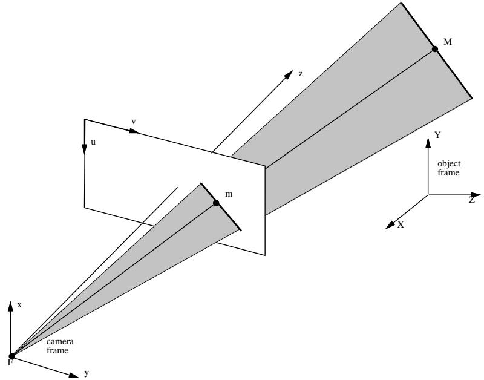  
Fig. 1 The object line, its projection onto the image, and the center of projection F are coplanar and this plane is shown in grey. ⃗n is the unit vector normal to this plane.

$$
\left\{ { \begin{array} { l } { { \vec { n } } \cdot { \vec { v } } ^ { \prime } = 0 } \\ { { \vec { n } } \cdot { \vec { p } } ^ { \prime } = 0 } \end{array} } \right.
$$

or

$$
\left\{ \begin{array} { c l } { { \vec { n } \cdot ( R \vec { v } ) = 0 } } \\ { { \vec { n } \cdot ( R \vec { p } + \vec { t } ) = 0 } } \end{array} \right.\tag{4}
$$

Therefore, each line correspondence provides 2 constraints. Since the number of unknown parameters is 6 (3 for rotation and 3 for translation) the pose problem can be solved if at least 3 line correspondences are available. In fact 3 lines can be built from 3, 4, 5, or 6 points, $\mathrm { e . g . }$ , Figure 2. More generally, N line correspondences can be built from 2N point correspondences for $N \geq 3$ . Hence, the solution presented in this section is a general solution for point and line correspondences for any number of correspondences. The minimal data set is either 3 points or 3 lines. In the general case, if N line correspondences are available, the pose problem becomes the problem of solving for a set of 2N non linear constraints, or equivalently, the problem of minimizing the following error function:

$$
f ( R , t ) = \sum _ { i = 1 } ^ { N } ( \vec { n } _ { i } \cdot ( R \vec { v } _ { i } ) ) ^ { 2 } + \sum _ { i = 1 } ^ { N } ( \vec { n } _ { i } \cdot ( R \vec { p _ { i } } + \vec { t } ) ) ^ { 2 }\tag{5}
$$

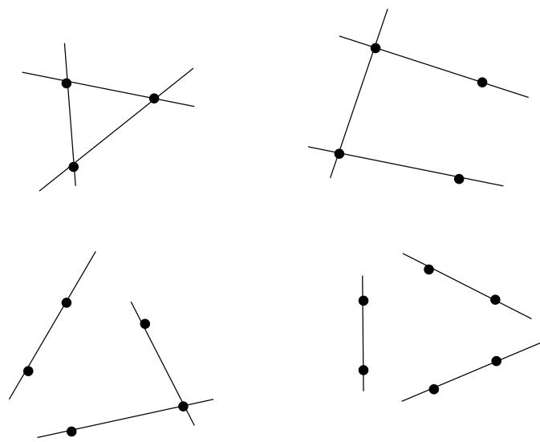  
Fig. 2 Configurations of $3 , 4 , 5 ,$ or 6 points in general position that can be replaced by 3 lines.

## 2.1 Rotation, translation, and dual number quaternions

It is well known since the French mathematician Chasles [1] that a convenient parameterization of the displacement group (i.e., rigid transformations) is a rotation about a unique axis not passing through the origin and a translation along the same axis. Such a combination of rotation and translation is called a screw. More formally, a screw is defined by the triplet $( d , \phi , { \mathcal { L } } )$ , where:

d is the length of the translation along the screwing axis;

– ϕ is the angle of rotation around this axis and

– L is the screwing axis which may well be represented parametrically by a direction unit vector $\vec { r }$ and a position vector $\vec { l , }$ with $\vec { r } \cdot \vec { l } = 0$

A dual number quaternion is a mathematical representation of screws just as a unit quaternion is a mathematical representation of rotations. The interest of parameterizing screws (and hence rigid transformations) with dual number quaternions resides in simple algebraic manipulations that are available with quaternions and in simple and elegant expressions for pose estimation problems.

A dual number quaternion has a real part and a dual part:

$$
\hat { \mathbf { q } } = \mathbf { r } + \epsilon \mathbf { s }
$$

where r and s are quaternions and $\epsilon ^ { 2 } = 0 , [ 3 0 ] . \ ^ { 1 }$

Now, a quaternion has a real part and three imaginary parts and may also be viewed as a 4-vector:

$$
\mathbf { r } = r _ { 0 } + i r _ { x } + j r _ { y } + k r _ { z } = ( r _ { 0 } , \vec { r } ) = ( r _ { 0 } \ r _ { x } \ r _ { y } \ r _ { z } ) ^ { T }
$$

Whenever $\hat { \mathbf { q } }$ represents a rigid transformation, its real and dual parts are defined by:

$$
\begin{array} { l } { { \displaystyle { \bf r } = ( \cos \frac \phi 2 , \sin \frac \phi 2 { \vec { r } } ) } } \\ { { \displaystyle { \bf s } = ( - \frac { d } 2 \sin \frac \phi 2 , \frac { d } 2 \cos \frac \phi 2 { \vec { r } } + \sin \frac \phi 2 { \vec { l } } \times { \vec { r } } ) } } \end{array}
$$

One may easily verify that the following two constraints hold:

$$
\begin{array} { l } { \mathbf { r } \cdot \mathbf { r } = 1 } \\ { \mathbf { r } \cdot \mathbf { s } = 0 } \end{array}
$$

The rotation matrix R and the translation vector $\vec { t }$ can be easily derived from r and s using the following formulae:

$$
\left( { \begin{array} { l } { 1 \ 0 ^ { T } } \\ { 0 \ R } \end{array} } \right) = W ( \mathbf { r } ) ^ { T } Q ( \mathbf { r } )\tag{6}
$$

and

$$
\binom { 0 } { \vec { t } } = 2 W ( \mathbf { r } ) ^ { T } \mathbf { s }\tag{7}
$$

where $W ( \mathbf { r } )$ and $Q ( \mathbf { r } )$ are two 4×4 matrices associated with a quaternion:

$$
Q ( \mathbf { r } ) = \left( \begin{array} { c c c c } { r _ { 0 } - r _ { x } - r _ { y } - r _ { z } } \\ { r _ { x } } & { r _ { 0 } - r _ { z } } & { r _ { y } } \\ { r _ { y } } & { r _ { z } } & { r _ { 0 } - r _ { x } } \\ { r _ { z } - r _ { y } } & { r _ { x } } & { r _ { 0 } } \end{array} \right)\tag{8}
$$

$$
W ( \mathbf { r } ) = \left( \begin{array} { l l l } { r _ { 0 } - r _ { x } - r _ { y } - r _ { z } } \\ { r _ { x } } & { r _ { 0 } } & { r _ { z } - r _ { y } } \\ { r _ { y } - r _ { z } } & { r _ { 0 } } & { r _ { x } } \\ { r _ { z } } & { r _ { y } - r _ { x } } & { r _ { 0 } } \end{array} \right)\tag{9}
$$

1 ϵ is known as the dual unity and obeys the following multiplication rules: $\scriptstyle 0 \in = \epsilon 0 = 0 , 1 \epsilon = \epsilon 1 = \epsilon ,$ and $\epsilon ^ { 2 } { = } 0$

## 2.2 The error function

If 3-vectors are treated as purely imaginary quaternions, that is:

$$
\mathbf { v } = ( 0 \ , \ { \vec { v } } )
$$

then the first constraint of eq. (4) can be written as:

$$
\vec { n } \cdot ( R \vec { v } ) = { \bf n } ^ { T } ( W ( { \bf r } ) ^ { T } Q ( { \bf r } ) { \bf v } ) = { \bf r } ^ { T } Q ( { \bf n } ) ^ { T } W ( { \bf v } ) { \bf r }\tag{10}
$$

Indeed, it is easy to verify that for two quaternions a and b we have the following property:

$$
Q ( \mathbf { a } ) \mathbf { b } = W ( \mathbf { b } ) \mathbf { a }\tag{11}
$$

The second constraint of eq. (4) becomes:

$$
\begin{array} { r l } & { \vec { n } \cdot ( R \vec { p } + \vec { t } ) = \mathbf { n } ^ { T } ( W ( \mathbf { r } ) ^ { T } Q ( \mathbf { r } ) \mathbf { p } + 2 W ( \mathbf { r } ) ^ { T } \mathbf { s } ) } \\ & { \qquad = \mathbf { r } ^ { T } Q ( \mathbf { n } ) ^ { T } W ( \mathbf { p } ) \mathbf { r } + \mathbf { r } ^ { T } ( 2 Q ( \mathbf { n } ) ^ { T } ) \mathbf { s } } \end{array}\tag{12}
$$

In other terms, each correspondence i provides two quadratic constraints:

$$
\mathbf { r } ^ { T } A _ { i } \mathbf { r } = 0
$$

and

$$
\mathbf { r } ^ { T } B _ { i } \mathbf { r } + \mathbf { r } ^ { T } C _ { i } \mathbf { s } = 0
$$

with $\mathbf { r } ^ { T } \mathbf { r } = 1 , \mathbf { r } ^ { T } \mathbf { s } = 0$ , and $A _ { i } , B _ { i }$ , and $C _ { i }$ being three 4×4 matrices:

$$
\begin{array} { r l } & { A _ { i } = Q ( \mathbf { n } _ { i } ) ^ { T } W ( \mathbf { v } _ { i } ) } \\ & { B _ { i } = Q ( \mathbf { n } _ { i } ) ^ { T } W ( \mathbf { p } _ { i } ) } \\ & { C _ { i } = 2 Q ( \mathbf { n } _ { i } ) ^ { T } } \end{array}
$$

We can now write a new expression of the error function associated with our problem, i.e., eq. (5):

$$
\begin{array} { l } { f ( \mathbf { r } , \mathbf { s } ) = \displaystyle \sum _ { i = 1 } ^ { N } \left( ( \mathbf { r } ^ { T } A _ { i } \mathbf { r } ) ^ { 2 } + ( \mathbf { r } ^ { T } B _ { i } \mathbf { r } + \mathbf { r } ^ { T } C _ { i } \mathbf { s } ) ^ { 2 } \right) } \\ { \qquad + \lambda ( \mathbf { r } ^ { T } \mathbf { r } - 1 ) ^ { 2 } + \lambda ( \mathbf { r } ^ { T } \mathbf { s } ) ^ { 2 } } \end{array}\tag{13}
$$

where the parameters to be estimated are the elements of the quaternions (or 4-vectors) r and ${ \mathbf { s } } ,$ and λ is a positive number. λ must be taken very large in order to guarantee that the penalization constraints $( \mathbf { r } ^ { T } \mathbf { r } = 1$ and $\mathbf { r } ^ { T } \mathbf { s } = 0 )$ are satisfied. In practice we took $\lambda =$ 50 and we obtained very good results with this value. However a too large value for λ can make convergence quite ineficient (see Section 4).

Notice that an alternative to this error function may be to consider the estimation of r and s separately. One may estimate the rotation first using the following error function:

$$
f ( \mathbf { r } ) = \sum _ { \mathbf { i } = 1 } ^ { \mathbf { N } } ( \mathbf { r } ^ { \mathbf { T } } \mathbf { A } _ { \mathbf { i } } \mathbf { r } ) ^ { 2 } + \lambda ( \mathbf { r } ^ { \mathbf { T } } \mathbf { r } - \mathbf { 1 } ) ^ { 2 }\tag{14}
$$

Once the optimal value of r is found, the computation of the optimal value of s is trivial since it is reduced to a linear least-square minimization problem:

$$
f ( \mathbf { s } ) = \sum _ { i = 1 } ^ { N } ( \mathbf { r } ^ { T } B _ { i } \mathbf { r } + \mathbf { r } ^ { T } C _ { i } \mathbf { s } ) ^ { 2 } + \lambda ( \mathbf { r } ^ { T } \mathbf { s } ) ^ { 2 }\tag{15}
$$

## 3 Object pose from point correspondences

The error function that we devised in the previous section holds for line correspondences and for point correspondences since a set of two quadratic constraints can be associated either with one line or with two points. In this section we devise an error function directly from point correspondences. This function has the same structure – sum of squares of quadratic constraints – as with line correspondences, provided that the rigid transformation is represented by a dual number quaternion. Each point correspondence provides two constraints that express the collinearity between the object point, its image projection, and the center of projection.

Let again $M _ { i }$ be an object point with coordinates $X _ { i } , Y _ { i }$ , and $Z _ { i }$ in an object frame and let $x _ { i }$ and $y _ { i }$ be the coordinates in the camera frame of its projection mi. The collinearity between $M _ { i } , m _ { i } .$ , and $F$ (the center of projection) is expressed by two equations [10], [13], e.g., Figure 1:

$$
x _ { i } = \frac { r _ { 1 1 } X _ { i } + r _ { 1 2 } Y _ { i } + r _ { 1 3 } Z _ { i } + t _ { 1 } } { r _ { 3 1 } X _ { i } + r _ { 3 2 } Y _ { i } + r _ { 3 3 } Z _ { i } + t _ { 3 } }\tag{16}
$$

$$
y _ { i } = { \frac { r _ { 2 1 } X _ { i } + r _ { 2 2 } Y _ { i } + r _ { 2 3 } Z _ { i } + t _ { 2 } } { r _ { 3 1 } X _ { i } + r _ { 3 2 } Y _ { i } + r _ { 3 3 } Z _ { i } + t _ { 3 } } }\tag{17}
$$

where $r _ { i j }$ is an element of the rotation matrix R and $t _ { i }$ is a component of the translation vector $\vec { t . }$ One may notice that the two constraints above can be written more compactly as:

$$
\left( 1 \ : 0 - x _ { i } \right) R \left( \begin{array} { l } { { X _ { i } } } \\ { { Y _ { i } } } \\ { { Z _ { i } } } \end{array} \right) + \left( 1 \ : 0 - x _ { i } \right) \ : \left( \begin{array} { l } { { t _ { 1 } } } \\ { { t _ { 2 } } } \\ { { t _ { 3 } } } \end{array} \right) = 0\tag{18}
$$

$$
\left( 0 \ : 1 \ : - y _ { i } \right) R \left( \begin{array} { c } { { X _ { i } } } \\ { { Y _ { i } } } \\ { { Z _ { i } } } \end{array} \right) + \left( 0 \ : 1 \ : - y _ { i } \right) \ : \left( \begin{array} { c } { { t _ { 1 } } } \\ { { t _ { 2 } } } \\ { { t _ { 3 } } } \end{array} \right) = 0\tag{19}
$$

Let M be the purely imaginary quaternion associated with the point vector $M _ { i }$ and let $\mathbf { m } _ { x _ { i } }$ and $\mathbf { m } _ { y _ { i } }$ be two purely imaginary quaternions each one associated with one “half” of the point vector $m _ { i } \colon$

$$
\begin{array} { r } { \mathbf { M } _ { i } = \left( 0 \ X _ { i } \ Y _ { i } \ Z _ { i } \right) ^ { T } } \\ { \mathbf { m } _ { x _ { i } } = \left( 0 \ 1 \ 0 \ - { x } _ { i } \right) ^ { T } } \\ { \mathbf { m } _ { y _ { i } } = \left( 0 \ 0 \ 1 \ - { y } _ { i } \right) ^ { T } } \end{array}
$$

By substituting the rotation matrix R and the translation vector $\vec { t }$ with their dual number quaternion representation (eqs. (6) and (7)) we obtain, for the first constraint (see also eq. (11)):

$$
\begin{array} { r l } & { \mathbf { m } _ { x _ { i } } ^ { T } W ( \mathbf { r } ) ^ { T } Q ( \mathbf { r } ) \mathbf { M } _ { i } + 2 \mathbf { m } _ { x _ { i } } ^ { T } W ( \mathbf { r } ) ^ { T } \mathbf { s } } \\ & { \qquad = ( W ( \mathbf { r } ) \mathbf { m } _ { x _ { i } } ) ^ { T } Q ( \mathbf { r } ) \mathbf { M } _ { i } + 2 ( W ( \mathbf { r } ) \mathbf { m } _ { x _ { i } } ) ^ { T } \mathbf { s } } \\ & { \qquad = \mathbf { r } ^ { T } Q ( \mathbf { m } _ { x _ { i } } ) ^ { T } W ( \mathbf { M } _ { i } ) \mathbf { r } + 2 \mathbf { r } ^ { T } Q ( \mathbf { m } _ { x _ { i } } ) ^ { T } \mathbf { s } } \end{array}
$$

There is a similar expression for the second constraint:

$$
\begin{array} { r l } & { \mathbf { m } _ { y _ { i } } ^ { T } W ( \mathbf { r } ) ^ { T } Q ( \mathbf { r } ) \mathbf { M } _ { i } + 2 \mathbf { m } _ { y _ { i } } ^ { T } W ( \mathbf { r } ) ^ { T } \mathbf { s } } \\ & { \qquad = \mathbf { r } ^ { T } Q ( \mathbf { m } _ { y _ { i } } ) ^ { T } W ( \mathbf { M } _ { i } ) \mathbf { r } + 2 \mathbf { r } ^ { T } Q ( \mathbf { m } _ { y _ { i } } ) ^ { T } \mathbf { s } } \end{array}
$$

Finally, equation (16) and equation (17), the collinearity constraints, become:

$$
\begin{array} { r } { \mathbf { r } ^ { T } A _ { i } ^ { p } \mathbf { r } + 2 \mathbf { r } ^ { T } B _ { i } ^ { p } \mathbf { s } = 0 } \\ { \mathbf { r } ^ { T } C _ { i } ^ { p } \mathbf { r } + 2 \mathbf { r } ^ { T } D _ { i } ^ { p } \mathbf { s } = 0 } \end{array}\tag{20}
$$

(21)

which can be written more compactly as two simple quadratic constraints:

$$
\begin{array} { r l } & { \left( \mathbf { \phi _ { s } ^ { r } } \right) ^ { T } \left( \begin{array} { l l } { A _ { i } ^ { p } } & { B _ { i } ^ { p } } \\ { B _ { i } ^ { p ^ { T } } } & { 0 } \end{array} \right) \left( \mathbf { \phi _ { s } ^ { r } } \right) = 0 } \\ & { \left( \mathbf { \phi _ { s } ^ { r } } \right) ^ { T } \left( \begin{array} { l l } { C _ { i } ^ { p } } & { D _ { i } ^ { p } } \\ { D _ { i } ^ { p ^ { T } } } & { 0 } \end{array} \right) \left( \mathbf { \phi _ { s } ^ { r } } \right) = 0 } \end{array}
$$

where $A _ { i } ^ { p } , B _ { i } ^ { p } , C _ { i } ^ { p }$ , and $D _ { i } ^ { p }$ are $4 \times 4$ matrices given by:

$$
\begin{array} { r l } & { A _ { i } ^ { p } = Q ( \mathbf { m } _ { x _ { i } } ) ^ { T } W ( \mathbf { M } _ { i } ) } \\ & { B _ { i } ^ { p } = Q ( \mathbf { m } _ { x _ { i } } ) ^ { T } } \\ & { C _ { i } ^ { p } = Q ( \mathbf { m } _ { y _ { i } } ) ^ { T } W ( \mathbf { M } _ { i } ) } \\ & { D _ { i } ^ { p } = Q ( \mathbf { m } _ { y _ { i } } ) ^ { T } } \end{array}
$$

Hence, each point correspondence i provides two quadratic constraints. To conclude, in the case of point correspondences, the error function to be minimized is:

$$
\begin{array} { r l } & { f ( \mathbf { r } , \mathbf { s } ) = \displaystyle \sum _ { i = 1 } ^ { N } \left( ( \mathbf { r } ^ { T } A _ { i } ^ { p } \mathbf { r } + 2 \mathbf { r } ^ { T } B _ { i } ^ { p } \mathbf { s } ) ^ { 2 } + ( \mathbf { r } ^ { T } C _ { i } ^ { p } \mathbf { r } } \\ & { \qquad + 2 \mathbf { r } ^ { T } D _ { i } ^ { p } \mathbf { s } ) ^ { 2 } \right) + \lambda ( \mathbf { r } ^ { T } \mathbf { r } - 1 ) ^ { 2 } + \lambda ( \mathbf { r } ^ { T } \mathbf { s } ) ^ { 2 } } \end{array}\tag{22}
$$

## 4 The trust-region optimization method

It is clear that the minimization of the error functions described by equations (13), (14), and (22) is equivalent to the following non linear least squares problem:

$$
0 = \operatorname* { m i n } _ { x } \{ f ( x ) = \frac { 1 } { 2 } \sum _ { j = 1 } ^ { m } \varPhi _ { j } ^ { 2 } ( x ) : x \in I R ^ { n } \}\tag{23}
$$

where $\varPhi _ { j } ( x )$ is twice continuously diferentiable function from $\pmb { { \cal { R } } } ^ { n }$ to $\mathit { \Pi } \mathit { \Pi } .$ In our case x is either a 4-vector (quaternion r of eq. (14)) or an 8-vector (the concatenation of quaternions r and s of eqs. (13) and (22)).

There are some methods which are usually used for dealing with unconstrained minimization problems, among which the steepest descent method, the Newton method, and Newton-like methods. The steepest descent method is both ineficient and unreliable because of its slow rate of linear convergence. The Newton method converges rapidly but its main drawback is that the method is only well defined under certain conditions and even in these cases it does not ensure the descent. In this section we proceed to present a Newtonlike method which is generally applicable and globally convergent while it retains the rapid convergence rate of Newton’s method – the trust region method.

In order to understand the diference between Newton’s method (which has been so far widely used in computer vision) and trust region methods we consider a simple example. Figure 3 shows a single-valued function $f ( x )$ to be minimized and which has more than one minimum. From an initial point $x ^ { 0 }$ , Newton’s method approximates the function with a parabola by using a second order Taylor’s expansion of $f ( x )$ around $x ^ { 0 }$ The next point, $x ^ { 1 }$ , corresponds to the minimum of that parabola but this value increases $f ( x )$ . The idea of the trust-region method is to approximate the function around the current iterate (say $x ^ { 0 } )$ with a parabola as well and to search for the minimum of that parabola in a restricted set around $x ^ { 0 }$ rather than over the entire definition set of $f ( x )$ . Figure 4 shows an example of applying this method to the same function as above. $\mathrm { A t }$ $x ^ { 0 }$ the function is approximated with a parabola on an interval of size $2 r _ { 0 }$ . The minimum of the parabola over this interval is at $x ^ { 1 } = x ^ { 0 } - r _ { 0 }$ . At $x ^ { 1 }$ the function is approximated with a parabola again, but on an interval of increased size $2 r _ { 1 }$ , with $r _ { 1 } = 2 r _ { 0 }$ . The minimum of the new parabola is at $x ^ { 2 } = x ^ { 1 } + r _ { 1 }$ . From now on, the behaviour of the algorithm is very similar to the Newton’s method and it will ultimately converge to the global minimum $x ^ { * }$

Denote by $\nabla f ( x )$ and $\nabla ^ { 2 } f ( x )$ the gradient and the Hessian of a function $f ( x )$ . From eq. (23) it is easy to verify that:

$$
\nabla f ( x ) = \sum _ { j = 1 } ^ { m } \varPhi _ { j } ( x ) \nabla \varPhi _ { j } ( x ) = J ( x ) ^ { T } \varPhi ( x ) ,\tag{24}
$$

$$
\begin{array} { l } { { \nabla ^ { 2 } f ( x ) = \displaystyle \sum _ { j = 1 } ^ { m } \nabla \varPhi _ { j } ( x ) \nabla \varPhi _ { j } ( x ) ^ { T } + \displaystyle \sum _ { j = 1 } ^ { m } \varPhi _ { j } ( x ) \nabla ^ { 2 } \varPhi _ { j } ( x ) } } \\ { { \mathrm { ~ } = J ( x ) ^ { T } J ( x ) + \displaystyle \sum _ { j = 1 } ^ { m } \varPhi _ { j } ( x ) \nabla ^ { 2 } \varPhi _ { j } ( x ) \qquad ( } } \end{array}\tag{25}
$$

where $\boldsymbol { \varPhi } ( \boldsymbol { x } ) = ( \varPhi _ { 1 } ( \boldsymbol { x } ) , \dots , \varPhi _ { m } ( \boldsymbol { x } ) ) ^ { T }$ and

$$
J ( x ) = ( \nabla \Phi _ { 1 } ( x ) , \ldots , \nabla \Phi _ { m } ( x ) ) ^ { T }
$$

is the $m \times n$ Jacobian matrix of $\varPhi ( x )$ . The Hessian of such a least-square error function is a combination of first- and second-order terms:

$$
\nabla ^ { 2 } f ( x ) = J ( x ) ^ { T } J ( x ) + Q ( x )
$$

with: $\begin{array} { r } { Q ( x ) = \sum _ { j = 1 } ^ { m } \varPhi _ { j } ( x ) \nabla ^ { 2 } \varPhi _ { j } ( x ) } \end{array}$ . In practice, Gauss-Newton approximation of the Hessian is used, $H ( x ) =$ $J ( x ) ^ { T } J ( x )$ . This is based on the premise that the firstorder term will eventually dominate the second-order term, Q(x) [12].

Let $x ^ { k }$ denote the current estimate of the solution; a vector over scripted by k will denote a vector evaluated at the $k ^ { t h }$ iteration of the algorithm. A scalar subscripted by k will denote a quantity evaluated at the $k ^ { t h }$ iteration. The basic idea of the trust-region optimization method consists of successively approximating the error function by a local quadratic form (or a paraboloid) in a neighbourhood of the current solution $x ^ { k }$

$$
f ( x ^ { k } + d ) \approx f ( x ^ { k } ) + q _ { k } ( d ) , \| d \| \leq \delta _ { k }
$$

where:

$$
q _ { k } ( d ) = \nabla f ( x ^ { k } ) ^ { T } d + \frac { 1 } { 2 } d ^ { T } H ( x ^ { k } ) d\tag{26}
$$

The error function will be reduced via the direction $d ^ { k } , \mathrm { i . e . , } x ^ { k + 1 } = x ^ { k } + d ^ { k }$ , where $d ^ { k }$ is a minimizer of the local quadratic form over a restricted spherical region centered around $x ^ { k } { \mathrm { : } }$ the trust region:

$$
d ^ { k } \in \arg \operatorname* { m i n } _ { d } \{ q _ { k } ( d ) : \| d \| \leq \delta _ { k } \}\tag{27}
$$

The parameter $\delta _ { k }$ is called the trust radius and is determined dynamically using a measure of the quality of the approximation; this is measured by a quality coeficient $r _ { k } \colon$

$$
r _ { k } = \frac { f ( x ^ { k } ) - f ( x ^ { k } + d ^ { k } ) } { q _ { k } ( 0 ) - q _ { k } ( d ^ { k } ) }\tag{28}
$$

which measures the ratio between the actual reduction of the error function when moving from $x ^ { k }$ to $x ^ { k } +$ $d ^ { k }$ and the predicted reduction according to the local quadratic approximation. If $r _ { k }$ is too small it means that the approximation is not good and the trust region should be decreased. Otherwise the trust region should be increased. Roughly, the following strategy will be applied:

if $r _ { k } \geq r$ (with $0 < r \leq 1 )$ then the new iterate is accepted, i. $\mathrm { e } . , x ^ { k + 1 } = x ^ { k } + d ^ { k }$ and in addition the trust region is increased;

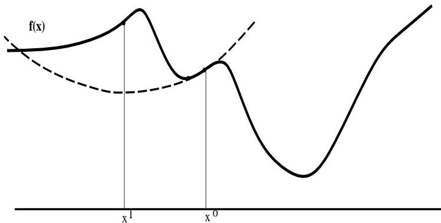  
Fig. 3 An example of minimization when several minima are present. Newton’s method may lead to an increase of the value of the function f(x).

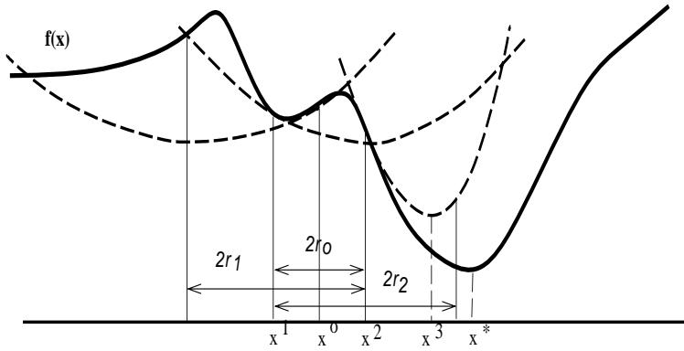  
Fig. 4 This figure shows an example of minimizing the function f(x) with the trust region method which always ensures that at each iteration the value of the function decreases.

– if $r _ { k } < r$ then the iterate is unchanged and in addition the trust region is decreased. This process is repeated until the local quadratic form yields a satisfactory approximation inside the trust region (which will necessarily occur for small radii since the gradient is supposed to be exactly known and the firstorder term in $q _ { k }$ becomes dominant if $\| g _ { k } \| \neq 0 )$ .

The local quadratic form depends on the gradient and the Hessian of the error function. Hence, the minimum thus found has “good” second-order properties. In a trust-region method the main dificulty resides in the minimization of the local quadratic form. Various trust region algorithms difer upon the method being used to minimize the local quadratic form inside the trust region. A detailed discussion on the theoretical aspects of this problem is given in Appendix A.

We propose to apply the following practical trustregion algorithm to our problem (see also Clermont & al. [3] and Tao & al. [28]). The idea is to use the Gauss-Newton’s approximation of the Hessian for determining a search direction. Generally, $H ( x ) = J ^ { T } ( x ) J ( x )$ is positive semi-definite and we can make it positive definite

by considering

$$
H ^ { \prime } ( x ) = H ( x ) + \alpha I
$$

where α is a chosen small positive number (for example $\alpha = 0 . 0 0 1 )$ . So $H ^ { \prime } ( x ) + \mu I \ge 0$ (condition (i) in Theorem 1 (Appendix A)) holds for all $\mu \geq 0$ . To solve (27) we first check whether $\mu _ { * } = 0$ when solving $H ^ { \prime } ( x ^ { k } ) d = - \nabla f ( x ^ { k } )$ . If the obtained solution $d ^ { k }$ satisfies $\| d ^ { k } \| \leq \delta _ { k }$ then $d ^ { k }$ is an optimal solution. Otherwise, $\mu _ { * } > 0$ and an unique solution to (27) can be found by a very eficient algorithm proposed by Hebden (see Appendix A).

## 4.1 The practical trust-region algorithm

The trust region algorithm is summarized as follows:

– Initialization : Choose an initial iterate $x ^ { o } .$ , a trust radius $\delta _ { o }$ and small positive numbers $\epsilon , \epsilon _ { g } , \epsilon _ { f }$ . Set k=0.

Iteration $k { = } \theta , \boldsymbol { \mathit { 1 } } ,$

$$
\begin{array} { r l } & { \mathrm { k . 1 ~ C o m p u t e ~ } f _ { k } = f ( x ^ { k } ) , g _ { k } = \nabla f ( x ^ { k } ) \mathrm { ~ a n d ~ } H _ { k } = } \\ & { \quad J ^ { T } ( x ^ { k } ) J ( x ^ { k } ) . } \end{array}
$$

k.2 If $\| g _ { k } \| \le \epsilon _ { g }$ or $\delta _ { k } \leq \epsilon _ { \delta }$ or $f _ { k } \leq \epsilon _ { f }$ then stop: $x ^ { k }$ is a solution.

k.3 Consider $H _ { k } ^ { \prime } = H _ { k } + 0 . 0 0 1 I .$ . Let d be a solution of the system

$$
H _ { k } ^ { \prime } d = - g _ { k }
$$

If $\| d \| ~ < ~ \delta _ { k } - \epsilon$ then $d ^ { k } \ = \ d .$ Otherwise, use Hebden’s algorithm to obtain $d ^ { k }$

k.4 Compute $r _ { k }$ using eq. (28).

k.5 If $r _ { k } \geq r$ then

$$
x ^ { k + 1 } : = x ^ { k } + d ^ { k }
$$

if $r _ { k } \geq s$ then

$$
\delta _ { k + 1 } : = 2 \delta _ { k }
$$

otherwise

$$
\delta _ { k + 1 } : = \delta _ { k }
$$

Set k := k + 1 and return to k.1

k.6 If $r _ { k } < r$ then

$$
\delta _ { k } : = \delta _ { k } / 2
$$

and return to k.3.

The parameter r must belong to the interval [0.1, 0.3] and the parameter s must belong to the interval [0.5, 0.8]. For our application, these parameters were set at: $r = 0 . 2 5$ and $s = 0 . 7 5$

## 4.2 Comparison with Levenberg-Marquardt

A well known non-linear optimization method that could have been used for solving our problem is a method that is due to Levenberg and Marquardt [19], [9]. This method uses the Gauss-Newton approximation of the Hessian and the $k ^ { t h }$ search direction is defined as the solution of:

$$
( J ( x ^ { k } ) ^ { T } J ( x ^ { k } ) + \nu _ { k } I ) d ^ { k } = - J ( x ^ { k } ) ^ { T } \varPhi ( x ^ { k } )
$$

where $\nu _ { k }$ is a non-negative scalar. It can be shown that, for some scalar $\delta _ { k }$ related to $\nu _ { k }$ , the vector $d ^ { k }$ is the solution of the constrained subproblem:

$$
\operatorname* { m i n } _ { d } \{ { \frac { 1 } { 2 } } \| J ( x ^ { k } ) d + \varPhi ( x ^ { k } ) \| ^ { 2 } , : \| d \| \leq \delta _ { k } . \}
$$

which is similar to the minimization of the local quadratic form just described. The Levenberg-Marquardt method does have disadvantage when $\nu _ { k }$ is close to zero in which case $d ^ { k }$ is badly determined by $\nu _ { k }$

Both our method and Levenberg-Marquardt’s one are based on the assumption that ultimately $J ( x ^ { k } ) ^ { T } J ( x ^ { k } )$

is a good approximation of the Hessian, $\mathrm { i . e . , }$ that the second-order term in eq. (25) can be neglected. This assumption is not justified for the so-called large-residual problems in which the optimal value $\| f ( x ^ { * } ) \|$ is not “small”. In this case, we must use the exact Hessian which is no longer positive and semi-definite. Therefore one cannot use the Levenberg-Marquardt method any more. The trust-region method that we just described can be used by replacing the step k.3 (Hebden’s algorithm) with the safeguarding algorithm proposed by Mor´e & Sorensen [25]. However, the latter algorithm is more time consuming than the Hebden’s algorithm.

## 5 Experimental results

The trust region algorithm is particularly well-suited for solving the object pose from a single view problem because the error function is a sum of squares of quadratic constraints. Indeed, the trust region algorithm – generally applicable for any non linear constraints – is more robust and more eficient when these constraints are quadratic. This explains why the algorithm can attain the global solution independently of the initialisation in a very small number of iterations. This is also one reason for which dual number quaternions are a good representation for rotation and translation. The experiments that we performed can be summarized as follows:

– A 3-D calibrating object with 460 calibrating points is viewed by a camera and point-to-point correspondences are established. The accuracy of the 3-D positions of these points is within 1/10 of a millimeter and the accuracy of the image points is within $1 / 1 0$ of a pixel;

The intrinsic and extrinsic camera parameters are determined using these 460 point correspondences and the linear method of Faugeras & Toscani [6]. This solution is taken to be the “ground-truth”. The intrinsic camera parameters thus found will be used throughout the experiments with the non-linear solver described in this paper. The numerical values of these intrinsic parameters are displayed on the last row of Table 1. The numerical values of the extrinsic parameters are as follows:

– The axis of rotation ⃗r: (–0.185148 –0.973420 0.156567)T

– The angle of rotation $\phi$ (radians): 2.9512

– The translation vector ⃗t (in centimeters): (2.627650 –11.006138 77.479236)T

Subsets of point correspondences are randomly selected from the initial set of 460 points. These subsets contain 10, 20, 40, 60, 80, 100, 200, 300, and

400 points. Hence, sets of 5, 10, 20, 30, 40, 50, 100, 150, and 200 line correspondences are also available; The linear method of Faugeras and Toscani is applied to these subsets of point correspondences. The solution obtained with each subset is then compared to the ground-truth, e.g., Table 1. For one of these point subsets (100 points) noise with increasing maximum amplitude is added to the image point locations. Again, the solutions thus obtained are compared with the ground-truth solution, e.g., Table 2. The trust region algorithm is applied both to sets of line correspondences (Section 2) and to point correspondences (Section 3). Moreover, there are two cases for line correspondences: (i) determine the rotation first with the non linear algorithm and then determine the translation with a linear algorithm and (ii) determine the rotation and the translation simultaneously with the non linear algorithm. Hence, there are three implementations of the non linear algorithm:

1. Rotation then translation with line correspondences, Table 3 and Table 4;

2. Rotation and translation with line correspondences, Table 5 and Table 6, and

3. Rotation and translation with point correspondences, Table 7 and Table 8.

Each one of the implementations above is applied to subsets of (points or lines) noise-free data and to data degraded by noise (100 points or 50 lines). Degraded data is obtained by adding uniformly distributed random noise (with a predefined maximum amplitude) to the image location of every point in a data set. Each solution thus obtained is compared to the ground-truth solution.

The discrepancy between a solution s and the groundtruth solution $s _ { 0 }$ is measured in “transformation space”. The transformation errors are given by:

$$
\begin{array} { r } { e _ { a x i s } = \| \vec { r } - \vec { r _ { 0 } } \| } \\ { e _ { a n g l e } = | \phi - \phi _ { 0 } | } \\ { e _ { t r a n s l a t i o n } = \| \vec { t } - \vec { t _ { 0 } } \| } \end{array}
$$

where quantities subscripted by 0 correspond to the ground-truth solution.

A quantitative comparison between the Faugeras-Toscani method and the trust-region method is provided by Figures 5, 6, and 7. The dashed curves correspond to the Faugeras-Toscani method and the full curves correspond to the rotation-then-translation implementation of our method. The errors in rotation (axis and angle) and translation, as compared with the ground-truth solution, are shown as functions of the number of correspondences (left) and as functions of increasing image noise (right). These curves correspond to data otherwise shown in Tables 1, 2, 3, and 4.

A second measure for the quality of a solution is estimated in image space. Independently of the number of points (or lines) that are actually used for obtaining a solution, all 460 3-D points are projected onto the image using that solution’s parameters. Then, we compute the error (the Euclidean distance) between the actual image locations and the projections of the 3-D points. More precisely the error associated with a correspondence i is:

$$
e _ { i } = \left( ( u _ { i } - u _ { i } ^ { s } ) ^ { 2 } + ( v _ { i } - v _ { i } ^ { s } ) ^ { 2 } \right) ^ { 1 / 2 }
$$

where $u _ { i }$ and $v _ { i }$ are the image coordinates of a point i and $u _ { i } ^ { s }$ and $v _ { i } ^ { s }$ are given by:

$$
\begin{array} { r } { u _ { i } ^ { s } = \alpha _ { u } \frac { r _ { 1 1 } ^ { s } X _ { i } + r _ { 1 2 } ^ { s } Y _ { i } + r _ { 1 3 } ^ { s } Z _ { i } + t _ { 1 } ^ { s } } { r _ { 3 1 } ^ { s } X _ { i } + r _ { 3 2 } ^ { s } Y _ { i } + r _ { 3 3 } ^ { s } Z _ { i } + t _ { 3 } ^ { s } } + u _ { 0 } } \\ { v _ { i } ^ { s } = \alpha _ { v } \frac { r _ { 2 1 } ^ { s } X _ { i } + r _ { 2 2 } ^ { s } Y _ { i } + r _ { 2 3 } ^ { s } Z _ { i } + t _ { 2 } ^ { s } } { r _ { 3 1 } ^ { s } X _ { i } + r _ { 3 2 } ^ { s } Y _ { i } + r _ { 3 3 } ^ { s } Z _ { i } + t _ { 3 } ^ { s } } + v _ { 0 } } \end{array}
$$

Then, for each solution we estimate:

– the largest error;

– the smallest error;

over the 460 point correspondences. The values of these errors are reported in Tables 1 through 8.

## 5.1 Matching errors

In order to test the robustness of both the Faugeras-Toscani method and our method with respect to matching errors, we studied the error between the groundtruth solution and solutions obtained with a variable number of mismatches. A mismatch, or a matching error is defined as follows. Let $( A , B , C , D )$ be 4 scene points and let $( a , b , c , d )$ be 4 image points. Assume that the following 4 point correspondences are correct: $( A - a , B - b , C - c , D - d )$ . Moreover, one may associate 2 line correspondences with these 4 point correspondences, $( A D - a d , B C - b c )$ , e.g., Figure 8. If A is matched to b and B is matched to a we obtain a point mismatched pair, that is $( A - b , B - a )$ , and a line mismatched pair, that is $( B D - a d , A C - b c )$

Figure 9 shows the errors in rotation (axis and angle) and translation as functions of the number of the point mismatched pairs. These experiments show that the results obtained with the non-linear method (full curves) degrade gently as the number of matching errors increases while the linear method (dashed curves) give erroneous results.

<table><tr><td rowspan=2 colspan=1>Numberof points</td><td rowspan=1 colspan=3>Transformation error</td><td rowspan=1 colspan=3>Image error</td><td rowspan=1 colspan=1></td><td rowspan=1 colspan=3>Intrinsic parameters</td></tr><tr><td rowspan=1 colspan=1>axis</td><td rowspan=1 colspan=1>angle</td><td rowspan=1 colspan=1>translation</td><td rowspan=1 colspan=1>largest</td><td rowspan=1 colspan=1>smallest</td><td rowspan=1 colspan=1>average</td><td rowspan=1 colspan=1>u0</td><td rowspan=1 colspan=1>v0</td><td rowspan=1 colspan=1> $\alpha _ { u }$ </td><td rowspan=1 colspan=1> $\alpha _ { v }$ </td></tr><tr><td rowspan=1 colspan=1>10</td><td rowspan=1 colspan=1>0.0170</td><td rowspan=1 colspan=1>0.0032</td><td rowspan=1 colspan=1>2.4277</td><td rowspan=1 colspan=1>0.9754</td><td rowspan=1 colspan=1>0.0008</td><td rowspan=1 colspan=1>0.2150</td><td rowspan=1 colspan=1>243.1</td><td rowspan=1 colspan=1>224.3</td><td rowspan=1 colspan=1>-1677.8</td><td rowspan=1 colspan=1>1183.2</td></tr><tr><td rowspan=1 colspan=1>20</td><td rowspan=1 colspan=1>0.0064</td><td rowspan=1 colspan=1>0.0143</td><td rowspan=1 colspan=1>3.2806</td><td rowspan=1 colspan=1>1.0983</td><td rowspan=1 colspan=1>0.0002</td><td rowspan=1 colspan=1>0.1912</td><td rowspan=1 colspan=1>269.0</td><td rowspan=1 colspan=1>233.2</td><td rowspan=1 colspan=1>-1663.5</td><td rowspan=1 colspan=1>1173.5</td></tr><tr><td rowspan=1 colspan=1>40</td><td rowspan=1 colspan=1>0.0016</td><td rowspan=1 colspan=1>0.0047</td><td rowspan=1 colspan=1>0.8157</td><td rowspan=1 colspan=1>1.0935</td><td rowspan=1 colspan=1>0.0018</td><td rowspan=1 colspan=1>0.1577</td><td rowspan=1 colspan=1>235.2</td><td rowspan=1 colspan=1>238.3</td><td rowspan=1 colspan=1>-1715.7</td><td rowspan=1 colspan=1>1209.6</td></tr><tr><td rowspan=1 colspan=1>60</td><td rowspan=1 colspan=1>0.0009</td><td rowspan=1 colspan=1>0.0015</td><td rowspan=1 colspan=1>0.2563</td><td rowspan=1 colspan=1>0.7255</td><td rowspan=1 colspan=1>0.0007</td><td rowspan=1 colspan=1>0.1508</td><td rowspan=1 colspan=1>239.9</td><td rowspan=1 colspan=1>242.9</td><td rowspan=1 colspan=1>-1734.2</td><td rowspan=1 colspan=1>1223.2</td></tr><tr><td rowspan=1 colspan=1>80</td><td rowspan=1 colspan=1>0.0024</td><td rowspan=1 colspan=1>0.0038</td><td rowspan=1 colspan=1>0.6620</td><td rowspan=1 colspan=1>0.9277</td><td rowspan=1 colspan=1>0.0001</td><td rowspan=1 colspan=1>0.1500</td><td rowspan=1 colspan=1>235.9</td><td rowspan=1 colspan=1>245.5</td><td rowspan=1 colspan=1>-1741.8</td><td rowspan=1 colspan=1>1229.0</td></tr><tr><td rowspan=1 colspan=1>100</td><td rowspan=1 colspan=1>0.0020</td><td rowspan=1 colspan=1>0.0003</td><td rowspan=1 colspan=1>0.1727</td><td rowspan=1 colspan=1>0.6431</td><td rowspan=1 colspan=1>0.0006</td><td rowspan=1 colspan=1>0.1500</td><td rowspan=1 colspan=1>245.6</td><td rowspan=1 colspan=1>238.8</td><td rowspan=1 colspan=1>-1730.3</td><td rowspan=1 colspan=1>1221.0</td></tr><tr><td rowspan=1 colspan=1>200</td><td rowspan=1 colspan=1>0.0011</td><td rowspan=1 colspan=1>0.0001</td><td rowspan=1 colspan=1>0.2249</td><td rowspan=1 colspan=1>0.7806</td><td rowspan=1 colspan=1>0.0001</td><td rowspan=1 colspan=1>0.1444</td><td rowspan=1 colspan=1>243.6</td><td rowspan=1 colspan=1>243.5</td><td rowspan=1 colspan=1>-1734.6</td><td rowspan=1 colspan=1>1223.8</td></tr><tr><td rowspan=1 colspan=1>300</td><td rowspan=1 colspan=1>0.0015</td><td rowspan=1 colspan=1>0.0016</td><td rowspan=1 colspan=1>0.3334</td><td rowspan=1 colspan=1>0.7471</td><td rowspan=1 colspan=1>0.0010</td><td rowspan=1 colspan=1>0.1425</td><td rowspan=1 colspan=1>246.0</td><td rowspan=1 colspan=1>244.1</td><td rowspan=1 colspan=1>-1736.8</td><td rowspan=1 colspan=1>1225.1</td></tr><tr><td rowspan=1 colspan=1>400</td><td rowspan=1 colspan=1>0.0002</td><td rowspan=1 colspan=1>0.0001</td><td rowspan=1 colspan=1>0.0147</td><td rowspan=1 colspan=1>0.6979</td><td rowspan=1 colspan=1>0.0000</td><td rowspan=1 colspan=1>0.1444</td><td rowspan=1 colspan=1>244.1</td><td rowspan=1 colspan=1>241.2</td><td rowspan=1 colspan=1>-1730.1</td><td rowspan=1 colspan=1>1220.5</td></tr><tr><td rowspan=1 colspan=1>460</td><td rowspan=1 colspan=1>0.0000</td><td rowspan=1 colspan=1>0.0000</td><td rowspan=1 colspan=1>0.0000</td><td rowspan=1 colspan=1>0.6987</td><td rowspan=1 colspan=1>0.0006</td><td rowspan=1 colspan=1>0.1446</td><td rowspan=1 colspan=1>243.8</td><td rowspan=1 colspan=1>241.2</td><td rowspan=1 colspan=1>-1730.3</td><td rowspan=1 colspan=1>1220.7</td></tr></table>

Table 1 This table shows the performance of the linear method of Faugeras and Toscani as a function of the number of point correspondences. The solution obtained with 460 points (the last row) is taken to be the ground-truth. While rotation seems to be relatively stable, translation degrades gently as the number of points decreases. Notice however the large variations of the intrinsic parameters.

<table><tr><td rowspan=2 colspan=1>Noise max.amplitude</td><td rowspan=1 colspan=3>Transformation error</td><td rowspan=1 colspan=1>Image</td><td rowspan=1 colspan=2>error</td><td rowspan=1 colspan=1></td><td rowspan=1 colspan=3>Intrinsic parameters</td></tr><tr><td rowspan=1 colspan=1>axis</td><td rowspan=1 colspan=1>angle</td><td rowspan=1 colspan=1>translation</td><td rowspan=1 colspan=1>largest</td><td rowspan=1 colspan=1>smallest</td><td rowspan=1 colspan=1>average</td><td rowspan=1 colspan=1>u0</td><td rowspan=1 colspan=1>v0</td><td rowspan=1 colspan=1> $\alpha _ { u }$ </td><td rowspan=1 colspan=1> $\alpha _ { v }$ </td></tr><tr><td rowspan=1 colspan=1>0.00</td><td rowspan=1 colspan=1>0.0023</td><td rowspan=1 colspan=1>0.0006</td><td rowspan=1 colspan=1>0.3333</td><td rowspan=1 colspan=1>0.5997</td><td rowspan=1 colspan=1>0.0008</td><td rowspan=1 colspan=1>0.1461</td><td rowspan=1 colspan=1>244.0</td><td rowspan=1 colspan=1>236.5</td><td rowspan=1 colspan=1>-1726.2</td><td rowspan=1 colspan=1>1217.6</td></tr><tr><td rowspan=1 colspan=1>0.01</td><td rowspan=1 colspan=1>0.0042</td><td rowspan=1 colspan=1>0.0035</td><td rowspan=1 colspan=1>0.6013</td><td rowspan=1 colspan=1>1.1291</td><td rowspan=1 colspan=1>0.0002</td><td rowspan=1 colspan=1>0.1574</td><td rowspan=1 colspan=1>235.2</td><td rowspan=1 colspan=1>246.8</td><td rowspan=1 colspan=1>-1738.3</td><td rowspan=1 colspan=1>1225.9</td></tr><tr><td rowspan=1 colspan=1>0.05</td><td rowspan=1 colspan=1>0.0014</td><td rowspan=1 colspan=1>0.0006</td><td rowspan=1 colspan=1>0.0970</td><td rowspan=1 colspan=1>0.7807</td><td rowspan=1 colspan=1>0.0011</td><td rowspan=1 colspan=1>0.1460</td><td rowspan=1 colspan=1>245.2</td><td rowspan=1 colspan=1>242.1</td><td rowspan=1 colspan=1>-1731.9</td><td rowspan=1 colspan=1>1221.9</td></tr><tr><td rowspan=1 colspan=1>0.10</td><td rowspan=1 colspan=1>0.0018</td><td rowspan=1 colspan=1>0.0029</td><td rowspan=1 colspan=1>0.4556</td><td rowspan=1 colspan=1>0.8290</td><td rowspan=1 colspan=1>0.0009</td><td rowspan=1 colspan=1>0.1463</td><td rowspan=1 colspan=1>239.4</td><td rowspan=1 colspan=1>238.7</td><td rowspan=1 colspan=1>-1721.9</td><td rowspan=1 colspan=1>1214.7</td></tr><tr><td rowspan=1 colspan=1>0.50</td><td rowspan=1 colspan=1>0.0103</td><td rowspan=1 colspan=1>0.0046</td><td rowspan=1 colspan=1>0.9617</td><td rowspan=1 colspan=1>0.7590</td><td rowspan=1 colspan=1>0.0016</td><td rowspan=1 colspan=1>0.1589</td><td rowspan=1 colspan=1>241.8</td><td rowspan=1 colspan=1>230.2</td><td rowspan=1 colspan=1>-1714.2</td><td rowspan=1 colspan=1>1208.9</td></tr><tr><td rowspan=1 colspan=1>1.00</td><td rowspan=1 colspan=1>0.0198</td><td rowspan=1 colspan=1>0.0177</td><td rowspan=1 colspan=1>11.4770</td><td rowspan=1 colspan=1>2.2091</td><td rowspan=1 colspan=1>0.0022</td><td rowspan=1 colspan=1>0.3827</td><td rowspan=1 colspan=1>222.0</td><td rowspan=1 colspan=1>198.4</td><td rowspan=1 colspan=1>-1478.2</td><td rowspan=1 colspan=1>1042.3</td></tr><tr><td rowspan=1 colspan=1>1.50</td><td rowspan=1 colspan=1>0.0414</td><td rowspan=1 colspan=1>0.0306</td><td rowspan=1 colspan=1>17.8853</td><td rowspan=1 colspan=1>3.3508</td><td rowspan=1 colspan=1>0.0028</td><td rowspan=1 colspan=1>0.6589</td><td rowspan=1 colspan=1>226.5</td><td rowspan=1 colspan=1>159.7</td><td rowspan=1 colspan=1>-1336.2</td><td rowspan=1 colspan=1>938.9</td></tr><tr><td rowspan=1 colspan=1>2.00</td><td rowspan=1 colspan=1>0.0460</td><td rowspan=1 colspan=1>0.0578</td><td rowspan=1 colspan=1>23.1873</td><td rowspan=1 colspan=1>4.3128</td><td rowspan=1 colspan=1>0.0022</td><td rowspan=1 colspan=1>1.0022</td><td rowspan=1 colspan=1>197.4</td><td rowspan=1 colspan=1>152.6</td><td rowspan=1 colspan=1>-1218.2</td><td rowspan=1 colspan=1>856.5</td></tr><tr><td rowspan=1 colspan=1>3.00</td><td rowspan=1 colspan=1>0.1774</td><td rowspan=1 colspan=1>0.0583</td><td rowspan=1 colspan=1>44.3465</td><td rowspan=1 colspan=1>13.9919</td><td rowspan=1 colspan=1>0.0368</td><td rowspan=1 colspan=1>2.6464</td><td rowspan=1 colspan=1>194.2</td><td rowspan=1 colspan=1>156.3</td><td rowspan=1 colspan=1>-734.1</td><td rowspan=1 colspan=1>510.7</td></tr><tr><td rowspan=1 colspan=1>4.00</td><td rowspan=1 colspan=1>1.2958</td><td rowspan=1 colspan=1>0.0339</td><td rowspan=1 colspan=1>55.6320</td><td rowspan=1 colspan=1>32.0500</td><td rowspan=1 colspan=1>0.0171</td><td rowspan=1 colspan=1>5.6593</td><td rowspan=1 colspan=1>160.2</td><td rowspan=1 colspan=1>141.1</td><td rowspan=1 colspan=1>-441.4</td><td rowspan=1 colspan=1>303.9</td></tr><tr><td rowspan=1 colspan=1>5.00</td><td rowspan=1 colspan=1>0.7169</td><td rowspan=1 colspan=1>0.0753</td><td rowspan=1 colspan=1>61.1560</td><td rowspan=1 colspan=1>45.8325</td><td rowspan=1 colspan=1>0.0312</td><td rowspan=1 colspan=1>7.9906</td><td rowspan=1 colspan=1>201.9</td><td rowspan=1 colspan=1>185.8</td><td rowspan=1 colspan=1>-336.3</td><td rowspan=1 colspan=1>231.2</td></tr></table>

Table 2 This table shows the performance of the linear method (Faugeras and Toscani) for 100 point correspondences and in the presence of image noise. The first column of this table shows the maximum noise amplitude around the nominal image point locations. Rotation resists quite nicely to noise while translation is not reliable for a maximum noise amplitude larger than half of a pixel.

<table><tr><td rowspan=2 colspan=1>Numberof lines</td><td rowspan=1 colspan=3>Transformation error</td><td rowspan=1 colspan=3>Image error</td><td rowspan=1 colspan=2>Performance</td></tr><tr><td rowspan=1 colspan=1>axis</td><td rowspan=1 colspan=1>angle</td><td rowspan=1 colspan=1>translation</td><td rowspan=1 colspan=1>largest</td><td rowspan=1 colspan=1>smallest</td><td rowspan=1 colspan=1>average</td><td rowspan=1 colspan=1>iterations</td><td rowspan=1 colspan=1>CPU time</td></tr><tr><td rowspan=1 colspan=1>5</td><td rowspan=1 colspan=1>0.0034</td><td rowspan=1 colspan=1>0.0005</td><td rowspan=1 colspan=1>0.0056</td><td rowspan=1 colspan=1>0.9421</td><td rowspan=1 colspan=1>0.0106</td><td rowspan=1 colspan=1>0.2870</td><td rowspan=1 colspan=1>10</td><td rowspan=1 colspan=1>0.12</td></tr><tr><td rowspan=1 colspan=1>10</td><td rowspan=1 colspan=1>0.0047</td><td rowspan=1 colspan=1>0.0008</td><td rowspan=1 colspan=1>0.0156</td><td rowspan=1 colspan=1>0.9049</td><td rowspan=1 colspan=1>0.0098</td><td rowspan=1 colspan=1>0.2127</td><td rowspan=1 colspan=1>7</td><td rowspan=1 colspan=1>0.03</td></tr><tr><td rowspan=1 colspan=1>20</td><td rowspan=1 colspan=1>0.0042</td><td rowspan=1 colspan=1>0.0012</td><td rowspan=1 colspan=1>0.0037</td><td rowspan=1 colspan=1>0.6071</td><td rowspan=1 colspan=1>0.0020</td><td rowspan=1 colspan=1>0.1804</td><td rowspan=1 colspan=1>6</td><td rowspan=1 colspan=1>0.02</td></tr><tr><td rowspan=2 colspan=1>3040</td><td rowspan=1 colspan=1>0.0038</td><td rowspan=1 colspan=1>0.0004</td><td rowspan=1 colspan=1>0.0038</td><td rowspan=1 colspan=1>0.7150</td><td rowspan=1 colspan=1>0.0117</td><td rowspan=1 colspan=1>0.1775</td><td rowspan=1 colspan=1>6</td><td rowspan=1 colspan=1>0.03</td></tr><tr><td rowspan=1 colspan=1>0.0036</td><td rowspan=1 colspan=1>0.0001</td><td rowspan=1 colspan=1>0.0025</td><td rowspan=1 colspan=1>0.6534</td><td rowspan=1 colspan=1>0.0060</td><td rowspan=1 colspan=1>0.1856</td><td rowspan=1 colspan=1>7</td><td rowspan=1 colspan=1>0.05</td></tr><tr><td rowspan=1 colspan=1>50</td><td rowspan=1 colspan=1>0.0036</td><td rowspan=1 colspan=1>0.0005</td><td rowspan=1 colspan=1>0.0042</td><td rowspan=1 colspan=1>0.7525</td><td rowspan=1 colspan=1>0.0105</td><td rowspan=1 colspan=1>0.1872</td><td rowspan=1 colspan=1>6</td><td rowspan=1 colspan=1>0.07</td></tr><tr><td rowspan=1 colspan=1>100</td><td rowspan=1 colspan=1>0.0037</td><td rowspan=1 colspan=1>0.0001</td><td rowspan=1 colspan=1>0.0013</td><td rowspan=1 colspan=1>0.6784</td><td rowspan=1 colspan=1>0.0022</td><td rowspan=1 colspan=1>0.1702</td><td rowspan=1 colspan=1>6</td><td rowspan=1 colspan=1>0.12</td></tr><tr><td rowspan=1 colspan=1>150</td><td rowspan=1 colspan=1>0.0036</td><td rowspan=1 colspan=1>0.0003</td><td rowspan=1 colspan=1>0.0001</td><td rowspan=1 colspan=1>0.6067</td><td rowspan=1 colspan=1>0.0078</td><td rowspan=1 colspan=1>0.1667</td><td rowspan=1 colspan=1>6</td><td rowspan=1 colspan=1>0.17</td></tr><tr><td rowspan=2 colspan=1>200230</td><td rowspan=2 colspan=1>0.00370.0035</td><td rowspan=1 colspan=1>0.0004</td><td rowspan=2 colspan=1>0.00000.0004</td><td rowspan=2 colspan=1>0.54680.6010</td><td rowspan=1 colspan=1>0.0098</td><td rowspan=1 colspan=1>0.1658</td><td rowspan=2 colspan=1>66</td><td rowspan=1 colspan=1>0.22</td></tr><tr><td rowspan=1 colspan=1>0.0004</td><td rowspan=1 colspan=1>0.0086</td><td rowspan=1 colspan=1>0.1669</td><td rowspan=1 colspan=1>0.25</td></tr></table>

Table 3 The performance of the rotation-then-translation implementation of our method with line correspondences. The CPU time is in seconds and was obtained on a Sun/Sparc10.

## 6 Discussion

The method that we presented in this paper for estimating the exterior parameters of a camera from line and/or point correspondences may be evaluated with respect to the following items:

Initialisation – the final result is independent of the initialisation. This is a dramatic improvement with respect to other approaches using Newton’s method, as reported in [32], [22], and [23].

– Number ofcorrespondences – The non linear method is more stable than the linear method when the number of correspondences varies. This is particularly true for the estimation of the translation vector, Tables 1, 3, 5, and 7.

<table><tr><td rowspan=2 colspan=1>Noise max.amplitude</td><td rowspan=1 colspan=3>Transformation error</td><td rowspan=1 colspan=3>Image error</td><td rowspan=1 colspan=2>Performance</td></tr><tr><td rowspan=1 colspan=1>axis</td><td rowspan=1 colspan=1>angle</td><td rowspan=1 colspan=1>translation</td><td rowspan=1 colspan=1>largest</td><td rowspan=1 colspan=1>smallest</td><td rowspan=1 colspan=1>average</td><td rowspan=1 colspan=1>iterations</td><td rowspan=1 colspan=1>CPU time</td></tr><tr><td rowspan=1 colspan=1>0.00</td><td rowspan=1 colspan=1>0.0034</td><td rowspan=1 colspan=1>0.0005</td><td rowspan=1 colspan=1>0.0001</td><td rowspan=1 colspan=1>0.5653</td><td rowspan=1 colspan=1>0.0121</td><td rowspan=1 colspan=1>0.1675</td><td rowspan=1 colspan=1>6</td><td rowspan=1 colspan=1>0.07</td></tr><tr><td rowspan=1 colspan=1>0.01</td><td rowspan=1 colspan=1>0.0039</td><td rowspan=1 colspan=1>0.0005</td><td rowspan=1 colspan=1>0.0007</td><td rowspan=1 colspan=1>0.6794</td><td rowspan=1 colspan=1>0.0105</td><td rowspan=1 colspan=1>0.1729</td><td rowspan=1 colspan=1>6</td><td rowspan=1 colspan=1>0.07</td></tr><tr><td rowspan=1 colspan=1>0.05</td><td rowspan=1 colspan=1>0.0038</td><td rowspan=1 colspan=1>0.0010</td><td rowspan=1 colspan=1>0.0010</td><td rowspan=1 colspan=1>0.5823</td><td rowspan=1 colspan=1>0.0126</td><td rowspan=1 colspan=1>0.1696</td><td rowspan=1 colspan=1>6</td><td rowspan=1 colspan=1>0.07</td></tr><tr><td rowspan=1 colspan=1>0.10</td><td rowspan=1 colspan=1>0.0039</td><td rowspan=1 colspan=1>0.0003</td><td rowspan=1 colspan=1>0.0016</td><td rowspan=1 colspan=1>0.7211</td><td rowspan=1 colspan=1>0.0025</td><td rowspan=1 colspan=1>0.1732</td><td rowspan=1 colspan=1>6</td><td rowspan=1 colspan=1>0.07</td></tr><tr><td rowspan=1 colspan=1>0.50</td><td rowspan=1 colspan=1>0.0034</td><td rowspan=1 colspan=1>0.0005</td><td rowspan=1 colspan=1>0.0028</td><td rowspan=1 colspan=1>0.7690</td><td rowspan=1 colspan=1>0.0129</td><td rowspan=1 colspan=1>0.2016</td><td rowspan=1 colspan=1>7</td><td rowspan=1 colspan=1>0.07</td></tr><tr><td rowspan=1 colspan=1>1.00</td><td rowspan=1 colspan=1>0.0034</td><td rowspan=1 colspan=1>0.0004</td><td rowspan=1 colspan=1>0.0024</td><td rowspan=1 colspan=1>0.6709</td><td rowspan=1 colspan=1>0.0038</td><td rowspan=1 colspan=1>0.2620</td><td rowspan=1 colspan=1>6</td><td rowspan=1 colspan=1>0.05</td></tr><tr><td rowspan=1 colspan=1>1.50</td><td rowspan=1 colspan=1>0.0040</td><td rowspan=1 colspan=1>0.0008</td><td rowspan=1 colspan=1>0.1024</td><td rowspan=1 colspan=1>1.7369</td><td rowspan=1 colspan=1>0.0470</td><td rowspan=1 colspan=1>0.5088</td><td rowspan=1 colspan=1>6</td><td rowspan=1 colspan=1>0.05</td></tr><tr><td rowspan=1 colspan=1>2.00</td><td rowspan=1 colspan=1>0.0038</td><td rowspan=1 colspan=1>0.0001</td><td rowspan=1 colspan=1>0.1326</td><td rowspan=1 colspan=1>1.6247</td><td rowspan=1 colspan=1>0.0276</td><td rowspan=1 colspan=1>0.5777</td><td rowspan=1 colspan=1>6</td><td rowspan=1 colspan=1>0.07</td></tr><tr><td rowspan=1 colspan=1>3.00</td><td rowspan=1 colspan=1>0.0042</td><td rowspan=1 colspan=1>0.0014</td><td rowspan=1 colspan=1>0.4713</td><td rowspan=1 colspan=1>2.9518</td><td rowspan=1 colspan=1>0.0805</td><td rowspan=1 colspan=1>1.1266</td><td rowspan=1 colspan=1>6</td><td rowspan=1 colspan=1>0.07</td></tr><tr><td rowspan=2 colspan=1>4.005.00</td><td rowspan=1 colspan=1>0.0033</td><td rowspan=1 colspan=1>0.0013</td><td rowspan=1 colspan=1>0.1499</td><td rowspan=1 colspan=1>2.0029</td><td rowspan=1 colspan=1>0.0162</td><td rowspan=1 colspan=1>0.7612</td><td rowspan=1 colspan=1>6</td><td rowspan=1 colspan=1>0.07</td></tr><tr><td rowspan=1 colspan=1>0.0034</td><td rowspan=1 colspan=1>0.0015</td><td rowspan=1 colspan=1>0.1055</td><td rowspan=1 colspan=1>2.2339</td><td rowspan=1 colspan=1>0.3024</td><td rowspan=1 colspan=1>1.1693</td><td rowspan=1 colspan=1>6</td><td rowspan=1 colspan=1>0.05</td></tr></table>

Table 4 Same as the table before but the quantities are functions of image noise.

<table><tr><td rowspan=2 colspan=1>Numberof lines</td><td rowspan=1 colspan=3>Transformation error</td><td rowspan=1 colspan=3>Image error</td><td rowspan=1 colspan=2>Performance</td></tr><tr><td rowspan=1 colspan=1>axis</td><td rowspan=1 colspan=1>angle</td><td rowspan=1 colspan=1>translation</td><td rowspan=1 colspan=1>largest</td><td rowspan=1 colspan=1>smallest</td><td rowspan=1 colspan=1>average</td><td rowspan=1 colspan=1>iterations</td><td rowspan=1 colspan=1>CPU time</td></tr><tr><td rowspan=1 colspan=1>5</td><td rowspan=1 colspan=1>0.0151</td><td rowspan=1 colspan=1>0.0316</td><td rowspan=1 colspan=1>1.7323</td><td rowspan=1 colspan=1>6.3106</td><td rowspan=1 colspan=1>0.1415</td><td rowspan=1 colspan=1>2.9870</td><td rowspan=1 colspan=1>3</td><td rowspan=1 colspan=1>0.05</td></tr><tr><td rowspan=1 colspan=1>10</td><td rowspan=1 colspan=1>0.0036</td><td rowspan=1 colspan=1>0.0018</td><td rowspan=1 colspan=1>0.0014</td><td rowspan=1 colspan=1>0.6187</td><td rowspan=1 colspan=1>0.0063</td><td rowspan=1 colspan=1>0.1948</td><td rowspan=1 colspan=1>18</td><td rowspan=1 colspan=1>0.13</td></tr><tr><td rowspan=1 colspan=1>20</td><td rowspan=1 colspan=1>0.0040</td><td rowspan=1 colspan=1>0.0021</td><td rowspan=1 colspan=1>0.0023</td><td rowspan=1 colspan=1>0.5790</td><td rowspan=1 colspan=1>0.0055</td><td rowspan=1 colspan=1>0.1830</td><td rowspan=1 colspan=1>30</td><td rowspan=1 colspan=1>0.33</td></tr><tr><td rowspan=1 colspan=1>30</td><td rowspan=1 colspan=1>0.0035</td><td rowspan=1 colspan=1>0.0021</td><td rowspan=1 colspan=1>0.0032</td><td rowspan=1 colspan=1>0.7203</td><td rowspan=1 colspan=1>0.0134</td><td rowspan=1 colspan=1>0.1933</td><td rowspan=1 colspan=1>23</td><td rowspan=1 colspan=1>0.35</td></tr><tr><td rowspan=1 colspan=1>40</td><td rowspan=1 colspan=1>0.0034</td><td rowspan=1 colspan=1>0.0007</td><td rowspan=1 colspan=1>0.0018</td><td rowspan=1 colspan=1>0.6408</td><td rowspan=1 colspan=1>0.0132</td><td rowspan=1 colspan=1>0.1881</td><td rowspan=1 colspan=1>23</td><td rowspan=1 colspan=1>0.45</td></tr><tr><td rowspan=1 colspan=1>50</td><td rowspan=1 colspan=1>0.0034</td><td rowspan=1 colspan=1>0.0004</td><td rowspan=1 colspan=1>0.0026</td><td rowspan=1 colspan=1>0.7202</td><td rowspan=1 colspan=1>0.0049</td><td rowspan=1 colspan=1>0.1890</td><td rowspan=1 colspan=1>24</td><td rowspan=1 colspan=1>0.53</td></tr><tr><td rowspan=1 colspan=1>100</td><td rowspan=1 colspan=1>0.0037</td><td rowspan=1 colspan=1>0.0002</td><td rowspan=1 colspan=1>0.0017</td><td rowspan=1 colspan=1>0.6992</td><td rowspan=1 colspan=1>0.0052</td><td rowspan=1 colspan=1>0.1726</td><td rowspan=1 colspan=1>14</td><td rowspan=1 colspan=1>0.65</td></tr><tr><td rowspan=1 colspan=1>150</td><td rowspan=1 colspan=1>0.0037</td><td rowspan=1 colspan=1>0.0002</td><td rowspan=1 colspan=1>0.0004</td><td rowspan=1 colspan=1>0.6320</td><td rowspan=1 colspan=1>0.0094</td><td rowspan=1 colspan=1>0.1686</td><td rowspan=1 colspan=1>19</td><td rowspan=1 colspan=1>1.28</td></tr><tr><td rowspan=2 colspan=1>200230</td><td rowspan=2 colspan=1>0.00350.0036</td><td rowspan=1 colspan=1>0.0003</td><td rowspan=1 colspan=1>0.0004</td><td rowspan=1 colspan=1>0.5415</td><td rowspan=1 colspan=1>0.0054</td><td rowspan=1 colspan=1>0.1666</td><td rowspan=1 colspan=1>8</td><td rowspan=1 colspan=1>0.57</td></tr><tr><td rowspan=1 colspan=1>0.0003</td><td rowspan=1 colspan=1>0.0009</td><td rowspan=1 colspan=1>0.6380</td><td rowspan=1 colspan=1>0.0078</td><td rowspan=1 colspan=1>0.1680</td><td rowspan=1 colspan=1>8</td><td rowspan=1 colspan=1>0.67</td></tr></table>

Table 5 Performance of the rotation-and-translation implemetation of the trust region method for line correspondences.

<table><tr><td rowspan=2 colspan=1>Noise max.amplitude</td><td rowspan=1 colspan=3>Transformation error</td><td rowspan=1 colspan=3>Image error</td><td rowspan=1 colspan=2>Performance</td></tr><tr><td rowspan=1 colspan=1>axis</td><td rowspan=1 colspan=1>angle</td><td rowspan=1 colspan=1>translation</td><td rowspan=1 colspan=1>largest</td><td rowspan=1 colspan=1>smallest</td><td rowspan=1 colspan=1>average</td><td rowspan=1 colspan=1>iterations</td><td rowspan=1 colspan=1>CPU time</td></tr><tr><td rowspan=1 colspan=1>0.00</td><td rowspan=1 colspan=1>0.0033</td><td rowspan=1 colspan=1>0.0008</td><td rowspan=1 colspan=1>0.0003</td><td rowspan=1 colspan=1>0.4916</td><td rowspan=1 colspan=1>0.0096</td><td rowspan=1 colspan=1>0.1706</td><td rowspan=1 colspan=1>11</td><td rowspan=1 colspan=1>0.27</td></tr><tr><td rowspan=1 colspan=1>0.01</td><td rowspan=1 colspan=1>0.0038</td><td rowspan=1 colspan=1>0.0000</td><td rowspan=1 colspan=1>0.0004</td><td rowspan=1 colspan=1>0.6495</td><td rowspan=1 colspan=1>0.0045</td><td rowspan=1 colspan=1>0.1720</td><td rowspan=1 colspan=1>21</td><td rowspan=1 colspan=1>0.48</td></tr><tr><td rowspan=1 colspan=1>0.05</td><td rowspan=1 colspan=1>0.0041</td><td rowspan=1 colspan=1>0.0008</td><td rowspan=1 colspan=1>0.0028</td><td rowspan=1 colspan=1>0.6654</td><td rowspan=1 colspan=1>0.0031</td><td rowspan=1 colspan=1>0.1768</td><td rowspan=1 colspan=1>22</td><td rowspan=1 colspan=1>0.55</td></tr><tr><td rowspan=1 colspan=1>0.10</td><td rowspan=1 colspan=1>0.0037</td><td rowspan=1 colspan=1>0.0007</td><td rowspan=1 colspan=1>0.0009</td><td rowspan=1 colspan=1>0.6408</td><td rowspan=1 colspan=1>0.0086</td><td rowspan=1 colspan=1>0.1690</td><td rowspan=1 colspan=1>21</td><td rowspan=1 colspan=1>0.53</td></tr><tr><td rowspan=1 colspan=1>0.50</td><td rowspan=1 colspan=1>0.0040</td><td rowspan=1 colspan=1>0.0030</td><td rowspan=1 colspan=1>0.0050</td><td rowspan=1 colspan=1>1.0173</td><td rowspan=1 colspan=1>0.0128</td><td rowspan=1 colspan=1>0.2381</td><td rowspan=1 colspan=1>10</td><td rowspan=1 colspan=1>0.20</td></tr><tr><td rowspan=1 colspan=1>1.00</td><td rowspan=1 colspan=1>0.0057</td><td rowspan=1 colspan=1>0.0028</td><td rowspan=1 colspan=1>0.0421</td><td rowspan=1 colspan=1>1.3253</td><td rowspan=1 colspan=1>0.0055</td><td rowspan=1 colspan=1>0.3742</td><td rowspan=1 colspan=1>34</td><td rowspan=1 colspan=1>0.87</td></tr><tr><td rowspan=1 colspan=1>1.50</td><td rowspan=1 colspan=1>0.0033</td><td rowspan=1 colspan=1>0.0010</td><td rowspan=1 colspan=1>0.0553</td><td rowspan=1 colspan=1>1.4390</td><td rowspan=1 colspan=1>0.0206</td><td rowspan=1 colspan=1>0.4949</td><td rowspan=1 colspan=1>22</td><td rowspan=1 colspan=1>0.52</td></tr><tr><td rowspan=1 colspan=1>2.00</td><td rowspan=1 colspan=1>0.0039</td><td rowspan=1 colspan=1>0.0081</td><td rowspan=1 colspan=1>0.0798</td><td rowspan=1 colspan=1>1.6826</td><td rowspan=1 colspan=1>0.0354</td><td rowspan=1 colspan=1>0.6471</td><td rowspan=1 colspan=1>21</td><td rowspan=1 colspan=1>0.52</td></tr><tr><td rowspan=1 colspan=1>3.00</td><td rowspan=1 colspan=1>0.0032</td><td rowspan=1 colspan=1>0.0083</td><td rowspan=1 colspan=1>0.3092</td><td rowspan=1 colspan=1>2.9927</td><td rowspan=1 colspan=1>0.0842</td><td rowspan=1 colspan=1>1.0871</td><td rowspan=1 colspan=1>25</td><td rowspan=1 colspan=1>0.67</td></tr><tr><td rowspan=1 colspan=1>4.00</td><td rowspan=1 colspan=1>0.0048</td><td rowspan=1 colspan=1>0.0213</td><td rowspan=1 colspan=1>0.6658</td><td rowspan=1 colspan=1>3.3989</td><td rowspan=1 colspan=1>0.0473</td><td rowspan=1 colspan=1>1.1541</td><td rowspan=1 colspan=1>22</td><td rowspan=1 colspan=1>0.57</td></tr><tr><td rowspan=1 colspan=1>5.00</td><td rowspan=1 colspan=1>0.0065</td><td rowspan=1 colspan=1>0.0222</td><td rowspan=1 colspan=1>0.5787</td><td rowspan=1 colspan=1>4.0622</td><td rowspan=1 colspan=1>0.0557</td><td rowspan=1 colspan=1>1.3912</td><td rowspan=1 colspan=1>22</td><td rowspan=1 colspan=1>0.52</td></tr></table>

Table 6 Same as the table before but the quantities are functions of image noise.

Accuracy – the algorithm nicely resists when noise is injected in the image. This is probably one of the major advantages of the non linear method presented here with respect to linear methods, Tables 2, 4, 6, and 8.

Eficiency – the rotation then translation implementation is more eficient than the rotation and translation implementations. This is due to the fact that the trust region algorithm minimizes over 4 parameters in the former case and over 8 parameters in the latter case. In fact there is a compromise between eficiency and accuracy. One may be interested in a fast algorithm which will provide a less accurate result. Ideally, with 30 line correspondences, the rotation then translation algorithm converges in 0.03 seconds on a Sun/Sparc10, e.g., Table 3.

Matching errors – when matching errors are artificially introduced in the data, as explained at the end of the previous section, the results obtained with the non linear method gently degrade as the number of mismatches increases, while the linear method gives bad results whichever the number of mismatches is, e.g., Figure 9.

<table><tr><td rowspan=1 colspan=1>Number</td><td rowspan=1 colspan=3>Transformation error</td><td rowspan=1 colspan=3>Image error</td><td rowspan=1 colspan=2>Performance</td></tr><tr><td rowspan=1 colspan=1>of points</td><td rowspan=1 colspan=1>axis</td><td rowspan=1 colspan=1>angle</td><td rowspan=1 colspan=1>translation</td><td rowspan=1 colspan=1>largest</td><td rowspan=1 colspan=1>smallest</td><td rowspan=1 colspan=1>average</td><td rowspan=1 colspan=1>iterations</td><td rowspan=1 colspan=1>CPU time</td></tr><tr><td rowspan=1 colspan=1>10</td><td rowspan=1 colspan=1>0.0032</td><td rowspan=1 colspan=1>0.0010</td><td rowspan=1 colspan=1>0.0171</td><td rowspan=1 colspan=1>0.6706</td><td rowspan=1 colspan=1>0.0015</td><td rowspan=1 colspan=1>0.2186</td><td rowspan=1 colspan=1>24</td><td rowspan=1 colspan=1>0.32</td></tr><tr><td rowspan=1 colspan=1>20</td><td rowspan=1 colspan=1>0.0033</td><td rowspan=1 colspan=1>0.0012</td><td rowspan=1 colspan=1>0.0001</td><td rowspan=1 colspan=1>0.5503</td><td rowspan=1 colspan=1>0.0051</td><td rowspan=1 colspan=1>0.1780</td><td rowspan=1 colspan=1>10</td><td rowspan=1 colspan=1>0.18</td></tr><tr><td rowspan=1 colspan=1>40</td><td rowspan=1 colspan=1>0.0035</td><td rowspan=1 colspan=1>0.0000</td><td rowspan=1 colspan=1>0.0000</td><td rowspan=1 colspan=1>0.5747</td><td rowspan=1 colspan=1>0.0189</td><td rowspan=1 colspan=1>0.1709</td><td rowspan=1 colspan=1>9</td><td rowspan=1 colspan=1>0.37</td></tr><tr><td rowspan=2 colspan=1>6080</td><td rowspan=1 colspan=1>0.0035</td><td rowspan=1 colspan=1>0.0002</td><td rowspan=1 colspan=1>0.0002</td><td rowspan=1 colspan=1>0.5220</td><td rowspan=1 colspan=1>0.0115</td><td rowspan=1 colspan=1>0.1665</td><td rowspan=1 colspan=1>9</td><td rowspan=1 colspan=1>0.45</td></tr><tr><td rowspan=1 colspan=1>0.0035</td><td rowspan=1 colspan=1>0.0000</td><td rowspan=1 colspan=1>0.0002</td><td rowspan=1 colspan=1>0.5201</td><td rowspan=1 colspan=1>0.0163</td><td rowspan=1 colspan=1>0.1657</td><td rowspan=1 colspan=1>9</td><td rowspan=1 colspan=1>0.55</td></tr><tr><td rowspan=1 colspan=1>100</td><td rowspan=1 colspan=1>0.0035</td><td rowspan=1 colspan=1>0.0003</td><td rowspan=1 colspan=1>0.0001</td><td rowspan=1 colspan=1>0.5747</td><td rowspan=1 colspan=1>0.0112</td><td rowspan=1 colspan=1>0.1675</td><td rowspan=1 colspan=1>9</td><td rowspan=1 colspan=1>0.70</td></tr><tr><td rowspan=1 colspan=1>200</td><td rowspan=1 colspan=1>0.0036</td><td rowspan=1 colspan=1>0.0003</td><td rowspan=1 colspan=1>0.0000</td><td rowspan=1 colspan=1>0.5385</td><td rowspan=1 colspan=1>0.0109</td><td rowspan=1 colspan=1>0.1652</td><td rowspan=1 colspan=1>9</td><td rowspan=1 colspan=1>1.62</td></tr><tr><td rowspan=1 colspan=1>300</td><td rowspan=1 colspan=1>0.0035</td><td rowspan=1 colspan=1>0.0003</td><td rowspan=1 colspan=1>0.0004</td><td rowspan=1 colspan=1>0.5168</td><td rowspan=1 colspan=1>0.0054</td><td rowspan=1 colspan=1>0.1666</td><td rowspan=1 colspan=1>10</td><td rowspan=1 colspan=1>2.88</td></tr><tr><td rowspan=2 colspan=1>400460</td><td rowspan=2 colspan=1>0.00350.0035</td><td rowspan=1 colspan=1>0.0002</td><td rowspan=1 colspan=1>0.0002</td><td rowspan=1 colspan=1>0.5385</td><td rowspan=1 colspan=1>0.0158</td><td rowspan=1 colspan=1>0.1657</td><td rowspan=1 colspan=1>10</td><td rowspan=1 colspan=1>4.00</td></tr><tr><td rowspan=1 colspan=1>0.0001</td><td rowspan=1 colspan=1>0.0001</td><td rowspan=1 colspan=1>0.5427</td><td rowspan=1 colspan=1>0.0228</td><td rowspan=1 colspan=1>0.1654</td><td rowspan=1 colspan=1>10</td><td rowspan=1 colspan=1>4.83</td></tr></table>

Table 7 The performance of the rotation-and-translation implementation of the trust region method with point correspondences. This implementation seems to provide the most accurate results and the most stable ones with respect to the number of correspondences.

<table><tr><td rowspan=1 colspan=1>N</td><td rowspan=2 colspan=1>Noise max.amplitude</td><td rowspan=1 colspan=2>Transformation</td><td rowspan=1 colspan=1>error</td><td rowspan=1 colspan=3>Image error</td><td rowspan=1 colspan=2>Performance</td></tr><tr><td></td><td rowspan=1 colspan=1>axis</td><td rowspan=1 colspan=1>angle</td><td rowspan=1 colspan=1>translation</td><td rowspan=1 colspan=1>largest</td><td rowspan=1 colspan=1>smallest</td><td rowspan=1 colspan=1>average</td><td rowspan=1 colspan=1>iterations</td><td rowspan=1 colspan=1>CPU time</td></tr><tr><td rowspan=1 colspan=2>0.00</td><td rowspan=1 colspan=1>0.0034</td><td rowspan=1 colspan=1>0.0004</td><td rowspan=1 colspan=1>0.0012</td><td rowspan=1 colspan=1>0.4761</td><td rowspan=1 colspan=1>0.0121</td><td rowspan=1 colspan=1>0.1708</td><td rowspan=1 colspan=1>9</td><td rowspan=1 colspan=1>0.77</td></tr><tr><td rowspan=1 colspan=2>0.01</td><td rowspan=1 colspan=1>0.0035</td><td rowspan=1 colspan=1>0.0003</td><td rowspan=1 colspan=1>0.0008</td><td rowspan=1 colspan=1>0.5356</td><td rowspan=1 colspan=1>0.0091</td><td rowspan=1 colspan=1>0.1678</td><td rowspan=1 colspan=1>9</td><td rowspan=1 colspan=1>0.72</td></tr><tr><td rowspan=1 colspan=2>0.05</td><td rowspan=1 colspan=1>0.0035</td><td rowspan=1 colspan=1>0.0000</td><td rowspan=1 colspan=1>0.0001</td><td rowspan=1 colspan=1>0.5414</td><td rowspan=1 colspan=1>0.0096</td><td rowspan=1 colspan=1>0.1656</td><td rowspan=1 colspan=1>9</td><td rowspan=1 colspan=1>0.80</td></tr><tr><td rowspan=1 colspan=2>0.10</td><td rowspan=1 colspan=1>0.0038</td><td rowspan=1 colspan=1>0.0004</td><td rowspan=1 colspan=1>0.0004</td><td rowspan=1 colspan=1>0.5877</td><td rowspan=1 colspan=1>0.0105</td><td rowspan=1 colspan=1>0.1664</td><td rowspan=1 colspan=1>9</td><td rowspan=1 colspan=1>0.72</td></tr><tr><td rowspan=1 colspan=2>0.50</td><td rowspan=1 colspan=1>0.0034</td><td rowspan=1 colspan=1>0.0002</td><td rowspan=1 colspan=1>0.0001</td><td rowspan=1 colspan=1>0.5635</td><td rowspan=1 colspan=1>0.0069</td><td rowspan=1 colspan=1>0.1823</td><td rowspan=1 colspan=1>9</td><td rowspan=1 colspan=1>0.80</td></tr><tr><td rowspan=1 colspan=2>1.00</td><td rowspan=1 colspan=1>0.0039</td><td rowspan=1 colspan=1>0.0005</td><td rowspan=1 colspan=1>0.0002</td><td rowspan=1 colspan=1>0.6765</td><td rowspan=1 colspan=1>0.0108</td><td rowspan=1 colspan=1>0.2026</td><td rowspan=1 colspan=1>9</td><td rowspan=1 colspan=1>0.78</td></tr><tr><td rowspan=2 colspan=2>1.502.00</td><td rowspan=1 colspan=1>0.0036</td><td rowspan=1 colspan=1>0.0023</td><td rowspan=1 colspan=1>0.0024</td><td rowspan=1 colspan=1>0.7637</td><td rowspan=1 colspan=1>0.0062</td><td rowspan=1 colspan=1>0.2046</td><td rowspan=1 colspan=1>9</td><td rowspan=1 colspan=1>0.80</td></tr><tr><td rowspan=1 colspan=1>0.0047</td><td rowspan=1 colspan=1>0.0114</td><td rowspan=1 colspan=1>0.0014</td><td rowspan=1 colspan=1>1.3642</td><td rowspan=1 colspan=1>0.0173</td><td rowspan=1 colspan=1>0.4545</td><td rowspan=1 colspan=1>9</td><td rowspan=1 colspan=1>0.70</td></tr><tr><td rowspan=1 colspan=2>3.00</td><td rowspan=1 colspan=1>0.0059</td><td rowspan=1 colspan=1>0.0020</td><td rowspan=1 colspan=1>0.0482</td><td rowspan=1 colspan=1>1.0298</td><td rowspan=1 colspan=1>0.0289</td><td rowspan=1 colspan=1>0.3472</td><td rowspan=1 colspan=1>9</td><td rowspan=1 colspan=1>0.80</td></tr><tr><td rowspan=2 colspan=2>4.005.00</td><td rowspan=1 colspan=1>0.0043</td><td rowspan=1 colspan=1>0.0004</td><td rowspan=1 colspan=1>0.0001</td><td rowspan=1 colspan=1>1.0785</td><td rowspan=1 colspan=1>0.0214</td><td rowspan=1 colspan=1>0.3643</td><td rowspan=1 colspan=1>10</td><td rowspan=1 colspan=1>0.93</td></tr><tr><td rowspan=1 colspan=1>0.0070</td><td rowspan=1 colspan=1>0.0078</td><td rowspan=1 colspan=1>0.3820</td><td rowspan=1 colspan=1>2.3401</td><td rowspan=1 colspan=1>0.0551</td><td rowspan=1 colspan=1>0.8375</td><td rowspan=1 colspan=1>10</td><td rowspan=1 colspan=1>0.83</td></tr></table>

Table 8 Same as the table before but the quantities are functions of image noise.

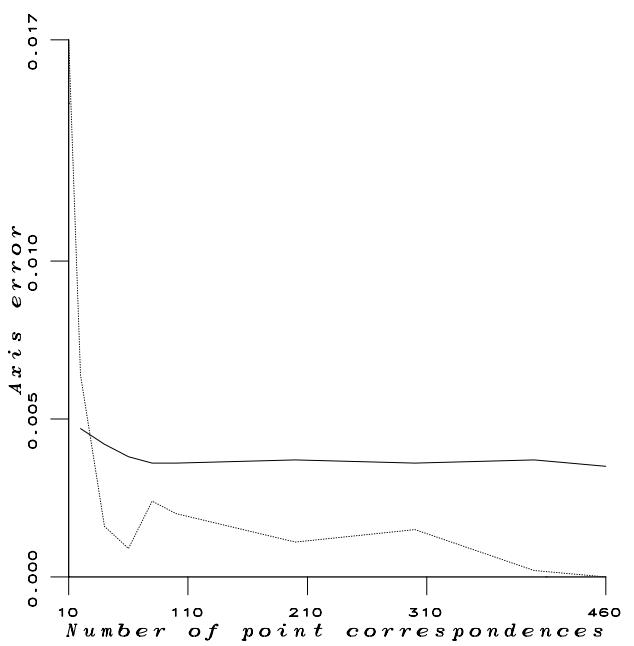

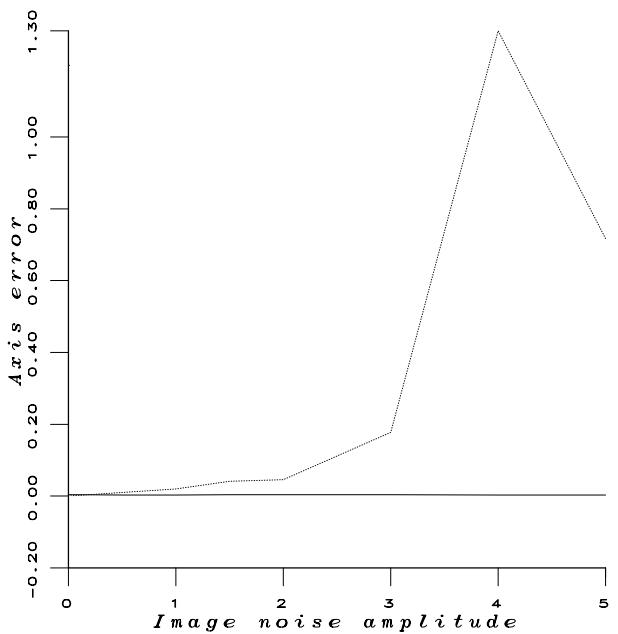  
Fig. 5 Axis of rotation: The error between the computed direction of rotation and the “true” one, as a function of the number of correspondences (left) and as a function of image noise (right). The dashed curves correspond to the Faugeras-Toscani linear method while the full curves correspond to the rotation-then-translation implementation of our method.

To conclude, we believe that the pose determination method that we presented in this paper has those properties that make it suitable to be used whenever robustness and accuracy are needed. We also believe that the trust-region method that we presented in Section 4 and Appendix A could beneficially be used to solve for other non-linear minimization problems (not necessarily quadratic) in computer vision such as structurefrom-motion, reconstruction from multiple views, or the estimation of the fundamental matrix [5].

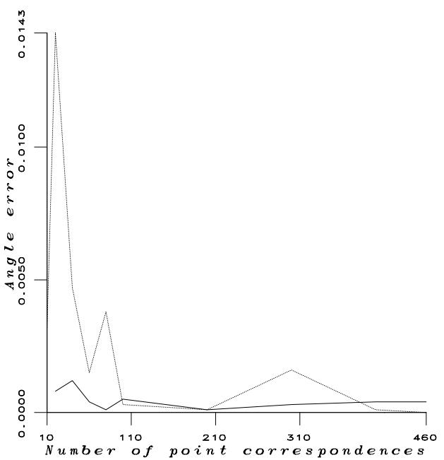

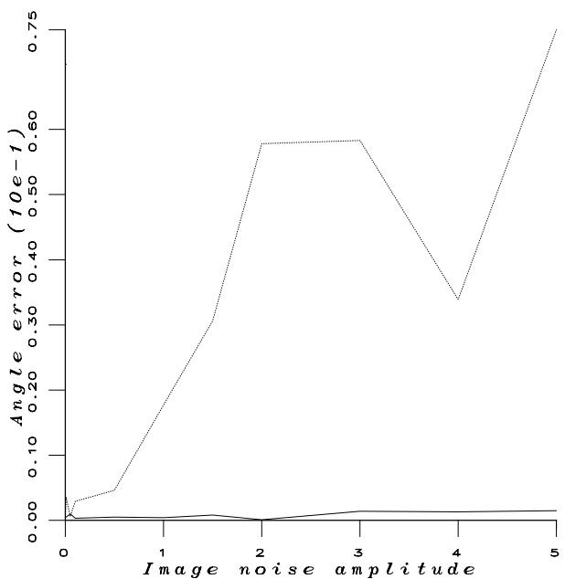  
Fig. 6 Angle of rotation: The error between the computed angle of rotation and the $^ { \mathrm { s } } \mathrm { t r u e } ^ { \mathrm { 7 } }$ one, measured in radians, as a function of the number of correspondences (left) and as a function of image noise (right). The dashed curves correspond to Faugeras-Toscani while the full curves correspond to the rotation-then-translation implementation of our method.

## A Minimization of the local quadratic form

Consider the problem of minimizing a quadratic form inside a sphere:

$$
\operatorname* { m i n } _ { d } \{ \frac { 1 } { 2 } d ^ { T } H d + g ^ { T } d : \| d \| \leq \delta \}\tag{29}
$$

where $\boldsymbol { g } \in \mathbb { R } ^ { n }$ , H is a n × n symmetric matrix and δ is a positive number. Since the constraint set is a compact, the problem has a solution. All existing methods for solving this problem are based on the following theorem due to Gay [11] and to Mor´e & Sorensen [25]:

Theorem 1 d∗ is a solution to (29) if and only if there exists $\mu _ { * } \geq 0$ such that:

$$
\begin{array} { r l } & { ( i ) ~ H + \mu _ { * } I ~ i s ~ p o s i t i v e ~ s e m i d e f i n i t e , } \\ & { ( i i ) ~ ( H + \mu _ { * } I ) d ^ { * } = - g , } \\ & { ( i i i ) ~ \| d ^ { * } \| \leq \delta ~ a n d ~ \mu _ { * } ( \| d ^ { * } \| - \delta ) = 0 . } \end{array}
$$

Such a µ∗ is unique.

If µ can be estimated, the optimal solution to our minimization problem, can be easily computed. In fact, the minimization of (29) represents an interesting case of non convex optimization and in what follows we will point out a complete characterization of a solution. The solution itself is given by an algorithm which will be outlined.

From (iii) (Theorem 1) we see that, for $\mu _ { * } > 0 , ( 2 9 )$ has a solution on the boundary of its constraint set, i.e,

$$
\| d ^ { * } \| = \delta
$$

and the problem is reduced to the problem of finding $\mu _ { * }$ such that:

$$
\phi ( \mu _ { * } ) = \| d ( \mu _ { * } ) \| = \delta\tag{30}
$$

where $d ( \mu )$ is a solution of $( H + \mu I ) d = - g .$

Let $\lambda _ { 1 } \geq \lambda _ { 2 } \geq . . . \geq \lambda _ { n }$ be the eigenvalues of H (a symmetric matrix) and let $u _ { 1 } , u _ { 2 } , \ldots , u _ { n }$ be their corresponding eigenvectors. The function $\phi$ can be made explicit using the eigensystem of H:

$$
\phi ( \mu ) = \left( \sum _ { i = 1 } ^ { n } \frac { ( u _ { i } ^ { T } g ) ^ { 2 } } { ( \lambda _ { i } + \mu ) ^ { 2 } } \right) ^ { 1 / 2 }\tag{31}
$$

It is easy to verify the following properties of the function ϕ: $1 . ~ \phi ( \mu )$ is positive, strictly decreasing in $] - \lambda _ { n } , + \infty [$ and $\phi ( \mu ) \to 0$ as $\mu \to \infty$

2. $\phi ^ { 2 } ( \dot { \mu } )$ is rational in µ with second-order poles on a subset of the negatives of the eigenvalues of H (see Hebden [14])

Thus, when $\mu _ { * } > 0 \left( \mathrm { e . g . } \right.$ , when the Gauss-Newton approximation of the Hessian is being used) there exists an unique solution $d ^ { * } = d ( \mu _ { * } )$ which is a solution of eq. (30). Such a couple $( \mu _ { * } , d ^ { * } )$ can be determined by a very eficient method developed by Hebden [14]. Given $\mathrm { ~ a ~ } \mu _ { o } \geq 0$ such that $\phi \big ( \mu _ { o } \big ) > \delta _ { \mathrm { { \scriptsize ~ \cdot ~ } } }$ Hebden proposed to update $\mu _ { l + 1 }$ from $\mu _ { l }$ as following:

$$
\mu _ { l + 1 } = \mu _ { l } + \frac { \phi ( \mu _ { l } ) } { \phi ^ { \prime } ( \mu _ { l } ) } \frac { ( \delta - \phi ( \mu _ { l } ) ) } { \delta } .\tag{32}
$$

In fact, Hebden’s algorithm can be viewed as Newton’s method for the zero-finding problem:

$$
\psi ( \mu ) = \frac { 1 } { \delta } - \frac { 1 } { \phi ( \mu ) } = 0 , \mathrm { f o r } \mu \in ] - \lambda _ { n } , + \infty [\tag{33}
$$

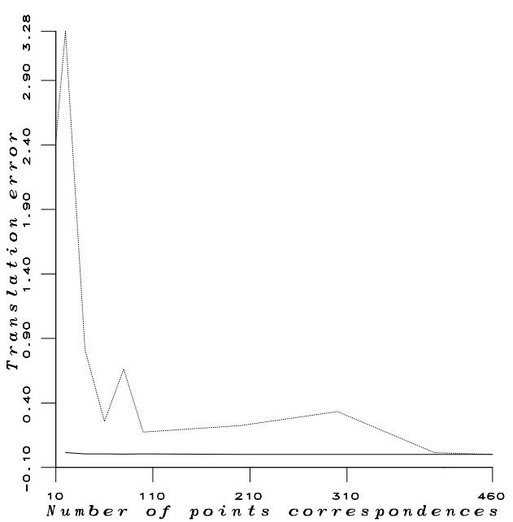

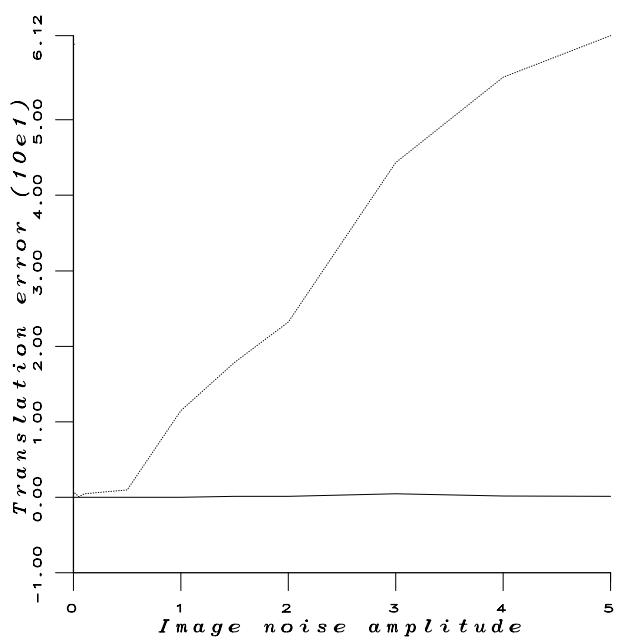  
Fig. 7 Vector of translation: The error between the computed translation and the $^ { \mathrm { s } } \mathrm { t r u e } ^ { \mathrm { 7 } }$ one, as a function of the number of correspondences (left) and as a function of image noise (right). The dashed curves correspond to Faugeras-Toscani while the full curves correspond to the rotation-then-translation implementation of our method. The translation error is measured in centimeters. Notice the rapid degradation of the estimation of translation in the presence of noise with the linear method.

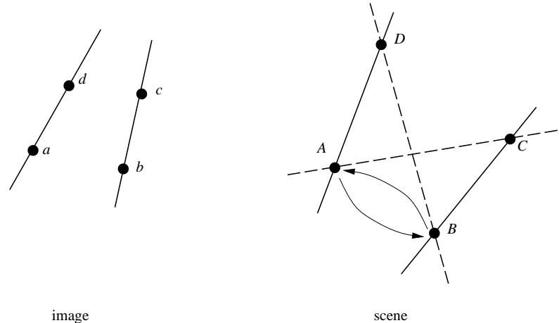  
Fig. 8 From 4 correct point correspondences, one may define one line mismatched pair.

The most important feature of (32) is that usually the number of iterations required to produce an acceptable approximation of solution $\mu _ { * }$ is very small since ψ is convex, almost linear, and strictly decreasing on $] - \lambda _ { n } , + \infty [$ . Moreover, the computation of the Cholesky factorization of $H + \mu I$ makes it possible to implement (32) without explicit knowledge of the eigensystem of H whenever $\mu \in ] - \lambda _ { n } , + \infty [$ . More precisely, it is easy to see that

$$
\phi ( \mu ) = \| d ( \mu ) \| , \qquad \phi ^ { \prime } ( \mu ) = - [ 1 / \phi ( \mu ) ] d ( \mu ) ^ { T } ( H + \mu I ) ^ { - 1 } d ( \mu ) ,
$$

where $( H + \mu I ) d ( \mu ) = - g .$ So, if $R ^ { T } R$ is the Cholesky factorization of $H + \mu _ { l } I$ with R being an upper triangular matrix then we have

$$
\frac { \phi ( \mu _ { l } ) } { \phi ^ { \prime } ( \mu _ { l } ) } = - \frac { \phi ^ { 2 } ( \mu _ { l } ) } { d ( \mu _ { l } ) ^ { T } ( R ^ { T } R ) ^ { - 1 } d ( \mu _ { l } ) } = - \frac { \phi ^ { 2 } ( \mu _ { l } ) } { | | ( R ^ { T } ) ^ { - 1 } d ( \mu _ { l } ) | | ^ { 2 } }
$$

Therefore, Hebden’s algorithm which finds the minimum of the local quadratic form can be summarized as follows:

– Initialization: Let $\mu _ { o } \geq 0$ and $\phi ( \mu _ { o } ) > \delta$

– Iteration $l { = } O , \boldsymbol { { 1 } } , \ldots$

l.1 Factor $\begin{array} { r } { ( H + \mu _ { l } I ) = R ^ { T } R . } \end{array}$

l.2 Solve $R ^ { T } R p = - g .$

l.3 If $| | p | | - \delta | < \epsilon$ then stop: µ is an approximation of $\mu ^ { * }$ and $p$ is a solution of (29).

l.4 Otherwise, solve $R ^ { T } q = p$

l.5 Set

$$
\mu _ { l + 1 } = \mu _ { l } + \left( { \frac { \| p \| } { \| q \| } } \right) ^ { 2 } { \frac { ( \| p \| - \delta ) } { \delta } } .\tag{34}
$$

l.6 Set l:=l+1 and return to l.1.

In practice, this algorithm converges in average after 4 iterations.

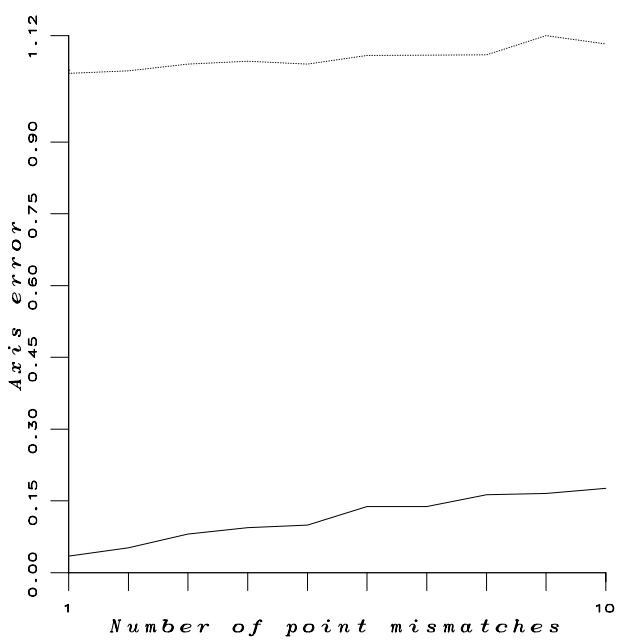

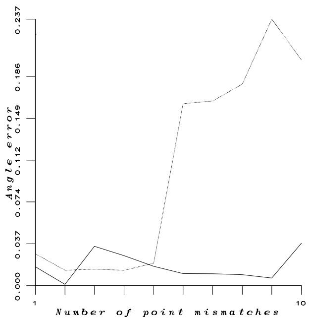

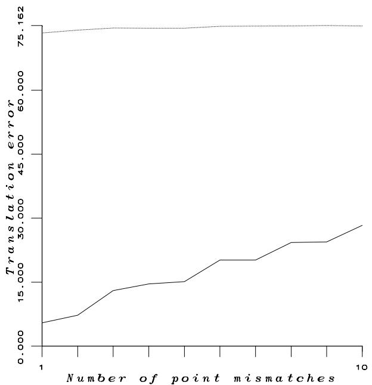  
Fig. 9 Matching errors: The errors in rotation axis (top), rotation angle (middle), and translation (bottom) as functions of the number of point mismatched pairs. The results were obtained with an initial set of 400 points among which 1, 2, ... 10 point pairs were chosen at random and mismatched. The dashed curves correspond to the Faugeras-Toscani method while the full curves correspond to the rotation-then-translation implementation of the non linear method.

## Acknowledgments

The authors acknowledge Claude Inglebert, Homer Chen, Roger Mohr, Long Quan, Fadi Dornaika, and Thomas Skordas for their insightful comments.

## References

1. M. Chasles. Note sur les propri´et´es g´en´erales des syst\`emes de deux corps semblables entre eux, plac´es d’une mani\`ere

quelconque dans l’espace ; et sur le d´eplacement fini ou infiniment petit d’un corps solide libre. Bulletin des Sciences Math´ematiques de F´erussac, XIV:321–326, 1831.

2. H. Chen. Pose determination from line-to-plane correspondences: existence solutions and closed-form solutions. IEEE Transactions on Pattern Analysis and Machine Intelligence, 13(6):530–541, June 1991.

3. J. R. Clermont, M. E. De La Lande, P. D. Tao, and A. Yassine. Analysis of plane and axis-symmetric flows of incompressible fluids with the stream tube method: numerical simulation by trust-region algorithm. Inter-

national Journal for Numerical Methods in Fluids, 13:371– 399, 1991.

4. M. Dhome, M. Richetin, J.T. Lapreste, and G. Rives. Determination of the Attitude of 3D Objects from a Single Perspective View. IEEE Transactions on Pattern Analysis and Machine Intelligence, 11(12):1265–1278, December 1989.

5. O. D. Faugeras, Q. T. Luong, and S. J. Maybank. Camera self-calibration: Theory and experiments. In G. Sandini, editor, Computer Vision – ECCV 92, Proceedings Second European Conference on Computer Vision, Santa Margherita Ligure, May 1992, pages 321–334. Springer Verlag, May 1992.

6. O. D. Faugeras and G. Toscani. The calibration problem for stereo. In Proc. Computer Vision and Pattern Recognition, pages 15–20, Miami Beach, Florida, USA, June 1986.

7. O.D. Faugeras and M. Hebert. The representation, recognition, and locating of 3-d objects. International Journal of Robotics Research, 5(3):27–52, Fall 1986.

8. M.A. Fischler and R.C. Bolles. Random Sample Consensus: A Paradigm for Model Fitting with Applications to Image Analysis and Automated Cartography. Communications of the ACM, 24(6):381–395, June 1981.

9. R. Fletcher. Practical Methods of Optimization. John Wiley & Sons, 1990.

10. S. Ganapathy. Decomposition of transformation matrices for robot vision. Pattern Recognition Letters, 2(6):401–412, December 1984.

11. D. M. Gay. Computing optimal constrained steps. SIAM Journal on Scientific and Statistical Computation, 1981.

12. P. E. Gill, W. Murray, and M. H. Wright. Practical Optimization. Academic Press, London, 1989.

13. R. B. Haralick, H. Joo, C-N. Lee, X. Zhuang, V. G. Vaidya, and M. B. Kim. Pose estimation from corresponding point data. IEEE Transactions on Systems, Man, and Cybernetics, 19(6):1426–1445, 1989.

14. M. D. Hebden. An algorithm for minimization using exact second derivatives. Technical Report TP 515, Atomic Energy Research Establishment, Harwell, England, 1973.

15. R. J. Holt and A. N. Netravali. Camera calibration problem: some new results. CGVIP-Image Understanding, 54(3):368–383, November 1991.

16. R. Horaud, B. Conio, O. Leboulleux, and B. Lacolle. An Analytic Solution for the Perspective 4-Point Problem. Computer Vision, Graphics, and Image Processing, 47(1):33–44, July 1989.

17. B.K.P. Horn. Closed-form solution of absolute orientation using unit quaternions. J. Opt. Soc. Amer. A., 4(4):629–642, 1987.

18. Y. Hung, P.-S. Yeh, and D. Harwood. Passive ranging to known planar point sets. In Proc. IEEE Int. Conf. on Robotics and Automation, pages 80–85, Saint-Louis, Missouri, USA, March 1985.

19. Mor´e J. J. The Levenberg-Marquart algorithm: Implementation and theory. In G. E. Watson, editor, Lecture Notes in Mathematics 630, pages 105–116. Springer-Verlag, 1978.

20. R. Kumar and A. R. Hanson. Robust estimation of camera location and orientation from noisy data having outliers. In Proc. Workshop on Interpretation of 3-D Scenes, pages 52–60, Austin, Texas, USA, November 1989.

21. Y. Liu, T. S. Huang, and O. D. Faugeras. Determination of camera location from 2-d to 3-d line and point correspondences. IEEE Transactions on Pattern Analysis and Machine Intelligence, 12(1):28–37, January 1990.

22. D. Lowe. Three-dimensional Object Recognition from Single Two-dimensional Images. Artificial Intelligence, 31:355–395, 1987.

23. D. Lowe. Fitting parameterized three-dimensional models to images. IEEE Transactions on Pattern Analysis and Machine Intelligence, 13(5):441–450, May 1991.

24. J. J. Mor´e. Recent developments in algorithms and software for trust region methods. In A Bchem, M. Gr¨otschel, and B. Korte, editors, Mathematical Programming: The State of the Art, pages 258–287. Springer Verlag, Berlin, 1983.

25. J. J. Mor´e and D. C. Sorensen. On the use of directions of negative curvature in a modified Newton method. Mathematical Programming, pages 1–20, 1979.

26. P. Puget and Th. Skordas. An Optimal Solution for Mobile Camera Calibration. In O. Faugeras, editor, Computer Vision – ECCV 90, Proceedings First European Conference on Computer Vision, Antibes, France, pages 187– 198. Springer Verlag, April 1990.

27. D. C. Soresen. Newton’s method with a model trust region modification. SIAM Journal on Numerical Analysis, 19(2):409–426, 1982.

28. P. D. Tao, S. Wang, and A. Yassine. Training multilayered neural networks with a trust-region based algorithm. Mathematical Modelling and Numerical Analysis, 24(4):523–553, 1990.

29. R. Y. Tsai. A Versatile Camera Calibration Technique for High-Accuracy 3D Machine Vision Metrology Using Of-the-Shelf TV Cameras and Lenses. IEEE Journal of Robotics and Automation, RA-3(4):323–344, August 1987.

30. M. W. Walker, L. Shao, and R. A. Volz. Estimating 3- d location parameters using dual number quaternions. CGVIP-Image Understanding, 54(3):358–367, November 1991.

31. A. Yassine. Etudes Adaptatives et Comparatives de Certains Algorithmes en Optimisation. Impl´ementation Efectives et Applications. PhD thesis, Universit´e Joseph Fourier, Grenoble, 1989.

32. J. S.-C. Yuan. A general photogrammetric method for determining object position and orientation. IEEE Transactions on Robotics and Automation, 5(2):129–142, April 1989.