# On the Limits of Representation-Based Test-Time Adaptation for Multimodal LLMs

Mikołaj Piórczynski´ 1,2

Wojciech Masarczyk1

Damian Sójka3, 4

Sebastian Cygert5, 6

Bartłomiej Twardowski1, 7

## Abstract

Vision-language models suffer significant accuracy drops under common corruptions. While test-time adaptation (TTA) successfully mitigates these shifts in CLIP-like contrastive models, its application to generative multimodal large language models (MLLMs) remains underexplored and uniquely challenging due to their sequential token generation. In this work, we demonstrate that representationbased TTA fails to recover performance in MLLMs. Our experiments reveal that even when violating standard TTA assumptions by leveraging target data offline, sample-blind feature alignment recovers only marginal accuracy. We attribute this failure to the nature of corruption shifts: unlike CLIP-like architectures, which benefit from a shared domain-shift direction within a single pooled classification embedding, MLLM visual token sequence shifts are nearly orthogonal and span the full embedding space. These findings bound what any sample-blind, position-shared correction at a single encoder site can achieve, establishing that representation-space interventions alone might be insufficient to ensure corruption robustness in MLLMs.

## 1 Introduction

Vision-language models (VLMs) excel on a broad range of visual tasks, yet they inherit the brittleness of their visual encoders. Common corruptions such as sensor noise, defocus, and brightness shifts can substantially degrade accuracy even when the scene remains clearly recognizable. Since this degradation arises at deployment, where only unlabeled, already-corrupted inputs are available, test-time adaptation (TTA) fits precisely this setting, adapting a pretrained model to the incoming test stream without labels.

VLMs, however, span substantially different architectures. Contrastive models such as CLIP [26] and SigLIP [46] align images and text through a single pooled embedding per modality, whereas multimodal large language models (MLLMs) pass a sequence of visual tokens through a connector into an autoregressive language model that generates the response. Existing TTA work for VLMs targets almost exclusively the former: the recent TTA-VLM benchmark evaluates fifteen methods across fifteen datasets, finds gains over the earliest baseline to be marginal even there, and leaves evaluation beyond CLIP-like models and beyond classification as open problems [35]. To our knowledge, adapting MLLMs to common corruptions at test time has not been studied, leaving practitioners who deploy them in noisy real-world environments with little evidence about whether their degraded visual performance can be recovered at all.

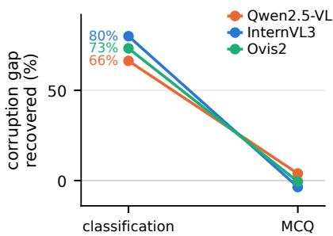  
Figure 1: Matching corrupted activations to clean statistics repairs a linear probe, but not the MLLM’s answers. For the probe, the statistics are matched on one pooled vector per image. For the MLLM, they are matched on individual visual tokens.

A natural starting point for recovering it is representation-based TTA, which corrects internal activations at inference time without updating any weights. If a corruption induces a consistent shift in representation space, a single sample-blind correction, estimated from activation statistics and applied to every input, should in principle undo it. Such methods need no gradients or labels and assume no fixed output space, making them among the few TTA approaches that remain practical at MLLM scale (Section 2). They have been validated, however, mainly on classification, where a prediction follows from one pooled representation per image. The token-sequence setting is substantially more demanding: a successful correction must restore the structure of the entire sequence rather than a single image-level vector.

We therefore ask whether sample-blind representation corrections can recover the performance MLLMs lose to common corruptions. We apply feature alignment, matching the per-dimension mean and variance of visual-token activations to their clean values, at layers spanning the vision encoders of three modern MLLMs on RealWorldQA under 15 common corruptions. Accuracy stays close to the no-TTA baseline throughout: no layer, model, or corruption closes a meaningful fraction of the corruption gap, even when the alignment maps are fitted offline from paired clean– corrupted activations (Figure 2). The contrast in Figure 1 is the central one: aligning corrupted projector activations with the clean distribution recovers most of the gap for a linear probe on a pooled representation, but none of it for the MLLM’s own answers.

Why these corrections fail is a property of the shifts themselves. They are nearly orthogonal across images and collectively span almost the full embedding space (Figure 4), so the component a sampleblind correction can remove accounts for only a small fraction of the total (Figure 3). Nor does any small subset of patches or feature dimensions carry a disproportionate share of the effect (Figure 5). There is no shared direction to remove: effective restoration would have to be specific not only to each sample but to each token within it (Section 4).

Our contributions are as follows:

• We provide, to our knowledge, the first evaluation of test-time adaptation for MLLMs, studying representation-based corrections across three models and 15 corruptions. We find no practically significant gains.

• We characterize the corruption-induced shifts and explain why sample-blind corrections fail, including a quantitative bound on the fraction of the shift that such corrections can remove.

## 2 Related Work

Robustness of Vision-Language Models Despite their impressive capabilities, VLMs exhibit welldocumented shortcomings: they hallucinate content not grounded in the visual input [16], overlook information present in their own visual representations in favor of language priors [37, 7, 38], fail to express reduced confidence on ambiguous inputs [40], and flip answers under minor input perturbations [30].

A complementary line of work probes this fragility with common image corruptions, popularized by ImageNet-C [9] as a controlled and reproducible testbed for the degradations encountered in realworld deployment; a growing body of benchmarks extends this paradigm to MLLMs [5, 12, 25, 32]. Notably, despite internet-scale pretraining, MLLMs still degrade substantially under such corruptions regardless of model scale, yet these benchmarks diagnose the problem without proposing remedies.

Among the few mitigation approaches, Liu et al. [16] steer latent representations at inference time to reduce hallucinations, while Manifold-Adversarial Adapters (MAA) [13] improve corruption robustness by aligning features of corrupted images with their clean counterparts. MAA, however, requires a large training set of paired clean–corrupted images and multiple epochs of adapter training– assumptions violated in deployment, where only unlabeled, already-corrupted test samples are available.

To the best of our knowledge, no prior work adapts general-purpose MLLMs to corrupted images directly at test time, using only unlabeled test samples–the gap this work addresses.

Test-Time Adaptation Test-Time Adaptation (TTA) addresses distribution shift at deployment by adapting a pretrained model to an unlabeled test stream [44, 14]. Classic approaches utilize backpropagation-based weight updates with self-supervised objectives that fall into three families: entropy minimization, as in TENT [39] and SAR [20]; pseudo-labeling, in which the model’s confident predictions serve as surrogate labels [3]; and feature alignment, which matches test-time activation statistics to those of the source domain, as in ActMAD [18].

These recipes transfer poorly to MLLMs. Backpropagation-based updates are computationally prohibitive at the scale of modern VLMs. Entropy- and pseudo-label-based objectives presuppose a fixed label space and calibrated uncertainty, whereas MLLMs generate open-ended text and remain confident when wrong [40]. Online self-supervised updates carry a well-documented risk of model collapse and catastrophic forgetting [24, 33].

Recent efforts extend TTA beyond classification to dense prediction and regression [1, 22]. MLLMs, however, remain largely unaddressed. A large body of work exists for CLIP-like architectures [35], such as test-time prompt tuning [36]. These methods treat CLIP strictly as a zero-shot classifier, inheriting standard classification assumptions.

To the best of our knowledge, Kaya et al. [10] is the only existing work on TTA for MLLMs. Their method aggregates predictions from augmented inputs at the token level and optionally updates parameters from the resulting pseudo-labels. However, it targets general test-time scaling for small MLLMs rather than robustness to input corruptions, and lacks evaluation under common corruptions. To address these gaps, we test whether activation engineering can provide a practical way to adapt MLLMs to corrupted images directly at test time.

Activation Steering and Test-Time Feature Alignment Two largely independent lines of work modify a model’s behavior at inference time by acting on its activations rather than its weights. In the LLM community this is known as activation engineering or steering [49]. The most notable Contrastive Activation Addition (CAA) [27] computes a difference-of-means vector from contrastive prompt pairs and adds it to the residual stream. In MLLMs, such interventions have so far been used to control high-level semantic behavior, e.g., to improve visual grounding or reduce hallucinations [16, 11, 23]. Recently Activation Transport (AcT) [28, 29] reframes steering as optimal transport between source and target activation distributions.

In the TTA literature, the analogous operation—matching test-time features to those of the source domain—is called feature alignment [34], and it underlies a recent wave of backpropagation-free methods that avoid the instabilities of gradient-based adaptation: FOA [21] shifts the last-layer CLS token back toward source activations, NEO [19] re-centers test embeddings by a single vector, TCA [45] aligns correlations of cached representations, and PEA [43] realigns intermediate features via a layer-wise whitening–coloring transform (WCT). Despite being lightweight and architectureagnostic, all of these are developed and evaluated exclusively on image classifiers.

In this work we consider the Gaussian case of AcT (Gaussian-AcT), requiring only source statistics rather than source samples. It recovers existing feature-alignment methods as special cases—the re-centering of NEO and FOA without the scaling term and the WCT of PEA with full covariance. To our knowledge, we are the first to repurpose activation steering for the low-level representation shifts induced by visual corruptions in MLLMs.

## 3 Experiments

Experimental Setup. We evaluate Qwen2.5-VL-3B-Instruct [2], InternVL3-2B [48], and Ovis2- 4B [17] on RealWorldQA [42], a vision-centric multiple-choice question answering (MCQ) benchmark of 765 questions on real-world scenes, under the 15 common corruptions [9] at severity 5, with images resized to 896 × 896 pixels. We use VLMEvalKit [6] to keep the evaluation protocol standardized and reproducible across all models and methods. All three models share the LLaVA architecture [15]: a vision encoder maps the image to patch embeddings, a projector maps each into the token-embedding space of a language model, and the language model processes the resulting visual tokens together with the text. Unlike a classifier, the language model reads every visual token rather than a single pooled vector; every method we study edits these token activations at test time and leaves all parameters frozen. We edit vision encoder activations, where the corruption-induced shift originates and is still purely visual, so one correction estimated from images alone serves every question about the image. The edited blocks, which we call the intervention layers, and the remaining details are given in Section A.

Table 1: Online TTA with Gaussian-AcT barely moves accuracy on any of the three MLLMs. RealWorldQA accuracy (%) under the 15 common corruptions at severity 5. no-TTA is the accuracy without adaptation. The Gaussian-AcT columns give the change $\Delta$ over it in pp when applied at all intervention layers, without and with dynamic weighting. Cells with $| \Delta | \geq \bar { 2 } \bar { \mathrm { p p } }$ are shaded green for a gain and red for a loss. The better of the two corrections per corruption is in bold.
<table><tr><td rowspan="2"></td><td colspan="3">InternVL3-2B</td><td colspan="3">Qwen2.5-VL-3B</td><td colspan="3">Ovis2-4B</td></tr><tr><td>no-TTA</td><td>Gaussian- + dynamic  $\mathbf { A c T }$ </td><td>weighting</td><td>no-TTA</td><td> $\mathbf { A c T }$ </td><td>Gaussian- + dynamic weighting</td><td>no-TTA</td><td> $\mathbf { A c T }$ </td><td>Gaussian- + dynamic weighting</td></tr><tr><td>Clean</td><td>62.5</td><td></td><td></td><td>65.6</td><td></td><td>一</td><td>69.4</td><td></td><td></td></tr><tr><td>Noise</td><td></td><td></td><td></td><td></td><td></td><td></td><td></td><td></td><td></td></tr><tr><td>Gaussian</td><td>54.1±0.4</td><td> $- 0 . 5 _ { \pm 1 . 9 } + 1 . 4 _ { \pm 0 . 8 }$ </td><td></td><td>50.8±0.5</td><td>−4.1±0.5</td><td> $+ { \bf 0 . 6 _ { \pm 1 . 0 } }$ </td><td> $5 8 . 9 { \scriptstyle \pm 0 . 3 }$ </td><td> $- 1 . 7 \pm 1 . 1$ </td><td> ${ \bf - 0 . 1 _ { \pm 0 . 5 } }$ </td></tr><tr><td>Shot</td><td> $5 4 . 2 { \scriptstyle \pm 0 . 5 }$ </td><td> $+ 0 . 4 _ { \pm 1 . 8 } + 1 . 7 _ { \pm 1 . 1 }$ </td><td></td><td> $5 2 . 3 { \scriptstyle \pm 0 . 1 }$ </td><td>−3.7±1.4</td><td> $\mathbf { - 0 . 0 _ { \pm 0 . 9 } }$ </td><td> $5 9 . 6 _ { \pm 0 . 6 }$ </td><td> ${ \bf + 1 . 0 _ { \pm 0 . 5 } }$ </td><td> $+ 0 . 6 _ { \pm 0 . 5 }$ </td></tr><tr><td>Impulse</td><td> $5 5 . 0 { \scriptstyle \pm 1 . 2 }$ </td><td> $+ 0 . 1 _ { \pm 1 . 3 } + 0 . 7 _ { \pm 1 . 0 }$ </td><td></td><td> $5 2 . 2 { \scriptstyle \pm 0 . 6 }$ </td><td> $- 5 . 4 \pm 1 . 0$ </td><td> $+ \mathbf { 0 . 8 } _ { \pm 0 . 9 }$ </td><td> $5 9 . 5 { \pm } 1 . 9$ </td><td> $\mathbf { + 0 . 4 } _ { \pm 2 . 0 }$ </td><td> $+ 0 . 4 { \scriptstyle \pm 1 . 7 }$ </td></tr><tr><td>Blur</td><td></td><td></td><td></td><td></td><td></td><td></td><td></td><td></td><td></td></tr><tr><td>Defocus</td><td></td><td> $5 5 . 3 { \scriptstyle \pm 0 . 0 } + 1 . 2 { \scriptstyle \pm 0 . 3 }$ </td><td> $+ { \bf 2 . 7 } _ { \pm 0 . 2 }$ </td><td> $5 3 . 9 { \scriptstyle \pm 0 . 0 }$ </td><td> $- 0 . 1 \pm 1 . 3$ </td><td> $+ { \bf 3 . 4 } _ { \pm 0 . 8 }$ </td><td> $5 9 . 0 { \scriptstyle \pm 0 . 0 }$ </td><td> $+ 4 . 0 _ { \pm 0 . 1 }$ </td><td>+3.4±0.1</td></tr><tr><td>Glass</td><td> $5 8 . 0 _ { \pm 0 . 3 } ~ + \mathbf { 0 . 6 } _ { \pm 0 . 6 }$ </td><td></td><td> $+ 0 . 3 _ { \pm 0 . 5 }$ </td><td></td><td> $5 7 . 7 { \scriptstyle \pm 0 . 5 } - 2 . 1 { \scriptstyle \pm 1 . 9 }$ </td><td> ${ \bf + 0 . 7 \pm 0 . 5 }$ </td><td> $6 1 . 1 _ { \pm 0 . 3 }$ </td><td> $\mathbf { + 1 . 9 _ { \pm 0 . 8 } }$ </td><td> $+ 1 . 4 _ { \pm 0 . 7 }$ </td></tr><tr><td>Motion</td><td> $4 6 . 1 _ { \pm 0 . 9 } ~ + 1 . 0 _ { \pm 0 . 6 }$ </td><td></td><td> $+ 0 . 7 _ { \pm 0 . 5 }$ </td><td></td><td>46.7±0.6−0.7±1.1</td><td> $+ \mathbf { 0 . 9 } _ { \pm 1 . 4 }$ </td><td> $5 0 . 5 { \scriptstyle \pm 1 . 1 }$ </td><td> $+ 0 . 7 _ { \pm 2 . 1 }$ </td><td> $+ \mathbf { 0 . 8 } _ { \pm 2 . 1 }$ </td></tr><tr><td>Zoom</td><td></td><td> $4 8 . 6 { \scriptstyle \pm 0 . 0 } \ + { \bf 3 . 6 } _ { \pm 0 . 3 }$ </td><td> $- 0 . 1 \pm 0 . 9$ </td><td> $4 6 . 4 { \scriptstyle \pm 0 . 0 }$ </td><td> ${ \bf + 3 . 6 _ { \pm 0 . 4 } }$ </td><td> $+ 1 . 7 _ { \pm 0 . 7 }$ </td><td> $5 1 . 6 { \scriptstyle \pm 0 . 0 }$ </td><td></td><td> $+ { \bf 6 . 1 } _ { \pm 0 . 2 } + 3 . 8 _ { \pm 0 . 6 }$ </td></tr><tr><td>Weather</td><td></td><td></td><td></td><td></td><td></td><td></td><td></td><td></td><td></td></tr><tr><td>Snow</td><td></td><td> $5 3 . 4 { \scriptstyle \pm 0 . 7 } + 0 . 5 { \scriptstyle \pm 0 . 4 } + 1 . 3 { \scriptstyle \pm 0 . 5 }$ </td><td></td><td> $5 1 . 8 { \scriptstyle \pm 0 . 6 }$ </td><td>−0.5±1.1</td><td> $\mathbf { + 1 . 0 _ { \pm 0 . 9 } }$ </td><td> $5 6 . 0 { \scriptstyle \pm 0 . 3 }$ </td><td></td><td> $\mathbf { + 1 . 0 _ { \pm 0 . 6 } } \ \mathbf { \ + 0 . 8 _ { \pm 0 . 5 } }$ </td></tr><tr><td>Frost</td><td></td><td> $5 6 . 5 { \scriptstyle \pm 1 . 9 } - 0 . 3 { \scriptstyle \pm 2 . 2 } + { \bf 0 . 9 } { \scriptstyle \pm 0 . 7 }$ </td><td></td><td></td><td>55.8±0.1 −1.4±1.1</td><td> $+ { \bf 0 . 8 _ { \pm 0 . 2 } }$ </td><td>61.0±0.5</td><td></td><td> $+ 0 . 7 _ { \pm 0 . 5 } + 1 . 0 _ { \pm 0 . 2 }$ </td></tr><tr><td>Fog</td><td></td><td> $5 9 . 0 { \scriptstyle \pm 0 . 7 } + 1 . 4 { \scriptstyle \pm 0 . 2 }$ </td><td> $+ 1 . 1 { \pm } 0 . 4$ </td><td> $5 7 . 1 _ { \pm 1 . 2 }$ </td><td>+1.9±2.2</td><td>+4.0±2.7</td><td> $6 3 . 7 _ { \pm 0 . 2 }$ </td><td></td><td> $+ { \bf 2 . 6 } _ { \pm 0 . 9 } + 2 . 6 _ { \pm 0 . 7 }$ </td></tr><tr><td>Brightness</td><td></td><td> $6 0 . 9 _ { \pm 0 . 0 } - 1 . 0 _ { \pm 0 . 3 }$ </td><td> $- 1 . 2 _ { \pm 0 . 3 }$ </td><td></td><td></td><td> $6 1 . 6 { \scriptstyle \pm 0 . 0 } - 4 . 0 { \scriptstyle \pm 0 . 5 } - 1 . 6 { \scriptstyle \pm 0 . 2 }$ </td><td>68.5±0.0</td><td> $- 1 . 5 _ { \pm 0 . 4 } - 1 . 2 _ { \pm 0 . 8 }$ </td><td></td></tr><tr><td>Digital</td><td></td><td></td><td></td><td></td><td></td><td></td><td></td><td></td><td></td></tr><tr><td>Contrast</td><td></td><td> $5 2 . 3 _ { \pm 0 . 0 } \ + 7 . 1 _ { \pm 0 . 7 }$ </td><td> $+ 5 . 9 _ { \pm 0 . 6 }$ </td><td> $5 0 . 1 { \scriptstyle \pm 0 . 0 }$ </td><td> $+ 0 . 7 _ { \pm 0 . 7 }$ </td><td> ${ \bf + 3 . 1 _ { \pm 0 . 2 } }$ </td><td> $5 7 . 0 { \scriptstyle \pm 0 . 0 }$ </td><td> $+ \mathbf { 9 } . 4 _ { \pm 1 . 4 }$ </td><td> $+ 8 . 1 _ { \pm 0 . 1 }$ </td></tr><tr><td>Elastic</td><td></td><td> $5 6 . 6 { \scriptstyle \pm 0 . 2 } + 0 . 4 { \scriptstyle \pm 0 . 9 }$ </td><td> $+ \mathbf { 0 . 9 } _ { \pm 1 . 0 }$ </td><td></td><td>54.7±0.6 −0.3±1.2</td><td>+2.5±0.9</td><td> $6 1 . 1 _ { \pm 0 . 5 }$ </td><td>+3.0±1.1</td><td> $+ 2 . 9 _ { \pm 0 . 7 }$ </td></tr><tr><td>Pixelate</td><td></td><td> $4 6 . 5 { \scriptstyle \pm 0 . 0 } - 1 . 3 { \scriptstyle \pm 0 . 3 }$ </td><td> $\mathbf { - 0 . 2 \pm 0 . 3 }$ </td><td> $4 9 . 0 { \scriptstyle \pm 0 . 0 }$ </td><td></td><td> $- 4 . 5 { \scriptstyle \pm 0 . 8 } - \mathbf { 0 . 4 } { \scriptstyle \pm 0 . 5 }$ </td><td> $5 2 . 3 { \scriptstyle \pm 0 . 0 }$ </td><td> $- 0 . 7 \pm 1 . 0$ </td><td> $\mathbf { + 0 . 9 } \pm \mathbf { 0 . 3 }$ </td></tr><tr><td>JPEG</td><td></td><td> $5 9 . 5 { \scriptstyle \pm 0 . 0 } - { \bf 0 . 7 } { \scriptstyle \pm 0 . 3 }$ </td><td> $- 1 . 0 _ { \pm 1 . 0 }$ </td><td> $5 9 . 3 { \scriptstyle \pm 0 . 0 }$ </td><td> $- 5 . 0 { \scriptstyle \pm 0 . 9 }$ </td><td> $- \mathbf { 1 . 4 } _ { \pm 1 . 1 }$ </td><td> $6 5 . 5 { \scriptstyle \pm 0 . 0 }$ </td><td> $- 2 . 5 _ { \pm 0 . 2 }$ </td><td> $\mathbf { - 0 . 9 _ { \pm 0 . 4 } }$ </td></tr><tr><td>Mean</td><td> $5 4 . 4 { \scriptstyle \pm 0 . 1 }$ </td><td> $+ 0 . 8 { \scriptstyle \pm 0 . 3 }$ </td><td> ${ \bf + 1 . 0 _ { \pm 0 . 3 } }$ </td><td> $5 3 . 3 { \pm 0 . 1 }$ </td><td> $- 1 . 7 { \pm } 0 . 4$ </td><td> ${ \bf + 1 . 1 { \bf _ { \pm 0 . 3 } } }$ </td><td> $5 9 . 0 { \scriptstyle \pm 0 . 2 }$ </td><td> $\mathbf { + 1 . 6 _ { \pm 0 . 3 } }$ </td><td> $+ 1 . 6 { \scriptstyle \pm 0 . 4 }$ </td></tr></table>

Gaussian-AcT. Let $\mu _ { \mathrm { s r c } } , \sigma _ { \mathrm { s r c } }$ and $\mu _ { \mathrm { t g t } } , \sigma _ { \mathrm { t g t } }$ be the per-dimension mean and standard deviation of the activations at an intervention layer on clean (source) and corrupted (target) images. Under a Gaussian approximation with diagonal covariance, the optimal transport map from the corrupted to the clean distribution is the elementwise affine map $T ( \pmb { x } ) = \mu _ { \mathrm { s r c } } + \left( \sigma _ { \mathrm { s r c } } / \sigma _ { \mathrm { t g t } } \right) \left( \pmb { x } - \mu _ { \mathrm { t g t } } \right)$ , the Gaussian case of activation transport (AcT) [28], which we call Gaussian-AcT. The moments are estimated either globally, one pair $( \mu , \sigma )$ per layer shared by all tokens, or per-token, one pair per token position across images. Both variants are sample-blind: the same map is applied to every image and depends only on the token position, which is known at test time.

## 3.1 Online adaptation

In online adaptation, the target statistics of the Gaussian-AcT map are estimated from the test stream itself, given only the precomputed source statistics, so the correction should improve as more corrupted data arrives. Each corruption forms a separate stream and the target statistics are reset between corruptions. We report means over three stream orders with the between-order standard deviation. We apply the map with per-token moments at every intervention layer, either unweighted or with dynamic weighting, adapted from PEA [43], which scales the correction of each layer by how far its running target statistics have drifted from the source statistics (more details in Section B).

Unweighted correction is unreliable, weighted correction marginal. Averaged over the 15 corruptions (Table 1), the unweighted correction gains +0.8 and +1.6 pp on InternVL3-2B and Ovis2-4B but loses 1.7 pp on Qwen2.5-VL-3B, and individual corruptions swing by several points in either direction. Dynamic weighting lifts Qwen2.5-VL-3B to +1.1 pp and leaves the other two models unchanged at +1.0 and +1.6 pp. These gains recover 12%, 9%, and 15% of the 8.1, 12.3, and 10.4 pp that corruption costs each model. The weighting achieves this by switching the correction off rather than by improving it: the weight concentrates on the earliest layers, and accuracy improves only gradually as the stream progresses (Figures 6 and 7).

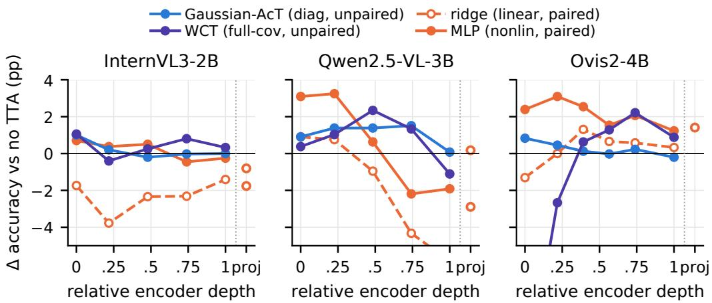  
Figure 2: A more expressive map does not recover more. Change in accuracy over the no-TTA baseline, averaged over the 15 corruptions, when a single layer is corrected. Gaussian-AcT and WCT are fitted from distribution statistics. Ridge and MLP on paired clean–corrupted tokens.

What little is recovered comes from globally acting corruptions. Contrast (+5.7 pp averaged over models), defocus blur (+3.2), fog (+2.6), and zoom blur (+1.8) account for most of the gain, whereas JPEG compression (−1.1) and pixelate (+0.1) are no better than no-TTA on any model. All four corruptions act smoothly over the whole image, either as a photometric change (contrast, fog) or as a low-frequency blur (defocus, zoom), while contrast is the only one whose gap is more than half recovered, on two of the three models. High-frequency, spatially local corruptions are left almost uncorrected. Brightness is the apparent exception, losing 1.3 pp, but at severity 5 it costs these models only 0.9–4.0 pp in the first place, leaving nothing to recover. Section 4 traces this split to the structure of the shift itself.

Online adaptation thus yields no gain of practical significance: unweighted it can hurt, and weighted it barely helps. The feature alignment that works for image classification does not carry over to MLLMs, even when they adapt to one corruption at a time.

## 3.2 The method is not the bottleneck

Gaussian-AcT is deliberately simple: a diagonal affine map fitted to distribution statistics estimated online. A null result could therefore be attributed to the estimator, to the expressivity of the map, to its supervision, or to the site of the intervention. We rule out each in turn.

Online estimation is not the bottleneck. At the single intervention block, per-token moments estimated online match the same map fitted offline on the full test set, with per-corruption gains correlated at r = 0.93 (Figure 9), and pooling the moments over token positions lowers the gain on every model (Figure 8). Per-token moments are therefore preferable, yet they still recover only about one point.

Expressivity and supervision are not the bottleneck. We next drop the online constraint and fit maps offline, with clean and corrupted images available together, and vary expressivity (linear vs. nonlinear) and supervision (unpaired statistics vs. paired tokens, each corrupted token regressed onto its own clean counterpart). Paired supervision is unavailable to any test-time method, so these results bound what such a method could achieve rather than propose one. Every map is shared across token positions and takes only the token’s own activation as input. Gaussian-AcT and its full-covariance counterpart WCT are fitted from distribution statistics, whereas a closed-form ridge regression and a two-layer MLP are fitted on paired tokens of 500 images. All maps are evaluated on the remaining 265 held-out images.

Figure 2 shows that neither factor changes the outcome. The oracle MLP recovers at most a quarter of the held-out gap (+0.50, +3.25, and +2.54 pp against gaps of 5.8, 15.2, and 10.7 pp), and only at a shallow layer. WCT stays within one standard error of Gaussian-AcT despite fitting a full covariance, and the paired ridge map lowers accuracy at most layers despite its oracle supervision: least squares returns the conditional mean of the clean token given the corrupted one, so the detail it cannot predict is shrunk away. What a single-layer, position-shared correction can recover is thus bounded regardless of estimator, expressivity, or supervision.

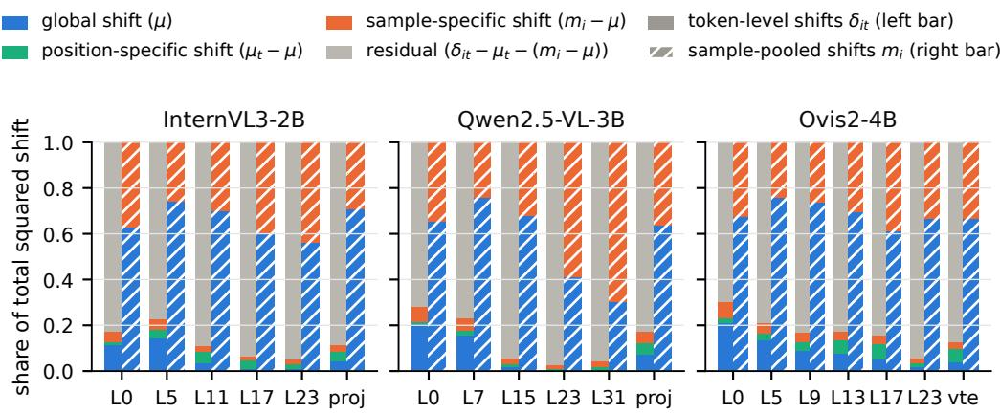  
Figure 3: Decomposition of the total squared shift (Equation (1)) across layers, averaged over the 15 corruptions. Solid bars: token-level shifts; hatched bars: sample-pooled shifts. The residual dominates the token-level shift at every layer, whereas the global shift dominates the pooled shift almost everywhere.

The MLP’s failure says more than this bound. Its correction is a nonlinear function of the input token, but it uses neither the token’s position, which per-token moments already capture, nor information from the other tokens of the image. The shift of a token is therefore not recoverable from that token alone. Undoing it requires the information from the rest of the image, which places the problem closer to restoration than to feature alignment.

The site is not the bottleneck. At the intervention layers, interpolating each token’s activation from its corrupted toward its clean value recovers accuracy in proportion to the interpolation weight (Section E), so a perfect per-token correction at a single layer would close the gap. Nor does the damage concentrate elsewhere in the encoder: activation patching, which overwrites the output of one encoder sub-module, the attention or MLP branch of a block, with its clean-image activation, upper-bounds what any adaptation applied there can achieve, and except for Ovis2’s projector-side MLP no single sub-module recovers more than about half of the gap, at a location that depends on the architecture (Section D). What sample-blind adaptation lacks is therefore not a place to intervene but a correction specific to each token.

## 4 Analysis

## 4.1 The shift is token-specific

The limited gains above raise a simpler question: how much of the corruption-induced shift could a correction of a given granularity remove at all, whatever its estimator? Let $\delta _ { i t }$ be the shift of token t of sample i between its corrupted and clean activation (N samples, T tokens each), and let $\mu , \mu _ { t }$ , and $m _ { i }$ be its means over all tokens, over the samples at position t, and over the tokens of sample i. A correction can remove at most the part of the shift that is constant within its granularity: a global correction removes µ, a per-token correction also removes the position-specific part $\mu _ { t } - \mu _  $ , and a per-sample correction, additionally removes the sample-specific part $m _ { i } - \mu$ . What remains varies from token to token within an image. The four parts are orthogonal under summation over i and $t ,$ because each centered part sums to zero over the index it is centered on, so they partition the total squared shift exactly:

$$
\sum _ { i , t } \Vert \delta _ { i t } \Vert _ { 2 } ^ { 2 } = \underbrace { N T \Vert \mu \Vert _ { 2 } ^ { 2 } } _ { \mathrm { g l o b a l } } + \underbrace { N \sum _ { t } \Vert \mu _ { t } - \mu \Vert _ { 2 } ^ { 2 } } _ { \mathrm { p o s i t i o n . s p e c i f i c } } + \underbrace { T \sum _ { i } \Vert m _ { i } - \mu \Vert _ { 2 } ^ { 2 } } _ { \mathrm { s a m p l e - s p e c i f i c } } + \underbrace { \sum _ { i , t } \Vert \delta _ { i t } - \mu _ { t } - m _ { i } + \mu \Vert _ { 2 } ^ { 2 } } _ { \mathrm { r e s i d u a l } } .\tag{1}
$$

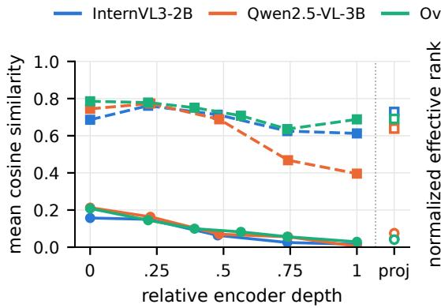

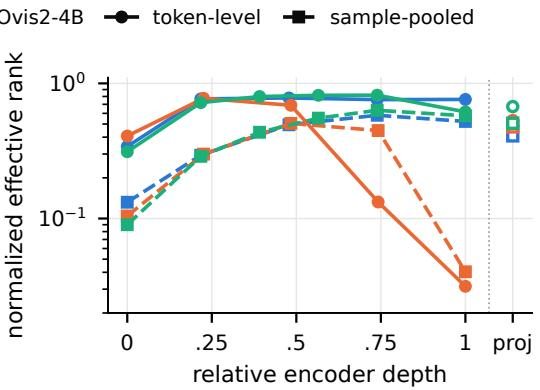  
Figure 4: Token-level shifts (solid) and sample-pooled shifts (dashed) versus encoder depth. (a) Mean cosine similarity between the shifts of different images and (b) normalized effective rank [31] of the shift matrix, averaged over the 15 corruptions.

Each share is the largest fraction of the total squared shift that the corresponding correction can remove. It bounds the shift removed, not the accuracy recovered, which Section 3.2 measures directly.

Figure 3 reports the four shares at every intervention layer. The global share is modest at the first blocks and vanishes with depth; conditioning on token position adds little, and even a per-sample oracle recovers only a small additional fraction. The residual, the variation from token to token within the same image, accounts for the large majority of the shift everywhere. Corruption thus changes the content of individual tokens rather than displacing their distribution as a whole, which explains why sample-blind corrections help only at the shallowest blocks and only for globally acting corruptions (Section G).

Figure 4 confirms that there is no shared direction to exploit. The token-level shifts of different images are only weakly aligned at the first block and become nearly orthogonal with depth. Also, the matrix of token shifts keeps a high normalized effective rank [31] throughout the encoder. The shifts of a corruption thus collectively span almost the full embedding space, leaving no low-dimensional structure for a shared correction to exploit.

Why the same methods work for classification. Feature alignment succeeds in image classification, where the prediction is read from a single pooled representation per image, the CLS token or mean-pooled activations, whether the correction is applied to that vector alone [21, 19] or to every token of the intermediate layers [43]. Averaging the token-level shifts of each image reproduces this view: the position-specific and residual components average out, and Equation (1) reduces to $\begin{array} { r } { \sum _ { i } \| m _ { i } \| _ { 2 } ^ { 2 } = \dot { N } \| \mu \| _ { 2 } ^ { 2 } + \dot { \sum } _ { i } \| m _ { i } - \mu \| _ { 2 } ^ { 2 } } \end{array}$ . In this pooled view the decomposition inverts (hatched bars in Figure $^ { 3 , }$ dashed lines in Figure 4). Pooled shifts of different images are strongly aligned and span few directions, and the global shift $\mu$ accounts for the majority of the squared pooled shift at almost every intervention layer of all three models, so a single sample-blind shift captures most of what there is to correct. The residual that dominates the token-level shift is thus not removed by pooling, only averaged out of the vector a classifier reads, while the language model reads the tokens themselves, residual included.

The pooled view is also the one in which the correction works (Figure 1; details and per-corruption results in Section F). A linear probe trained on clean, mean-pooled projector activations to recognize five scene types falls from 94.5% to 57.6% accuracy under corruption, averaged over models. Gaussian-AcT fitted to the pooled activations lifts it to 84.0%, recovering a fraction $\rho = 0 . 6 5 – 0 . 7 8$ of the probe’s clean–corrupted gap and improving every model–corruption pair. A map of the same form, fitted on the same corrupted images at the same projector output but applied to every visual token, recovers none of the RealWorldQA accuracy gap (ρ between −0.04 and 0.04). The corrupted representation still contains the scene information, and matching its first two moments makes that information linearly decodable again. A classifier that reads a pooled feature benefits from this; an MLLM whose language model attends to every visual token does not.

## 4.2 The degradation is not localized

Prior work shows that the task-relevant visual signal in MLLMs is highly concentrated: most visual tokens can be pruned with little accuracy loss [4], and cropping to a single question-relevant region recovers much of the accuracy lost on fine-grained VQA [47, 41]. If the degradation caused by corruption were similarly concentrated, repairing a small subset of the representation would suffice, and correction would reduce to a selection problem.

We test this with an oracle intervention at the final encoder block of all three models, under Gaussian noise at severity 5. We replace a random subset of the corrupted activation with the clean activation of the same image and sweep the size of the subset along two axes: whole token positions, and feature dimensions across all positions.

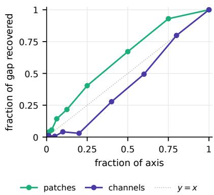  
Figure 5: No small subset of the representation carries the degradation. The fraction of the clean–corrupted gap recovered on both axes (dotted: proportional), for Qwen2.5-VL-3B under Gaussian noise at severity 5.

Recovery requires restoring a large fraction of the representation on either axis (Figure 5): half of the gap costs roughly a third of all patches or 60% of all feature dimensions. For Qwen2.5-VL-3B, the two axes differ in shape, while for the remaining two models the curves nearly align (Figures 14 and 15) having a steeper slope at lower fractions. Patch recovery is concave and begins immediately, whereas dimension recovery is flat below about 20% of

the dimensions and stays below the proportional rate throughout: corruption is spread across nearly all feature dimensions and somewhat unevenly across positions. Choosing the subset by the magnitude or the variance of the clean activations instead of at random rescales these curves by at most a constant factor and leaves their shape unchanged (Section H.1). The concentration that token pruning and visual cropping exploit therefore does not extend to the degradation caused by corruption: no small region of the representation carries it, and no selection rule we tested finds one.

## 5 Discussion, Limitations, and Future Work

Across three MLLMs and 15 corruptions, representation-based TTA recovers about one percentage point of a drop an order of magnitude larger, and no variant of the method changes this: online or offline estimation, global or per-token moments, linear or nonlinear maps, and unpaired or paired supervision recover at most a few points (Sections 3.1 and 3.2). Prompting about the degradation does not help either, and the confidence signal on which entropy-based objectives rely barely predicts correctness (Sections I.1 and I.2). The reason is the structure of the shift, not the method: it is almost entirely token-specific (Section 4.1), so a sample-blind correction has little to correct, whereas pooled per image, as a classifier reads it, the same shift is dominated by a shared direction, which is why feature alignment works for classification. The correction that would work must be specific to each sample and token, and no small subset of tokens or dimensions carries it (Section 4.2). Adapting MLLMs to corruptions is therefore a per-token restoration problem rather than a featurealignment problem, and sample-blind corrections should not be expected to repair corruption damage at deployment.

Limitations. We test only sample-blind corrections: none is estimated from the image it corrects, and none draws on the rest of the image. The study is preliminary in scale: three models of 2–4B parameters whose language models come from one family (Qwen2.5), and one multiplechoice benchmark of 765 questions. Corrections are applied in the vision encoder and projector only. The corruptions are synthetic, at a single severity, and one per stream, rather than the mixed degradations met in deployment.

Future work. MAA trains layer-wise adapters in a frozen vision encoder that steer corrupted features back onto the clean manifold, using paired clean–corrupted features and a token-level adversarial constraint [13]. A test-time counterpart would have to learn such a token-level correction from the unlabeled stream alone, for instance through consistency across augmentations [10]. Whether this is possible without paired data is the question we leave open.

## Acknowledgments and Disclosure of Funding

We gratefully acknowledge Polish high-performance computing infrastructure PLGrid (HPC Center: ACK Cyfronet AGH) for providing computer facilities and support within computational grant no. PLG/2025/018644 and PLG/2026/019363. This research was funded in whole or in part by National Science Centre, Poland, grant no 2023/51/D/ST6/02846 and 2024/53/N/ST6/03156. Bartłomiej Twardowski acknowledges the grant RYC2021-032765-I.

## References

[1] Kazuki Adachi, Shin’ya Yamaguchi, Atsutoshi Kumagai, and Tomoki Hamagami. Test-time adaptation for regression by subspace alignment. In The Thirteenth International Conference on Learning Representations, 2025. URL https://openreview.net/forum?id=SXtl7NRyE5.

[2] Shuai Bai, Keqin Chen, Xuejing Liu, Jialin Wang, Wenbin Ge, Sibo Song, Kai Dang, Peng Wang, Shijie Wang, Jun Tang, et al. Qwen2. 5-vl technical report. arXiv preprint arXiv:2502.13923, 2025.

[3] Dian Chen, Dequan Wang, Trevor Darrell, and Sayna Ebrahimi. Contrastive test-time adaptation. In Proceedings of the IEEE/CVF Conference on Computer Vision and Pattern Recognition, pages 295–305, 2022.

[4] Liang Chen, Haozhe Zhao, Tianyu Liu, Shuai Bai, Junyang Lin, Chang Zhou, and Baobao Chang. An image is worth 1/2 tokens after layer 2: Plug-and-play inference acceleration for large vision-language models. In Computer Vision – ECCV 2024: 18th European Conference, Milan, Italy, September 29–October 4, 2024, Proceedings, Part LXXXI, page 19–35, Berlin, Heidelberg, 2024. Springer-Verlag. ISBN 978-3-031-73003-0. doi: 10.1007/978-3-031-73004-7\_2.

[5] Shuo Chen, Jindong Gu, Zhen Han, Yunpu Ma, Philip Torr, and Volker Tresp. Benchmarking robustness of adaptation methods on pre-trained vision-language models. Advances in Neural Information Processing Systems, 36:51758–51777, 2023.

[6] Haodong Duan, Junming Yang, Yuxuan Qiao, Xinyu Fang, Lin Chen, Yuan Liu, Xiaoyi Dong, Yuhang Zang, Pan Zhang, Jiaqi Wang, et al. Vlmevalkit: An open-source toolkit for evaluating large multi-modality models. In Proceedings of the 32nd ACM International Conference on Multimedia, pages 11198–11201, 2024.

[7] Stephanie Fu, tyler bonnen, Devin Guillory, and Trevor Darrell. Hidden in plain sight: VLMs overlook their visual representations. In Second Conference on Language Modeling, 2025. URL https://openreview.net/forum?id=qQb1JLrwol.

[8] Stefan Heimersheim and Neel Nanda. How to use and interpret activation patching. arXiv preprint arXiv:2404.15255, 2024.

[9] Dan Hendrycks and Thomas Dietterich. Benchmarking neural network robustness to common corruptions and perturbations. arXiv preprint arXiv:1903.12261, 2019.

[10] Mehmet Onurcan Kaya, Desmond Elliott, and Dim Papadopoulos. Efficient test-time scaling for small vision-language models. In The Fourteenth International Conference on Learning Representations, 2026. URL https://openreview.net/forum?id=rClkte0ZTp.

[11] Pegah Khayatan, Mustafa Shukor, Jayneel Parekh, and Matthieu Cord. Analyzing fine-tuning representation shift for multimodal llms steering alignment. arXiv preprint arXiv:2501.03012, 2025.

[12] Chunyi Li, Jianbo Zhang, Zicheng Zhang, Haoning Wu, Yuan Tian, Wei Sun, Guo Lu, Xiaohong Liu, Xiongkuo Min, Weisi Lin, and Guangtao Zhai. R-bench: Are your large multimodal model robust to real-world corruptions?, 2024.

[13] Hao Li, Zeyu Xiao, Junhao Zhou, Peng Liu, Yang Zhao, and Wei Jia. Robust vision-language models via manifold-adversarial adapters. In Forty-third International Conference on Machine Learning, 2026. URL https://openreview.net/forum?id=j3NoRf0n7d.

[14] Jian Liang, Ran He, and Tieniu Tan. A comprehensive survey on test-time adaptation under distribution shifts. International Journal ofComputer Vision, 133(1):31–64, 2025.

[15] Haotian Liu, Chunyuan Li, Qingyang Wu, and Yong Jae Lee. Visual instruction tuning. Advances in neural information processing systems, 36:34892–34916, 2023.

[16] Sheng Liu, Haotian Ye, and James Zou. Reducing hallucinations in large vision-language models via latent space steering. In The Thirteenth International Conference on Learning Representations, 2025. URL https://openreview.net/forum?id=LBl7Hez0fF.

[17] Shiyin Lu, Yang Li, Qing-Guo Chen, Zhao Xu, Weihua Luo, Kaifu Zhang, and Han-Jia Ye. Ovis: Structural embedding alignment for multimodal large language model. arXiv preprint arXiv:2405.20797, 2024.

[18] Muhammad Jehanzeb Mirza, Pol Jané Soneira, Wei Lin, Mateusz Kozinski, Horst Possegger, and Horst Bischof. Actmad: Activation matching to align distributions for test-time-training. In Proceedings of the IEEE/CVF Conference on Computer Vision and Pattern Recognition, pages 24152–24161, 2023.

[19] Alexander Murphy, Michal Danilowski, Soumyajit Chatterjee, and Abhirup Ghosh. NEO — nooptimization test-time adaptation through latent re-centering. In The Fourteenth International Conference on Learning Representations, 2026. URL https://openreview.net/forum? id=mVlIKLiizr.

[20] Shuaicheng Niu, Jiaxiang Wu, Yifan Zhang, Zhiquan Wen, Yaofo Chen, Peilin Zhao, and Mingkui Tan. Towards stable test-time adaptation in dynamic wild world. arXiv preprint arXiv:2302.12400, 2023.

[21] Shuaicheng Niu, Chunyan Miao, Guohao Chen, Pengcheng Wu, and Peilin Zhao. Test-time model adaptation with only forward passes. In The International Conference on Machine Learning, 2024.

[22] Shuaicheng Niu, Guohao Chen, Peilin Zhao, Tianyi Wang, Pengcheng Wu, and Zhiqi Shen. Self-bootstrapping for versatile test-time adaptation. In Forty-second International Conference on Machine Learning, 2025. URL https://openreview.net/forum?id=Li4rieeClO.

[23] Jayneel Parekh, Pegah Khayatan, Mustafa Shukor, Arnaud Dapogny, Alasdair Newson, and Matthieu Cord. Learning to steer: Input-dependent steering for multimodal llms. arXiv preprint arXiv:2508.12815, 2025.

[24] Ori Press, Steffen Schneider, Matthias Kümmerer, and Matthias Bethge. Rdumb: A simple approach that questions our progress in continual test-time adaptation. Advances in Neural Information Processing Systems, 36:39915–39935, 2023.

[25] Xinkuan Qiu, Meina Kan, Yongbin Zhou, and Shiguang Shan. Benchmarking multimodal large language models against image corruptions. In Proceedings of the IEEE/CVF International Conference on Computer Vision, pages 9014–9023, 2025.

[26] Alec Radford, Jong Wook Kim, Chris Hallacy, Aditya Ramesh, Gabriel Goh, Sandhini Agarwal, Girish Sastry, Amanda Askell, Pamela Mishkin, Jack Clark, et al. Learning transferable visual models from natural language supervision. In International conference on machine learning, pages 8748–8763. PmLR, 2021.

[27] Nina Rimsky, Nick Gabrieli, Julian Schulz, Meg Tong, Evan Hubinger, and Alexander Turner. Steering llama 2 via contrastive activation addition. In Proceedings ofthe 62nd Annual Meeting ofthe Associationfor Computational Linguistics (Volume 1: Long Papers), pages 15504–15522, 2024.

[28] Pau Rodriguez, Arno Blaas, Michal Klein, Luca Zappella, Nicholas Apostoloff, marco cuturi, and Xavier Suau. Controlling language and diffusion models by transporting activations. In The Thirteenth International Conference on Learning Representations, 2025. URL https: //openreview.net/forum?id=l2zFn6TIQi.

[29] Pau Rodriguez, Michal Klein, Eleonora Gualdoni, Valentino Maiorca, Arno Blaas, Luca Zappella, marco cuturi, and Xavier Suau. LinEAS: End-to-end learning of activation steering with a distributional loss. In The Thirty-ninth Annual Conference on Neural Information Processing Systems, 2025. URL https://openreview.net/forum?id=EBONa3tT3K.

[30] Amir Rosenfeld, Neta Glazer, and Ethan Fetaya. Questioning the stability of visual question answering. arXiv preprint arXiv:2511.11206, 2025.

[31] Olivier Roy and Martin Vetterli. The effective rank: A measure of effective dimensionality. In 2007 15th European signal processing conference, pages 606–610. IEEE, 2007.

[32] Rohit Saxena, Alessandro Suglia, and Pasquale Minervini. VLM-robustbench: A comprehensive benchmark for robustness of vision-language models. In Forty-third International Conference on Machine Learning, 2026. URL https://openreview.net/forum?id=HwXyyvK7ZJ.

[33] Mona Schirmer, Metod Jazbec, Christian A. Naesseth, and Eric Nalisnick. Monitoring risks in test-time adaptation. In The Thirty-ninth Annual Conference on Neural Information Processing Systems, 2025. URL https://openreview.net/forum?id=TzHX2RWUdE.

[34] Steffen Schneider, Evgenia Rusak, Luisa Eck, Oliver Bringmann, Wieland Brendel, and Matthias Bethge. Improving robustness against common corruptions by covariate shift adaptation. Advances in neural information processing systems, 33:11539–11551, 2020.

[35] Lijun Sheng, Jian Liang, Ran He, Zilei Wang, and Tieniu Tan. The illusion of progress? a critical look at test-time adaptation for vision-language models. Advances in Neural Information Processing Systems, 38, 2026.

[36] Manli Shu, Weili Nie, De-An Huang, Zhiding Yu, Tom Goldstein, Anima Anandkumar, and Chaowei Xiao. Test-time prompt tuning for zero-shot generalization in vision-language models. Advances in Neural Information Processing Systems, 35:14274–14289, 2022.

[37] Shengbang Tong, Zhuang Liu, Yuexiang Zhai, Yi Ma, Yann LeCun, and Saining Xie. Eyes wide shut? exploring the visual shortcomings of multimodal llms. In Proceedings ofthe IEEE/CVF Conference on Computer Vision and Pattern Recognition, pages 9568–9578, 2024.

[38] An Vo, Khai-Nguyen Nguyen, Mohammad Reza Taesiri, Vy Tuong Dang, Anh Totti Nguyen, and Daeyoung Kim. Vision language models are biased. In The Fourteenth International Conference on Learning Representations, 2026. URL https://openreview.net/forum? id=DG4S2OlGQA.

[39] Dequan Wang, Evan Shelhamer, Shaoteng Liu, Bruno Olshausen, and Trevor Darrell. Tent: Fully test-time adaptation by entropy minimization. arXiv preprint arXiv:2006.10726, 2020.

[40] Xi Wang and Eric Nalisnick. Are vision language models robust to uncertain inputs? arXiv preprint arXiv:2505.11804, 2025.

[41] Penghao Wu and Saining Xie. V\*: Guided visual search as a core mechanism in multimodal llms. In 2024 IEEE/CVF Conference on Computer Vision and Pattern Recognition (CVPR), pages 13084–13094, 2024. doi: 10.1109/CVPR52733.2024.01243.

[42] xAI. Grok-1.5 vision preview: Connecting the digital and physical worlds with our first multimodal model. https://x.ai/blog/grok-1.5v, 2024.

[43] MA Xiao, Young D Kwon, Pan Zhou, and Dong Ma. Architecture-agnostic test-time adaptation via backprop-free embedding alignment. In The Fourteenth international conference on learning representations, 2026.

[44] Zehao Xiao and Cees GM Snoek. Beyond model adaptation at test time: A survey. arXiv preprint arXiv:2411.03687, 2024.

[45] Linjing You, Jiabao Lu, and Xiayuan Huang. Test-time correlation alignment. In Forty-second International Conference on Machine Learning, 2025. URL https://openreview.net/ forum?id=0dualJz9OI.

[46] Xiaohua Zhai, Basil Mustafa, Alexander Kolesnikov, and Lucas Beyer. Sigmoid loss for language image pre-training. In 2023 IEEE/CVF International Conference on Computer Vision (ICCV), pages 11941–11952. IEEE, 2023.

[47] Jiarui Zhang, Mahyar Khayatkhoei, Prateek Chhikara, and Filip Ilievski. Towards perceiving small visual details in zero-shot visual question answering with multimodal llms, 2024. URL https://arxiv.org/abs/2310.16033.

[48] Jinguo Zhu, Weiyun Wang, Zhe Chen, Zhaoyang Liu, Shenglong Ye, Lixin Gu, Hao Tian, Yuchen Duan, Weijie Su, Jie Shao, et al. Internvl3: Exploring advanced training and test-time recipes for open-source multimodal models. arXiv preprint arXiv:2504.10479, 2025.

[49] Andy Zou, Long Phan, Sarah Chen, James Campbell, Phillip Guo, Richard Ren, Alexander Pan, Xuwang Yin, Mantas Mazeika, Ann-Kathrin Dombrowski, et al. Representation engineering: A top-down approach to ai transparency. arXiv preprint arXiv:2310.01405, 2023.

## A Experimental Details

Intervention layers. Unless stated otherwise, we intervene at the outputs of encoder blocks {0, 5, 11, 17, 23} and the projector of InternVL3-2B, blocks {0, 7, 15, 23, 31} and the projector of Qwen2.5-VL-3B, and blocks {0, 5, 9, 13, 17, 23} and the visual embedding table of Ovis2-4B, which span each encoder at roughly equal relative depth; we refer to these as the intervention layers. Qwen2.5-VL and InternVL3 merge neighboring patch embeddings before projection, and Ovis2 replaces the projector with a lookup in a learned visual embedding table (vte). Single-layer experiments use blocks 11, 11, and 9, respectively, selected by activation patching (Section D). Source statistics are computed once on clean images, while target statistics are estimated either offline on the full test set or online from a test stream (Section B). We report accuracy averaged over three random seeds, which for online adaptation also determine the sample order.

Source statistics. Our use of pre-computed source statistics $( \mu _ { \mathrm { s r c } } , \sigma _ { \mathrm { s r c } } )$ sits at the boundary between test-time adaptation and unsupervised domain adaptation and deserves comment. In the standard TTA setting, the model pre-trained on the source domain is available at test time but the source data are not [14]. Storing summary statistics of the source activations is a one-time offline computation: it requires a single forward pass over a calibration set and a few tensors per layer, on the order of tens of megabytes for a ViT-scale encoder, and grants no access to individual source samples at adaptation time. The same convention is followed by prior feature-alignment methods: ActMAD [18] aligns test activations with source activation statistics, FOA [21] measures the discrepancy between test and source statistics and shifts activations to reduce it, and PEA [43] pre-computes per-block source statistics offline. We adopt it throughout. Retaining these statistics is a mild relaxation of settings that prohibit retaining any information derived from the source domain; the adaptation procedure nevertheless never sees a source example and incurs only a small, fixed storage cost.

## B Online Estimation and Dynamic Weighting

Target moments are estimated online in batches of B = 16 samples: after each batch, the running mean and variance of every intervention layer are updated by an exponential moving average with rate 0.1. Figure 6 traces the cumulative accuracy gain along the stream and Figure 7 the per-layer weights of the dynamically weighted variant of Section 3.1.

Dynamic weighting. The weight of layer ℓ follows the per-layer rule of PEA [43]: the discrepancy $d _ { \ell } ,$ the Kullback–Leibler divergence between the Gaussian fits of the running target moments and of the source moments, is rescaled across layers to [0, 1] by min–max normalization, so that the most discrepant layer is corrected at full strength and the least discrepant one not at all. Because deeper layers begin estimating their moments later in our online cascade, a layer with a nearly empty estimate would otherwise appear maximally discrepant and receive full weight. We therefore multiply the weight by a confidence factor $n _ { \ell } / ( n _ { \ell } + B )$ , where $n _ { \ell }$ is the number of samples the estimate of layer ℓ has seen, which keeps the weight near zero until the estimate rests on data.

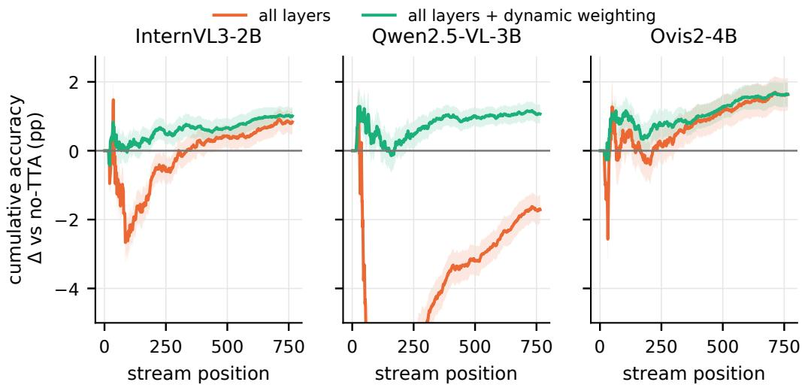

Figure 6: Adaptation is slow and the gain stays small. Cumulative change in RealWorldQA accuracy over the no-TTA baseline along the stream (mean over corruptions and three orders; band: standard error). The unweighted correction drops sharply early, while the online estimate is still poor, and recovers to about break-even; the weighted variant stays near zero and ends with a small gain.  
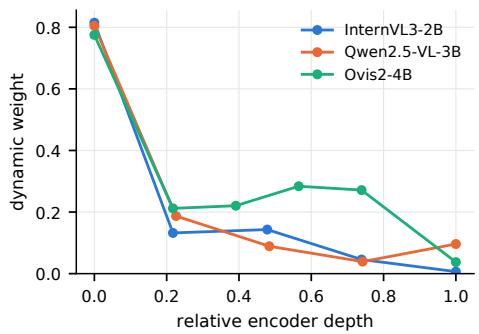  
Figure 7: The weight concentrates on the early layers. Mean per-layer weight over the stream against relative encoder depth.

## C Ablations of Single-Layer Gaussian-AcT

We run both ablations on single-layer Gaussian-AcT fitted online (Section 3.1) at block 11 of InternVL3-2B and Qwen2.5-VL-3B and block 9 of Ovis2-4B, under the 15 corruptions at severity 5, and report the whole-episode accuracy gain over the no-TTA baseline as mean and standard deviation over three stream orders.

Online fitting matches offline fitting. With per-token moments estimated online, accuracy improves by +0.87 ± 0.38, +1.32 ± 0.23, and +0.91 ± 0.10 pp on InternVL3-2B, Qwen2.5-VL-3B, and Ovis2-4B, compared with +0.95, +1.27, and +1.05 pp when the moments are fitted offline on the full test set. Per corruption (Figure 9), the online and offline gains are strongly correlated $( r = 0 . 9 3 )$ and differ by −0.06 pp on average (SD 0.64).

Per-token moments outperform global moments. Pooling the moments over all token positions reduces the gain to $+ 0 . { \overset { \textstyle - } { 1 2 } } \pm 0 . 1 7 { \overset { \textstyle - } { , } } + 0 . 8 8 \pm 0 . 1 4 .$ , and $+ 0 . 2 \bar { 5 } \pm 0 . 0 8 ~ \mathrm { p p }$ . Figure 8 shows the gain along the stream: the global estimate converges within the first 50 samples but plateaus, whereas the per-token estimate converges after 200–300 samples and reaches the accuracy of offline fitting. For reference, the corruptions lower accuracy by 8.3, 12.6, and 10.7 pp relative to clean images.

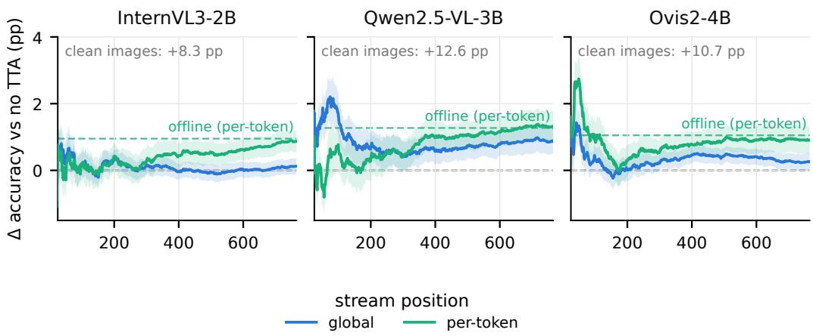  
Figure 8: Per-token moments converge more slowly but higher. Cumulative accuracy gain over the no-TTA baseline along the stream for single-layer Gaussian-AcT fitted online with global and pertoken target moments, averaged over the 15 corruptions (band: ±1 standard error over corruptions; each corruption averaged over three stream orders). The dashed line marks the same per-token Gaussian-AcT fitted offline and the inset text the gain of clean images; the first 16 samples are not adapted.

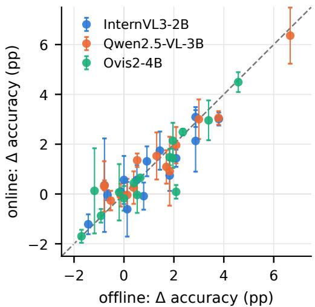  
Figure 9: Online estimation matches offline fitting. Whole-episode accuracy gain over the no-TTA baseline of per-token Gaussian-AcT with target moments fitted offline (x) or estimated online (y); one point per model and corruption (mean over three stream orders; bars: standard deviation); dashed line: identity.

## D Activation Patching: Where the Degradation Can Be Repaired

Activation patching [8] overwrites activations during a forward pass with activations cached from a pass on a different input and observes how the output changes. Here the pass is on a corrupted image, the cached activations come from the same image before corruption, and we overwrite the output of one encoder sub-module, the attention or MLP branch of one block, at a time. We measure the share of the lost answer margin, the logit of the correct option minus the mean logit of the incorrect ones, that returns. Because the clean activation is the best possible correction for that sub-module, this share upper-bounds what any adaptation confined to it can achieve, whatever method estimates the correction.

Concretely, for each corrupted image we run the model once per sub-module u with a forward hook that replaces its output for all tokens by the cached clean activation, and record the answer margin $M _ { u } = \ell _ { \mathrm { c o r r e c t } } - \mathrm { m e a n } _ { k } \ell _ { k }$ over the option-letter logits at the answer position, with k ranging over the incorrect options. We report $( M _ { u } ^ { \bullet } - M ^ { \mathrm { c o r r } } ) / ( \bar { M } ^ { \mathrm { c l e a n } } - M ^ { \mathrm { c o r r } } )$ averaged over 100 images per corruption for all 15 corruptions at severity 5. Normalizing by the gap makes cells comparable across models and corruptions, at the price of noisier rows for corruptions with a small gap (brightness). Replacing the output of a whole block, which cuts the entire visual stream, reproduces the clean margin exactly in every run and validates the setup.

Figure 10 shows that repair is localized but that its location depends on the architecture. Qwen2.5-VL-3B recovers most low-frequency degradation (blur, digital) in itsfirst MLP and has two corruptiongeneral attention hubs, at mid-depth and at the end of the encoder. Ovis2-4B’s repair is broad rather than concentrated: a mid-depth attention cluster and the MLPs of the final blocks are positive for nearly all corruptions. Its projector-side MLP, the MLP of its last block, appears to restore almost the entire gap, but it accounts for most of the norm of its block’s output, so the effect cannot be attributed to the MLP rather than to the restoration of the visual stream as a whole. InternVL3-2B has no comparable lever: recoverable degradation is spread thinly over mid-depth blocks, and restoring early sub-modules in isolation is harmful for low-frequency corruptions, so their effect is not captured by any single sub-module. Except for the projector-side MLP of Ovis2-4B, no single sub-module recovers more than about half of the gap.

The single-layer experiments (Section 3.1 and Section C) adapt block 11 of InternVL3-2B and Qwen2.5-VL-3B and block 9 of Ovis2-4B, the upstream edge of the mid-depth region whose attention sub-modules recover damage for nearly every corruption (Figure 10). Intervening there places the correction where repair is corruption-general and upstream of the encoder’s own repair machinery, rather than at the strongest single component, which is corruption-specific in Qwen2.5-VL-3B and sits at the very end of the encoder in Ovis2-4B. The maps also set expectations: a single-block correction has more headroom where repair is concentrated (Qwen2.5-VL-3B, Ovis2-4B) than in InternVL3-2B, where it is spread thinly.

## E Interpolating Between Corrupted and Clean Activations

We evaluate Qwen2.5-VL-3B on 200 random samples, for each of which both the clean (source) and the corrupted (target) image are available. For every sample we linearly interpolate, at a given site, between the activation of the corrupted image and that of the clean image,

$$
y ( \alpha ) = ( 1 - \alpha ) \pmb { x } ^ { \mathrm { t a r g e t } } + \alpha \pmb { x } ^ { \mathrm { s o u r c e } } ,\tag{2}
$$

sweep $\alpha \in [ 0 , 1 ]$ , and measure downstream accuracy. $\alpha = 0$ reproduces the no-TTA baseline and $\alpha = 1$ the clean baseline; the sweep therefore traces how accuracy depends on the precision of the correction at that site, independently of any estimator’s error. We apply it at the visual tokens at the output of an encoder block or of the projector, sweeping the site over blocks 4, 18, and 30 and the projector, under Gaussian noise at severity 5.

Does the interpolation leave the manifold? Li et al. [13] argue that aligning corrupted features with clean references in Euclidean space is not semantics-preserving: the features move geometrically closer to the clean ones while drifting off the in-distribution support on which the language model’s reasoning is calibrated, and this motivates the adversarial manifold constraint of their Manifold-Adversarial Adapters (MAA). The interpolation above is such a Euclidean operation. Every intermediate point is a convex combination of the corrupted activation and the clean activation of the same token, and nothing constrains it to lie on either the clean or the corrupted manifold. If the segment left the support the language model handles, accuracy should dip or stall at intermediate α. Figure 11 shows no such dip. Accuracy grows roughly in proportion to α at every site, no intermediate α falls below the no-TTA baseline, and the curves meet the clean accuracy at $\alpha = 1$ . This suggests that the straight path from a corrupted token to its own clean counterpart stays within the region the language model reads correctly, at least for this model and corruption. We do not see this as contradicting MAA. The drift they describe arises when a feature is pulled toward a clean reference that is not its paired counterpart, as in distribution-level alignment, where the target is a mean or a nearby clean feature rather than the sample’s own clean activation. Read this way, the obstacle is the sample-blind target rather than the Euclidean geometry of the correction, which is consistent with

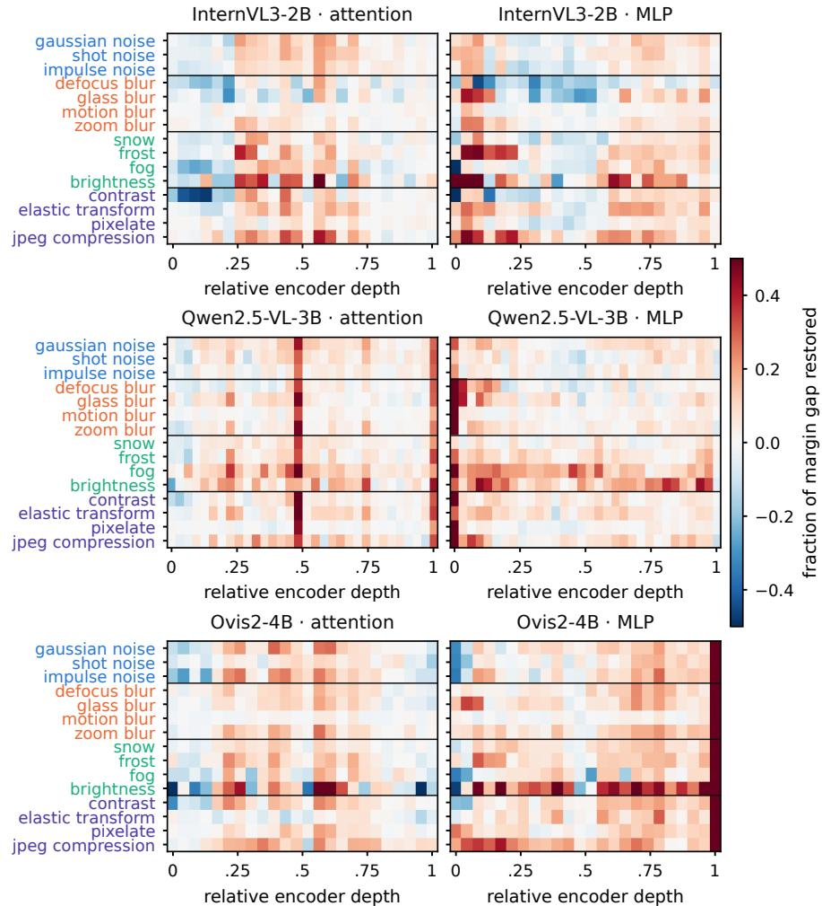  
Figure 10: Per-corruption encoder repair map. Share of the clean–corrupted margin gap recovered by patching a single attention (left) or MLP (right) sub-module to its clean activation, for all 15 corruptions at severity 5 (rows, colored by family) and every encoder block (columns, relative depth); 100 images per cell, color saturates at ±0.5.

Section 4.1. Two caveats apply. We do not measure manifold membership directly but infer it from the accuracy along the path, and the sweep covers one model and one corruption.

## F Linear Probe on Pooled Projector Activations

This section details the probe experiment summarized in Section 4.1. Under corruption, answer accuracy confounds two failures: the visual features may lose the scene information, or the language model may fail to use it. We isolate the first by scoring the projector output directly with a linear probe. RealWorldQA [42] carries no scene labels, so we construct them. We mean-pool the projector output over all visual tokens (D=2048 for Qwen2.5-VL-3B and Ovis2-4B, 1536 for InternVL3-2B) and partition the 765 images into five classes by k-means on the clean activations, clustering each model separately and merging the three partitions by co-association consensus. The models agree on the partition (ARI 0.73), so it reflects structure shared across encoders rather than an artifact of one; inspection of a few images per cluster yields the class names residential street, open road, night drive, handheld photo, and urban intersection.

We split the 765 samples 70/30, stratified by class, and fit a linear classifier on the clean activations of the training split alone, selecting $C \in \{ \hat { 1 0 } ^ { - 2 } , . . . , 1 0 ^ { 2 } \}$ by 5-fold cross-validation within it; all numbers are scored on the held-out split. Corruption does not change which scene an image shows, so a corrupted activation keeps its clean label. Gaussian-AcT matches the per-dimension mean and standard deviation of the corrupted activations to those of the clean ones; it is label-free and fitted on all samples of a condition. We report means over five splits ± SEM and summarize recovery by the fraction of the clean–corrupted gap closed, $\rho = ( a _ { \mathrm { G A } } - a _ { \mathrm { n o n e } } ) / ( a _ { \mathrm { c l e a n } } - a _ { \mathrm { n o n e } } )$

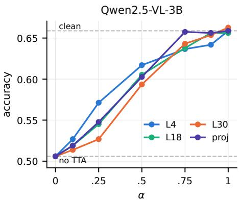  
Figure 11: A perfect single-layer correction recovers clean accuracy. Accuracy of Qwen2.5-VL-3B under Gaussian noise at severity 5 when the activation of one site is interpolated between its corrupted $( \alpha = 0 )$ and clean $( \alpha = 1 )$ value; one curve per layer, dashed line: clean accuracy.

Severity-5 corruption is destructive in pooled projector space: accuracy falls from 94.5% to 57.6 ± 0.3%, cutting the margin over the $3 0 . 4 \%$ majority baseline from 64 to 27 points. Gaussian-AcT lifts it to $8 4 . 0 \pm 0 . 2 \%$ , recovering $\rho = 0 . 6 5 – 0 . 7 8$ of the gap. The effect is uniform rather than an average: Gaussian-AcT improves all 45 model–corruption pairs (Table 2), and $\rho$ exceeds 0.6 for 13 of the 15 corruptions, peaking at 0.95 for InternVL3-2B under defocus blur. Recovery is largest where the degradation is largest: the noise family is both the most destructive without adaptation (49.6%) and the most fully repaired $( \rho = 0 . 8 2 )$ , so the transport does not merely improve conditions that were already easy. Motion blur $( \rho = 0 . 3 6 )$ and pixelate (0.51) recover least, as expected of a transport with one scale and one offset per channel. Raw, uncentered features change $\rho$ by at most 0.03.

This recovery does not reach the model’s multiple-choice answers. Averaged over the corruptions, the probe recovers $\rho = 0 . 7 8 , 0 . 6 5$ , and 0.72 of its clean–corrupted gap for InternVL3-2B, Qwen2.5-VL-3B, and Ovis2-4B. For those answers, the same map is fitted offline on the same corrupted images and applied at the same projector output, but to every visual token rather than to one pooled vector per image, and the language model rather than a linear probe reads the result. Position-shared Gaussian AcT then recovers $\rho = - 0 . 0 4 , 0 . 0 4$ , and −0.01 of the RealWorldQA accuracy gap (Figure 1). The two measurements thus share the site, the form of the map, and the offline access to the corrupted set; they differ only in what the map acts on and who reads it.

The corrupted representation therefore still contains the scene information, and matching its first two moments makes that information linearly decodable again, yet the answer does not follow. Restoring the first two moments of the projector distribution is thus not sufficient for the downstream task, and probe accuracy alone overstates what feature alignment delivers.

Two caveats bound these conclusions. The labels are not independent of the features: they are derived by clustering the clean activations of all 765 samples, so the label definition has seen the test images and absolute accuracies are inflated; the clean–corrupted drop and the recovered fraction $\rho ,$ which carry the conclusions, are unaffected in direction. The probe and its transport also operate on pooled sample vectors, whereas adaptation acts on the per-token distribution inside the model, so this experiment diagnoses what the representation retains and does not itself constitute an adaptation method.

Table 2: Per-corruption effect of the projector transport, by readout. $\Delta$ is the change in accuracy over no TTA (percentage points) and $\rho = \Delta /$ (clean − no TTA) the fraction of the corruption gap recovered. Classification fits and applies the transport on one pooled vector per image and reads it out with a linear probe on scene pseudo-classes (mean over five stratified splits); MCQ fits and applies it on the unpooled token sequence inside the model, shared across positions, and reads out RealWorldQA accuracy. Per-corruption $\Delta$ is a point estimate; the means carry the SEM of the mean.
<table><tr><td rowspan=1 colspan=10>InternVL3-2B              Qwen2.5-VL-3B               Ovis2-4BClass.        MCQ        Class.        MCQ        Class.       MCQ∆    ρ    ∆    ρ      ∆    ρ    ∆   ρ      ∆    ρ    ∆   ρCorruption(pp)(of gap) (pp)(of gap)   (pp)(of gap) (pp)(of gap)   (pp)(of gap) (pp)(of gap)</td></tr><tr><td rowspan=1 colspan=4>Noise</td><td rowspan=1 colspan=3></td><td rowspan=2 colspan=3></td></tr><tr><td rowspan=1 colspan=1>Gaussian +41.3</td><td rowspan=1 colspan=3>+0.89 +0.4 +0.05</td><td rowspan=1 colspan=3>+35.9 +0.75 -0.7 -0.04</td></tr><tr><td rowspan=1 colspan=1>Shot    +39.7 +</td><td rowspan=1 colspan=3>0.84 -0.5 −-0.06</td><td rowspan=1 colspan=3>+36.5 +0.75 -0.7 -0.05</td><td rowspan=1 colspan=3>+35.8 +0.84 -0.1 -0.01</td></tr><tr><td rowspan=1 colspan=1>Impulse  +40.3</td><td rowspan=1 colspan=3>+0.89 -2.0 -0.29</td><td rowspan=1 colspan=3>+36.3 +0.79 +1.4 +0.10</td><td></td><td></td><td></td></tr><tr><td rowspan=1 colspan=1>Blur</td><td rowspan=1 colspan=3></td><td></td><td></td><td></td><td></td><td></td><td></td></tr><tr><td></td><td rowspan=3 colspan=3>+0.95 +0.1 +0.02</td><td></td><td></td><td></td><td></td><td></td><td></td></tr><tr><td></td><td rowspan=2 colspan=2>+31.5 +0.78 +0.8</td><td rowspan=2 colspan=1>+0.07</td><td></td><td></td><td></td></tr><tr><td rowspan=1 colspan=1>Defocus  +35.5</td><td></td><td></td><td></td></tr><tr><td rowspan=1 colspan=1>Glass    +30.7</td><td rowspan=1 colspan=2>+0.92 -0.1</td><td rowspan=1 colspan=1>-0.03</td><td rowspan=1 colspan=1>+29.3</td><td rowspan=1 colspan=1>+0.76 +0.7</td><td rowspan=1 colspan=1>+0.08</td><td rowspan=1 colspan=1>+23.0</td><td rowspan=1 colspan=2>+0.86 +1.0 +0.11</td></tr><tr><td rowspan=1 colspan=1>Motion  +15.0</td><td rowspan=1 colspan=2>+0.33 -0.7</td><td rowspan=1 colspan=1>-0.04</td><td rowspan=1 colspan=1>+17.5</td><td rowspan=1 colspan=1>+0.36 -1.4</td><td rowspan=1 colspan=1>-0.07</td><td rowspan=1 colspan=1>+17.3</td><td rowspan=1 colspan=2>+0.41 -2.9 -0.15</td></tr><tr><td rowspan=1 colspan=1>Zoom   +30.8</td><td rowspan=1 colspan=2>+0.74 -0.1 -</td><td rowspan=1 colspan=1>0.01</td><td rowspan=1 colspan=1>+26.8</td><td rowspan=1 colspan=1>+0.59 -0.9</td><td rowspan=3 colspan=1>-0.05+0.09</td><td rowspan=3 colspan=1>+25.8+19.2</td><td rowspan=3 colspan=2>+0.68 -0.3 -0.01+0.80 +0.9 +0.07</td></tr><tr><td rowspan=1 colspan=1>Weather</td><td rowspan=1 colspan=2></td><td rowspan=1 colspan=1></td><td rowspan=1 colspan=1></td><td rowspan=2 colspan=1>+0.67 +1.2</td></tr><tr><td rowspan=1 colspan=1>Snow    +22.4</td><td rowspan=1 colspan=2>+0.88 +0.3</td><td rowspan=1 colspan=1>+0.03</td><td rowspan=1 colspan=1>+28.3</td></tr><tr><td rowspan=1 colspan=1>Frost    +23.6</td><td rowspan=1 colspan=2>+0.63 -0.5 -</td><td rowspan=1 colspan=1>0.07</td><td rowspan=1 colspan=1>+29.7</td><td rowspan=1 colspan=1>+0.65 +1.7</td><td rowspan=1 colspan=1>+0.17</td><td rowspan=1 colspan=1>+25.7</td><td rowspan=1 colspan=2>+0.60 +0.9 +0.09</td></tr><tr><td rowspan=1 colspan=1>Fog     +12.6</td><td rowspan=1 colspan=2>+0.92 -0.9 −</td><td rowspan=1 colspan=1>0.29</td><td rowspan=1 colspan=1>+31.3</td><td rowspan=1 colspan=1>+0.79 +1.2</td><td rowspan=1 colspan=1>+0.14</td><td rowspan=1 colspan=1>+15.0</td><td rowspan=1 colspan=2>+0.79 +0.3 +0.04</td></tr><tr><td rowspan=1 colspan=1>Brightness+8.2 +</td><td rowspan=1 colspan=2>0.76 +0.1 +</td><td rowspan=1 colspan=1>0.05</td><td rowspan=1 colspan=1>+9.4 +</td><td rowspan=1 colspan=1>0.68 +1.3 +</td><td rowspan=1 colspan=1>0.25</td><td rowspan=1 colspan=1>+4.1 +</td><td rowspan=4 colspan=2>0.57 -0.1-0.11+0.800.0  0.00</td></tr><tr><td rowspan=1 colspan=1>Digital</td><td rowspan=1 colspan=2></td><td></td><td></td><td></td><td></td><td></td></tr><tr><td rowspan=2 colspan=1>Contrast  +40.8</td><td rowspan=2 colspan=2>+0.88 -0.8</td><td></td><td></td><td></td><td></td><td></td></tr><tr><td rowspan=1 colspan=1>-0.08</td><td rowspan=1 colspan=1>+36.3</td><td rowspan=1 colspan=1>+0.70 +2.7</td><td rowspan=1 colspan=2>+0.16 +30.8</td></tr><tr><td rowspan=1 colspan=1>Elastic   +33.6</td><td rowspan=1 colspan=1>+0.84</td><td rowspan=1 colspan=1>+1.3</td><td rowspan=1 colspan=1>+0.19</td><td rowspan=1 colspan=1>+30.4</td><td rowspan=1 colspan=1>+0.62 -1.6</td><td rowspan=1 colspan=1>-0.14</td><td rowspan=1 colspan=1>+24.7</td><td rowspan=1 colspan=1>+0.77 +0.3</td><td rowspan=1 colspan=1>+0.03</td></tr><tr><td rowspan=1 colspan=1>Pixelate  +30.3</td><td rowspan=1 colspan=1>+0.61</td><td rowspan=1 colspan=1>+0.7</td><td rowspan=1 colspan=1>+0.04</td><td rowspan=1 colspan=1>+18.6</td><td rowspan=1 colspan=1>+0.35 -0.9</td><td rowspan=1 colspan=1>-0.05</td><td rowspan=1 colspan=1>+29.3+0.59</td><td rowspan=1 colspan=1>+1.2</td><td rowspan=1 colspan=1>+0.07</td></tr><tr><td rowspan=1 colspan=1>JPEG    +18.0</td><td rowspan=1 colspan=2>+0.91 -0.1</td><td rowspan=1 colspan=1>-0.04</td><td rowspan=1 colspan=1>+20.77</td><td rowspan=1 colspan=1>+0.71 -0.4</td><td rowspan=1 colspan=1>-0.06</td><td rowspan=1 colspan=1>+9.9+0.81</td><td rowspan=1 colspan=1>-1.0</td><td rowspan=1 colspan=1>-0.26</td></tr><tr><td rowspan=1 colspan=6>+28.2       -0.2        +27.9       +0.3+0.66Mean+0.80-0.04±0.3±0.5±0.3±0.5</td><td rowspan=1 colspan=4>+23.1        0.0+0.04        +0.73     -0.01±0.2±0.5</td></tr></table>

## G Per-Corruption Decomposition of the Squared Shift

Figure 12 breaks the decomposition of Figure 3 down by corruption at a shallow block, the most favorable case for sample-blind adaptation.

## H Substituting Clean Activations

## H.1 Selecting the substituted subset by importance

To test whether the recovery curves of Section 4.2 reflect the structure of the representation or only the statistics of random sampling, we repeated the sweep with the substituted subset chosen by importance rather than at random. We rank patches and channels either by the magnitude of their clean activations or by how much these activations vary across the dataset, two criteria that use no knowledge of where the corruption acts, and substitute either the highest- or the lowest-ranked units first. No rule changes the shape of the curve (Figure 13): each retains the profile of random selection, including the flat region at small subset sizes, and differs from it by a roughly constant horizontal factor. Only the highest-ranked channel rules improve on random selection; the lowest-ranked rules match it, and on the patch axis informed selection is never better than random and often slightly worse. Choosing which units to restore therefore rescales the recovery curve at best: the corruption is spread broadly enough that no cheaply identifiable subset carries the recovery.

## H.2 Additional models

Figures 14 and 15 repeat the random substitution sweep of Section 4.2 for InternVL3-2B and Ovis2-4B.

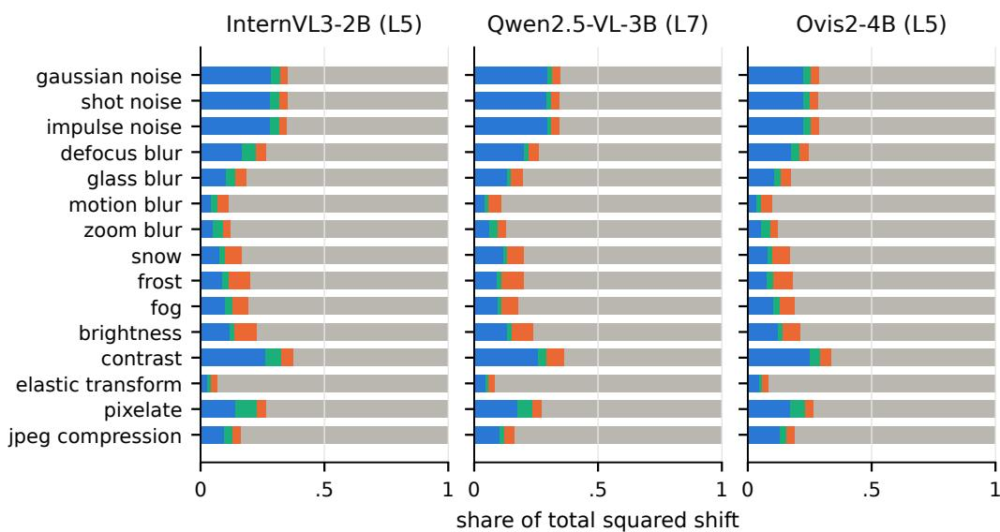  
Figure 12: Per-corruption decomposition of the total squared shift (Equation (1)) at a shallow block (blocks 5/7/5 for InternVL3-2B/Qwen2.5-VL-3B/Ovis2-4B), the most favorable case for sample-blind adaptation: share of the total squared shift captured by the global shift $\mu ,$ the positionspecific shift $\mu _ { t } - \mu .$ , the sample-specific shift $m _ { i } - \mu ,$ , and the residual. Only the noise family and contrast produce a sizable global component (up to 0.30); geometric and compression corruptions (elastic transform, JPEG, motion blur) are almost entirely residual.

## I Alternatives to Feature Alignment

## I.1 Prompting does not mitigate image corruptions

A natural objection to correcting activations is that the same robustness might be obtained by simply telling the model that its input is corrupted. We test this directly. The evaluation follows Section 3 with a single change, the system prompt: against a baseline that leaves each model’s default system message unchanged, we evaluate a variant that appends

The image may be degraded by visual artifacts that carry no   
information about the scene. Do not describe or reason about the   
artifacts. Recover the underlying content from large-scale evidence   
- object shape, size, position, and context - rather than fine local   
texture, and answer as if you had been given a clean, sharp version   
of the same image.

Figure 16 reports both variants. The prompt has no measurable effect: averaged over the 15 corruptions, it changes accuracy by −0.5, +0.5, and −0.4 pp for InternVL3-2B, Qwen2.5-VL-3B, and Ovis2-4B, respectively, and no individual corruption differs by more than the noise of the paired comparison: four of the 45 corrupted cells reach nominal $p < 0 . 0 5$ under a paired sign test, against 2.25 expected by chance at the 0.05 level, and three of the four are negative. Clean accuracy is unchanged as well (+0.4, +0.3, and +0.0 pp), so the prompt neither improves accuracy under corruption nor trades clean accuracy for robustness. The signs are inconsistent across models and corruption families, and the prompted and unprompted variants produce nearly identical predictions — the median cell leaves only 48 of 765 answers discordant; we therefore read the result as a null effect rather than as weak evidence of a benefit.

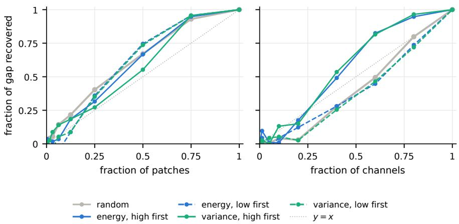  
Figure 13: Importance-based selection does not beat random substitution. Fraction of the clean–corrupted gap recovered against the fraction of patches (left) or channels (right) whose clean activation is substituted, choosing the subset at random or by ranking units on the magnitude or on the across-dataset variance of their clean activations, highest or lowest first; Qwen2.5-VL-3B, Gaussian noise at severity 5, dotted line y = x.

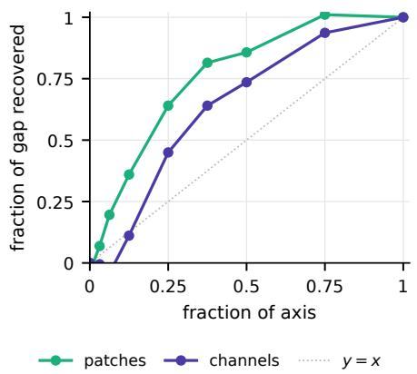

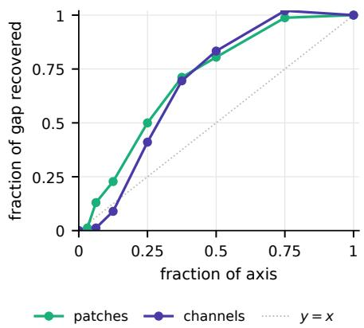  
Figure 14: No small subset of the representation carries the degradation. The fraction of the clean–corrupted gap recovered on both axes (dotted: proportional), for InternVL3-2B under Gaussian noise at severity 5.  
Figure 15: No small subset of the representation carries the degradation. The fraction of the clean–corrupted gap recovered on both axes (dotted: proportional), for Ovis2-4B under Gaussian noise at severity 5.

## I.2 Confidence is a weak predictor of correctness

Entropy- and confidence-based TTA rests on the assumption that a model is confident when it is right and uncertain when it is wrong; if so, making predictions more confident also makes them more correct. We test the assumption rather than the method: instead of running an entropy-minimization procedure, we measure, for Qwen2.5-VL-3B on RealWorldQA, how well the model’s confidence in its answer predicts whether the answer is correct, as the area under the ROC curve (AUROC), where 0.5 means that confidence carries no information about correctness. On clean images the signal is modest (AUROC 0.684, 95% CI [0.645, 0.720]); under Gaussian noise it falls to 0.588 [0.549, 0.628], barely above the chance band of [0.460, 0.541] expected at this sample size. The assumption fails where it matters most: on all 168 questions that corruption turns from correct to incorrect, the model’s top-ranked answer is a distractor, held with an average margin of 0.258 over the correct option, so a confidence-increasing objective can only entrench the predictions that would need to be overturned.

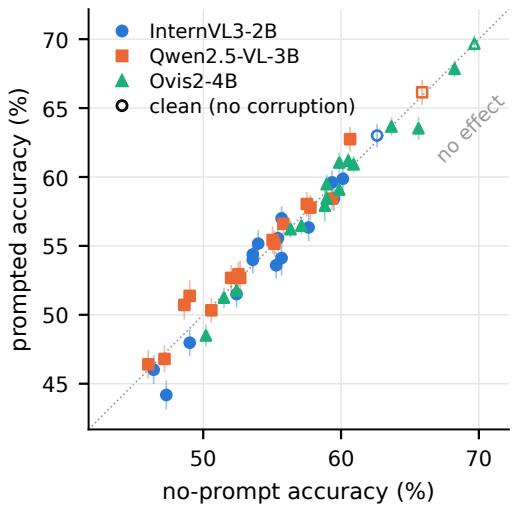  
Figure 16: Prompting does not recover corrupted accuracy. One point per model and condition; hollow markers are the clean cells. Error bars are the paired (McNemar) standard error of the difference, so a bar crossing the identity line is consistent with no effect.

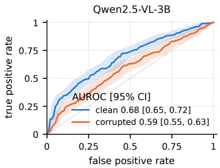  
Figure 17: Confidence is a weak predictor of correctness. ROC curves of the model’s confidence in its answer as a predictor of correctness, for Qwen2.5-VL-3B on RealWorldQA, clean and under Gaussian noise at severity 5; shaded bands are 95% confidence intervals.

This mismatch is structural rather than incidental. Entropy-based TTA was developed for closed-set classification, where each logit corresponds to a fixed semantic class: the “dog” direction means the same thing for every input, so a stream of test samples provides repeated evidence about the same decision boundaries, and methods can accumulate class prototypes, adapt normalization statistics, or tune prompts that encode class semantics. In multiple-choice VQA no such correspondence exists. The output symbols are option letters whose meaning is defined by the question and by the ordering of the choices, so the token A denotes an unrelated proposition on each item, and the option set itself varies in size across the benchmark. Nothing is shared across samples for adaptation to accumulate: there are no persistent class directions to sharpen toward, and confidence in A on one question is not evidence about A on the next. Prompt-tuning methods are the partial exception, since the tuned prompt is a genuinely shared parameter and is not tied to any particular option letter; what it cannot do is carry class semantics, as it does when a prompt is optimized alongside a fixed label set. Any gain must therefore come from generic effects such as an improved instruction or output format, and it is still driven by a confidence signal that our measurements show is only weakly related to correctness. What remains is per-sample sharpening of a distribution over symbols, which cannot change the answer, and parameter updates guided by that same weak signal.