# OneLA: Learning Many Worlds from Latent Actions

Ziyu Zhu1 Zhaoxu Sun1 Fan Jiang1, ‡ Chiyu Wang1 Junfeng Ni1, 2, § Mu Xu1

1AMAP, Alibaba Group 2Tsinghua University

## Abstract

Learning world models across diverse domains calls for a unified control space, yet action interfaces vary across domains and action annotations are often scarce. Latent actions learned directly from videos offer a promising way to establish such a space without explicit action supervision. However, learning shared latent actions across domains remains challenging, as variations in appearance, embodiment, and dynamics can entangle domain-specific visual cues with transferable transition structure. To this end, we introduce OneLA, a simple framework that learns continuous latent actions through a shared orthogonal dictionary and a common predictive objective, without task-specific designs or cross-domain alignment losses during latent action pretraining. These latent actions provide a shared conditioning interface for world models, with lightweight adapters mapping native control commands into the same space. Conditioned on latent actions and the current visual state, the world model predicts context-dependent transitions for controllable rollout. OneLA improves action readout across domains and reduces action cycle-transfer rotation error by 24.8% over the strongest evaluated baseline. A joint-training comparison further shows a 20.5% improvement in Human Preference Score v3 (HPSv3) for realscene generation. These results suggest a path toward general-purpose world models that learn from diverse videos and support flexible control through latent action space.

## 1 Introduction

World models enable agents to anticipate the consequences of their actions and learn behavior through simulated interaction [1–3]. Extending this capability across games, navigation, driving, and robotics calls for a shared action space that connects heterogeneous control interfaces to a common predictive model. Yet much of the available video data captures interactions without recording the underlying commands [4, 5]. A shared space learned from visual transitions could make these unlabeled videos useful for controllable world modeling.

Recent studies infer latent actions from videos to learn controllable world models [4, 6]. AdaWorld adapts world models to new control interfaces, while Garrido et al. [7] study action transfer across natural videos. Other work guides learning with agent localization [8], task descriptions or action-category priors [9, 10], synchronized views [11], or labeled robot actions [12–15]. These signals help identify relevant visual changes, but are not uniformly available across sources. We study how a common regularizer can structure continuous actions across heterogeneous videos for a shared world-model interface.

Learning this shared interface presents two challenges. First, regularization must encourage reusable motion structure without discarding information needed to represent diverse transitions. Frame prediction alone can retain scene-specific or uncontrolled changes alongside motion [16, 17]. Second, the interface must accommodate observed motion and control inputs: video-derived latents describe realized transitions, whereas command-derived latents specify controls whose effects depend on the scene. A forward command, for example, may produce no motion when an obstacle blocks the agent. The world model must therefore use visual context to predict the outcome of either input.

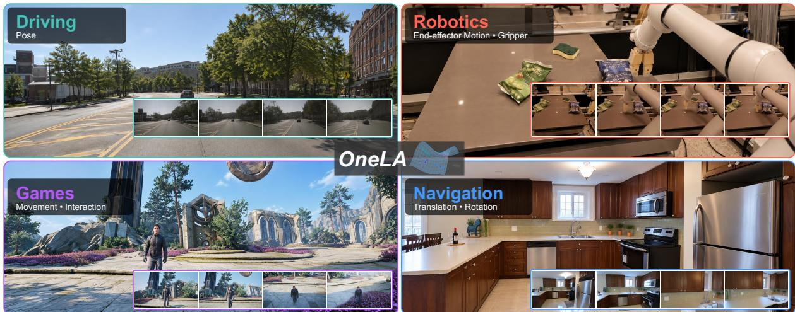  
Figure 1: OneLA across many worlds. A shared latent action interface connects video prediction to the different control signals of driving, robotics, games, and navigation. The inset boxes at the bottom of each panel show frames from model-generated rollouts.

We introduce OneLA, a simple framework for learning a shared action interface from videos (Figure 1). A latent action model (LAM), formulated as an inverse dynamics model [7], encodes frame pairs into continuous coefficients. We pretrain it across games, navigation, driving, and robotics without action labels, combining next-frame reconstruction with an orthonormal motion dictionary [18], Kullback–Leibler (KL) regularization, and sparsity. We then freeze the LAM and train lightweight multilayer perceptrons (MLPs) on labeled trajectories to align native controls to its latent space. Finally, we train a shared diffusion transformer conditioned on the initial frame and either video-derived pseudo-actions or mapped native controls. It jointly predicts video and realized-transition latent actions, using frame-pair codes from the frozen LAM as action targets.

We evaluate OneLA on six datasets spanning four domains. It improves linear-probe macro-F1 over the strongest listed baseline by 5.30 points on Game and 5.63 on AgiBot (Table 2). In world-model evaluation, it reduces action-cycle translation and rotation errors by 15.5% and 24.8% relative to OLaF and achieves the highest nuScenes peak signal-to-noise ratio (PSNR) and structural similarity (SSIM) among the evaluated methods (Table 3).

Our main contributions are summarized as follows:

• We propose a shared latent action interface learned from unlabeled videos through an orthonormal motion dictionary and coefficient regularization.

• We introduce unified world-model training on labeled and unlabeled videos, combining nativecontrol alignment with joint video and latent action prediction.

• We evaluate OneLA across diverse domains, demonstrating improved action readout, cross-view transfer, and action-cycle consistency, with higher visual quality.

Table 1: OneLA learns latent actions across diverse domains with a simple shared objective.
<table><tr><td rowspan="2">Method</td><td rowspan="2">Domains</td><td colspan="5">Auxiliary LAM objectives</td></tr><tr><td>Feat.</td><td>Act.</td><td>Temp.</td><td>Flow</td><td>Reg.</td></tr><tr><td>AdaWorld [4]</td><td>G, D, R</td><td>X</td><td>X</td><td>X</td><td>X</td><td>KL</td></tr><tr><td>VILA [12]</td><td>R</td><td>×</td><td>√</td><td>X</td><td>X</td><td>Contr., struct.</td></tr><tr><td>LAOF [19]</td><td>G, R</td><td>X</td><td>X</td><td>×</td><td>√</td><td>一</td></tr><tr><td>AC-LAM [20]</td><td>R</td><td>×</td><td>√</td><td>√</td><td>X</td><td>VQ</td></tr><tr><td>Olaf-World [21]</td><td>G,N</td><td>√</td><td>X</td><td>X</td><td>X</td><td>KL</td></tr><tr><td>DiLA [22]</td><td>G, N, R</td><td>X</td><td>X</td><td>√</td><td>X</td><td>Norm, var.</td></tr><tr><td>OneLA (ours)</td><td>G, N, D, R</td><td>X</td><td>X</td><td>X</td><td>X</td><td>KL + l1</td></tr></table>

G: games; N: navigation; D: driving; R: robot manipulation. Feat.: feature/effect alignment; Act.: action/proprioceptive supervision; Temp.: temporal consistency, composition, or inversion; Flow: optical-flow prediction; Reg.: latent regularization; Contr., struct.: contrastive and structural regularization. VQ: vector quantization; Norm, var.: norm and variance regularization.

## 2 Related Work

## 2.1 Latent Actions from Video

Recent studies learn latent actions from visual transitions for controllable generation [4, 6] and policy pretraining [5, 23–25]. A central difficulty is that predictive codes can retain appearance and uncontrolled changes alongside motion [16, 17]. Information bottlenecks restrict what the code can retain, trading off action abstraction against predictive detail. Discrete tokenizers [5, 6] and regularized continuous spaces [4, 7] make different choices in this trade-off, whose effects on action abstraction and prediction have motivated systematic study [26, 27]. Beyond capacity, learning transferable actions requires deciding which visual changes should have similar representations. Methods guide this choice through agent masks, optical-flow targets, or action supervision [8, 12, 19]; others impose content–structure separation [22], compositional or cycle consistency [20, 28], or alignment to video-feature changes [21]. To structure continuous actions across sources, OneLA uses an orthonormal dictionary [18] that gives KL and sparsity regularization a consistent geometric scale. It learns through a common reconstruction objective without additional supervision or alignment targets during latent action pretraining. Table 1 compares auxiliary objectives beyond transition prediction.

## 2.2 World Models

World models support control through video simulation [29–33] or feature-space prediction for planning [34, 35]. Broad video pretraining supplies visual and dynamics priors [36, 37], while geometry and memory help maintain consistent rollouts [38–40]. Reusing these predictive models across domains also requires reconciling different control interfaces. Latent actions provide an intermediate representation: they connect unlabeled video pretraining to downstream commands [4, 41] and make video-derived motion useful for imitation and feature-space dynamics [42, 43]. Recent unified models further accommodate diverse controls through shared and modality-specific experts [44] or partially revealed visual trajectories [45]. OneLA couples a geometrically regularized action space with joint multi-domain video and action prediction, enabling native-command control and reference-action transfer through one shared world-model backbone.

## 3 OneLA

## 3.1 Formulation

We represent a visual transition $\left( { { x } _ { t } } , { { x } _ { t + \Delta } } \right)$ by a latent action $\boldsymbol { z } _ { t } \in \mathcal { Z } = \mathbb { R } ^ { d }$ , where $\Delta$ is the frame interval. The LAM infers $z _ { t }$ from the frame pair, while a decoder reconstructs $x _ { t + \Delta }$ from $x _ { t }$ and $z _ { t }$

(a) Latent action pretraining video distribution  
(b) Example frame pairs  
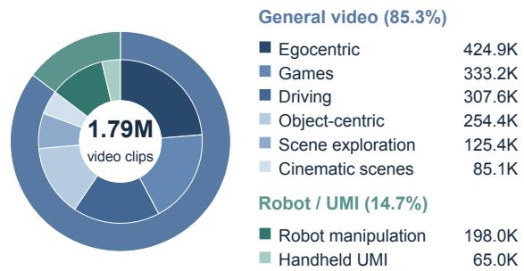

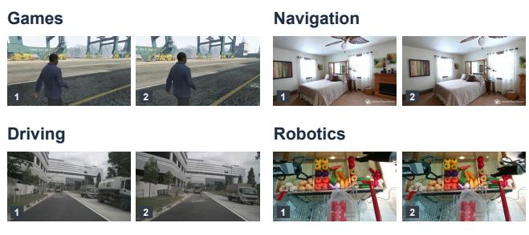  
Figure 2: Video distribution for latent action pretraining. (a) Clip counts grouped by video category. (b) Example frame pairs from games, navigation, driving, and robotics.

Training has three stages. We first learn the LAM with a shared orthonormal motion dictionary from videos without action labels (Section 3.3). We then freeze it and train lightweight MLPs on labeled trajectories to map native controls $u _ { t } ^ { ( k ) } \in \mathcal { U } _ { k }$ into $\mathcal { Z }$ . Finally, we train a shared video world model,

$$
p _ { \theta } ( x _ { 1 : T } \mid x _ { 0 } , c _ { 1 : L } ) , \qquad c _ { \ell } \in \mathcal { Z } ,\tag{1}
$$

conditioned on the initial frame $x _ { 0 }$ and latent actions $c _ { 1 : L }$ . For world-model clips, we index actions by their destination frames: $\bar { z } _ { \ell } = \mu _ { \phi } ( x _ { \ell - 1 } , x _ { \ell } )$ and $L = T$ ; the adapter groups four actions per video-latent transition. These conditions are either LAM-inferred pseudo-actions or, for labeled clips, MLP-mapped native controls. The model jointly predicts video and realized-transition latent actions, using the frozen LAM to supply action targets (Section 3.4).

## 3.2 Latent Action Pretraining Data

Our pretraining collection contains 1.79M video clips spanning games, navigation, driving, egocentric interactions, and robot manipulation. We sample temporally ordered frame pairs to learn from camera motion, agent movement, and object interaction without using action labels. A common LAM, motion dictionary, and reconstruction decoder process all sources. Figure 2 groups the collection by video category and shows example frame pairs.

## 3.3 Orthogonal Latent Action Learning

We express visual transitions as combinations of learned motion directions. The LAM predicts a compact coefficient vector $z _ { t } ,$ , which a shared dictionary embeds for next-frame reconstruction. QR factorization keeps dictionary directions orthonormal, giving coefficient regularization a fixed geometric scale. KL and sparsity regularization then control the information and combinations used to explain visual changes.

Inferring transition coefficients. The LAM encodes a frame pair with a spatiotemporal transformer [6] and a learned action token. It predicts a diagonal Gaussian posterior,

$$
q _ { \phi } ( \boldsymbol { z } _ { t } \mid \boldsymbol { x } _ { t } , \boldsymbol { x } _ { t + \Delta } ) = \mathcal { N } \big ( \mu _ { \phi } ( \boldsymbol { x } _ { t } , \boldsymbol { x } _ { t + \Delta } ) , \mathrm { d i a g } ( \sigma _ { \phi } ^ { 2 } ( \boldsymbol { x } _ { t } , \boldsymbol { x } _ { t + \Delta } ) ) \big ) ,\tag{2}
$$

where $z _ { t } \in \mathbb { R } ^ { d }$ specifies the coefficients of a transition. During pretraining, we sample $z _ { t }$ by reparameterization. After pretraining, we use the posterior mean $\bar { z } _ { t } = \mu _ { \phi } ( x _ { t } , x _ { t + \Delta } )$ as the deterministic latent action for command alignment and world modeling.

A shared orthonormal motion dictionary. To regularize coefficients on a consistent geometric scale, we use an orthonormal motion dictionary [18] with d directions in an embedding space of dimension $h >$ d. In our implementation, we obtain them by reduced QR factorization of a trainable matrix $W \in \mathbb { R } ^ { h \times d } ,$ assuming full column rank:

$$
W = Q R , \qquad Q = [ q _ { 1 } , \dots , q _ { d } ] , \qquad Q ^ { \top } Q = I _ { d } .\tag{3}
$$

The columns $q _ { i }$ are unit-norm, mutually orthogonal directions. A transition embedding is their weighted sum, $\begin{array} { r } { a _ { t } = Q z _ { t } = \sum _ { i = 1 } ^ { d } z _ { t , i } q _ { i } } \end{array}$ . Thus, different transitions can combine the same directions with different coefficients. Gradients pass through the factorization to update W, so the dictionary is learned jointly with the LAM and reconstruction decoder.

The decoder receives both the current observation and this transition embedding. Specifically, we add $Q z _ { t }$ to each projected current-frame patch $p _ { j } ( x _ { t } ) \in \mathbb { R } ^ { h }$ and reconstruct the next frame with a spatial transformer $F _ { \psi }$

$$
\widetilde { p } _ { t , j } = p _ { j } ( x _ { t } ) + Q z _ { t } , \qquad \widehat { x } _ { t + \Delta } = F _ { \psi } ( \{ \widetilde { p } _ { t , j } \} _ { j } ) .\tag{4}
$$

This combines a global transition condition with local visual content. The same dictionary and decoder process every data source. The resulting coefficients $z _ { t }$ form the shared interface for world modeling; $Q z _ { t }$ is the embedding used by the pretraining decoder.

Learning motion structure through regularization. QR provides a simple form of structural regularization at the embedding interface (Appendix D):

$$
\| Q z \| _ { 2 } = \| z \| _ { 2 } , \qquad \| Q z - Q z ^ { \prime } \| _ { 2 } = \| z - z ^ { \prime } \| _ { 2 } .\tag{5}
$$

Consequently, dictionary directions cannot become collinear or be arbitrarily enlarged to offset smaller coefficients. This removes a scale ambiguity between the coefficients and dictionary columns, giving coefficient regularization a consistent geometric scale. It constrains how transitions are represented, without assigning semantic meanings to the learned directions. We jointly train the LAM, dictionary, and reconstruction decoder with

$$
\mathcal { L } _ { \mathrm { L A M } } = \mathbb { E } _ { ( x _ { t } , x _ { t + \Delta } ) , z _ { t } \sim q _ { \phi } } \left[ \| x _ { t + \Delta } - \widehat { x } _ { t + \Delta } \| _ { 2 } ^ { 2 } \right] + \beta \mathbb { E } [ D _ { \mathrm { K L } } ( q _ { \phi } \| { \mathcal { N } } ( 0 , I ) ) ] + \frac { \lambda } { d } \mathbb { E } [ \| \mu _ { \phi } \| _ { 1 } ] .\tag{6}
$$

Reconstruction loss is averaged over valid pixels. The KL term limits information in the coefficients, while the $\ell _ { 1 }$ term encourages sparse posterior means; $\beta$ and λ weight the two terms. All video sources share this objective without action labels or domain-specific prediction targets.

## 3.4 World Model Training

We use the diffusion transformer (DiT) [46] from Wan2.2-TI2V-5B [47, 48] for video generation conditioned on an initial frame and latent actions (Figure 3).

(a) Orthogonal latent action learning  
(b) Unified world model training  
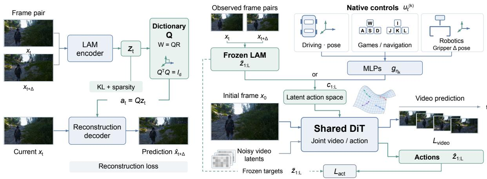  
Figure 3: Overview of OneLA. (a) Orthogonal latent action learning from frame pairs. (b) Joint video and action prediction conditioned on inferred latent actions or mapped native controls.

For each labeled clip, we sample either frozen-LAM conditions $c _ { \ell } = \bar { z } _ { \ell }$ or MLP-mapped controls $c _ { \ell } =$ $g _ { \eta _ { k } } ( u _ { \ell } ^ { ( k ) } )$ . Unlabeled clips use only the former. A trainable adapter temporally aligns and projects these coefficients into the DiT. The pretrained command MLPs are then optimized jointly with the video model and adapter, while the LAM remains frozen.

We jointly predict video and latent actions, a strategy also explored in robot learning [49, 50]. For both conditioning routes, the frozen LAM extracts action targets $\bar { z } _ { 1 : L }$ from observed frame pairs to supervise realized transitions. The objective is

$$
\mathcal { L } _ { \mathrm { W M } } = \mathcal { L } _ { \mathrm { v i d e o } } + \lambda _ { \mathrm { a c t } } \mathcal { L } _ { \mathrm { a c t } } ,\tag{7}
$$

where $\mathcal { L } _ { \mathrm { v i d e o } }$ is the video flow-matching loss [51], and $\mathcal { L } _ { \mathrm { a c t } }$ combines SmoothL1 regression and cosine distance between predicted and target coefficients.

## 4 Experiments

## 4.1 Experimental Setting

Datasets. Latent action pretraining uses the collection in Section 3.2. World-model training uses 11 sources, including ABot-World [52], nuScenes [53], Sekai [54], RealEstate10K [55], and RT-1 [56]. Representation tests cover four domains, including AgiBot [57]; Game is a held-out ABot-World split. We evaluate video prediction on MIND [58], nuScenes, and RT-1, and action cycle transfer between game and real scenes. For OneLA, MIND, nuScenes, and RT-1 prediction uses the initial frame and MLP-mapped native commands, without target-frame latent conditions; cycle transfer instead extracts latent actions from the source video.

Implementation. The LAM latent dimension is 32. Its default pretraining schedule is configured for 50k steps, a global batch of 640 frame pairs, and an initial learning rate of $5 \times 1 0 ^ { - 5 }$ . Across all quantitative benchmarks in Table 3, OneLA uses the same trained Wan2.2-TI2V-5B DiT weights [48, 52], frozen LAM, and latent action space; only the command MLPs differ by control interface. We evaluate after 6k fine-tuning updates with a global batch of 16 clips and an initial learning rate of 10−5. Both stages use AdamW on 16 GPUs with cosine learning-rate decay. Joint training uses $\lambda _ { \mathrm { a c t } } = 0 . 0 5$ . Further details are in the appendix.

Baselines. Using released LAM weights, we compare frozen representations with OLaF [21], its variational autoencoder (VAE) without alignment, AdaWorld [4], DiLA [22], and RLA-WM [43]; for OLaF, AdaWorld, and DiLA, we fine-tune a world model for each released frozen LAM using the same Wan backbone, data mixture, and optimization settings as OneLA in the Implementation paragraph above. Within each benchmark, methods use the same evaluation cases, readouts, and metrics, retaining native dimensions and method-specific preprocessing. Additional baseline details are provided in the appendix.

## 4.2 Main Results

Action representation. Table 2 shows that OneLA achieves the best F1 on most datasets and the secondbest on the rest under both full-representation linear probing and single-dimension readout. The latter uses one scalar latent dimension per action label. On Game, the single-dimension readout achieves 65.26 F1 versus 67.08 using all dimensions, indicating that action information is concentrated in individual coordinates. MIND cross-view F1 reaches 78.31 and 72.88, exceeding the best baselines by 10.66 and 5.53 points without target-view labels for probe fitting.

Video prediction. OneLA reduces MIND translation/rotation RPE by 15.2%/7.6% over the best baselines and leads nuScenes PSNR/SSIM (Table 3). On RT-1, OneLA ranks second across PSNR, SSIM, and LPIPS. Across 40 action-transfer cycles, which transfer source motion to a new scene and back, OneLA reduces translation and rotation RPE by 15.5% and 24.8% relative to OLaF, the strongest comparator, indicating better round-trip preservation of source motion.

## 4.3 Ablation Study

How are cross-domain action prototypes organized? Figure 4 (enlarged in Appendix F) compares checkpoints with and without QR at sparsity weight 0.01. With action-balanced samples, the gap between same- and different-action cosine similarities increases from 0.715 to 0.836 across MIND views and from 0.140 to 0.181 across robots, indicating greater separation between matched and unmatched action-label prototypes. With QR, prototypes sharing the same action label have higher average similarity across domains, supporting better alignment of action-label-conditioned latent representations.

Table 2: Action information in frozen LAM representations. Macro-F1 (%, ↑) for the three readout settings. Boldface and underlining indicate the best and second-best scores.
<table><tr><td colspan="7">(a) Linear probe (all dimensions)</td></tr><tr><td>Method</td><td>Game</td><td>Sekai</td><td>MIND</td><td>nuScenes</td><td>RT-1</td><td>AgiBot</td></tr><tr><td>OLaF [21]</td><td>61.78</td><td>53.84</td><td>81.41</td><td>87.22</td><td>60.02</td><td>48.90</td></tr><tr><td>AdaWorld [4]</td><td>58.95</td><td>50.63</td><td>79.68</td><td>80.84</td><td>61.58</td><td>45.41</td></tr><tr><td>OLaF w/o align (VAE) [21]</td><td>56.43</td><td>48.02</td><td>75.57</td><td>78.39</td><td>58.59</td><td>43.87</td></tr><tr><td>DiLA [22]</td><td>40.55</td><td>34.90</td><td>57.94</td><td>59.05</td><td>56.32</td><td>46.53</td></tr><tr><td>RLA-WM [43]</td><td>45.26</td><td>26.33</td><td>64.48</td><td>49.58</td><td>52.20</td><td>39.09</td></tr><tr><td>OneLA (ours)</td><td>67.08</td><td>53.60</td><td>89.21</td><td>87.53</td><td>60.85</td><td>54.53</td></tr></table>

<table><tr><td></td><td colspan="5">(b) Single-dimension readout</td><td colspan="2">(c) Cross-view transfer</td></tr><tr><td>Method</td><td>Game</td><td>Sekai</td><td>MIND</td><td>RT-1</td><td>AgiBot</td><td>1st→3rd</td><td>3rd→1st</td></tr><tr><td>OLaF [21]</td><td>55.09</td><td>47.40</td><td>70.57</td><td>57.82</td><td>36.30</td><td>64.72</td><td>63.92</td></tr><tr><td>AdaWorld [4]</td><td>53.98</td><td>49.31</td><td>68.55</td><td>59.75</td><td>38.45</td><td>60.84</td><td>67.35</td></tr><tr><td>OLaF w/o align (VAE) [21]</td><td>53.49</td><td>41.89</td><td>58.08</td><td>57.12</td><td>35.92</td><td>67.65</td><td>62.32</td></tr><tr><td>DiLA [22]</td><td>33.36</td><td>30.81</td><td>34.58</td><td>56.10</td><td>38.93</td><td>37.67</td><td>37.31</td></tr><tr><td>RLA-WM [43]</td><td>29.72</td><td>28.07</td><td>27.29</td><td>56.90</td><td>39.65</td><td>46.42</td><td>46.13</td></tr><tr><td>OneLA (ours)</td><td>65.26</td><td>56.91</td><td>77.98</td><td>59.48</td><td>45.90</td><td>78.31</td><td>72.88</td></tr></table>

Table 3: Video prediction and action cycle transfer. Video prediction uses mapped native commands; cycle transfer uses video-derived latent actions. SSIM [59] and LPIPS [60] measure fidelity; IQ is MUSIQ-SPAQ [61]; RPE denotes translation (t) and rotation (r, degrees) error. Boldface and underlining indicate the best and secondbest scores.
<table><tr><td></td><td colspan="3">nuScenes</td><td colspan="3">RT-1</td></tr><tr><td>Method</td><td>PSNR ↑</td><td>SSIM↑</td><td>LPIPS↓</td><td>PSNR ↑</td><td>SSIM↑</td><td>LPIPS↓</td></tr><tr><td>OLaF [21]</td><td>15.92</td><td>0.601</td><td>0.525</td><td>18.78</td><td>0.785</td><td>0.321</td></tr><tr><td>AdaWorld [4]</td><td>10.08</td><td>0.208</td><td>0.801</td><td>17.16</td><td>0.743</td><td>0.367</td></tr><tr><td>DiLA [22]</td><td>15.49</td><td>0.604</td><td>0.538</td><td>17.28</td><td>0.734</td><td>0.370</td></tr><tr><td>OneLA</td><td>16.13</td><td>0.625</td><td>0.533</td><td>17.78</td><td>0.771</td><td>0.338</td></tr></table>

<table><tr><td rowspan="2">Method</td><td colspan="3">MIND</td><td colspan="2">Action cycle transfer</td></tr><tr><td>IQ(×100)↑</td><td> $\mathrm { R P E } _ { t } \downarrow$ </td><td> $\mathrm { R P E } _ { r } \downarrow$ </td><td> $\mathrm { R P E } _ { t } \downarrow$ </td><td> $\mathrm { R P E } _ { r } \downarrow$ </td></tr><tr><td>OLaF [21]</td><td>62.11</td><td>0.045</td><td>0.598</td><td>0.092</td><td>0.496</td></tr><tr><td>AdaWorld [4]</td><td>62.30</td><td>0.044</td><td>0.601</td><td>0.102</td><td>0.535</td></tr><tr><td>DiLA [22]</td><td>60.15</td><td>0.051</td><td>0.945</td><td>0.099</td><td>0.666</td></tr><tr><td>OneLA</td><td>61.19</td><td>0.037</td><td>0.553</td><td>0.077</td><td>0.373</td></tr></table>

(a) w/o QR  
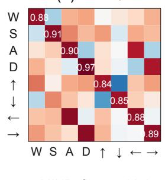

(b) w/ QR  
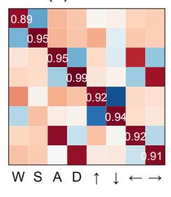

(c) w/o QR  
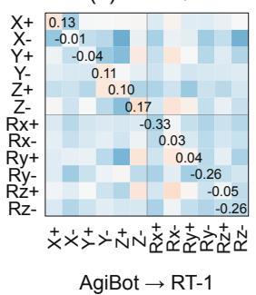

(d) w/ QR  
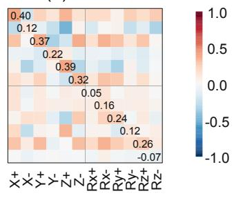  
AgiBot → RT-1  
Figure 4: Cross-domain action prototypes with and without QR. Cosine similarity between action-conditioned posterior means, across MIND viewpoints (left) and AgiBot/RT-1 robots (right). Rows and columns denote action classes.

How do latent actions affect world-model training? Figure 5(a–c) compares world-model training with and without latent actions for unlabeled videos. Both settings train the command MLPs under the same data and optimization setup, differing only in whether unlabeled videos receive LAM-inferred latent actions or zero vectors. Using these conditions improves real-scene HPSv3 [62] from 4.94 to 5.95, MIND rotation RPE from 0.665 to 0.553, and nuScenes PSNR from 13.65 to 16.13. These results show that latent action conditioning can improve visual quality and motion prediction. Separately, panel (d) shows that adding the latent-action prediction loss reduces human-verified collisions from 36% (18/50) to 22% (11/50).

Does scaling improve action readout? Increasing each encoder and decoder stack from 6 to 12 layers at the same update budget improves Game, nuScenes, and RT-1 F1 by 6.44, 10.30, and 1.35 points (Table 4(a)). The 24-layer model scores highest among the reported models. Data scaling improves all three datasets, with Game peaking at 2× and nuScenes/RT-1 at 3× (Table 4(b)).

Does a broader data mixture help? Expanding game-only training to the full mixture improves F1 on all six datasets, including Game (58.41 to 66.34) and AgiBot (39.18 to 54.42; Table 5). Sekai drops

w/o latent action

(a) Real scenes  
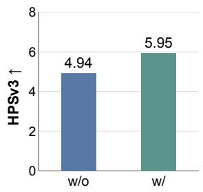

1 w/ latent action

(b) MIND  
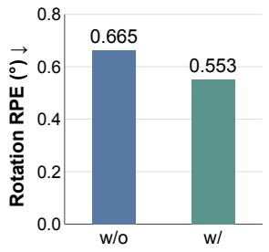

(c) nuScenes  
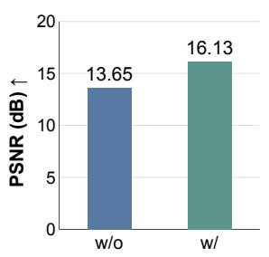

(d) Collision  
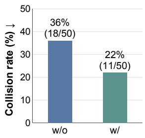  
Figure 5: World-model training comparisons. (a–c) With identical data and training procedures, w/ and w/o latent action use LAM-inferred and zero action vectors for unlabeled videos, respectively. Real-scene HPSv3 averages 16 generated frames per video over 30 scenes with fixed per-case target-scene text captions. (d) Latent-action prediction loss, with 50 cases per setting.

Table 4: Model size and data amount. Linear-probe macro-F1 (%, ↑). Data amount denotes cumulative sampled frame pairs. Boldface and underlining mark best and second-best scores.  
(a) Model size
<table><tr><td>Layers</td><td>Params (M)</td><td>Game</td><td>nuScenes</td><td>RT-1</td></tr><tr><td>6</td><td>180.9</td><td>55.94</td><td>71.29</td><td>57.81</td></tr><tr><td>12</td><td>357.2</td><td>62.38</td><td>81.59</td><td>59.16</td></tr><tr><td>24</td><td>709.8</td><td>65.35</td><td>84.02</td><td>60.05</td></tr></table>

(b) Data amount
<table><tr><td>Data</td><td>Game</td><td>nuScenes</td><td>RT-1</td></tr><tr><td>1×</td><td>64.04</td><td>81.63</td><td>59.26</td></tr><tr><td>2×</td><td>67.60</td><td>84.38</td><td>60.26</td></tr><tr><td>3×</td><td>66.06</td><td>87.64</td><td>60.71</td></tr></table>

from 55.60 to 53.87 in the robot-inclusive setting, consistent with a possible trade-off in domain-specific readout.

Table 5: Training-data composition. Linear-probe macro-F1 (%, ↑). Boldface and underlining indicate the best and second-best scores.
<table><tr><td colspan="4">Training sources</td><td colspan="6">Evaluation datasets</td></tr><tr><td>G Games</td><td>V Real videos</td><td>D Driving</td><td>R Robotics</td><td>Game</td><td>Sekai</td><td>MIND</td><td>nuScenes</td><td>RT-1</td><td>AgiBot</td></tr><tr><td>V</td><td>X</td><td>X</td><td>X</td><td>58.41</td><td>44.60</td><td>71.16</td><td>73.64</td><td>58.79</td><td>39.18</td></tr><tr><td>√</td><td>V</td><td>X</td><td>X</td><td>64.82</td><td>54.44</td><td>82.49</td><td>83.84</td><td>58.76</td><td>49.79</td></tr><tr><td>V</td><td>V</td><td>√</td><td>X</td><td>65.14</td><td>55.60</td><td>83.74</td><td>84.93</td><td>58.89</td><td>50.79</td></tr><tr><td>V</td><td>V</td><td>V</td><td>V</td><td>66.34</td><td>53.87</td><td>84.58</td><td>87.49</td><td>61.08</td><td>54.42</td></tr></table>

## 4.4 Qualitative Results

Figures 6 and 7 illustrate reference-action transfer and control across worlds. Transferred latent actions preserve camera or character motion across changes in scene appearance, while keyboard commands drive navigation in real scenes. Additional examples appear in Appendix E.

## 5 Conclusion

We presented OneLA, a shared latent action interface for world models across games, navigation, driving, and robotics. An orthonormal motion dictionary with variational and sparsity regularization structures motion representations learned from unlabeled videos. Lightweight command mappings connect native controls to this space, enabling unified video and action prediction from labeled and unlabeled data. Experiments show strong action readout, cross-view transfer, and action-cycle consistency, while the ablations support using latent actions to learn from unlabeled videos. Together, these results suggest that a common action representation can connect diverse control interfaces without requiring separate world-model backbones. Future work will extend this interface to longer-horizon planning and closed-loop interaction, and test whether it can adapt efficiently to new environments and embodiments.

(a) Real to real  
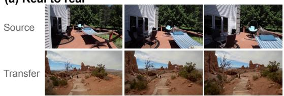

(b) Real to game  
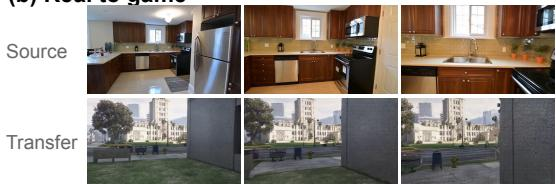

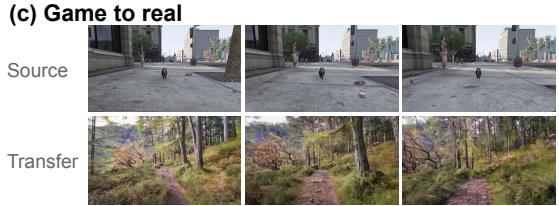

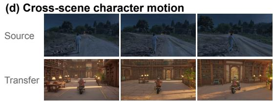  
Figure 6: Reference-based action transfer. Source (top) and Transfer (bottom) show matched relative frame indices; each transfer rollout starts from its first displayed frame.

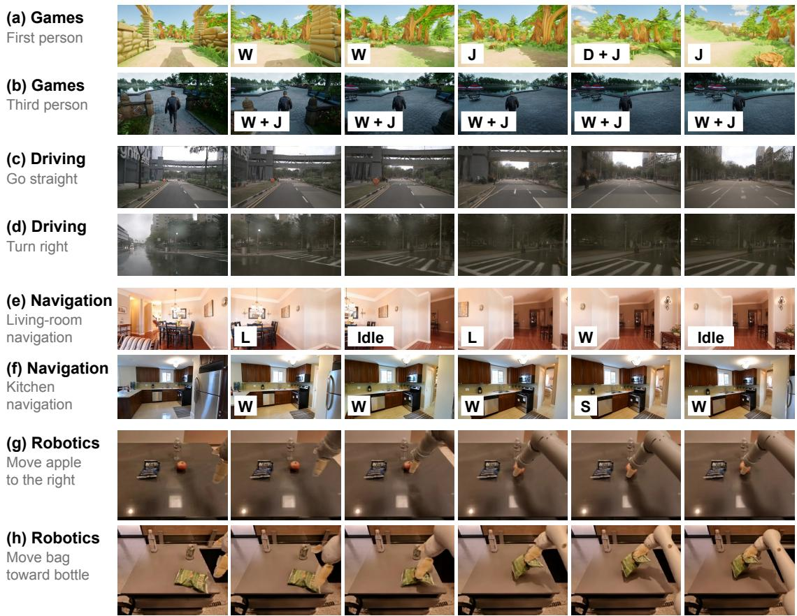  
Figure 7: Qualitative rollouts across four domains. Each row shows an input frame followed by five generated frames.

## References

[1] David Ha and Jürgen Schmidhuber. World models. arXiv preprint arXiv:1803.10122, 2018.

[2] Danijar Hafner, Jurgis Pasukonis, Jimmy Ba, and Timothy Lillicrap. Mastering diverse control tasks through world models. Nature, 640:647–653, 2025. doi: 10.1038/s41586-025-08744-2.

[3] Eloi Alonso, Adam Jelley, Vincent Micheli, Anssi Kanervisto, Amos Storkey, Tim Pearce, and François Fleuret. Diffusion for world modeling: Visual details matter in atari. In Advances in Neural Information Processing Systems, volume 37, pages 58757–58791, 2024.

[4] Shenyuan Gao, Siyuan Zhou, Yilun Du, Jun Zhang, and Chuang Gan. AdaWorld: Learning adaptable world models with latent actions. In Proceedings of the 42nd International Conference on Machine Learning, volume 267 of Proceedings ofMachine Learning Research, pages 18744–18771. PMLR, 2025.

[5] Seonghyeon Ye, Joel Jang, Byeongguk Jeon, Se June Joo, Jianwei Yang, Baolin Peng, Ajay Mandlekar, Reuben Tan, Yu-Wei Chao, Bill Yuchen Lin, Lars Liden, Kimin Lee, Jianfeng Gao, Luke Zettlemoyer, Dieter Fox, and Minjoon Seo. Latent action pretraining from videos. In International Conference on Learning Representations, 2025.

[6] Jake Bruce, Michael Dennis, Ashley Edwards, Jack Parker-Holder, Yuge Shi, Edward Hughes, Matthew Lai, Aditi Mavalankar, Richie Steigerwald, Chris Apps, Yusuf Aytar, Sarah Bechtle, Feryal Behbahani, Stephanie Chan, Nicolas Heess, Lucy Gonzalez, Simon Osindero, Sherjil Ozair, Scott Reed, Jingwei Zhang, Konrad Zolna, Jeff Clune, Nando de Freitas, Satinder Singh, and Tim Rocktäschel. Genie: Generative interactive environments. In Proceedings of the 41st International Conference on Machine Learning, volume 235 of Proceedings of Machine Learning Research, pages 4603–4623. PMLR, 2024.

[7] Quentin Garrido, Tushar Nagarajan, Basile Terver, Nicolas Ballas, Yann LeCun, and Michael Rabbat. Learning latent action world models in the wild. In Proceedings of the 43rd International Conference on Machine Learning, 2026.

[8] Marcus Fechner, Hamza Adnan, Constantin C. Lüth, Matthew T. Jackson, Alexey Zakharov, and J. Marius Zöllner. Segment to focus: Guiding latent action models in the presence of distractors. arXiv preprint arXiv:2602.02259, 2026.

[9] Alexander Nikulin, Ilya Zisman, Albina Klepach, Denis Tarasov, Alexander Derevyagin, Andrei Polubarov, Nikita Lyubaykin, and Vladislav Kurenkov. Vision-language models unlock task-centric latent actions. arXiv preprint arXiv:2601.22714, 2026.

[10] Weisheng Dai, Kai Lan, Jianyi Zhou, Bo Zhao, Xiu Su, Junwen Tong, Weili Guan, and Shuo Yang. ConLA: Contrastive latent action learning from human videos for robotic manipulation. arXiv preprint arXiv:2602.00557, 2026.

[11] Jung Min Lee, Dohyeok Lee, Seokhun Ju, Taehyun Cho, Jin Woo Koo, Li Zhao, Sangwoo Hong, and Jungwoo Lee. MVP-LAM: Learning action-centric latent action via cross-viewpoint reconstruction. In Proceedings ofthe 43rd International Conference on Machine Learning, 2026.

[12] Youngjoon Jeong, Junha Chun, and Taesup Kim. Learning to act robustly with view-invariant latent actions. In Proceedings of the IEEE/CVF Conference on Computer Vision and Pattern Recognition (CVPR), pages 6781–6790, 2026.

[13] Maxime Alvarez, Renzo Caballero, Tatsuya Matsushima, Yusuke Iwasawa, and Yutaka Matsuo. Improving cross-embodiment transfer in latent action models with action-similarity supervision. arXiv preprint arXiv:2609.19846, 2026.

[14] Anthony Liang, Pavel Czempin, Matthew M. Hong, Yutai Zhou, Jingzhen Wang, Erdem Bıyık, and Stephen Tu. CLAM: Continuous latent action models for robot learning from unlabeled demonstrations. In IEEE/RSJ International Conference on Intelligent Robots and Systems, 2026.

[15] Xiaoyu Chen, Hangxing Wei, Pushi Zhang, Chuheng Zhang, Kaixin Wang, Yanjiang Guo, Rushuai Yang, Yucen Wang, Xinquan Xiao, Li Zhao, Jianyu Chen, and Jiang Bian. villa-X: Enhancing latent action modeling in vision-language-action models. In International Conference on Learning Representations, 2026.

[16] Chuheng Zhang, Tim Pearce, Pushi Zhang, Kaixin Wang, Xiaoyu Chen, Wei Shen, Li Zhao, and Jiang Bian. What do latent action models actually learn? In Advances in Neural Information Processing Systems, volume 38, 2025.

[17] Alexander Nikulin, Ilya Zisman, Denis Tarasov, Nikita Lyubaykin, Andrei Polubarov, Igor Kiselev, and Vladislav Kurenkov. Latent action learning requires supervision in the presence of distractors. In Proceedings of the 42nd International Conference on Machine Learning, volume 267 of Proceedings ofMachine Learning Research, pages 46427–46447. PMLR, 2025.

[18] Yaohui Wang, Di Yang, Francois Bremond, and Antitza Dantcheva. Latent image animator: Learning to animate images via latent space navigation. In International Conference on Learning Representations, 2022.

[19] Xizhou Bu, Jiexi Lyu, Fulei Sun, Ruichen Yang, Zhiqiang Ma, and Wei Li. LAOF: Robust latent action learning with optical flow constraints. In Proceedings of the IEEE/CVF Conference on Computer Vision and Pattern Recognition, pages 27334–27344, 2026.

[20] Hangxing Wei, Xiaoyu Chen, Chuheng Zhang, Tim Pearce, Jianyu Chen, Alex Lamb, Li Zhao, and Jiang Bian. Learning additively compositional latent actions for embodied AI. arXiv preprint arXiv:2604.03340, 2026.

[21] Yuxin Jiang, Yuchao Gu, Ivor W. Tsang, and Mike Zheng Shou. Olaf-World: Orienting latent actions for video world modeling. In Proceedings ofthe 43rd International Conference on Machine Learning, 2026.

[22] Tianqiu Zhang, Muyang Lyu, Yufan Zhang, Fang Fang, and Si Wu. DiLA: Disentangled latent action world models. In Proceedings ofthe 43rd International Conference on Machine Learning, 2026.

[23] Qingwen Bu, Yanting Yang, Jisong Cai, Shenyuan Gao, Guanghui Ren, Maoqing Yao, Ping Luo, and Hongyang Li. Learning to act anywhere with task-centric latent actions. In Proceedings of Robotics: Science and Systems, 2025.

[24] Yi Chen, Yuying Ge, Weiliang Tang, Yizhuo Li, Yixiao Ge, Mingyu Ding, Ying Shan, and Xihui Liu. Moto: Latent motion token as the bridging language for learning robot manipulation from videos. In Proceedings of the IEEE/CVF International Conference on Computer Vision, pages 19752–19763, 2025.

[25] Bahey Tharwat, Yara Nasser, Ali Abouzeid, and Ian Reid. Latent action pretraining through world modeling. arXiv preprint arXiv:2509.18428, 2025.

[26] Takanori Yoshimoto, Yang Hu, Naruya Kondo, and Tatsuya Matsushima. FlexLAM: Resolving the bottleneck trade-off in latent action learning. arXiv preprint arXiv:2606.19408, 2026.

[27] Xizhou Bu, Qingda Hu, Lei Zhou, Lingfeng Zhang, Yingbo Tang, Zihao Liu, Xinyi Tao, Zhiqiang Ma, Qingqiu Huang, Chufeng Tang, Hongbo Wang, Jing Zhang, Jiayi Ma, Hangjun Ye, Wei Li, and Xiaoshuai Hao. What matters for latent actions in robot learning. arXiv preprint arXiv:2608.19613, 2026.

[28] Guangyan Chen, Qi Shao, Te Cui, Zichen Zhou, Weixin Mao, Luojie Yang, Meiling Wang, Yi Yang, Hua Chen, and Yufeng Yue. Learning a unified latent action space from videos with action-centric cycle consistency. In Proceedings of the IEEE/CVF Conference on Computer Vision and Pattern Recognition, pages 12871–12880, 2026.

[29] Dani Valevski, Yaniv Leviathan, Moab Arar, and Shlomi Fruchter. Diffusion models are real-time game engines. In International Conference on Learning Representations, 2025.

[30] Jiwen Yu, Yiran Qin, Xintao Wang, Pengfei Wan, Di Zhang, and Xihui Liu. GameFactory: Creating new games with generative interactive videos. In Proceedings of the IEEE/CVF International Conference on Computer Vision, pages 11590–11599, 2025.

[31] Shenyuan Gao, Jiazhi Yang, Li Chen, Kashyap Chitta, Yihang Qiu, Andreas Geiger, Jun Zhang, and Hongyang Li. Vista: A generalizable driving world model with high fidelity and versatile controllability. In Advances in Neural Information Processing Systems, volume 37, pages 91560–91596, 2024.

[32] Guosheng Zhao, Xiaofeng Wang, Zheng Zhu, Xinze Chen, Guan Huang, Xiaoyi Bao, and Xingang Wang. DriveDreamer-2: LLM-enhanced world models for diverse driving video generation. Proceedings of the AAAI Conference on Artificial Intelligence, 39(10):10412–10420, 2025. doi: 10.1609/aaai.v39i10.33130.

[33] Lloyd Russell, Anthony Hu, Lorenzo Bertoni, George Fedoseev, Jamie Shotton, Elahe Arani, and Gianluca Corrado. GAIA-2: A controllable multi-view generative world model for autonomous driving. arXiv preprint arXiv:2503.20523, 2025.

[34] Gaoyue Zhou, Hengkai Pan, Yann LeCun, and Lerrel Pinto. DINO-WM: World models on pretrained visual features enable zero-shot planning. In Proceedings of the 42nd International Conference on Machine Learning, volume 267 of Proceedings of Machine Learning Research, pages 79115–79135. PMLR, 2025.

[35] Mido Assran, Adrien Bardes, David Fan, Quentin Garrido, Russell Howes, Mojtaba Komeili, Matthew Muckley, Ammar Rizvi, Claire Roberts, Koustuv Sinha, Artem Zholus, Sergio Arnaud, Abha Gejji, Ada Martin, Francois Robert Hogan, Daniel Dugas, Piotr Bojanowski, Vasil Khalidov, Patrick Labatut, Francisco Massa, Marc Szafraniec, Kapil Krishnakumar, Yong Li, Xiaodong Ma, Sarath Chandar, Franziska Meier, Yann LeCun, Michael Rabbat, and Nicolas Ballas. V-JEPA 2: Self-supervised video models enable understanding, prediction and planning. arXiv preprint arXiv:2506.09985, 2025.

[36] NVIDIA, Niket Agarwal, Arslan Ali, Maciej Bala, Yogesh Balaji, Erik Barker, Tiffany Cai, Prithvijit Chattopadhyay, Yongxin Chen, Yin Cui, Yifan Ding, Daniel Dworakowski, Jiaojiao Fan, Michele Fenzi, Francesco Ferroni, Sanja Fidler, Dieter Fox, Songwei Ge, Yunhao Ge, Jinwei Gu, Siddharth Gururani, Ethan He, Jiahui Huang, Jacob Huffman, Pooya Jannaty, Jingyi Jin, Seung Wook Kim, Gergely Klár, Grace Lam, Shiyi Lan, Laura Leal-Taixe, Anqi Li, Zhaoshuo Li, Chen-Hsuan Lin, Tsung-Yi Lin, Huan Ling, Ming-Yu Liu, Xian Liu, Alice Luo, Qianli Ma, Hanzi Mao, Kaichun Mo, Arsalan Mousavian, Seungjun Nah, Sriharsha Niverty, David Page, Despoina Paschalidou, Zeeshan Patel, Lindsey Pavao, Morteza Ramezanali, Fitsum Reda, Xiaowei Ren, Vasanth Rao Naik Sabavat, Ed Schmerling, Stella Shi, Bartosz Stefaniak, Shitao Tang, Lyne Tchapmi, Przemek Tredak, Wei-Cheng Tseng, Jibin Varghese, Hao Wang, Haoxiang Wang, Heng Wang, Ting-Chun Wang, Fangyin Wei, Xinyue Wei, Jay Zhangjie Wu, Jiashu Xu, Wei Yang, Lin Yen-Chen, Xiaohui Zeng, Yu Zeng, Jing Zhang, Qinsheng Zhang, Yuxuan Zhang, Qingqing Zhao, and Artur Zolkowski. Cosmos world foundation model platform for physical AI. arXiv preprint arXiv:2501.03575, 2025.

[37] Siqiao Huang, Jialong Wu, Qixing Zhou, Shangchen Miao, and Mingsheng Long. Vid2World: Crafting video diffusion models to interactive world models. In International Conference on Learning Representations, 2026.

[38] Junyi Chen, Haoyi Zhu, Xianglong He, Yifan Wang, Jianjun Zhou, Wenzheng Chang, Yang Zhou, Zizun Li, Zhoujie Fu, Jiangmiao Pang, and Tong He. DeepVerse: 4D autoregressive video generation as a world model. arXiv preprint arXiv:2506.01103, 2025.

[39] Wenqiang Sun, Haiyu Zhang, Haoyuan Wang, Junta Wu, Zehan Wang, Zhenwei Wang, Yunhong Wang, Jun Zhang, Tengfei Wang, and Chunchao Guo. WorldPlay: Towards long-term geometric consistency for real-time interactive world modeling. In Proceedings ofthe 43rd International Conference on Machine Learning, 2026.

[40] Haoyi Zhu, Yifan Wang, Jianjun Zhou, Wenzheng Chang, Yang Zhou, Zizun Li, Junyi Chen, Chunhua Shen, Jiangmiao Pang, and Tong He. Aether: Geometric-aware unified world modeling. In Proceedings of the IEEE/CVF International Conference on Computer Vision, pages 8535–8546, 2025.

[41] Shenyuan Gao, William Liang, Kaiyuan Zheng, Ayaan Malik, Seonghyeon Ye, Sihyun Yu, Wei-Cheng Tseng, Yuzhu Dong, Kaichun Mo, Chen-Hsuan Lin, Jiannan Xiang, Yuqi Xie, Ruijie Zheng, Dantong Niu, Pooya Jannaty, Jinwei Gu, Jun Zhang, Jitendra Malik, Pieter Abbeel, Ming-Yu Liu, Yuke Zhu, Joel Jang, and Jim Fan. DreamDojo: A real-time robot world model from large-scale human videos. In Proceedings ofthe 43rd International Conference on Machine Learning, 2026.

[42] Tianyou Wang, Anson Lei, Joe Watson, and Ingmar Posner. Imitation from heterogeneous demonstrations using grounded latent-action world models. arXiv preprint arXiv:2606.21672, 2026.

[43] Xinyu Zhang, Zhengtong Xu, Yutian Tao, Yeping Wang, Yu She, and Abdeslam Boularias. Learning visual feature-based world models via residual latent action. arXiv preprint arXiv:2605.07079, 2026.

[44] Jianjie Fang, Yongyan Xu, Ziyou Wang, Chen Gao, Yuchao Huang, Zhaolu Wang, Rongze Tang, Mingyuan Jia, Baining Zhao, Weichen Zhang, Xin Zhang, Haisheng Su, Yu Shang, Wei Wu, Xinlei Chen, and Yong Li. Worldscape-MoE: A unified mixture-of-experts world model for scalable heterogeneous action control. arXiv preprint arXiv:2607.03964, 2026.

[45] Hadi Alzayer, Wenlong Huang, Haonan Chen, Christopher Luey, Lvmin Zhang, Maneesh Agrawala, Gordon Wetzstein, Li Fei-Fei, Yilun Du, Jiajun Wu, and Jia-Bin Huang. Masked visual actions for unified world modeling. arXiv preprint arXiv:2607.19343, 2026.

[46] William Peebles and Saining Xie. Scalable diffusion models with transformers. In Proceedings of the IEEE/CVF International Conference on Computer Vision, pages 4195–4205, 2023.

[47] Team Wan, Ang Wang, Baole Ai, Bin Wen, Chaojie Mao, Chen-Wei Xie, Di Chen, Feiwu Yu, Haiming Zhao, Jianxiao Yang, Jianyuan Zeng, Jiayu Wang, Jingfeng Zhang, Jingren Zhou, Jinkai Wang, Jixuan Chen, Kai Zhu, Kang Zhao, Keyu Yan, Lianghua Huang, Mengyang Feng, Ningyi Zhang, Pandeng Li, Pingyu Wu, Ruihang Chu, Ruili Feng, Shiwei Zhang, Siyang Sun, Tao Fang, Tianxing Wang, Tianyi Gui, Tingyu Weng, Tong Shen, Wei Lin, Wei Wang, Wei Wang, Wenmeng Zhou, Wente Wang, Wenting Shen, Wenyuan Yu, Xianzhong Shi, Xiaoming Huang, Xin Xu, Yan Kou, Yangyu Lv, Yifei Li, Yijing Liu, Yiming Wang, Yingya Zhang, Yitong Huang, Yong Li, You Wu, Yu Liu, Yulin Pan, Yun Zheng, Yuntao Hong, Yupeng Shi, Yutong Feng, Zeyinzi Jiang, Zhen Han, Zhi-Fan Wu, and Ziyu Liu. Wan: Open and advanced large-scale video generative models. arXiv preprint arXiv:2503.20314, 2025.

[48] Wan-AI. Wan2.2-TI2V-5B model card. Hugging Face, 2025. URL https://huggingface. co/Wan-AI/Wan2.2-TI2V-5B.

[49] Chi-Lam Cheang, Guangzeng Chen, Ya Jing, Tao Kong, Hang Li, Yifeng Li, Yuxiao Liu, Hongtao Wu, Jiafeng Xu, Yichu Yang, Hanbo Zhang, and Minzhao Zhu. GR-2: A generative video-languageaction model with web-scale knowledge for robot manipulation. arXiv preprint arXiv:2410.06158, 2024.

[50] Sandeep Kumar Routray, Hengkai Pan, Unnat Jain, Shikhar Bahl, and Deepak Pathak. ViPRA: Video prediction for robot actions. In International Conference on Learning Representations, 2026.

[51] Yaron Lipman, Ricky T. Q. Chen, Heli Ben-Hamu, Maximilian Nickel, and Matthew Le. Flow matching for generative modeling. In International Conference on Learning Representations, 2023.

[52] Fan Jiang, Zhaoxu Sun, Mengchao Wang, Ziyu Zhu, Chiyu Wang, Yunpeng Zhang, Wenlin Liu, Yun Wang, Xue Zheng, Rui Sun, Junfeng Ni, Hongyu Pan, Zhongxu Sun, Fei Yu, Zengye Ge, Mengmeng Du, Nianfei Fan, Mingchao Sun, Yu Liu, Yongchang, Yanqing Zhu, Jiahang Wang, Ning Ying, Yuze Xuan, Di Yang, Zhicheng Liu, Zhe Gao, Tingbing Xu, Jiacheng Sui, Wenjin Yang, Junnan Lai, Shufeng Liu, Yuan Liu, Zheng Zhou, Yingliang Peng, Dawei Cao, Kaifeng Sheng, Yuxiang Cai, Fei Lu, Mu Xu, and Ning Guo. ABot-World-0: Infinite interactive world rollout on a single desktop gpu. arXiv preprint arXiv:2607.19191, 2026.

[53] Holger Caesar, Varun Bankiti, Alex H. Lang, Sourabh Vora, Venice Erin Liong, Qiang Xu, Anush Krishnan, Yu Pan, Giancarlo Baldan, and Oscar Beijbom. nuScenes: A multimodal dataset for autonomous driving. In Proceedings ofthe IEEE/CVF Conference on Computer Vision and Pattern Recognition, pages 11621–11631, 2020.

[54] Zhen Li, Chuanhao Li, Xiaofeng Mao, Shaoheng Lin, Ming Li, Shitian Zhao, Zhaopan Xu, Xinyue Li, Yukang Feng, Jianwen Sun, Zizhen Li, Fanrui Zhang, Jiaxin Ai, Zhixiang Wang, Yuwei Wu, Tong He, Yunde Jia, and Kaipeng Zhang. Sekai: A video dataset towards world exploration. In Advances in Neural Information Processing Systems, volume 38, 2025.

[55] Tinghui Zhou, Richard Tucker, John Flynn, Graham Fyffe, and Noah Snavely. Stereo magnification: Learning view synthesis using multiplane images. ACM Transactions on Graphics, 37(4):65:1– 65:12, 2018. doi: 10.1145/3197517.3201323.

[56] Anthony Brohan, Noah Brown, Justice Carbajal, Yevgen Chebotar, Joseph Dabis, Chelsea Finn, Keerthana Gopalakrishnan, Karol Hausman, Alex Herzog, Jasmine Hsu, et al. RT-1: Robotics transformer for real-world control at scale. In Proceedings ofRobotics: Science and Systems, 2023. doi: 10.15607/RSS.2023.XIX.025.

[57] Qingwen Bu, Jisong Cai, Li Chen, Xiuqi Cui, Yan Ding, Siyuan Feng, Xindong He, Xu Huang, et al. AgiBot World Colosseo: A large-scale manipulation platform for scalable and intelligent embodied systems. In 2025 IEEE/RSJ International Conference on Intelligent Robots and Systems (IROS), 2025.

[58] Yixuan Ye, Xuanyu Lu, Yuxin Jiang, Yuchao Gu, Rui Zhao, Qiwei Liang, Jiachun Pan, Fengda Zhang, Weijia Wu, and Alex Jinpeng Wang. MIND: Benchmarking memory consistency and action control in world models. arXiv preprint arXiv:2602.08025, 2026.

[59] Zhou Wang, Alan C. Bovik, Hamid R. Sheikh, and Eero P. Simoncelli. Image quality assessment: From error visibility to structural similarity. IEEE Transactions on Image Processing, 13(4):600– 612, 2004.

[60] Richard Zhang, Phillip Isola, Alexei A. Efros, Eli Shechtman, and Oliver Wang. The unreasonable effectiveness of deep features as a perceptual metric. In Proceedings of the IEEE Conference on Computer Vision and Pattern Recognition, pages 586–595, 2018.

[61] Junjie Ke, Qifei Wang, Yilin Wang, Peyman Milanfar, and Feng Yang. MUSIQ: Multi-scale image quality transformer. In Proceedings of the IEEE/CVF International Conference on Computer Vision, pages 5148–5157, 2021.

[62] Yuhang Ma, Xiaoshi Wu, Keqiang Sun, and Hongsheng Li. HPSv3: Towards wide-spectrum human preference score. In Proceedings of the IEEE/CVF International Conference on Computer Vision (ICCV), pages 15086–15095, 2025.

[63] Kristen Grauman, Andrew Westbury, Eugene Byrne, Zachary Chavis, Antonino Furnari, Rohit Girdhar, Jackson Hamburger, Hao Jiang, Miao Liu, Xingyu Liu, Miguel Martin, Tushar Nagarajan, Ilija Radosavovic, Santhosh Kumar Ramakrishnan, Fiona Ryan, Jayant Sharma, Michael Wray, Mengmeng Xu, Eric Zhongcong Xu, Chen Zhao, Siddhant Bansal, Dhruv Batra, Vincent Cartillier, Sean Crane, Tien Do, Morrie Doulaty, Akshay Erapalli, Christoph Feichtenhofer, Adriano Fragomeni, Qichen Fu, Abrham Gebreselasie, Cristina González, James Hillis, Xuhua Huang, Yifei Huang, Wenqi Jia, Weslie Khoo, Jáchym Koláˇr, Satwik Kottur, Anurag Kumar, Federico Landini, Chao Li, Yanghao Li, Zhenqiang Li, Karttikeya Mangalam, Raghava Modhugu, Jonathan Munro, Tullie Murrell, Takumi Nishiyasu, Will Price, Paola Ruiz, Merey Ramazanova, Leda Sari, Kiran Somasundaram, Audrey Southerland, Yusuke Sugano, Ruijie Tao, Minh Vo, Yuchen Wang, Xindi Wu, Takuma Yagi, Ziwei Zhao, Yunyi Zhu, Pablo Arbeláez, David Crandall, Dima Damen, Giovanni Maria Farinella, Christian Fuegen, Bernard Ghanem, Vamsi Krishna Ithapu, C. V. Jawahar, Hanbyul Joo, Kris Kitani, Haizhou Li, Richard Newcombe, Aude Oliva, Hyun Soo Park, James M. Rehg, Yoichi Sato, Jianbo Shi, Mike Zheng Shou, Antonio Torralba, Lorenzo Torresani, Mingfei Yan, and Jitendra Malik. Ego4D: Around the world in 3,000 hours of egocentric video. In Proceedings ofthe IEEE/CVF Conference on Computer Vision and Pattern Recognition (CVPR), pages 18995–19012, June 2022.

[64] Ryan Hoque, Peide Huang, David Yoon, Mouli Sivapurapu, and Jian Zhang. EgoDex: Learning dexterous manipulation from large-scale egocentric video. In International Conference on Learning Representations, pages 4218–4237, 2026.

[65] Raghav Goyal, Samira Ebrahimi Kahou, Vincent Michalski, Joanna Materzynska, Susanne Westphal, Heuna Kim, Valentin Haenel, Ingo Fruend, Peter Yianilos, Moritz Mueller-Freitag, Florian Hoppe, Christian Thurau, Ingo Bax, and Roland Memisevic. The "something something" video database for learning and evaluating visual common sense. In Proceedings ofthe IEEE International Conference on Computer Vision (ICCV), Oct 2017.

[66] Hongchi Xia, Yang Fu, Sifei Liu, and Xiaolong Wang. RGBD objects in the wild: Scaling real-world 3D object learning from RGB-D videos. In Proceedings ofthe IEEE/CVF Conference on Computer Vision and Pattern Recognition (CVPR), pages 22378–22389, June 2024.

[67] Jiahao Wang, Yufeng Yuan, Rujie Zheng, Youtian Lin, Jian Gao, Lin-Zhuo Chen, Yajie Bao, Chang Zeng, Yanxi Zhou, Xiao-Xiao Long, Hao Zhu, Zhaoxiang Zhang, Xun Cao, and Yao Yao. SpatialVID: A large-scale video dataset with spatial annotations. In Proceedings of the IEEE/CVF Conference on Computer Vision and Pattern Recognition (CVPR), pages 42592–42603, 2026.

[68] Lu Ling, Yichen Sheng, Zhi Tu, Wentian Zhao, Cheng Xin, Kun Wan, Lantao Yu, Qianyu Guo, Zixun Yu, Yawen Lu, Xuanmao Li, Xingpeng Sun, Rohan Ashok, Aniruddha Mukherjee, Hao Kang, Xiangrui Kong, Gang Hua, Tianyi Zhang, Bedrich Benes, and Aniket Bera. DL3DV-10K: A largescale scene dataset for deep learning-based 3D vision. In Proceedings ofthe IEEE/CVF Conference on Computer Vision and Pattern Recognition (CVPR), pages 22160–22169, June 2024.

[69] Cheng Chi, Zhenjia Xu, Chuer Pan, Eric Cousineau, Benjamin Burchfiel, Siyuan Feng, Russ Tedrake, and Shuran Song. Universal manipulation interface: In-the-wild robot teaching without in-the-wild robots. In Proceedings ofRobotics: Science and Systems, 2024.

[70] Zhaxizhuoma, Kehui Liu, Chuyue Guan, Zhongjie Jia, Ziniu Wu, Xin Liu, Tianyu Wang, Shuai Liang, Pengan Chen, Pingrui Zhang, Haoming Song, Delin Qu, Dong Wang, Zhigang Wang, Nieqing Cao, Yan Ding, Bin Zhao, and Xuelong Li. FastUMI: A scalable and hardware-independent universal manipulation interface with dataset. arXiv preprint arXiv:2409.19499, 2024.

[71] Ziqi Huang, Yinan He, Jiashuo Yu, Fan Zhang, Chenyang Si, Yuming Jiang, Yuanhan Zhang, Tianxing Wu, Qingyang Jin, Nattapol Chanpaisit, Yaohui Wang, Xinyuan Chen, Limin Wang, Dahua Lin,

Yu Qiao, and Ziwei Liu. VBench: Comprehensive benchmark suite for video generative models. In Proceedings ofthe IEEE/CVF Conference on Computer Vision and Pattern Recognition, 2024.

[72] Jiahui Huang, Qunjie Zhou, Hesam Rabeti, Aleksandr Korovko, Huan Ling, Xuanchi Ren, Tianchang Shen, Jun Gao, Dmitry Slepichev, Chen-Hsuan Lin, Jiawei Ren, Kevin Xie, Joydeep Biswas, Laura Leal-Taixe, and Sanja Fidler. ViPE: Video pose engine for 3D geometric perception. arXiv preprint arXiv:2508.10934, 2025.

## Appendix

## A Implementation and Reproducibility Details

This appendix details the training configurations and evaluation protocols. Training schedules specify optimization budgets; the checkpoints used for the reported comparisons are identified separately in Appendices B.1 and C.1.

## A.1 Latent Action Pretraining Video Composition

Figure 2 groups the 1,793,552 latent action pretraining clips into eight video categories. Egocentric pools Ego4D [63], EgoDex [64], daily activities, and in-the-wild first-person videos; driving combines NVIDIA’s PhysicalAI Autonomous Vehicles dataset1 (NVIDIA driving) and nuScenes. Object-centric groups Something-Something v2 (SSv2) [65] interactions and WildRGB-D [66] object captures, while scene exploration groups Sekai, Spatial-Vid [67], RealEstate10K, and DL3DV [68]. Robot manipulation combines RT-1 and the two AgiBot collections; handheld UMI [69] contains FastUMI [70].

Table 6 gives the source-level composition. Game videos come from ABot-World [52]; the Daily activities, In the wild, and Cinematic scenes sources are collected in-house. We retain 20% of Spatial-Vid, 50% of cinematic scenes, and 5% of daily activities, and use all records from the other configured training man ifests. For a manifest with N records and retention ratio r, the retained count is max(1, ⌊rN⌋). Counts refer to video-clip records after this subsampling. Shares use the total retained count as the denominator; they do not denote frame-pair sampling probabilities.

Table 6: Latent action pretraining video composition. Retained clips and their shares after source-specific subsampling.
<table><tr><td>Category</td><td>Source</td><td>Retained (%)</td><td>Clips</td><td>Share (%)</td></tr><tr><td rowspan="4">Egocentric</td><td>Ego4D</td><td>100</td><td>242,712</td><td>13.53</td></tr><tr><td>EgoDex</td><td>100</td><td>7,136</td><td>0.40</td></tr><tr><td>Daily activities</td><td>5</td><td>159,833</td><td>8.91</td></tr><tr><td>In the wild</td><td>100</td><td>15,203</td><td>0.85</td></tr><tr><td>Games</td><td>ABot-World</td><td>100</td><td>333,201</td><td>18.58</td></tr><tr><td rowspan="2">Driving</td><td>NVIDIA driving</td><td>100</td><td>306,912</td><td>17.11</td></tr><tr><td>nuScenes</td><td>100</td><td>700</td><td>0.04</td></tr><tr><td rowspan="2">Object-centric</td><td>SSv2</td><td>100</td><td>168,913</td><td>9.42</td></tr><tr><td>WildRGB-D</td><td>100</td><td>85,471</td><td>4.77</td></tr><tr><td rowspan="4">Scene exploration</td><td>Sekai</td><td>100</td><td>18,900</td><td>1.05</td></tr><tr><td>Spatial-Vid</td><td>20</td><td>91,029</td><td>5.08</td></tr><tr><td>RealEstate10K</td><td>100</td><td>6,075</td><td>0.34</td></tr><tr><td>DL3DV</td><td>100</td><td>9,376</td><td>0.52</td></tr><tr><td>Cinematic scenes</td><td>Cinematic scenes</td><td>50</td><td>85,123</td><td>4.75</td></tr><tr><td rowspan="3">Robot manipulation</td><td>RT-1</td><td>100</td><td>86,912</td><td>4.85</td></tr><tr><td>AgiBot 2026</td><td>100</td><td>20,324</td><td>1.13</td></tr><tr><td>AgiBot</td><td>100</td><td>90,757</td><td>5.06</td></tr><tr><td>Handheld UMI</td><td>FastUMI</td><td>100</td><td>64,975</td><td>3.62</td></tr><tr><td colspan="4">Total</td><td>1,793,552 100.00</td></tr></table>

## A.2 Latent Action Model

The 32-dimensional LAM uses transformer width 1024, patch size 16, 16 attention heads, and 24 blocks in each encoder and decoder stack. Spatial rotary position embeddings and scaled dot-product attention are enabled. The loss uses KL coefficient $\beta = 1 0 ^ { - 6 }$ and sparsity coefficient λ = 0.01, with no auxiliary contrastive loss. Training samples from the diagonal Gaussian posterior; representation extraction uses its mean. The decoder adds the embedded action to each current-frame patch.

Optimization. We train from scratch on 16 GPUs using fully sharded data parallelism and AdamW with a learning rate of $5 \times 1 0 ^ { - 5 }$ , weight decay 0.01, and gradient clipping at 0.3. Each GPU processes 40 frame pairs, giving a global batch of 640 without gradient accumulation. The cosine schedule decays to $5 \times 1 0 ^ { - 6 }$ . The default schedule specifies five passes over a 6.4M-pair sampling budget, for up to 50,000 updates. The data-amount and composition comparisons below instead use constant learning rates. Mixed precision is disabled and the random seed is 42.

Frame-pair sampling. Frames are resized to height 240 with aspect ratio preserved, patch-aligned widths, and a maximum width of 864. Most sources are sampled at 16 frames per second (FPS) with frame offsets in {0, 1, 2, 4, 8, 16}. RT-1 uses 3 FPS and offsets {0, 1, 2, 3, 6}; SSv2 and nuScenes use 12 FPS, and NVIDIA driving and daily-activity videos use 10 FPS. nuScenes additionally includes offset 12. Pair starting positions advance by two sampled frames except for RT-1, which uses stride one. Zero-offset pairs provide static transitions. Per-video pair limits range from 10 to 40 across sources. Source selection uses the configured sample-count sampler after the manifest subsampling in Appendix A.1.

Model-size and data-amount comparisons. Layers in Table 4(a) count transformer blocks in each stack: 6/6, 12/12, and 24/24 encoder/decoder blocks. All use width 1024, 16 attention heads, 16-pixel patches, and 32 latent coefficients. Parameter counts include the encoder, decoder, projections, action prompt, and motion dictionary: 180,870,400, 357,172,672, and 709,777,216, respectively. They exclude the downstream video world model and native-command MLPs. Table 4(b) uses three checkpoints from the same 24/24-layer training run with a constant learning rate of $5 \times 1 0 ^ { - 5 }$ and a global batch of 640 frame pairs. The 1×, 2×, and 3× settings correspond to 10,000, 20,000, and 30,000 updates, or 6.4M, 12.8M, and 19.2M sampled frame pairs. The source mixture is fixed, and data amount measures cumulative sampled frame pairs.

Data-composition comparisons. The four mixtures in Table 5 use 24/24-layer LAMs with 32- dimensional coefficients and a constant learning rate of $5 \times 1 0 ^ { - 5 }$ . The evaluation uses the same six-dataset linear-probe protocol.

## A.3 World-Model Training

Training data and native-label usage. The world-model mixture comprises the 11 sources in Table 7, distinct from the larger LAM pretraining collection. With a global batch of 16 clips over 6,000 updates, world-model training samples 96,000 clips. Native action annotations and matching command MLPs are available for ABot-World [52], AgiBot, nuScenes, and RT-1; the remaining sources use frame-pair-derived latent actions.

Counts are proportional to each source’s share of the training mixture and include repeated sampling. Labeled count denotes the expected number of samples using native controls during world-model finetuning, totaling approximately 12,873 (13.41%). Latent-action prediction targets are extracted by the frozen LAM for both conditioning routes.

Table 7: World-model training data and native-label usage. Expected sample counts over 6,000 updates with batch size 16, rounded to integers. Labeled counts are before action dropout.
<table><tr><td>Source</td><td>Sample count</td><td>Labeled count</td></tr><tr><td>ABot-World</td><td>42,422</td><td>8,484</td></tr><tr><td>AgiBot</td><td>16,204</td><td>3,241</td></tr><tr><td>nuScenes</td><td>1,250</td><td>250</td></tr><tr><td>RT-1</td><td>4,490</td><td>898</td></tr><tr><td>DL3DV</td><td>1,674</td><td>0</td></tr><tr><td>EgoDex</td><td>2,548</td><td>0</td></tr><tr><td>NVIDIA driving</td><td>5,447</td><td>0</td></tr><tr><td>RealEstate10K</td><td>7,866</td><td>0</td></tr><tr><td>Sekai</td><td>3,375</td><td>0</td></tr><tr><td>Spatial-Vid</td><td>7,708</td><td>0</td></tr><tr><td>SSv2</td><td>3,016</td><td>0</td></tr><tr><td>Total</td><td>96,000</td><td>12,873</td></tr></table>

Initialization and conditioning. The video model uses a pretrained Wan2.2-TI2V-5B [48] checkpoint from ABot-World [52] and shares its backbone weights across domains. The LAM is frozen, and four pretrained command MLPs and an additive action adapter initialize the conditioning path. Each MLP has two linear layers with a sigmoid linear unit (SiLU) nonlinearity, hidden width 256, and no input layer normalization. Alignment targets are posterior means from the frozen LAM. Four consecutive 32- dimensional actions are concatenated into each 128-dimensional adapter input (Pack1; see below). Clips with native controls use either mapped controls or frame-pair-derived latent actions; clips without native controls use frame-pair-derived latent actions. The MLPs remain trainable. The joint objective combines video flow matching with latent action prediction, with action-loss weight 0.05 and cosine-loss weight 0.1.

Native-control alignment. Before world-model training, each MLP regresses frozen-LAM posterior means using SmoothL1 loss plus cosine distance weighted by 0.1. The keyboard, driving, AgiBot, and RT-1 inputs have 8, 6, 14, and 7 dimensions, respectively, and all outputs have 32 dimensions. Prealignment uses AdamW with a constant learning rate of 10−4, weight decay 0.01, and a global batch of 32 on four GPUs, with a budget of 20,000 updates. AgiBot’s left and right gripper deltas are divided by training-set scales 30.6821 and 30.5333; other inputs retain their native scale. These MLPs initialize the subsequent joint training and remain trainable.

Auxiliary action prediction. The action head reads spatial features from adjacent DiT temporal token groups. Learned queries cross-attend to these features, and an output projection regresses four consecutive 32-dimensional actions per transition between video-latent steps. Targets are detached posterior means from the frozen LAM. The loss combines SmoothL1 regression with cosine distance computed separately for each 32-dimensional action, weighted by 0.1; the combined action loss is weighted by $\lambda _ { \mathrm { a c t } } = 0 . 0 5$ For video-derived conditioning, the same inferred codes provide both the condition and the auxiliary supervision target.

Optimization and video sampling. World-model training uses 16 GPUs and AdamW with a global batch of 16 clips, a learning rate of 10−5, AdamW coefficients (0.9, 0.99), and weight decay 0.01. We fine-tune for 6,000 updates with cosine learning-rate decay (Appendix C.1). Gradients are clipped at 1.0; bfloat16 mixed precision and gradient checkpointing are enabled, and the seed is 42. Clips contain 121 frames. The video reader resizes the short side to 704 pixels, preserves the aspect ratio, and aligns spatial dimensions to multiples of 32. The target frame rate is 16 FPS, with MIND and RT-1 retaining their native frame rates. LAM conditioning images use the separate height-240 preprocessing above and are encoded in microbatches of eight. Action conditioning is dropped with probability 0.1. Reference-image conditioning uses up to five slots at resolution 512 and a drop probability of 0.1. Clip-level and frame-level static augmentation probabilities are 0.03 and 0.02; horizontal flipping is disabled.

## A.4 Video and Control Alignment

For T + 1 sampled frames, consecutive pairs provide L = T action conditions and targets. In the reported Pack1 setting, the LAM encodes consecutive frame pairs; each stride-four video-latent step receives four concatenated 32-dimensional vectors. The resulting 128-dimensional condition preserves the ordering of the four transitions. This is different from encoding only the endpoints four frames apart. Native control $u _ { i }$ describes the transition arriving at sampled frame i: the transition from frame 0 to frame 4 uses controls $u _ { 1 } , \ldots , u _ { 4 }$ . Mapped controls follow the same packing. The initial conditioning frame has no newly generated transition and is excluded from fidelity scores.

## B Probe Labels and Statistical Reporting

Table 8 summarizes the sample counts and action labels used in the frozen-representation evaluation.

Table 8: Frozen-representation evaluation sets. Counts refer to frame pairs. Binary labels are predicted independently. Sekai macro-F1 averages the six labels with positive test examples; I/K have no positive examples.
<table><tr><td>Dataset</td><td>Fit</td><td>Test</td><td>Action labels</td></tr><tr><td>Game</td><td>800</td><td>1,600</td><td>8 binary keyboard controls</td></tr><tr><td>Sekai</td><td>607</td><td>1,222</td><td>6 evaluated motion labels</td></tr><tr><td>MIND</td><td>1,500</td><td>1,500</td><td>8 actions; first-/third-person views</td></tr><tr><td>nuScenes</td><td>2,342</td><td>2,441</td><td>4 binary motion directions</td></tr><tr><td>RT-1</td><td>1,640</td><td>1,650</td><td>14 signed motion/gripper labels</td></tr><tr><td>AgiBot</td><td>1,600</td><td>1,600</td><td>28 signed labels across two arms</td></tr></table>

## B.1 Reported Frozen-Representation Protocol

Checkpoints and preprocessing. We compare the 32-dimensional OneLA with OLaF [21], its VAE checkpoint without alignment, DiLA [22], and the ManiSkill checkpoint of RLA-WM [43]. AdaWorld [4] uses its released 32-dimensional LAM and posterior-mean representations. All methods use the same evaluation pairs and dataset-specific readout protocol, retaining their native representation dimensions and input preprocessing. DiLA uses a 256-dimensional code; RLA-WM uses flattened residual features with 2,048 dimensions.

Readouts and evaluation splits. For OneLA, we use a consistent video-level train/test partition across LAM pretraining and world-model training. All test videos used in representation and world-model evaluations are excluded from both training stages. Our primary metric is macro-F1 from a single linear layer over the full representation. For MIND, we follow the train/test partition of Olaf-World [21]. Our MIND probe is an eight-way classifier; the other datasets use independent binary classifiers. We also test a restricted readout that selects one dimension per action by its absolute correlation with fit labels, then fit a sign and decision threshold. This single-dimension test measures how directly individual dimensions expose action information; it still requires labeled fit data. For nuScenes, we report full-representation probing. Within each dataset, all methods use the same probe-fitting protocol. AgiBot uses disjoint sets of 200 fit and 200 test episodes.

Cross-view transfer. For each MIND transfer direction, we fit an eight-way linear probe on the sourceview training subset and apply it unchanged to the target-view test subset. Feature means and standard deviations are estimated only from the source training subset; target-view labels are used only to compute macro-F1.

Reporting. Readouts measure accessibility of the provided action labels. Simultaneous binary controls retain their multilabel form, and robot labels use each dataset’s native action convention.

## C Metric and Qualitative Evaluation Contracts

## C.1 Reported World-Model Comparison

Checkpoint selection. All methods in Table 3 are evaluated after 6,000 fine-tuning updates. For OneLA, MIND, nuScenes, and RT-1 use a single shared checkpoint with the corresponding WASD/IJKL, pose, or RT-1 MLP. Inputs are the initial frame and keyboard commands on MIND, known ego-pose trajectories on nuScenes, or robot actions on RT-1; future target RGB frames are not used to extract action conditions. Cycle transfer extracts latent actions from the source video; the return pass extracts them from the generated transfer video and starts from the original source initial frame. The baselines are fine-tuned on the common 11-source mixture, including RT-1. Their LAMs remain frozen while the video model and action-conditioning components are jointly trained.

Samples and aggregation. For OneLA, test videos are held out from both LAM pretraining and worldmodel training, following the shared partition in Appendix B. All four methods use the same fixed test cases, 50 denoising steps, guidance scale 3, and seed 42. MIND contains 100 videos of 97 frames at 24 FPS. nuScenes and RT-1 each contain 40 videos. Cycle transfer contains 40 videos, evenly divided among the four source–target–source domain combinations. Metrics are first averaged within each video and then equally across videos. Scores cover all test cases. Relative improvements are computed from unrounded scores.

Visual metrics. PSNR (dB), SSIM [59], and LPIPS [60] with the VGG16 backbone compare predictions and ground truth at the original video geometry, excluding the conditioning frame. IQ is MUSIQ-SPAQ [61] rescaled to [0, 100] for reporting, evaluated on all frames including the first frame with the existing VBench [71] long-side-512 preprocessing. IQ measures visual quality rather than action correctness.

Trajectory metrics. MIND and cycle RPE use ViPE [72] default pose estimation, Sim(3) alignment of the predicted trajectory to the reference, and adjacent-frame relative poses (∆ = 1). Translation error is expressed in the estimated reference-trajectory scale; rotation error is in degrees. MIND uses 24 FPS. Cycle evaluation uses 16 FPS and the source video’s actual length (21, 41, or 121 frames), comparing the returned video to the source. RPE is aggregated separately within each benchmark.

Training-configuration and collision comparisons. Figure 5(a–c) compares training w/ and w/o latent action after 6,000 fine-tuning updates. Both settings use the same data and training procedure, train the MLPs, and retain the initial frame and native-command pathway. The only difference is whether unlabeled videos receive LAM-inferred latent actions or zero action vectors. The real-scene test uses game-action commands with 30 initial frames, ten each from Sekai, Spatial-Vid, and RealEstate10K. For HPSv3 [62], we uniformly sample 16 frames per generated video, excluding the initial frame and rounding indices to the nearest frame. Each case uses the same fixed target-scene text caption across setups and frames. We average raw preference means $( \mu )$ across frames and then equally across videos. This measures visual preference rather than control correctness. The collision comparison in panel (d) is a separate 50-case test of each loss setting. Collision outcomes are verified by human inspection of the generated videos. Collision rates are 36% (18/50) without the latent-action prediction loss and 22% (11/50) with it.

Qualitative example provenance. Each control example shows the initial frame followed by five generated frames, with labels from its command record at the displayed frame indices. A key labels the action arriving at that frame, not a constant action over the interval between displayed frames; the initial frame has no generated transition. Each transfer example uses the same three frame indices for the source and transfer videos; the first transfer frame is the generation input.

## D Orthogonal Parameterization: Scope of the Constraint

Equation (5) follows directly from $Q ^ { \top } Q = I !$ for $v = z - z ^ { \prime } , \| Q v \| _ { 2 } ^ { 2 } = v ^ { \top } Q ^ { \top } Q v = \| v \| _ { 2 } ^ { 2 }$ . This is a property of the embedding map, not of the generated transition. A nonlinear decoder can respond differently to the same coefficient change at different observations. Moreover, for an orthogonal $U \in$ $\mathbb { R } ^ { d \times d }$ , the pair $( Q U , U ^ { \top } z )$ produces the same embedded action. The isotropic Gaussian prior does not resolve that rotational ambiguity. Sparsity changes the preference among coordinate systems but does not identify a unique physical basis.

## E Additional Qualitative Results

Figures 8 and 9 show additional scene-control rollouts. Further examples cover games (Figure 10), driving (Figure 11), navigation (Figure 12), and robotics (Figure 13); Figure 14 shows reference-action transfer. Frames are ordered from left to right; source and transfer frames are temporally paired.

## E.1 Scene Control

## Scene control

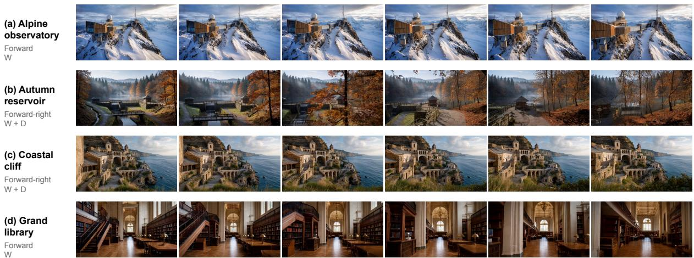  
Figure 8: Additional OneLA scene-control rollouts. Six frames per case illustrate motion under the indicated keyboard controls.

## Scene control

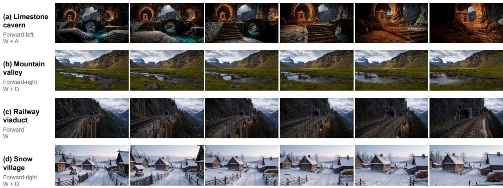  
Figure 9: Additional OneLA scene-control rollouts in natural and built environments. Each row follows the indicated keyboard control.

## E.2 Rollouts across Domains

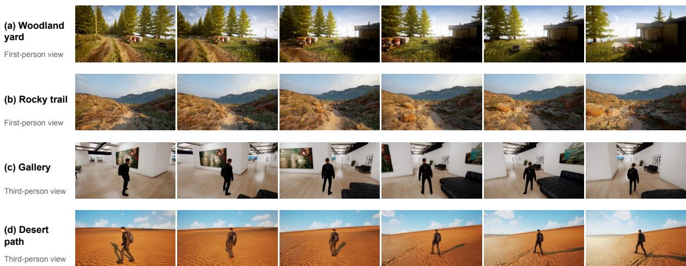  
Figure 10: Additional OneLA rollouts in games. Examples include first- and third-person views, with six frames sampled from each rollout.

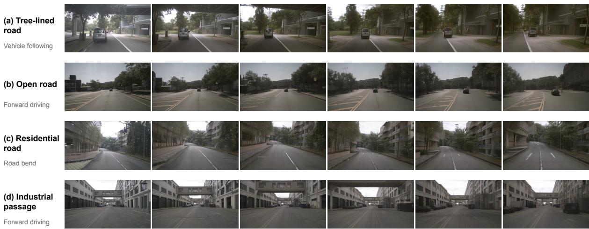  
Figure 11: Additional OneLA driving rollouts. Examples cover vehicle following, open roads, a road bend, and an industrial passage.

## Navigation

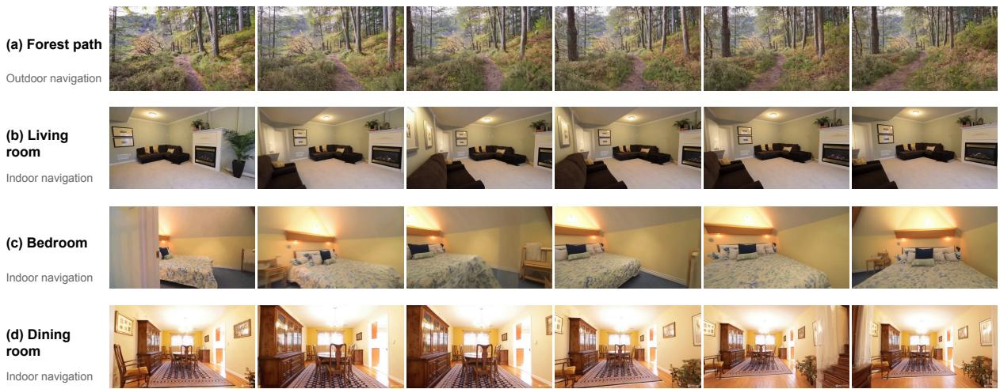  
Figure 12: Additional OneLA navigation rollouts. Examples show camera motion through outdoor and indoor scenes.

## Robotics

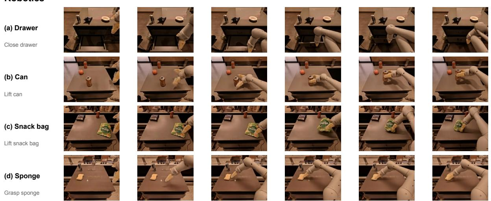  
Figure 13: Additional OneLA robot rollouts. Examples show interactions with a drawer, a can, a snack bag, and a sponge.

## E.3 Reference-Action Transfer

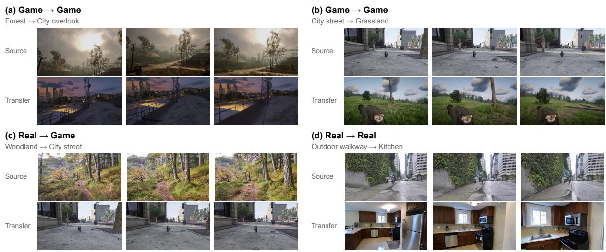  
Figure 14: Additional OneLA reference-action transfer results. Each case pairs a source video (top) with a generated rollout in a different scene (bottom). Columns show matched temporal positions.

## F Enlarged Cross-Domain Similarity Matrices

Figure 15 provides an enlarged view of the cross-domain similarity matrices in Figure 4.  
(a) w/o QRw/o QR  
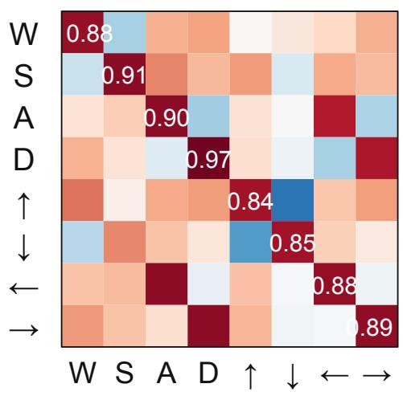  
MIND: first → thirdgiBot → RT-1

(b) w/ QR w/ QR  
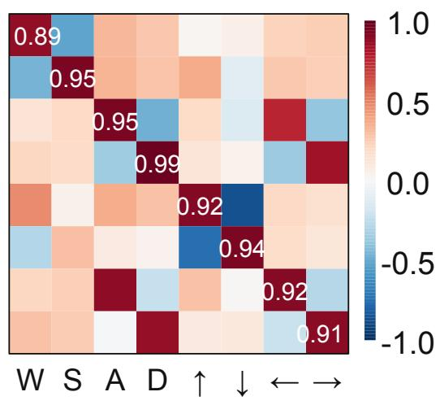  
MIND: first → thirdgiBot → RT-1

(c) w/o QR  
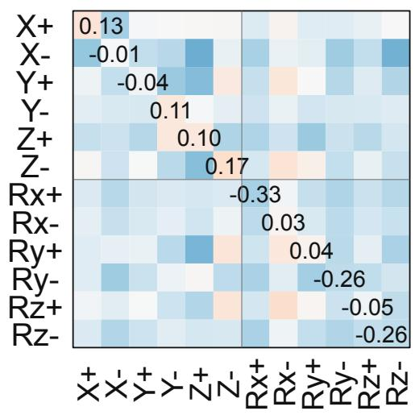  
AgiBot → RT-1

(d) w/ QR  
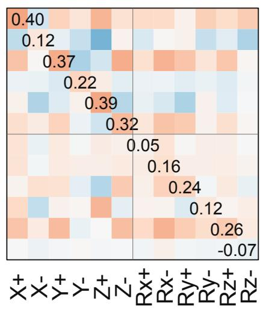  
AgiBot → RT-1  
Figure 15: Enlarged view of Figure 4. Diagonal annotations give the cosine similarity between prototypes with matching action labels.