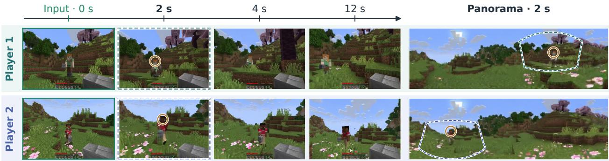
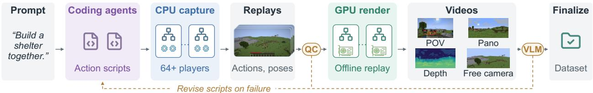
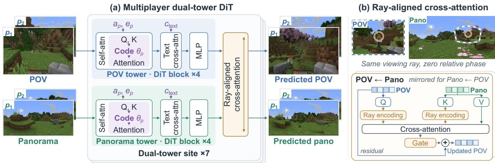
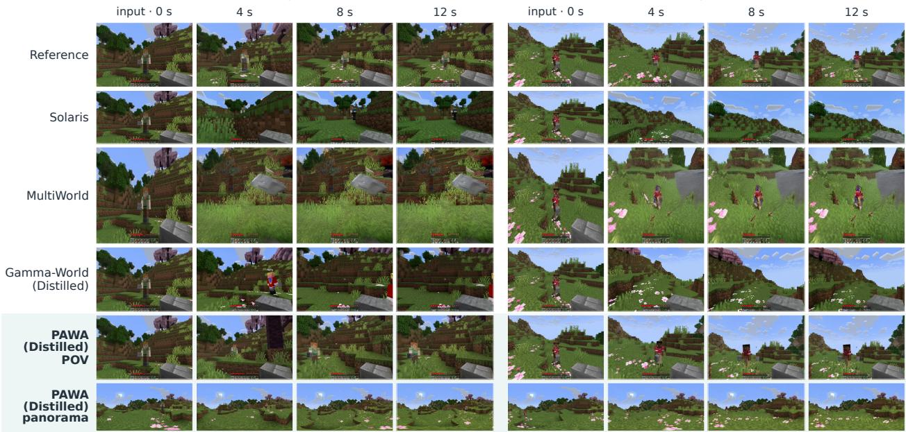
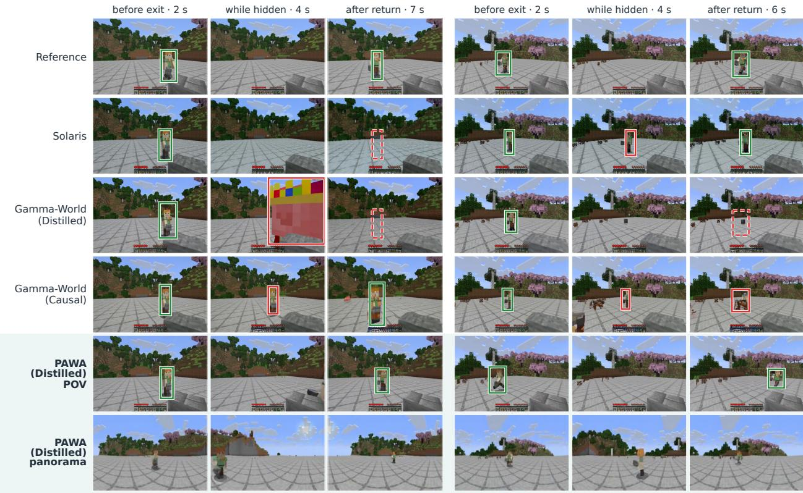
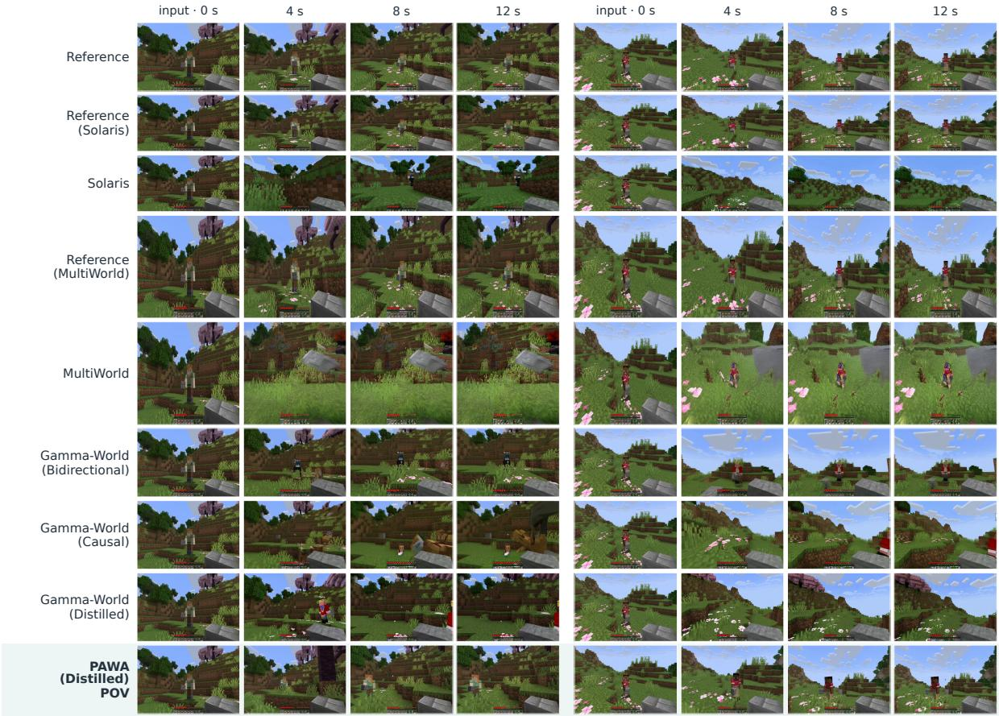
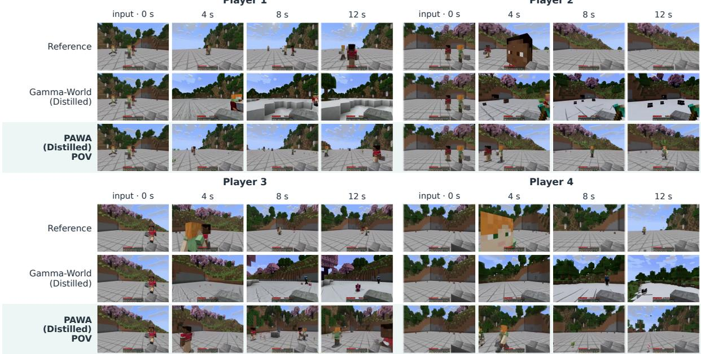

# PAWA: Panoramic Action-conditioned World Modeling for Multiple Agents

Siqi Yang1,2,∗, Yimu Wang2,∗, Ziqi Cai1,2,3, Chengxuan Zhu2, Shuchen Weng2, Erwin Wu3, Zhaofei Yu2, Kaipeng Zhang1,‡, Boxin Shi2,†

1Alaya Lab 2Peking University 3Institute of Science Tokyo ∗Equal contribution, †Corresponding author, ‡Project leader

A multiplayer world model must predict how the independent actions of several players change a shared environment, including changes outside a player’s current field of view. A point-of-view (POV) video captures such changes only after they enter its field of view, whereas panoramic video records the surroundings in every viewing direction and has served as an intermediate representation of the world state in recent world models. Learning this task therefore requires synchronized POV and panoramic videos of interacting players together with their actions, yet no existing dataset provides this combination in Minecraft, an established testbed in which players act independently in a shared, modifiable 3D world. We present PAWA, a dataset and framework for action-conditioned panoramic multiplayer world modeling. The dataset pairs each player’s POV video with world-stabilized panoramic video and aligned actions. Its distributed pipeline decouples CPU gameplay capture from GPU rendering, scales beyond 64 simultaneous players, and re-renders each recorded session under new observation configurations without replaying the gameplay. On this dataset, we develop a dual-tower model that jointly predicts POV and panoramic video and couples the two streams through cross-attention that aligns tokens observing the same direction in a shared world frame. We further introduce a quadratic-phase player encoding that provides many more player codes than existing rotary codes at the same embedding dimension. Experiments show that PAWA outperforms state-of-the-art multiplayer world models in POV prediction quality while also producing high-fidelity panoramic predictions. The dataset and collection pipeline are open source to support further research on multiplayer world models.

Project page: https://pawa.siki.moe   
Code: https://github.com/yousiki/pawa-pipeline   
Dataset: https://huggingface.co/datasets/YOUSIKI/pawa-dataset   
Date: October 15, 2026

## 1 Introduction

In a multiplayer world, several players act independently on a shared environment, and each action can change what every other player sees. A world model for such a world must predict how these combined actions unfold in each player’s observations. Many of the consequences arise outside a player’s field of view. A teammate places a block behind the player, or an opponent approaches from the side, and the change becomes visible only once the camera turns toward it. A point-of-view (POV) video therefore records the shared world only in part. Panoramic video records the surroundings in every direction at once, and recent world models have adopted it as a representation of the surrounding scene and as spatial memory (Jiang et al., 2026; Li et al., 2026b). Pairing each player’s POV video with a panorama exposes the surroundings of every player to the model, including the regions that no local camera currently observes.

Minecraft offers a natural setting, since players act independently in a shared 3D world that every action can modify. It is an established testbed for action-conditioned video world models (Guo et al., 2025; Yu et al., 2025; Zhang et al., 2025c; He et al., 2025), and recent multiplayer models synchronize the POV videos of several interacting players (Savva et al., 2026; Liu et al., 2026a; Wu et al., 2026a). These multiplayer models learn from perspective observations alone. Other multi-agent world models broaden visual coverage by stitching directional views into panoramas (Zhu et al., 2026) or by projecting panoramic recordings into perspective training views (Sun et al., 2026a), yet their generated streams remain perspective videos. Predicting full-sphere panoramic video jointly with each player’s POV under the actions of interacting players remains unexplored.

  
Figure 1 Panoramic multiplayer world modeling with PAWA. From each player’s initial POV and panoramic observations and the actions of both players, PAWA jointly forecasts every player’s POV video and world-stabilized panoramic video. Apart from the green-bordered inputs, all frames are forecasts of the distilled model. The dashed outline projects the dashed POV frame at 2 s onto the panorama at the same time. Circles mark the co-player, which appears in the matching direction in the POV and the panorama. Panoramas are cropped to ±55◦ latitude for display.

Modeling POV and panoramic video together for many players raises three challenges. (i) Paired multiplayer data. Existing multiplayer data are recorded by screen capture from live game clients, which yields only the displayed perspective view. Every player also requires its own graphics client, and the recording cost therefore grows with the population. No dataset pairs POV and panoramic video with the actions of interacting players. (ii) Correspondence across projections. The same scene direction occupies different image coordinates in a rectilinear POV frame and an equirectangular panorama. Because the POV camera turns with the player’s head while the panorama stays fixed to the world, this correspondence changes at every frame. (iii) Player identity at scale. A model that shares parameters across players must keep each observation stream bound to its own actions. Existing rotary player codes admit only m + 1 equidistant identities in m phase planes (Liu et al., 2026a), and the identity pool therefore grows only linearly with the embedding dimension.

In this paper, we present PAWA (Panoramic Action-conditioned World modeling for multiple Agents), a dataset and framework for action-conditioned panoramic multiplayer world modeling in Minecraft. (i) Scalable, programmable collection. PAWA records gameplay on CPUs without graphics clients, simulating sessions with more than 64 simultaneous players, and renders the saved replays offline on GPUs. Each replay yields a player’s POV video, a world-stabilized equirectangular panorama and aligned actions, and can be rendered again with relative depth or along custom camera trajectories without repeating gameplay. These observations serve multiplayer world modeling well beyond panoramic prediction. Coding agents compose interaction scripts from natural-language descriptions, and behavioral checks together with vision-language review retain the scripts whose intended interactions occur (Figure 2). (ii) Dual towers with ray-aligned cross-attention. A POV tower and a panorama tower jointly predict the two videos and are repeatedly coupled through bidirectional ray-aligned cross-attention. Each token carries its viewing ray in a shared world frame as a rotary phase, and tokens that observe the same direction thus have zero relative phase regardless of their image coordinates (Figure 3). The panorama thus serves as both a prediction target and a source of context for the local view. In the resulting forecasts, a co-player seen in a player’s

POV appears in the matching direction of the same player’s panorama (Figure 1). (iii) Quadratic-phase player encoding. Building on classical quadratic-phase codes (Wootters and Fields, 1989), PAWA assigns each player a rotary code from a pool of $m ^ { 2 }$ identities in the same m phase planes. The identity pool thus grows quadratically rather than linearly with the embedding dimension.

Our contributions are threefold. (i) We construct a multiplayer Minecraft dataset of synchronized POV and world-stabilized panoramic videos with aligned actions, whose distributed pipeline scales beyond 64 simultaneous players and re-renders replays with relative depth or custom camera trajectories. Both are open source on Hugging Face and GitHub. (ii) We propose a dual-tower world model that jointly predicts POV and panoramic video, whose ray-aligned cross-attention encodes world-frame viewing rays as rotary phases and thereby assigns identical phases to matching viewing directions in the two projections. (iii) We introduce a quadratic-phase player encoding that enlarges the identity pool from m + 1 to $m ^ { 2 }$ codes at a fixed embedding dimension, with closed-form correlations between any two codes.

## 2 Related work

Interactive video world models. World models predict the consequences of actions for control (Ha and Schmidhuber, 2018; Hafner et al., 2025). Video world models learn this prediction through autoregressive tokens (Wu et al., 2024), latent actions (Bruce et al., 2024), adapted video diffusion (Huang et al., 2026), and diffusion game engines (Alonso et al., 2024; Valevski et al., 2025; Kanervisto et al., 2025), and now generate gameplay, explorable scenes, and navigation views under user control (Che et al., 2025; Li et al., 2025a; Ye et al., 2025; Mao et al., 2025; Sun et al., 2026b; Xiong et al., 2026; Bar et al., 2025). Minecraft is a central testbed for action-conditioned simulation (Guo et al., 2025; Yu et al., 2025; Zhang et al., 2025c; He et al., 2025; Wang et al., 2026) and for learned agents (Guss et al., 2019; Fan et al., 2022; Baker et al., 2022; Lifshitz et al., 2023). Language models write executable skills (Liang et al., 2023; Wang et al., 2024a) and vision-language models judge task success (Du et al., 2023), and PAWA uses both to generate and validate multiplayer interactions.

Multiplayer world models. Multiplayer models render every player’s observation under the combined actions of all players. Solaris, Gamma-World, and MIRA generate synchronized player views in Minecraft and Rocket League (Savva et al., 2026; Liu et al., 2026a; Hu et al., 2026a), and further models coordinate views through shared world states, registers, or memories (Wu et al., 2026a; Mo et al., 2026; Po et al., 2026; Zhao et al., 2026; Cai et al., 2026). Related work learns multi-agent generation from single-view footage (Hu et al., 2026b), routes peer-view evidence (Xu et al., 2026), composes joint actions for cooperation (Zhang et al., 2025a), and synthesizes surround views of a single vehicle (Wang et al., 2024c; Wen et al., 2024; Russell et al., 2025; Cheng et al., 2026). ShareVerse and Prisma-World widen coverage by stitching directional views or by cropping panoramic recordings (Zhu et al., 2026; Sun et al., 2026a). Their generated streams remain perspective videos, and their multiplayer data come from live game clients (Savva et al., 2026). Like procedural generators that render programmable scenes offline (Greff et al., 2022; Deitke et al., 2022), PAWA renders recorded gameplay into aligned POV and panoramic videos, and it predicts both.

Panoramic video generation and world models. Panoramic video records the full surroundings in every frame, and recent world models adopt it as the world representation itself. Panoramas serve as proxies for explorable 3D worlds (HunyuanWorld Team, 2025; Yang et al., 2025; Su et al., 2026; Wang et al., 2025; Zhou et al., 2026), for long-horizon and single-image exploration (Liu et al., 2026b; Gui et al., 2025; Lu et al., 2025), as latent states for perspective rendering (Tan et al., 2026) and driving (Li et al., 2026a), and for geometric consistency and spatial memory (Jiang et al., 2026; Li et al., 2026b; Jia et al., 2026). These models build on 360-degree video diffusion (Wang et al., 2024b; Zhang et al., 2025b; Xia et al., 2025; Ji et al., 2025; Zhou et al., 2025), perspective-to-panorama expansion (Ma et al., 2024; Luo et al., 2025; Li et al., 2026c), and joint perspective and panoramic modeling (Tang et al., 2023; Zhang et al., 2024; Tan et al., 2025; Fang et al., 2025). Perspective models instead recall regions from visual history (Xiao et al., 2025; Huang et al.,

  
Figure 2 Distributed data generation. Coding agents write action scripts, CPU capture records sessions with more than 64 players without graphics clients, and GPU workers render the replays offline. Behavioral QC and VLM review return failed scripts for revision.

2025a) or simulate out-of-sight dynamics (Duan et al., 2026) for a single observer. PAWA extends panoramic prediction to a shared world, where each panorama reflects changes caused by co-players.

## 3 Panoramic multiplayer dataset

A panoramic multiplayer world model learns from both projections and the actions of every player within one synchronized interaction. To this end, we construct a dataset that pairs each player’s POV video with a world-stabilized panoramic video, aligned actions and camera annotations. Existing multiplayer data such as the Solaris dataset are recorded from live Minecraft clients (Savva et al., 2026), which limits each recording to the perspective view displayed during play. Our pipeline instead records programmable interactions on CPUs and renders the saved replays offline on GPUs, which yields POV and panoramic videos, relative depth and custom camera trajectories from a single interaction without repeating the gameplay (Figure 2).

Scaling multiplayer data collection. SolarisEngine pairs each Mineflayer controller with a live graphics client (Savva et al., 2026), and controller computation and rendering therefore both grow with the player count and must keep pace with the running simulation. PAWA removes rendering from gameplay. Its player runtime, built on the open-source Azalea library, executes action scripts written in Rust and simulates interactions among more than 64 simultaneous players while recording per-tick actions, positions, camera orientations and player state. Without graphics clients, independent episodes run in parallel across CPU hosts, and GPU workers render the saved replays on separate hosts, with views and camera paths assigned to workers independently. Capture and rendering thus scale with separate resources, and a large session is recorded once and rendered afterwards.

Generating and validating interactions. Interaction scenarios are specified as natural-language descriptions of player behaviors and expected outcomes. Coding agents compose reusable interaction primitives into executable scripts, which may fail to produce their intended interaction, and each scenario is therefore validated on both behavior and appearance. Behavioral quality control (QC) detects inactivity, ineffective movement and abrupt control changes in the recorded actions and states before rendering, and a visionlanguage model (VLM) then reviews sampled videos against the specified outcomes. Both checks return feedback for the coding agents to revise the scripts.

Observing a shared world beyond the local view. Each player’s rectilinear POV video is paired with an equirectangular panorama rendered from the same camera origin. The panorama stays oriented to the world as the player’s head turns, which gives every frame a stable directional reference and records changes that no local camera observes. All videos share the server clock, and action annotations and camera poses bind each observation to its player (Appendix A).

## 4 Panoramic multiplayer world modeling

The PAWA world model jointly predicts every player’s POV and panoramic video under the actions of all players (Figure 3). We formulate the task (Section 4.1) and describe the dual towers (Section 4.2), the player

identity encoding (Section 4.3), the training objective (Section 4.4) and the causal few-step generator used for rollout (Section 4.5).

## 4.1 Problem formulation

For N players, the dataset provides synchronized POV and world-stabilized panoramic videos with aligned actions. Let p index players, t observation time, T the prediction horizon, and v ∈ {pov, pano} the projection. Given the initial observations of all players in both projections, PAWA models

$$
p _ { \theta } \left( \big \{ X _ { p , 1 : T } ^ { v } \big \} p _ { , v } \ \Big | \ \big \{ X _ { p , 0 } ^ { v } \big \} p _ { , v } , \big \{ a _ { p , 0 : T - 1 } , e _ { p } \big \} _ { p = 1 } ^ { N } , c \right) ,\tag{1}
$$

where $X _ { p , t } ^ { v }$ is an observation, $a _ { p , t }$ contains the keyboard and camera controls of the following transition, and $e _ { p }$ is a fixed appearance attribute of the player’s character. The shared condition c contains a scene description and the initial camera orientations, from which the angular controls determine every later orientation. Future positions, visibility and images are never provided (Appendix B.1).

## 4.2 Dual towers with ray-aligned cross-attention

Dual-tower backbone. POV and panoramic frames describe the same interaction through different projections. PAWA builds on the DiT backbone of Cosmos-Predict2.5 (NVIDIA, 2025) and uses two towers of identical architecture, one predicting the POV videos and the other the panoramic videos, following a similar design of perspective and panoramic diffusion models (Zhang et al., 2024; Tan et al., 2025). Each tower shares its weights across players. A tower encodes the initial frames into latent context, combines it with noisy future latents, and processes the result with DiT blocks of self-attention, text cross-attention and an MLP. The actions $a _ { p , t }$ of each player condition self-attention in both towers, together with the appearance attribute $e _ { p }$ that Section 4.3 motivates. The panorama tower further accounts for the spherical geometry of the equirectangular grid. A token in latent row i of H rows and column k receives rotary position coordinates

$$
\big ( y _ { i } , k \big ) , \qquad y _ { i } = \frac { H - 1 } { 2 } \big ( 1 - \sin \vartheta _ { i } \big ) , \qquad \vartheta _ { i } = \pi \Big ( \frac 1 2 - \frac { i } { H - 1 } \Big ) ,\tag{2}
$$

where $\vartheta _ { i }$ is the latitude of row i. The vertical coordinate thus follows the equal-area sine of latitude and compresses the rows near the poles, which the equirectangular projection oversamples, a design adopted from PanoWorld (Jiang et al., 2026). Writing $\mathbf { h } _ { l } ^ { v }$ for the tokens of tower v after block $B _ { l } ^ { v }$ and $\mathcal { X } _ { l }$ for a bidirectional ray-aligned cross-attention module, the two towers run in parallel as

$$
\begin{array} { r } { \mathbf { h } _ { l } ^ { v } = { \mathcal { B } } _ { l } ^ { v } \left( \mathbf { h } _ { l - 1 } ^ { v } ; s , \{ a _ { p , t } , e _ { p } \} , c \right) , \qquad \left( \mathbf { h } _ { l } ^ { \mathrm { p o v } } , \mathbf { h } _ { l } ^ { \mathrm { p a n o } } \right) \gets { \mathcal { X } } _ { l } \left( \mathbf { h } _ { l } ^ { \mathrm { p o v } } , \mathbf { h } _ { l } ^ { \mathrm { p a n o } } \right) \mathrm { ~ f o r ~ } l \in \{ 4 , 8 , \ldots , L \} , } \end{array}\tag{3}
$$

where s is the noise level, L the number of blocks, and each such l marks a cross-attention site. In each $\mathcal { X } _ { l } ,$ the POV and panoramic tokens of one player at one latent time attend to each other, each located by its world-frame viewing ray as detailed below. We initialize the shared backbone weights of the POV tower from Gamma-World (Liu et al., 2026a) and those of the panorama tower from PanoWorld (Jiang et al., 2026), and zero-initialize the cross-attention gates and the weights of all new input features.

World-frame viewing rays. PAWA locates every token by the world-frame direction it observes. A POV token at image coordinates (u, v) receives the unit ray $\mathbf { d } _ { p , t } ^ { \mathsf { \tiny { p o v } } } = O _ { p , t }$ normalize $( K ^ { - 1 } [ u , v , 1 ] ^ { \mathsf { T } } )$ , where K holds the POV intrinsics and $O _ { p , t }$ the camera orientation given by the yaw and pitch of player p at time t. A panorama token at longitude $\varphi$ and latitude ϑ receives dpano = (cos ϑ sin φ, sin ϑ, cos ϑ cos φ) in the world frame (Appendix C.1). Following the use of camera geometry in multi-view attention (Li et al., 2025b; Wu et al., 2026b; Xiang et al., 2026), each ray is mapped to rotary phases $\Phi ( { \bf d } ) = ( \omega _ { j } d _ { x } , \omega _ { j } d _ { y } , \omega _ { j } d _ { z } ) _ { j = 1 } ^ { J }$ with J frequencies per Cartesian component, and $\mathsf { R } ( \phi )$ denotes the block-diagonal rotation by these phases.

Ray-aligned cross-attention. The module $\mathcal { X } _ { l }$ connects both views of one player at one latent time, for which the two camera centers coincide. For a POV query q and a panorama key $\mathbf { k } ,$ rotating each by its own ray and applying the relative-phase property of rotary encoding (Su et al., 2024) gives

  
Figure 3 PAWA architecture. (a) POV and panorama towers share weights across players and are coupled by ray-aligned cross-attention at seven sites. Actions $a _ { p }$ and appearance attributes $e _ { p }$ condition self-attention, and the player code $\theta _ { p }$ rotates Q and K. (b) Tokens that share a viewing ray, shown by the POV field of view projected onto the panorama. Each direction rotates the normalized Q and K by their viewing rays and adds its output through a zero-initialized gate.

$$
\left( { \mathsf { R } } ( \Phi ( \mathbf { d } ^ { \mathrm { p o v } } ) ) \mathbf { q } \right) ^ { \mathsf { T } } { \mathsf { R } } ( \Phi ( \mathbf { d } ^ { \mathrm { p a n o } } ) ) \mathbf { k } = \mathbf { q } ^ { \mathsf { T } } { \mathsf { R } } ( \Phi ( \mathbf { d } ^ { \mathrm { p a n o } } ) - \Phi ( \mathbf { d } ^ { \mathrm { p o v } } ) ) \mathbf { k } .\tag{4}
$$

Tokens that observe the same direction thus have zero relative phase regardless of their image coordinates and of the head orientation, and this phase correspondence holds by construction at every frame. Writing $\mathrm { { A t t n } _ { r a y } }$ for attention with Q and K normalized per head and rotated by their rays, the POV features $\mathbf { h } ^ { \mathrm { p o v } }$ read the panoramic features $\mathbf { h } ^ { \mathrm { p a n o } }$ through

$$
\begin{array} { r } { \mathbf { h } ^ { \mathrm { p o v } }  \mathbf { h } ^ { \mathrm { p o v } } + \mathbf { g } \odot W _ { o } \mathbf { A } \mathrm { t t n } _ { \mathrm { r a y } } ( W _ { q } \mathbf { h } ^ { \mathrm { p o v } } , W _ { k } \mathbf { h } ^ { \mathrm { p a n o } } , W _ { v } \mathbf { h } ^ { \mathrm { p a n o } } ) , } \end{array}\tag{5}
$$

and the reverse direction mirrors this update with its own projections and gate. The channel gate g starts from zero, and temporal and cross-player attention remain within each tower.

## 4.3 Player identity encoding

Rotary player codes. A model that shares parameters across players, as set models do for inputs of variable size (Zaheer et al., 2017; Lee et al., 2019), must associate each observation stream with its own actions for any population. Following Gamma-World (Liu et al., 2026a), PAWA reserves m rotary phase planes in self-attention for player identity and rotates the queries and keys of player $p$ by a code $\theta _ { p } \in [ 0 , 2 \pi ) ^ { m }$ . In the attention between players $p$ and $p ^ { \prime } .$ , this band contributes

$$
\mathrm { R e } \sum _ { r = 0 } ^ { m - 1 } q _ { r } \bar { k } _ { r } e ^ { \mathrm { i } ( \theta _ { p , r } - \theta _ { p ^ { \prime } , r } ) } ,\tag{6}
$$

where $q _ { r }$ and $k _ { r }$ are the complex feature pairs of plane r. The relative code $\theta _ { p } - \theta _ { p ^ { \prime } }$ therefore enters the attention of every token pair in each head. Gamma-World places the codes at the vertices of a regular simplex, which admits at most $m + 1$ equidistant codes in m phase planes.

Quadratic-phase codes. We draw instead on quadratic-phase codes from mutually unbiased bases (Wootters and Fields, 1989; Klappenecker and Rötteler, 2004). For an odd prime $m ,$

$$
\theta _ { r } ^ { ( a , b ) } = \frac { 2 \pi } { m } ( a r ^ { 2 } + b r ) , \qquad z _ { r } ^ { ( a , b ) } = \frac { 1 } { \sqrt { m } } e ^ { \mathrm { i } \theta _ { r } ^ { ( a , b ) } } , \qquad a , b , r \in \mathbb { F } _ { m } ,\tag{7}
$$

where $\mathbb { F } _ { m }$ is the field of integers modulo $m , a$ indexes a code family and b a code within that family. The normalized inner products of the $m ^ { 2 }$ codes have magnitudes

$$
\begin{array} { r } { \left| \left. z ^ { ( a , b ) } , z ^ { ( a ^ { \prime } , b ^ { \prime } ) } \right. \right| = \left\{ \begin{array} { l l } { 1 , } & { ( a , b ) = ( a ^ { \prime } , b ^ { \prime } ) , } \\ { 0 , } & { a = a ^ { \prime } , \ b \neq b ^ { \prime } , } \\ { m ^ { - 1 / 2 } , } & { a \neq a ^ { \prime } . } \end{array} \right. } \end{array}\tag{8}
$$

Codes within a family are exactly orthogonal by finite geometric sums, and codes across families have the uniform correlation $\dot { m } ^ { - 1 / 2 }$ given by quadratic Gauss sums (Appendix C.2). After reserving the all-zero code, PAWA provides $m ^ { 2 } - 1$ codes, compared with $m + 1$ simplex codes, and the identity pool thus grows quadratically rather than linearly with the embedding dimension.

Randomized code assignment. Each player keeps one code across time and projections. Codes are resampled per training example, and observations, actions, attributes and codes are permuted together. The model thus distinguishes players by relative codes rather than indices, and the codebook serves populations up to its size without per-player parameters (Appendix C.2).

Appearance attributes. Because code assignments change across examples, a code identifies a player stream but not a character. The appearance attribute $e _ { p }$ specifies the character appearance and follows its player under permutation. It is concatenated with the camera controls $a _ { p , t } ^ { \mathrm { c a m } }$ , which contain the yaw and pitch increments and the absolute orientation, to form the camera condition $[ a _ { p , t } ^ { \mathrm { c a m } } , e _ { p } ]$ in both towers.

## 4.4 Training objective

Joint flow matching. Both towers are trained with flow matching (Lipman et al., 2023). For clean latents $Z ^ { v }$ of projection $v ,$ independent Gaussian noise $\epsilon ^ { v }$ and a noise level s shared by the two projections, the model $F _ { \theta }$ predicts the velocity $U ^ { v } = \epsilon ^ { v } - Z ^ { v }$ at $Z _ { s } ^ { v } = ( 1 - s ) Z ^ { v } + s \epsilon ^ { v }$ given the conditions C of Equation 1, and the joint objective sums the losses of the two projections,

$$
\mathcal { L } = \mathcal { L } _ { \mathrm { p o v } } + \mathcal { L } _ { \mathrm { p a n o } } , \qquad \mathcal { L } _ { v } = \mathbb { E } \left[ \frac { 1 } { \left| \Omega _ { v } \right| } \sum _ { i \in \Omega _ { v } } \bar { w } _ { i } ^ { v } \big \| F _ { \theta , i } ^ { v } ( Z _ { s } , s , \mathcal { C } ) - U _ { i } ^ { v } \big \| _ { 2 } ^ { 2 } \right] ,\tag{9}
$$

where $\Omega _ { v }$ indexes the latent positions of all players and forecast frames in a sample.

Co-player weighting. Co-players often occupy a small part of the frame, and an image-wide loss therefore underweights their appearance and motion. Projecting the recorded body boxes of the co-players into each view gives a support mask $M _ { i } \in \{ 0 , 1 \}$ , and the position weights

$$
\bar { w } _ { i } = \frac { 1 + \lambda M _ { i } } { 1 + \lambda \bar { M } } , \qquad \bar { M } = \frac { 1 } { | \Omega _ { v } | } \sum _ { i \in \Omega _ { v } } M _ { i } ,\tag{10}
$$

raise the loss on co-player regions while keeping unit mean per sample. Half of the training windows further favor co-player occupancy to raise exposure to interactions (Appendix B.2).

## 4.5 Causal generation and distillation

Block-causal generation. The two pretrained towers are first adapted to their own projections, after which joint training with the cross-attention modules minimizes Equation 9 and yields a bidirectional teacher. For rollout, a causal generator uses diffusion forcing (Chen et al., 2024) with the block-causal sparse hub attention of Gamma-World (Liu et al., 2026a). Within each tower, players attend to their own histories and to shared hub tokens, which mediate cross-player interaction. Noise levels vary across temporal blocks and are shared by all players and both projections within a block. A query in block b accesses only blocks $b ^ { \prime } \leq b .$ which the same-time cross-attention preserves.

Table 1 Two-player interaction tier with 30 episodes and 239 forecast frames per player. Baselines support only POV input, and PAWA additionally receives the initial panoramas. Bold and underline mark the best and second best within each stream and evaluation group.
<table><tr><td>Model</td><td>Stream</td><td>FVD↓</td><td>FID↓</td><td>LPIPS↓</td><td>PSNR ↑</td><td>SSIM ↑</td></tr><tr><td>Gamma-World (Bidirectional)</td><td>POV</td><td>267.1</td><td>56.63</td><td>0.567</td><td>13.08</td><td>0.478</td></tr><tr><td>Gamma-World (Causal)</td><td>POV</td><td>306.7</td><td>52.00</td><td>0.606</td><td>12.46</td><td>0.451</td></tr><tr><td>Gamma-World (Distilled)</td><td>POV</td><td>279.7</td><td>58.36</td><td>0.584</td><td>11.83</td><td>0.431</td></tr><tr><td>Solaris</td><td>POV</td><td>614.9</td><td>77.31</td><td>0.634</td><td>10.42</td><td>0.447</td></tr><tr><td>MultiWorld</td><td>POV</td><td>771.2</td><td>186.06</td><td>0.667</td><td>11.76</td><td>0.395</td></tr><tr><td>PAWA (Causal)</td><td>POV</td><td>120.1</td><td>30.80</td><td>0.421</td><td>16.86</td><td>0.562</td></tr><tr><td>PAWA (Causal)</td><td>Panorama</td><td>88.0</td><td>26.53</td><td>0.223</td><td>20.41</td><td>0.643</td></tr><tr><td>PAWA (Distilled)</td><td>POV</td><td>138.1</td><td>28.40</td><td>0.465</td><td>15.38</td><td>0.516</td></tr><tr><td>PAWA (Distilled)</td><td>Panorama</td><td>98.1</td><td>28.26</td><td>0.243</td><td>19.77</td><td>0.617</td></tr></table>

Few-step distillation. We distill the causal generator $G _ { \phi }$ on its own rollouts with Self Forcing and distribution matching distillation (DMD) (Huang et al., 2025b; Yin et al., 2024). A frozen bidirectional teacher provides the real score $s _ { \mathrm { r e a l } } ,$ , and a learned bidirectional network tracks the score $s _ { \mathrm { f a k e } }$ of the generated distribution. Both start from the joint teacher and receive identical conditions and player codes. For a generated latent $\hat { Z } = G _ { \phi } ( \cdot )$ re-noised to $\hat { Z } _ { s }$ , the generator follows the co-player weighted gradient

$$
\nabla _ { \phi } \mathcal { L } _ { \mathrm { D M D } } = \mathbb { E } \Big [ \sum _ { i } \bar { w } _ { i } \big ( s _ { \mathrm { f a k e } } \big ( \hat { Z } _ { s } , s \big ) - s _ { \mathrm { r e a l } } \big ( \hat { Z } _ { s } , s \big ) \big ) _ { i } \frac { \partial \hat { Z } _ { i } } { \partial \phi } \Big ] .\tag{11}
$$

Causal training and distillation sample $N \in \{ 2 , 4 , 8 , 1 6 \}$ players, with shorter clips at larger populations. At inference, the distilled model generates the two streams jointly block by block with four denoising steps per block. Appendix B reports the training lengths and sampling settings.

## 5 Experiments

## 5.1 Experimental setup

Models and baselines. We evaluate PAWA (Causal), sampled with 35 steps, and PAWA (Distilled), sampled with four steps per causal block. The baselines are the bidirectional, causal and distilled variants of Gamma-World (Liu et al., 2026a), Solaris (Savva et al., 2026), and MultiWorld (Wu et al., 2026a), which runs its official 50-step autoregressive sampler with Minecraft actions mapped to its action space. No prior multiplayer world model accepts panoramas, and the baselines thus receive only the initial POV observations. PAWA also receives the initial panoramas, and it outperforms every baseline even when its cross-attention is disabled at inference (Table 9, Appendix D.4).

Protocol and metrics. The main comparison uses 30 two-player interaction episodes of 12 seconds at 20 Hz, and separate sets of 12 episodes cover four, eight and sixteen players. All evaluation episodes are absent from the final training split (Appendix D). We report PSNR, SSIM and LPIPS (Zhang et al., 2018) over each player’s 239 forecast frames, together with FID (Heusel et al., 2017) over all forecast frames and FVD (Unterthiner et al., 2018) over 16-frame clips.

## 5.2 Comparison with multiplayer world models

Prediction quality. Both PAWA variants surpass every baseline on every POV metric of Table 1. PAWA (Causal) more than halves the POV FVD of the strongest baseline, Gamma-World (Bidirectional), and PAWA (Distilled) does so against Gamma-World (Distilled) under the same four-step budget. The panoramic predictions, which no prior multiplayer model provides, reach high fidelity as well. Co-players entering a view after at least 1 s outside it reach LPIPS 0.58 against 0.65 for the best baseline, and the panorama renders co-players outside the POV as well as inside it (Appendix D.3).

Player 1  
Player 2  
  
Figure 4 Synchronized two-player forecasts. Reference denotes the recorded continuation, and POV and panorama rows share time columns. The co-player in each POV can be compared with the one in the Reference row. MultiWorld uses 50 denoising steps per block and the other models use four

Table 2 POV prediction with larger populations. Bold and underline mark the best and second best.
<table><tr><td></td><td colspan="2">4 players</td><td colspan="2">8 players</td><td colspan="2">16 players</td></tr><tr><td>Model</td><td>FVD↓</td><td>LPIPS ↓</td><td>FVD↓</td><td>LPIPS ↓</td><td>FVD↓</td><td>LPIPS↓</td></tr><tr><td>Gamma-World (Bidirectional)</td><td>752.3</td><td>0.633</td><td>1707.7</td><td>0.681</td><td>一</td><td></td></tr><tr><td>Gamma-World (Causal)</td><td>373.0</td><td>0.587</td><td>297.3</td><td>0.606</td><td>一</td><td></td></tr><tr><td>Gamma-World (Distilled)</td><td>323.6</td><td>0.577</td><td>267.1</td><td>0.586</td><td></td><td></td></tr><tr><td>PAWA (Causal)</td><td>138.0</td><td>0.427</td><td>111.5</td><td>0.458</td><td>92.2</td><td>0.467</td></tr><tr><td>PAWA (Distilled)</td><td>167.3</td><td>0.481</td><td>141.3</td><td>0.517</td><td>116.7</td><td>0.520</td></tr></table>

Qualitative comparison. In Figure 4, Gamma-World (Distilled) replaces the co-player of Player 1 with a differently dressed character and loses the co-player of Player 2 after 4 s, Solaris drops the co-player of Player 2, and MultiWorld stalls after 4 s, whereas PAWA keeps both co-players in view with a consistent appearance throughout the 12-second rollout. In Figure 5, where a co-player leaves and re-enters the view, PAWA renders its return while the baselines lose it or wrongly keep it in view.

## 5.3 Scaling the player population

In Table 2, the released Gamma-World configuration provides four simplex player codes, and an eight-code extension enables it to run with eight players, yet its bidirectional variant collapses and its best variant has more than twice the POV FVD of PAWA (Causal). With sixteen players, which only PAWA supports, every player receives a distinct quadratic-phase code, and for 73 to 83% of the players whose camera turns, their own actions best explain the rotation of their stream, against 6% by chance (Appendix D.3).

## 5.4 Ablations

Ray-aligned cross-attention. Disabling all seven sites of PAWA (Distilled) at inference raises POV FVD from 138.1 to 179.0 and LPIPS from 0.465 to 0.510 (Table 9). The pano→POV direction alone accounts for the entire POV degradation, and early and late sites contribute comparably. POV prediction thus draws on the panorama. Continued for 3000 updates from the same checkpoint, the causal model without cross-attention sites reaches POV LPIPS 0.511 and FVD 191.7 against 0.455 and 138.4 with them, and the LPIPS gap grows from 0.012 at the start (Appendix D.4).

(a) B walks around behind A  
(b) B steps out to the side and returns  
  
Figure 5 A co-player leaving and re-entering the view. In (a) the co-player walks around behind the player, and in (b) it steps out to the side and returns. Green boxes mark a correct co-player, red boxes a co-player that should be hidden or a wrong character, and dashed red boxes a co-player the model has lost. The baselines keep the co-player in view, replace it or lose it, whereas the panorama of PAWA (Distilled) tracks the hidden co-player and its POV shows it again after the return.

Learned ray alignment. At the late sites, POV queries place up to 57% of their attention on the panorama inside their own frustum, against 10% for uniform attention and for re-initialized sites (Table 12). The cross-attention thus learns to connect matching directions.

## 6 Conclusion

We present PAWA, a dataset and framework for action-conditioned panoramic multiplayer world modeling. Its pipeline turns sessions of more than 64 players into synchronized POV and world-stabilized panoramic videos with aligned actions, and its model jointly predicts both videos for every player through ray-aligned cross-attention and quadratic-phase player codes. It outperforms state-of-the-art multiplayer world models in POV prediction and produces high-fidelity panoramas.

Limitations and future work. Like all evaluated multiplayer world models, PAWA loses co-player fidelity over long rollouts, and its POV and panoramic forecasts diverge gradually since the cross-attention aligns directions without enforcing pixel agreement. Although the pipeline records more than 64 players and the codebook provides 120 identities, the model does not decouple the players, and its computational cost increases rapidly with the number of players, which limits training and evaluation to sixteen players. Scaling to larger populations requires a redesign in which each player runs on its own GPU and exchanges little information with the others.

## References

Eloi Alonso, Adam Jelley, Vincent Micheli, Anssi Kanervisto, Amos Storkey, Tim Pearce, and François Fleuret. Diffusion for world modeling: Visual details matter in Atari. In Advances in Neural Information Processing Systems, 2024.

Bowen Baker, Ilge Akkaya, Peter Zhokhov, Joost Huizinga, Jie Tang, Adrien Ecoffet, Brandon Houghton, Raul Sampedro, and Jeff Clune. Video PreTraining (VPT): Learning to act by watching unlabeled online videos. In Advances in Neural Information Processing Systems, 2022.

Amir Bar, Gaoyue Zhou, Danny Tran, Trevor Darrell, and Yann LeCun. Navigation world models. In IEEE/CVF Conference on Computer Vision and Pattern Recognition, 2025.

Jake Bruce, Michael D. Dennis, Ashley Edwards, Jack Parker-Holder, Yuge Shi, Edward Hughes, Matthew Lai, Aditi Mavalankar, Richie Steigerwald, Chris Apps, Yusuf Aytar, Sarah Maria Elisabeth Bechtle, Feryal Behbahani, Stephanie C. Y. Chan, Nicolas Heess, Lucy Gonzalez, Simon Osindero, Sherjil Ozair, Scott Reed, Jingwei Zhang, Konrad Zolna, Jeff Clune, Nando de Freitas, Satinder Singh, and Tim Rocktäschel. Genie: Generative interactive environments. In International Conference on Machine Learning, 2024.

Ziqi Cai, Siqi Yang, Yimu Wang, Zixian Gao, Yunheng Liu, Shuchen Weng, Erwin Wu, Kaipeng Zhang, and Boxin Shi. MASS: Multiplayer world models with authoritative shared state. arXiv preprint arXiv:2608.06257, 2026.

Haoxuan Che, Xuanhua He, Quande Liu, Cheng Jin, and Hao Chen. GameGen-X: Interactive open-world game video generation. In International Conference on Learning Representations, 2025.

Boyuan Chen, Diego Martí Monsó, Yilun Du, Max Simchowitz, Russ Tedrake, and Vincent Sitzmann. Diffusion forcing: Next-token prediction meets full-sequence diffusion. In Advances in Neural Information Processing Systems, 2024.

Ke Cheng, Hanqiao Ye, Lei Shi, Yahui Liu, Yunhan Shen, Jingtao Dong, Zhenke Wang, Wenxuan Ao, Weixiang Xu, Kaining Huang, and Shuhan Shen. M4World: A multi-view multimodal driving world model for interactive object manipulation and minute-long streaming. arXiv preprint arXiv:2607.14005, 2026.

Matt Deitke, Eli VanderBilt, Alvaro Herrasti, Luca Weihs, Jordi Salvador, Kiana Ehsani, Winson Han, Eric Kolve, Ali Farhadi, Aniruddha Kembhavi, and Roozbeh Mottaghi. ProcTHOR: Large-scale embodied AI using procedural generation. In Advances in Neural Information Processing Systems, 2022.

Yuqing Du, Ksenia Konyushkova, Misha Denil, Akhil Raju, Jessica Landon, Felix Hill, Nando de Freitas, and Serkan Cabi. Vision-language models as success detectors. In Conference on Lifelong Learning Agents, 2023.

Zicheng Duan, Jiatong Xia, Zeyu Zhang, Wenbo Zhang, Gengze Zhou, Chenhui Gou, Yefei He, Feng Chen, Xinyu Zhang, and Lingqiao Liu. LiveWorld: Simulating out-of-sight dynamics in generative video world models. In European Conference on Computer Vision, 2026

Linxi Fan, Guanzhi Wang, Yunfan Jiang, Ajay Mandlekar, Yuncong Yang, Haoyi Zhu, Andrew Tang, De-An Huang, Yuke Zhu, and Anima Anandkumar. MineDojo: Building open-ended embodied agents with internet-scale knowledge. In Advances in Neural Information Processing Systems, 2022.

Zixun Fang, Kai Zhu, Zhiheng Liu, Yu Liu, Wei Zhai, Yang Cao, and Zheng-Jun Zha. ViewPoint: Panoramic video generation with pretrained diffusion models. In Advances in Neural Information Processing Systems, 2025.

Klaus Greff, Francois Belletti, Lucas Beyer, Carl Doersch, Yilun Du, Daniel Duckworth, David J. Fleet, Dan Gnanapragasam, Florian Golemo, Charles Herrmann, Thomas Kipf, Abhijit Kundu, Dmitry Lagun,

Issam Laradji, Hsueh-Ti (Derek) Liu, Henning Meyer, Yishu Miao, Derek Nowrouzezahrai, Cengiz Oztireli, Etienne Pot, Noha Radwan, Daniel Rebain, Sara Sabour, Mehdi S. M. Sajjadi, Matan Sela, Vincent Sitzmann, Austin Stone, Deqing Sun, Suhani Vora, Ziyu Wang, Tianhao Wu, Kwang Moo Yi, Fangcheng Zhong, and Andrea Tagliasacchi. Kubric: A scalable dataset generator. In IEEE/CVF Conference on Computer Vision and Pattern Recognition, 2022.

Dongnan Gui, Xun Guo, Wengang Zhou, and Yan Lu. Image as a world: Generating interactive world from single image via panoramic video generation. In Advances in Neural Information Processing Systems, 2025.

Junliang Guo, Yang Ye, Tianyu He, Haoyu Wu, Yushu Jiang, Tim Pearce, and Jiang Bian. MineWorld: a real-time and open-source interactive world model on Minecraft. arXiv preprint arXiv:2504.08388, 2025.

William H. Guss, Brandon Houghton, Nicholay Topin, Phillip Wang, Cayden Codel, Manuela Veloso, and Ruslan Salakhutdinov. MineRL: A large-scale dataset of Minecraft demonstrations. In International Joint Conference on Artificial Intelligence, 2019.

David Ha and Jürgen Schmidhuber. Recurrent world models facilitate policy evolution. In Advances in Neural Information Processing Systems, 2018.

Danijar Hafner, Jurgis Pasukonis, Jimmy Ba, and Timothy Lillicrap. Mastering diverse control tasks through world models. Nature, 640, 2025.

Xianglong He, Chunli Peng, Zexiang Liu, Boyang Wang, Yifan Zhang, Qi Cui, Fei Kang, Biao Jiang, Mengyin An, Yangyang Ren, Baixin Xu, Hao-Xiang Guo, Kaixiong Gong, Size Wu, Wei Li, Xuchen Song, Yang Liu, Yangguang Li, and Yahui Zhou. Matrix-Game 2.0: An open-source real-time and streaming interactive world model. arXiv preprint arXiv:2508.13009, 2025.

Martin Heusel, Hubert Ramsauer, Thomas Unterthiner, Bernhard Nessler, and Sepp Hochreiter. GANs trained by a two time-scale update rule converge to a local Nash equilibrium. In Advances in Neural Information Processing Systems, 2017.

Anthony Hu, Václav Volhejn, Adrien Ramanana Rahary, Chris Mulder, Aditya Makkar, Alyx Liao, Amélie Royer, Manu Orsini, Adam Jelley, Eloi Alonso, Florian Laurent, Fredrik Norén, James Swingos, Jan Hünermann, Kent Rollins, Lucas Hosseini, Matthieu Le Cauchois, Maxim Peter, Pim de Witte, Tim Brown, Vincent Micheli, Moritz Böhle, Gabriel de Marmiesse, Viktoriia Sharmanska, Lucia Specia, Michael Black, and Patrick Pérez. Multiplayer interactive world models with representation autoencoders. arXiv preprint arXiv:2607.05352, 2026a.

Teng Hu, Mingchun Lu, Yating Wang, Jiangning Zhang, Jinkun Hao, Ye Pan, Ran Yi, Lizhuang Ma, and Dacheng Tao. MetaWorld: Scaling multi-agent video world model from single-view video data. arXiv preprint arXiv:2606.02753, 2026b.

Junchao Huang, Xinting Hu, Boyao Han, Shaoshuai Shi, Zhuotao Tian, Tianyu He, and Li Jiang. Memory forcing: Spatio-temporal memory for consistent scene generation on Minecraft. arXiv preprint arXiv:2510.03198, 2025a.

Siqiao Huang, Jialong Wu, Qixing Zhou, Shangchen Miao, and Mingsheng Long. Vid2World: Crafting video diffusion models to interactive world models. In International Conference on Learning Representations, 2026.

Xun Huang, Zhengqi Li, Guande He, Mingyuan Zhou, and Eli Shechtman. Self forcing: Bridging the train-test gap in autoregressive video diffusion. In Advances in Neural Information Processing Systems, 2025b.

HunyuanWorld Team. HunyuanWorld 1.0: Generating immersive, explorable, and interactive 3D worlds from words or pixels. arXiv preprint arXiv:2507.21809, 2025.

Chenhao Ji, Chaohui Yu, Junyao Gao, Fan Wang, and Cairong Zhao. CamPVG: Camera-controlled panoramic video generation with epipolar-aware diffusion. In ACM SIGGRAPH Asia Conference Papers, 2025.

Jinrang Jia, Zhenjia Li, Yijiang Hu, and Yifeng Shi. PanoWorld: A generative spatial world model for consistent whole-house panorama synthesis. arXiv preprint arXiv:2605.17916, 2026.

Le Jiang, Xiangyu Bai, Bishoy Galoaa, Shayda Moezzi, Caleb James Lee, Tooba Imtiaz, Edmund Yeh, Jennifer Dy, Yanzhi Wang, and Sarah Ostadabbas. PanoWorld: Geometry-consistent panoramic video world modeling. arXiv preprint arXiv:2605.15391, 2026.

Anssi Kanervisto et al. World and human action models towards gameplay ideation. Nature, 638, 2025.

Andreas Klappenecker and Martin Rötteler. Constructions of mutually unbiased bases. In International Conference on Finite Fields and Applications, 2004.

Juho Lee, Yoonho Lee, Jungtaek Kim, Adam Kosiorek, Seungjin Choi, and Yee Whye Teh. Set transformer: A framework for attention-based permutation-invariant neural networks. In International Conference on Machine Learning, 2019.

Bohan Li, Zhuang Ma, Dalong Du, Baorui Peng, Zhujin Liang, Zhenqiang Liu, Xianda Guo, Zheng Zhu, Chao Ma, Yueming Jin, Xin Jin, Hao Zhao, and Wenjun Zeng. OmniNWM: Omniscient driving navigation world models. In European Conference on Computer Vision, 2026a.

Haoyuan Li, Dizhe Zhang, Yuemei Zhou, Xiangkai Zhang, Haoran Feng, Xiaofan Lin, Wenjie Jiang, Bo Du, Ming-Hsuan Yang, and Lu Qi. PanoWorld: Real-world panoramic generation. arXiv preprint arXiv:2607.09661, 2026b.

Jiaqi Li, Junshu Tang, Zhiyong Xu, Longhuang Wu, Yuan Zhou, Shuai Shao, Tianbao Yu, Zhiguo Cao, and Qinglin Lu. Hunyuan-GameCraft: High-dynamic interactive game video generation with hybrid history condition. arXiv preprint arXiv:2506.17201, 2025a.

Lingen Li, Guangzhi Wang, Xiaoyu Li, Zhaoyang Zhang, Qi Dou, Jinwei Gu, Tianfan Xue, and Ying Shan. CubeComposer: Spatio-temporal autoregressive 4K 360◦ video generation from perspective video. In IEEE/CVF Conference on Computer Vision and Pattern Recognition, 2026c.

Ruilong Li, Brent Yi, Junchen Liu, Hang Gao, Yi Ma, and Angjoo Kanazawa. Cameras as relative positional encoding. In Advances in Neural Information Processing Systems, 2025b.

Jacky Liang, Wenlong Huang, Fei Xia, Peng Xu, Karol Hausman, Brian Ichter, Pete Florence, and Andy Zeng. Code as policies: Language model programs for embodied control. In IEEE International Conference on Robotics and Automation, 2023.

Shalev Lifshitz, Keiran Paster, Harris Chan, Jimmy Ba, and Sheila McIlraith. STEVE-1: A generative model for text-to-behavior in Minecraft. In Advances in Neural Information Processing Systems, 2023.

Yaron Lipman, Ricky T. Q. Chen, Heli Ben-Hamu, Maximilian Nickel, and Matt Le. Flow matching for generative modeling. In International Conference on Learning Representations, 2023.

Fangfu Liu, Kai He, Tianchang Shen, Tianshi Cao, Sanja Fidler, Yueqi Duan, Jun Gao, Igor Gilitschenski, Zian Wang, and Xuanchi Ren. Gamma-World: Generative multi-agent world modeling beyond two players. arXiv preprint arXiv:2605.28816, 2026a.

Yuheng Liu, Xin Lin, Xinke Li, Baihan Yang, Chen Wang, Kalyan Sunkavalli, Yannick Hold-Geoffroy, Hao Tan, Kai Zhang, Xiaohui Xie, Zifan Shi, and Yiwei Hu. OmniRoam: World wandering via long-horizon panoramic video generation. In ACM SIGGRAPH Conference Papers, 2026b.

Taiming Lu, Tianmin Shu, Alan Yuille, Daniel Khashabi, and Jieneng Chen. GenEx: Generating an explorable world. In International Conference on Learning Representations, 2025.

Rundong Luo, Matthew Wallingford, Ali Farhadi, Noah Snavely, and Wei-Chiu Ma. Beyond the frame: Generating 360◦ panoramic videos from perspective videos. In IEEE/CVF International Conference on Computer Vision, 2025.

Jingwei Ma, Erika Lu, Roni Paiss, Shiran Zada, Aleksander Holynski, Tali Dekel, Brian Curless, Michael Rubinstein, and Forrester Cole. VidPanos: Generative panoramic videos from casual panning videos. In ACM SIGGRAPH Asia Conference Papers, 2024.

Xiaofeng Mao, Shaoheng Lin, Zhen Li, Chuanhao Li, Wenshuo Peng, Tong He, Jiangmiao Pang, Mingmin Chi, Yu Qiao, and Kaipeng Zhang. Yume: An interactive world generation model. arXiv preprint arXiv:2507.17744, 2025.

Sicheng Mo, Yuheng Li, Ziyang Leng, Krishna Kumar Singh, and Bolei Zhou. Streaming multi-agent autoregressive diffusion model with world state registers. arXiv preprint arXiv:2607.21594, 2026.

NVIDIA. World simulation with video foundation models for physical AI. arXiv preprint arXiv:2511.00062, 2025.

Ryan Po, David Junhao Zhang, Amir Hertz, Gordon Wetzstein, Neal Wadhwa, and Nataniel Ruiz. MultiGen: Level-design for editable multiplayer worlds in diffusion game engines. arXiv preprint arXiv:2603.06679, 2026.

Lloyd Russell, Anthony Hu, Lorenzo Bertoni, George Fedoseev, Jamie Shotton, Elahe Arani, and Gianluca Corrado. GAIA-2: A controllable multi-view generative world model for autonomous driving. arXiv preprint arXiv:2503.20523, 2025.

Georgy Savva, Oscar Michel, Daohan Lu, Suppakit Waiwitlikhit, Timothy Meehan, Dhairya Mishra, Srivats Poddar, Jack Lu, and Saining Xie. Solaris: Building a multiplayer video world model in Minecraft. arXiv preprint arXiv:2602.22208, 2026.

Jianlin Su, Murtadha Ahmed, Yu Lu, Shengfeng Pan, Wen Bo, and Yunfeng Liu. RoFormer: Enhanced transformer with rotary position embedding. Neurocomputing, 568, 2024.

Yongxin Su, Linjie Hou, Feng Wang, Jialin Tang, Zhijun Li, Qian Wang, and Maoqing Yao. Genie Sim PanoWorld: An infinite indoor 3D world generation pipeline via panoramic scene modeling and simulation. arXiv preprint arXiv:2607.26646, 2026.

Huiqiang Sun, Zhan Peng, Size Wu, Kun Wang, Kang Liao, Dianyi Wang, Xingyu Zeng, Sheng Jin, Yangguang Li, Zhiguo Cao, Ziwei Liu, and Wei Li. Prisma-World: Camera-controllable multi-agent video world model. arXiv preprint arXiv:2606.09507, 2026a.

Wenqiang Sun, Haiyu Zhang, Haoyuan Wang, Junta Wu, Zehan Wang, Zhenwei Wang, Yunhong Wang, Jun Zhang, Tengfei Wang, and Chunchao Guo. WorldPlay: Towards long-term geometric consistency for real-time interactive world modeling. In International Conference on Machine Learning, 2026b.

Jiaming Tan, Mingliang Zhai, Zhen Li, Yuwei Wu, Chuanhao Li, and Kaipeng Zhang. AlayaVista: Streaming world modeling from panoramic states to perspective video. arXiv preprint arXiv:2609.14462, 2026.

Jing Tan, Shuai Yang, Tong Wu, Jingwen He, Yuwei Guo, Ziwei Liu, and Dahua Lin. Imagine360: Immersive 360 video generation from perspective anchor. In Advances in Neural Information Processing Systems, 2025.

Shitao Tang, Fuyang Zhang, Jiacheng Chen, Peng Wang, and Yasutaka Furukawa. MVDiffusion: Enabling holistic multi-view image generation with correspondence-aware diffusion. In Advances in Neural Information Processing Systems, 2023.

Thomas Unterthiner, Sjoerd van Steenkiste, Karol Kurach, Raphael Marinier, Marcin Michalski, and Sylvain Gelly. Towards accurate generative models of video: A new metric & challenges. arXiv preprint arXiv:1812.01717, 2018.

Dani Valevski, Yaniv Leviathan, Moab Arar, and Shlomi Fruchter. Diffusion models are real-time game engines. In International Conference on Learning Representations, 2025.

Guanzhi Wang, Yuqi Xie, Yunfan Jiang, Ajay Mandlekar, Chaowei Xiao, Yuke Zhu, Linxi Fan, and Anima Anandkumar. Voyager: An open-ended embodied agent with large language models. Transactions on Machine Learning Research, 2024a.

Jiahao Wang, Luoxin Ye, TaiMing Lu, Junfei Xiao, Jiahan Zhang, Yuxiang Guo, Xijun Liu, Rama Chellappa, Cheng Peng, Alan Yuille, and Jieneng Chen. EvoWorld: Evolving panoramic world generation with explicit 3D memory. arXiv preprint arXiv:2510.01183, 2025.

Qian Wang, Weiqi Li, Chong Mou, Xinhua Cheng, and Jian Zhang. 360DVD: Controllable panorama video generation with 360-degree video diffusion model. In IEEE/CVF Conference on Computer Vision and Pattern Recognition, 2024b.

Yuqi Wang, Jiawei He, Lue Fan, Hongxin Li, Yuntao Chen, and Zhaoxiang Zhang. Driving into the future: Multiview visual forecasting and planning with world model for autonomous driving. In IEEE/CVF Conference on Computer Vision and Pattern Recognition, 2024c.

Zile Wang et al. Matrix-Game 3.0: Real-time and streaming interactive world model with long-horizon memory. arXiv preprint arXiv:2604.08995, 2026.

Yuqing Wen, Yucheng Zhao, Yingfei Liu, Fan Jia, Yanhui Wang, Chong Luo, Chi Zhang, Tiancai Wang, Xiaoyan Sun, and Xiangyu Zhang. Panacea: Panoramic and controllable video generation for autonomous driving. In IEEE/CVF Conference on Computer Vision and Pattern Recognition, 2024.

William K. Wootters and Brian D. Fields. Optimal state-determination by mutually unbiased measurements. Annals of Physics, 191(2), 1989.

Haoyu Wu, Jiwen Yu, Yingtian Zou, and Xihui Liu. MultiWorld: Scalable multi-agent multi-view video world models. arXiv preprint arXiv:2604.18564, 2026a.

Jialong Wu, Shaofeng Yin, Ningya Feng, Xu He, Dong Li, Jianye Hao, and Mingsheng Long. iVideoGPT: Interactive VideoGPTs are scalable world models. In Advances in Neural Information Processing Systems, 2024.

Yu Wu, Minsik Jeon, Jen-Hao Rick Chang, Oncel Tuzel, and Shubham Tulsiani. RayRoPE: Projective ray positional encoding for multi-view attention. In European Conference on Computer Vision, 2026b.

Yifei Xia, Shuchen Weng, Siqi Yang, Jingqi Liu, Chengxuan Zhu, Minggui Teng, Zijian Jia, Han Jiang, and Boxin Shi. PanoWan: Lifting diffusion video generation models to 360◦ with latitude/longitude-aware mechanisms. In Advances in Neural Information Processing Systems, 2025.

Chendong Xiang, Jiajun Liu, Jintao Zhang, Xiao Yang, Zhengwei Fang, Shizun Wang, Zijun Wang, Yingtian Zou, Hang Su, and Jun Zhu. Consistent video world model with geometry-aware rotary position embedding. In ICLR Workshop on World Models: Understanding, Modelling and Scaling, 2026.

Zeqi Xiao, Yushi Lan, Yifan Zhou, Wenqi Ouyang, Shuai Yang, Yanhong Zeng, and Xingang Pan. WorldMem: Long-term consistent world simulation with memory. In Advances in Neural Information Processing Systems, 2025.

Zhexiao Xiong, Yizhi Song, Hao Kang, Qing Yan, Liming Jiang, Jenson Yang, Zhoujie Fu, Stathi Fotiadis, Angtian Wang, Zichuan Liu, Bo Liu, Yiding Yang, Xin Lu, and Nathan Jacobs. ActWorld: From explorable to interactive world model via action-aware memory. arXiv preprint arXiv:2606.17730, 2026.

Qianxun Xu, Xianfang Zeng, Xinyao Liao, Wei Cheng, Gang Yu, and Chi Zhang. ConsistWorld: Evidence routing for consistent multi-agent world models. arXiv preprint arXiv:2609.22641, 2026.

Zhongqi Yang, Wenhang Ge, Yuqi Li, Jiaqi Chen, Haoyuan Li, Mengyin An, Fei Kang, Hua Xue, Baixin Xu, Yuyang Yin, Eric Li, Yang Liu, Yikai Wang, Hao-Xiang Guo, and Yahui Zhou. Matrix-3D: Omnidirectional explorable 3D world generation. arXiv preprint arXiv:2508.08086, 2025.

Deheng Ye et al. Yan: Foundational interactive video generation. arXiv preprint arXiv:2508.08601, 2025.

Tianwei Yin, Michaël Gharbi, Richard Zhang, Eli Shechtman, Frédo Durand, William T. Freeman, and Taesung Park. One-step diffusion with distribution matching distillation. In IEEE/CVF Conference on Computer Vision and Pattern Recognition, 2024.

Jiwen Yu, Yiran Qin, Xintao Wang, Pengfei Wan, Di Zhang, and Xihui Liu. GameFactory: Creating new games with generative interactive videos. In IEEE/CVF International Conference on Computer Vision, 2025.

Manzil Zaheer, Satwik Kottur, Siamak Ravanbakhsh, Barnabás Póczos, Ruslan Salakhutdinov, and Alexander J. Smola. Deep sets. In Advances in Neural Information Processing Systems, 2017.

Cheng Zhang, Qianyi Wu, Camilo Cruz Gambardella, Xiaoshui Huang, Dinh Phung, Wanli Ouyang, and Jianfei Cai. Taming Stable Diffusion for text to 360◦ panorama image generation. In IEEE/CVF Conference on Computer Vision and Pattern Recognition, 2024.

Hongxin Zhang, Zeyuan Wang, Qiushi Lyu, Zheyuan Zhang, Sunli Chen, Tianmin Shu, Behzad Dariush, Kwonjoon Lee, Yilun Du, and Chuang Gan. COMBO: Compositional world models for embodied multi-agent cooperation. In International Conference on Learning Representations, 2025a.

Muyang Zhang, Yuzhi Chen, Rongtao Xu, Changwei Wang, Jinming Yang, Weiliang Meng, Jianwei Guo, Huihuang Zhao, and Xiaopeng Zhang. PanoDiT: Panoramic videos generation with diffusion transformer. In AAAI Conference on Artificial Intelligence, 2025b.

Richard Zhang, Phillip Isola, Alexei A. Efros, Eli Shechtman, and Oliver Wang. The unreasonable effectiveness of deep features as a perceptual metric. In IEEE/CVF Conference on Computer Vision and Pattern Recognition, 2018.

Yifan Zhang, Chunli Peng, Boyang Wang, Puyi Wang, Qingcheng Zhu, Fei Kang, Biao Jiang, Zedong Gao, Eric Li, Yang Liu, and Yahui Zhou. Matrix-Game: Interactive world foundation model. arXiv preprint arXiv:2506.18701, 2025c.

Renjie Zhao, Yuxiang Wu, Mingyu Zhang, Jiaxin Li, Sisi Li, He Li, Yimin Sheng, Tianxi Tan, Zhenkai Zhang, Jiao Liang, Jianyi Zhu, and Yong-Lu Li. Population-scalable multi-agent world modeling. arXiv preprint arXiv:2608.08600, 2026.

Haiyang Zhou, Wangbo Yu, Jiawen Guan, Xinhua Cheng, Yonghong Tian, and Li Yuan. HoloTime: Taming video diffusion models for panoramic 4D scene generation. In ACM International Conference on Multimedia, 2025.

Yang Zhou, Ziheng Wang, Yuqin Lu, Haofeng Liu, Jun Liang, Shengfeng He, and Jing Li. MoVerse: Real-time video world modeling with panoramic gaussian scaffold. arXiv preprint arXiv:2606.13376, 2026.

Jiayi Zhu, Jianing Zhang, Yiying Yang, Wei Cheng, and Xiaoyun Yuan. ShareVerse: Multi-agent consistent video generation for shared world modeling. arXiv preprint arXiv:2603.02697, 2026.

## Appendix

## A Dataset specification

Table 3 Collection snapshot. Player views count complete per-player renders, each carrying a POV stream, a panorama stream and a per-frame action record.
<table><tr><td rowspan="2"></td><td rowspan="2"></td><td rowspan="2">Episodes Player views</td><td colspan="5">Episodes by player count</td></tr><tr><td>N=1</td><td> $N { = } 2$ </td><td> $N { = } 4$ </td><td> $N { = } 8$ </td><td> $N { = } 1 6$ </td></tr><tr><td>Collection snapshot</td><td>8162</td><td>45716</td><td>350</td><td>2555</td><td>2770</td><td>1327</td><td>1160</td></tr></table>

Table 3 summarizes the collection. A player view contains both projections and the per-frame action record of one player and is counted once. The source videos have POV resolution $6 4 0 \times 3 6 0$ and panorama resolution $1 0 2 4 \times 5 1 2$ at 20 Hz. Every stream is mapped to the world-age ticks of the server and cropped to the common interval covered by the actions of all retained players, and a three-tick display-phase correction aligns actions with the rendered frames. Each replay also exports relative depth in both projections and can be rendered again along custom camera trajectories within the recorded scene. The collector has recorded sessions with 64 and 128 simultaneous players, from which participant and observer views are rendered on demand.

## B Model and training settings

## B.1 Conditioning and architecture

The camera condition contains the yaw and pitch increments and scaled sine and cosine pairs of the absolute yaw and pitch, followed by a 16-dimensional appearance attribute, 22 dimensions in total. Keyboard actions form a separate input. Absolute orientations follow from the initial orientation and the angular controls, and a recorded angular increment is reindexed as the outgoing transition of Equation 1. Both projections share the world clock, the player ordering and the player codes.

Each tower has 28 blocks of width 2048 with 16 heads, and the cross-attention sites follow blocks $3 , 7 , \ldots , 2 7$ (zero-based). The panorama tower uses the equirectangular rotary position encoding of Equation 2. Each causal tower has eight hub tokens per latent frame.

The player-code band has $m = 1 1$ phase planes, which provide 120 assignable codes after reserving the all-zero code. For $2 \leq N \leq 1 1$ players, the codes come from a single family with probability 0.75 and from several families otherwise, and larger populations always span several families. The ray encoding allocates 16 phase planes to each Cartesian component with frequencies $\omega _ { j } = 3 2 ^ { j / 1 5 } , j = 0 , \dotsc , 1 \dot { 5 } ,$ and uses the POV field of view of $1 0 2 . 4 5 ^ { \circ } \times 7 0 ^ { \circ }$

## B.2 Objectives and window sampling

The flow-matching loss of Equation 9 additionally applies the base noise weighting of the backbone and excludes the supplied context frames. Joint bidirectional training shares one noise level per sample, and causal training shares one level across players and projections within each temporal block. Appearance adaptation and joint training use the projected co-player support with $\lambda = 4$ . The causal and distilled models expand the body boxes by $1 . 4 \times 1 . 2 ,$ , take their union over lags of 0 to 6 ticks to absorb small alignment offsets, and use

$$
\lambda = \operatorname* { m i n } \biggl ( 2 , \frac { 0 . 2 5 } { \bar { M } + 1 0 ^ { - 8 } } \biggr ) ,\tag{12}
$$

which keeps the background weight at least 0.8. Distillation applies these weights to both the generator and the learned score. Half of the training windows are sampled uniformly, and the other half are selected

from four candidates with probability proportional to $0 . 1 + f _ { j } ,$ where $f _ { j }$ is the co-player frustum occupancy. Joint training samples $N \in \{ 1 , 2 , 4 , 8 \}$ players, and causal training and distillation sample $N \in \{ 2 , 4 , \bar { 8 } , 1 6 \}$ weighted toward smaller populations.

## B.3 Optimization

For the bidirectional teacher, the POV and panorama towers each receive 10000 updates on their own projection, followed by appearance adaptation and 10000 joint updates on 93-frame clips at POV resolution $4 8 0 \times 3 2 0$ and panorama resolution $5 \dot { 1 } 2 \times 2 5 6 ,$ , with AdamW at learning rate $3 \times 1 \mathrm { { \dot { 0 } } } ^ { - 5 }$ , betas (0.9, 0.99) and weight decay 0.001. No classifier-free guidance is used. The causal generator starts from block-causal models trained for 15000 updates and is trained for a further 9000 updates with quadratic-phase codes at learning rate $1 0 ^ { - 5 }$ , on clips of 93 frames for up to eight players and 45 frames for sixteen. Distillation initializes the generator from the causal model and both scores from the bidirectional teacher, and alternates one generator update with four learned-score updates for 2000 generator updates, with AdamW learning rates $2 \times 1 0 ^ { - 6 }$ and $4 \times 1 0 ^ { - 7 }$ , betas (0, 0.999) and weight decay 0.01, on clips of 45, 45, 33 and 21 frames for $^ { 2 , }$ 4, 8 and 16 players. Three latent frames form a causal block, and the four denoising steps use timesteps (1000, 937, 833, 625). Training uses BF16 computation with FP32 parameters and optimizer states.

## C Geometry and player-code analysis

## C.1 Viewing rays

For normalized image coordinates $( u , v )$ , camera-to-world orientation $O _ { p , t , }$ and horizontal and vertical POV fields of view $\alpha _ { x } , \alpha _ { y } ,$ the paired world-frame rays are

$$
\mathbf { d } _ { p , t } ^ { \mathrm { p o v } } ( u , v ) = O _ { p , t } { \mathrm { n o r m a l i z e } } \left( { ( 2 u - 1 ) \tan ( \alpha _ { x } / 2 ) } \atop { 1 } \right) ,
$$

$$
\begin{array} { r } { \mathbf { d } ^ { \mathrm { p a n o } } ( u , v ) = \left( { \displaystyle \sum _ { \cos \vartheta \cos \varphi } ^ { \cos \vartheta \sin \varphi } } \right) , \quad \varphi = 2 \pi ( u - \frac { 1 } { 2 } ) , \quad \vartheta = \pi ( \frac { 1 } { 2 } - v ) . } \end{array}\tag{13}
$$

The camera axes are right, up and forward, and the panorama axes are fixed to the world. The spherical map is continuous at the longitude seam. For block-diagonal rotary maps, $\mathsf { R } ( \phi ) ^ { \mathsf { T } } \mathsf { R } ( \psi ) = \mathsf { R } ( \psi - \phi )$ , which gives Equation 4. Matching rays therefore have zero relative phase for the co-located POV and panoramic cameras of the same player.

## C.2 Simplex capacity and quadratic-phase correlations

For V equidistant points in $\mathbb { R } ^ { m }$ with squared separation $\delta ^ { 2 } > 0$ , the centered Gram matrix is $\left( \delta ^ { 2 } / 2 \right) \left( I _ { V } - \right.$ $\mathbf { 1 1 } ^ { \mathsf { T } } / V )$ , of rank $V - 1$ , and thus $V \leq m + 1$

Let $\omega = e ^ { 2 \pi \mathrm { i } / m } , A = a ^ { \prime } - a ,$ and $B = \boldsymbol { b ^ { \prime } } - \boldsymbol { b }$ for the codes in Equation 7. Their Hermitian inner product is $m ^ { - 1 } \sum _ { r } \omega ^ { A r ^ { 2 } + B r }$ . It equals one for $A = B = 0$ and vanishes for $A = 0 , B \neq 0$ by the finite geometric sum. For $A \neq 0 .$ , write $\begin{array} { r } { G ( A , B ) = \sum _ { r } \omega ^ { A r ^ { 2 } + B r } } \end{array}$ and set $r = s + h$ to obtain

$$
| G ( A , B ) | ^ { 2 } = \sum _ { h } \omega ^ { A h ^ { 2 } + B h } \sum _ { s } \omega ^ { 2 A h s } = m .\tag{14}
$$

Because m is an odd prime, 2A is invertible and only $h = 0$ contributes. Division by m gives the cross-family magnitude $m ^ { - 1 / 2 }$ in Equation $8 ,$ and the m families of m orthonormal codes together give $m ^ { 2 }$ codes in m phase planes, against the $m + 1$ vertices of a regular simplex.

Table 4 Two-player low-motion tier with 12 episodes and 239 forecast frames per player. Bold and underline mark the best and second best within each stream and evaluation group.
<table><tr><td>Model</td><td>Stream</td><td>FVD↓</td><td>FID↓</td><td>LPIPS ↓</td><td>PSNR ↑</td><td>SSIM ↑</td><td>MAE↓</td></tr><tr><td>Gamma-World (Bidirectional)</td><td>POV</td><td>333.4</td><td>67.25</td><td>0.557</td><td>12.87</td><td>0.453</td><td>37.70</td></tr><tr><td>Gamma-World (Causal)</td><td>POV</td><td>323.7</td><td>70.16</td><td>0.572</td><td>13.16</td><td>0.435</td><td>37.67</td></tr><tr><td>Gamma-World (Distilled)</td><td>POV</td><td>340.1</td><td>69.14</td><td>0.551</td><td>12.98</td><td>0.416</td><td>38.12</td></tr><tr><td>Solaris</td><td>POV</td><td>482.7</td><td>79.50</td><td>0.593</td><td>11.49</td><td>0.429</td><td>46.33</td></tr><tr><td>MultiWorld</td><td>POV</td><td>715.8</td><td>185.33</td><td>0.642</td><td>12.68</td><td>0.381</td><td>43.49</td></tr><tr><td>PAWA (Causal)</td><td>POV</td><td>157.0</td><td>41.61</td><td>0.380</td><td>16.95</td><td>0.546</td><td>20.97</td></tr><tr><td>PAWA (Causal)</td><td>Panorama</td><td>158.8</td><td>35.91</td><td>0.209</td><td>20.75</td><td>0.653</td><td>12.03</td></tr><tr><td>PAWA (Distilled)</td><td>POV</td><td>175.0</td><td>46.18</td><td>0.437</td><td>15.80</td><td>0.502</td><td>26.62</td></tr><tr><td>PAWA (Distilled)</td><td>Panorama</td><td>166.5</td><td>37.72</td><td>0.226</td><td>20.08</td><td>0.623</td><td>13.30</td></tr></table>

Player relabeling. Shared player-wise maps and same-player cross-attention commute with a joint permutation of observations, actions, appearance attributes, codes, noise and masks. Random code assignment preserves this property in distribution when its law is independent of player order, and the evaluated models share block noise levels across players. The distribution of generated videos is therefore equivariant to any reordering of the players, and no player index carries meaning.

## D Evaluation protocol and supplementary results

## D.1 Protocol

Episodes. The interaction tier contains 30 two-player episodes, one window per scenario family, selected from seeded candidates by the geometric co-visibility of the players in the recorded telemetry rather than by generated quality. The low-motion tier selects 12 further two-player windows by camera motion, and the four-, eight- and sixteen-player tiers contain 12 episodes each. Six of the interaction episodes also served for checkpoint selection. On the other 24 episodes, POV LPIPS is 0.418 for PAWA (Causal) and 0.459 for PAWA (Distilled) against 0.558 for Gamma-World (Bidirectional), and the LPIPS ranking of Table 1 is unchanged.

Metrics. Scoring excludes the conditioning frame and covers 239 forecast frames per player, ending at 11.95 s. Solaris and MultiWorld generate 241 frames and the other models 249, and the first 240 are decoded. PSNR uses the pixel MSE of the whole window, SSIM and AlexNet LPIPS are averaged over the forecast frames, and MAE uses the 0 to 255 scale. Per-player scores are averaged across players and then episodes. Pixel metrics use the natively preprocessed ground truth of each model. FID pools 2048-dimensional InceptionV3 features of all forecast frames, and FVD pools I3D features of 14 disjoint 16-frame clips per player at 224 × 224.

Baselines. The bidirectional and causal Gamma-World variants use 35 steps and the distilled one uses four. Solaris uses its official distilled four-step sampler with the aligned initial observation. MultiWorld uses its public checkpoint and official autoregressive sampler with 50 steps and three 81-frame blocks, each conditioned on the tail of the previous block, and its action space receives the movement, jump and camera controls. The released Gamma-World configuration provides four player codes, and the eight-player comparison extends its simplex player encoding to eight codes, whereas Solaris and MultiWorld support two players.

## D.2 Additional comparisons

Tables 4, 5 and 6 extend the comparison to the low-motion, four-player, eight-player and sixteen-player tiers, where PAWA again obtains the best POV scores. Distillation substantially improves the four-step FVD and LPIPS. Sampling the causal model directly with the same four steps yields POV FVD 438.5 and LPIPS 0.497 on the interaction tier, which distillation lowers to 138.1 and 0.465. Varying only the inference seed of PAWA (Distilled) on an 18-episode subset changes POV FVD within 157.4 to 159.6 and POV LPIPS within 0.468 to 0.475, far less than the gaps to the baselines.

Table 5 Four-player tier with 12 episodes and 239 forecast frames per player. Bold and underline mark the best and second best within each stream and evaluation group.
<table><tr><td>Model</td><td>Stream</td><td>FVD↓</td><td>FID ↓</td><td>LPIPS↓</td><td>PSNR↑</td><td>SSIM ↑</td><td>MAE↓</td></tr><tr><td>Gamma-World (Bidirectional)</td><td>POV</td><td>752.3</td><td>142.95</td><td>0.633</td><td>13.34</td><td>0.487</td><td>38.14</td></tr><tr><td>Gamma-World (Causal)</td><td>POV</td><td>373.0</td><td>57.02</td><td>0.587</td><td>13.06</td><td>0.465</td><td>40.38</td></tr><tr><td>Gamma-World (Distilled)</td><td>POV</td><td>323.6</td><td>56.65</td><td>0.577</td><td>12.39</td><td>0.440</td><td>42.73</td></tr><tr><td>PAWA (Causal)</td><td>POV</td><td>138.0</td><td>33.49</td><td>0.427</td><td>16.41</td><td>0.550</td><td>24.68</td></tr><tr><td>PAWA (Causal)</td><td>Panorama</td><td>161.9</td><td>32.79</td><td>0.254</td><td>19.08</td><td>0.630</td><td>17.42</td></tr><tr><td>PAWA (Distilled)</td><td>POV</td><td>167.3</td><td>33.86</td><td>0.481</td><td>15.08</td><td>0.506</td><td>30.54</td></tr><tr><td>PAWA (Distilled)</td><td>Panorama</td><td>194.1</td><td>32.94</td><td>0.264</td><td>18.67</td><td>0.619</td><td>17.79</td></tr></table>

Table 6 Eight- and sixteen-player tiers with 12 episodes each and 239 forecast frames per player. At eight players, Gamma-World runs with its simplex player encoding extended from four to eight codes. Bold and underline mark the best and second best within each stream and evaluation group.
<table><tr><td>Model</td><td>Stream</td><td>FVD↓</td><td>FID↓</td><td>LPIPS↓</td><td>PSNR ↑</td><td>SSIM ↑</td><td>MAE↓</td></tr><tr><td colspan="8">8 players</td></tr><tr><td>Gamma-World (Bidirectional)</td><td>POV</td><td>1707.7</td><td>213.93</td><td>0.681</td><td>12.83</td><td>0.497</td><td>43.22</td></tr><tr><td>Gamma-World (Causal)</td><td>POV</td><td>297.3</td><td>48.84</td><td>0.606</td><td>12.21</td><td>0.453</td><td>45.16</td></tr><tr><td>Gamma-World (Distilled)</td><td>POV</td><td>267.1</td><td>48.27</td><td>0.586</td><td>11.56</td><td>0.432</td><td>47.28</td></tr><tr><td>PAWA (Causal)</td><td>POV</td><td>111.5</td><td>32.32</td><td>0.458</td><td>15.06</td><td>0.536</td><td>28.92</td></tr><tr><td>PAWA (Causal)</td><td>Panorama</td><td>127.9</td><td>27.42</td><td>0.294</td><td>17.31</td><td>0.591</td><td>20.52</td></tr><tr><td>PAWA (Distilled)</td><td>POV</td><td>141.3</td><td>28.90</td><td>0.517</td><td>13.71</td><td>0.494</td><td>35.51</td></tr><tr><td>PAWA (Distilled)</td><td>Panorama</td><td>135.6</td><td>29.52</td><td>0.301</td><td>16.72</td><td>0.577</td><td>22.57</td></tr><tr><td colspan="8">16 players</td></tr><tr><td>PAWA (Causal)</td><td>POV</td><td>92.2</td><td>28.39</td><td>0.467</td><td>15.50</td><td>0.554</td><td>28.49</td></tr><tr><td>PAWA (Causal)</td><td>Panorama</td><td>93.6</td><td>23.65</td><td>0.333</td><td>16.87</td><td>0.570</td><td>22.58</td></tr><tr><td>PAWA (Distilled)</td><td>POV</td><td>116.7</td><td>23.96</td><td>0.520</td><td>14.15</td><td>0.511</td><td>35.04</td></tr><tr><td>PAWA (Distilled)</td><td>Panorama</td><td>92.5</td><td>20.95</td><td>0.333</td><td>16.66</td><td>0.567</td><td>22.79</td></tr></table>

Table 7 Co-player LPIPS in the POV over the 10 frames after a co-player enters a player’s view after at least 20 frames outside it. Static repeats the conditioning frame, and the last column is the paired change of PAWA (Distilled) against the best baseline.

<table><tr><td>Players</td><td>Events</td><td>PAWA</td><td>Best baseline</td><td>Static</td><td colspan="2">PAWA - best</td></tr><tr><td>2</td><td>48</td><td>0.582</td><td>0.654</td><td>0.635</td><td></td><td>-0.071 [−0.116, −0.023]</td></tr><tr><td>4</td><td>111</td><td>0.603</td><td>0.649</td><td>0.647</td><td>-0.046</td><td>−0.076, −0.018</td></tr><tr><td>8</td><td>505</td><td>0.649</td><td>0.710</td><td>0.688</td><td></td><td>-0.061 [-0.081, -0.040]</td></tr></table>

## D.3 Out-of-view changes, action following and player codes

Co-players entering the view. Table 7 isolates the situation that motivates panoramic prediction. From the recorded poses, we find events in which a co-player stays outside the frustum of a player for at least one second and then enters it, and we score the co-player region of the POV over the next ten frames with the masks of Appendix D.6. Across 48 events from both two-player tiers and 111 four-player and 505 eight-player events, PAWA (Distilled) reconstructs the entering co-player with lower LPIPS than every baseline and than the static copy of the conditioning frame, and the 95% intervals of the paired difference from the best baseline exclude zero at every population. The advantage holds when the viewer turns at least 45◦ or the co-player moves at least 2 m while hidden, and for regions revealed by camera rotation for the first time, where PAWA improves LPIPS over the best baseline by 0.13, 0.10 and 0.09 at two, four and eight players.

Co-players in the panorama. The panorama of PAWA covers every direction around the player, and its co-player regions reach a similar LPIPS whether or not the co-player lies inside the POV frustum of the player, with a difference of +0.009 [−0.013, 0.031] on the interaction tier. For co-players outside the POV, the panorama improves on the static first panorama by 0.086, 0.031 and 0.038 at two, four and eight players. Changes outside the local view are thus forecast in the panorama.

Action following and binding. Table 8 estimates the camera rotation of each generated POV by phase correlation between consecutive frames with HUD rows removed, sums it over 0.5 s windows and compares it with the same estimate on the recorded video. This estimate correlates with the commanded yaw at 0.80 to 0.91. PAWA follows the camera actions with the lowest error of all evaluated models at every population, reducing the error of the best baseline by 33 to 43% for the causal model and by 14 to 31% for the distilled model. For action binding, a player counts as bound when its own actions explain the rotation of its stream better than the actions of any co-player whose camera turns noticeably. PAWA binds 90 to 98% of the players in populations of up to eight. When two players swap action streams while keeping their initial observations and player codes, 95% of the swapped two-player streams are best explained by the injected actions, and the generated POVs thus turn with the given actions.

Table 8 Action following. Top, mean absolute error in degrees per 0.5 s window between the yaw rotation estimated from the generated POV and the same estimate on the recorded video. Bottom, the fraction of players whose own actions best explain the rotation of their generated stream among all players whose camera turns noticeably, with chance in parentheses and the recorded videos as a reference.

<table><tr><td></td><td colspan="5">Players</td></tr><tr><td>Yaw error ↓</td><td>2, low-motion</td><td>2, interaction</td><td>4</td><td>8</td><td>16</td></tr><tr><td>Gamma-World (Bidirectional)</td><td>4.65</td><td>8.55</td><td>11.16</td><td>12.23</td><td>N/A</td></tr><tr><td>Gamma-World (Causal)</td><td>4.77</td><td>8.80</td><td>8.55</td><td>8.45</td><td>N/A</td></tr><tr><td>Gamma-World (Distilled)</td><td>3.68</td><td>8.35</td><td>7.77</td><td>8.00</td><td>N/A</td></tr><tr><td>Solaris</td><td>7.72</td><td>13.10</td><td>N/A</td><td>N/A</td><td>N/A</td></tr><tr><td>MultiWorld</td><td>6.26</td><td>13.90</td><td>N/A</td><td>N/A</td><td>N/A</td></tr><tr><td>PAWA (Causal)</td><td>2.10</td><td>4.81</td><td>4.83</td><td>5.32</td><td>6.75</td></tr><tr><td>PAWA (Distilled)</td><td>3.17</td><td>5.79</td><td>5.38</td><td>6.74</td><td>7.75</td></tr><tr><td>Action binding ↑</td><td></td><td>2 (0.50)</td><td>4 (0.26)</td><td>8 (0.13)</td><td>16 (0.06)</td></tr><tr><td>Recorded videos</td><td></td><td>0.98</td><td>0.98</td><td>0.96</td><td>0.86</td></tr><tr><td>PAWA (Causal)</td><td></td><td>0.95</td><td>0.98</td><td>0.92</td><td>0.83</td></tr><tr><td>PAWA (Distilled)</td><td></td><td>0.93</td><td>0.94</td><td>0.90</td><td>0.73</td></tr></table>

Player code families. The codebook reaches $m ^ { 2 } - 1$ codes by combining code families whose mutual correlation is $m ^ { - 1 / 2 }$ . Resampling PAWA (Distilled) with codes drawn from several families instead of one, with the same checkpoint, noise and sampler, changes POV FVD by $- 6 . 8 , - 1 1 . 6$ and −17.0 at two, four and eight players, and the player pool thus extends beyond a single family.

## D.4 Ablation of the ray-aligned cross-attention

Removing the cross-attention. Table 9 disables all seven cross-attention sites of the final distilled checkpoint without retraining, with identical episodes, conditioning inputs, sampler, seed and recorded noise. With the sites enabled, POV FVD is 23% lower, and the paired POV LPIPS change is −0.045 with a 95% episode bootstrap interval of [−0.058, −0.032]. On the 24 episodes outside checkpoint selection, the change is −0.048 [−0.063, −0.033], with improvements on 22 episodes.

Directions and sites. Table 10 removes each cross-attention direction and each group of sites separately. Removing only the pano→POV direction reproduces the POV degradation of removing every site, since the POV stream then receives no panoramic features, whereas removing only the POV→pano direction raises panoramic FVD by 8.0, the same as removing every site. The early and late sites contribute comparably, and removing all sites degrades POV LPIPS on 29 of 30 episodes.

Training without the cross-attention. The removal above measures how much the trained model relies on the cross-attention. To test whether training with it improves prediction, we continue the causal model from the iteration-3000 checkpoint of its training run in two arms that share the code, learning rate, batch and data distribution and differ in whether the cross-attention sites are present (Table 11). The arms see identical batches for the first 2000 updates, after which the arm without sites resumes with a new batch order following an evaluation pause. Both are sampled with the causal 35-step sampler on the 30 two-player interaction episodes. Disabling the sites of the starting checkpoint raises POV LPIPS by 0.012, and training without them does not close this gap but widens it, to 0.030 [0.016, 0.043] after 2000 updates and 0.056 [0.039, 0.073] after 3000 updates. At that point the arm with cross-attention also leads by 53 in FVD and 1.9 dB in PSNR, with lower LPIPS in 26 of the 30 episodes. The arm without cross-attention increasingly collapses late in the rollout into over-scaled avatars and uniform views, while the arm with it keeps the scene layout of the reference. Training with the ray-aligned cross-attention thus improves POV prediction in LPIPS, FID and PSNR, and the gap after training exceeds the gap caused by removing the sites alone.

Player 1  
Player 2  
  
Figure 6 Two-player comparison with all baselines. The episode of Figure 4 with frames 0, 80, 160 and 239 at 20 Hz. Separate Solaris and MultiWorld references preserve their native preprocessing. Gamma-World (Bidirectional) and Gamma-World (Causal) use 35 steps, MultiWorld uses 50 denoising steps per block and the other models use four.

Table 9 Inference-time removal of the seven cross-attention sites from PAWA (Distilled). Both configurations use the same final distilled checkpoint, 30 two-player interaction episodes, recorded noise, seed 1 and four-step sampler. No model is retrained. Bold and underline mark the best and second best within each stream and evaluation group.
<table><tr><td>Stream</td><td>Sites</td><td>FVD↓</td><td>FID↓</td><td>LPIPS↓</td><td>PSNR↑</td><td>SSIM↑</td></tr><tr><td>POV</td><td>Enabled</td><td>138.1</td><td>28.40</td><td>0.4648</td><td>15.382</td><td>0.5157</td></tr><tr><td>POV</td><td>Disabled</td><td>179.0</td><td>37.71</td><td>0.5096</td><td>14.749</td><td>0.5094</td></tr><tr><td>Panorama</td><td>Enabled</td><td>98.1</td><td>28.26</td><td>0.2425</td><td>19.765</td><td>0.6172</td></tr><tr><td>Panorama</td><td>Disabled</td><td>104.0</td><td>28.42</td><td>0.2444</td><td>19.645</td><td>0.6142</td></tr></table>

Learned ray alignment. Table 12 measures where POV queries attend on the panorama during sampling on eight interaction episodes. Under uniform attention, the expected angle between a query ray and the attended key rays is 90◦ and 10% of the mass falls inside the POV frustum. At sites 19 and 23 of the distilled model, 43 to 46% of the mass falls inside the frustum and the most attended key lies a median of $7 ^ { \circ }$ to $9 ^ { \circ }$ from the query ray, and the causal model reaches 5◦. At the late sites, the reverse direction is aligned as

  
Figure 7 Synchronized four-player forecasts. Both distilled models use four steps, and the first column contains the recorded inputs of the four players.

Table 10 Inference-time removal of cross-attention directions and sites from PAWA (Distilled) on the 30 two-player interaction episodes. Values are changes against the outputs of the full model regenerated in the same run with identical checkpoint, recorded noise and sampler, and positive FVD and LPIPS changes mean degradation. Pano→POV denotes POV queries reading panoramic keys, early sites follow blocks 3, 7 and 11, and late sites follow blocks 19, 23 and 27.

<table><tr><td></td><td colspan="5">POV</td><td colspan="2">Panorama</td></tr><tr><td>Removed</td><td>∆FVD</td><td>∆FID</td><td>∆LPIPS</td><td>95% interval</td><td>∆PSNR</td><td>∆FVD</td><td>∆LPIPS</td></tr><tr><td>All sites</td><td>+36.0</td><td>+10.04</td><td>+0.052</td><td>[0.039,0.067]</td><td>-1.09</td><td>+8.0</td><td>+0.002</td></tr><tr><td>Pano→POV only</td><td>+36.0</td><td>+10.04</td><td>+0.052</td><td>[0.039, 0.067]</td><td>-1.09</td><td>+1.2</td><td>-0.001</td></tr><tr><td>POV→pano only</td><td>+3.8</td><td>+0.86</td><td>+0.009</td><td>[0.004, 0.014]</td><td>-0.34</td><td>+8.0</td><td>+0.002</td></tr><tr><td>Early sites</td><td>+10.3</td><td>+3.87</td><td>+0.024</td><td>[0.013,0.035]</td><td>-0.58</td><td>-2.9</td><td>-0.001</td></tr><tr><td>Late sites</td><td>+6.8</td><td>+2.61</td><td>+0.025</td><td>[0.016, 0.035]</td><td>-0.56</td><td>+6.0</td><td>+0.001</td></tr></table>

well, with in-frustum panoramic queries attending to POV keys at an expected angle of $2 1 ^ { \circ }$ to $3 6 ^ { \circ }$ against a chance level of 44◦. Re-initializing the cross-attention sites while keeping the ray encoding returns every site to chance, and the directional alignment emerges during training without an auxiliary alignment loss.

## D.5 Qualitative comparisons

Figure 6 shows the two-player episode of Figure 4 with every baseline, and Figure 7 shows a four-player episode. Both episodes were chosen for a recognizable scene with co-players visible in the generated POVs, and all videos are the evaluated outputs. Player groups share input and forecast columns as in Liu et al. (2026a), and Reference denotes the recorded continuation.

## D.6 Co-player fidelity over long rollouts

Table 13 reports POV LPIPS in four forecast-frame bands, over the whole frame and within co-player regions. Co-player regions are projected from the recorded player poses with the box expansion and temporal union of Appendix B.2, HUD rows are excluded, and a frame counts when the region covers at least 0.5% of the image. Over the 12-second rollout, co-player LPIPS rises for every model, by 0.14 to 0.27 for Gamma-World, Solaris and PAWA, and part of every increase reflects the recorded future diverging from the first frame, since the LPIPS of the static copy rises by 0.11. In the last band, the co-player regions of all Gamma-World variants, Solaris and MultiWorld are no closer to the reference than this static copy, whereas both PAWA variants obtain a lower LPIPS. The same trend holds with four players, where co-player LPIPS rises from 0.476 to 0.618 for PAWA (Distilled) and from 0.547 to 0.719 for Gamma-World (Distilled). Loss of co-player fidelity over long rollouts is therefore common to current multiplayer world models, and PAWA keeps the co-player regions closest to the reference in every band.

Table 11 Training with and without the cross-attention. Both arms continue the causal model from the same checkpoint with the same data distribution, learning rate and batch size, and differ in the cross-attention sites. Their batches are identical for the first 2000 updates. At 0 updates the arm without cross-attention is the starting checkpoint with its sites disabled. POV scores on the 30 two-player interaction episodes. Bold marks the better arm at each training length.
<table><tr><td>Updates</td><td>Cross-attention</td><td>FVD↓</td><td>FID↓</td><td>LPIPS↓</td><td>PSNR↑</td></tr><tr><td>0</td><td>with</td><td>103.5</td><td>27.68</td><td>0.452</td><td>16.08</td></tr><tr><td>0</td><td>without</td><td>131.1</td><td>30.67</td><td>0.464</td><td>15.90</td></tr><tr><td>1000</td><td>with</td><td>139.8</td><td>29.98</td><td>0.455</td><td>15.90</td></tr><tr><td>1000</td><td>without</td><td>152.1</td><td>34.23</td><td>0.462</td><td>15.66</td></tr><tr><td>2000</td><td>with</td><td>143.7</td><td>32.35</td><td>0.448</td><td>16.14</td></tr><tr><td>2000</td><td>without</td><td>164.7</td><td>38.22</td><td>0.478</td><td>15.56</td></tr><tr><td>3000</td><td>with</td><td>138.4</td><td>34.68</td><td>0.455</td><td>16.01</td></tr><tr><td>3000</td><td>without</td><td>191.7</td><td>40.69</td><td>0.511</td><td>14.08</td></tr></table>

Table 12 Geometry of pano→POV attention at the late cross-attention sites, averaged over heads. For each POV query we report the expected angle between its ray and the attended panoramic key rays, the attention mass inside the POV frustum, the mass within 15◦ of the query ray, and the median angle to the most attended key. Chance is uniform attention over the panorama, and the control re-initializes the cross-attention sites of the distilled model while keeping its ray encoding.

<table><tr><td>Model</td><td>Site</td><td>Angle ↓ 1</td><td></td><td>Frustum mass ↑ Mass within 15° ↑ Argmax error ↓</td><td></td></tr><tr><td rowspan="3">PAWA (Distilled)</td><td>19</td><td>51°</td><td>0.43</td><td>0.25</td><td>9°</td></tr><tr><td>23</td><td>50°</td><td>0.46</td><td>0.29</td><td>7°</td></tr><tr><td>27</td><td>65°</td><td>0.28</td><td>0.16</td><td>24°</td></tr><tr><td rowspan="3">PAWA (Causal)</td><td>19</td><td>47°</td><td>0.47</td><td>0.29</td><td>8°</td></tr><tr><td>23</td><td>38°</td><td>0.57</td><td>0.43</td><td>5°</td></tr><tr><td>27</td><td>55°</td><td>0.36</td><td>0.25</td><td>12°</td></tr><tr><td rowspan="2">Control, re-initialized sites Chance</td><td>all</td><td>90°</td><td>0.10</td><td>0.011</td><td>≈90°</td></tr><tr><td>all</td><td>90°</td><td>0.10</td><td>0.012</td><td>≈90°</td></tr></table>

Table 13 POV LPIPS by forecast-frame band on the 30 two-player interaction episodes, over the whole frame and within projected co-player regions. Repeat frame 0 copies the conditioning frame for the whole rollout and serves as a static reference.

<table><tr><td></td><td colspan="4">Whole frame</td><td colspan="4">Co-player regions</td></tr><tr><td>Model</td><td>1-44</td><td>45-92</td><td>93-188</td><td>189-239</td><td>1-44</td><td>45-92</td><td>93-188</td><td>189-239</td></tr><tr><td>Gamma-World (Bidirectional)</td><td>0.447</td><td>0.565</td><td>0.595</td><td>0.621</td><td>0.505</td><td>0.617</td><td>0.656</td><td>0.646</td></tr><tr><td>Gamma-World (Causal)</td><td>0.452</td><td>0.591</td><td>0.645</td><td>0.678</td><td>0.514</td><td>0.609</td><td>0.679</td><td>0.710</td></tr><tr><td>Gamma-World (Distilled)</td><td>0.446</td><td>0.571</td><td>0.617</td><td>0.651</td><td>0.507</td><td>0.607</td><td>0.661</td><td>0.718</td></tr><tr><td>Solaris</td><td>0.471</td><td>0.619</td><td>0.679</td><td>0.702</td><td>0.512</td><td>0.680</td><td>0.763</td><td>0.783</td></tr><tr><td>MultiWorld</td><td>0.588</td><td>0.677</td><td>0.690</td><td>0.683</td><td>0.618</td><td>0.704</td><td>0.728</td><td>0.694</td></tr><tr><td>PAWA (Causal)</td><td>0.292</td><td>0.398</td><td>0.456</td><td>0.485</td><td>0.373</td><td>0.495</td><td>0.562</td><td>0.574</td></tr><tr><td>PAWA (Distilled)</td><td>0.322</td><td>0.449</td><td>0.502</td><td>0.534</td><td>0.418</td><td>0.549</td><td>0.589</td><td>0.596</td></tr><tr><td>Repeat frame 0</td><td>0.418</td><td>0.529</td><td>0.573</td><td>0.581</td><td>0.506</td><td>0.588</td><td>0.624</td><td>0.615</td></tr></table>