# PLAYER-1: LEARNING TO PLAY FROM SYNTHETIC EXPERIENCE

Mingyu Ouyang1,2,∗, Yiran Wang2,†, Siyuan Hu3, Xingyilang Yin2, Huiqiang Sun2, Guangzhi Wang2, Junfu Pu2, Cheng Cheng2, Honghao Chen2, Ying Shan2, Mike Zheng Shou1,‡, Hwee Tou Ng1,‡

1National University of Singapore 2ARC Lab, Tencent IEG 3Nanyang Technological University

€ Project: player-1-project.github.io/ § Code: github.com/TencentARC/Player-1

## ABSTRACT

Computer-use agents have demonstrated strong capabilities in interpreting screens and executing keyboard and mouse actions. However, games, with their visually rich worlds and diverse mechanics, remain challenging and offer a demanding next step toward general digital control. Current game-agent learning pipelines often rely on large-scale demonstrations with limited coverage of dynamic game states, while scalable environments for interactive training remain difficult to obtain. We introduce PLAYER-1, a post-training framework for learning game control beyond demonstrations through synthetic experience. We extend the computer-use action space with relative pointer motion, sustained inputs, and composite actions. For supervised initialization, we fine-tune computer-use models on 6,044 curated gameplay trajectories that pair recorded actions with task instructions and visual reasoning. We construct PLAYER-1-GYM, sixteen synthetic 2D and 3D environments designed around control demands shared across games. Programmatically verifiable rewards and randomized observations and control dynamics support multi-environment reinforcement learning with PPO. The resulting Player-1-9B and Player-1-35B-A3B improve MineDojo-300 success over their SFT policies by 27.8 and 17.7 percentage points, respectively. Player-1-9B reaches 38.33% success compared with 12.63% for the strongest evaluated baseline, with further gains over SFT on ViZDoom-10 and GameWorld. Further analyses show that broader synthetic environment coverage improves transfer, while the use of composite actions that combine multiple keyboard and mouse inputs increases during RL. We demonstrate that learning from synthetic experience substantially improves game control beyond supervised initialization, with gains that generalize beyond the RL training suite.

## 1 INTRODUCTION

Foundation models have developed broad capabilities in visual understanding, reasoning, and instruction following (OpenAI, 2024; Anthropic, 2025; Gemini Team, 2025). Computer-use agents bring these capabilities to digital interfaces, interpreting screens and executing keyboard and mouse actions (Wang et al., 2025a; Bai et al., 2025; Lu et al., 2026). Games offer a demanding next step toward general digital control: their visually complex environments and diverse mechanics require precise, sustained, and concurrent control under dynamic and rapidly changing visual feedback (Luo et al., 2026a).

Recent game agents learn from large-scale gameplay demonstrations and interactive experience (Wang et al., 2025b; Magne et al., 2026; SIMA Team, 2025; Shi et al., 2026). Yet demonstrations cover only a limited portion of the states an agent may encounter in open-ended tasks, while scalable environments for interactive training remain difficult to obtain. Despite differences in appearance and rules, we find that many games share recurring control demands such as precise aiming, sustained movement, and coordinated inputs. This motivates our central question: Can synthetic experience advance game-control capabilities beyond supervised initialization, with gains that generalize to games outside the RL training suite?

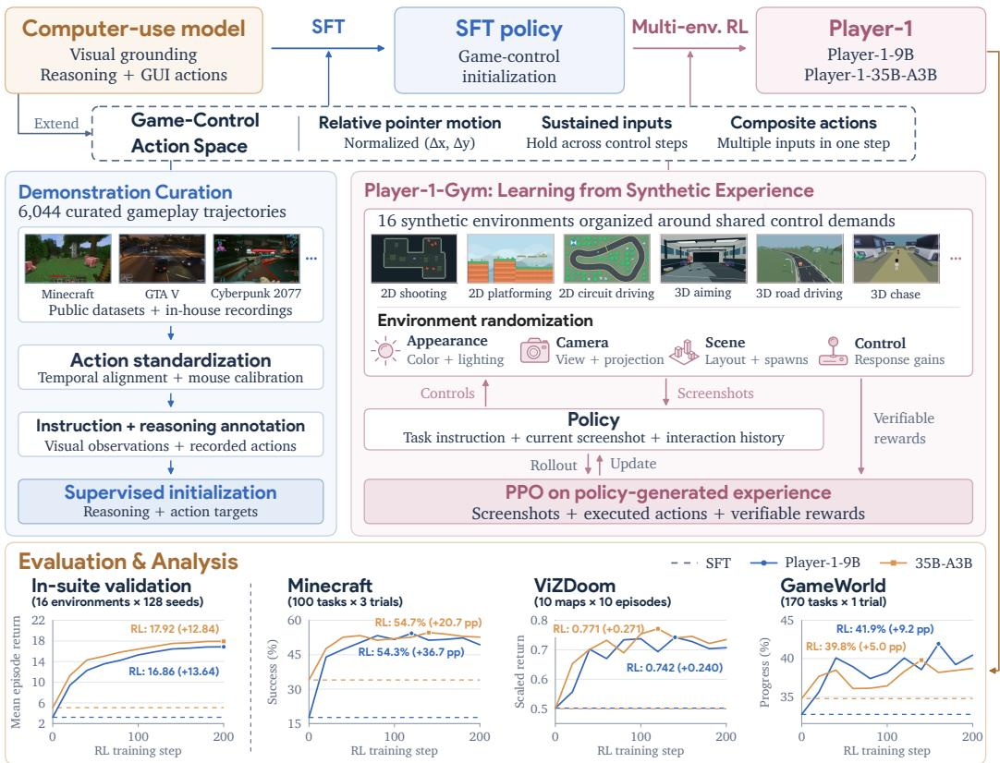  
Figure 1: Overview of PLAYER-1: learning game control beyond demonstrations. A shared gamecontrol action space connects supervised initialization from gameplay demonstrations with multienvironment RL in PLAYER-1-GYM. Learning from synthetic experience with verifiable rewards advances control capabilities beyond SFT, with gains that generalize beyond the RL training suite.

Three challenges shape this approach. First, gameplay demonstrations recorded with heterogeneous input conventions and temporal resolutions must be converted into a shared action space, and paired with task instructions and visual reasoning that reflect the player’s intent. Second, learning beyond demonstrations requires feedback on states reached by the policy’s own actions, but implementing programmatic rewards across diverse commercial games is difficult to scale. Third, experience from environments with different control demands, dynamics, and reward scales must be incorporated into a shared policy that generalizes beyond the training suite. These challenges motivate our supervised initialization from curated demonstrations, followed by learning in controllable synthetic environments with verifiable rewards.

We present PLAYER-1, a post-training framework for learning game control beyond demonstrations through synthetic experience, as illustrated in Figure 1. We extend the computer-use action space with relative pointer motion, sustained inputs, and composite actions. Curated gameplay demonstrations pair recorded actions with task instructions and visual reasoning to initialize game control. PLAYER-1-GYM then provides sixteen synthetic 2D and 3D environments designed around recurring control demands across aiming, combat, driving, navigation, and UI interaction. Programmatic gamestate rewards and randomization of observations and control dynamics support multi-environment reinforcement learning with verifiable rewards (RLVR), yielding Player-1-9B and Player-1-35B-A3B. Table 1 summarizes the differences and focuses of representative game-agent learning pipelines.

Our results demonstrate that learning from synthetic experience improves game-control capabilities, with gains extending beyond the RL training suite. On MineDojo-300, Player-1-9B improves from 10.54% success after SFT to 38.33%, exceeding the strongest evaluated external baseline at 12.63% under our evaluation protocol. The same policy also improves on ViZDoom-10 and GameWorld, both outside the RL training suite. We summarize our main contributions as follows:

Table 1: Comparison of representative game-agent learning pipelines, including supervision, RL environments, evaluation scope, and pipeline and model availability.
<table><tr><td>Method</td><td>Learning focus</td><td>Supervision</td><td>RL environments</td><td>Evaluation</td><td>Availability</td></tr><tr><td>Game-TARS</td><td>Large-scale pretraining</td><td>Reasoning + action</td><td></td><td>Held-out games</td><td>x</td></tr><tr><td>SIMA 2</td><td>Embodied assistance</td><td>Reasoning + action</td><td>Games + world model</td><td>Held-out games</td><td>x</td></tr><tr><td>NitroGen</td><td>System-1 generalist</td><td>Action</td><td></td><td>Games + adaptation</td><td>√</td></tr><tr><td>Odysseus</td><td>Long-horizon RL</td><td>Reasoning + action</td><td>5 Mario levels</td><td>Mario games</td><td>√</td></tr><tr><td>PLAYER-1</td><td>Beyond demonstrations</td><td>Reasoning + action</td><td>16 synthetic envs</td><td>RL held-out games</td><td>√</td></tr></table>

• We present PLAYER-1, a post-training framework that builds on supervised initialization to learn transferable game-control capabilities from synthetic experience. A shared action space supports relative pointer motion, sustained inputs, and composite actions, while 6,044 curated gameplay trajectories provide supervised initialization for subsequent interactive learning.

• We introduce PLAYER-1-GYM, sixteen synthetic 2D and 3D environments designed around recurring control demands across games. Programmatically verifiable rewards, together with randomized observations and control dynamics, provide diverse experience for multienvironment reinforcement learning beyond demonstrations.

• We demonstrate that learning from synthetic experience advances game-control capabilities beyond supervised demonstrations: Player-1-9B and Player-1-35B-A3B gain 27.8 and 17.7 pp in MineDojo-300 success, respectively, with further gains on ViZDoom and GameWorld outside the RL training suite. Further analyses show improved transfer with broader environment coverage and increased composite-action use during RL.

## 2 RELATED WORK

Generalist and Computer-Use Agents. Foundation models provide broad language, reasoning, and multimodal capabilities that underpin general-purpose agents (OpenAI, 2024; Anthropic, 2025; Gemini Team, 2025; Yang et al., 2025). Vision-language models (VLMs) connect visual perception with language, supporting scene understanding and spatial grounding (Bai et al., 2025). Computer-use agents (CUAs) specialize these capabilities for screenshot-conditioned interaction, using keyboard and mouse actions to complete multi-step tasks (Hu et al., 2024; Qin et al., 2025; Wang et al., 2025a; Lu et al., 2026).

Game Agents, Development, and Environments. Game-agent research spans planning-based systems (Tan et al., 2025b), learned visual policies and vision–language–action (VLA) models (SIMA Team, 2024; Tan et al., 2025a; Li et al., 2025; Wang et al., 2025b; Magne et al., 2026; Yue et al., 2026), and joint video–action models (Guo et al., 2026). Reinforcement learning further supports self-improvement and long-horizon control (SIMA Team, 2025; Shi et al., 2026). Most recently, Jev demonstrates low-latency game control through a text-only interface, relying on structured game-state representations rather than screenshot observations (Almeida, 2026). Complementary benchmarks evaluate gameplay (Ouyang et al., 2026) and agentic game development (Chi et al., 2026; Luo et al., 2026b). Code world models synthesized from rules and trajectories support planning (Lehrach et al., 2026), while game engine development provides trajectory data for world-model training (Zhou et al., 2026), connecting game creation to learning (Luo et al., 2026a).

Agent Post-Training with Verifiable Rewards. Post-training with verifiable rewards enables agents to learn from the outcomes of their own actions. Environment-synthesis approaches expand training coverage by constructing interactive tasks with verifiable rewards (Dong et al., 2026; Wang et al., 2026a). Adaptive approaches learn which environments to generate or jointly improve the policy, environment, and reward model (Liu et al., 2026; Wang et al., 2026b). In games, SIMA 2 combines supervised initialization with online RLVR and further demonstrates self-improvement transfer across Genie 3 environments (SIMA Team, 2025). PLAYER-1 combines supervised initialization with learning from synthetic experience in environments organized around shared control demands, demonstrating game-control gains that generalize beyond the RL training suite.

## 3 METHOD

PLAYER-1 connects supervised initialization with learning from synthetic experience through a shared game-control action space. We first extend computer-use actions to support dynamic game control, and initialize the policy using curated gameplay demonstrations. We then optimize the policy across PLAYER-1-GYM’s synthetic environments using PPO with verifiable rewards.

## 3.1 EXTENDING THE COMPUTER-USE ACTION SPACE

We extend the computer-use action space for dynamic game control while retaining screenshotconditioned decision making. At turn t, the policy receives task instruction $q ,$ screenshot $I _ { t } ,$ , and interaction history $C _ { H } ( h _ { < t } )$ (see Section 3.2):

$$
( z _ { t } , \hat { a } _ { t } ) \sim \pi _ { \theta } ( \cdot \mid q , I _ { t } , C _ { H } ( h _ { < t } ) ) .
$$

Here $z _ { t }$ is reasoning and $\hat { a } _ { t }$ the proposed action. The game-control action space extends the base model’s computer-use actions with relative pointer motion, sustained inputs, and composite actions.

Relative pointer motion. For the mouse actions, CUAs typically use normalized absolute coordinates to select visible targets by specifying their on-screen positions. In game-play scenarios, to control the camera without a visible pointer, we extend this action space with relative displacements:

$$
{ \mathcal { A } } _ { \mathrm { p o i n t e r } } = \underbrace { \left\{ { \mathrm { a b s o l u t e } } ( x , y ) \right\} } _ { { \mathrm { R e t a i n e d C U A ~ c o o r d i n a t e s } } } \cup \underbrace { \left\{ { \mathrm { r e l a t i v e } } ( \Delta x , \Delta y ) \right\} } _ { { \mathrm { R e l a t i v e - m o t i o n ~ e x t e n s i o n } } } .
$$

Absolute coordinates satisfy $x , y \in [ 0 , 1 0 0 0 ]$ , while relative displacements $\Delta x , \Delta y \in [ - 1 0 0 0 , 1 0 0 0 ]$ are normalized by screen width and height. Positive $\Delta x$ denotes rightward motion, and positive $\Delta y$ denotes downward motion. The resulting view rotation depends on the game’s camera gain.

Sustained inputs. We extend taps and clicks with holds lasting one full control step of duration $\Delta t$ For a key or mouse button b, the press or long-hold action space is

$$
\begin{array} { r } { \boldsymbol { A } _ { \mathrm { p r e s s } } ( b ) = \underbrace { \left\{ \mathrm { t a p } / \mathrm { c l i c k } ( b ) \right\} } _ { \mathrm { R e t a i n e d C U A t a p s / c l i c k s } } \cup \underbrace { \left\{ \mathrm { h o l d } ( b ; \Delta t ) \right\} } _ { \mathrm { S u s t a i n e d e x t e n s i o n } } . } \end{array}
$$

Repeating holds across consecutive control steps sustains movement and interaction.

Composite actions. We define a composite action as two or more compatible keyboard or mouse inputs executed concurrently within one control step. The step action space is

$$
{ \mathcal { A } } _ { \mathrm { s t e p } } = \underbrace { \left\{ \mathrm { w a i t } \right\} \cup { \mathcal { A } } _ { \mathrm { k e y b o a r d } } \cup { \mathcal { A } } _ { \mathrm { m o u s e } } } _ { \mathrm { I n d i v i d u a l ~ C U A i n p u t s } } \cup \underbrace { \left\{ \mathrm { i n p u t } _ { 1 } \ \| \cdot \cdot \cdot \| \ \mathrm { i n p u t } _ { m } \right\} } _ { \mathrm { C o m p o s i t e - a c t i o n ~ e x t e n s i o n } } .
$$

Each input $\in \mathcal { A } _ { \mathrm { k e y b o a r d } } \cup \mathcal { A } _ { \mathrm { m o u s e } } ; \ |$ denotes concurrent execution and $m \geq 2 .$ . These combinations support coordinated movement and combat that is crucial for game control. For example, holding $\mathbf { \hat { \Pi } } ^ { \bullet } \mathbf { W } ^ { \bullet }$ while tapping ‘Space’ enables running jumps, and pointer motion with a right-button hold and left-button click enables concurrent aiming and firing.

## 3.2 SUPERVISED INITIALIZATION FOR GAME CONTROL

The extended action space in Section 3.1 defines the available controls, but the policy must learn when and how to use them. In this section, we describe how we use SFT on a compact collection of curated gameplay demonstrations to initialize computer-use models for subsequent learning from synthetic experience.

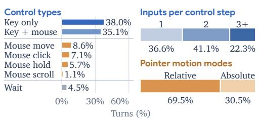

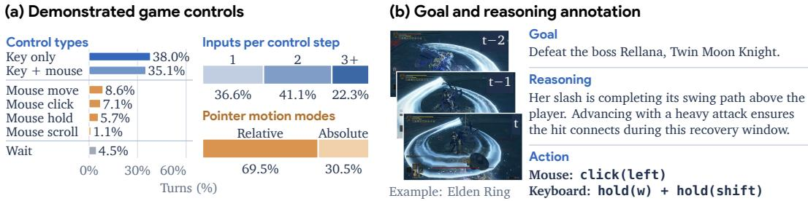  
Figure 2: Curated gameplay demonstrations for supervised initialization. (a) Recorded controls summarized by control type, number of inputs per control step, and pointer-motion mode in our demonstration trajectories. Two or more concurrent inputs form a composite action. (b) A demonstration sample pairing recorded actions with an annotated task instruction and visual reasoning.

Demonstration trajectory curation. We curate 6,044 gameplay trajectories comprising 295,097 interaction turns from public datasets (Choi et al., 2026; Markov AI, 2026; Yue et al., 2026; Baker et al., 2022) and in-house recordings, mapping recorded controls to the shared game-control action space defined in Section 3.1. Controls are aligned to shared action intervals, and source-specific mouse calibration expresses relative inputs in normalized, pixel-equivalent coordinates. After filtering incomplete or redundant recordings, we use a VLM (Google DeepMind, 2026) to annotate the recorded actions with task instructions and per-turn visual reasoning. For reasoning annotation, the VLM conditions on the task instruction, current and past observations, and the action target. Figure 2 illustrates input coverage and an annotated demonstration. Appendix B details the sources, alignment, calibration, and annotation procedures.

Supervised fine-tuning. We construct each SFT example as $( q , I _ { t } , C _ { H } ( h _ { < t } ) , z _ { t } , a _ { t } )$ , where the task instruction $q ,$ current screenshot $I _ { t } ,$ , and retained history $C _ { H } ( h _ { < t } )$ form the policy input, while visual reasoning $z _ { t }$ and action $a _ { t }$ provide supervision. Following Wang et al. (2025b), our SFT, RL, and evaluation share a $2 + 2$ history setting: two recent visual–action turns and two earlier action-only turns, with reasoning omitted. We fine-tune the policy to predict $( z _ { t } , a _ { t } )$ conditioned on the task instruction, current screenshot, and retained history. We use action-balanced sampling detailed in Appendix D.1 to increase exposure to less frequent controls and composite actions.

## 3.3 PLAYER-1-GYM: LEARNING FROM SYNTHETIC EXPERIENCE

We construct PLAYER-1-GYM, a suite of synthetic environments organized around control demands shared across games. Programmatically verifiable rewards, together with randomized observations and control dynamics, support our multi-environment PPO training of the SFT-initialized policy.

Verifiable environment construction. We identify recurring control demands across games and organize training tasks into five families: aiming, combat, driving, navigation, and UI interaction. For example, aiming tasks require pointer-based or camera-relative target tracking, while combat tasks combine movement with attack timing. Building upon our own shared 2D and 3D engines, reusable assets, and scene templates, we implement sixteen environments that require these forms of contro through different game mechanics, viewpoints, and spatial layouts, as shown in Figure 3(a–b). A unified runtime provides screenshot observations and executes the shared game-control action space. This shared foundation facilitates extending the suite with new environments while maintaining consistent observation and action interfaces.

To provide verifiable training feedback, each environment defines game- and task-specific scoring rules over changing game states. Score increments supply step-level rewards, providing dense and verifiable feedback without a learned judge, while privileged state is not exposed to the policy.

Environment randomization. To further broaden training experience within each environment, we randomize four complementary dimensions in PLAYER-1-GYM: (1) Appearance: colors, lighting, and assets; (2) Camera: projection, placement, and initial orientation; (3) Scene: layouts, spawns, and task-specific configurations; and (4) Control: input-response gains for camera rotation, movement,

Player-1-Gym: 16 synthetic environments

(a) Task families and control demands
<table><tr><td>Task family →</td><td>Control demands →</td><td>Environments</td></tr><tr><td>Aiming (2)</td><td>Align the pointer or camera to hit targets.</td><td>2D aiming; 3D aiming</td></tr><tr><td>Combat (5)</td><td>Coordinate movement, aiming, and attack timing.</td><td>2D shooting; 3D combat arena; 3D spear duel; 3D sword duel; 3D melee arena</td></tr><tr><td>Driving (4)</td><td>Control vehicle direction and position along paths.</td><td>2D lane driving; 2D circuit driving; 3D road driving; 3D lane driving</td></tr><tr><td>Navigation (4)</td><td>Move toward goals, avoid obstacles, and time jumps.</td><td>2D collect dodge; 2D platforming; 3D navigation; 3D chase</td></tr><tr><td>UI interaction (1)</td><td>Select and manipulate interface elements.</td><td>2D UI crafting</td></tr></table>

## (b) Environment views

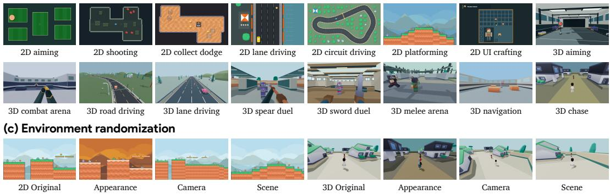  
Figure 3: PLAYER-1-GYM: synthetic experience with verifiable rewards. (a) Shared control demands across five task families. (b) Visualization of sixteen 2D and 3D environments. (c) Examples of appearance, camera, and scene randomization applied to the same environment.

driving, and steering where applicable. All four dimensions are jointly randomized during training where supported. Examples are provided in Figure 3(c). Appendix C further specifies the distributions and per-environment settings.

Multi-environment reinforcement learning. We jointly optimize the SFT-initialized policy with PPO across randomized environments with different control demands, dynamics, and reward scales. To limit the effect of reward-scale differences on policy-update magnitudes, we apply per-environment advantage normalization to generalized advantage estimates (GAE):

$$
\widetilde { A } _ { i , j } = \frac { A _ { i , j } - \mu _ { e } } { \sqrt { \sigma _ { e } ^ { 2 } + \epsilon } } , \quad \mu _ { e } = \frac { \sum _ { ( i , j ) \in { \mathcal { S } _ { c } } } A _ { i , j } } { N _ { e } } , \quad \sigma _ { e } ^ { 2 } = \frac { \sum _ { ( i , j ) \in { \mathcal { S } _ { c } } } ( A _ { i , j } - \mu _ { e } ) ^ { 2 } } { N _ { e } - 1 } .\tag{1}
$$

Here i indexes turns and $j$ response tokens. For each environment $e , S _ { e }$ contains its response-token indices in the rollout batch, with $N _ { e } = | S _ { e } |$ . We normalize each $A _ { i , j }$ for $( i , j ) \in \bar { \mathcal { S } } _ { \epsilon }$ using the corresponding advantage mean $\mu _ { e }$ and sample variance $\sigma _ { e } ^ { 2 }$ . Return-to-go targets accumulate rewards from subsequent turns, allowing later outcomes to inform earlier control decisions. Appendix D.2 further details reward construction, cross-turn credit, loss aggregation, and optimization.

## 4 EXPERIMENTS

## 4.1 EXPERIMENTAL SETUP

Training setup. We initialize Player-1-9B and Player-1-35B-A3B from their respective Qwen3.5- 9B and Qwen3.5-35B-A3B backbones. Both undergo two epochs of SFT on the full demonstration dataset with action-balanced sampling. We then apply proximal policy optimization (PPO) in the sixteen-environment PLAYER-1-GYM suite. Both model sizes train on the full sixteen-environment suite with a budget of 200 RL steps. Each training step collects 256 episodes allocated equally across environments, with at most 50 interaction turns per episode. More training details and hyperparameters are provided in Appendix D.

Evaluation. Besides in-domain evaluation of sixteen PLAYER-1-GYM environments, we construct two evaluation suites: MineDojo-300, comprising 300 tasks from the MineDojo (Fan et al., 2022)

task collection in Minecraft, and ViZDoom-10, comprising ten maps from the twelve available maps in ViZDoom (Kempka et al., 2016). We also evaluate browser-game interaction on GameWorld (Ouyang et al., 2026), covering 170 tasks across 34 games. Our standardized evaluation protocols use 8 trials per MineDojo task, 50 per ViZDoom map, and 3 per GameWorld task. Appendix E details benchmark composition, metrics, and budgets.

We compare against game-specific models, including JARVIS-VLA (Li et al., 2025), NitroGen (Magne et al., 2026), Open-P2P (Yue et al., 2026), and GameWAM (Guo et al., 2026), as well as computer-use models, including UI-TARS-1.5-7B (ByteDance Seed, 2025) and our Qwen3.5 base models. We keep their native preprocessing and inference procedures across the benchmarks. We also compare the base models, our SFT-initialized models, and the final PLAYER-1 models to separate the gains from SFT and those from synthetic experience.

## 4.2 MAIN RESULTS

Task-directed control in Minecraft. On MineDojo-300, SFT raises success from 9.21% to 10.54% for 9B and from 7.79% to 23.38% for 35B-A3B. Interactive learning raises 9B success to 38.33%, a large gain of 27.79 percentage points over SFT. The number of tasks completed in at least four of eight trials increases from 20 to 136, showing gains in both task coverage and repeatability.

Table 2: Task success and coverage on MineDojo-300. Results use 8 trials per task. Coverage counts tasks meeting the success thresholds; brackets show 95% task-bootstrap confidence intervals.
<table><tr><td rowspan="2">Method</td><td colspan="4">Success rate (%) ↑</td><td colspan="3">Coverage by successes (n/300) ↑</td></tr><tr><td>Combat</td><td>Harvest</td><td>Overall</td><td>[95% CI]</td><td>≥1 of 8</td><td>≥2 of 8</td><td>≥4 of 8</td></tr><tr><td>JARVIS-VLA</td><td>7.56</td><td>5.00</td><td>6.71</td><td>[5.38, 8.08]</td><td>95/300</td><td>41/300</td><td>5/300</td></tr><tr><td>UI-TARS-1.5-7B</td><td>0.56</td><td>0.00</td><td>0.38</td><td>[0.13, 0.67]</td><td>8/300</td><td>1/300</td><td>0/300</td></tr><tr><td>NitroGen</td><td>0.00</td><td>0.00</td><td>0.00</td><td>[-]</td><td>0/300</td><td>0/300</td><td>0/300</td></tr><tr><td>Open-P2P-1.2B</td><td>0.44</td><td>0.00</td><td>0.29</td><td>[0.08, 0.50]</td><td>7/300</td><td>0/300</td><td>0/300</td></tr><tr><td>GameWAM</td><td>14.00</td><td>9.88</td><td>12.63</td><td>[10.79, 14.54]</td><td>155/300</td><td>79/300</td><td>16/300</td></tr><tr><td>Qwen3.5-9B</td><td>11.75</td><td>4.13</td><td>9.21</td><td>[7.50, 11.00]</td><td>106/300</td><td>59/300</td><td>13/300</td></tr><tr><td>Qwen3.5-35B-A3B</td><td>8.69</td><td>6.00</td><td>7.79</td><td>[6.25, 9.46]</td><td>99/300</td><td>50/300</td><td>8/300</td></tr><tr><td>Player-1-9B-SFT</td><td>12.50</td><td>6.63</td><td>10.54</td><td>[8.67, 12.50]</td><td>120/300</td><td>63/300</td><td>20/300</td></tr><tr><td>Player-1-35B-A3B-SFT</td><td>30.31</td><td>9.50</td><td>23.38</td><td>[20.63, 26.21]</td><td>172/300</td><td>133/300</td><td>76/300</td></tr><tr><td>Player-1-9B</td><td>52.31</td><td>10.38</td><td>38.33</td><td>[35.13, 41.58]</td><td>209/300</td><td>173/300</td><td>136/300</td></tr><tr><td>Player-1-35B-A3B</td><td>55.56</td><td>12.00</td><td>41.04</td><td>[37.83, 44.29]</td><td>224/300</td><td>182/300</td><td>142/300</td></tr></table>

Table 3: First-person control on ViZDoom-10, with 50 trials per map. We report the mean scaled return. Map-specific reward settings and scaling factors are provided in Appendix E.4.
<table><tr><td>Method</td><td>Precision shooting</td><td>Goal navigation</td><td>Mobile combat</td><td>Survival</td><td>Overall</td></tr><tr><td>JARVIS-VLA</td><td>-0.6270</td><td>-0.1459</td><td>0.1340</td><td>0.1565</td><td>-0.1458</td></tr><tr><td>UI-TARS-1.5-7B</td><td>-0.6648</td><td>-0.1064</td><td>0.0587</td><td>0.1444</td><td>-0.1743</td></tr><tr><td>NitroGen</td><td>-0.3877</td><td>-0.0732</td><td>0.0740</td><td>0.1471</td><td>-0.0793</td></tr><tr><td>Open-P2P-1.2B</td><td>-0.5385</td><td>-0.0174</td><td>0.6493</td><td>0.1525</td><td>0.0602</td></tr><tr><td>GameWAM</td><td>0.1175</td><td>-0.1285</td><td>1.1860</td><td>0.1424</td><td>0.3938</td></tr><tr><td>Qwen3.5-9B</td><td>0.2257</td><td>0.1155</td><td>0.4340</td><td>0.3822</td><td>0.2975</td></tr><tr><td>Qwen3.5-35B-A3B</td><td>0.3376</td><td>0.1147</td><td>0.5627</td><td>0.4909</td><td>0.3912</td></tr><tr><td>Player-1-9B-SFT</td><td>0.4403</td><td>0.1839</td><td>0.5293</td><td>0.5423</td><td>0.4361</td></tr><tr><td>Player-1-35B-A3B-SFT</td><td>0.7376</td><td>0.3019</td><td>0.5380</td><td>0.6065</td><td>0.5644</td></tr><tr><td>Player-1-9B</td><td>1.0772</td><td>0.5974</td><td>0.3033</td><td>0.7927</td><td>0.6922</td></tr><tr><td>Player-1-35B-A3B</td><td>1.0423</td><td>0.2628</td><td>0.5960</td><td>0.8979</td><td>0.7236</td></tr></table>

Table 4: Browser-game control on GameWorld, with 3 trials per task across 170 tasks and 34 games.
<table><tr><td>Method</td><td>Success (%)</td><td>Progress (%)</td></tr><tr><td>JARVIS-VLA</td><td>6.47</td><td>17.61</td></tr><tr><td>UI-TARS-1.5-7B</td><td>5.49</td><td>19.71</td></tr><tr><td>NitroGen</td><td>8.82</td><td>23.41</td></tr><tr><td>Open-P2P-1.2B</td><td>2.35</td><td>10.37</td></tr><tr><td>GameWAM</td><td>5.88</td><td>16.91</td></tr><tr><td>Qwen3.5-9B</td><td>10.39</td><td>29.22</td></tr><tr><td>Qwen3.5-35B-A3B</td><td>13.14</td><td>33.49</td></tr><tr><td>Player-1-9B-SFT</td><td>13.14</td><td>31.43</td></tr><tr><td>Player-1-35B-A3B-SFT</td><td>15.49</td><td>34.60</td></tr><tr><td>Player-1-9B</td><td>15.88</td><td>34.45</td></tr><tr><td>Player-1-35B-A3B</td><td>17.25</td><td>38.79</td></tr></table>

Generalization beyond the RL training suite. The same policy improves performance on external games. On ViZDoom-10, Player-1-9B increases scaled return from 0.4361 after SFT to 0.6922. Player-1-35B-A3B achieves an overall scaled return of 0.7236, surpassing GameWAM, the strongest external baseline at 0.3938, by 83.7%. On GameWorld’s 3 × 170 episodes, progress rises from 31.43% to 34.45%. Together, these results show that control experience acquired in PLAYER-1-GYM transfers to first-person shooting and distinct browser games, beyond the synthesized environments for RL. These gains support using synthetic experience to develop transferable control capabilities without reinforcement learning in each target game.

Task Instruction Explore on foot, find and enter a car, then drive through the city.

(c) Ablation: SFT initialization  
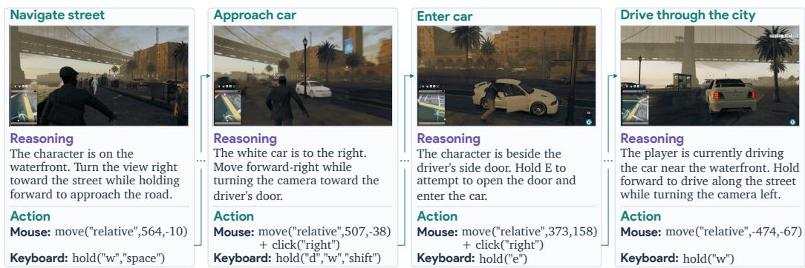  
Figure 4: Player-1-9B in the held-out commercial game Watch Dogs 2: on-foot navigation, car approach, vehicle entry, and city driving. The sequence illustrates coordinated movement and camera control during navigation, and specified inputs for vehicle entry and driving. Reasoning and action text has been lightly shortened and reformatted for readability.

Case Example: Control in an Unseen Commercial Game. We integrate PLAYER-1 into commercial games using an observation–action loop with visual inputs and keyboard–mouse controls. Figure 4 shows an example sequence in Watch Dogs 2, a game unseen during both SFT and RL. Experience acquired during training enables the agent to reason and act across on-foot navigation, target approach, vehicle interaction, and driving scenarios.

## 5 ANALYSIS

## 5.1 LEARNING DYNAMICS

In this section, we illustrate the learning dynamics of the SFT-initialized policies over RL steps. Figure 5(a,b) separates penalized episode returns from unpenalized game scores, with each metric averaged across sixteen environments.

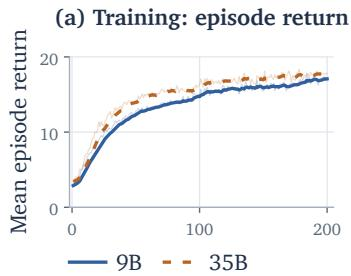

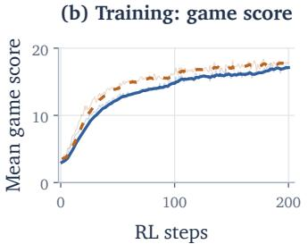

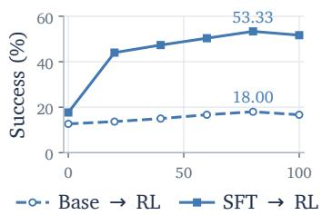  
Figure 5: Training dynamics and the effect of supervised initialization. (a,b) Mean episode returns and game scores across 16 environments for 9B and 35B-A3B over 200 RL steps; faint traces show raw values and bold curves show EMA. (c) Base→RL and SFT→RL for 9B over 0–100 RL steps.

Learning beyond SFT. As shown in Figure 5(a,b), both mean episode return and mean game score rise across the RL training steps. Gains are largest early in training and become more gradual later. The 35B-A3B curve finishes slightly above the 9B curve on both measures. These trends indicate that learning from synthetic experience improves game control beyond SFT.

Effect of supervised initialization. Figure 5(c) contrasts the displayed Base→RL and SFT→RL trajectories for 9B over 100 RL steps. SFT→RL rises from 17.67% to 51.67% Minecraft success, while Base→RL rises from 12.67% to 16.67%, leaving a 35.00-percentage-point gap at step 100.

Learning across environments. Figure 6 breaks down episode returns across all sixteen training environments. Both models show broad net gains, but their learning trajectories vary across environments. For example, performance on simpler tasks such as 2D aiming improves rapidly and then levels off, whereas gains in 2D circuit driving emerge much later.

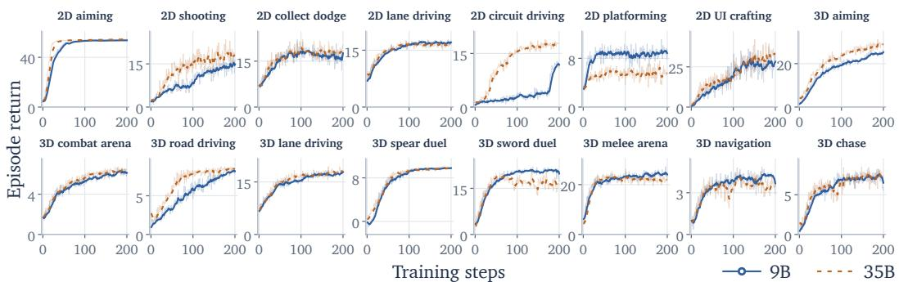  
Figure 6: Per-environment episode returns for 9B and 35B-A3B over 200 RL steps. The curves show differences in learning progress, return scales, and relative model performance across diverse synthetic environments.

## 5.2 ENVIRONMENT SCALING

Expanding the training suite. The scaling comparison allocates a fixed budget of 25,600 episodes over 100 RL steps across 2, 4, 8, or 16 environments, starting from the same Player-1-9B-SFT checkpoint. Each configuration uses 256 episodes per step, allocated equally across the environments. Appendix D.4 specifies the subsets and protocol.

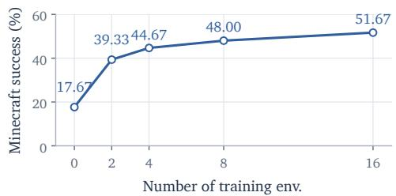  
Figure 7: Environment scaling at a fixed budget of 25,600 episodes over 100 RL steps. Zero denotes the SFT reference.

## 5.3 EVOLUTION OF ACTION COMPOSITION

Figure 8 shows increased use of composite actions during RL. Across Player-1-9B’s in-suite validation trajectories, the share of turns with composite actions rises from 64.7% at the start of RL to 85.4% and 93.2% after 50 and 100 RL steps, respectively. This progressive increase occurs without an explicit reward for action composition, suggesting that task-driven RL reinforces coordinated inputs common to game control, such as aiming while firing or moving while adjusting the camera.

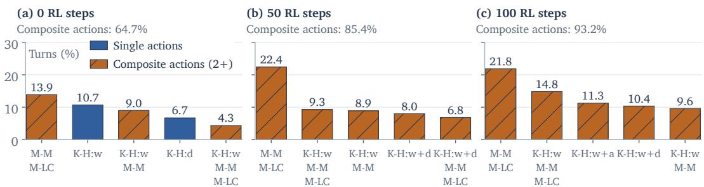  
Figure 8: Evolution of action composition during PLAYER-1-GYM validation. Composite-action use rises from 64.7% to 93.2% over 100 RL steps. Bars show each checkpoint’s most frequent actions as shares of all turns. K-H: key hold; M-M: mouse movement; M-LC: mouse left click.

## 6 CONCLUSION

We presented PLAYER-1, a post-training framework for learning game control beyond demonstrations through synthetic experience. Curated gameplay demonstrations initialize computer-use models in a shared game-control action space. PLAYER-1-GYM then provides sixteen synthetic environments organized around shared control demands, with verifiable rewards and randomized observations and control dynamics for multi-environment RL. Evaluations on MineDojo-300, ViZDoom-10, and

GameWorld demonstrate that learning from synthetic experience advances game-control capabilities beyond SFT, with gains that generalize beyond the RL training suite. Further analyses show improved transfer with larger training suites. Together, these findings establish synthetic experience as an effective resource for learning transferable game control without online training in each target game.

## REFERENCES

Diogo Almeida. Introducing System One Models & Jev. TypeSafe AI Blog, September 2026. URL https: //typesafe.ai/blog/introducing-system-one-models-and-jev.

Anthropic. Introducing Claude 4. Technical announcement, 2025. URL https://www.anthropic.com/ news/claude-4.

Shuai Bai, Yuxuan Cai, Ruizhe Chen, Keqin Chen, Xionghui Chen, Zesen Cheng, Lianghao Deng, Wei Ding, Chang Gao, Chunjiang Ge, et al. Qwen3-VL technical report. arXiv preprint arXiv:2511.21631, 2025. URL https://arxiv.org/abs/2511.21631.

Bowen Baker, Ilge Akkaya, Peter Zhokhov, Joost Huizinga, Jie Tang, Adrien Ecoffet, Brandon Houghton, Raul Sampedro, and Jeff Clune. Video pretraining (VPT): Learning to act by watching unlabeled online videos. arXiv preprint arXiv:2206.11795, 2022.

ByteDance Seed. UI-TARS-1.5-7B, 2025. URL https://huggingface.co/ByteDance-Seed/ UI-TARS-1.5-7B. Model release.

Wayne Chi, Yixiong Fang, Arnav Yayavaram, Siddharth Yayavaram, Seth Karten, Qiuhong Anna Wei, Runkun Chen, Alexander Wang, Valerie Chen, Ameet Talwalkar, and Chris Donahue. GameDevBench: Evaluating agentic capabilities through game development. arXiv preprint arXiv:2602.11103, 2026. URL https: //arxiv.org/abs/2602.11103.

Suhwan Choi, Jaeyoon Jung, Haebin Seong, Minchan Kim, Minyeong Kim, Yongjun Cho, Yoonshik Kim, Yubeen Park, Youngjae Yu, and Yunsung Lee. D2E: Scaling vision-action pretraining on desktop data for transfer to embodied AI. In International Conference on Learning Representations, 2026. URL https: //arxiv.org/abs/2510.05684.

Guanting Dong, Junting Lu, Junjie Huang, Wanjun Zhong, Longxiang Liu, Shijue Huang, et al. Agent-World: Scaling real-world environment synthesis for evolving general agent intelligence. arXiv preprint arXiv:2604.18292, 2026.

Linxi Fan, Guanzhi Wang, Yunfan Jiang, Ajay Mandlekar, Yuncong Yang, Haoyi Zhu, Andrew Tang, De-An Huang, Yuke Zhu, and Anima Anandkumar. MineDojo: Building open-ended embodied agents with internet scale knowledge. In Advances in Neural Information Processing Systems, volume 35, pp. 18343–18362, 2022.

Gemini Team. Gemini 2.5: Pushing the frontier with advanced reasoning, multimodality, long context, and next generation agentic capabilities. Technical report, Google DeepMind, 2025. URL https://storage. googleapis.com/deepmind-media/gemini/gemini\_v2\_5\_report.pdf.

Google DeepMind. Gemini 3.8 Flash. Model card, 2026. URL https://deepmind.google/models/ model-cards/gemini-3-8-flash/.

Yuncheng Guo, Zhanqiu Zhang, Yiwen Guo, and Weijia Li. GameWAM: A world action model for video games. arXiv preprint arXiv:2608.26200, 2026. URL https://arxiv.org/abs/2608.26200.

Siyuan Hu, Mingyu Ouyang, Difei Gao, and Mike Zheng Shou. The dawn of GUI agent: A preliminary case study with Claude 3.5 Computer Use. arXiv preprint arXiv:2411.10323, 2024. URL https://arxiv. org/abs/2411.10323.

Michał Kempka, Marek Wydmuch, Grzegorz Runc, Jakub Toczek, and Wojciech Jaskowski. ViZDoom: A´ doom-based AI research platform for visual reinforcement learning. In IEEE Conference on Computational Intelligence and Games, pp. 341–348, 2016. doi: 10.1109/CIG.2016.7860433. URL https://arxiv. org/abs/1605.02097.

Wolfgang Lehrach, Daniel Hennes, Miguel Lazaro-Gredilla, Xinghua Lou, Carter Wendelken, Zun Li, Antoine Dedieu, Marc Lanctot, Atil Iscen, John Schultz, Marcus Chiam, Ian Gemp, Piotr Zielinski, Satinder Singh, and Kevin Murphy. Code world models for general game playing. In The Fourteenth International Conference on Learning Representations, 2026. URL https://openreview.net/forum?id=1UoB7IWiku.

Muyao Li, Zihao Wang, Kaichen He, Xiaojian Ma, and Yitao Liang. JARVIS-VLA: Post-training large-scale vision language models to play visual games with keyboards and mouse. In Findings ofthe Associationfor Computational Linguistics: ACL 2025, pp. 17878–17899, 2025. doi: 10.18653/v1/2025.findings-acl.920.

Bo Liu, Simon Yu, Yiding Jiang, Ao Qu, Andrew Zhao, Zichen Liu, Junsu Kim, Zijian Zhou, Seungone Kim, Tongzheng Ren, Mickel Liu, Hanfei Yu, Zhaorun Chen, Weiyan Shi, Paul Pu Liang, Luke Zettlemoyer, Yejin Choi, and Natasha Jaques. SPADE: Self-play in adaptive synthetic executable environments. arXiv preprint arXiv:2608.19197, 2026.

Dunjie Lu, Shuai Bai, Tianyi Bai, Sicheng Fan, Chang Gao, Jian Guan, Feng Hu, Mianqiu Huang, Xingyang Huang, Yizhen Jiang, et al. Qwen-CUA: Native computer use for (almost) everything. arXiv preprint arXiv:2608.02352, 2026. URL https://arxiv.org/abs/2608.02352.

Meng Luo, Yanlin Li, Hao Li, Hongzhan Lin, Pengfei Zhou, Tianjie Ju, Ran Zhang, Yeying Jin, Mong-Li Lee, and Wynne Hsu. AI for games in the foundation model era. arXiv preprint arXiv:2609.16679, 2026a. URL https://arxiv.org/abs/2609.16679.

Tongxu Luo, Rongsheng Wang, Jiaxi Bi, Chenming Xu, Zhengyang Tang, Jianlong Chen, Juhao Liang, Ke Ji, Shuqi Guo, Yuhao Du, Fan Bu, Wenyu Du, Xiaotong Zhang, Kyle Li, Shaobo Wang, Linfeng Zhang, Yuxuan Liu, Xin Lai, Chenxin Li, Yiduo Guo, Zhexin Zhang, Xinyuan Wang, Tianyi Bai, Ziniu Li, and Benyou Wang. GameCraft-Bench: Can agents build playable games end-to-end in a real game engine? arXiv preprint arXiv:2606.17861, 2026b. URL https://arxiv.org/abs/2606.17861.

Lo¨ıc Magne, Anas Awadalla, Guanzhi Wang, Yinzhen Xu, Joshua Belofsky, Fengyuan Hu, Joohwan Kim, Ludwig Schmidt, Georgia Gkioxari, Jan Kautz, Yisong Yue, Yejin Choi, Yuke Zhu, and Linxi Fan. NitroGen: An open foundation model for generalist gaming agents. In Proceedings ofthe IEEE/CVF Conference on Computer Vision and Pattern Recognition, pp. 21511–21521, 2026.

Markov AI. Gaming 500 hours. Hugging Face dataset, 2026. URL https://huggingface.co/ datasets/markov-ai/gaming-500-hours.

OpenAI. GPT-4o system card. arXiv preprint arXiv:2410.21276, 2024. URL https://arxiv.org/abs/ 2410.21276.

Mingyu Ouyang, Siyuan Hu, Kevin Qinghong Lin, Hwee Tou Ng, and Mike Zheng Shou. GameWorld: Towards standardized and verifiable evaluation of multimodal game agents. arXiv preprint arXiv:2604.07429, 2026.

Yujia Qin, Yining Ye, Junjie Fang, Haoming Wang, Shihao Liang, Shizuo Tian, Junda Zhang, et al. UI-TARS: Pioneering automated GUI interaction with native agents. arXiv preprint arXiv:2501.12326, 2025.

Chengshuai Shi, Wenzhe Li, Xinran Liang, Yizhou Lu, Wenjia Yang, Ruirong Feng, Seth Karten, Ziran Yang, Zihan Ding, Gabriel Sarch, Danqi Chen, Karthik Narasimhan, and Chi Jin. Odysseus: Scaling VLMs to 100+ turn decision-making in games via reinforcement learning. arXiv preprint arXiv:2605.00347, 2026.

SIMA Team. Scaling instructable agents across many simulated worlds. arXiv preprint arXiv:2404.10179, 2024. URL https://arxiv.org/abs/2404.10179.

SIMA Team. SIMA 2: A generalist embodied agent for virtual worlds. arXiv preprint arXiv:2512.04797, 2025. URL https://arxiv.org/abs/2512.04797.

Weihao Tan, Xiangyang Li, Yunhao Fang, Heyuan Yao, Shi Yan, Hao Luo, Tenglong Ao, Huihui Li, Hongbin Ren, Bairen Yi, Yujia Qin, Bo An, Libin Liu, and Guang Shi. Lumine: An open recipe for building generalist agents in 3D open worlds. arXiv preprint arXiv:2511.08892, 2025a. URL https://arxiv.org/abs/ 2511.08892.

Weihao Tan, Wentao Zhang, Xinrun Xu, Haochong Xia, Ziluo Ding, Boyu Li, Bohan Zhou, Junpeng Yue, Jiechuan Jiang, Yewen Li, Ruyi An, Molei Qin, Chuqiao Zong, Longtao Zheng, Yujie Wu, Xiaoqiang Chai, Yifei Bi, Tianbao Xie, Pengjie Gu, Xiyun Li, Ceyao Zhang, Long Tian, Chaojie Wang, Xinrun Wang, Borje F. Karlsson, Bo An, Shuicheng Yan, and Zongqing Lu. Cradle: Empowering foundation¨ agents towards general computer control. In Proceedings ofthe 42nd International Conference on Machine Learning, volume 267 of Proceedings of Machine Learning Research, pp. 58658–58725, 2025b. URL https://proceedings.mlr.press/v267/tan25h.html.

Bowen Wang, Dunjie Lu, Junli Wang, Tianyi Bai, Shixuan Liu, Zhipeng Zhang, Haiquan Wang, Hao Hu, Tianbao Xie, Shuai Bai, Dayiheng Liu, Que Shen, Junyang Lin, and Tao Yu. CUA-Gym: Scaling verifiable training environments and tasks for computer-use agents. arXiv preprint arXiv:2605.25624, 2026a.

Haoming Wang, Haoyang Zou, Huatong Song, Jiazhan Feng, Junjie Fang, Junting Lu, Longxiang Liu, Qinyu Luo, Shihao Liang, Shijue Huang, Wanjun Zhong, Yining Ye, Yujia Qin, et al. UI-TARS-2 technical report: Advancing GUI agent with multi-turn reinforcement learning. arXiv preprint arXiv:2509.02544, 2025a.

Yinjie Wang, Tianbao Xie, Ke Shen, Mengdi Wang, and Ling Yang. RLAnything: Forge environment, policy, and reward model in completely dynamic RL system. arXiv preprint arXiv:2602.02488, 2026b.

Zihao Wang, Xujing Li, Yining Ye, Junjie Fang, Haoming Wang, Longxiang Liu, et al. Game-TARS: Pretrained foundation models for scalable generalist multimodal game agents. arXiv preprint arXiv:2510.23691, 2025b. URL https://arxiv.org/abs/2510.23691.

An Yang, Anfeng Li, Baosong Yang, Beichen Zhang, Binyuan Hui, Bo Zheng, Bowen Yu, Chang Gao, Chengen Huang, Chenxu Lv, et al. Qwen3 technical report. arXiv preprint arXiv:2505.09388, 2025. URL https://arxiv.org/abs/2505.09388.

Yuguang Yue, Irakli Salia, Samuel Hunt, Chris Green, Wenzhe Shi, and Jonathan J. Hunt. Scaling behavior cloning improves causal reasoning: An open model for real-time video game playing. arXiv preprint arXiv:2601.04575, 2026. URL https://arxiv.org/abs/2601.04575.

Pengfei Zhou, Hexin Wang, Zhengfeiyang Zhang, Yixing Ma, Zhenglin Wan, Kaipeng Zhang, Wangbo Zhao, and Yang You. Agentic game development as a verifiable trajectory data engine for scaling world models. arXiv preprint arXiv:2608.25518, 2026. URL https://arxiv.org/abs/2608.25518.

## A GAME-CONTROL INTERFACE

## A.1 COORDINATES AND COMPOSITE ACTIONS

Table 5 specifies the execution semantics of the actions introduced in Section 3.1. For an observation of width W and height H, normalized absolute positions and relative displacements map to pixels as

$$
( x , y ) \mapsto ( x W / 1 0 0 0 , y H / 1 0 0 0 ) , \qquad ( \Delta x , \Delta y ) \mapsto ( \Delta x W / 1 0 0 0 , \Delta y H / 1 0 0 0 ) .
$$

The origin is the upper-left corner, and positive displacement points right and down. One movement uses either absolute or relative coordinates. A key cannot be both held and tapped in the same step, nor can one mouse button be both held and clicked.

Table 5: Game-control semantics. Inputs in a composite action execute concurrently within one step; bindings are restricted to those supported by the environment.
<table><tr><td>Component</td><td>Semantics</td></tr><tr><td>Key hold / tap</td><td>Hold a set of keys throughout the step, or briefly press and release them.</td></tr><tr><td>Mouse movement</td><td>Move to an absolute screen position or apply a relative displacement.</td></tr><tr><td>Mouse hold / click</td><td>Hold one button throughout the step, or click one button. Different buttons may execute concurrently.</td></tr><tr><td>Mouse scroll</td><td>Apply one upward or downward scroll step.</td></tr><tr><td>Wait</td><td>No operation. Advance one step without keyboard or mouse input.</td></tr></table>

## A.2 EXECUTION AND VISUAL FEEDBACK

Relative motion requests input displacement, not a universal camera angle. For per-pixel camera gain g, requested yaw and pitch increments δψ and δϕ have magnitudes

$$
| \delta \psi | = g W | \Delta x | / 1 0 0 0 , \qquad | \delta \phi | = g H | \Delta y | / 1 0 0 0 ,
$$

before native camera limits; mouse displacement is not multiplied by action duration. The seven mouse-controlled 3D PLAYER-1-GYM environments use a nominal gain $g _ { 0 } = 0 . 0 0 1 9 6$ radians per observation pixel by default. With Control randomization, the effective gain is $g = g _ { 0 } L ,$ , where L is defined in Appendix C.2. Observation geometry and camera constraints remain fixed within a checkpoint comparison. Benchmark-specific settings are given in Appendix E.

## A.3 OBSERVATION AND INTERACTION HISTORY

SFT, RL, and evaluation all use two recent visual–action turns and two earlier action-only turns. In the earlier action-only turns, screenshots are replaced by <image omitted>; reasoning in all retained historical turns is replaced by <thinking omitted>. The current screenshot and executed historical actions are retained.

## B GAMEPLAY DEMONSTRATIONS: CONSTRUCTION AND ANNOTATION

## B.1 SOURCES AND STATISTICS

Both model sizes are trained with the collection in Figure 9: 6,044 trajectories and 295,097 turns from 2,544 source-qualified recording sessions and 172 games. We approximate the sampled control hours, which equal the turn count × 200 ms, or 16.4 hours in total for the full annotated dataset.

Quality selection. We automated validity, activity, and repetition checks that complement sourcelevel and manual review of recording completeness, observation–action alignment, and sequence diversity. The collection contains 5,360 gameplay trajectories with a total of 268,000 turns and 684 in-game UI trajectories with a total of 27,097 turns.

Action statistics. Figure 2(a) counts the distribution of each action across all samples in the dataset. Keyboard–mouse composites take precedence. Mouse-only turns are assigned by movement, click, hold, then scroll. Inputs per step count each key tap/hold and mouse operation separately, with wait as one no-op. Pointer-mode shares use all turns containing mouse move, including keyboard–mouse composites.

<table><tr><td>(a) Sources &amp; scale Turns Hours</td></tr><tr><td>Source Traj.</td></tr><tr><td>Public datasets</td></tr><tr><td>Desktop to Embodied AI (2026) 1,005 49,883 2.8</td></tr><tr><td>Gaming 500 Hours (2026) 985 48,652 2.7</td></tr><tr><td>Open Pixel2Play (2026) 1,140 57,000 3.2</td></tr><tr><td>Video PreTraining (2022) 1,153 56,431 3.1</td></tr><tr><td>In-house recordings</td></tr><tr><td>In-house Gameplay Recordings 1,761 83,131 4.6</td></tr><tr><td>Total 6,044 295,097 16.4</td></tr></table>

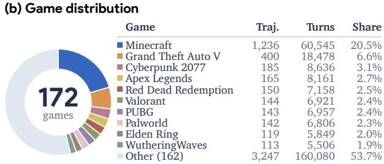  
Figure 9: Sources and game distribution of the 6,044 gameplay demonstrations used for SFT. (a) Sources and scale, with sampled control hours. (b) Game distribution.

## B.2 ACTION STANDARDIZATION

Temporal alignment. For continuous gameplay, source timestamps define contiguous intervals of 150–250 ms, projected onto a 200-ms target grid using cumulative boundaries. Relative input is summed within each source interval. Keyboard presses shorter than 100 ms become taps, and longer presses become holds on overlapping target steps. Mouse presses lasting at most 300 ms become clicks. Each target summarizes compatible recorded inputs for concurrent execution within one control step.

UI trajectories also follow recorded operation boundaries. Clicks retain their recorded targets, key sequences expand into individual presses, drags use start and endpoint controls with an explicit release, and scroll gestures become directional steps. Execution uses the shared 200-ms action space. Sampled control hours use target execution duration, while UI trajectories retain their recorded, operation-dependent timing.

Spatial alignment. Native relative-mouse input scales vary across data sources and recording setups. We therefore calibrate these inputs to pixel-equivalent displacements using freely moving GUI pointers from the same recording session. The mapping also applies to pointer-locked recordings. Camera response is defined in Appendix A.2. For native-input sums $( r _ { x } , r _ { y } )$ , coefficients $( k _ { x } , k _ { y } )$ and logical recording size $\left( W _ { m } , \bar { H } _ { m } \right)$ , the normalized target is

$$
\Delta x = \mathrm { r o u n d } ( 1 0 0 0 k _ { x } r _ { x } / W _ { m } ) , \qquad \Delta y = \mathrm { r o u n d } ( 1 0 0 0 k _ { y } r _ { y } / H _ { m } ) .
$$

Mouse-move Calibration. In-house and D2E calibration uses GUI windows with stable focus and geometry, aligned timestamps, and no pointer clipping or recentering. For paired native input $r _ { i }$ and pointer displacement $p _ { i }$ , window and pooled session estimates are

$$
k _ { i } = \frac { r _ { i } ^ { \top } p _ { i } } { r _ { i } ^ { \top } r _ { i } } , \qquad \hat { k } = \frac { \sum _ { i } r _ { i } ^ { \top } p _ { i } } { \sum _ { i } r _ { i } ^ { \top } r _ { i } } .
$$

D2E uses window-equal estimates for a source-level coefficient; in-house coefficients are recordingspecific. Pixel2Play uses per-axis Huber regression over at least two stable, non-overlapping twosecond GUI blocks. Out-of-range projections are rejected rather than clipped to ensure the action quality. Table 6 lists the source mappings.

Table 6: Source-specific mouse-action mapping. Relative inputs use calibration coefficients bound to recording geometry; UI operations use absolute endpoints.  
Source Mapping   
In-house Recording-specific calibration coefficients   
D2E Source-level $k _ { x } = k _ { y } = 0 . 6 ($ 6 for relative input; absolute endpoints for UI operations.   
Pixel2Play Hierarchical selection: session GUI fit → metadata profile → display scale.   
VPT $k _ { x } = k _ { y } = 2$ in logical $1 2 8 0 \times 7 2 0$ coordinates for relative input; absolute endpoints for UI   
operations.   
Gaming 500h Recorded absolute positions projected using capture geometry.

## B.3 GOAL AND REASONING ANNOTATION

We use Gemini 3.8 Flash to build reusable profiles of rules, roles, inputs, and examples for each game in the trajectory, and check them for recorded-control coverage and action validity. It assigns goals

from each profile, full-trajectory storyboard, and action timeline. The same game from different data sources should share the same assembled profile. For per-turn reasoning annotation, it re-uses the goal, fixed action target, and current and past frames.

## C PLAYER-1-GYM: TASKS, REWARDS, AND RANDOMIZATION

## C.1 TASKS AND VERIFIABLE REWARDS

By primary task, the sixteen environments comprise aiming (2), combat (5), driving (4), navigation (4), and UI interaction (1). Tables 7 and 8 specify their tasks, score components, and API state fields. Interaction tests, score checks, and human review verify controls, observable transitions, and reward events against human-defined rules.

We designed the shared Three.js browser runtime to provide controllable resets, keyboard–mouse execution, screenshots, and rewards, with fixed-step simulation independent of inference latency. Each environment defines a cumulative score $S _ { e } ( s )$ and supplies the increment $r _ { e , t } = S _ { e } ( s _ { t + 1 } ) - S _ { e } ( s _ { t } )$ as reward. Reward computation and evaluation use privileged state, while the policy receives only screenshots and task/control text. Episodes only end on native completion or failure, or at the turn cap when the task is not completed under the limits.

Table 7: 2D environments, controls, and verifiable score components. State fields are read from gameGymAPI.getState().metrics; primary score gives the resulting cumulative score.
<table><tr><td>Environment</td><td>Task and control</td><td>Score components</td><td>State fields (API)</td></tr><tr><td>2D aiming</td><td>Track and click moving targets</td><td>Hits +0.1× accumulated precision</td><td>targets_collected, precision_total</td></tr><tr><td>2D shooting 2D collect dodge</td><td>Move, aim, and shoot Collect while avoiding</td><td>Enemies defeated Coins collected</td><td>kills coins_collected</td></tr><tr><td>2D lane driving 2D circuit driving</td><td>hazards Time lane changes Steer through a route</td><td>Coins collected Checkpoints reached</td><td>coins_collected checkpoints-passed</td></tr><tr><td>2D platforming</td><td>Run, jump, and dash</td><td>Coins, cleared gaps/spikes, and flags</td><td>coins_collected, gaps_cleared,</td></tr><tr><td>2D UI crafting</td><td>Consult, craft, and equip Recipe consultations +</td><td>material reward +3× crafts +</td><td>spikes_cleared, flags_reached recipe_book_rewards, correct_material_reward, target_crafts,</td></tr></table>

Table 8: 3D environments, controls, and verifiable score components. State fields are read from gameGymAPI.getState().metrics; primary score gives the resulting cumulative score.
<table><tr><td>Environment</td><td>Task and control</td><td>Score components</td><td>State fields (API)</td></tr><tr><td>3D aiming</td><td>Track and hit targets</td><td>Target hits</td><td>hits</td></tr><tr><td>3D combat arena</td><td>Coordinate movement, aim, and fire</td><td>Enemies defeated</td><td>kills</td></tr><tr><td>3D road driving</td><td>Follow bends and checkpoints</td><td>Checkpoints reached Coins collected</td><td>checkpoints-passed coins_collected</td></tr><tr><td>3D lane driving</td><td>Collect and avoid with lane changes</td><td></td><td></td></tr><tr><td>3D spear duel</td><td>Track, charge, release, and dodge</td><td>Spear hits —0.5× damage received</td><td>spear_hits, damage_taken</td></tr><tr><td>3D sword duel</td><td>Approach, aim, and strike</td><td>Attack hits + defeats —0.5× damage received</td><td>attack_hits,kills, damage_taken</td></tr><tr><td>3D melee arena</td><td>Coordinate facing, range, and movement</td><td>Attack hits + defeats —0.5× damage received</td><td>attack_hits,kills, damage_taken</td></tr><tr><td>3D navigation</td><td>Reach successive flags</td><td>Goals reached</td><td>goals_reached</td></tr><tr><td>3D chase</td><td>Pursue around obstacles</td><td>Targets reached</td><td>targets_reached</td></tr></table>

## C.2 RANDOMIZATION AND SAMPLING

Figure 10 shows individual and joint Appearance, Camera, and Scene variation. The parameters, distributions, and applicable environments for Appearance, Camera, Scene, and Control are specified in Table 9. Specifically, appearance preserves collision geometry and functional roles; Scene varies layouts, spawns, and subsequent entity generation, potentially changing task difficulty. Appearance and Camera are sampled at reset and fixed within each episode, with triangular modes at native values. Background lightness and saturation, ambient intensity, and key-light intensity share one sampled quantile, and linked asset components receive compatible color changes. Orthographic zoom is relative to the native view, including 2D platforming. Initial first-person point-of-view yaw/pitch is distinct from camera-rig pitch.

Control-response sampling. Control varies input response independently of camera projection and scene configuration. For each supported response parameter k, we independently sample

$$
c _ { e , k } \sim \operatorname { T r i } ( a _ { e , k } , 1 , b _ { e , k } ) , \qquad c _ { e , k } ( t ) = c _ { e , k } ( 0 ) \quad { \mathrm { t h r o u g h o u t t h e ~ e p i s o d e } } .\tag{2}
$$

The control seed is independent of domain randomization. Separate parameter substreams set values at reset, unchanged through respawns. The narrower chasing, platforming, and jump ranges preserve pursuit-speed and traversal constraints. Collision rules, gravity, attack timing, control bindings, and reward definitions remain fixed. Table 10 specifies the training mixture.

## D POST-TRAINING DETAILS

## D.1 SUPERVISED FINE-TUNING

For supervised fine-tuning, both model sizes use token-level cross-entropy on the current turn’s reasoning and action, with the history in Appendix A.3.

Action-balanced sampling. In human gameplay recordings, some actions occupy only a small fraction of playing time but are critical for game progress. For example, left mouse button inputs account for less than 1% of valid inputs in the original recordings, which are dominated by keyboard inputs and mouse movement. In addition to selecting and filtering demonstrations for action coverage during data curation, we use action-balanced sampling to strengthen supervision for these infrequent but important actions. We classify each turn by its current recorded action into overlapping pools: keyboard, mouse movement, click, hold, any mouse button, keyboard–mouse, movement–click, keyboard–click, and keyboard–movement–click. Keyboard includes held and tapped keys; keyboard– mouse includes any mouse input, including scrolling. Other contains the remaining turns, including wait and scroll-only actions. Each draw selects a pool proportionally to its weight (1 for each control pool; 0.1 for Other), then samples a turn uniformly with replacement.

## D.2 MULTI-ENVIRONMENT REINFORCEMENT LEARNING

During RL, we use synchronous PPO with a dense critic initialized from Qwen3.5-9B for both actor sizes. Before actor updates begin, the critic undergoes five warmup iterations under the same environment configuration. Rollouts retain the observations, prompts, responses, masks, and behavior log probabilities used at generation, preserving the same conditioning during optimization.

Reward and cross-turn credit. For turn t in environment e, we define the penalized step reward and undiscounted return-to-go as

$$
\widetilde { r } _ { e , t } = r _ { e , t } - p _ { e , t } ^ { \mathrm { i n v a l i d } } - p _ { e , t } ^ { \mathrm { l e n g t h } } , \qquad G _ { e , t } = \sum _ { u = t } ^ { T } \widetilde { r } _ { e , u } ,\tag{3}
$$

where ${ r } _ { e , t }$ is the game-score increment (Appendix C.1) and T the terminal turn. Training curves average episode returns $G _ { e , 1 }$ . The penalties are

$$
p _ { e , t } ^ { \mathrm { i n v a l i d } } = \mathbf { 1 } [ \mathrm { i n v a l i d ~ a c t i o n } ] , \qquad p _ { e , t } ^ { \mathrm { l e n g t h } } = \operatorname* { m i n } \{ 1 , 0 . 0 0 5 \operatorname* { m a x } ( 0 , n _ { t } ^ { \mathrm { r e a s o n } } - 6 4 ) \} ,
$$

where $n _ { t } ^ { \mathrm { r e a s o n } }$ counts generated reasoning/prose tokens. An invalid action executes the runtime’s wait fallback. We apply no additional terminal-failure penalty or task-wise reward rescaling. With $\gamma = \lambda = 1$ , return targets are computed over complete trajectories, preserving cross-turn credit.

Table 9: Appearance, camera, scene, and control-response randomization configurations. Multipliers are relative to each game’s native setting. U denotes uniform sampling and Tri is parameterized by lower bound, mode, and upper bound. Rig parameters affect only camera components used by the game. Scene variation is task-specific and may already be present in native settings.
<table><tr><td colspan="6">(a) Appearance Visual attribute</td></tr><tr><td></td><td>Native</td><td colspan="2">Perturbed distribution / choice</td><td>Applies to</td></tr><tr><td>Entity hue shift</td><td>0°</td><td colspan="2">Uniform over {0, 60, 120, 180, 240, 300}°</td><td>All games</td></tr><tr><td>Entity saturation</td><td>1</td><td colspan="2">U(0.95, 1.25)</td><td>All games</td></tr><tr><td>Entity lightness</td><td>1</td><td colspan="2">U(0.96, 1.15)</td><td>All games</td></tr><tr><td>Background hue shift</td><td> $0 ^ { \circ }$ </td><td colspan="2">Tri(−10, 0, 10)°</td><td>All games</td></tr><tr><td>Background saturation</td><td>1</td><td colspan="2">Tri(0.55, 1, 1.05)</td><td>All games</td></tr><tr><td>Background lightness</td><td>1</td><td colspan="2">Tri(0.32, 1, 1.04)</td><td>All games</td></tr><tr><td>Color temperature</td><td>Neutral</td><td colspan="2">Warm / neutral / cool: 0.2/0.6/0.2</td><td>All games</td></tr><tr><td>Ambient intensity</td><td>1</td><td colspan="2">Tri(0.35, 1, 1.15)</td><td>3D games</td></tr><tr><td>Key-light intensity</td><td>1</td><td colspan="2">Tri(0.45, 1, 1.20)</td><td>3D games</td></tr><tr><td>Key-light azimuth</td><td> $0 ^ { \circ }$ </td><td colspan="2">-120°/0°/120°: 0.2/0.6/0.2</td><td>3D games</td></tr><tr><td>Shadow strength Visual assets</td><td>1 Native</td><td colspan="2">Tri(0.78, 1, 1) Compatible non-native variants</td><td>3D games All games</td></tr><tr><td colspan="6"></td></tr><tr><td>(b) Camera Camera parameter</td><td>Native</td><td colspan="2">Perturbed distribution</td><td></td></tr><tr><td>Orthographic zoom</td><td></td><td></td><td colspan="2">Applies to 2D games</td></tr><tr><td>FOV offset</td><td>1</td><td>U(0.80, 1.00) U(−8,8)°</td><td colspan="2">3D games</td></tr><tr><td>Rig height</td><td>0°</td><td>U(0.90, 1.10)</td><td colspan="2">3D games</td></tr><tr><td>Follow distance</td><td>1</td><td>U(0.85, 1.15)</td><td colspan="2">3D road/lane driving, melee arena, chase</td></tr><tr><td>Rig pitch offset</td><td>1</td><td>U(−0.05, 0.05) rad</td><td colspan="2"></td></tr><tr><td>Initial yaw: aiming</td><td>0</td><td>U(−0.10, 0.10) rad</td><td colspan="2">3D except driving</td></tr><tr><td>Initial yaw: combat</td><td>0</td><td>U(–0.05, 0.05) rad</td><td colspan="2">3D aiming, 3D combat arena</td></tr><tr><td>Initial yaw: navigation</td><td>0</td><td>U(−0.20, 0.20) rad</td><td colspan="2">3D duel/melee games</td></tr><tr><td>Initial pitch</td><td>0 0</td><td>U(−0.05, 0.05) rad</td><td colspan="2">3D navigation, 3D chase All three groups</td></tr><tr><td colspan="5">(c) Scene</td></tr><tr><td>Environment</td><td colspan="3">Task-specific variation</td><td></td></tr><tr><td>2D aiming</td><td colspan="3">Target positions, motion, and spatial layouts</td><td></td></tr><tr><td>2D shooting</td><td colspan="3">Connected walls, enemy regions, and spawns</td><td></td></tr><tr><td>2D collect dodge</td><td colspan="3">Connected layouts, coins, and moving obstacles</td><td></td></tr><tr><td>2D lane driving</td><td colspan="3">Initial lane and object sequences</td><td></td></tr><tr><td>2D circuit driving</td><td colspan="3">Circuit geometry, direction, scale, and mirroring</td><td></td></tr><tr><td>2D platforming</td><td colspan="3">Platforms, gaps, hazards, and route widths</td><td></td></tr><tr><td>2D UI crafting</td><td colspan="3">Recipes, quantities, distractors, and inventory layouts</td><td></td></tr><tr><td>3D aiming</td><td colspan="3">Target directions, distances, and spawns</td><td></td></tr><tr><td>3D combat arena</td><td colspan="3">Connected rooms, cover, and spawns</td><td></td></tr><tr><td>3D road driving</td><td colspan="3">Road curvature, phase, and mirroring</td><td></td></tr><tr><td>3D lane driving</td><td colspan="3">Initial lane and object sequences</td><td></td></tr><tr><td>3D spear duel</td><td colspan="3">Arena geometry and opponent spawns</td><td></td></tr><tr><td>3D sword duel</td><td colspan="3">Platforms, cover, and spawns</td><td></td></tr><tr><td>3D melee arena</td><td colspan="3">Connected courtyards, gates, and spawns</td><td></td></tr><tr><td>3D navigation</td><td colspan="3">Obstacles, starts, and goal positions</td><td></td></tr><tr><td>3D chase</td><td colspan="3">Building geometry, starts, and target routes</td><td></td></tr><tr><td>(d) Control</td><td colspan="3"></td><td>Applies to</td></tr><tr><td>Response multiplier</td><td>Native</td><td>Perturbed distribution</td><td></td><td></td></tr><tr><td>Look gain L Movement M</td><td>1</td><td>Tri(0.8, 1, 1.2) Tri(0.8, 1, 1.2)</td><td>3D except driving 2D shooting, collect dodge, and lane driving;</td><td></td></tr><tr><td></td><td></td><td></td><td>3D combat arena, lane driving, spear duel,</td><td></td></tr><tr><td>Chasing movement M</td><td></td><td></td><td>sword duel, melee arena, and navigation</td><td></td></tr><tr><td>Platform movement M</td><td></td><td>Tri(0.9, 1, 1.1) Tri(0.95, 1, 1.05)</td><td>3D chase 2D platforming</td><td></td></tr><tr><td>Driving D</td><td></td><td>Tri(0.8, 1, 1.2)</td><td>4 driving games</td><td></td></tr><tr><td></td><td></td><td></td><td></td><td></td></tr><tr><td>Steering T Jump impulse J</td><td>1</td><td>Tri(0.8, 1, 1.2) Tri(0.975, 1, 1.025)</td><td>3D road driving 2D platforming; 3D combat arena</td><td></td></tr></table>

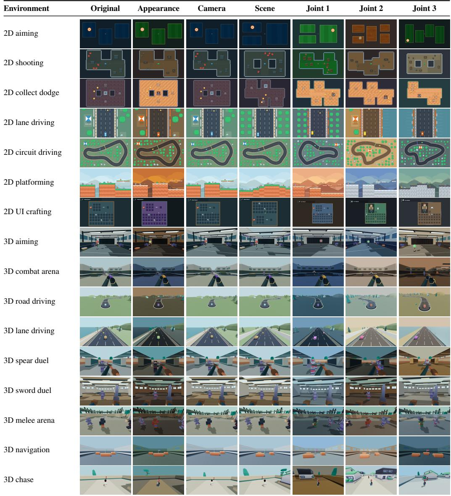  
Figure 10: Visual examples of PLAYER-1-GYM randomization: 16 environments × seven views. Original uses default profiles; Appearance, Camera, and Scene change one domain; Joint 1–3 combine these three dimensions. Control-response variation is omitted because its effects require action sequences rather than static screenshots.

Advantage normalization and loss reduction. We normalize advantages globally in GAE, then within environments using Equation (1), with $N _ { e } \ \geq \ 2$ and $\epsilon = 1 0 ^ { - 8 } ;$ critic return targets are unchanged. For minibatch $B ,$ let $\mathcal { T } _ { i }$ be turn $i \mathrm { \ ' } _ { \mathrm { s } }$ nonempty response-token set selected by the loss mask. The clipped PPO loss averages within turns, then across turns:

$$
\mathcal { L } _ { \mathrm { p o l i c y } } ( \theta ) = \frac { 1 } { | \mathcal { B } | } \sum _ { i \in \mathcal { B } } \frac { 1 } { | \mathcal { T } _ { i } | } \sum _ { j \in \mathcal { T } _ { i } } \ell _ { i , j } ^ { \mathrm { P P O } } ( \theta ; \widetilde { A } _ { i , j } ) .\tag{4}
$$

The critic uses the same reduction. Normalization is token-weighted within environments, whereas losses weight turns equally. Each environment therefore contributes in proportion to its included turns.

## D.3 TRAINING IMPLEMENTATION

Table 10 summarizes the shared recipe for both model sizes. For each model size, the SFT stage uses 32 NVIDIA H200 GPUs and takes approximately 24 hours, while a 200-step RL run uses 64 H200

GPUs and takes approximately 36 hours. Both durations include validation. Browser rollouts use a cluster-wide pool of 32 workers, each managing up to 16 isolated Playwright browser contexts, for a total capacity of 512 concurrent environments. Browser processes and contexts are reused across episodes to amortize startup costs.

Table 10: Post-training configuration. Both model sizes share the settings below except for actor architecture. Each RL step includes rollout collection and PPO updates; critic-only warmup is excluded.
<table><tr><td>Setting</td><td>Player-1-9B</td><td>Player-1-35B-A3B</td></tr><tr><td>Actor / critic</td><td>Dense 9B / dense 9B</td><td>MoE 35B-A3B / dense 9B</td></tr><tr><td>SFT</td><td></td><td></td></tr><tr><td>Training trajectories</td><td>6,044</td><td></td></tr><tr><td>History (visual-action + action-only)</td><td>2 + 2 Pool weights: nine action pools 1 each; Other 0.1</td><td></td></tr><tr><td>Sampling Epoch budget / global batch</td><td>2 / 512 turns</td><td></td></tr><tr><td>Learning rate / warmup fraction</td><td>5 × 10−7 / 0.03</td><td></td></tr><tr><td></td><td></td><td></td></tr><tr><td>Interactive learning</td><td></td><td></td></tr><tr><td>Algorithm / discount / GAE parameter</td><td>PPO / γ = 1 / λ = 1</td><td></td></tr><tr><td>RL training steps</td><td>200</td><td></td></tr><tr><td>Critic-only warmup</td><td>5 iterations</td><td></td></tr><tr><td>History (visual-action + action-only)</td><td>2 + 2</td><td></td></tr><tr><td>Observation resolution</td><td>480P</td><td></td></tr><tr><td>Rollout batch / PPO minibatch</td><td>256 episodes / 64 turn responses</td><td></td></tr><tr><td>Episode cap</td><td>50 turns</td><td></td></tr><tr><td>Output cap per turn</td><td>256 tokens</td><td></td></tr><tr><td>Actor learning rate</td><td>10-6</td><td></td></tr><tr><td>Critic learning rate</td><td>10-5</td><td></td></tr><tr><td>Optimizer / learning-rate schedule</td><td>AdamW / constant</td><td></td></tr><tr><td>AdamW β1, β2 / weight decay</td><td>(0.9, 0.999) / 0.01</td><td></td></tr><tr><td>PPO epochs per rollout batch</td><td>1</td><td></td></tr><tr><td>Gradient-norm clip / PPO clip</td><td>1.0 / 0.2</td><td></td></tr><tr><td>Reward rescaling</td><td>None</td><td></td></tr><tr><td>Advantage normalization / loss</td><td></td><td>Per environment / token mean, then turn mean</td></tr><tr><td>Environment allocation</td><td></td><td></td></tr><tr><td>Randomization mixture</td><td>Equal across 16 environments</td><td>100% Appearance + Camera + Scene + Control</td></tr></table>

## D.4 ENVIRONMENT-SCALING PROTOCOL

For Section 5.2, 9B policies start independently from the same SFT checkpoint, sharing the PPO, history, reward, and randomization settings in Table 10. Table 11 gives the suites and matched episode budgets, while interaction lengths and compute may vary within different episodes. Comparisons share Minecraft development tasks and trial seeds, with SFT as the zero-environment reference.

Table 11: Environment subsets for 9B scaling. All runs use 100 RL steps and 25,600 episodes (256 per step), allocated equally across environments.
<table><tr><td>Envs.</td><td>Environment subset</td><td>Episodes / env. / step</td></tr><tr><td>2</td><td>2D shooting; 3D navigation</td><td>128</td></tr><tr><td></td><td>4 2-env. subset + 2D circuit driving; 3D aiming</td><td>64</td></tr><tr><td></td><td>8 4-env. subset + 2D UI crafting; 2D platforming; 3D sword duel; 3D road driving</td><td>32</td></tr><tr><td></td><td>16 Full PLAYER-1-GYM suite</td><td>16</td></tr></table>

## E EVALUATION AND RESULTS

Table 12 lists the full panels and budgets. Methods share each panel’s tasks, trial seeds, and decision budgets while retaining model-specific preprocessing and inference schedules. Periodic evaluation during RL steps uses 100 Minecraft tasks with three trials each, ten ViZDoom maps with ten episodes each, and 170 GameWorld tasks with one trial each. Qwen3.5, Player-1-SFT, and final Player-1-9B are deployed with the history in Appendix A.3.

Table 12: Evaluation panels, budgets, and reporting units. Decision limits are per episode (per role in GameWorld). The three external benchmarks use environments outside PLAYER-1-GYM.
<table><tr><td>Panel</td><td>Tasks / maps</td><td>Trials</td><td>Budget</td><td>Metrics</td></tr><tr><td>PLAYER-1-GYM</td><td>16 games</td><td>128 / game</td><td>50 decisions</td><td>Mean episode return</td></tr><tr><td>MineDojo-300</td><td>300 tasks</td><td>8 / task</td><td>1,000 decisions</td><td>Success; task coverage counts</td></tr><tr><td>ViZDoom-10</td><td>10 maps</td><td>50 / map</td><td>150–2,100 decisions</td><td>Scaled return</td></tr><tr><td>GameWorld</td><td>170 tasks; 34 games</td><td>3 / task</td><td>400 decisions</td><td>Success; progress</td></tr></table>

Evaluation cost. Our full MineDojo-300, ViZDoom-10, and GameWorld protocols allocate up to 3.14 million agent decision turns per model. Our in-suite validation records average roughly 3,000 input tokens and 100 output tokens per turn, including visual context and generated reasoning. Using these observed lengths as a workload proxy, a full-budget evaluation would cost approximately USD\$110,000 at GPT-6 Astra’s standard API rates of USD\$10 and USD\$50 per million input and output tokens, respectively, before caching discounts.1 Actual costs depend on model-specific tokenization, reasoning, and episode lengths. Considering the estimated cost, our focus is mainly on representative released game-control and computer-use policies rather than proprietary API models.

## E.1 BASELINE INFERENCE AND ACTION ADAPTERS

We deploy JARVIS-VLA with its action-token decoder and two history entries to predict one action per decision. UI-TARS-1.5-7B uses three previous screenshots, deterministic decoding, and a 400- token output limit. Its adapter maps pixel-coordinate actions to one benchmark interval, with drag and double-click unsupported. NitroGen aggregates an 18-action chunk into six benchmark decisions (three native actions per decision), refreshing the image after each chunk. GameWAM predicts 16 actions and executes eight before replanning, using its Minecraft checkpoint outside Doom and its ViZDoom checkpoint for Doom. Open-P2P uses visual-only conditioning and session-specific recurrent state. All temporal inference state is isolated between episodes.

Model inputs retain the released preprocessing for the best practice of each baseline: Minecraft is rendered at $8 6 4 \times 4 8 0$ . We resize the screenshots to 640 × 360 for JARVIS-VLA and UI-TARS, $2 5 6 \times 2 5 6$ for NitroGen, $2 2 4 \times 2 2 4$ for GameWAM, and $1 9 2 \times 1 9 2$ for Open-P2P. JARVIS-VLA and GameWAM retain their native degree-based Minecraft camera actions, while Open-P2P uses an adapter gain of 0.15 degrees per raw mouse pixel. Browser-game adapters project native actions onto per-game and per-role bindings. Benchmark action intervals remain fixed, so a native action chunk can span different simulated durations across benchmarks.

## E.2 PLAYER-1-GYM IN-SUITE VALIDATION

In-suite validation uses the seeded panel in Table 12 with the training randomization settings. For an episode of T turns in environment $e ,$ the return is

$$
G _ { e , 1 } = \sum _ { t = 1 } ^ { T } \left( r _ { e , t } - p _ { e , t } ^ { \mathrm { i n v a l i d } } - p _ { e , t } ^ { \mathrm { l e n g t h } } \right) .
$$

Here $r _ { e , t } = S _ { e } ( s _ { t + 1 } ) - S _ { e } ( s _ { t } )$ is the native game-score increment (Appendix C.1), and the invalidaction and length penalties are defined in Appendix D.2. We report mean episode return, averaging trials within each environment and then equally across the sixteen environments.

## E.3 MINEDOJO-300

MineDojo-300 contains 200 Combat and 100 Harvest tasks from MineDojo, ported to MineStudio on Minecraft 1.16.5. World and task seeds are deterministically derived from each task and trial. Success is verified after initialization from inventory acquisition for Harvest tasks or target kills for Combat tasks. We average success over trials within each task, then equally over tasks. One decision advances a 50-ms simulator tick. PLAYER-1’s camera adapter uses a nominal gain of 0.00196 radians per observation pixel, subject to native constraints.

We also report Task coverage in $\begin{array} { r } { C _ { m } = \sum _ { i = 1 } ^ { N } \mathbf { 1 } [ s _ { i } \geq m ] } \end{array}$ for $m \in \{ 1 , 2 , 4 \}$ , where $s _ { i }$ counts successes among eight trials for task i. Entries $\bar { C } _ { m } / N$ , with $N = 3 0 0$ , count tasks meeting each threshold. Overall success intervals use 100,000 percentile task-cluster bootstrap replicates, stratified by Combat and Harvest while retaining all eight trials per task and the panel’s category weights. The 95% intervals quantify within-panel task-sampling uncertainty. For all-zero outcomes, we report [-].

## Hunt a Bat in Night Plains with an Iron Sword, Shield, and Diamond Armor

Task instruction: “hunt a bat in night plains with a iron sword, shield, and a full suite of diamond armors”

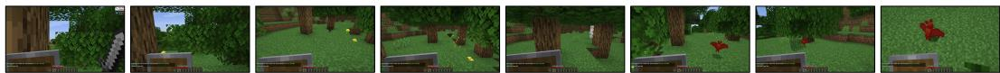

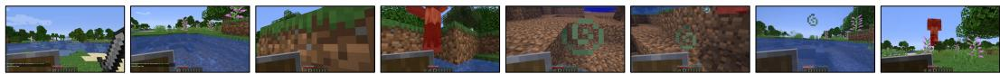

Obtain One Log in Plains

Task instruction: “obtain log in plains”

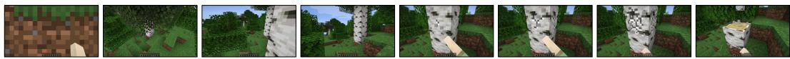  
Figure 11: Example tasks and scenes from MineDojo-300.

## E.4 VIZDOOM-10

Table 13: ViZDoom-10 map categories, raw reward rules, and fixed scales. Rewards accumulate over an episode; a tic is one simulator tick. Scaled Return divides the raw episode return by $c _ { m } .$
<table><tr><td>Category</td><td>Map</td><td>Raw reward rule</td><td>Scale  $c _ { m }$ </td></tr><tr><td>Precision shooting</td><td>Basic</td><td>+106 for eliminating the target; —5 per shot; –1 per tic.</td><td>100</td></tr><tr><td></td><td>Defend the Center</td><td>+1 per kill; -1 on death.</td><td>10</td></tr><tr><td></td><td>Defend the Line</td><td>+1 per kill; -1 on death.</td><td>10</td></tr><tr><td>Goal navigation</td><td>Deadly Corridor</td><td>Forward position along the corridor; +1000 for collecting armor; —100 on death.</td><td>1000</td></tr><tr><td></td><td>My Way Home</td><td>+1 for reaching the goal; —0.0001 per tic.</td><td>1</td></tr><tr><td>Mobile combat</td><td>Battle 1</td><td>+1 per kill.</td><td>10</td></tr><tr><td></td><td>Battle 2</td><td>+1 per kill.</td><td>10</td></tr><tr><td></td><td>Deathmatch</td><td>Enemy-dependent kill bonuses, with 1, 3, 3, 4, 3, and 10</td><td>10</td></tr><tr><td></td><td></td><td>for the six enemy types.</td><td></td></tr><tr><td>Survival</td><td>Health Gathering</td><td>+1 per tic alive; —100 on death.</td><td>2100</td></tr><tr><td></td><td>Health Gathering Supreme</td><td>+1 per tic alive; —100 on death.</td><td>2100</td></tr></table>

Table 13 lists the ten selected maps, control categories, native rewards, and fixed return scales. ViZDoom 1.3.0 provides $6 4 0 \times 4 8 0 \mathrm { R G B }$ observations. Each decision advances two simulator tics. Basic permits 150 decisions, Deathmatch 2,100, and the other maps 1,050, subject to earlier native termination. PLAYER-1’s camera adapter uses 0.00196 radians per observation pixel with native pitch constraints.

From raw return $R _ { m , s }$ and map-specific scale $c _ { m } > 0$ , we compute map, category $( \boldsymbol { \mathcal { M } } _ { c } ) _ { \cdot }$ , and overall scaled returns:

$$
S _ { m } = \frac { 1 } { N } \sum _ { s = 1 } ^ { N } \frac { R _ { m , s } } { c _ { m } } , \qquad S _ { c } = \frac { 1 } { | \mathcal { M } _ { c } | } \sum _ { m \in \mathcal { M } _ { c } } S _ { m } , \qquad S _ { \mathrm { o v e r a l l } } = \frac { 1 } { 1 0 } \sum _ { m = 1 } ^ { 1 0 } S _ { m } .
$$

Evaluation uses $N = 5 0$ fixed seeds per map, with identical scales across models. The survival scale of 2,100 corresponds to the native time-reward budget, with death penalties retained. Observation geometry, timing, and camera constraints are matched within each backbone.

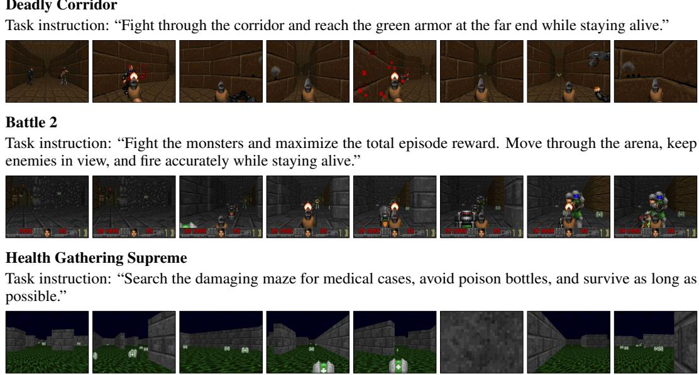

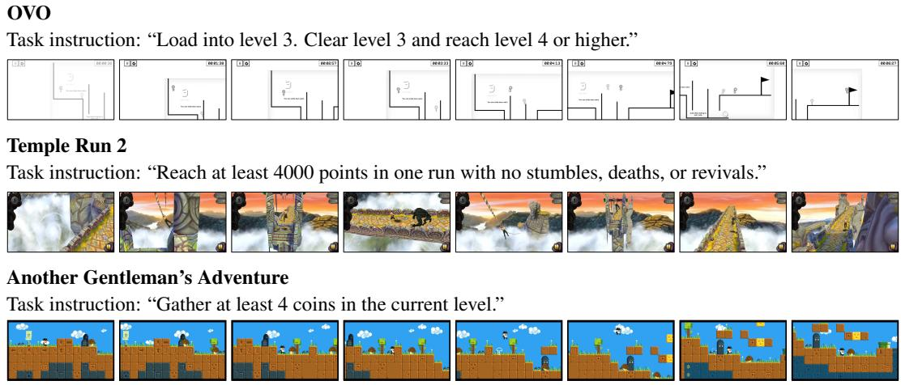  
Figure 12: Example tasks and scenes from ViZDoom-10.  
Figure 13: Example tasks and scenes from GameWorld.

## Deadly Corridor

## E.5 GAMEWORLD

GameWorld includes 170 tasks across 34 diverse browser games. We evaluate our model for three trials with seeds 0, 1, and 2 (Table 12). The policy receives screenshots, rules, and instructions, while evaluator state is hidden. Action duration, observation geometry, and admissible controls follow each game’s configuration, and multi-role games keep separate histories. Success is the fraction of trials reporting completion, while progress is the achieved fraction from its initial value to its target, clipped to [0, 1]. The evaluator averages objectives and retains the best task progress reached. Reported success and progress average trials within each task, then equally across tasks.