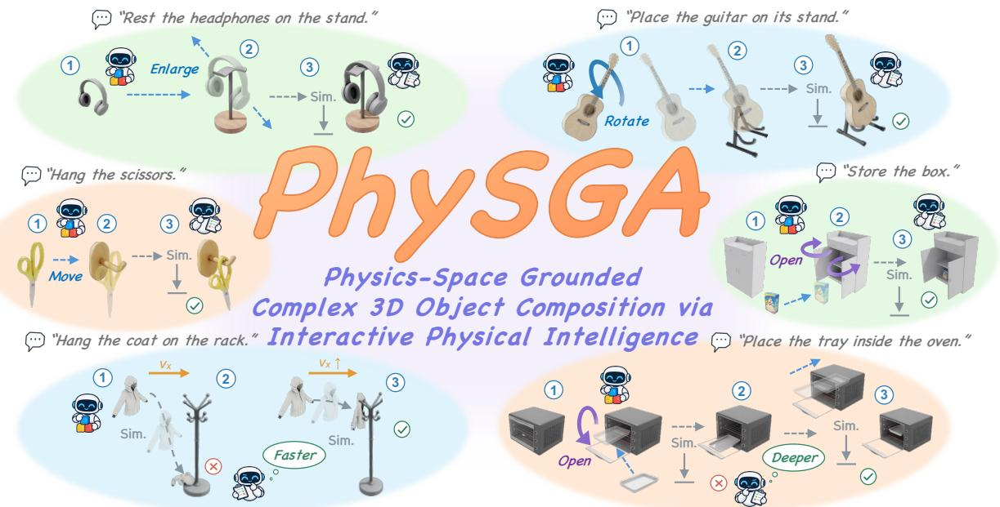
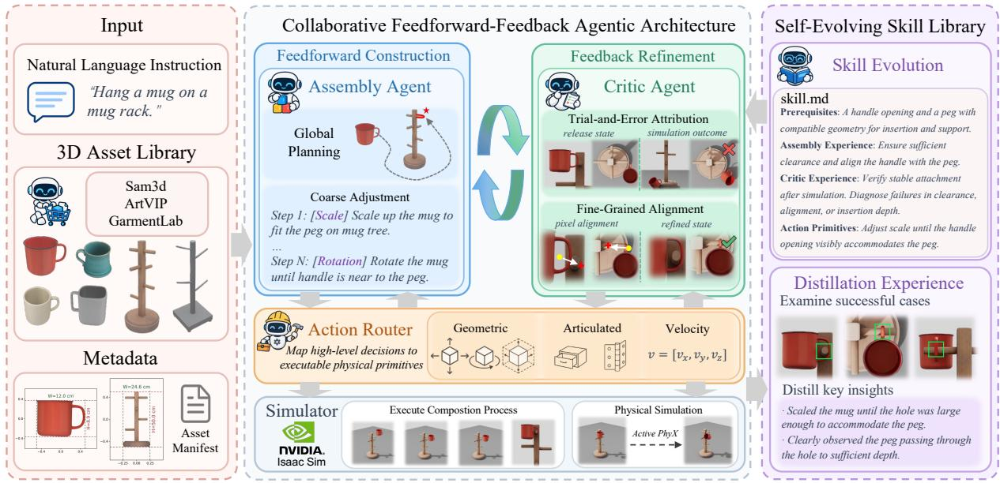
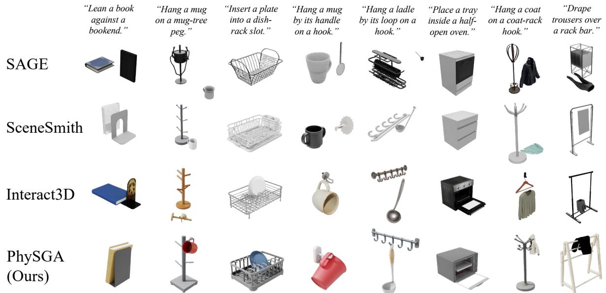

# PhySGA: A Physics-Space Grounded Agentic Framework for Generalizable and Interactive 3D Composition

Weichen Lyu1,∗, Chong Xia1,∗, Mingyu Dong1, Long Xu2, Shengjun Zhang1, Yueqi Duan1,†

1Tsinghua University, 2Zhejiang University

  
Figure 1 . Physics-Space Grounded Complex 3D Object Composition via Interactive Physical Intelligence. Our framework tackles complex 3D composition by grounding the construction process directly in physical space. Driven by a collaborative Feedforward-Feedback paradigm, the agents iteratively propose kinematic actions, observe simulated outcomes, and apply fine-grained corrections. This continuous loop guarantees strict physical validity and realizes complex target relations across rigid, articulated, and deformable objects.

## Abstract

3D object composition is pivotal to digital content creation and robot simulation, while also serving as a critical testbed for physical intelligence in foundation models. Previous methods either leverage large language models to directly predict object coordinates, or utilize generative difusion priors to synthesize composite images for visual alignment, both of which rely on static priors in digital spaces. However, these methods consistently struggle with complex compositions such as precise hanging, gravity-driven settling and hidden containment, as these tasks require interactive construction processes involving global planning, fine-grained alignment, and physical simulation. To address these challenges, we propose PhySGA, a Physics-Space Grounded Agentic Framework for 3D composition via agent exploration and physical simulation, enabling the universal interactive assembly of rigid, articulated, and deformable objects. Directly applying vanilla LLMs or VLMs to this task proves insuficient, as current models inherently lack grounded physical understanding and interactive construction experience. To overcome this limitation, we design a collaborative feedforward-feedback architecture: an Assembly Agent focuses on geometric and kinematic reasoning for global step planning and coarse adjustment, while a Critic Agent reasons over contact dynamics for simulator state diagnosis and fine-grained closed-loop correction. Furthermore, Action Routers map semantic planning and analysis onto executable physical primitives within the simulator, while a task-specific Self-Evolving Skill Library distills historical trial-and-error feedback into reusable experiences, boosting success rates and minimizing exploration attempts. Extensive experiments within Isaac Sim demonstrate that PhySGA significantly surpasses existing methods in relation fidelity, physical plausibility, and visual quality.

Project Page: https://agenticei.github.io/PhySGA-page/

## 1 Introduction

3D object composition aims to construct physically and functionally coherent interactions among independent object assets [25]. Empowering AI agents to construct complex interactive tasks within dynamic simulators is of paramount importance, as it yields scalable, physically grounded environments that directly enhance the capabilities of embodied models [46]. Furthermore, this interactive construction establishes a rigorous standard for evaluating the true physical intelligence of foundational models. Unlike conventional benchmarks that rely on static visual question answering [5, 10], 3D composition forces models to translate semantic understanding into executable physical actions, using direct simulation feedback to explicitly validate their reasoning capabilities.

Earlier scene synthesis methods place objects using predefined rules or heuristic spatial relations extracted from annotated 3D datasets [7]. Recently, foundation models have driven two dominant routes for 3D composition. The language-driven route uses LLMs to directly predict object coordinates from text instructions [9]. Agentic frameworks like SAGE [42] and SceneSmith [24] extend this approach by employing tool-use to iteratively adjust hierarchical placements. Yet, their core mechanisms remain heavily dependent on semantic layout priors. The vision-driven route relies on 2D generative models to create an image of the target composition. This image subsequently guides the spatial positioning of 3D objects using difusion priors [31].

However, these methods primarily rely on static priors in digital space, namely knowledge of object positions and relations encoded in language models or difusion priors, struggling with complex 3D object compositions (e.g., precise hanging, gravity-driven settling, and hidden containment). This is because precise hanging requires precise multi-view observation and exact spatial alignment; gravity-driven settling must explicitly utilize physical simulation under gravitational dynamics; and hidden containment involves a sequence of interactive kinematic actions. Looking back at these approaches, the language-driven branch struggles in these scenarios because it learns plausible static layouts but lacks experiential data for complex interactions, while the final state of physical equilibrium is notoriously dificult to express precisely in text. Equally problematic, the vision-driven branch prioritizes visual plausibility, which rarely equates to physical validity, proving fatal for fine-grained assembly. Therefore, a fundamental challenge in complex interactions is realizing target relations while strictly adhering to physical laws. We argue that a reliable approach is to ground the composition directly in physical space, assembling objects step-by-step in an iterative manner. This preserves physical validity at each step and ultimately ensures relation satisfaction. Intuitively, this mirrors how humans assemble objects in the real world: not through a one-shot prediction, but through a continuous loop of planning, adjusting, and utilizing physical feedback.

In this paper, we propose PhySGA, formulating 3D object composition as an interactive assembly process in physical space, inspired by how humans assemble objects in the real world, as illustrated in Figure 1. To achieve this, we design a collaborative Feedforward-Feedback architecture tailored for physical interaction. The Assembly Agent conducts kinematic reasoning to formulate a global plan, executing metric-grounded coarse adjustments to achieve a reliable preliminary correction. Subsequently, the Critic Agent analyzes simulated motion and contact feedback to diagnose physical failures, performing pixel-grounded finegrained corrections until the target relation reaches physical equilibrium. To bridge high-level semantic reasoning and low-level simulation execution, we introduce modular Action Routers that seamlessly convert agent predictions into exact geometric, articulated, and velocity commands. Finally, we maintain a Self-Evolving Skill Library that distills historical interaction memories, allowing the agents to retrieve past experience to avoid repeating failures and facilitate continuous experience reuse.

Our main contributions are summarized as follows:

• We propose PhySGA, formulating 3D object composition as an interactive assembly process grounded in dynamic physical space, ensuring that complex target relations are constructed upon strict physical validity.

• We design a comprehensive agentic framework featuring a Feedforward-Feedback paradigm driven by an Assembly Agent and a Critic Agent for global planning and precise visual correction, modular Action Routers for executing decoupled physical commands, and a Self-Evolving Skill Library for historical experience reuse.

• Extensive experiments in Isaac Sim across rigid, articulated, and deformable tasks demonstrate that PhySGA significantly outperforms state-of-the-art methods, providing a scalable solution for complex task construction in simulators while efectively unlocking the latent physical intelligence of foundational models.

## 2 Related Work

## 2.1 Simulation Scene Generation

Simulation scene generation provides interactive environments for training embodied agents. Early approaches construct these environments through procedural rules [7, 26, 27] or by learning distributions over static object layouts [23, 29, 34, 36, 37]. Recent language-guided methods, such as Holodeck and SceneWeaver [45, 46], advance this field by directly translating textual instructions into object selections and spatial arrangements [15]. Language agents can interleave reasoning with actions and use environmental observations to guide subsequent decisions [47]. To further refine these layouts, agentic frameworks like SAGE [42] and SceneSmith [24] incorporate iterative tool use alongside visual or physical critics. However, these language-driven pipelines primarily formulate generation as predicting static coordinates, treating physical simulation merely as a binary verification step. They lack the capacity to handle complex relations that require continuous interaction. To address this, PhySGA bypasses one-shot coordinate prediction by embedding the agent within the simulator, driving composition through step-by-step physical execution.

## 2.2 3D Object Composition

3D object composition aims to establish functional and spatial relations among distinct 3D objects. Previous research explores spatial arrangements across diferent scales. At the scene level, methods like SimRecon [41] and PhyRecon [19] reconstruct 3D scenes from visual observations [8, 13, 14, 20, 39, 40]. At the part level, methods such as Jigsaw [17] assemble fractured pieces [30] by matching local geometries. Shifting the focus toward complete object composition, Interact3D [31] leverages difusion priors to guide the geometric registration of independent assets. However, these approaches rely heavily on visual alignment to recover static terminal poses, which does not guarantee physical plausibility. Crucially, pure visual alignment completely fails on complex interactions: gravity-driven settling dictates dynamic physical simulation to determine the final resting state, and hidden containment involves visually occluded target regions, rendering image-based matching inefective. PhySGA overcomes these limitations by casting composition as a closed-loop physical construction problem, ensuring that object relations are rigorously validated by physical laws.

## 2.3 Evaluating Physical Intelligence

Evaluating physical intelligence in foundation models has increasingly drawn attention [5]. Current benchmarks primarily probe this capability through visual question answering, requiring models to infer spatial relations [10, 28], metric quantities [44], or physical dynamics [4, 48] from static images or videos [5, 33]. Concurrently, experiential language agents demonstrate that models can improve over time by accumulating trial-and-error feedback [2, 18, 32, 49] or self-evolving skills across episodes [35, 43, 50]. However, passive visual questioning is often insuficient to capture the complexities of real-world physics. The most rigorous testbed for physical intelligence is executable construction within a simulator, where semantic reasoning must be validated by dynamic physical interaction. PhySGA adopts this paradigm, evaluating and enhancing the physical understanding of agents through continuous simulation feedback rather than static predictions.

## 3 Method

We present PhySGA, a physics-space grounded agentic framework for interactive 3D composition, as illustrated in Figure 2. Section 3.1 presents the task formulation, the overall architecture, and the unified asset pipeline. Section 3.2 introduces the collaborative high-level agents, while Sections 3.3 and 3.4 detail the modular action routing and self-evolving skills, respectively.

## 3.1 Overview of PhySGA

## 3.1.1 Interactive Composition Representation

Given a natural-language instruction q and a pair of independently instantiated, simulation-ready 3D assets $\mathcal { A } = \{ a _ { 1 } , a _ { 2 } \}$ , the goal is to construct a physically realizable composition $\mathcal { C } ^ { * }$ from an initial simulator state $s _ { 0 } ^ { * }$ . Previous methods predominantly formulate this task as a one-shot prediction of final relative object poses, bypassing the physical interaction trajectory. However, complex compositions inherently depend on continuous contact dynamics and intermediate state transitions. We therefore formulate 3D object composition as an iterative physical construction process. Starting from $s _ { 0 } ^ { * } ,$ the composition is achieved through a sequence of state transitions utilizing a comprehensive set of operations, including geometric transformations (translation, rotation, scale), dynamic velocity assignments, and physical simulation. This generalized iterative representation can be written as:

  
Figure 2 . Overview of the PhySGA framework. Driven by a collaborative Feedforward-Feedback architecture, the Assembly Agent executes metric-grounded coarse adjustments, while the Critic Agent performs pixel-grounded fine-grained corrections via simulation feedback. Action Routers translate these semantic decisions into decoupled physical commands, and a Self-Evolving Skill Library distills successful interactions into reusable skills.

$$
\begin{array} { r } { s _ { k } = \Phi ( s _ { k - 1 } , a _ { k } ) , } \end{array}\tag{1}
$$

where $a _ { k }$ represents an applied adjustment or simulation step at iteration $k ,$ and Φ denotes the environment transition function. This step-by-step evolution continues until it yields the final target composition $\mathcal { C } ^ { * } = s _ { K }$

## 3.1.2 Feedforward-Feedback Agentic Architecture

To execute this generalized iterative process, we design a hierarchical architecture comprising two highlevel agents. The Assembly Agent $\left( \pi _ { \mathrm { A s m } } \right)$ governs the outer loop of feedforward construction, leveraging geometric and kinematic reasoning to formulate N-step plans and execute coarse metric adjustments. For the n-th step, it applies adjustments to the previously validated state $s _ { n - 1 } ^ { * }$ , producing a new state $s _ { n } .$ . If this step requires physical validation, $s _ { n }$ initiates a pre-simulation state $s _ { n , 0 }$ . The Critic Agent (πCrit) manages the conditional inner loop of feedback refinement. During the r-th round, the simulator S evaluates this state, and the Critic Agent applies fine-grained corrections based on the simulated physical evidence to produce the revised state $s _ { n , r + 1 }$ . Once the physical requirements are satisfied, the validated state returns to the feedforward process as $s _ { n } ^ { * }$ . The final target composition is achieved upon the completion of all N steps, yielding $\mathcal { C } ^ { * } = s _ { N } ^ { * }$ . The state evolution for step n is explicitly instantiated as:

$$
\begin{array} { r l } & { s _ { n } = \pi _ { \mathrm { A s m } } ( q , \boldsymbol { A } , \boldsymbol { s } _ { n - 1 } ^ { * } ) , } \\ & { s _ { n }  s _ { n , 0 } \quad \mathrm { ( i f ~ p h y s i c a l ~ v a l i d a t i o n ~ i s ~ r e q u i r e d ) } , } \\ & { s _ { n , r + 1 } = \pi _ { \mathrm { C r i t } } ( q , \boldsymbol { A } , \boldsymbol { s } _ { n , r } , \boldsymbol { S } ( \boldsymbol { s } _ { n , r } ) ) , } \\ & { s _ { n , r + 1 }  \boldsymbol { s } _ { n } ^ { * } \quad \mathrm { ( u p o n ~ v a l i d a t i o n ~ s u c c e s s ) } . } \end{array}\tag{2}
$$

This asymmetric collaboration structurally separates the step-wise global assembly planning from the pixel-grounded physical correction within the simulator.

## 3.1.3 Unified Asset Pipeline

PhySGA processes generated rigid assets using GPT Image 2 [22] and SAM 3D Objects [3] alongside articulated and deformable assets retrieved from ArtVIP [12] and GarmentLab [16] through a unified pipeline. To provide the high-level agents with consistent observations across diverse asset types, we standardize all assets using a shared metadata schema that explicitly records semantics, metric geometry, canonical orientation, and physical properties. We additionally provide standardized CAD-style orthographic multi-view renderings with metric annotations to facilitate accurate spatial reasoning.

## 3.2 Collaborative Dual-Agent Architecture

## 3.2.1 Shared State Machine Design

To efectively explore the interactive assembly process, we structure both the Assembly and Critic agents as persistent state machines. Unlike standard one-shot coordinate prediction, this cyclic formulation endows the agents with temporal awareness and environment-conditioned reasoning capabilities. The interaction cycle unfolds through a unified sequence of four cognitive phases: Observe, Decide, Execute, and Validate. Formally, at any interaction timestep $t ,$ an active agent $i \in \{ \mathrm { A s m } , \mathrm { C r i t } \}$ begins in the Observe phase, processing the current simulator observation $o _ { t }$ alongside its historical memory $\mathcal { M } _ { t - 1 } ^ { i } .$ . Based on this context, the agent transitions to the Decide phase to formulate a geometric or physical adjustment, outputting a natural-language instruction $d _ { t } ^ { i }$ . During the Execute phase, the Action Router grounds this semantic instruction into a concrete simulator command, yielding a physical execution status. Finally, in the Validate phase, the agent evaluates the outcome. At this juncture, the agent determines the macroscopic control flow: advancing to the next step if the current requirements are satisfied, or looping back to initiate another attempt if they are not. Regardless of success or failure, the executed action and its environmental consequence are immediately assimilated into the current memory $\mathcal { M } _ { t } ^ { i }$ to inform the subsequent reasoning cycle.

## 3.2.2 Assembly Agent

Global Planning. To emulate the human cognitive process of feedforward task decomposition, we equip the Assembly Agent with a structured chain-of-thought prior [38]. Starting from the initial simulator state $s _ { 0 }$ and the intended assembly relation given by the task instruction, it generates a natural language plan that outlines the whole construction process. Each step provides a semantic description of a target object state and its observable check condition. Given the task instruction $q ,$ task-relevant asset semantics $\eta _ { A }$ , the initial observation $o _ { 0 }$ , and its memory $\mathcal { M } _ { \mathrm { A s m } }$ , it produces:

$$
\mathcal { P } _ { \mathrm { A s m } } = \mathrm { P l a n } _ { \mathrm { A s m } } \left( q , \eta _ { A } , o _ { 0 } , \mathcal { M } _ { \mathrm { A s m } } \right) = \left\{ \left( g _ { k } , c _ { k } \right) \right\} _ { k = 1 } ^ { K } , \qquad K \leq K _ { \operatorname* { m a x } } .\tag{3}
$$

Each pair $( g _ { k } , c _ { k } )$ serves as a high-level semantic instruction that specifies the target state and verification criteria, establishing a global trajectory rather than prescribing a rigid sequence of low-level commands.

Metric-Grounded Coarse Adjustment. To execute these planned steps, the Assembly Agent transmits the intended adjustment type, the estimated metric value, the target state, and the corresponding verification criteria to its designated Action Router. Operating within an observation space of orthogonal multi-view scene renderings, the agent selects one or more primary views that best expose the interactive region. It then reasons over these selected views to deduce the actual metric values required for the adjustment, thereby further concretizing the target state and its checking criteria. This metric-output paradigm maximally preserves the inherent common-sense spatial reasoning capabilities of vision-language models, making it highly efective for coarse global coordination and structural alignment.

## 3.2.3 Critic Agent

Trial-and-Error Attribution. In contrast to the Assembly Agent’s feedforward approach, the Critic Agent emulates human trial-and-error refinement based on physical feedback. Following the r-th physical simulation round of step $n _ { \mathrm { : } }$ , the Critic Agent diagnoses the failure $\xi _ { n , r }$ and identifies a correction aspect $\alpha _ { n , r }$ from the simulated state $s _ { n , r } ^ { \mathrm { s i m } }$ . Using this diagnosis alongside the latest observations, it refines the pre-simulation state $s _ { n , r }$ to produce an adjusted state $s _ { n , r + 1 } .$ , which is then evaluated by a subsequent physical simulation. If the resulting simulation succeeds, $s _ { n , r + 1 }$ is returned as the validated state. If it fails, the agent strategically decides whether to proceed with further refinements from the newly adjusted state $s _ { n , r + 1 }$ or to roll back to the previous state $s _ { n , r }$ for an alternative correction path. This physical refinement process is formulated as:

$$
\begin{array} { r l } & { ( \xi _ { n , r } , \alpha _ { n , r } ) = \mathrm { D i a g n o s e } _ { \mathrm { C r i t } } \left( q , s _ { n , r } ^ { \mathrm { s i m } } , \mathcal { M } _ { \mathrm { C r i t } , r } \right) , } \\ & { s _ { n , r + 1 } = \mathrm { R e f i n e } _ { \mathrm { C r i t } } \left( s _ { n , r } , o _ { n , r } , \xi _ { n , r } , \alpha _ { n , r } , \mathcal { M } _ { \mathrm { C r i t } , r } \right) . } \end{array}\tag{4}
$$

Pixel-Grounded Fine-Grained Alignment. Coarse metric adjustments are often insuficient for achieving precise physical alignment. To address this, we directly leverage the inherent pixel-level alignment capabilities of Vision-Language Models. During the diagnosis phase following a failed simulation, the Critic Agent examines the multi-view observations to identify the specific geometric error. Rather than estimating semantic metric values, the agent directly outputs pixel coordinates, mapping the representative pixel of the manipulated object to its intended position on the target object across multiple views. The

Action Router then triangulates these pixel correspondences using calibrated camera projections, converting the precise visual alignment directly into executable commands for the simulator.

## 3.3 Action Router

The Action Router grounds the high-level agents’ semantic targets and adjustment analyses into executable simulator commands through three modular functions. The Geometric Router converts translation, rotation, and uniform scale predictions along 3D orthogonal axes into exact transformations. The Articulated Router maps semantic instructions (e.g., opening a drawer) to corresponding joint movements for articulated objects. The Velocity Router converts release instructions (e.g., throwing forward) into uniform world-space velocities applied to deformable objects prior to simulation. This design seamlessly adapts to diverse object types and explicitly decouples distinct physical variables. Moreover, by separating high-level semantic reasoning from low-level physical details, it significantly reduces the cognitive burden on the Assembly Agent and Critic Agent, allowing them to focus exclusively on task planning and spatial alignment.

## 3.4 Self-Evolving Skill Library

To avoid repeating past failures, reduce reasoning time, and streamline planning for tasks with similar physical conditions, we maintain a self-evolving skill library K. Before executing a new instruction q, the framework retrieves compatible knowledge from K to provide the agents with reference strategies. After execution, the consolidated interaction memory M and final physical outcome O are jointly distilled to construct new knowledge or supplement existing skills. This distillation summarizes key insights, such as Assembly planning bottlenecks and the Critic’s root-cause error analyses. The entire retrieval and evolution process is concisely formulated as:

$$
\begin{array} { r l } & { p _ { i } \gets p _ { i } \oplus \mathrm { R e t r i e v e } ( \mathcal { K } , q ) , } \\ & { \mathcal { K } \gets \mathrm { U p d a t e } \big ( \mathcal { K } , \mathrm { D i s t i l l } ( \mathcal { M } , \mathcal { O } ) \big ) , } \end{array}\tag{5}
$$

where ⊕ denotes appending the retrieved skill to the prompt $p _ { i }$ of agent $i \in \{ \mathrm { A s m } , \mathrm { C r i t } \}$

## 4 Experiments

We conduct extensive experiments to evaluate the efectiveness of our method in 3D composition. Following the experimental setup in Section 4.1, we compare PhySGA against state-of-the-art 3D composition frameworks in Section 4.2 and vanilla coding agents across various base models in Section 4.3. Finally, Section 4.4 provides comprehensive ablations of our core agentic components.

## 4.1 Experimental Setup

Benchmark. We construct a benchmark of object composition tasks spanning three categories: rigid, articulated, and deformable. Rigid tasks cover physical contact relations (e.g., containment, slotting) between rigid objects. Articulated tasks involve the actuation of kinematic joints, while deformable tasks require physical simulation to naturally settle soft bodies. The benchmark comprises 40 unique tasks (20 rigid, 10 articulated, 10 deformable). Each task is instantiated with three prompt variants featuring diferent asset descriptions but identical target relations, yielding 120 evaluation scenes in total.

Baselines. We compare PhySGA against three representative systems: SAGE [42], SceneSmith [24], and Interact3D [31]. Since SAGE and SceneSmith are hierarchical scene generation frameworks, we primarily compare against their object-level performance. Specifically, we retain the placement and critic agents from SAGE and the manipuland agents from SceneSmith, while omitting room initialization and global layout planning. Each system utilizes its native asset acquisition pipeline, and all final compositions are executed and evaluated in Isaac Sim under a unified protocol.

Implementation Details. All methods are executed and evaluated in NVIDIA Isaac Sim 4.2.0. In the baseline comparison, GPT-5.5 serves as the base VLM for all VLM-driven reasoning. Each method receives the same 120 language prompts and follows its native pipeline to generate compositions, which are then loaded into Isaac Sim using identical rendering and physical execution configurations.

Metrics. We evaluate composition quality using both physical and visual metrics. Physical metrics include Penetration Rate (PR) and Contact Rate (CR), both ranging from 0 to 1, which measure the average fraction of scenes exhibiting invalid collisions (lower is better) and successful target contacts (higher is better), respectively. For visual metrics, a VLM evaluator scores the multi-view outputs on a scale from 0 to 10. We report Asset Fidelity Score (AFS) for asset fidelity, Composition Overall Score (COS) for overall composition quality, and prominently highlight Relation Fidelity Score (RFS) as the primary indicator of successfully achieving the instructed relation. All visual metrics are averaged across the 120 scenes.

  
Figure 3 . Qualitative comparison with baselines. Columns represent distinct compositional tasks across rigid, articulated, and deformable domains, comparing SAGE, SceneSmith, Interact3D, and our PhySGA after physical simulation. PhySGA consistently maintains high-fidelity asset details, satisfies target relations, and yields physically valid compositions.

## 4.2 Comparison with Baselines

Table 1 presents the quantitative evaluation of the composition tasks. PhySGA significantly outperforms all baselines across both physical and visual metrics, achieving a near-perfect Contact Rate (CR) of 0.958 while maintaining a critically low Penetration Rate (PR) of 0.033. Notably, SAGE records a PR of 0.000, but this is merely an artifact of its inability to establish interaction. It places assets far apart without meaningful contact,

Table 1 . Quantitative comparison with existing methods. PR and CR range from 0 to 1, while AFS, RFS, and COS range from 0 to 10. The best and second-best results are shown in bold and underlined, respectively.
<table><tr><td rowspan="2">Method</td><td rowspan="2">Physical Metrics PR↓</td><td rowspan="2">CR↑</td><td colspan="3">Visual Metrics</td></tr><tr><td>AFS↑</td><td>RFS↑</td><td>COS↑</td></tr><tr><td>SAGE [42]</td><td>0.000</td><td>0.000</td><td>3.96</td><td>0.74</td><td>3.03</td></tr><tr><td>SceneSmith [24]</td><td>0.042</td><td>0.575</td><td>3.29</td><td>2.59</td><td>4.55</td></tr><tr><td>Interact3D [31]]</td><td>0.133</td><td>0.717</td><td>6.87</td><td>4.45</td><td>5.12</td></tr><tr><td>PhySGA (Ours)</td><td>0.033</td><td>0.958</td><td>9.02</td><td>8.75</td><td>7.41</td></tr></table>

resulting in a 0.000 CR and the lowest Relation Fidelity Score (RFS). In contrast, PhySGA’s RFS of 8.75 nearly doubles that of the strongest baseline, Interact3D at 4.45, demonstrating its superior capability to translate semantic relations into physically validated configurations.

Qualitative comparisons in Figure 3 further highlight these advantages. Baseline methods frequently struggle with spatial tolerances, resulting in floating assets, as observed with SAGE, or severe visual misalignments after physical simulation, as observed with Interact3D. Conversely, PhySGA consistently produces physically coherent compositions across all object categories. It uniquely succeeds in fine-grained operations requiring millimeter-level precision, such as inserting a plate into a narrow dish-rack slot or hanging a ladle by its loop. Furthermore, it efectively manages complex multi-step articulated interactions and realistic deformable settling in simulation.

## 4.3 Comparison with Vanilla VLM-based Coding Agents

We compare vanilla VLM-based coding agents against the same base models instantiated within PhySGA, evaluating Qwen3.8-Max [1], Gemini-3.1-Pro-Preview [11], DeepSeek-V4-Flash-Vision-Exp [6], and GPT-5.5 [21]. All configurations share identical benchmark tasks and asset instances. Therefore, we omit the Asset Fidelity Score (AFS) and focus exclusively on physical and relational metrics.

The vanilla baselines operate as Codexstyle coding agents, utilizing a Python sandbox to analyze asset geometry and generate executable scene programs. Table 2 shows that these vanilla agents struggle to realize physically plausible configurations, highlighting an inherent deficit in their native physical intelligence. Conversely, integrating these models into PhySGA consistently reduces penetration and drastically improves relation fidelity across all models. GPT-5.5 achieves the highest overall performance, followed by Qwen3.8- Max. This confirms that our framework efectively unlocks and empowers 3D composition. 3D composition.

Table 2 . Comparison between vanilla VLM-based coding agents and PhySGA using the same base VLMs. The best and second-best results are shown in bold and underlined, respectively.
<table><tr><td>Method</td><td>Physical Metrics PR↓</td><td>CR↑</td><td>Visual Metrics RFS↑</td><td>COS↑</td></tr><tr><td>Qwen3.8-Max DeepSeek-V4</td><td>0.258 0.208</td><td>0.542 0.542</td><td>1.42 1.16</td><td>2.46 2.35</td></tr><tr><td>Gemini-3.1-Pro GPT-5.5</td><td>0.158 0.142</td><td>0.392 0.350</td><td>1.79 1.29</td><td>3.08</td></tr><tr><td></td><td></td><td></td><td></td><td>2.62</td></tr><tr><td>PhySGA + Qwen3.8-Max</td><td>0.092</td><td>0.858</td><td>6.36</td><td>6.39</td></tr><tr><td> $\mathrm { P h y S G A } + \mathrm { D e e p S e e k } { \mathrm { - } } \mathrm { V } 4$ </td><td>0.075</td><td>0.467</td><td>4.11</td><td>4.72</td></tr><tr><td> $\mathrm { P h y S G A + G e m i n i - 3 . 1 – P r o }$ </td><td>0.058</td><td>0.792</td><td>5.90</td><td>6.06</td></tr><tr><td> $\mathrm { P h y S G A } + \mathrm { G P T } \mathrm { - } 5 . 5$ </td><td>0.033</td><td>0.958</td><td>8.75</td><td>7.41</td></tr></table>

the latent physical intelligence of foundational models for complex

## 4.4 Ablation Study

We evaluate six ablations of PhySGA under the same experimental settings to assess the contribution of each core component to overall composition quality. w/o Global Planning replaces the complete global plan with isolated step-by-step planning. w/o Metric Adjustment replaces metric estimation by directly predicting pixel-level movement changes. w/o Error Attribution performs direct adjustments without utilizing physical simulation feedback. w/o Pixel Alignment forces the agent to directly predict real-valued spatial movements instead of precise pixel alignments. w/o Action Routers re-

Table 3 . Ablation study of PhySGA with individual components removed. PhySGA denotes the complete framework with all components enabled.
<table><tr><td>Method</td><td>Physical Metrics PR↓</td><td>CR↑</td><td>Visual Metrics RFS↑</td><td>COS↑</td></tr><tr><td>Assembly Agent w/o Global Planning</td><td>0.067</td><td>0.733</td><td>6.08</td><td>6.42</td></tr><tr><td>w/o Metric Adjustment Critic Agent</td><td>0.050</td><td>0.783</td><td>6.92</td><td>6.58</td></tr><tr><td>w/o Error Attribution w/o Pixel Alignment</td><td>0.092 0.083</td><td>0.917 0.667</td><td>7.42 6.33</td><td>7.08 5.92</td></tr><tr><td>w/o Action Routers</td><td>0.058</td><td>0.283</td><td>4.12</td><td>5.42</td></tr><tr><td>w/o Self-Evolving Skills</td><td>0.042</td><td>0.792</td><td>7.58</td><td>7.17</td></tr><tr><td>PhySGA</td><td>0.033</td><td>0.958</td><td>8.75</td><td>7.41</td></tr></table>

quires the agents to output low-level simulator control codes directly without executing through modular routers. w/o Self-Evolving Skills removes the retrieval of historical experience.

As reported in Table 3, the complete PhySGA consistently achieves the highest Contact Rate (CR) and visual scores (RFS, COS), alongside the lowest Penetration Rate (PR). Removing any single module leads to a noticeable drop in overall composition quality. This confirms that global planning, coarse-to-fine visual alignment, modular action routing, and self-evolving skills are all indispensable for physically grounded 3D composition.

## 5 Conclusion

In this paper, we propose PhySGA, a physics-space grounded agentic framework for interactive 3D object composition across rigid, articulated, and deformable objects. We design a collaborative feedforwardfeedback architecture in which the Assembly Agent uses geometric and kinematic reasoning for global assembly planning and metric-grounded coarse adjustments, while the Critic Agent diagnoses composition failures from simulated contact dynamics and performs pixel-grounded fine adjustments. Action Routers translate their decisions into executable simulator commands, and a Self-Evolving Skill Library distills experience from complete assembly runs into reusable skills for subsequent tasks. Experiments in Isaac

Sim show improved relation fidelity and overall composition quality over existing methods and vanilla VLM-based coding agents, with ablation studies further supporting the efectiveness of the key design choices.

## References

[1] Alibaba Cloud. Qwen3.8-Max. Alibaba Cloud Model Studio documentation, 2026. URL https://www.alib abacloud.com/help/en/model-studio/qwen3-8-max.

[2] Minghao Chen, Yihang Li, Yanting Yang, Shiyu Yu, Binbin Lin, and Xiaofei He. AutoManual: Constructing instruction manuals by LLM agents via interactive environmental learning. In Advances in Neural Information Processing Systems, volume 37, 2024.

[3] Xingyu Chen, Fu-Jen Chu, Pierre Gleize, Kevin J. Liang, Alexander Sax, Hao Tang, Weiyao Wang, Michelle Guo, Thibaut Hardin, Xiang Li, Aohan Lin, Jia-Wei Liu, Ziqi Ma, Anushka Sagar, Bowen Song, Xiaodong Wang, Jianing Yang, Bowen Zhang, Piotr Dollár, Georgia Gkioxari, Matt Feiszli, and Jitendra Malik. SAM 3D: 3Dfy anything in images. In Proceedings of the IEEE/CVF Conference on Computer Vision and Pattern Recognition, pages 7220–7232, 2026.

[4] Zhenfang Chen, Kexin Yi, Yunzhu Li, Mingyu Ding, Antonio Torralba, Joshua B. Tenenbaum, and Chuang Gan. ComPhy: Compositional physical reasoning of objects and events from videos. In International Conference on Learning Representations, 2022.

[5] Wei Chow, Jiageng Mao, Boyi Li, Daniel Seita, Vitor Campagnolo Guizilini, and Yue Wang. PhysBench: Benchmarking and enhancing vision-language models for physical world understanding. In The Thirteenth International Conference on Learning Representations, 2025. Oral presentation.

[6] DeepSeek. DeepSeek-V4-Flash-Vision-Exp release: Multimodal API now live. DeepSeek release announcement, 2026. URL https://api-docs.deepseek.com/news/news260821/. August 21, 2026.

[7] Matt Deitke, Eli VanderBilt, Alvaro Herrasti, Luca Weihs, Kiana Ehsani, Jordi Salvador, Winson Han, Eric Kolve, Aniruddha Kembhavi, and Roozbeh Mottaghi. ProcTHOR: Large-scale embodied AI using procedural generation. In Advances in Neural Information Processing Systems, volume 35, pages 5982–5994. Curran Associates, Inc., 2022. doi: 10.52202/068431-0433.

[8] Mingyu Dong, Chong Xia, Mingyuan Jia, Weichen Lyu, Long Xu, Zheng Zhu, and Yueqi Duan. ReplicateAnyScene: Zero-shot video-to-3D composition via textual-visual-spatial alignment. arXiv preprint arXiv:2604.10789, 2026.

[9] Weixi Feng, Wanrong Zhu, Tsu-Jui Fu, Varun Jampani, Arjun Akula, Xuehai He, Sugato Basu, Xin Eric Wang, and William Yang Wang. LayoutGPT: Compositional visual planning and generation with large language models. In Advances in Neural Information Processing Systems, volume 36, 2023.

[10] Xingyu Fu, Yushi Hu, Bangzheng Li, Yu Feng, Haoyu Wang, Xudong Lin, Dan Roth, Noah A. Smith, Wei-Chiu Ma, and Ranjay Krishna. BLINK: Multimodal large language models can see but not perceive. In European Conference on Computer Vision, 2024.

[11] Google. Gemini 3.1 Pro Preview. Gemini API model documentation, 2026. URL https://ai.google.dev/ gemini-api/docs/models/gemini-3.1-pro-preview.

[12] Zhao Jin, Zhengping Che, Tao Li, Zhen Zhao, Kun Wu, Yuheng Zhang, Yinuo Zhao, Zehui Liu, Qiang Zhang, Xiaozhu Ju, Jing Tian, Yousong Xue, and Jian Tang. ArtVIP: Articulated digital assets of visual realism, modular interaction, and physical fidelity for robot learning. In The Fourteenth International Conference on Learning Representations, 2026.

[13] Inhee Lee, Sangwon Baik, Sungjoo Kim, Hyeonwoo Kim, Hyunsoo Cha, and Hanbyul Joo. SimuScene: Simulation-ready compositional 3D scene reconstruction from a single image. arXiv preprint arXiv:2606.03994, 2026.

[14] Zizhang Li, Xiaoyang Lyu, Yuanyuan Ding, Mengmeng Wang, Yiyi Liao, and Yong Liu. RICO: Regularizing the unobservable for indoor compositional reconstruction. In Proceedings of the IEEE/CVF International Conference on Computer Vision, pages 17761–17771, 2023.

[15] Chenguo Lin and Yadong Mu. InstructScene: Instruction-driven 3D indoor scene synthesis with semantic graph prior. In International Conference on Learning Representations, 2024.

[16] Haoran Lu, Ruihai Wu, Yitong Li, Sijie Li, Ziyu Zhu, Chuanruo Ning, Yan Shen, Longzan Luo, Yuanpei Chen, and Hao Dong. GarmentLab: A unified simulation and benchmark for garment manipulation. In Advances in Neural Information Processing Systems, volume 37, 2024. doi: 10.52202/079017-0379

[17] Jiaxin Lu, Yifan Sun, and Qixing Huang. Jigsaw: Learning to assemble multiple fractured objects. In Advances in Neural Information Processing Systems, volume 36, pages 14969–14986. Curran Associates, Inc., 2023. doi: 10.52202/075280-0657.

[18] Bodhisattwa Prasad Majumder, Bhavana Dalvi Mishra, Peter Jansen, Oyvind Tafjord, Niket Tandon, Li Zhang, Chris Callison-Burch, and Peter Clark. CLIN: A continually learning language agent for rapid task adaptation and generalization. In Conference on Language Modeling, 2024.

[19] Junfeng Ni, Yixin Chen, Bohan Jing, Nan Jiang, Bin Wang, Bo Dai, Puhao Li, Yixin Zhu, Song-Chun Zhu, and Siyuan Huang. PhyRecon: Physically plausible neural scene reconstruction. In Advances in Neural Information Processing Systems, volume 37, 2024. doi: 10.52202/079017-0810.

[20] Junfeng Ni, Yu Liu, Ruijie Lu, Zirui Zhou, Song-Chun Zhu, Yixin Chen, and Siyuan Huang. Decompositional neural scene reconstruction with generative difusion prior. In Proceedings of the IEEE/CVF Conference on Computer Vision and Pattern Recognition, pages 6022–6033, 2025.

[21] OpenAI. Introducing GPT-5.5. OpenAI release announcement, 2026. URL https://openai.com/index/int roducing-gpt-5-5/. April 23, 2026.

[22] OpenAI. GPT Image 2. OpenAI API model documentation, 2026. URL https://developers.openai.com/ api/docs/models/gpt-image-2.

[23] Despoina Paschalidou, Amlan Kar, Maria Shugrina, Karsten Kreis, Andreas Geiger, and Sanja Fidler. ATISS: Autoregressive transformers for indoor scene synthesis. In Advances in Neural Information Processing Systems, volume 34, pages 12013–12026. Curran Associates, Inc., 2021.

[24] Nicholas Pfaf, Thomas Cohn, Sergey Zakharov, Rick Cory, and Russ Tedrake. SceneSmith: Agentic generation of simulation-ready indoor scenes. In Proceedings of the 43rd International Conference on Machine Learning, 2026. Spotlight presentation.

[25] Yu Qi, Yuanchen Ju, Tianming Wei, Chi Chu, Lawson L. S. Wong, and Huazhe Xu. Two by two: Learning multi-task pairwise objects assembly for generalizable robot manipulation. In Proceedings of the IEEE/CVF Conference on Computer Vision and Pattern Recognition, pages 17383–17393. IEEE, 2025. doi: 10.1109/CV PR52734.2025.01620.

[26] Alexander Raistrick, Lahav Lipson, Zeyu Ma, Lingjie Mei, Mingzhe Wang, Yiming Zuo, Karhan Kayan, Hongyu Wen, Beining Han, Yihan Wang, Alejandro Newell, Hei Law, Ankit Goyal, Kaiyu Yang, and Jia Deng. Infinite photorealistic worlds using procedural generation. In Proceedings of the IEEE/CVF Conference on Computer Vision and Pattern Recognition, pages 12630–12641, 2023.

[27] Alexander Raistrick, Lingjie Mei, Karhan Kayan, David Yan, Yiming Zuo, Beining Han, Hongyu Wen, Meenal Parakh, Stamatis Alexandropoulos, Lahav Lipson, Zeyu Ma, and Jia Deng. Infinigen indoors: Photorealistic indoor scenes using procedural generation. In Proceedings of the IEEE/CVF Conference on Computer Vision and Pattern Recognition, pages 21783–21794. IEEE, 2024. doi: 10.1109/CVPR52733.2024.02058.

[28] Santhosh Kumar Ramakrishnan, Erik Wijmans, Philipp Krähenbühl, and Vladlen Koltun. Does spatial cognition emerge in frontier models? In International Conference on Learning Representations, 2025.

[29] Daniel Ritchie, Kai Wang, and Yu-An Lin. Fast and flexible indoor scene synthesis via deep convolutional generative models. In Proceedings of the IEEE/CVF Conference on Computer Vision and Pattern Recognition, pages 6182–6190, 2019.

[30] Silvia Sellán, Yun-Chun Chen, Ziyi Wu, Animesh Garg, and Alec Jacobson. Breaking bad: A dataset for geometric fracture and reassembly. In Advances in Neural Information Processing Systems, volume 35, 2022.

[31] Hui Shan, Keyang Luo, Ming Li, Sizhe Zheng, Yanwei Fu, Zhen Chen, and Xiangru Huang. Interact3D: Compositional 3D generation of interactive objects. In European Conference on Computer Vision, 2026. To appear.

[32] Noah Shinn, Federico Cassano, Ashwin Gopinath, Karthik Narasimhan, and Shunyu Yao. Reflexion: Language agents with verbal reinforcement learning. In Advances in Neural Information Processing Systems, volume 36, pages 8634–8652. Curran Associates, Inc., 2023. doi: 10.52202/075280-0377.

[33] Zijian Song, Xiaoxin Lin, Qiuming Huang, Sihan Qin, Guangrun Wang, and Liang Lin. SIRI-Bench: Challenging VLMs’ spatial intelligence through complex reasoning tasks. arXiv preprint arXiv:2506.14512, 2025.

[34] Jiapeng Tang, Yinyu Nie, Lev Markhasin, Angela Dai, Justus Thies, and Matthias Nießner. DifuScene: Denoising difusion models for generative indoor scene synthesis. In Proceedings of the IEEE/CVF Conference on Computer Vision and Pattern Recognition, pages 20507–20518. IEEE, 2024. doi: 10.1109/CVPR52733.20 24.01938.

[35] Guanzhi Wang, Yuqi Xie, Yunfan Jiang, Ajay Mandlekar, Chaowei Xiao, Yuke Zhu, Linxi Fan, and Anima Anandkumar. Voyager: An open-ended embodied agent with large language models. Transactions on Machine Learning Research, 2024.

[36] Kai Wang, Yu an Lin, Ben Weissmann, Manolis Savva, Angel X. Chang, and Daniel Ritchie. PlanIT: Planning and instantiating indoor scenes with relation graph and spatial prior networks. ACM Transactions on Graphics, 38(4):132:1–132:15, 2019. doi: 10.1145/3306346.3322941.

[37] Xinpeng Wang, Chandan Yeshwanth, and Matthias Nießner. SceneFormer: Indoor scene generation with transformers. In International Conference on 3D Vision, pages 106–115, 2021.

[38] Jason Wei, Xuezhi Wang, Dale Schuurmans, Maarten Bosma, Brian Ichter, Fei Xia, Ed Chi, Quoc V. Le, and Denny Zhou. Chain-of-thought prompting elicits reasoning in large language models. In Advances in Neural Information Processing Systems, volume 35, pages 24824–24837. Curran Associates, Inc., 2022. doi: 10.52202/068431-1800.

[39] Qianyi Wu, Kaisiyuan Wang, Kejie Li, Jianmin Zheng, and Jianfei Cai. ObjectSDF++: Improved objectcompositional neural implicit surfaces. In Proceedings of the IEEE/CVF International Conference on Computer Vision, pages 21764–21774, 2023.

[40] Chong Xia, Fangfu Liu, Yule Wang, Yize Pang, and Yueqi Duan. OnlineX: Unified online 3D reconstruction and understanding with active-to-stable state evolution, 2026. arXiv preprint arXiv:2603.02134.

[41] Chong Xia, Kai Zhu, Zizhuo Wang, Fangfu Liu, Zhizheng Zhang, and Yueqi Duan. SimRecon: SimReady compositional scene reconstruction from real videos. In Proceedings of the IEEE/CVF Conference on Computer Vision and Pattern Recognition, pages 42452–42463, 2026.

[42] Hongchi Xia, Xuan Li, Zhaoshuo Li, Qianli Ma, Jiashu Xu, Ming-Yu Liu, Yin Cui, Tsung-Yi Lin, Wei-Chiu Ma, Shenlong Wang, Shuran Song, and Fangyin Wei. SAGE: Scalable agentic 3D scene generation for embodied AI. In Proceedings of the IEEE/CVF Conference on Computer Vision and Pattern Recognition, pages 22358–22368, 2026.

[43] Peng Xia, Jianwen Chen, Hanyang Wang, Jiaqi Liu, Kaide Zeng, Yu Wang, Siwei Han, Yiyang Zhou, Xujiang Zhao, Haifeng Chen, Zeyu Zheng, Cihang Xie, and Huaxiu Yao. SkillRL: Evolving agents via recursive skill-augmented reinforcement learning. arXiv preprint arXiv:2602.08234, 2026. Presented at the ICLR 2026 Workshop on Recursive Self-Improvement.

[44] Jihan Yang, Shusheng Yang, Anjali W. Gupta, Rilyn Han, Li Fei-Fei, and Saining Xie. Thinking in space: How multimodal large language models see, remember, and recall spaces. In Proceedings of the IEEE/CVF Conference on Computer Vision and Pattern Recognition, pages 10632–10643, 2025.

[45] Yandan Yang, Baoxiong Jia, Shujie Zhang, and Siyuan Huang. SceneWeaver: All-in-one 3D scene synthesis with an extensible and self-reflective agent. In Advances in Neural Information Processing Systems, volume 38, pages 140319–140351. Curran Associates, Inc., 2025. doi: 10.52202/085713-4689.

[46] Yue Yang, Fan-Yun Sun, Luca Weihs, Eli Vanderbilt, Alvaro Herrasti, Winson Han, Jiajun Wu, Nick Haber, Ranjay Krishna, Lingjie Liu, Chris Callison-Burch, Mark Yatskar, Aniruddha Kembhavi, and Christopher Clark. Holodeck: Language guided generation of 3D embodied AI environments. In Proceedings of the IEEE/CVF Conference on Computer Vision and Pattern Recognition, pages 16277–16287. IEEE, 2024. doi: 10.1109/CVPR52733.2024.01536.

[47] Shunyu Yao, Jefrey Zhao, Dian Yu, Nan Du, Izhak Shafran, Karthik Narasimhan, and Yuan Cao. ReAct: Synergizing reasoning and acting in language models. In International Conference on Learning Representations, 2023.

[48] Kexin Yi, Chuang Gan, Yunzhu Li, Pushmeet Kohli, Jiajun Wu, Antonio Torralba, and Joshua B. Tenenbaum. CLEVRER: Collision events for video representation and reasoning. In International Conference on Learning Representations, 2020.

[49] Andrew Zhao, Daniel Huang, Quentin Xu, Matthieu Lin, Yong-Jin Liu, and Gao Huang. ExpeL: LLM agents are experiential learners. Proceedings of the AAAI Conference on Artificial Intelligence, 38(17):19632–19642, March 2024. doi: 10.1609/aaai.v38i17.29936.

[50] Haiteng Zhao, Chang Ma, Guoyin Wang, Jing Su, Lingpeng Kong, Jingjing Xu, Zhi-Hong Deng, and Hongxia Yang. Empowering large language model agents through action learning. In Conference on Language Modeling, 2024.