# FALCON: FPGA-Accelerated Latency-Certifiable Occupancy Networks for Camera-Based Autonomous Driving

Haohua Que\* Mingkai Liu\* Handong Yao College of Engineering, University of Georgia, Athens, Georgia, USA hq10606@uga.edu MingkaiKLEIN@outlook.com handong.yao@uga.edu

## Abstract

A perception system that must brake for a pedestrian does not need a low average latency. It must deliver an answer before the deadline on every frame, the worst case included. Commodity edge accelerators optimize the mean through dynamic scheduling, OS jitter, thermal throttling, and contention, so their per-frame latency can be measured but not bounded. We build FALCON, a camera-based 3D occupancy front-end on the AMD Kria KR260, an embedded FPGA drawing 4.3 W idle and up to 6.6 W under inference, and make the latency guarantee layered and explicit: programmable-logic (PL) compute is cycle-bounded analytically; inference is a measured envelope over 100kframe traces; and a watchdog enforces output delivery, publishing the previous output flagged stale when a frame is late. The deadline runs use a fixed-work proxy of six ResNet-50 DPU inferences per frame, not the full occupancy network: across three 100k-frame enforced runs, all 300k proxy frames delivered an output within the 100 ms deadline plus at most 10.2 ms, the worst of the three runs. The full six-camera FlashOcc pipeline composes to about 1.3 s per frame on the board and is not yet a 10 Hz system. The two operations the DPU cannot run, a view-transform gather and a bilinear resize, becomefixed-trip-count PL IPs numerically matched to their software references. On the full Occ3D-nuScenes validation set the board reaches mIoU 29.88, 92.8% ofan FP32 baseline the DPU cannot run. On a ResNet-50 probe over 100k frames the KR260 tail stays within 1.5× its median (2.0× for the six-inference proxy), where Jetson Orin reaches 4.4× and the worst datacenter GPU run (NVIDIA L4) 23.6×. The deployment recipe, HLS sources, and raw timing traces are released.

## 1. Introduction

A self-driving stack that brakes for a pedestrian needs perception before the braking deadline on every frame, not just

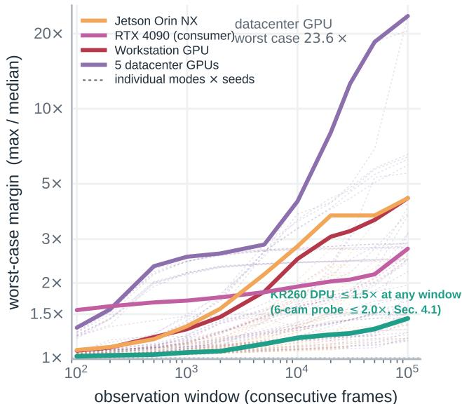  
Figure 1. Tail ratio (max / median) versus observation window on 100k-frame traces of a ResNet-50 probe (INT8 on KR260 and Orin, FP16 on GPUs). Bold lines: each platform’s worst run; dashed: power-mode and seed spread. The KR260 DPU tail grows slowly because accelerator compute is fixed by cycle count; rare host-path spikes (up to 2.0× on the six-inference proxy) are left to the delivery watchdog. Orin NX reaches 4.4× and the worst datacenter run (NVIDIA L4, no co-tenant, shared cluster node) 23.6×. low average latency. Occupancy prediction, a dense 3D map of free and occupied space [38, 40, 47], is becoming that safety-bearing layer for vulnerable road users (VRUs: pedestrians, cyclists, motorcyclists). Yet occupancy methods, from lift-splat models [17, 34, 51] to sparse and setprediction models [28, 43], are judged mainly by mIoU and sometimes mean FPS. Mean throughput is the wrong safety currency: on a late frame, the pedestrian is seen too late.

A safety case uses worst-case execution time (WCET), a per-frame bound checked against the deadline, and ISO 26262 [20] asks for that evidence rather than an average. GPUs cannot provide it: datacenter GPUs and automotive edge SoCs optimize the mean, while dynamic scheduling, driver and OS jitter, thermal throttling, and contention move the tail [29]. On a ResNet-50 probe, Jetson Orin’s worst case keeps climbing with the observation window and swings from 1.1× to 4.4× across power modes and seeds, unlimited power included (Fig. 1). A GPU latency can be measured but not bounded. A bound needs both a statically scheduled accelerator whose cycle count is fixed [36, 41] and a model with input-invariant work. This is independent of accuracy: recent occupancy models differ by about 25× in determinism, with an input-dependent sparse model at 27.5% coefficient of variation (CV) and a fixed-query sparse model at 1.1%.

This paper builds such a front end on the AMD Kria KR260, an embedded FPGA at 4.3 W idle and up to 6.6 W under inference. We choose FlashOcc [51] over sparse SOTA because it is dense, fixed-compute, and DPUcompilable (Sec. 4.1). Two stages the DPU cannot run, the lift-splat view transform [16, 34] and BEV-neck bilinear resize, become custom HLS IPs: with a fixed camera rig their indices and weights are static constants, so both are fixed-trip-count operators whose compute WCET is a cycle count. Accuracy survives a DPU-compatible INT8 recipe with calibration-time activation clipping and no QAT [2, 3, 53]: on full Occ3D-nuScenes [7, 40] validation the board reaches mIoU 29.88, 1.55 below the INT8 reference matched to its deployed configuration and 92.8% of an FP32 baseline the DPU cannot run (Sec. 4.3).

Only PL compute (11.6 ms per frame) is bounded analytically; DPU stages, DDR streaming, and the host path are measured envelopes, and the watchdog guarantees that an output, possibly stale, is published within the deadline plus a measured envelope. The 100 ms deadline runs use a fixedwork proxy of six ResNet-50 DPU inferences per frame, while the full pipeline composes to about 1.3 s (Tab. 2). Our contribution is threefold:

1. An evaluation axis for safety-critical occupancy. Latency-determinability: input-dependent computation, not sparsity, drives tails, and we decompose nondeterminism into architecture, platform sharing, and host path (Sec. 4.1).

2. Two fixed-trip-count PL IPs that close the DPU gaps. Lift-splat gather and BEV-neck bilinear resize as custom HLS IPs with cycle-bounded, input-invariant compute, numerically matched to their software references (Sec. 5).

3. A quantized board deployment and a measured, enforced deadline. Every stage deployed and measured on the board (Tabs. 2 and 3); deadline behavior characterized at 100k-frame scale on the fixed-work proxy against GPU and Orin (Fig. 5); delivery enforced, with its envelope and its fallback cost measured.

## 2. Related Work

Camera-only 3D occupancy descends from Lift-Splat-Shoot [34]. BEVDet [17] and BEVDepth [24] established the deployment-friendly LSS pipeline; SimpleOccupancy [13], OccNet [38], TPVFormer [18], Vox-Former [25], OccFormer [54], and COTR [30] explore compact, dense, plane-based, sparse, and transformer-style occupancy representations. RenderOcc uses 2D rendering supervision [33]; BEVFormer [26], SurroundOcc [47], FB-OCC [27], OpenOccupancy [45], and GaussianFormer [19] buy accuracy at higher cost; SparseOcc [28] and OPUS [43] cut dense-voxel cost. We deploy FlashOcc [51], which keeps features in 2D BEV and recovers height with a channel-to-height plug-in. These works optimize mIoU and sometimes mean FPS, not the per-frame latency determinism that decides deadline feasibility (Sec. 4).

Low-bit BEV/occupancy quantization is mostly GPU/TensorRT-targeted: QD-BEV [53] and PTQAT [46] use QAT, BEVFormer tensorrt [10] uses INT8 PTQ, and all rest on general methods such as AdaRound [32], BRECQ [23], SmoothQuant [50], HAQ [44], and clippingbased activation quantization [9]. The AMD/Xilinx DPU [2] with vai q pytorch [3] is more constrained: per-tensor power-of-two scales and min-max calibration only. We therefore use fixed activation clipping to stay inside the supported DPU path; prior quantized occupancy work rarely reports worst-case timing.

On the deployment-operator side, BEVPoolv2 [16] precomputes ranks and intervals for fast GPU LSS pooling, FastOcc [15] shares 2D BEV and perspective-view features, and TensorRT ports rely on custom plugins [10]. Their kernels remain GPU software with scheduler jitter, whereas our PL gather and resize turn fixed camera tables into on-chip memories with static trip counts and reported FPGA WCET.

For embedded-FPGA perception, the argument is timing: GPU per-frame latency is hard to bound [29], while ISO 26262 [20] values worst-case evidence over average throughput. Restuccia and Biondi [36] analyze the Zynq UltraScale+ DPU, and FINN/FINN-R [6, 41] with PointPillars-on-FINN [39] is the closest embedded 3D precedent. Yet PointPillars-on-FINN is LiDAR-based and leaves scatter on ARM, while DPU WCET work treats the accelerator as a generic CNN. No prior work gives a camera-to-occupancy datapath both cycle-bounded view operators and an enforced delivery layer on programmable logic, including the two operations the DPU cannot run.

## 3. An Occupancy Front End with Certifiable Delivery

## 3.1. From latency determinability to a hardware split

The method follows from three requirements: the model must have input-invariant work; any operation the accelerator cannot run must become a fixed-trip-count hardware operator, not move to a jittery CPU path; and the

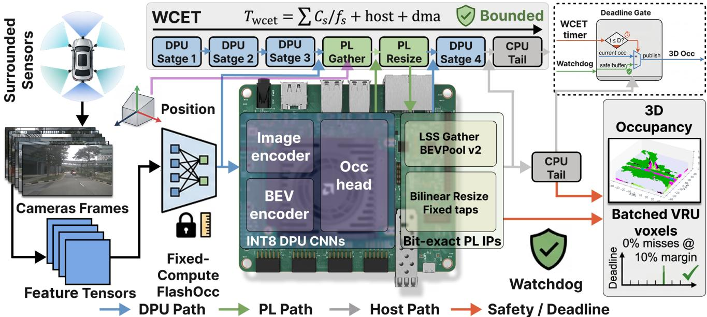  
Figure 2. System overview: six cameras feed fixed-compute FlashOcc; DPU stages run dense INT8 convolutions; custom PL IPs implement gather and resize; the watchdog enforces the deadline before the 3D occupancy output.  
INT8 deployment must preserve the quantized algorithm with a DPU-compatible calibration recipe [21] rather than training-heavy QAT [12].

We target the AMD Kria KR260 [1] (K26 Zynq Ultra-Scale+ SOM, B4096 DPU, 4 GB DDR4, measured 4.3 W idle to 8.7 W peak) with the DPUCZDX8G accelerator [2], and deploy FlashOcc-R50 [51] on Occ3D-nuScenes [7, 40]. FlashOcc keeps features in 2D BEV and recovers height with a channel-to-height plug-in, a zero-FLOP reshape of BEV channels into height bins. It is fixed-compute, one forward pass with input-independent FLOPs, where sparse, transformer, rendering, and efficiency-oriented designs reduce average work instead [15, 18, 25, 33, 54]; a deadline bound requires fixed per-frame work. For a pipeline with hardware stages s, a certifiable deadline uses a static timing bound, not a measured average [48]:

$$
T _ { \mathrm { w c e t } } = T _ { \mathrm { h o s t } } ^ { \mathrm { i s o } } + \sum _ { s } { \frac { C _ { s } } { f _ { s } } } + T _ { \mathrm { d m a } } , \qquad C _ { s } ( x ) = C _ { s } \forall x .\tag{1}
$$

Here $C _ { s }$ is the stage cycle count, $f _ { s }$ its clock, and x the scene. The important condition is $C _ { s } ( x ) \ = \ C _ { s } { \mathrm { : } }$ values may change, but the amount of work cannot. In this work only the $C _ { s } / f _ { s }$ terms are analytic; $T _ { \mathrm { h o s t } } ^ { \mathrm { i s o } }$ and $T _ { \mathrm { d m a } }$ are measured envelopes (Sec. 4.2), and the deadline guarantee that does not depend on either is enforced at the delivery layer (Eq. (7)).

For our split, the deadline margin for a selected deadline

D is

$$
\begin{array} { l } { { \displaystyle M ( D ) = D - T _ { \mathrm { p i p e } } , } } \\ { { \displaystyle T _ { \mathrm { p i p e } } = T _ { \mathrm { h o s t } } ^ { \mathrm { i s o } } + \sum _ { k \in \mathcal { D } } \frac { C _ { k } ^ { \mathrm { d p u } } } { f _ { \mathrm { d p u } } } + \frac { C _ { \mathrm { g a t h e r } } + C _ { \mathrm { r e s i z e } } } { f _ { \mathrm { p l } } } + T _ { \mathrm { d m a } } . } } \end{array}\tag{2}
$$

where D is the set of compiled DPU subgraphs. A viable operating point needs $M ( D ) \geq 0 ;$ with measured envelope terms this is a design target, and the certified property remains delivery (Eq. (7)).

The split in Fig. 2 enforces this condition. Dense convolutions run as INT8 DPU subgraphs: image trunk, neck, BEV encoder, and convolutional occupancy head. Two FlashOcc operations are not DPU primitives: the LSS view transform [16, 34] and BEV-neck bilinear resize. Sending them to ARM would put OS jitter back onto the critical path, so both move to programmable logic (PL) as custom HLS operators [11, 14]. The final softplus-plus-linear predictor over 40 000 BEV cells is fixed-cost but not small (22 GFLOP per frame); we measure it on the CPU and prototype it on the DPU in Sec. 4.3.

## 3.2. Static-index gather operators

Both non-DPU operations are irregular only because of geometry, and the geometry is fixed. The LSS projection tables are functions of intrinsics, extrinsics, and preprocessing; bilinear coordinates and weights are functions of tensor shapes. Once the rig is fixed, addresses, weights, and loop trip counts are constants. The two operators therefore become static-index gathers.

For the LSS gather, with BEV pillar p and channel $c ,$ the

hardware computes

$$
B _ { p , c } = \sum _ { i \in \mathcal { T } _ { p } } D _ { r _ { i } ^ { d } } F _ { r _ { i } ^ { f } , c } , \qquad \mathbb { Z } _ { p } , r _ { i } ^ { d } , r _ { i } ^ { f } \mathrm { ~ f i x e d b y ~ c a l i b r a t i o n } .\tag{3}
$$

The interval $\mathcal { T } _ { p }$ and ranks are static for the rig, so the total trip count $N _ { \mathrm { p o i n t s } }$ is fixed. Segmented accumulation writes each BEV cell once, avoiding scatter hazards. The HLS kernel unrolls $C =$ 64 channels over a 512-bit AXI bus, uses INT8 inputs with a wide fixed-point accumulator, and writes INT16 BEV features in the deployed path to preserve occupied-cell fidelity. Equivalently, the compiled table is

$$
\mathcal { T } _ { \mathrm { l s s } } = \{ ( p _ { i } , r _ { i } ^ { d } , r _ { i } ^ { f } ) \} _ { i = 1 } ^ { N _ { \mathrm { p o i n t s } } } , \qquad C _ { \mathrm { g a t h e r } } = C _ { 0 } ^ { \mathrm { g } } + N _ { \mathrm { p o i n t s } } \left[ \frac { C } { P _ { c } } \right]\tag{4}
$$

where $P _ { c }$ is the channel parallelism and $C _ { 0 } ^ { \mathrm { g } }$ is pipeline fill and drain overhead. Since $\mathcal { T } _ { \mathrm { l s s } }$ is fixed after calibration, $C _ { \mathrm { g a t h e r } }$ is independent of scene content.

For bilinear resize, at output location $( u , v )$

$$
Y _ { u , v , c } = \sum _ { a , b \in \{ 0 , 1 \} } w _ { u , a } ^ { y } w _ { v , b } ^ { x } X _ { y _ { u , a } , x _ { v , b } , c } ,\tag{5}
$$

where indices $y _ { u , a } , x _ { v , b }$ and weights $w ^ { y } , w ^ { x }$ are fixed by the input and output shapes. We implement this as a separable two-pass gather with row fusion, avoiding the full-plane intermediate that overflows BRAM. Together, Eqs. (3) and (5) cover exactly the two non-DPU operations; Tab. 1 reports exactness, utilization, and WCET. For input shape $( H _ { i } , W _ { i } , C )$ and output shape $( H _ { o } , W _ { o } , C )$ , the resize IP has

$$
C _ { \mathrm { r e s i z e } } = C _ { 0 } ^ { \mathrm { r } } + \left( H _ { o } W _ { i } + H _ { o } W _ { o } \right) \left\lceil \frac { C } { P _ { c } } \right\rceil ,\tag{6}
$$

again up to fixed pipeline overhead. The two terms correspond to the fused separable passes, so the bound is a function of tensor shapes and hardware parallelism only.

## 3.3. Deadline path and INT8 recipe

The timing path is governed in three layers: PL compute is cycle-bounded; inference latency is a measured envelope; delivery is enforced by a watchdog that publishes the previous ego-warped occupancy, flagged stale, when a frame would miss the deadline. Enforcement is implemented and measured on the board: fallback preparation costs 0.2 ms on the A53, and every frame yields an output at the deadline plus an enforcement envelope of 0.3 to 1.9 ms typical, 7.6 to 10.2 ms worst across the 421 events of three enforced 100k-frame runs (Sec. 4.3), a host-thread wake latency that a PL-side timer, not implemented here, would remove. The fallback is conservative only in that known occupied space is retained under ego motion; a VRU first appearing during the missed frame is invisible to it, which is why the output carries the stale flag and why the fallback’s cost is measured directly (Sec. 4.4). The host uses core dedication rather than RT priority, the stable policy for the polling DPU runner (Sec. 4.1). For frame t,

$$
\begin{array} { r l } { O _ { t } ^ { \mathrm { o u t } } = \left\{ \begin{array} { l l } { \hat { O } _ { t } , } & { T _ { t } \leq D , } \\ { W _ { \Delta E _ { t } } ( O _ { t - 1 } ^ { \mathrm { o u t } } ) , } & { T _ { t } > D , } \end{array} \right. } & { } \\ & { r _ { \mathrm { m i s s } } ( D ) = \displaystyle \frac { 1 } { N } \sum _ { t = 1 } ^ { N } \mathbf { 1 } [ T _ { t } > D ] . } \end{array}\tag{7}
$$

Here $\hat { O } _ { t }$ is the current occupancy prediction and $W _ { \Delta E _ { t } }$ warps by the ego-pose change $\Delta E _ { t }$ accumulated since the last delivered frame (implemented as a precom-, puted constant-velocity shift, prepared during the previous frame’s slack), and $r _ { \mathrm { m i s s } }$ is the deadline-miss rate used in Fig. 5c.

The DPU path uses Vitis AI per-tensor power-of-two INT8 [2, 3]. The image trunk verifies the toolchain: the on-board DPU output is identical to the quantizer simulation (Sec. 4.3). The BEV stage needs one calibration adjustment. Naive PTQ fails because LSS creates a 34× activation outlier at the first BEV layer $( \mathrm { m a x } { = } 2 0 6 . 6$ vs $\mathrm { p 9 9 . 9 = 6 . 0 ) }$ . Under min-max scaling, most activations receive only about five effective INT8 levels. Instead of QATstyle recovery used by BEV quantizers [53], we keep the DPU post-training quantization path [8, 31, 52] and clip the activation range before quantization:

$$
\hat { a } = \mathrm { m i n } ( \mathrm { m a x } ( a , 0 ) , C ) , \qquad C = 3 2 ,\tag{8}
$$

with $C = 3 2$ chosen from calibration statistics. This is ordinary activation clipping applied at calibration time. The clipped values are saturated and near-uninformative, so the operation has negligible FP32 cost, removes the scale outlier from min-max calibration, and requires no QAT. The accuracy impact is measured in Sec. 4.3.

The resulting DPU input is quantized with a power-oftwo scale,

$$
\boldsymbol { q } ( a ) = \mathrm { s a t } _ { [ - 1 2 8 , 1 2 7 ] } \left( \mathrm { r o u n d } \left( \frac { \hat { a } } { 2 ^ { k } } \right) \right) , \qquad k \in \mathbb { Z } ,\tag{9}
$$

which matches the Vitis AI constraint and keeps the deployed model aligned with the simulated INT8 reference.

## 4. Experiments

## 4.1. Latency determinability

We report host-visible per-frame latency using one-frame submit-and-wait execution. The sweep covers a dedicated KR260 DPU, a dedicated RTX PRO 6000, a shared A100, a Jetson Orin NX (TensorRT 10.3 INT8, 10 to 15 W), and three occupancy models on the shared A100: FlashOcc, SparseOcc, and OPUS. Per-frame statistics exclude a single warmup frame.

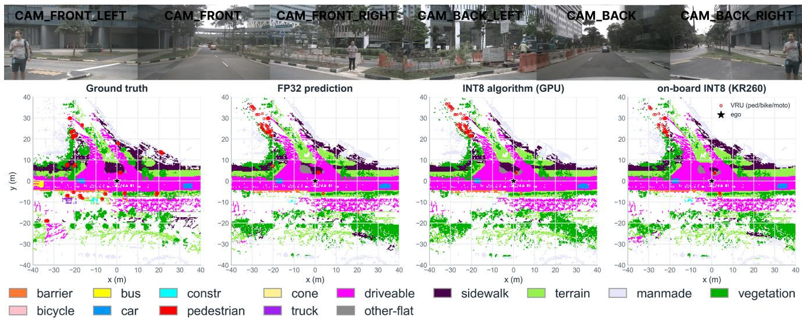  
Figure 3. Qualitative deployment example: ground truth, FP32, GPU INT8, and KR260 INT8 outputs show the board tracking the INT8 reference and preserving visible VRU structure.

Throughout, host-visible latency is wall time from job submission to completion on the host, the quantity a deadline check sees; a CPU burner is a spin loop pinned to a named core; a co-tenant is an unrelated GPU workload sharing the accelerator (steady: fixed-size matmul loop; bursty: randomized sizes and sleeps); seeds are repeated runs launched at different times with freshly initialized processes, nothing else varying. The 100k-frame runs replay a fixed input tensor, so work is input-invariant by construction and residual variation is platform-induced; Fig. 4e varies content explicitly. Conservative occupancy names the fallback of Eq. (7): the previous output ego-warped, flagged stale, unable to contain objects first visible in the missed frame. Latency probes use ResNet-50@224 INT8 on the DPU; accuracy runs use the deployed FlashOcc xmodels (trunk 256×704, BEV stage bev clamp32); BEV-stage latency traces use the structurally identical bev reluc compile. Software: XRT 2.13.0, Vitis AI 2.5/3.0, PYNQ-DPU, Ubuntu 22.04. All runs use batch 1, one frame in flight: DPU INT8 on the stock B4096 overlay, custom IPs at 200 MHz, GPU probes FP16 at stock clocks, Orin TensorRT 10.3 INT8 at the stated power mode. Latency curves time the current frame’s inference only; fallback delivery is measured separately (Fig. 5b).

Figure 4(a,b) show the platform gap. Pro6000 is tight when idle (max/p50 1.07) but reaches 2.13× under a cotenant; shared-A100 FlashOcc reaches 1.72×; Orin NX varies from 1.1× to 4.4× across power modes and seeds; a consumer RTX 4090 reaches 2.75× at 100k frames while idle (CV 7.4%), consistent with GPU timing studies [4, 49, 55]. The KR260 probe tail is the smallest and grows slowest because accelerator work is fixed: 1.44× idle and 2.0× dedicated at 100k frames, the rare host spikes behind these tails handled by the delivery-bounding watchdog.

The model sweep separates sparsity from determinability (Fig. 4a). OPUS is sparse but fixed-query, with CV 1.1% and max/p50 1.11. SparseOcc is sparse but inputdependent, with CV 27.5%, max/p50 2.75, and a +102 ms tail. FlashOcc is dense and fixed-compute, with CV 12.6% and max/p50 1.72 on the shared node. SparseOcc latency is uncorrelated with occupied voxels or object count (corr = −0.02 and +0.01), so scene size does not predict the tail.

Panel (b) adds the seed dimension: the five-seed spread caps Orin near 3.7×, the 4.4× above being its separate 100k worst-seed run (Fig. 1); a bursty co-tenant drives Pro6000 CV to 36.7%; on the KR260, CPU burners push max/p50 from 1.045 to 1.78. RT priority makes the polling DPU runner worse (3.56 per-thread, 4.09 whole-process SCHED FIFO priority 80), while whole-process core dedication reduces the loaded tail to 1.077 (Fig. 4c); this is measured on the DPU submission runner, the DDR-streamed PL IP path characterized separately (Sec. 4.2).

## 4.2. KR260 hardware closure

Both custom IPs have cycle-bounded, input-invariant compute (Tab. 1). Each targets the real K26, passes C/RTL cosimulation, and closes timing at 200 MHz. The INT16 datapath is bit-exact against its own integer simulation; against floating-point references the IPs are numerically matched: gather to FlashOcc CUDA bev pool v2 within max-absolute error 2.6e−5, resize to torch bilinear align corners=True within 1e−13.

In the full-rig deployment, large static tables stream from DDR; this changes latency but not the loop bounds. Host-side input flush costs 0.11 ms and output readback 0.17 ms (p50), so the 52.5 ms median is the ap start-toap done kernel window: PL compute plus DDR streaming. Compute-only CPU burners leave the median fixed and lengthen only the host polling tail (Fig. 4d); deliberate memory saturation on the other three cores stretches the window itself to 65.1 ms p50 and 88.7 ms max over 2000 frames, because streaming shares DDR bandwidth. The per-frame traffic is a compile-time byte ledger (8.44 MB: 2.51 rank tables, 0.17 intervals, 0.64 activation streams, 5.12 output), but dividing it by bulk-copy bandwidth underestimates the window since rank-indexed reads are randomaccess; we therefore report the compute cycle count (4.7 ms) as the analytical component and the memorysaturated envelope as the operative ceiling. Holding Npoints fixed across five pathological point-to-pillar distributions, the median stays within [44.4, 51.4] ms and no frame exceeded 53.2 ms at idle memory (Fig. 4e; a later 2000-frame idle trace peaks at 54.3 ms, the value the budget table carries); the degenerate single-pillar scene only runs faster. Resize is likewise stable at p50 19.67 ms, CV 0.20%, its gap to the 3.44 ms cycle count again DDR streaming. The unified B4096-DPU bitstream closes timing with +0.15 ns slack at 65% LUT, 59% FF, 69% BRAM, 83% DSP.

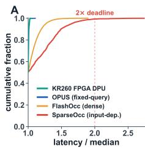

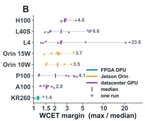

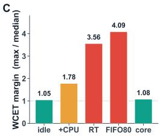

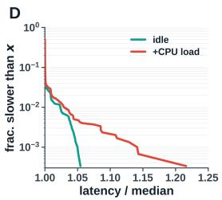

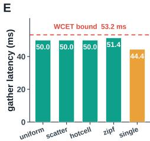  
Figure 4. Latency determinability decomposes into three measured legs (a–c), and the deployed gather IP is deterministic on the axes fixed work controls (d–e). (a) Per-frame latency CDF normalized by each series’ median: fixed-work series (KR260 DPU, fixed-query OPUS) stay near-vertical, while dense FlashOcc and input-dependent SparseOcc grow tails, SparseOcc past the 2× deadline; the discriminator is fixed work, not sparsity. (b) Per-run tail ratio (max/median) across the full hardware sweep over five seeds in idle and loaded conditions: the KR260 clusters tightly, while Jetson Orin and datacenter GPUs spread to large seed- and load-dependent worst cases. (c) KR260 host path leg: real-time priority makes the polling DPU runner worse (3.56 per-thread, 4.09 whole-process FIFO80), while whole-process core dedication restores the tight envelope (1.08). (d) Median-normalized latency tail (CCDF) of the gather IP, idle versus compute-only CPU load: the median is fixed by cycle count, so only the host polling tail extends; memory-saturating load stretches the streaming window itself (text). (e) Five pathological point-to-pillar distributions at fixed $N _ { \mathrm { p o i n t s } } \mathrm { : }$ no frame exceeds 53.2 ms at idle memory, and the degenerate single-pillar scene only runs faster.

Table 1. Custom PL IPs synthesized with Vitis HLS on the KR260 K26. Both have cycle-bounded compute, match their references numerically at full rig size, pass C/RTL cosimulation, and close timing at 200 MHz. Compute WCET is the cycle count at the 200 MHz deployment clock, not at Fmax.
<table><tr><td>Gather IP</td><td>LSS view transform, FlashOcc BEVPoolv2</td></tr><tr><td>Exactness Fixed work</td><td>max-abs 2.6e—5 vs CUDA reference  $N _ { \mathrm { p o i n t s } } { = } 3 0 2 { , } 5 5 8$  static point visits</td></tr><tr><td>Kernel / timing Post-route use</td><td>≈0.93M cycles, ≈4.7 ms; Fmax 211 MHz DSP 15%, BRAM 10%, LUT 5%</td></tr><tr><td>Resize IP</td><td>BEV-neck bilinear upsample</td></tr><tr><td>Exactness</td><td>max-abs 1e—13 vs torch reference</td></tr><tr><td>Fixed work</td><td>fixed output grid and interpolation taps</td></tr><tr><td>Kernel / timing</td><td>688,023 cycles, 3.44 ms; Fmax 230 MHz</td></tr><tr><td>Post-route use</td><td>DSP 10%, BRAM 54%, LUT 9%</td></tr></table>

Table 2. Composed per-frame budget of the full-resolution deployment from per-stage board measurements (serial, no overlap, from the trunk input; host-side decode/normalization excluded). Evidence classes: cycle-bounded (analytic), measured (idle envelope), stressed (deliberate memory saturation).
<table><tr><td>Stage</td><td>p50</td><td>worst</td><td>evidence</td></tr><tr><td>Image trunk (6×, 256×704)</td><td>6×45.5</td><td>6×49.8</td><td>measured</td></tr><tr><td>Gather IP kernel (compute)</td><td>4.7</td><td></td><td>cycle-bounded</td></tr><tr><td>Gather kernel incl. DDR streaming</td><td>52.5</td><td>54.3</td><td>measured</td></tr><tr><td>under memory saturation</td><td>65.1</td><td>88.7</td><td>stressed</td></tr><tr><td>BEV DPU subgraphs (3)</td><td>399.3</td><td>408.2</td><td>measured</td></tr><tr><td>Resize IP (2 calls)</td><td>39.3</td><td>40.2</td><td>measured</td></tr><tr><td>Host marshaling (flush, readback)</td><td>0.3</td><td>1.5</td><td>measured</td></tr><tr><td>CPU head (predictor MLP,</td><td>6730</td><td>6780</td><td>measured</td></tr><tr><td>NumPy) on DPU (1 ×1 convs, LUT softplus)</td><td>505</td><td>534</td><td>measured</td></tr><tr><td>Accelerated stages, serial</td><td>≈764</td><td>≈ 803</td><td>composed</td></tr><tr><td>with DPU head</td><td>≈ 1269</td><td>≈ 1337</td><td>composed</td></tr></table>

## 4.3. Accuracy and deadline behavior

The relevant target is the INT8 algorithm, because the DPU cannot run FP32. Quantizing only the BEV stage (clamp 32, trunk FP32) reaches 98% of FP32 mIoU (32.19 to 31.6 on 6019 frames), isolating the clip cost. Reference configurations matter: an idealized clamp-16 reference gives 29.08; the reference matched to the deployed configuration (clamp 32, view transform quantized as deployed, INT16 at 1/128 resolution) scores 31.43, and the board reaches 29.88 against it, a 1.55 gap attributable to the real per-layer quantizer realization. Quantizing the view transform to INT8 instead would cost 9.4 mIoU (22.01 vs 31.43), the direct justification for the INT16 gather datapath. The feature cosine 0.873: board trunk output and the quantizer’s CPU simulation score identically against FP32 features (0.87323 both), so the deploy chain adds nothing on top of quantization itself; the number measures PTQ cost, not deployment error, whose task-level effect Tab. 3 reports.

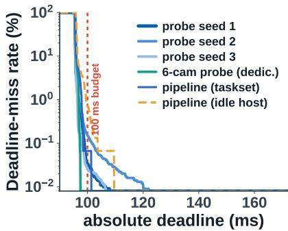  
(a)

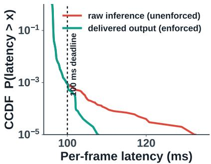  
(b)

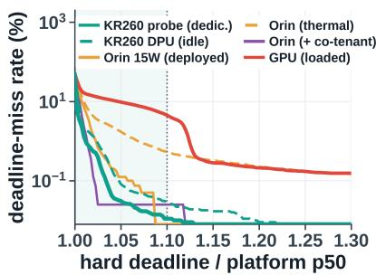  
(c)  
Figure 5. Deadline behavior at 100k-frame scale. (a) Absolute-deadline view: the six-inference DPU probe, a fixed-work proxy rather than the full FlashOcc pipeline of Tab. 2, misses the 100 ms budget on 0.027 to 0.152% of frames across three dedicated seeds, maxima 124 to 169 ms; shorter traces understate the tail. (b) Enforced delivery (CCDF): the raw tail (132.5 ms max) crosses the budget on 0.088% of frames, 2.75× the unenforced seed-1 trace of (a), a probe effect of the enforcement timer’s own host work; the delivered-output curve terminates at 107.8 ms, 68 of the 88 late frames as stale-flagged fallbacks and the rest publishing fresh inside the enforcer’s wake window; two further enforced runs with tenfold-spanning raw miss rates deliver every frame by 107.6 and 110.2 ms, the 10.2 ms worst excursion a host-thread wake tail a PL-side timer would remove. (c) Relative-deadline view, shaded band marking deadlines within a 10% margin of each platform’s median: the dedicated KR260 probe misses 0.011% at that margin; a loaded GPU and a thermally-throttled Orin miss several percent at theirs.

Table 3. INT8 deployment accuracy on Occ3D-nuScenes. Columns 256/1024/2048/full: nested first-N validation subsets, showing consistency across evaluation scale. The idealized clamp-16 reference is a configuration mismatch kept for context; the matched reference uses the deployed configuration. FP32 is an unreachable DPU upper bound.
<table><tr><td colspan="6">mIoU at validation scale</td></tr><tr><td>Configuration</td><td>256</td><td>1024</td><td>2048</td><td>full</td><td>%FP32</td></tr><tr><td>FP32 upper</td><td>25.0</td><td>30.0</td><td>34.8</td><td>32.19</td><td>100.0</td></tr><tr><td>INT8 sim. (idealized c16)</td><td>23.1</td><td>27.5</td><td>31.5</td><td>29.08</td><td>90.3</td></tr><tr><td>INT8 sim. (matched c32)</td><td></td><td></td><td></td><td>31.43</td><td>97.6</td></tr><tr><td>Board INT8</td><td>23.8</td><td>28.1</td><td>32.1</td><td>29.88</td><td>92.8</td></tr></table>

<table><tr><td>Configuration</td><td>bicyc.</td><td>motorc.</td><td>pedest.</td><td>note</td></tr><tr><td>FP32 upper</td><td>11.5</td><td>14.4</td><td>16.8</td><td>no DPU path</td></tr><tr><td>INT8 sim.</td><td>7.4</td><td>9.1</td><td>12.2</td><td>algorithm ref.</td></tr><tr><td>Board INT8</td><td>5.5</td><td>11.1</td><td>12.9</td><td>this work</td></tr></table>

The board exceeds the idealized reference at every evaluated scale; pedestrian and motorcycle IoU exceed it too, while bicycle drops most (Tab. 3). Figure 3 shows the board output following the INT8 reference and preserving visible VRU structure.

We evaluate deadlines in two frames. The relative frame sets each hard deadline as a fixed margin over the platform median, testing whether a platform reliably meets a deadline sized to its own throughput: at a 10% margin over 100k frames the dedicated KR260 probe (one ResNet-50@224 inference per frame) misses 0.011%, against 4.5% for the loaded GPU and 0.5% for the thermally-throttled Orin at their own margins (Fig. 5c); shorter traces can show zero misses at this margin, so measured maxima are reported as envelopes, not bounds. The absolute frame scores the deployment against a fixed 100 ms perception budget: at urban 50 km/h the vehicle travels 1.4 m per budget interval. On this budget, the six-inference DPU framebudget probe (six sequential ResNet-50@224 INT8 inferences per frame, 6× the relative-frame probe’s accelerator work, held fixed; exact configuration in the released code and traces) runs at 95.5 ms median and misses on 0.027 to 0.152% of unenforced frames across three 100k-frame seeds (0.070% pooled), with per-seed maxima of 124.3, 133.2, and 169.0 ms; the enforced run of Fig. 5b is a separate trace, on which the watchdog converts every miss into a flagged fallback, every output landing within 7.8 ms of the deadline over 100k enforced frames (10.2 ms worst over all three enforced runs). The full-resolution FlashOcc pipeline is far heavier than this proxy (Tab. 2): accelerated stages compose to roughly 0.8 s per frame serial, and the CPU head, a pointwise two-layer MLP over the 200×200 grid (22 GFLOP), measures 6.7 s as an unoptimized FP32 NumPy reference on the A53 cores; recompiled as two 1×1-convolution DPU subgraphs with an int8 lookup-table softplus bridge it runs at 505 ms median (stage medians 89.6, 389.3, 31.7 ms; independent medians need not sum to the end-to-end median; 97.3% argmax agreement with the FP32 head), 13× faster than that unoptimized reference. The full pipeline thus composes to about 1.3 s per frame. Input downscaling does not buy this back: the BEV stage is independent of image resolution, and halving the trunk input without retraining collapses accuracy (4.32 vs 20.48 mIoU paired, under a superseded view-transform scale, so the ratio is the evidence), and halving the BEV grid needs an architecture-consistent neck. A 10 Hz tier therefore requires a retrained reduced-grid model, a measured engineering boundary rather than a knob.

## 4.4. Robustness, calibration, and the application context

On-board full-val mIoU is 29.88 with a 95% bootstrap CI of [29.61, 30.15] at the frame level and [28.58, 31.11] sceneclustered; board-versus-reference comparisons are paired on identical frames. Splitting by scene description gives day 30.26 (4449 frames), rain 29.80 (1088), night 16.76 (602; rain and night overlap on rainy nights). Rain costs almost nothing; night halves accuracy. The clip threshold is not the sensitive part: sweeping $C \in \{ 1 6 , 2 4 , 3 2 , 4 8 , 6 4 \}$ on the night subset moves mIoU by at most 0.7 (16.4 at C=16 vs 15.7 at the deployed C=32), so the clipping recipe is robust to the lighting shift; night loss traces to the backbone.

Injecting camera-artifact perturbations before the backbone (matched INT8; baseline 28.9 on the same first-1000- frame subset, differing from the full-set value): Gaussian blur $\sigma { = } 1 / 2 / 4$ gives $1 3 . 8 / 7 . 9 / 3 . 5$ mIoU; exposure gain $0 . 5 { \times } / 2 { \times }$ gives $2 5 . 2 / 2 3 . 4 ;$ sensor noise gives 18.2. Blur dominates, halving accuracy at one pixel of spread; moderate exposure change is nearly free; none of these can change the amount of work on the fixed-work path.

Calibration drift is probed by perturbing the rig pitch on all cameras (stale static tables relative to the images): $0 . 1 / 0 . 2 / 0 . 5$ degrees cost nothing measurable and 1.0 degree costs 0.1 mIoU against the 28.9 baseline; tables regenerate offline on recalibration.

As for where the remaining accuracy loss lives: of all bicycle ground-truth voxels, the board predicts 49.2% free and 29.5% background surfaces, keeps 5.7% as bicycle, and scatters the remainder across driveable surface (6.5%), vegetation, and small movable-class confusions: thin structures are erased toward free space, a recall problem quantization amplifies (on-board VRU recall: pedestrian 14.8%, motorcycle 12.3%, bicycle 5.7%; occupied-any 43.8% mean).

The fallback is priced directly: ego-warping the previous on-board prediction by one and two 2 Hz keyframes (500 ms steps, five times the staleness a 100 ms miss produces, conservative upper bounds forced by the dataset’s keyframe rate): pedestrian recall falls $1 4 . 8  1 1 . 6  8 . 1 \%$ , bicycle $5 . 7  4 . 3  3 . 8 \%$ , occupied-any recall on pedestrian voxels $4 2 . 5  3 9 . 7  3 7 . 0 \%$ The expected delivered pedestrian recall under the enforced 100 ms budget is R ≈ $( 1 - p _ { \mathrm { m i s s } } ) R _ { \mathrm { f r e s h } } + p _ { \mathrm { m i s s } } R _ { \mathrm { s t a l e } }$ with $p _ { \mathrm { m i s s } } = 8 . 8 { \times } 1 0 ^ { - 4 }$ a degradation of about 0.003 percentage points in expectation, under an independence assumption between spike timing and scene content.

Measured power, from INA260 board telemetry: KR260 4.33 W idle, 5.8 to 6.6 W under inference, 8.7 W peak; Orin NX at its 15 W mode draws 7.4 W under INT8 inference (VDD IN); the workstation GPU idles at 16 W and draws 329 W median under a co-tenant (nvidia-smi). Reported for context, not as a contribution.

At matched full-model workload the shared A100 runs

FlashOcc at 33.5 ms median, 57.5 ms maximum over 2k frames, meeting the 100 ms budget on that trace and missing 0.5% at 50 ms; a 2k-frame trace is the finite-window trap of Fig. 1, with no enforcement layer behind it.

## 5. Discussion, Limitations, and Conclusion

This work is a deployment result, not a new occupancy backbone: a camera occupancy network becomes easier to certify when algorithm, accelerator mapping, and runtime policy all expose fixed work. The latency guarantee is layered, and only one layer is a bound: PL compute is cyclebounded analytically; inference latency is a measured envelope whose maxima are sample-size-dependent; delivery is structurally guaranteed, possibly with a stale-flagged fallback. Raw miss rates span tenfold across enforced runs and raw maxima wander 125.2 to 139.8 ms, yet every frame delivered within the deadline plus the envelope of Sec. 4.3. That envelope is itself measured: the enforcement timer is a host thread, and the PL-side timer that would remove its wake tail is not implemented. A back-to-back run after prior host activity misses more often than clean boot (0.671 vs 0.070%), drift that runtime monitoring must catch. The timing-closed K26 bitstream co-places the DPU and both resize IP instances; the gather IP runs from its own overlay, so the full pipeline has not run as one bitstream. The evidence is dataset replay on hardware, not a moving-vehicle test: on-car synchronization, planner-interface timing, actuation, and real-traffic fallback remain future validation, with runtime fault monitoring [5, 37, 42].

On-board VRU recall (pedestrian 14.8%, bicycle 5.7%) and night mIoU (16.76) are far below what a braking function needs, and the fallback lowers recall further on late frames (Sec. 4.4); we claim no recall level as sufficient, since it comes from the system safety case [42]. The timing layer is model-independent, so a more accurate fixed-work model inherits it unchanged. The platform comparison is not matched in precision or isolation: GPUs run FP16, datacenter runs share cluster nodes, and the KR260 is dedicated. A real-time-configured GPU, Orin’s DLA, or another FPGA would be fairer baselines.

Determinism does not remove compute cost (Sec. 4.3), but the condition is not FlashOcc-specific: fixed rigs and tensor shapes turn LSS splatting and known-shape resampling into static-index gathers with certifiable trip counts, extending FPGA determinism evidence [22, 35] to camera occupancy. The HLS sources, deployment recipe, and raw 100k-frame traces are released at $\mathrm { g i t h u b . c o m / Q u e 1 } 2 1 / \mathrm { f a l c o n - k r } 2 6 0 \mathrm { - r } \mathrm { e } \mathrm { l e a s e } .$

## References

[1] Advanced Micro Devices, Inc. Kria KR260 Robotics Starter Kit (and KV260 Vision AI Starter Kit). AMD Product Documentation / Product Brief, 2022.

[2] Advanced Micro Devices, Inc. DPUCZDX8G for Zynq UltraScale+ MPSoCs (Vitis AI DPU IP / Product Guide PG338). AMD/Xilinx Product Guide (Vitis AI documentation), 2023.

[3] Advanced Micro Devices, Inc. Vitis AI User Guide (UG1414) — vai q pytorch / vai q tensorflow Quantizer. AMD Technical Documentation (UG1414), 2023.

[4] Miguel Alcon, Axel Brando, Enrico Mezzetti, Jaume Abella, and Francisco J. Cazorla. Main Sources of Variability and Non-determinism in AD Software: Taxonomy and Prospects to Handle Them. Real-Time Systems, 59, 2023.

[5] Pasquale Antonante, Heath Nilsen, and Luca Carlone. Monitoring of Perception Systems: Deterministic, Probabilistic, and Learning-based Fault Detection and Identification. Artificial Intelligence, 325, 2023.

[6] Michaela Blott, Thomas B. Preusser, Nicholas J. Fraser, Giulio Gambardella, Kenneth O’Brien, Yaman Umuroglu, Miriam Leeser, and Kees Vissers. FINN-R: An End-to-End Deep-Learning Framework for Fast Exploration of Quantized Neural Networks. arXiv preprint arXiv:1809.04570, 2018.

[7] Holger Caesar, Varun Bankiti, Alex H. Lang, Sourabh Vora, Venice Erin Liong, Qiang Xu, Anush Krishnan, Yu Pan, Giancarlo Baldan, and Oscar Beijbom. nuScenes: A Multimodal Dataset for Autonomous Driving. In CVPR, 2020.

[8] Yaohui Cai, Zhewei Yao, Zhen Dong, Amir Gholami, Michael W. Mahoney, and Kurt Keutzer. ZeroQ: A Novel Zero Shot Quantization Framework. In CVPR, 2020.

[9] Jungwook Choi, Zhuo Wang, Swagath Venkataramani, Pierce I-Jen Chuang, Vijayalakshmi Srinivasan, and Kailash Gopalakrishnan. PACT: Parameterized Clipping Activation for Quantized Neural Networks. arXiv preprint arXiv:1805.06085, 2018.

[10] DerryHub. BEVFormer tensorrt: BEVFormer/BEVDet inference on TensorRT with INT8 quantization and custom plugins. GitHub (open-source repository), 2023.

[11] Javier Duarte, Song Han, Philip Harris, et al. Fast inference of deep neural networks in FPGAs for particle physics. Journal ofInstrumentation (JINST), 13:P07027, 2018.

[12] Steven K. Esser, Jeffrey L. McKinstry, Deepika Bablani, Rathinakumar Appuswamy, and Dharmendra S. Modha. Learned Step Size Quantization. In ICLR, 2020.

[13] Wanshui Gan, Ningkai Mo, Hongbin Xu, and Naoto Yokoya. A Simple Framework for 3D Occupancy Estimation in Autonomous Driving (SimpleOccupancy). arXiv preprint arXiv:2303.10076, 2023.

[14] Yijin Guan, Hao Liang, Ningyi Xu, Jason Cong, et al. FP-DNN: An Automated Framework for Mapping Deep Neural Networks onto FPGAs with RTL-HLS Hybrid Templates. In IEEE International Symposium on Field-Programmable Custom Computing Machines (FCCM), 2017.

[15] Jiawei Hou, Xiaoyan Li, et al. FastOcc: Accelerating 3D Occupancy Prediction by Fusing the 2D Bird’s-Eye View and Perspective View. In ICRA, 2024.

[16] Junjie Huang and Guan Huang. BEVPoolv2: A Cuttingedge Implementation of BEVDet Toward Deployment. arXiv preprint arXiv:2211.17111, 2022.

[17] Junjie Huang, Guan Huang, Zheng Zhu, Yun Ye, and

Dalong Du. BEVDet: High-performance Multi-camera 3D Object Detection in Bird-Eye-View. arXiv preprint arXiv:2112.11790, 2021.

[18] Yuanhui Huang, Wenzhao Zheng, Yunpeng Zhang, Jie Zhou, and Jiwen Lu. Tri-Perspective View for Vision-Based 3D Semantic Occupancy Prediction (TPVFormer). In CVPR, 2023.

[19] Yuanhui Huang, Wenzhao Zheng, Yunpeng Zhang, Jie Zhou, and Jiwen Lu. GaussianFormer: Scene as Gaussians for Vision-Based 3D Semantic Occupancy Prediction. In ECCV, 2024.

[20] International Organization for Standardization. ISO 26262: Road Vehicles — Functional Safety (Parts 1-12); ASIL A-D risk classification, ASIL D highest. ISO International Stan dard, 2018.

[21] Benoit Jacob, Skirmantas Kligys, Bo Chen, et al. Quantiza tion and Training of Neural Networks for Efficient Integer-Arithmetic-Only Inference. In CVPR, 2018.

[22] Minjae Lee, Seongmin Park, et al. SPADE: Sparse Pillar based 3D Object Detection Accelerator for Autonomous Driving. In IEEE International Symposium on High-Performance Computer Architecture (HPCA), 2024.

[23] Yuhang Li, Ruihao Gong, Xu Tan, Yang Yang, Peng Hu, Qi Zhang, Fengwei Yu, Wei Wang, and Shi Gu. BRECQ: Pushing the Limit of Post-Training Quantization by Block Reconstruction. In ICLR, 2021.

[24] Yinhao Li, Zheng Ge, Guanyi Yu, Jinrong Yang, Zengran Wang, Yukang Shi, Jianjian Sun, and Zeming Li. BEVDepth: Acquisition of Reliable Depth for Multi-view 3D Object Detection. In AAAI, 2023.

[25] Yiming Li, Zhiding Yu, Christopher Choy, et al. VoxFormer: Sparse Voxel Transformer for Camera-Based 3D Semantic Scene Completion. In CVPR, 2023.

[26] Zhiqi Li, Wenhai Wang, Hongyang Li, Enze Xie, Chonghao Sima, Tong Lu, Yu Qiao, and Jifeng Dai. BEV-Former: Learning Bird’s-Eye-View Representation from Multi-Camera Images via Spatiotemporal Transformers. In ECCV, 2022.

[27] Zhiqi Li, Zhiding Yu, David Austin, Mingsheng Fang, Shiy Lan, Jan Kautz, and Jose M. Alvarez. FB-OCC: 3D Occupancy Prediction based on Forward-Backward View Transformation. In CVPRW (3D Occupancy Prediction Challenge winning solution), 2023.

[28] Haisong Liu, Yang Chen, Haiguang Wang, Zetong Yang, Tianyu Li, Jia Zeng, Li Chen, Hongyang Li, and Limin Wang. Fully Sparse 3D Occupancy Prediction (SparseOcc). In ECCV, 2024.

[29] Liangkai Liu, Yanzhi Wang, and Weisong Shi. Understanding Time Variations of DNN Inference in Autonomous Driving. arXiv preprint arXiv:2209.05487, 2022.

[30] Qihang Ma, Xin Tan, Yanyun Qu, Lizhuang Ma, Zhizhong Zhang, and Yuan Xie. COTR: Compact Occupancy TRansformer for Vision-based 3D Occupancy Prediction. In CVPR, 2024.

[31] Markus Nagel, Mart van Baalen, Tijmen Blankevoort, and Max Welling. Data-Free Quantization Through Weight Equalization and Bias Correction. In ICCV, 2019.

[32] Markus Nagel, Rana Ali Amjad, Mart van Baalen, Christos Louizos, and Tijmen Blankevoort. Up or Down? Adaptive

Rounding for Post-Training Quantization (AdaRound). In ICML, 2020.

[33] Mingjie Pan, Jiaming Liu, et al. RenderOcc: Vision-Centric 3D Occupancy Prediction with 2D Rendering Supervision. In ICRA, 2024.

[34] Jonah Philion and Sanja Fidler. Lift, Splat, Shoot: Encoding Images From Arbitrary Camera Rigs by Implicitly Unprojecting to 3D. In ECCV, 2020.

[35] Julien Posso et al. Real-Time Semantic Segmentation of Aerial Images Using an Embedded U-Net: A Comparison of CPU, GPU, and FPGA Workflows. arXiv preprint arXiv:2503.08700, 2025.

[36] Francesco Restuccia and Alessandro Biondi. Time-Predictable Acceleration of Deep Neural Networks on FPGA SoC Platforms. In IEEE Real-Time Systems Symposium (RTSS), 2021.

[37] Albert Schotschneider, Svetlana Pavlitska, and J. Marius Zollner. Runtime Safety Monitoring of Deep Neural Net-¨ works for Perception: A Survey. In IEEE International Conference on Systems, Man, and Cybernetics (SMC), 2025.

[38] Chonghao Sima, Wenwen Tong, Tai Wang, Li Chen, Silei Wu, Hanming Deng, Yi Gu, Lewei Lu, Ping Luo, Dahua Lin, and Hongyang Li. Scene as Occupancy (OccNet). In ICCV, 2023.

[39] Joanna Stanisz, Konrad Lis, and Marek Gorgon. Implementation of the PointPillars Network for 3D Object Detection in Reprogrammable Heterogeneous Devices Using FINN. Journal of Signal Processing Systems (Springer), 2022.

[40] Xiaoyu Tian, Tao Jiang, Longfei Yun, Yucheng Mao, Huitong Yang, Yue Wang, Yilun Wang, and Hang Zhao. Occ3D: A Large-Scale 3D Occupancy Prediction Benchmark for Autonomous Driving. In NeurIPS (Datasets & Benchmarks), 2023.

[41] Yaman Umuroglu, Nicholas J. Fraser, Giulio Gambardella, Michaela Blott, Philip Leong, Magnus Jahre, and Kees Vissers. FINN: A Framework for Fast, Scalable Binarized Neural Network Inference. In FPGA (ACM/SIGDA Int. Symp. on FPGAs), 2017.

[42] Hong Wang, Wenbo Shao, Chen Sun, Kai Yang, Dongpu Cao, and Jun Li. A Survey on an Emerging Safety Challenge for Autonomous Vehicles: Safety of the Intended Functionality. Engineering, 33, 2024.

[43] Jiabao Wang, Zhaojiang Liu, Qiang Meng, Liujiang Yan, Ke Wang, Jie Yang, Wei Liu, Qibin Hou, and Ming-Ming Cheng. OPUS: Occupancy Prediction Using a Sparse Set. In NeurIPS, 2024.

[44] Kuan Wang, Zhijian Liu, Yujun Lin, Ji Lin, and Song Han. HAQ: Hardware-Aware Automated Quantization with Mixed Precision. In CVPR, 2019.

[45] Xiaofeng Wang, Zheng Zhu, Wenbo Xu, Yunpeng Zhang, Yi Wei, Xu Chi, Yun Ye, Dalong Du, Jiwen Lu, and Xingang Wang. OpenOccupancy: A Large Scale Benchmark for Surrounding Semantic Occupancy Perception. In ICCV, 2023.

[46] Xinhao Wang et al. PTQAT: A Hybrid Parameter-Efficient Quantization Algorithm for 3D Perception Tasks. In ICCVW, 2025.

[47] Yi Wei, Linqing Zhao, Wenzhao Zheng, Zheng Zhu, Jie Zhou, and Jiwen Lu. SurroundOcc: Multi-Camera 3D Occu-

pancy Prediction for Autonomous Driving. In ICCV, 2023.

[48] Reinhard Wilhelm, Jakob Engblom, Andreas Ermedahl, et al. The Worst-Case Execution-Time Problem: Overview of Methods and Survey of Tools. ACM Transactions on Em bedded Computing Systems (TECS), 7(3), 2008.

[49] Yecheng Xiang and Hyoseung Kim. Pipelined Data-Parallel CPU/GPU Scheduling for Multi-DNN Real-Time Inference. In IEEE Real-Time Systems Symposium (RTSS), 2019.

[50] Guangxuan Xiao, Ji Lin, Mickael Seznec, Hao Wu, Julien Demouth, and Song Han. SmoothQuant: Accurate and Efficient Post-Training Quantization for Large Language Mod els. In ICML, 2023.

[51] Zichen Yu, Changyong Shu, Jiajun Deng, Kangjie Lu, Zongdai Liu, Jiangyong Yu, Dawei Yang, Hui Li, and Yan Chen. FlashOcc: Fast and Memory-Efficient Occupancy Prediction via Channel-to-Height Plugin. arXiv preprint arXiv:2311.12058, 2023.

[52] Zhihang Yuan, Chenhao Xue, Yiqi Chen, Qiang Wu, and Guangyu Sun. PTQ4ViT: Post-Training Quantization for Vision Transformers with Twin Uniform Quantization. In ECCV, 2022.

[53] Yifan Zhang, Zhen Dong, Huanrui Yang, Ming Lu, Cheng Ching Tseng, Yuan Du, Kurt Keutzer, Li Du, and Shanghang Zhang. QD-BEV: Quantization-aware View-guided Distilla tion for Multi-view 3D Object Detection. In ICCV, 2023.

[54] Yunpeng Zhang, Zheng Zhu, and Dalong Du. OccFormer: Dual-path Transformer for Vision-based 3D Semantic Occu pancy Prediction. In ICCV, 2023.

[55] An Zou, Jing Li, Christopher D. Gill, and Xuan Zhang. RT-GPU: Real-Time GPU Scheduling of Hard Deadline Parallel Tasks With Fine-Grain Utilization. IEEE Transactions on Parallel and Distributed Systems (TPDS), 34(5), 2023.