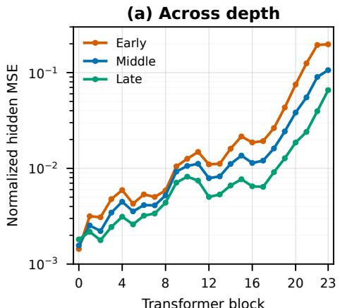
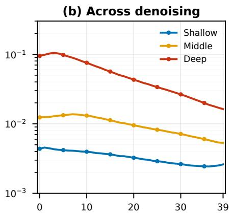
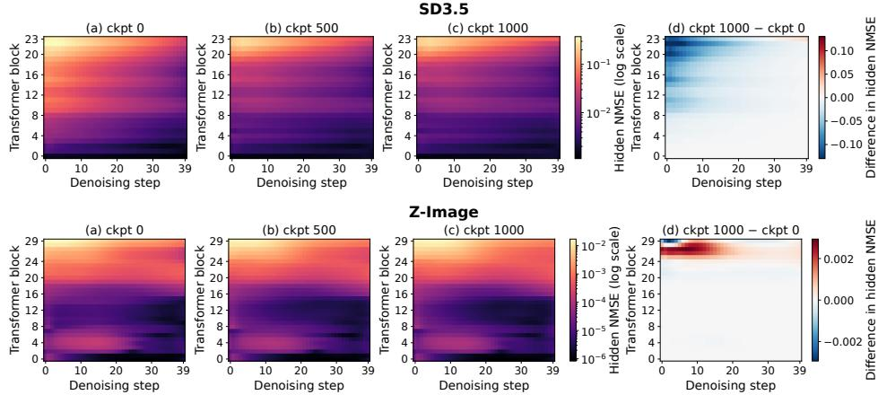
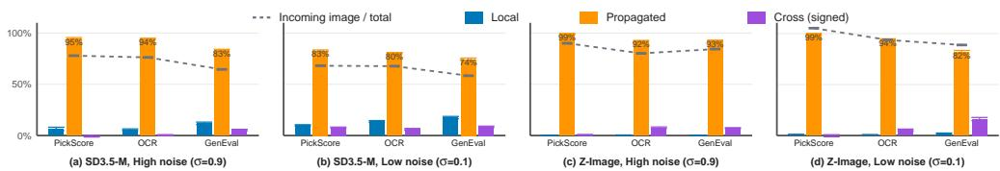
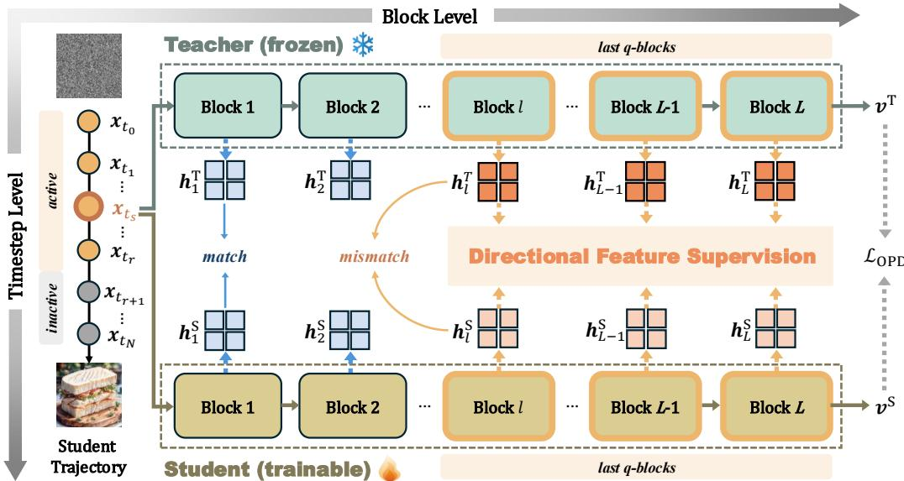
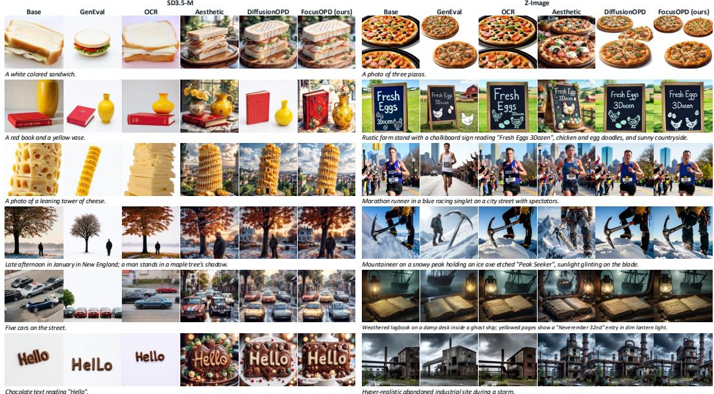
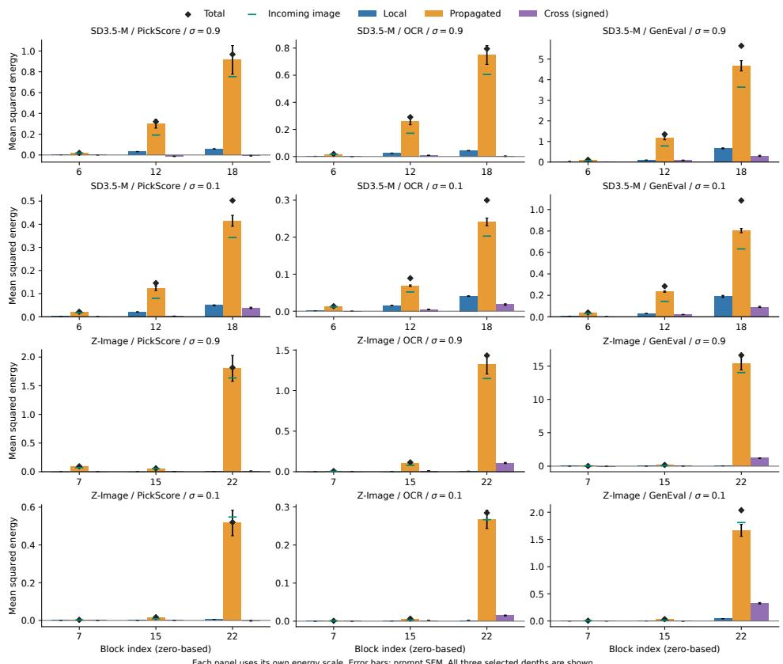

# FOCUSOPD: STRUCTURE-GUIDED ON-POLICY DISTILLATION FOR DIFFUSION MODELS

Xinrui Lin1,\*, Shumin Wang1,\*, Suqi Song2, Fan Li3,†, Yanyong Zhang1,†

1University of Science and Technology of China, Hefei, China

2The Hong Kong University of Science and Technology (Guangzhou)

3Huawei Noah’s Ark Lab

{xinruilin,shuminwang}@mail.ustc.edu.cn ssong943@connect.hkust-gz.edu.cn lifan61@huawei.com, yanyongz@ustc.edu.cn

## ABSTRACT

Multi-teacher on-policy distillation enables rectified-flow models with diffusiontransformer architectures to combine task-specific capabilities within a single student. However, matching model outputs does not guarantee that their internal representations are aligned, and it remains unclear where and when additional feature supervision is most useful. We analyze the teacher–student feature mismatch across Transformer blocks and denoising timesteps, and find that the mismatch is concentrated in deeper Transformer blocks during early denoising and persists after OPD distillation, indicating ineffective distillation. Motivated by this observation, we introduce FocusOPD, which augments the base OPD objective with token-wise directional feature alignment restricted to deep layers and early denoising steps. Across two rectified-flow backbones and multiple OPD objectives, FocusOPD improves capability transfer in compositional generation, text rendering, and preference-based evaluation. On the primary benchmark, it improves over DiffusionOPD from 0.953 to 0.967 on GenEval, from 23.797 to 23.944 on PickScore, and from 6.052 to 6.199 on LAION-Aesthetic. Ablations show that selective deep and early supervision is more effective and efficient than alignment over the full network and trajectory.

## 1 INTRODUCTION

On-policy distillation (OPD) transfers teacher behavior through feedback on student-generated tra jectories (Agarwal et al., 2024; Lu & Thinking Machines Lab, 2025). For diffusion models, multiteacher OPD integrates specialized capabilities, including compositional generation, text rendering, and alignment with human preferences, into a single student (Ma et al., 2026; Li et al., 2026; Fang et al., 2026). Recent methods select denoising states for teacher feedback and align representation changes across network blocks (Zhou et al., 2026; Wei et al., 2026). Yet these developments leave open how the value of supervision varies across blocks and denoising stages. We therefore ask: what patterns characterize the utility of additional feature supervision across network depth and denoising steps?

To investigate this question, we begin by examining teacher–student feature mismatch in SD3.5- M Esser et al. (2024) and Z-Image (Z-Image Team et al., 2025). Evaluating teacher and student on the same noisy inputs, we find that feature mismatch is generally larger in deeper blocks and during early, high-noise denoising. Its relative organization remains qualitatively similar before and after output-level OPD, even though its magnitude may change. We call this a persistent depth–temporal structure. The marginal trends locate larger discrepancies; the joint profiles reveal that their organization persists through training. Neither observation alone explains the underlying mechanism.

We examine two mechanisms consistent with this structure. Two lemmas characterize how local discrepancies propagate across network blocks and how weaker observations preserve prior-dependent differences in a Gaussian denoising model. Building on this account, we derive a local criterion for selective feature supervision: under local smoothness and gradient-compatibility conditions, allocating a fixed auxiliary weight to sufficiently larger discrepancies can yield greater output-loss reduction for small auxiliary updates. Two lightweight diagnostics support the proposed mechanisms: upstream differences dominate mismatch at selected deep blocks, and noise-dependent scaling improves held-out prediction over a timestep control.

  
Figure 1: Teacher–student feature MSE across (a) transformer blocks and (b) denoising steps, ordered from high to low noise. Different curves indicates different groups of (a)denoising steps (b)blocks.

Motivated by this analysis, we introduce FocusOPD, a straightforward way to use the persistent depth–temporal structure in multi-teacher OPD (MOPD). It augments the base output objective with tokenwise cosine alignment of conditional image features in deep layers during early denoising. Output and feature queries are specified independently, and inference requires no additional components. On SD3.5-M with DiffusionOPD, it improves GenEval from 0.953 to 0.967, OCR accuracy from 0.958 to 0.960, and PickScore from 23.797 to 23.944, and ImageReward from 1.471 to 1.517. The ablations show that gains depend on supervision placement: Last-12/Front-40% reaches LAION-Aesthetic 6.214 with a 432 MiB feature cache, whereas full-trajectory supervision yieds a GenEval score of 0.951, and supervising all blocks raises it only to 0.965 while doubling the cache. Our main contributions are:

• Observation (Section 1). We identify persistent structure of teacher-student mismatch across depth and denoising time in the MOPD of SD3.5-M and Z-Image.

• Theory & Evidence (Sections 3–4). We characterize two mismatch mechanisms, support them with targeted diagnostics, and derive a conditional local criterion for selective supervision.

• Method (Section 5). We introduce FocusOPD, aligning deep features in early denoising steps while retaining the base OPD protocol.

• Experiments & Insights (Section 6). We improve capability transfer across composition, text rendering, and preference metrics. The ablations show that selective supervision of deep layers during early denoising is effective, while broader temporal or depth coverage adds cost without consistent gains.

## 2 A PERSISTENT STRUCTURE OF TEACHER–STUDENT MISMATCH

Output-level OPD transfers teacher behavior by matching denoising predictions. To understand the internal discrepancies that remain under this supervision, we begin by examining where teacher– student representations differ across network depth and denoising time, and whether their mismatch structure changes with training or varies on different models.

On SD3.5-M, we measure the MSE between corresponding conditional image-token features, evaluating teacher and student on the same noisy latent, timestep, and prompt. Figure 1 shows that mismatch is larger in deeper transformer blocks and during early, high-noise denoising steps.

  
Figure 2: Hidden-NMSE heatmaps. Columns show checkpoints 0, 500, 1000, and the checkpoint-1000 minus checkpoint-0 difference.

These trends identify where discrepancies are larger, but do not explain how they arise. To further characterize this pattern, we examine its joint distribution across blocks and denoising steps before and after output-level OPD and extend the experiments with Z-Image.

Figure 2 reveals a consistent pattern across both backbones: larger discrepancies are concentrated in deeper blocks and earlier denoising steps. This organization persists after training, with only small differences between training steps 0 and 1000, as shown in the rightmost column. We refer to this recurring pattern as a persistent depth–temporal structure. Persistence describes the relative distribution of mismatch, rather than an unchanged absolute MSE. This raises the question: What gives rise to this structure, and why does it persist after output-level distillation? Section 3 develops a mechanistic account of these observations.

## 3 FROM MISMATCH MECHANISMS TO SELECTIVE SUPERVISION

We first examine two mechanisms consistent with the observed structure, then analyze when mismatch can guide feature supervision. All proofs are in Appendix A.

Notation. Fix a student S and teacher $T$ at the same noisy latent $x _ { s }$ and text condition c, with s indexing denoising from high to low noise. For $M \in \{ S , T \}$ , let $z _ { \ell , s } ^ { M }$ be the complete input to block ℓ, including image/text tokens and side inputs, and $F _ { \ell , s } ^ { M }$ its block map. Thus $z _ { \ell + 1 , s } ^ { M } = F _ { \ell , s } ^ { M } ( z _ { \ell , s } ^ { M } ) ;$ write $d _ { \ell , s } = z _ { \ell , s } ^ { S } - z _ { \ell , s } ^ { T }$

Lemma 3.1 (Depth-wise discrepancy transport). For continuously differentiable student blocks, define $b _ { j , s } = \dot { F } _ { j , s } ^ { S } \dot { ( } z _ { j , s } ^ { T } ) - F _ { j , s } ^ { T } ( z _ { j , s } ^ { T } )$ . Let $A _ { j , s }$ be the student Jacobian averaged along the segment joining its teacher and student inputs, and set $P _ { \ell  j , s } = A _ { \ell - 1 , s } \cdot \cdot \cdot A _ { j , s } , P _ { \ell  \ell , s } = I .$ Then

$$
d _ { \ell , s } = P _ { \ell  0 , s } d _ { 0 , s } + \sum _ { j = 0 } ^ { \ell - 1 } P _ { \ell  j + 1 , s } b _ { j , s } .\tag{1}
$$

Deep mismatch thus combines local discrepancies with differences inherited from upstream states;   
their interaction determines accumulation.

Lemma 3.2 (Noise-dependent prior sensitivity). Let $\textit { y } \mid c , M \sim \mathcal { N } ( \mu _ { M } ( c ) , \tau ^ { 2 } I )$ be a clean-latent prior with mean $\mu _ { M } ( \boldsymbol { c } )$ and shared variance $\tau ^ { \bar { 2 } } > 0 .$ . Observe $x _ { s } = a _ { s } y + \sigma _ { s } \varepsilon$ , with signal coefficient $a _ { s } ,$ , noise scale $\sigma _ { s } > 0$ , and $\varepsilon \sim \mathcal { N } ( 0 , I )$ independent ofy. The posterior means $\widehat { y } _ { M } = \mathbb { E } _ { M } [ y \vert x _ { s } , c ]$ satisfy

$$
\widehat y _ { S } - \widehat y _ { T } = \rho _ { s } \bigl ( \mu _ { S } ( c ) - \mu _ { T } ( c ) \bigr ) , \qquad \rho _ { s } = { \frac { \sigma _ { s } ^ { 2 } } { a _ { s } ^ { 2 } \tau ^ { 2 } + \sigma _ { s } ^ { 2 } } } .\tag{2}
$$

The priors encode model-specific expectations under the same text. Lower $\mathrm { S N R } _ { s } = a _ { s } ^ { 2 } / \sigma _ { s } ^ { 2 }$ preserves more of this prior difference. Together, Lemmas 3.1 and 3.2 motivate a structured view of mismatch across depth and denoising time. Building on this account, Proposition 3.3 establishes a conditional implication for feature supervision: under local smoothness and gradient-compatibility conditions, sufficiently larger mismatch can yield a greater single-step reduction in output loss at a matched supervision budget.

  
Figure 3: Deep-block decomposition across three teachers. Terms are normalized by total mean discrepancy energy. Block indices are 18 for SD3.5-M and 22 for Z-Image. Error bars: 95% prompt-bootstrap intervals.

Local supervision utility. Fix a replay batch and teacher targets for one update comparison. For position $i ~ = ~ ( \ell , s )$ , let $\dot { \phi } _ { i } ^ { M }$ stack the image features, with averaging factors and optional token normalization included. For student parameters θ, define $e _ { i } ( \theta ) = \phi _ { i } ^ { S } ( \theta ) - \phi _ { i } ^ { T } , D _ { i } = \| e _ { i } \| _ { 2 } ^ { 2 }$ , and $\ell _ { i } = D _ { i } / 2$ . Let $g = \nabla _ { \theta } \mathcal { L } _ { \mathrm { o u t } }$ be the output-loss gradient and $g _ { i } = \mathbf { \dot { \nabla } } \nabla _ { \theta } \ell _ { i }$ the feature gradient, all evaluated at θ. A supervision distribution $p _ { i } \ge 0 , \textstyle \sum _ { i } p _ { i } = 1$ , defines $\begin{array} { r } { g _ { p } = \sum _ { i } p _ { i } g _ { i } } \end{array}$ and mean mismatch $\begin{array} { r } { S _ { p } = \sum _ { i } p _ { i } D _ { i } } \end{array}$ . For a fixed learning rate $\eta > 0$ and auxiliary weight $\lambda > 0 .$ , compare

$$
\theta _ { \mathrm { o u t } } ^ { + } = \theta - \eta g , \qquad \theta _ { p } ^ { + } = \theta _ { \mathrm { o u t } } ^ { + } - \delta g _ { p } , \qquad \delta = \eta \lambda .\tag{3}
$$

Write $g _ { \mathrm { o u t } } ^ { + } = \nabla \mathcal { L } _ { \mathrm { o u t } } ( \theta _ { \mathrm { o u t } } ^ { + } )$ and define the correction efficiency $\alpha _ { i } = \langle g _ { \mathrm { o u t } } ^ { + } , g _ { i } \rangle / D _ { i }$ for $D _ { i } > 0$ , with $\alpha _ { i } = 0$ otherwise. It measures output correction per unit feature mismatch.

Proposition 3.3 (Local utility of selective supervision). Suppose the features are differentiable and the output-loss gradient is $L _ { \mathrm { s m } } { - } L i p s c h i t z$ on the compared update segments. The additional outputloss reduction $\begin{array} { r } { \breve { \mathcal { G } } ( p ) = \mathcal { L } _ { \mathrm { o u t } } ( \theta _ { \mathrm { o u t } } ^ { + } ) ^ { - } - \mathcal { L } _ { \mathrm { o u t } } ( \theta _ { p } ^ { + } ) } \end{array}$ satisfies

$$
\mathcal { G } ( \boldsymbol { p } ) = \delta \sum _ { i } p _ { i } \alpha _ { i } D _ { i } + R _ { p } , \qquad | R _ { p } | \leq \frac { L _ { \mathrm { s m } } \delta ^ { 2 } } { 2 } \| g _ { p } \| _ { 2 } ^ { 2 } .\tag{4}
$$

For two distributions $p , q ,$ assume $0 < \alpha _ { \mathrm { m i n } } \le \alpha _ { i } \le \alpha _ { \mathrm { m a x } }$ at their positive-mismatch positions. If $\alpha _ { \mathrm { m i n } } S _ { p } > \alpha _ { \mathrm { m a x } } S _ { q }$ , then $\mathcal { G } ( \boldsymbol { p } ) > \mathcal { G } ( \boldsymbol { q } )$ for sufficiently small common $\delta > 0$

The proposition links supervision utility to mismatch and its compatibility with the output objective. When correction efficiencies are positive and comparable, it favors regions whose larger mismatch outweighs the efficiency variation. Combined with the observed concentration in deep layers and early steps, this motivates the selective design in Section 5. For cosine supervision, $D _ { i }$ is the corresponding unit-feature discrepancy (Appendix A.4).

## 4 EMPIRICAL EVIDENCE FOR THE MISMATCH MECHANISMS

We examine Lemmas 3.1 and 3.2 using outputonly DiffusionOPD checkpoint-1000 on SD3.5- M and Z-Image, each paired with PickScore, OCR, and GenEval teachers. We use shared teacher–student inputs for 32 prompts per pair, fixing each prompt’s clean latent and noise across $\sigma \in \bar { \{ 0 . 1 , 0 . 3 , 0 . 5 , 0 . 7 , 0 . 9 \} }$

Evaluating student blocks on their native and complete teacher inputs separates the local discrepancy $b _ { \ell , s }$ from the propagated term $\begin{array} { r l } { p _ { \ell , s } } & { { } = } \end{array}$

Table 1: Held-out prediction NMSE. Lower is better.
<table><tr><td>Model</td><td>Teacher</td><td>t-ctrl.</td><td>Scaling</td></tr><tr><td rowspan="3">SD3.5-M</td><td>PickScore</td><td>1.303</td><td>0.748</td></tr><tr><td>OCR</td><td>0.728</td><td>0.547</td></tr><tr><td>GenEval</td><td>5.932</td><td>0.879</td></tr><tr><td rowspan="3">Z-Image</td><td>PickScore</td><td>1.938</td><td>0.947</td></tr><tr><td>OCR</td><td>3.380</td><td>0.786</td></tr><tr><td>GenEval</td><td>8.243</td><td>0.862</td></tr></table>

$d _ { \ell + 1 , s } - b _ { \ell , s }$ . We measure image-token energies and their signed interaction (Equation (10)). At the selected deep positions, propagated energy is dominates the discrepancy energy (Figure 3). Upstream state differences thus dominate mismatch at these positions. More results are in Appendix C.

  
Figure 4: Overview of FocusOPD. Teacher and student are evaluated on shared states from student trajectories. Output supervision follows the base OPD protocol, while directional feature supervision targets deep layers during early denoising. Only the trained student is used at inference.

To examine noise dependence, let $\Delta _ { s } = \widehat { y } _ { S } - \widehat { y } _ { T }$ denote the clean-latent estimate difference, with ⋆ marking the reference at $\sigma = 0 . 9$ . We compare the prediction $( \rho _ { s } / \rho _ { \star } ) \Delta$ ⋆ from Lemma 3.2 with the t-control $( t _ { s } / t _ { \star } ) \Delta _ { \star }$ . Here $t _ { s }$ is the coefficient in $\widehat { y } _ { M } = x _ { s } - t _ { s } \widehat { v } _ { M }$ , where $\widehat { v } _ { M }$ is the predicted flow velocity. For each pair, we fit the single parameter $\tau ^ { 2 }$ on 16 prompts and evaluate normalized mean squared prediction error (NMSE) on the remaining 16. Noise-dependent scaling yields lower held-out NMSE in all six pairs (Table 1). This result supports its predictive value beyond the outputconversion factor alone.

## 5 FOCUSOPD: STRUCTURE-GUIDED FEATURE DISTILLATION

Motivated by Proposition 3.3, we introduce FocusOPD, a straightforward way to use the persistent depth–temporal mismatch structure in multi-teacher OPD. We concentrate auxiliary supervision on deep layers and early denoising steps, where the observed mismatch is concentrated. The method augments output-level distillation with directional feature alignment in this fixed region (Figure 4).

## 5.1 DISTILLATION ON STUDENT TRAJECTORIES

Let $S _ { \theta }$ be the student and $\lbrace T _ { m } \rbrace _ { m = 1 } ^ { K }$ fixed task-specific teachers sharing its backbone architecture. We sample task m from a distribution π and prompt c from its prompt set $\mathcal { C } _ { m } . \mathrm { ~ \ A t ~ }$ each round, the student with parameters $\theta _ { \mathrm { r o l l } }$ generates an N-step trajectory $\tau = ( x _ { t _ { 0 } } , \dots , x _ { t _ { N } } )$ , where $t _ { 0 } >$ $\cdot \cdot > t _ { N }$ . Optimization uses detached states $\bar { x } _ { t _ { s } } = \mathrm { s g } [ x _ { t _ { s } } ]$ for $s = 0 , \ldots , N - 1$ , with sg denoting stop-gradient. Teacher $T _ { m }$ and student $S _ { \theta }$ receive the same $( \bar { x } _ { t _ { s } } , t _ { s } , c )$ . We retain the base output objective $\mathcal { L } _ { \mathrm { O P D } }$ , including its targets, weights, and query set $\dot { \mathcal { T } } _ { \mathrm { o u t } } \subseteq \{ 0 , \dots , N - 1 \}$

## 5.2 SELECTING THE SUPERVISION REGION

We select a contiguous deep-layer window and an early denoising window. For a backbone with L blocks, let $q \in \{ 1 , \ldots , L \}$ be the number of selected blocks. Their output positions are

$$
{ \mathcal { D } } _ { q } = \{ L - q + 1 , \ldots , L \} .\tag{5}
$$

For an early-window fraction $r \in [ 1 / N , 1 ]$ , define

$$
m _ { r } = \lfloor N r \rfloor , \qquad \mathcal { Z } _ { \mathrm { f e a t } } ( r ) = \{ 0 , \ldots , m _ { r } - 1 \} .\tag{6}
$$

The resulting region is ${ \mathcal { D } } _ { q } \times { \mathcal { I } } _ { \mathrm { f e a t } } ( r )$ , with early steps measured from the high-noise start of each trajectory. Its use as a fixed region is motivated by the observed persistence and Proposition 3.3.

Feature queries are specified independently of $\mathcal { T } _ { \mathrm { o u t } }$ , so output supervision continues according to the base protocol beyond the feature window.

## 5.3 DIRECTIONAL FEATURE SUPERVISION

For $M ~ \in ~ \{ S _ { \theta } , T _ { m } \}$ , let $h _ { \ell , s , p } ^ { M } ~ \in ~ \mathbb { R } ^ { d _ { h } }$ be image token p after ℓ blocks at $( \bar { x } _ { t _ { s } } , t _ { s } , c )$ , where $d _ { h }$ is the feature dimension and $P$ is the number of image tokens. We extract features from the text-conditional branch; output predictions use the base guidance configuration. With $\widehat { h } \ =$ $h / \operatorname* { m a x } ( \| h \| _ { 2 } , \epsilon )$ and norm floor $\epsilon > 0$ , the feature loss at step s is

$$
\mathcal { L } _ { \mathrm { f e a t } } ^ { m , s } = \frac { 1 } { | \mathcal { D } _ { q } | P } \sum _ { \mathcal { L } \in \mathcal { D } _ { q } } \sum _ { p = 1 } ^ { P } \left( 1 - \left. \widehat { h } _ { \ell , s , p } ^ { S _ { \theta } } , \mathrm { s g } \left[ \widehat { h } _ { \ell , s , p } ^ { T _ { m } } \right] \right. \right) .\tag{7}
$$

This objective aligns feature directions, averaging over selected blocks and image tokens. Its normalized-feature formulation allows Proposition 3.3 to apply directly to cosine-loss gradients (ref Appendix A.4 for details).

The joint training objective is

$$
\mathcal { L } ( \theta ) = \mathcal { L } _ { \mathrm { O P D } } ( \theta ) + \lambda \mathbb { E } _ { m , c , \tau } \left[ \frac { 1 } { N } \sum _ { s \in \mathcal { Z } _ { \mathrm { f e a t } } ( r ) } \mathcal { L } _ { \mathrm { f e a t } } ^ { m , s } \right] ,\tag{8}
$$

where $\tau \sim S _ { \theta _ { \mathrm { r o l l } } } ( \cdot \mid c )$ and $\lambda \geq 0$ controls feature supervision. The auxiliary loss is normalized by the full trajectory length N. We keep $( q , r , \lambda )$ fixed during training and shared across task teachers; concrete settings and supervision-budget comparisons are reported in Section 6.

Training replays states in ${ \mathcal { T } } _ { \mathrm { o u t } } \cup { \mathcal { T } } _ { \mathrm { f e a t } } ( r )$ , applying each loss at its designated queries and sharing teacher forward passes where queries overlap. Only student parameters are updated, with fresh student trajectories collected in subsequent rounds. Inference uses the trained student without additional components.

## 6 EXPERIMENTS

## 6.1 EXPERIMENTAL SETUP

Models and Evaluation. Following the multi-teacher setting of DiffusionOPD (Li et al., 2026), we evaluate two diffusion backbones, SD3.5-M (Esser et al., 2024) and Z-Image (Z-Image Team et al., 2025), at a resolution of $5 1 2 \times 5 1 2$ . For each backbone, the student and three task-specific teachers are initialized from the same base model, with teachers specializing in compositional alignment, text rendering, and human preference optimization. For SD3.5-M, we use the teachers trained in DiffusionOPD, while for Z-Image we train three teachers using the same task-specific RL protocols. All students generate ten-step on-policy trajectories with a deterministic flow solver and only LoRA (Hu et al., 2022) parameters are optimized. All methods are trained for 1000 epochs.

We evaluate compositional alignment on GenEval (Ghosh et al., 2023) and report its six category scores and overall score. Text rendering is evaluated on a held-out OCR split using OCR accuracy. Human preference and visual quality are evaluated on DrawBench (Saharia et al., 2022) with PickScore (Kirstain et al., 2023), HPSv2.1 (Wu et al., 2023), LAION-Aesthetic (Schuhmann, 2022), and ImageReward (Xu et al., 2023). We use the same evaluation prompts, resolution, sampler, guid ance settings, random seeds, and evaluator versions for all methods within each backbone.

Baselines. We compare the base model and single-task teachers with multi-teacher OPD methods. DiffusionOPD (Li et al., 2026) and DanceOPD (Zhou et al., 2026) represent output-level distillation, while STEP-OPD (Wei et al., 2026) additionally supervises internal representation dynamics. Our method builds on each OPD objective while preserving its output target and teacher-routing strategy.

## 6.2 MAIN RESULTS

Table 2 compares each baseline with and without our feature supervision: DiffusionOPD, DanceOPD, and STEP-OPD are each followed by a corresponding “+ FocusOPD” row. This paired presentation tests whether the proposed feature objective is useful across different OPD output objectives and query strategies. The SD3.5-M and Z-Image experiments use the same teacher roles and evaluation protocol, with depth and denoising windows calibrated per backbone.

Table 2: Multi-teacher distillation on GenEval, OCR, and DrawBench. The table reports all GenEval categories, OCR accuracy, and four independent DrawBench quality metrics. All metrics are higher-is-better; Scores are reported at checkpoint 1000. Gray rows highlight our method applied to each baseline.
<table><tr><td rowspan="2">Method</td><td colspan="7">GenEval</td><td rowspan="2">OCR</td><td colspan="4">DrawBench</td></tr><tr><td>Sing.</td><td>Two</td><td>Cnt.</td><td>Col.</td><td>Pos.</td><td>C-Att.</td><td>Ovr.</td><td>Acc.</td><td>Pick Aes.</td><td>HPS</td><td>ImgR</td></tr><tr><td colspan="10">SD3.5-M</td><td></td><td></td><td></td></tr><tr><td>Single-task teacher references</td><td></td><td></td><td></td><td></td><td></td><td></td><td></td><td></td><td></td><td></td><td></td><td></td></tr><tr><td>Base model</td><td>0.963</td><td>0.889</td><td>0.613</td><td>0.809</td><td>0.250</td><td>0.570</td><td>0.682</td><td>0.675</td><td>22.411</td><td>5.388</td><td>0.281</td><td>0.901</td></tr><tr><td>GenEval teacher</td><td>1.000</td><td>1.000</td><td>0.950</td><td>0.936</td><td>0.960</td><td>0.900</td><td>0.958</td><td>0.507</td><td>22.061</td><td>5.202</td><td>0.248</td><td>0.611</td></tr><tr><td>OCR teacher</td><td>0.988</td><td>0.838</td><td>0.663</td><td>0.787</td><td>0.310</td><td>0.480</td><td>0.678</td><td>0.961</td><td>22.351</td><td>5.273</td><td>0.273</td><td>0.938</td></tr><tr><td>Preference teacher</td><td>1.000</td><td>0.970</td><td>0.625</td><td>0.894</td><td>0.350</td><td>0.640</td><td>0.746</td><td>0.729</td><td>24.049</td><td>6.237</td><td>0.346</td><td>1.520</td></tr><tr><td colspan="10">Multi-objective OPD methods</td><td colspan="3"></td></tr><tr><td>DanceOPD</td><td>0.988</td><td>1.000</td><td>0.900</td><td>0.926</td><td>0.960</td><td>0.790</td><td>0.927</td><td>0.952</td><td>23.573</td><td>5.872</td><td>0.317</td><td>1.367</td></tr><tr><td>+ FocusOPD (ours)</td><td>1.000</td><td>0.990</td><td>0.900</td><td>0.904</td><td>0.960</td><td>0.830</td><td>0.931</td><td>0.945</td><td>23.736</td><td>5.986</td><td>0.326</td><td>1.441</td></tr><tr><td>STEP-OPD</td><td>1.000</td><td>1.000</td><td>0.975</td><td>0.926</td><td>0.980</td><td>0.900</td><td>0.963</td><td>0.961</td><td>24.048</td><td>6.255</td><td>0.345</td><td>1.518</td></tr><tr><td>+ FocusOPD (ours)</td><td>1.000</td><td>1.000</td><td>0.975</td><td>0.915</td><td>0.980</td><td>0.930</td><td>0.967</td><td>0.961</td><td>24.025</td><td>6.260</td><td>0.345</td><td>1.520</td></tr><tr><td>DiffusionOPD</td><td>1.000</td><td>1.000</td><td>0.925</td><td>0.915</td><td>0.990</td><td>0.890</td><td>0.953</td><td>0.958</td><td>23.797</td><td>6.052</td><td>0.333</td><td>1.471</td></tr><tr><td>+ FocusOPD (ours)</td><td>1.000</td><td>1.000</td><td>0.988</td><td>0.926</td><td>0.990</td><td>0.900</td><td>0.967</td><td>0.960</td><td>23.944</td><td>6.199</td><td>0.340</td><td>1.517</td></tr><tr><td colspan="10">Z-Image</td><td colspan="3"></td></tr><tr><td colspan="10">Single-task teacher references</td><td></td><td></td><td></td></tr><tr><td>Base model</td><td>0.988</td><td>0.889</td><td>0.625</td><td>0.777</td><td>0.380</td><td>0.480</td><td>0.690</td><td>0.779</td><td>22.177</td><td>5.233</td><td>0.270</td><td>0.780</td></tr><tr><td>GenEval teacher</td><td>1.000</td><td>0.990</td><td>0.913</td><td>0.936</td><td>0.970</td><td>0.880</td><td>0.948</td><td>0.835</td><td>22.287</td><td>5.113</td><td>0.262</td><td>0.893</td></tr><tr><td>OCR teacher</td><td>0.975</td><td>0.838</td><td>0.600</td><td>0.798</td><td>0.360</td><td>0.410</td><td>0.664</td><td>0.876</td><td>22.226</td><td>5.220</td><td>0.272</td><td>0.797</td></tr><tr><td>Preference teacher</td><td>1.000</td><td>0.899</td><td>0.600</td><td>0.819</td><td>0.320</td><td>0.620</td><td>0.710</td><td>0.867</td><td>23.485</td><td>5.942</td><td>0.332</td><td>1.361</td></tr><tr><td colspan="10">Multi-objective OPD methods</td><td colspan="3"></td></tr><tr><td>DanceOPD</td><td>0.975</td><td>0.828</td><td>0.588</td><td>0.883</td><td>0.430</td><td>0.650</td><td>0.726</td><td>0.873</td><td>22.894</td><td>5.531</td><td>0.300</td><td>1.100</td></tr><tr><td>+ FocusOPD (ours)</td><td>0.975</td><td>0.960</td><td>0.763</td><td>0.894</td><td>0.990</td><td>0.800</td><td>0.897</td><td>0.875</td><td>23.203</td><td>5.691</td><td>0.315</td><td>1.247</td></tr><tr><td>STEP-OPD</td><td>0.988</td><td>0.990</td><td>0.913</td><td>0.968</td><td>0.970</td><td>0.850</td><td>0.946</td><td>0.880</td><td>23.547</td><td>5.954</td><td>0.334</td><td>1.360</td></tr><tr><td>+ FocusOPD (ours)</td><td>0.988</td><td>0.990</td><td>0.913</td><td>0.979</td><td>0.970</td><td>0.850</td><td>0.948</td><td>0.881</td><td>23.571</td><td>5.958</td><td>0.334</td><td>1.386</td></tr><tr><td>DiffusionOPD</td><td>1.000</td><td>1.000</td><td>0.913</td><td>0.883</td><td>0.970</td><td>0.810</td><td>0.929</td><td>0.884</td><td>23.467</td><td>5.867</td><td>0.328</td><td>1.342</td></tr><tr><td>+ FocusOPD (ours)</td><td>1.000</td><td>1.000</td><td>0.938</td><td>0.957</td><td>0.970</td><td>0.860</td><td>0.954</td><td>0.881</td><td>23.558</td><td>5.918</td><td>0.333</td><td>1.378</td></tr></table>

  
Figure 5: Qualitative comparison of generation results. Our method produces images with better compositional alignment, text rendering quality, and visual aesthetics compared to baseline methods.

Main-result analysis. We compare output-only, uniform KD, and our selective method on a fixed replay bank, pairing depth/denoising mismatch profiles with generation scores. This analysis tests whether better alignment in the supervised regions accompanies better generation quality, and whether the method with the lowest global feature error necessarily has the best task scores. Results confirm that selective supervision in the diagnosed regions (deep layers, early denoising) improves generation more effectively than uniform supervision across all positions.

Cross-baseline and cross-backbone consistency. Our method consistently improves different OPD baselines, as shown in Table 2. DiffusionOPD, DanceOPD, and STEP-OPD each use different output objectives and query strategies, yet all benefit from the same Last-12 Front-40% feature supervision on both SD3.5-M and Z-Image backbones. This confirms that the proposed feature objective is complementary to various output-distillation protocols.

The same table also shows that the diagnostic-guided selection strategy generalizes from SD3.5-M to Z-Image. While both backbones use the same Last-q principle (deep-layer, early-phase supervision), the specific q and r values are calibrated independently for each architecture through backbonespecific diagnostics and ablations.

## 6.3 ABLATION STUDIES

All ablation studies use SD3.5-M with DiffusionOPD as the base. We average feature loss over tokens, layers, and active steps. Cosine distance and coefficient λ are fixed unless varied explicitly. Results are reported on the development prompt set with fixed generation seeds.

Table 3: Ablation of feature supervision components on SD3.5-M with DiffusionOPD. Training time per update is measured over steps 11–1000; teacher feature cache is the CPU-stored tensor payload per rank. All feature variants use cosine distance with $\lambda = 0 . 3 ;$ all methods train the full 24-block transformer.
<table><tr><td>Configuration</td><td>Depth</td><td>Time</td><td>GenEval</td><td>OCR</td><td>Pick</td><td>Aes</td><td>HPS</td><td>ImgR</td><td>Time/up (s)</td><td>Cache (MiB)</td></tr><tr><td>Output KD only</td><td></td><td></td><td>0.951</td><td>0.961</td><td>23.654</td><td>6.146</td><td>0.339</td><td>1.502</td><td>16.54</td><td>0</td></tr><tr><td>w/o depth selection</td><td>All-24</td><td>Front 40%</td><td>0.965</td><td>0.959</td><td>23.565</td><td>6.208</td><td>0.341</td><td>1.505</td><td>19.88</td><td>864</td></tr><tr><td>w/o temporal selection</td><td>Last-12</td><td>Full</td><td>0.951</td><td>0.960</td><td>23.556</td><td>6.183</td><td>0.341</td><td>1.500</td><td>19.88</td><td>2160</td></tr><tr><td>All blocks, full time</td><td>All-24</td><td>Full</td><td>0.953</td><td>0.958</td><td>23.574</td><td>6.198</td><td>0.342</td><td>1.501</td><td>21.77</td><td>2160</td></tr><tr><td>FocusOPD</td><td>Last-12</td><td>Front 40%</td><td>0.960</td><td>0.959</td><td>23.545</td><td>6.214</td><td>0.340</td><td>1.497</td><td>18.99</td><td>432</td></tr></table>

Feature-selection ablation. Table 3 examines whether depth and temporal selection are necessary for effective feature supervision. The output-only baseline establishes that multi-teacher OPD succeeds without auxiliary features (GenEval 0.951, LAION-Aesthetic 6.146). Adding feature supervision uniformly across all blocks and all timesteps (All-24/Full) brings modest gains in some metrics (GenEval 0.953, HPSv2.1 0.342) but requires the longest training time (21.77s per update) and largest teacher cache (2160 MiB per rank). Comparing the two selection dimensions shows that early temporal coverage is important: supervising the full trajectory gives no GenEval improvement over output-only, whereas Front-40% improves generation quality. For depth, All-24/Front-40% reaches the highest GenEval (0.965) but costs more memory and time than our Last-12/Front-40% setting, which achieves GenEval 0.960 and LAION-Aesthetic 6.214 with a smaller cache and faster updates. The detailed depth and temporal trends are analyzed below.

Table 4: Depth window ablation (fixed Front-40% temporal coverage). Block indices are zero-based.
<table><tr><td>Depth window</td><td>GenEval</td><td>OCR</td><td>Pick</td><td>Aes</td><td>HPS</td><td>ImgR</td></tr><tr><td>Output KD only</td><td>0.951</td><td>0.961</td><td>23.654</td><td>6.146</td><td>0.339</td><td>1.502</td></tr><tr><td>First-6 (0–5)</td><td>0.948</td><td>0.958</td><td>23.652</td><td>6.207</td><td>0.342</td><td>1.513</td></tr><tr><td>Mid-6 (8–13)</td><td>0.958</td><td>0.959</td><td>23.616</td><td>6.144</td><td>0.340</td><td>1.507</td></tr><tr><td>Last-6 (18–23)</td><td>0.962</td><td>0.962</td><td>23.522</td><td>6.199</td><td>0.340</td><td>1.488</td></tr><tr><td>First-12 (0–11)</td><td>0.950</td><td>0.957</td><td>23.629</td><td>6.149</td><td>0.341</td><td>1.506</td></tr><tr><td>Mid-12 (6–17)</td><td>0.953</td><td>0.957</td><td>23.607</td><td>6.184</td><td>0.341</td><td>1.506</td></tr><tr><td>Last-12 (12–23)</td><td>0.960</td><td>0.959</td><td>23.545</td><td>6.214</td><td>0.340</td><td>1.497</td></tr><tr><td>Last-18 (6–23)</td><td>0.962</td><td>0.959</td><td>23.562</td><td>6.200</td><td>0.341</td><td>1.501</td></tr><tr><td>All blocks (0–23)</td><td>0.965</td><td>0.959</td><td>23.565</td><td>6.208</td><td>0.341</td><td>1.505</td></tr><tr><td>First-6+Last-6</td><td>0.962</td><td>0.959</td><td>23.554</td><td>6.225</td><td>0.341</td><td>1.498</td></tr></table>

Table 5: Temporal window ablation (fixed Last-12 depth coverage). Step indices are zero-based.
<table><tr><td>Temporal window</td><td>GenEval</td><td>OCR</td><td>Pick</td><td>Aes</td><td>HPS</td><td>ImgR</td></tr><tr><td>Output KD only</td><td>0.951</td><td>0.961</td><td>23.654</td><td>6.146</td><td>0.339</td><td>1.502</td></tr><tr><td>Front 20% (0–1)</td><td>0.959</td><td>0.959</td><td>23.543</td><td>6.174</td><td>0.339</td><td>1.481</td></tr><tr><td>Front 30% (0–2)</td><td>0.957</td><td>0.960</td><td>23.543</td><td>6.200</td><td>0.340</td><td>1.490</td></tr><tr><td>Front 40% (0–3)</td><td>0.960</td><td>0.959</td><td>23.545</td><td>6.214</td><td>0.340</td><td>1.497</td></tr><tr><td>Front 50% (0–4)</td><td>0.960</td><td>0.960</td><td>23.549</td><td>6.214</td><td>0.341</td><td>1.501</td></tr><tr><td>Front 60% (0–5)</td><td>0.956</td><td>0.960</td><td>23.554</td><td>6.200</td><td>0.341</td><td>1.500</td></tr><tr><td>Full trajectory (0–9)</td><td>0.951</td><td>0.960</td><td>23.556</td><td>6.183</td><td>0.341</td><td>1.500</td></tr><tr><td>Middle 40% (3–6)</td><td>0.953</td><td>0.963</td><td>23.590</td><td>6.174</td><td>0.339</td><td>1.481</td></tr><tr><td>Last 40% (6–9)</td><td>0.954</td><td>0.960</td><td>23.579</td><td>6.092</td><td>0.335</td><td>1.484</td></tr><tr><td>Front 20%+Last 20%</td><td>0.963</td><td>0.961</td><td>23.564</td><td>6.198</td><td>0.341</td><td>1.495</td></tr></table>

Depth selection. Table 4 examines which layers benefit most from feature supervision, holding temporal coverage fixed at Front-40%. Shallow supervision (First-6, blocks 0–5) yields minimal improvement over output-only (GenEval 0.948 vs. 0.951), suggesting that early-layer features are already well-aligned through output distillation. Middle layers (Mid-6, Mid-12) show moderate gains but remain below deep-layer configurations.

Deep-layer supervision consistently outperforms shallow supervision: Last-6 (blocks 18–23) reaches GenEval 0.962 and OCR 0.962, the highest OCR among all depth windows. Expanding to Last-12 (blocks 12–23) achieves a LAION-Aesthetic score of 6.214 while maintaining strong compositional performance (GenEval 0.960). Further expansion to Last-18 or All-24 increases GenEval slightly (0.962, 0.965) but at diminishing returns: All-24 requires double the feature computation of Last-12 with only +0.5% GenEval gain. Non-contiguous selection (First-6+Last-6) does not outperform Last-12, confirming that a contiguous deep window suffices. These results support the hypothesis that mismatch concentrated in deeper blocks benefits most from explicit alignment, as these representations are more task-specific and further from the shared backbone prior.

Temporal selection. Table 5 varies the denoising-step coverage with Last-12 depth fixed. Supervising the full trajectory (steps 0–9) provides no gain over output-only (GenEval 0.951 for both), despite supervising 2.5× more layer-step pairs than Front-40%. Middle 40% (steps 3–6) and Last 40% (steps 6–9) similarly underperform, with Last-40% yielding the lowest LAION-Aesthetic (6.092) and HPSv2.1 (0.335) among all temporal configurations.

In contrast, early-phase supervision drives consistent improvements. Front-20% (steps 0–1) already lifts GenEval from 0.951 to 0.959. Extending to Front-40% (steps 0–3) reaches GenEval 0.960 and LAION-Aesthetic 6.214, the best aesthetic score across all temporal windows. Front-50% matches this GenEval and LAION-Aesthetic, with marginal HPSv2.1 gain (+0.001), but extending further to Front-60% or Full trajectory degrades performance. The sharp drop from Front-50% (GenEval 0.960) to Full (0.951) indicates that late denoising steps add no value to feature supervision and may even dilute the training signal from high-noise steps. This occurs because noise levels are low and model priors converge at late steps. This empirically confirms the prediction that feature mismatch matters most when noise modulates sensitivity to prior differences, precisely the regime our theory identifies. Feature-loss formulation. Table 6 compares cosine distance with teacherenergy-normalized MSE under the selected Last-12 and Front-40% windows. Cosine distance gives the strongest GenEval and LAION-Aesthetic scores, supporting its use as the default feature loss.

Table 6: Feature loss formulations on SD3.5-M with Last-12 and front-40% coverage. Both feature variants use λ = 0.3. Normalized MSE divides each sample/layer squared error by teacher mean squared energy, then averages over selected layers; the denominator floor is $\mathrm { i } 0 ^ { - 8 }$ . This compares formulations at a fixed coefficient, not matched gradient magnitudes.
<table><tr><td>Feature loss type</td><td>GenEval</td><td>OCR</td><td>PickScore</td><td>Aes</td><td>HPSv2.1</td><td>ImgRwd</td></tr><tr><td>Output KD only (no feature)</td><td>0.951</td><td>0.961</td><td>23.654</td><td>6.146</td><td>0.339</td><td>1.502</td></tr><tr><td>Teacher-energy-normalized MSE</td><td>0.955</td><td>0.963</td><td>23.509</td><td>6.210</td><td>0.340</td><td>1.491</td></tr><tr><td>Cosine distance</td><td>0.960</td><td>0.959</td><td>23.545</td><td>6.214</td><td>0.340</td><td>1.497</td></tr></table>

## 7 RELATED WORK

We provide a detailed discussion of related work in Appendix B. On-policy distillation (OPD) trains students on their own trajectories, reducing the distribution mismatch between training and inference (Agarwal et al., 2024). Recent studies (Li et al., 2026; Fang et al., 2026; Zhou et al., 2026; Jiang et al., 2026) extend OPD to multi-teacher capability integration in diffusion models, but primarily rely on output-level supervision. Feature distillation Romero et al. (2015); Lee et al. (2024); Yu et al. (2025); Wei et al. (2026) adds intermediate representation supervision, while selective knowledge distillation (Liang et al., 2023; Liu et al., 2024) adapts the supervised content or location according to teacher relevance. However, how to select feature supervision across network depth and denoising stages in multi-teacher diffusion OPD remains underexplored. Building on output-level OPD, our method supervises conditional image-token representations in selected deep blocks during early denoising to study their depth- and stage-dependent benefits.

## 8 CONCLUSION

In this work, we investigate where and when intermediate supervision is most effective for multiteacher on-policy distillation in diffusion models. We identify a persistent depth–temporal structure in teacher–student mismatch and provide theoretical and empirical evidence linking it to selective supervision. Building on these findings, we introduce FocusOPD, which complements output-level distillation with directional feature alignment in deep layers during early denoising. Experiments across two diffusion backbones and multiple OPD baselines show consistent gains, demonstrating the effectiveness of structure-guided feature supervision for multi-teacher capability integration.

## AI USE STATEMENT

In this work, we used generative AI tools to assist with translation, polish and clarify the writing, and support the retrieval and discovery of related work. We also used them to support environment construction, testing, and monitoring in our experiments. Specifically, we used large language models (LLMs), including GPT-6 and Claude Opus 5, to improve the clarity and readability of the manuscript. We have reviewed all AI-assisted work and take full responsibility for the final content of this work, including any text, claims, or artifacts produced with the assistance of generative AI.

## REFERENCES

Rishabh Agarwal, Nino Vieillard, Yongchao Zhou, Piotr Stanczyk, Sabela Ramos Garea, Matthieu Geist, and Olivier Bachem. On-policy distillation of language models: Learning from selfgenerated mistakes. In The Twelfth International Conference on Learning Representations, 2024. URL https://proceedings.iclr.cc/paper\_files/paper/2024/hash/ 5be69a584901a26c521c2b51e40a4c20-Abstract-Conference.html.

Patrick Esser et al. Scaling rectified flow transformers for high-resolution image synthesis. arXiv preprint arXiv:2403.03206, 2024.

Zhen Fang, Wenxuan Huang, Yu Zeng, Yiming Zhao, Shuang Chen, Kaituo Feng, Yunlong Lin, Lin Chen, Zehui Chen, Shaosheng Cao, and Feng Zhao. Flow-OPD: On-policy distillation for flow matching models. arXiv preprint arXiv:2605.08063, 2026.

Dhruba Ghosh, Hannaneh Hajishirzi, and Ludwig Schmidt. GenEval: An object-focused framework for evaluating text-to-image alignment. Advances in Neural Information Processing Systems, 2023.

Edward J. Hu, Yelong Shen, Phillip Wallis, Zeyuan Allen-Zhu, Yuanzhi Li, Shean Wang, Lu Wang, and Weizhu Chen. Lora: Low-rank adaptation of large language models. In International Conference on Learning Representations, 2022.

Dengyang Jiang, Xin Jin, Dongyang Liu, Zanyi Wang, Mingzhe Zheng, Ruoyi Du, Xiangpeng Yang, Qilong Wu, Zhen Li, Peng Gao, Harry Yang, and Steven Hoi. D-OPSD: On-policy self-distillation for continuously tuning step-distilled diffusion models. arXiv preprint arXiv:2605.05204, 2026.

Yuval Kirstain et al. Pick-a-pic: An open dataset of user preferences for text-to-image generation. Advances in Neural Information Processing Systems, 2023.

Youngwan Lee, Kwanyong Park, Yoorhim Cho, Yong-Ju Lee, and Sung Ju Hwang. KOALA: Empirical lessons toward memory-efficient and fast diffusion models for textto-image synthesis. In Advances in Neural Information Processing Systems, volume 37, 2024. URL https://proceedings.neurips.cc/paper\_files/paper/2024/ hash/5c4e0e38691e2aa08bba4cefc4c6e852-Abstract-Conference.html.

Quanhao Li et al. DiffusionOPD: A unified perspective of on-policy distillation in diffusion models. arXiv preprint arXiv:2605.15055, 2026.

Chen Liang, Simiao Zuo, Qingru Zhang, Pengcheng He, Weizhu Chen, and Tuo Zhao. Less is more: Task-aware layer-wise distillation for language model compression. In Proceedings of

the 40th International Conference on Machine Learning, volume 202 of Proceedings ofMachine Learning Research, pp. 20852–20867. PMLR, 2023. URL https://proceedings.mlr. press/v202/liang23j.html.

Kang Liu, Yingyi Zhang, Jingyun Zhang, Jinmin Li, Jun Wang, Shaoming Wang, Chun Yuan, and Rizen Guo. DFD: Distilling the feature disparity differently for detectors. In Proceedings of the 41st International Conference on Machine Learning, volume 235 of Proceedings ofMachine Learning Research, pp. 32421–32430. PMLR, 2024. URL https://proceedings.mlr. press/v235/liu24cd.html.

Kevin Lu and Thinking Machines Lab. On-policy distillation. Thinking Machines Lab: Connectionism, 2025. doi: 10.64434/tml.20251026. URL https://thinkingmachines.ai/blog/ on-policy-distillation/.

Wenhan Ma, Jianyu Wei, Liang Zhao, Hailin Zhang, Bangjun Xiao, Lei Li, Qibin Yang, Bofei Gao, Yudong Wang, Rang Li, Jinhao Dong, Zhifang Sui, and Fuli Luo. MOPD: Multi-teacher on-policy distillation for capability integration in LLM post-training. arXiv preprint arXiv:2606.30406, 2026. URL https://arxiv.org/abs/2606.30406.

Adriana Romero, Nicolas Ballas, Samira Ebrahimi Kahou, Antoine Chassang, Carlo Gatta, and Yoshua Bengio. FitNets: Hints for thin deep nets. In International Conference on Learning Representations, 2015. URL https://arxiv.org/abs/1412.6550.

Chitwan Saharia et al. Photorealistic text-to-image diffusion models with deep language understanding. Advances in Neural Information Processing Systems, 2022.

Christoph Schuhmann. LAION-Aesthetics. https://laion.ai/blog/ laion-aesthetics/, 2022.

Qingyan Wei, Guangzhao Li, Xiaobing Tu, Yinggui Wang, Xiantao Zhang, Jinkui Ren, Xiaohong Liu, and Linfeng Zhang. STEP-OPD: Rethinking output targets and internal dynamics in onpolicy distillation for diffusion models. arXiv preprint arXiv:2608.04887, 2026.

Xiaoshi Wu et al. Human preference score v2. https://github.com/tgxs002/HPSv2, 2023. Evaluation checkpoint: v2.1.

Jiazheng Xu et al. ImageReward: Learning and evaluating human preferences for text-to-image generation. Advances in Neural Information Processing Systems, 2023.

Sihyun Yu, Sangkyung Kwak, Huiwon Jang, Jongheon Jeong, Jonathan Huang, Jinwoo Shin, and Saining Xie. Representation alignment for generation: Training diffusion transformers is easier than you think. In The Thirteenth International Conference on Learning Representations, 2025. URL https://proceedings.iclr.cc/paper\_files/paper/2025/hash/ d9e42b4d7163931f3689d6d6fbaa11d0-Abstract-Conference.html.

Z-Image Team et al. Z-Image: An efficient image generation foundation model with single-stream diffusion transformer. arXiv preprint arXiv:2511.22699, 2025.

Wei Zhou, Xiongwei Zhu, Zelin Xu, Bo Dong, Lixue Gong, Yongyuan Liang, Meng Chu, Leigang Qu, Lingdong Kong, Wei Liu, and Tat-Seng Chua. DanceOPD: On-policy generative field distillation. arXiv preprint arXiv:2606.27377, 2026.

## A PROOFS OF THE MISMATCH AND SUPERVISION RESULTS

## A.1 DEPTH-WISE DISCREPANCY TRANSPORT

ProofofLemma 3.1. Fix s and suppress its index. Adding and subtracting $F _ { \ell } ^ { S } ( z _ { \ell } ^ { T } )$ and applying the fundamental theorem of calculus gives

$$
d _ { \ell + 1 } = b _ { \ell } + A _ { \ell } d _ { \ell } , \qquad A _ { \ell } = \int _ { 0 } ^ { 1 } J F _ { \ell } ^ { S } ( z _ { \ell } ^ { T } + u d _ { \ell } ) d u ,\tag{9}
$$

where J denotes the input Jacobian. Recursively substituting this identity gives Equation (1), including the initial embedded-state difference $d _ { 0 }$ □

For the diagnostic in Section 4, let $p _ { \ell } = A _ { \ell } d _ { \ell } = F _ { \ell } ^ { S } ( z _ { \ell } ^ { S } ) - F _ { \ell } ^ { S } ( z _ { \ell } ^ { T } )$ and let Π select image-token coordinates at the block output. Then

$$
\| \Pi d _ { \ell + 1 } \| _ { 2 } ^ { 2 } = \| \Pi b _ { \ell } \| _ { 2 } ^ { 2 } + \| \Pi p _ { \ell } \| _ { 2 } ^ { 2 } + 2 \langle \Pi b _ { \ell } , \Pi p _ { \ell } \rangle .\tag{10}
$$

The cross term permits reinforcement or cancellation, so the transport identity alone does not imply monotonic growth with depth. Shared noisy latents also need not give $d _ { 0 } = 0$ when input embeddings differ.

## A.2 NOISE-DEPENDENT PRIOR SENSITIVITY

Proof of Lemma 3.2. Gaussian conditioning yields

$$
\widehat { y } _ { M } = \frac { a _ { s } \tau ^ { 2 } } { a _ { s } ^ { 2 } \tau ^ { 2 } + \sigma _ { s } ^ { 2 } } x _ { s } + \frac { \sigma _ { s } ^ { 2 } } { a _ { s } ^ { 2 } \tau ^ { 2 } + \sigma _ { s } ^ { 2 } } \mu _ { M } ( c ) .\tag{11}
$$

At the same $( x _ { s } , c )$ , subtracting the two estimates cancels the observation term and gives Equation (2). Since $\rho _ { s } \doteq ( 1 + \tau ^ { 2 } \mathrm { S N R } _ { s } ) ^ { - 1 }$ decreases with SNR, weaker observations preserve more of the prior-mean difference. □

The shared covariance is essential to this scalar response. The lemma models clean-latent estimates; it does not impose the same response on hidden features or velocity predictions. In the flow parameterization $x _ { t } = ( 1 - t ) y + t \varepsilon$ with $\widehat { v } _ { M } = ( x _ { t } - \widehat { y } _ { M } ) / t .$ , for $t > 0$

$$
\widehat v _ { S } - \widehat v _ { T } = - \frac { t } { \tau ^ { 2 } ( 1 - t ) ^ { 2 } + t ^ { 2 } } \big ( \mu _ { S } ( c ) - \mu _ { T } ( c ) \big ) .\tag{12}
$$

This coefficient need not grow monotonically with noise. The following update analysis therefore uses the actual feature loss directly.

## A.3 LOCAL UTILITY OF SELECTIVE SUPERVISION

Proof of Proposition 3.3. All gradients defining the updates are computed at the same θ. If $D _ { i } = 0$ differentiability gives $g _ { i } = { \bar { J _ { e _ { i } } } } ( \theta ) ^ { \top } e _ { i } ( \theta ) = { \bar { 0 } }$ , justifying $\alpha _ { i } = 0$ . For $u = \theta _ { \mathrm { o u t } } ^ { + }$ , the Lipschitzgradient bound gives

$$
\begin{array} { c } { { \mathcal { L } _ { \mathrm { o u t } } ( u - \delta g _ { p } ) = \mathcal { L } _ { \mathrm { o u t } } ( u ) - \delta \langle g _ { \mathrm { o u t } } ^ { + } , g _ { p } \rangle + r _ { p } , } } \\ { { | r _ { p } | \leq \displaystyle \frac { L _ { \mathrm { s m } } \delta ^ { 2 } } { 2 } \| g _ { p } \| _ { 2 } ^ { 2 } . } } \end{array}\tag{13}
$$

Substitute $\begin{array} { r } { g _ { p } = \sum _ { i } p _ { i } g _ { i } } \end{array}$ and $\langle g _ { \mathrm { o u t } } ^ { + } , g _ { i } \rangle = \alpha _ { i } D _ { i }$ to obtain Equation (4), with $R _ { p } = - r _ { p }$ . For two distributions obeying the compatibility bounds, let $\Delta = \alpha _ { \mathrm { m i n } } S _ { p } - \alpha _ { \mathrm { m a x } } S _ { q } > 0 .$ . Then

$$
\mathcal { G } ( \boldsymbol { p } ) - \mathcal { G } ( \boldsymbol { q } ) \geq \delta \Delta - \frac { L _ { \mathrm { s m } } \delta ^ { 2 } } { 2 } \big ( \| g _ { p } \| _ { 2 } ^ { 2 } + \| g _ { q } \| _ { 2 } ^ { 2 } \big ) .\tag{14}
$$

The right-hand side is positive for $0 < \delta < 2 \Delta / [ L _ { \mathrm { s m } } ( | | g _ { p } | | _ { 2 } ^ { 2 } + | | g _ { q } | | _ { 2 } ^ { 2 } ) ]$ when the denominator is positive, and for any positive δ within the smoothness neighborhood when it is zero. Here $\eta$ is fixed while the common auxiliary weight controls δ. □

Interpretation of the assumptions. Replay states, teacher targets, and the candidate distributions are fixed only for this comparison. The argument uses ordinary Euclidean gradient steps and requires neither a teacher-matching parameter reference nor a quadratic loss or stable training trajectory. The lemmas motivate the mismatch structure; positive and comparable $\alpha _ { i }$ are an additional local compatibility condition. Equal $\textstyle \sum _ { i } p _ { i } = \sum _ { i } q _ { i } { \dot { = } } 1$ fixes coefficient mass, not gradient norm.

The gradient $g _ { \mathrm { o u t } } ^ { + }$ is evaluated at the output-only comparison point, while every feature gradient remains evaluated at $\theta ;$ no sequential recomputation is required by the joint update. Replacing $g _ { \mathrm { o u t } } ^ { + }$ by $g$ would add an error bounded by $L _ { \mathrm { s m } } \eta \bar { \delta } \| g \| _ { 2 } \| g _ { p } \| _ { 2 }$ , provided the same smoothness bound also holds between $\theta$ and $\theta _ { \mathrm { o u t } } ^ { + }$ . This is first order in δ at fixed $\eta .$ The result supplies a local allocation principle; persistence of the selected region remains an empirical observation.

## A.4 DIRECT CONNECTION TO COSINE SUPERVISION

Let $u _ { k } ^ { M } = h _ { k } ^ { M } / \| h _ { k } ^ { M } \| _ { 2 }$ be unit-normalized image tokens at position $i ,$ and let $Q$ be the total number of tokens across the fixed batch. Stacking their differences as $e _ { i } = Q ^ { - 1 / 2 } \mathrm { v e c } ( U ^ { S } - U ^ { T } )$ gives the exact identity

$$
\frac { 1 } { 2 } D _ { i } = \frac { 1 } { Q } \sum _ { k = 1 } ^ { Q } \bigl ( 1 - \langle u _ { k } ^ { S } , u _ { k } ^ { T } \rangle \bigr ) = \ell _ { \mathrm { c o s } , i } .\tag{15}
$$

Proposition 3.3 thus applies to the actual cosine-loss gradients, without a feature-response linearization. Its mismatch variable is angular discrepancy; a raw-MSE ranking does not by itself establish the same ordering. The identity assumes nonzero tokens with the numerical norm floor inactive. Where the safeguarded loss is differentiable but this identity does not hold, the general gain expansion still applies directly to its loss gradient through $\begin{array} { r } { \delta \sum _ { i } \dot { p _ { i } } \langle g _ { \mathrm { o u t } } ^ { + } , \nabla \ell _ { i } \rangle + R _ { p } } \end{array}$

## B FULL RELATED WORK.

On-policy distillation for capability integration. On-policy distillation (OPD) (Agarwal et al., 2024) transfers teacher knowledge on student-generated trajectories, addressing the distribution mismatch between training and inference. Recent work (Ma et al., 2026; Li et al., 2026; Fang et al., 2026) extends this paradigm to capability integration from multiple teachers in language and diffusion models. DiffusionOPD Li et al. (2026) derives transition-level supervision for diffusion processes, while Flow-OPD Fang et al. (2026) combines task-specialized teachers with a task-agnostic anchor for multi-task alignment. DanceOPD Zhou et al. (2026) formulates capability transfer as generative field distillation, using sample-wise routing and a single low-noise velocity query. D-OPSD Jiang et al. (2026) applies on-policy self-distillation to continual adaptation of few-step models. Building on output-level OPD, our work investigates intermediate teacher supervision for multi-task capability transfer.

Feature alignment in diffusion models. Feature distillation supplements output matching with intermediate teacher representations (Romero et al., 2015). In diffusion models, KOALA Lee et al. (2024) studies self-attention distillation for compact text-to-image generators, while REPA Yu et al. (2025) aligns denoising features with pretrained visual representations to improve diffusiontransformer training. STEP-OPD (Wei et al., 2026) introduces representation-change alignment alongside output extrapolation, matching the direction and magnitude of inter-block updates. Our method directly aligns conditional image-token representations within selected deep blocks and an early denoising window, with feature supervision scheduled independently of output queries.

Selective and adaptive knowledge distillation. Selective distillation accounts for differences in the relevance and transferability of teacher knowledge. TED Liang et al. (2023) learns task-aware filters for intermediate representations in language-model compression. DFD Liu et al. (2024) assigns different distillation constraints to spatial regions according to teacher–student feature disparity in object detection. SAKD learns a routing policy to adapt distillation locations to individual samples and training iterations. These methods select feature content, spatial constraints, or distillation locations in discriminative tasks. We study which blocks and denoising stages benefit from additional feature supervision in diffusion OPD.

  
Figure 6: Deep-block decomposition across three teachers for all tested σ. Terms are normalized by total mean discrepancy energy. Block indices are 18 for SD3.5-M and 22 for Z-Image. Error bars: 95% prompt-bootstrap intervals.

## C FULL RESULTS OF EMPIRICAL EVIDENCE FOR THE MISMATCH MECHANISMS

Figure 6 presents the full version of Figure 3. As shown, the cumulative effect dominates the teacher–student mismatch across depths, stages, and configurations of different networks.