# FeaTok: Feature-Loss Tokenization for Image Generation

Zhang Xiaofeng1,2,3, Samuel Lavoie1,2,†, Nicolas Beltran-Velez3,6,†, Jianhao Yuan3,7, Felix Friedrich3, Jakob Verbeek3, Aaron Courville1,2,5,‡, Michal Drozdzal3,‡, Adriana Romero-Soriano1,3,4,5,‡

1Mila - Québec AI Institute, 2Université de Montréal, 3FAIR at Meta, 4McGill University, 5Canada CIFAR AI chair, 6Columbia University, 7University of Oxford

†Equal contribution, ‡Co-senior authors

Discrete image generators learn the distribution of tokens produced by an image tokenizer. These token representations should be easy for generators to model, not merely enable faithful image reconstruction. Yet these tokenizers are commonly trained to reconstruct pixels, which prioritizes low-level fidelity and may disrupt representation structure useful for generation. Motivated by feature-predictive self-supervised learning, we introduce feature-loss tokenization (FeaTok), which trains discrete tokens by reconstructing pretrained features rather than pixels. Ablations across SigLIP, SigLIP2, DINOv2, and DINOv3 show better generative performance with FeaTok. In class-conditional generation, FeaTok advances the quality–compute Pareto frontier, reducing gFDr6 at 256×256 by up to 29% over the strongest discrete baselines and outperforming the strongest unguided continuous baseline (RAEv2) with 38× less sampling compute. FeaTok also achieves higher human-preference reward-model scores than prior art without reward-based training and surpasses continuous and discrete text-conditional baselines on three benchmarks with only 500 fine-tuning updates after pre-training.

Website: https://featok.github.io/ Correspondence: xiaofeng.zhang@mila.quebec

∞Meta

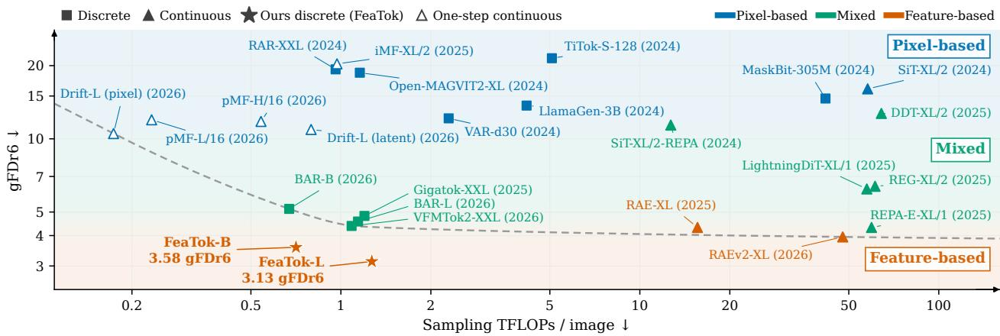  
Figure 1 Feature-based discrete tokens enable strong generation. FeaTok models advance the quality–compute Pareto frontier for image generation. We categorize generative image models by how pretrained feature-predictive self-supervised learning representations (Def. 1) shape the generated representation or the generator: not at all (pixel-based), together with pixel objectives (mixed), or alone (feature-based). Generation performance on ImageNet 256 × 256, where all models sample without guidance. Both axes are log-scaled.

## 1 Introduction

Image generation enables machines to create new visual content, supporting applications ranging from creative design to multimodal interaction. A growing body of work represents images as discrete tokens and models them autoregressively (Sun et al., 2024; Tian et al., 2024; Yu et al., 2026). Discrete tokens share the interface of language models, which makes them a natural choice for unified multimodal models. They also sample an image with an order of magnitude less compute than continuous difusion models, as shown in Fig. 1.

Image generation quality depends on discrete tokens that are both expressive and easy for a generator to model. Previous discrete tokenizers focus on reconstruction performance, which targets the first property, expressivity. However, generation also depends on the second property, which we call generative learnability: how easily a generator fits the token distribution at a given budget. These two properties do not always align, as observed for both continuous and discrete image tokenizers and generators (Gu et al., 2024; Yao et al., 2025; Ramanujan et al., 2025).

Generative learnability is related to the structure of a representation (Skorokhodov et al., 2025; Chu et al., 2026), which is in turn induced by the training target. Pixel reconstruction prioritizes high-variance image details over features useful for perception (Balestriero and Lecun, 2024), and using self-supervised learning (SSL) objectives to predict features instead of pixels yields more semantically meaningful representations (Assran et al., 2023). We refer to the representations of encoders trained with SSL objectives in feature space as pretrained visual features (see Def. 1). Moreover, RAE (Zheng et al., 2026b) and RAEv2 (Singh et al., 2026) show that the benefits of pretrained visual features go beyond representation learning and successfully transfer to image generation.

Wang et al. (2024) trained discrete tokens by reconstructing the features of image-understanding encoders instead of pixels, and showed that these tokens can outperform pixel-trained VQ tokens for image generation. Yet the discrete tokenizers that followed still use pixel reconstruction as the central loss, and add pretrained visual features with additional losses (Xiong et al., 2025; Du et al., 2026; Yu et al., 2026; Zheng et al., 2026a; Chen et al., 2026b). This raises the question of whether pixel reconstruction loss is essential for modern discrete tokenizer training used for downstream image generation. We argue that it is not. Feature objectives should shape both the encoder, pretrained in feature space, and the discrete tokens.

We introduce feature-loss tokenization (FeaTok), which separates discrete representation learning from image reconstruction. Instead of a pixel decoder and a pixel reconstruction loss, a feature decoder that reconstructs pretrained visual features shapes the discrete tokens. A separate image decoder is trained with pixel losses on detached tokens and only renders generated token sequences, so pixel losses never shape the discrete representation. We additionally discretize the encoder’s global representation (e.g., CLS token), and generate it before the patch tokens, giving them image-level context. We call this global-augmented generative modelling. Ablations in Sec. 2.2 show that FeaTok has better spatial structure and generates better than tokenizers trained with pixel or combined losses for all four encoders we study, and that global-augmented modelling contributes to this improvement.

On class-conditional ImageNet-1k (Russakovsky et al., 2015) at 256×256, FeaTok advances the quality–compute Pareto front for image generation (Fig. 1). We measure quality by gFDr6, the mean Fréchet-distance ratio across six feature spaces rather than the Inception space alone (Yang et al., 2026). FeaTok improves on the strongest discrete baselines by 29% without guidance and by 25% with it, and outperforms recent continuous generators at a matched sampling cost in both settings. The gains grow at 512×512: relative to the previously best discrete model (BAR (Yu et al., 2026)), FeaTok reduces gFDr6 by 43% without guidance and 39% with guidance, up from 32% and 25% at 256×256, and it also outperforms RAE. FeaTok further achieves higher rewards than discrete and continuous baselines on three human-preference models (Kirstain et al., 2023; Wu et al., 2023; Ma et al., 2025) without reward-based training. Finally, reusing the ImageNet-trained tokenizer, FeaTok surpasses the baselines on three text-to-image benchmarks (Ghosh et al., 2023; Li et al., 2024a; Hu et al., 2024) after 75K pretraining updates and only 500 fine-tuning updates. Discrete tokens shaped by feature losses alone are therefore competitive with continuous representations while sampling at a fraction of the cost, which makes them a practical substrate for unified multimodal models.

## 2 Feature-loss tokenization

In this section, we present FeaTok, which learns discrete tokens by reconstructing pretrained visual features.   
We use this term to distinguish representations by their pretraining objective.

Definition 1. We define pretrained visual features as representations of encoders learned by self-supervision in feature space, including language–image contrastive learning (Radford et al., 2021; Zhai et al., 2023; Tschannen

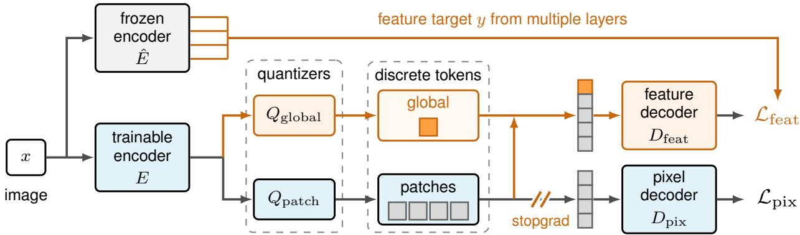  
Figure 2 FeaTok tokenizer and generation pipeline. Blue denotes the conventional discrete tokenizer and orange our contributions. Only feature losses shape the discrete tokens: $\mathcal { L } _ { \mathrm { f e a t } }$ trains $D _ { \mathrm { f e a t } }$ to reconstruct the multi-layer target y of the frozen encoder Eˆ from both global and patch tokens, while $\mathcal { L } _ { \mathrm { p i x } }$ trains only $D _ { \mathrm { p i x } }$ on detached patch tokens. The generator (not shown) models the global token from $Q _ { \mathrm { g l o b a l } }$ together with the patch tokens from $Q _ { \mathrm { p a t c h } }$

et al., 2025) and self-distillation (Caron et al., 2021; Oquab et al., 2024; Siméoni et al., 2026; Tschannen et al., 2025). Encoders trained by pixel reconstruction (He et al., 2022) are excluded.

We next describe how FeaTok uses these features to train the tokenizer with feature losses (Fig. 2).

## 2.1 Learning discrete tokens with feature loss only

Conventional discrete tokenizers (Van Den Oord et al., 2017; Jia et al., 2025; Bachmann et al., 2025; Zheng et al., 2026a; Yu et al., 2026) consist of an encoder E, a quantizer Q, and a pixel decoder $D _ { \mathrm { p i x } }$ . Given an image x partitioned into N patches, the encoder E produces N feature vectors, one per patch, which the quantizer Q maps to discrete tokens $z _ { 1 : N } = Q ( E ( x ) )$ . The pixel decoder $D _ { \mathrm { p i x } }$ then reconstructs the image as $\hat { x } = D _ { \mathrm { p i x } } ( z _ { 1 : N } )$ . Tokenizers are typically trained as an autoencoder with a pixel-level objective $\mathcal { L } _ { \mathrm { p i x } }$ that combines pixel reconstruction losses $( \ell _ { 1 } , \ell _ { 2 } )$ , perceptual losses (LPIPS (Zhang et al., 2018), GRAM (Lu et al., 2026a)), and adversarial losses (Goodfellow et al., 2014). Once the tokenizer is trained, an autoregressive model conditioned on class labels or text prompts c learns the distribution $p _ { \phi } \big ( z _ { 1 : N } \mid c \big )$ of the resulting token sequences using the cross-entropy loss.

Shaping discrete tokens with feature losses. FeaTok follows the autoencoder-style tokenizer design, but learns the discrete tokens by reconstructing features rather than pixels (see Fig. 2). Concretely, we add a feature decoder $D _ { \mathrm { f e a t } }$ that maps the discrete tokens $z _ { 1 : N }$ to a prediction $\hat { y } _ { 1 : N } = D _ { \mathrm { f e a t } } ( z _ { 1 : N } )$ of a feature target $y _ { 1 : N }$ We train the encoder, quantizer, and feature decoder to match this prediction to the target using a loss ${ \mathcal { L } } _ { \mathrm { f e a t } }$ that combines $\ell _ { 1 } , \ell _ { 2 }$ , and cosine distances.

For the feature target, following the insights in Singh et al. (2026), we use an average of features from multiple layers of the frozen vision encoder $\begin{array} { r } { \hat { E } , y _ { 1 : N } ( x ) = | \dot { K } | ^ { - 1 } \sum _ { k \in \mathcal { K } } \mathrm { L N } _ { k } \big ( \hat { E } ^ { ( k ) } ( x ) _ { 1 : N } \big ) } \end{array}$ , where K contains four evenly spaced encoder layers and LayerNorm (Ba et al., 2016) normalizes each layer’s features before averaging. This target is intended to combine visual detail from earlier layers with semantic information from later layers, balancing expressivity and generative learnability.

While we retain the pixel decoder $D _ { \mathrm { p i x } }$ and its pixel-level loss $\mathcal { L } _ { \mathrm { p i x } }$ during training, we stop the gradients at the decoder input. This preserves the ability to decode tokens back into images while preventing the pixe reconstruction losses from shaping the token distribution.

Leveraging global tokens. In addition to patch features, various vision encoders supply a global representation, $e . g .$ , a CLS token in DINO (Caron et al., 2021; Oquab et al., 2024; Siméoni et al., 2026) or a global pooling token in SigLIP (Zhai et al., 2023; Tschannen et al., 2025). Replacing pixel reconstruction with feature reconstruction losses naturally suggests discretizing this global feature along with patches. The benefit of doing so is that it allows us to define a hierarchical generative model that first generates the global token and then the patch tokens conditioned on it which simplifies the conditional distributions of the patch tokens by providing a global context. This global representation is generally ignored by discrete tokenizers trained using pixel-reconstruction losses, as the pixel reconstruction over patches does not provide direct supervision on the global feature discretization. Prior work follows a similar global-to-local strategy, using learned holistic tokens (Zheng et al., 2025a), coarse-to-fine token sequences (Bachmann et al., 2025), or separately generated semantic codes (Lavoie et al., 2025). In our case, the global token directly discretizes the pretrained encoder’s global representation.

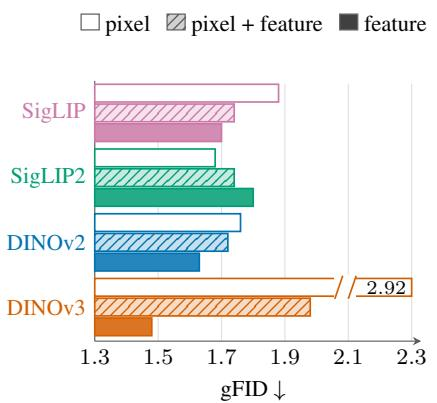  
(a) Tokenizer targets.

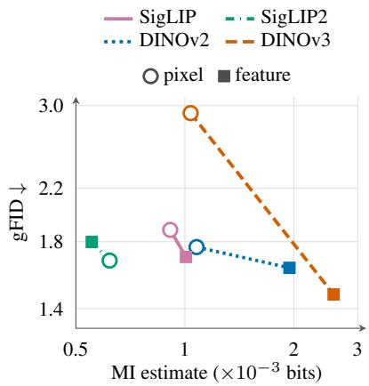  
(b) Spatial dependence.

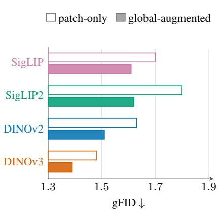  
(c) Global augmentation.  
Figure 3 Tokenizer-target and generator-type ablations. (a) With patch-only generation, feature targets improve gFID for SigLIP, DINOv2, and DINOv3. The DINOv3 pixel bar has a break to accommodate its gFID of 2.92. (b) Spatial dependence between adjacent patch tokens versus patch-only gFID. The feature target raises the dependence and lowers gFID for SigLIP, DINOv2, and DINOv3. Both axes are log-scaled. (c) With the feature target fixed, global-augmented generation improves gFID for all four encoders, achieving better generation than pixel-target baselines.

Specifically, we use separate quantizers, $Q _ { \mathrm { g l o b a l } }$ and $Q _ { \mathrm { p a t c h } }$ , for global and patch features, respectively. The feature decoder $D _ { \mathrm { f e a t } }$ takes both global and patch tokens and reconstructs the combined target $y = ( y _ { \mathrm { g l o b a l } } , y _ { 1 : N } )$ using the feature loss $\mathcal { L } _ { \mathrm { f e a t } }$ . This yields a discrete global token $z _ { \mathrm { g l o b a l } }$ , which we model jointly with the patch tokens using the following factorization:

$$
p _ { \phi } ( z _ { \mathrm { g l o b a l } } , z _ { 1 : N } \mid c ) = p _ { \phi } ( z _ { \mathrm { g l o b a l } } \mid c ) \prod _ { i = 1 } ^ { N } p _ { \phi } ( z _ { i } \mid z _ { \mathrm { g l o b a l } } , z _ { < i } , c ) .\tag{1}
$$

where c denotes the class label or text prompt. During inference, the generator first samples the global token and then samples patch tokens conditioned on both global and external conditions.

Combined training objective. We train the tokenizer and pixel decoder jointly using the feature and pixel losses described above. Following prior work on semantic preservation during tokenizer training (Chen et al., 2026a; Du et al., 2026), we also include an $\ell _ { 2 }$ regularizer $\mathcal { L } _ { \mathrm { r e g } }$ between the last-layer features h and hˆ of the trainable and frozen encoders. With $z = ( z _ { \mathrm { g l o b a l } } , z _ { 1 : N } )$ , the complete objective is

$$
\begin{array} { r } { \mathcal { L } _ { \mathrm { F e a T o k } } = \mathbb { E } _ { x } \left[ \underbrace { \mathcal { L } _ { \mathrm { f e a t } } ( D _ { \mathrm { f e a t } } ( z ) , y ) + \lambda _ { \mathrm { r e g } } \mathcal { L } _ { \mathrm { r e g } } ( h , \hat { h } ) } _ { \mathrm { t r a i n s ~ e n c o d e r , ~ q u a n t i z e r s , ~ f e a t u r e ~ d e c o d e r } } + \underbrace { \lambda _ { \mathrm { p i x } } \mathcal { L } _ { \mathrm { p i x } } ( D _ { \mathrm { p i x } } ( \mathrm { s g } ( z _ { 1 : N } ) ) , x ) } _ { \mathrm { t r a i n s ~ o n l y ~ t h e ~ p i x e l ~ d e c o d e r } } \right] , } \end{array}\tag{2}
$$

where the expectation is over training images x. The weights $\lambda _ { \mathrm { r e g } }$ and $\lambda _ { \mathrm { p i x } }$ balance the loss terms, and sg stops gradients at the pixel decoder input.

Once the tokenizer is trained, we keep it fixed and train an autoregressive generator on its tokens using teacher forcing. We combine the cross-entropy loss for the global token with the average loss over patch tokens, weighted by $\lambda _ { \mathrm { g l o b a l } }$ and $\lambda _ { \mathrm { p a t c h } }$ , respectively. These weights control the emphasis on global and patch prediction independently of the number of patches.

## 2.2 Controlled ablations across pretrained vision encoders

We verify FeaTok, feature-loss tokenization, against pixel-loss tokenization using four pretrained vision encoders: SigLIP (Zhai et al., 2023), SigLIP2 (Tschannen et al., 2025), DINOv2 (Oquab et al., 2024), and DINOv3 (Siméoni et al., 2026). We compare the generation performance of a generative model trained on ImageNet-1k (Russakovsky et al., 2015) images at 256×256 resolution using diferent tokenizers. Details of ablation setups are given in App. C. Additionally, App. C.2 shows that tokenizers built on MAE (He et al., 2022), whose features are learned by pixel reconstruction, generate poorly under every supervision.

Feature targets work better than pixel-only or mixed feature–pixel targets. Feature supervision improves the generation over pixel supervision for three of the four encoders, as shown in Fig. 3a. With patch-only generation, replacing pixel targets with feature targets lowers gFID for SigLIP, DINOv2, and DINOv3, while combining pixel and feature losses, i.e., letting gradients from both decoders update the discrete tokens, gives intermediate results. Fig. 3b relates these gFID changes to the spatial dependence between adjacent discrete patch tokens. The feature target raises this dependence and lowers gFID for SigLIP, DINOv2, and DINOv3, showing that the feature target improves the token structure for generation. SigLIP2 is the exception, possibly because, unlike the other three encoders, it is not trained only in feature space. Its training adds a text decoder that generates captions of whole images and of specific regions (Tschannen et al., 2025). App. C.4 details the estimator and presents other token-structure measures.

Holding the tokenizer fixed and adding the global conditioning to generative modeling lowers gFID from 1.70 to 1.61 for SigLIP, 1.80 to 1.62 for SigLIP2, 1.63 to 1.51 for DINOv2, and 1.48 to 1.39 for DINOv3, as shown in Fig. 3c. With the global token, FeaTok with SigLIP2 overtakes the counterpart trained with pixel reconstruction losses.

Leveraging features from multiple layers improves generation. The four-layer average gives the best measured gFID for each encoder in Fig. 4, with global-augmented generation throughout. Compared with the first and last layers, respectively, averaging yields the best generation performance consistently across all encoders. Tab. 11 in App. C reports the numbers presented in this section in detail, and with the accompanying reconstruction results for each ablation.

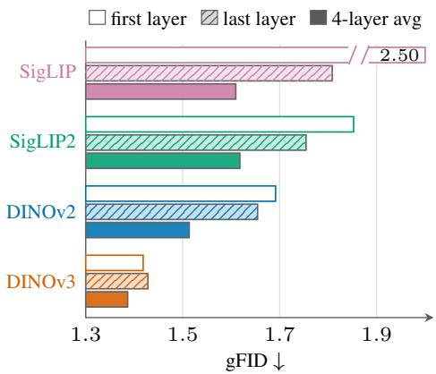  
Figure 4 Feature-target depth. First-layer, lastlayer and four-layer-average targets with globalaugmented generation. The SigLIP first-layer bar has a break to accommodate its gFID of 2.50.

## 3 State-of-the-art image generation with discrete tokens

To demonstrate the efectiveness of our approach, we evaluate it on ImageNet-1k (Russakovsky et al., 2015) at 256×256 and 512×512 resolution, as well as text-to-image (T2I) generation. Our models achieve state-of-the-art performance among methods using discrete tokenizers and outperform recent continuous generative models at a matched inference cost on ImageNet-1k 256×256. FeaTok achieves better performance on ImageNet-1k 512×512 than both continuous and discrete baselines. On T2I, FeaTok outperforms RAEv2 (Singh et al., 2026) after a short fine-tuning on three T2I benchmarks, including GenEval (Ghosh et al., 2023), DPG-Bench (Hu et al., 2024), and GenAI-Bench (Li et al., 2024a).

## 3.1 ImageNet-1k generation at 256×256

We train our 256×256 FeaTok tokenizers on ImageNet-1k using SigLIP (Zhai et al., 2023), SigLIP2 (Tschannen et al., 2025), DINOv2 (Oquab et al., 2024), and DINOv3 (Siméoni et al., 2026) encoders, with a vocabulary size of 65, 536. For each tokenizer, we train the same autoregressive generator as BAR (Yu et al., 2026), the previous state-of-the-art discrete model for ImageNet-1k, with our global-augmented modelling. App. A specifies the implementation details including vision encoder versions, tokenizer and generator instantiations, etc.

Fréchet distance in the Inception space can misrank modern generative models, and measuring it in stronger feature spaces such as DINOv2 agrees better with human judgments (Stein et al., 2023). We therefore report gFDr6, the mean Fréchet-distance ratio across Inception-v3 (Szegedy et al., 2016), ConvNeXt V2 (Woo et al., 2023), DINOv2 (Oquab et al., 2024), MAE (He et al., 2022), SigLIP2 (Tschannen et al., 2025), and CLIP (Radford et al., 2021) feature spaces, following Yang et al. (2026). In App. E we detail the sampling configurations for each model. In App. F we report gFID (Heusel et al., 2017) and precision, recall (Kynkäänniemi et al., 2019), density and coverage (Naeem et al., 2020) in Inception space as complementary diagnostics. Unless stated otherwise, baselines are evaluated by us using their released setups.

Table 1 Comparison with discrete baselines on ImageNet-1k 256 ×256. FeaTok outperforms all discrete baselines with and without guidance. Size denotes the generator parameter count. TFLOPs reports the sampling cost per image without guidance. Baselines use their released sampling settings, and App. F reports FeaTok at gFID-selected settings. ‡VAR’s unguided generator cost is estimated as half its guided cost. Bold and underline mark the best and second-best values across all models in each metric column.
<table><tr><td></td><td></td><td colspan="8">without guidance</td><td colspan="7">with guidance</td></tr><tr><td>method</td><td colspan="2">size TFLOPs gFDr6incep. cvnx2 dino2</td><td colspan="2"></td><td colspan="2"></td><td colspan="2">mae siglip2</td><td colspan="2">clip</td><td colspan="2">gFDr6incep. cvnx2 dino2</td><td></td><td>mae siglip2</td><td></td><td>clip</td></tr><tr><td>Pixel-based</td><td></td><td></td><td></td><td></td><td></td><td></td><td></td><td></td><td></td><td></td><td></td><td></td><td></td><td></td><td></td><td></td></tr><tr><td>VAR-d30 (Tian et al., 2024)</td><td>2.0B</td><td>2.29</td><td>12.14</td><td>3.09</td><td>5.09</td><td>11.92</td><td>10.21</td><td>22.60</td><td>19.91</td><td>6.75</td><td>1.16</td><td>1.64</td><td>5.30</td><td>7.25</td><td>11.95</td><td>13.22</td></tr><tr><td>LlamaGen-3B (Sun et al., 2024)</td><td>3.1B</td><td>4.18</td><td>13.70</td><td>5.62</td><td>8.70</td><td>13.33</td><td>9.34</td><td>23.32</td><td>21.91</td><td>5.97</td><td>1.26</td><td>1.40</td><td>4.75</td><td>5.35</td><td>10.46</td><td>12.59</td></tr><tr><td>TiTok-S-128 (Yu et al., 2024b)</td><td>0.3B</td><td>5.08</td><td>21.45</td><td>5.11</td><td>10.51</td><td>22.62</td><td>14.22</td><td>41.96</td><td>34.27</td><td>15.32</td><td>1.19</td><td>1.98</td><td>14.04</td><td>13.53</td><td>30.23</td><td>30.96</td></tr><tr><td>Open-MAGVIT2-XL (Luo et al., 2024) 1.5B</td><td></td><td>1.16</td><td>18.70</td><td>6.85</td><td>12.83</td><td>19.89</td><td>10.29</td><td>34.18</td><td>28.13</td><td>7.72</td><td>1.39</td><td>2.24</td><td>7.15</td><td>5.53</td><td>14.98</td><td>15.03</td></tr><tr><td>MaskBit-305M (Weber et al., 2024)</td><td>0.3B</td><td>41.79</td><td>14.65</td><td>2.36</td><td>6.84</td><td>13.23</td><td>10.45</td><td>27.15</td><td>27.84</td><td>11.68</td><td>0.93</td><td>3.06</td><td>9.03</td><td>9.71</td><td>21.43</td><td>25.94</td></tr><tr><td>RAR-XXL (Yu et al., 2025a)</td><td>1.5B</td><td>0.96</td><td>19.31</td><td>2.50</td><td>7.07</td><td>16.95</td><td>12.50</td><td>32.90</td><td>43.93</td><td>15.07</td><td>0.88</td><td>2.71</td><td>10.23</td><td>11.39</td><td>24.73</td><td>40.48</td></tr><tr><td>Mixed</td><td></td><td></td><td></td><td></td><td></td><td></td><td></td><td></td><td></td><td></td><td></td><td></td><td></td><td></td><td></td><td></td></tr><tr><td>Gigatok-XXL (Xiong et al., 2025)</td><td>1.4B</td><td>1.20</td><td>4.82</td><td>1.18</td><td>1.24</td><td>3.78</td><td>4.84</td><td>8.78</td><td>9.10</td><td>4.24</td><td>1.72</td><td>1.44</td><td>2.96</td><td>4.30</td><td>7.27</td><td>7.76</td></tr><tr><td>VFMTok2-XXL (Zheng et al., 2026a)</td><td>1.4B</td><td>1.09</td><td>4.38</td><td>1.22</td><td>0.99</td><td>3.25</td><td>4.82</td><td>7.73</td><td>8.29</td><td>4.37</td><td>2.32</td><td>1.79</td><td>2.98</td><td>4.67</td><td>7.01</td><td>7.44</td></tr><tr><td>BAR-B (Yu et al., 2026)</td><td>0.4B</td><td>0.67</td><td>5.15</td><td>1.01</td><td>1.70</td><td>5.21</td><td>5.82</td><td>9.40</td><td>7.73</td><td>4.89</td><td>0.69</td><td>0.95</td><td>4.63</td><td>5.89</td><td>9.32</td><td>7.86</td></tr><tr><td>BAR-L (Yu et al., 2026)</td><td>1.1B</td><td>1.14</td><td>4.57</td><td>0.83</td><td>1.38</td><td>4.59</td><td>5.22</td><td>8.14</td><td>7.26</td><td>4.11</td><td>0.61</td><td>0.79</td><td>3.72</td><td>5.02</td><td>7.49</td><td>7.06</td></tr><tr><td>Feature-based</td><td></td><td></td><td></td><td></td><td></td><td></td><td></td><td></td><td></td><td></td><td></td><td></td><td></td><td></td><td></td><td></td></tr><tr><td>FeaTok-B-SigLIP</td><td>0.4B</td><td>0.71</td><td>4.46</td><td>1.58</td><td>0.89</td><td>4.49</td><td>5.86</td><td>8.00</td><td>5.94</td><td>4.14</td><td>1.28</td><td>0.75</td><td>3.96</td><td>5.51</td><td>7.71</td><td>5.63</td></tr><tr><td>FeaTok-B-SigLIP2 FeaTok-B-DINOv2</td><td>0.4B</td><td>0.71</td><td>4.00</td><td>1.42</td><td>0.98</td><td>3.79</td><td>4.87</td><td>7.52</td><td>5.41</td><td>3.46</td><td>1.30</td><td>0.86</td><td>3.09</td><td>4.14</td><td>6.29</td><td>5.05</td></tr><tr><td>FeaTok-B-DINOv3</td><td>0.4B</td><td>0.71 0.71</td><td>4.40 3.58</td><td>0.92</td><td>1.36</td><td>4.12</td><td>4.93</td><td>8.31</td><td>6.74</td><td>3.56</td><td>1.15</td><td>0.89</td><td>3.00</td><td>4.21</td><td>6.39</td><td>5.71</td></tr><tr><td></td><td>0.4B</td><td></td><td></td><td>1.09</td><td>0.82</td><td>3.30</td><td>4.62</td><td>6.50</td><td>5.15</td><td>3.39</td><td>1.06</td><td>0.70</td><td>3.00</td><td>4.43</td><td>6.28</td><td>4.91</td></tr><tr><td>FeaTok-L-SigLIP</td><td>1.1B</td><td>1.27</td><td>4.00</td><td>1.49</td><td>0.80</td><td>3.94</td><td>5.09</td><td>7.12</td><td>5.56</td><td>3.92</td><td>1.52</td><td>0.85</td><td>3.80</td><td>4.82</td><td>7.01</td><td>5.54</td></tr><tr><td>FeaTok-L-SigLIP2</td><td>1.1B</td><td>1.27</td><td>3.45</td><td>1.11</td><td>0.82</td><td>3.37</td><td>4.04</td><td>6.29</td><td>5.11</td><td>3.27</td><td>1.12</td><td>0.78</td><td>2.98</td><td>3.75</td><td>6.07</td><td>4.94</td></tr><tr><td>FeaTok-L-DINOv2</td><td>1.1B</td><td>1.27</td><td>3.47</td><td>0.87</td><td>0.83</td><td>3.11</td><td>4.13</td><td>6.33</td><td>5.52</td><td>3.20</td><td>0.95</td><td>0.74</td><td>2.69</td><td>3.77</td><td>5.79</td><td>5.28</td></tr><tr><td>FeaTok-L-DINOv3</td><td>1.1B</td><td>1.27</td><td>3.13</td><td>0.96</td><td>0.68</td><td>2.95</td><td>4.00</td><td>5.57</td><td>4.62</td><td>3.08</td><td>1.09</td><td>0.82</td><td>2.93</td><td>3.73</td><td>5.28</td><td>4.65</td></tr></table>

FeaTok outperforms discrete models. In Tab. 1 we compare FeaTok using diferent vision encoders and two model sizes to existing discrete image generative models in terms of gFDr6 and its per-feature metrics. All four FeaTok-L variants outperform the strongest prior discrete baseline in gFDr6, showing consistent gains across four pretrained visual feature encoders satisfying Def. 1. FeaTok-DINOv3 is the strongest discrete model at both generator scales, with and without guidance. The largest improvements appear without guidance, where we reduce the prior baseline gFDr6 of 4.38 from VFMTok2-XXL (Zheng et al., 2026a) to 3.13. With guidance, we reduce the 4.11 gFDr6 of BAR-L to 3.08. Increasing the generator from base to large consistently improves gFDr6; for DINOv3, it decreases from 3.58 to 3.13 without guidance and from 3.39 to 3.08 with guidance. Importantly, these generation gains do not coincide with improved reconstruction: rFID remains nearly constant across FeaTok tokenizers (0.92–1.01; App. C.3), reinforcing that reconstruction fidelity alone does not explain generative performance. Figs. 8–11 in App. H show qualitative samples.

FeaTok is competitive with continuous models at lower sampling cost. Tab. 2 compares against continuous baselines at their standard sampling settings. Without guidance, FeaTok-L-DINOv3 achieves gFDr6 3.13, outperforming RAEv2 (3.95) while using 1.27 rather than 47.72 TFLOPs per image. With guidance, our 3.08 is competitive with RAE-XL (3.26) (Zheng et al., 2026b) and REPA-E (3.04) (Leng et al., 2025), although RAEv2 retains the best gFDr6 (2.17).

To compare at similar sampling costs, Tab. 3 evaluates RAEv2 with fewer sampling steps, tuning its internal guidance at each step count for the best gFDr6 (App. E). With guidance, FeaTok achieves gFDr6 3.08 at 2.31 TFLOPs per image, compared with 3.43 at 3.07 TFLOPs for six-step RAEv2. RAEv2 is not trained to perform few-step sampling. We therefore also compare with Drift (Deng et al., 2026), iMF (Geng et al., 2026), and pMF (Lu et al., 2026b), which are explicitly trained for one-step generation. Without guidance, their gFDr6 values range from 10.51 to 20.34, and even the best guided value is 6.87, whereas unguided FeaTok achieves 3.13. App. G provides detailed cost measurements, including FLOPs, wall-clock throughput, and peak memory.

Table 2 Comparison with baselines using continuous features on ImageNet-1k at 256 × 256. Without guidance, FeaTok achieves lower gFDr6 than all listed baselines at a lower sampling cost. Size denotes the generator parameter count, and TFLOPs reports the sampling cost per image without guidance. Bold and underline mark the best and second-best values in each metric column. Guided continuous-baseline results are transcribed from Singh et al. (2026).
<table><tr><td></td><td colspan="10">without guidance</td><td colspan="7">with guidance</td></tr><tr><td>method</td><td colspan="2">size TFLOPs</td><td colspan="2">gFDr6incep. cvnx2 dino2</td><td colspan="2"></td><td colspan="2">mae siglip2</td><td colspan="2">clip</td><td colspan="2">gFDr6incep. cvnx2 dino2</td><td></td><td>mae</td><td>siglip2</td><td>clip</td></tr><tr><td>Pixel-based</td><td></td><td></td><td></td><td></td><td></td><td></td><td></td><td></td><td></td><td></td><td></td><td></td><td></td><td></td><td></td><td></td></tr><tr><td>SiT-XL/2 (Ma et al., 2024)</td><td>675M</td><td>57.82</td><td>16.05</td><td>5.24</td><td>8.34</td><td>16.77</td><td>9.40</td><td>30.05</td><td>26.52</td><td>8.44</td><td>1.26</td><td>2.02</td><td>7.89</td><td>5.62</td><td>16.14</td><td>17.69</td></tr><tr><td>Mixed</td><td></td><td></td><td></td><td></td><td></td><td></td><td></td><td></td><td></td><td></td><td></td><td></td><td></td><td></td><td></td><td></td></tr><tr><td>SiT-XL/2-REPA (Yu et al., 2025b)</td><td>675M</td><td>12.69</td><td>11.39</td><td>3.57</td><td>5.10</td><td>10.81</td><td>7.34</td><td>20.70</td><td>20.80</td><td>5.45</td><td>0.85</td><td>1.22</td><td>4.27</td><td>3.85</td><td>9.87</td><td>12.65</td></tr><tr><td>LightningDiT-XL/1 (Yao et al., 2025)</td><td>675M</td><td>57.45</td><td>6.22</td><td>1.33</td><td>2.42</td><td>5.77</td><td>4.08</td><td>11.77</td><td>11.95</td><td>4.57</td><td>0.85</td><td>1.09</td><td>3.76</td><td>3.02</td><td>8.47</td><td>10.21</td></tr><tr><td>DDT-XL/2 (Wang et al., 2026)</td><td>675M</td><td>64.25</td><td>12.72</td><td>3.86</td><td>5.52</td><td>11.89</td><td>8.20</td><td>23.06</td><td>23.78</td><td>5.70</td><td>0.75</td><td>1.02</td><td>4.26</td><td>4.11</td><td>10.16</td><td>13.86</td></tr><tr><td>REPA-E-XL/1 (Leng et al., 2025) REG-XL/2 (Wu et al., 2025)</td><td>675M</td><td>59.57 61.22</td><td>4.32 6.38</td><td>1.03</td><td>2.35</td><td>3.81</td><td>3.48</td><td>7.38</td><td>7.84 13.81</td><td>3.04</td><td>0.70</td><td>1.28</td><td>2.44</td><td>2.52 3.02</td><td>5.04 8.42</td><td>6.28 10.86</td></tr><tr><td></td><td>675M</td><td></td><td></td><td>1.05</td><td>1.74</td><td>4.98</td><td>4.96</td><td>11.72</td><td></td><td>4.64</td><td>0.92</td><td>1.14</td><td>3.45</td><td></td><td></td><td></td></tr><tr><td>Feature-based</td><td></td><td></td><td></td><td></td><td></td><td></td><td></td><td></td><td></td><td></td><td></td><td></td><td></td><td></td><td></td><td></td></tr><tr><td>RAE-XL (Zheng et al., 2026b)</td><td>839M</td><td>15.59</td><td>4.32</td><td>0.91</td><td>2.23</td><td>3.01</td><td>4.79</td><td>5.66</td><td>9.36</td><td>3.26</td><td>0.69</td><td>1.79</td><td>2.11</td><td>3.30</td><td>3.79</td><td>7.87</td></tr><tr><td>RAEv2-XL (Singh et al., 2026)</td><td>875M</td><td>47.72</td><td>3.95</td><td>1.00</td><td>1.41</td><td>2.39</td><td>5.83</td><td>5.66</td><td>7.41</td><td>2.17</td><td>0.64</td><td>0.77</td><td>1.15</td><td>2.67</td><td>2.54</td><td>5.21</td></tr><tr><td>FeaTok-L-DINOv3</td><td>1.1B</td><td>1.27</td><td>3.13</td><td>0.96</td><td>0.68</td><td>2.95</td><td>4.00</td><td>5.57</td><td>4.62</td><td>3.08</td><td>1.09</td><td>0.82</td><td>2.93</td><td>3.73</td><td>5.28</td><td>4.65</td></tr></table>

Table 3 Generation with matched inference cost on ImageNet 256 × 256. TFLOPs are computed without guidance per image. Guided one-step results are from Yang et al. (2026). Drift models share the same setup w and w/o guidance. Bold and underline mark the best and second-best values in each metric column.
<table><tr><td></td><td colspan="10">without guidance</td><td colspan="7">with guidance</td></tr><tr><td>method</td><td>steps TFLOPs</td><td></td><td>gFDr6incep. cvnx2 dino2</td><td></td><td></td><td></td><td>mae</td><td>siglip2</td><td>clip</td><td></td><td>gFDr6incep. cvnx2 dino2</td><td></td><td></td><td>mae</td><td>siglip2</td><td>clip</td></tr><tr><td>Baselines with continuous features</td><td></td><td></td><td></td><td></td><td></td><td></td><td></td><td></td><td></td><td></td><td></td><td></td><td></td><td></td><td></td><td></td></tr><tr><td>RAEv2-XL (Singh et al., 2026)</td><td>3</td><td>1.65</td><td>38.90</td><td>14.12</td><td>11.69</td><td>16.68</td><td>69.14</td><td>78.74</td><td>43.06</td><td>8.95</td><td>2.98</td><td>3.15</td><td>6.41</td><td>10.49</td><td>16.15</td><td>14.50</td></tr><tr><td>RAEv2-XL (Singh et al., 2026)</td><td>6</td><td>3.07</td><td>8.49</td><td>2.52</td><td>2.90</td><td>5.32</td><td>12.75</td><td>14.45</td><td>13.01</td><td>3.43</td><td>1.27</td><td>1.29</td><td>2.11</td><td>4.54</td><td>4.92</td><td>6.42</td></tr><tr><td>Baselines of one-step flow models</td><td></td><td></td><td></td><td></td><td></td><td></td><td></td><td></td><td></td><td></td><td></td><td></td><td></td><td></td><td></td><td></td></tr><tr><td>Drift-L (latent) (Deng et al., 2026)</td><td>1</td><td>0.79</td><td>10.92</td><td>0.91</td><td>2.03</td><td>10.35</td><td>6.51</td><td>24.12</td><td>21.59</td><td>10.92</td><td>0.91</td><td>2.03</td><td>10.35</td><td>6.51</td><td>24.12</td><td>21.59</td></tr><tr><td>Drift-L (pixel) (Deng et al., 2026)</td><td>1</td><td>0.17</td><td>10.51</td><td>0.85</td><td>0.73</td><td>6.33</td><td>6.51</td><td>22.13</td><td>26.49</td><td>10.51</td><td>0.85</td><td>0.73</td><td>6.33</td><td>6.51</td><td>22.13</td><td>26.49</td></tr><tr><td>iMF-XL/2 (Geng et al., 2026)</td><td>1 1</td><td>0.97</td><td>20.34</td><td>6.33</td><td>9.26</td><td>19.10</td><td>13.28</td><td>41.90</td><td>32.15</td><td>8.39</td><td>1.09</td><td>1.72</td><td>7.30</td><td>6.09</td><td>17.02</td><td>17.14 14.81</td></tr><tr><td>pMF-L/16 (Lu et al., 2026b) pMF-H/16 (Lu et al., 2026b)</td><td>1</td><td>0.23 0.54</td><td>11.97 11.79</td><td>1.86 2.37</td><td>1.68 2.38</td><td>8.76 9.58</td><td>13.12 10.28</td><td>27.75 27.79</td><td>18.67 18.34</td><td>9.09 6.87</td><td>1.62 1.37</td><td>1.36 1.15</td><td>6.70 5.43</td><td>9.72 6.25</td><td>20.34</td><td>11.68</td></tr><tr><td></td><td></td><td></td><td></td><td></td><td></td><td></td><td></td><td></td><td></td><td></td><td></td><td></td><td></td><td></td><td>15.33</td><td></td></tr><tr><td>FeaTok-L-DINOv3</td><td>256</td><td>1.27</td><td>3.13</td><td>0.96</td><td>0.68</td><td>2.95</td><td>4.00</td><td>5.57</td><td>4.62</td><td>3.08</td><td>1.09</td><td>0.82</td><td>2.93</td><td>3.73</td><td>5.28</td><td>4.65</td></tr></table>

FeaTok reaches higher human-preference rewards, closer to those of the training data. Fig. 5 compares generated and real ImageNet-1k data using PickScore (Kirstain et al., 2023), HPSv2 (Wu et al., 2023), and HPSv3 (Ma et al., 2025), all learned from human preference comparisons. These scores are automatic proxies for human evaluations, and complement the distributional measurements in Tabs. 1 and 2. FeaTok performs better than baselines both in terms of the raw value of the rewards and the closeness to the training data. On PickScore and HPSv2, the SigLIP2, DINOv2, and DINOv3 variants are closer to the real-data reference than every baseline. On the more discriminative HPSv3, FeaTok-DINOv3 and FeaTok-SigLIP have the reward scores closest to those of the training set, followed by RAEv2, all substantially closer than BAR-L and RAE.

## 3.2 FeaTok outperforms BAR-L and RAE at 512×512

Following Yu et al. (2026), we train a tokenizer for ImageNet-1k generation at 512×512 with the DINOv3 vision encoder, using vocabulary size 1, 024 per token. Implementation details are in Apps. A and B. We show the gFDr6 results for 512 resolution in Tab. 4. The benefit of FeaTok over baseline is larger at higher resolution. FeaTok-L-DINOv3 reduces the unguided gFDr6 of BAR-L from 3.82 to 2.17 and the guided result from 2.94 to 1.80. These are reductions of 43% and 39%, compared with 32% and 25% for the corresponding large-scale comparison at 256 resolution. Our method outperforms BAR-L in all feature spaces without guidance, and in all feature spaces except Inception with guidance. FeaTok also outperforms RAE in gFDr6, with 2.17 against 3.03 without guidance and 1.80 against 2.13 with guidance, although RAE is better in the Inception and SigLIP2 spaces in both settings. RAEv2 does not provide a model at 512 resolution.

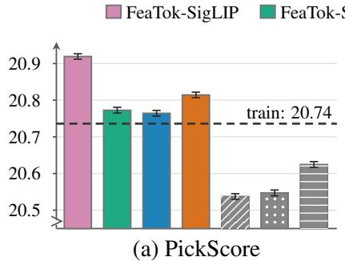

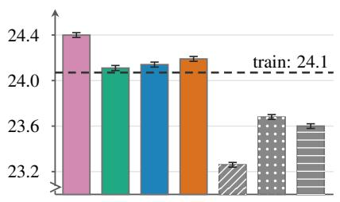  
(b) HPSv2

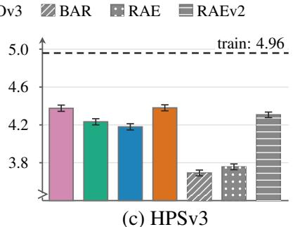  
Figure 5 Human-preference rewards on 50K generated ImageNet images with 95% confidence intervals. FeaTok achieves the highest rewards compared to baselines, and also closer to the rewards measured on the training set. Dashed lines represent the mean of the rewards over training-data. HPSv2 scores are displayed multiplied by 100. FeaTok uses large generators sampled with guidance.

Table 4 Generation on ImageNet-1k 512 × 512. FeaTok outperforms BAR-L and RAE with and without guidance. Bold and underline mark the best and second-best values in each metric column. †RAE uses autoguidance instead of classifier-free guidance, and its unguided row uses the released configuration with autoguidance disabled.
<table><tr><td></td><td colspan="6">without guidance</td><td colspan="7">with guidance</td></tr><tr><td>method</td><td></td><td></td><td>gFDr6incep. cvnx2</td><td>dino2</td><td>mae</td><td>siglip2</td><td>clip</td><td>gFDr6</td><td>incep. cvnx2</td><td></td><td>dino2</td><td>mae siglip2</td><td>clip</td></tr><tr><td>Baselines</td><td></td><td></td><td></td><td></td><td></td><td></td><td></td><td></td><td></td><td></td><td></td><td></td><td></td></tr><tr><td>RAE-XL† (Zheng et al., 2026b)</td><td>3.03</td><td>0.97</td><td>1.42</td><td>2.07</td><td>3.11</td><td>4.40</td><td>6.19</td><td>2.13 0.75</td><td>1.10</td><td>1.34</td><td>2.02</td><td>2.74</td><td>4.84</td></tr><tr><td>BAR-L (Yu et al., 2026)</td><td>3.82</td><td>1.19</td><td>1.77</td><td>2.86</td><td>2.80</td><td>8.98</td><td>5.30</td><td>2.94 0.78</td><td>1.02</td><td>2.24</td><td>2.54</td><td>5.81</td><td>5.22</td></tr><tr><td>FeaTok-L-DINOv3</td><td>2.17</td><td>1.16</td><td>0.74</td><td>1.41</td><td>1.69</td><td>4.63</td><td>3.38</td><td>1.80 0.94</td><td>0.65</td><td>1.26</td><td>1.30</td><td>3.51</td><td>3.17</td></tr></table>

## 3.3 Extension to text-to-image generation

Finally, we demonstrate the usefulness of FeaTok by applying it to text-to-image (T2I) generation. Following RAEv2 (Singh et al., 2026), we use BLIP-3o datasets (Chen et al., 2025) (Long-Caption, Short-Caption, and JourneyDB) for pre-training and BLIP-3o-60K for fine-tuning. We replace the class conditioning in FeaTok with a sequence of text embeddings provided by Qwen3-0.6B (Qwen Team, 2025) to enable T2I generation, re-using our FeaTok-SigLIP2 tokenizer trained on ImageNet-1k. We pre-train 75k updates with batch size 2048, while baselines use 150k updates with batch size 1024, giving the same total number of training examples processed. Then we further fine-tune the pre-trained model for 500 updates, while baselines are fine-tuned for approximately 3k updates.

After pre-training, FeaTok is broadly comparable to RAEv2. It is slightly lower on GenEval (Ghosh et al., 2023) (0.611 versus 0.624) and DPG-Bench (Hu et al., 2024) (79.8 versus 81.7), but higher on GenAI-Bench (Li et al., 2024a) (0.668 versus 0.638). After only 500 additional updates, FeaTok exceeds RAEv2 on all three benchmarks: 0.837 versus 0.827 on GenEval, 0.698 versus 0.680 on GenAI-Bench, and 83.4 versus 82.3 on DPG-Bench. The comparison with BAR (Yu et al., 2026) isolates the efect of the tokenizer directly, whose tokenizer is trained with pixel losses and a feature-alignment loss using SigLIP2. After pre-training, FeaTok is ahead of BAR on GenEval, slightly ahead on GenAI-Bench, and tied on DPG-Bench. After fine-tuning, all three benchmarks rank FeaTok above BAR, with 0.837 versus 0.817 on GenEval, 0.698 versus 0.688 on GenAI-Bench, and 83.4 versus 81.7 on DPG-Bench. The advantage of feature-loss tokens over mixed tokens thus carries over from class-conditional to text-to-image generation. We provide several T2I qualitative examples in Fig. 6. More qualitative samples are presented in App. I (Fig. 12).

## 4 Related work

Pretrained representations for continuous generation. Continuous generators show that the pretraining objective of the features matters. RAE (Zheng et al., 2026b) and RAEv2 (Singh et al., 2026) train difusion models in the feature spaces of pretrained vision encoders, paired with learned image decoders, and RAE finds that

Table 5 Text-to-image results after pre-training and fine-tuning. FeaTok is broadly comparable to RAEv2, and surpasses all baselines after 500 fine-tuning updates. Continuous-latent baseline results are taken from Singh et al. (2026).
<table><tr><td></td><td colspan="3">after pre-training</td><td colspan="3">after fine-tuning</td></tr><tr><td>model</td><td>GenEval ↑</td><td>GenAI ↑</td><td>DPG ↑</td><td>GenEval ↑</td><td>GenAI ↑</td><td>DPG ↑</td></tr><tr><td colspan="7">continuous models</td></tr><tr><td>Flux-VAE (Black Forest Labs, 2024)</td><td>0.417</td><td>0.573</td><td>77.6</td><td>0.783</td><td>0.639</td><td>79.2</td></tr><tr><td>RAE (Zheng et al., 2026b)</td><td>0.584</td><td>0.632</td><td>80.1</td><td>0.815</td><td>0.672</td><td>80.6</td></tr><tr><td>RAEv2 (Singh et al., 2026)</td><td>0.624</td><td>0.638</td><td>81.7</td><td>0.827</td><td>0.680</td><td>82.3</td></tr><tr><td colspan="7">discrete models</td></tr><tr><td>BAR (Yu et al., 2026)</td><td>0.564</td><td>0.664</td><td>79.8</td><td>0.817</td><td>0.688</td><td>81.7</td></tr><tr><td>FeaTok</td><td>0.611</td><td>0.668</td><td>79.8</td><td>0.837</td><td>0.698</td><td>83.4</td></tr></table>

  
a butterfly gently touching the vast surface of the lake, peace, serenity,

  
a photo of a cat and a dog on the beach wearing fancy hats

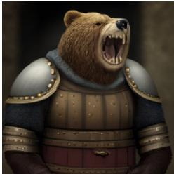  
grizzly bear wearing medieval armor looking fierce and roaring

  
a realistic photo of a margarita cocktail

  
a hyperrealistic image of half a lemon dropping into clear water. . .

Figure 6 Text-to-image samples with abbreviated prompts. Full prompts are available in Tab. 17.

MAE features (He et al., 2022) reconstruct best but generate worse than DINOv2 features. REPA (Yu et al., 2025b) aligns intermediate SiT (Ma et al., 2024) features with pretrained representations, where MAE is the weakest of the tested targets, and DDT (Wang et al., 2026) adopts this alignment. REG (Wu et al., 2025) denoises a pretrained class token together with the image latents, VA-VAE (Yao et al., 2025) aligns VAE latents with a pretrained vision encoder, and REPA-E (Leng et al., 2025) tunes the VAE and the difusion model end to end with the REPA loss.

Discrete tokenization with pretrained representations. VQ-VAE (Van Den Oord et al., 2017) learns discrete image tokens through pixel reconstruction, and later tokenizers simplify the quantizer (Yu et al., 2024a; Mentzer et al., 2024). Wang et al. (2024) train tokenizers to reconstruct the features from image understanding encoders, and in autoregressive generation all but the MAE teacher outperform pixel-trained VQGAN tokens. Recent tokenizers keep pixel reconstruction as the central objective and add pretrained encoder features through feature alignment (Yu et al., 2026), semantic regularization (Xiong et al., 2025), self-distillation (Du et al., 2026), or feature reconstruction from several encoder depths (Jia et al., 2025; Chen et al., 2026b; Zheng et al., 2025b, 2026a). TA-Tok (Han et al., 2025) trains feature-reconstructed tokens for unified multimodal models, but decodes images through pixel-trained VQ tokens or latents. In FeaTok, only pretrained visual features (Def. 1) shape the tokens, which reconstruct a multi-layer target and include a quantized global token.

## 5 Conclusion

We presented FeaTok, a discrete image tokenizer whose tokens are shaped only by feature reconstruction, while a pixel decoder trained on detached tokens renders them into images. We also discretize the encoder’s global representation and model it together with the patch tokens. Across four pretrained encoders, FeaTok generates better than tokenizers trained with pixel or combined losses. FeaTok achieves the best gFDr6 among the evaluated discrete generators on ImageNet at 256×256 and 512×512, outperforms continuous generators at a matched sampling cost, achieves higher human-preference reward-model scores, and transfers to text-to-image generation after pretraining and only 500 fine-tuning updates. We believe these results are a step toward efective discrete representations for unified multimodal modeling, and that the low sampling cost of FeaTok makes it attractive for scaling multimodal training.

## References

Mahmoud Assran, Quentin Duval, Ishan Misra, Piotr Bojanowski, Pascal Vincent, Michael Rabbat, Yann LeCun, and Nicolas Ballas. Self-supervised learning from images with a joint-embedding predictive architecture. In 2023 IEEE/CVF Conference on Computer Vision and Pattern Recognition (CVPR), pages 15619–15629. IEEE, 2023.

Jimmy Lei Ba, Jamie Ryan Kiros, and Geofrey E Hinton. Layer normalization. arXiv preprint arXiv:1607.06450, 2016.

Roman Bachmann, Jesse Allardice, David Mizrahi, Enrico Fini, Oğuzhan Fatih Kar, Elmira Amirloo, Alaaeldin El-Nouby, Amir Zamir, and Afshin Dehghan. Flextok: Resampling images into 1d token sequences of flexible length. In Forty-second International Conference on Machine Learning, 2025. https://openreview.net/forum?id=DgdOkUUBzf.

Randall Balestriero and Yann Lecun. How learning by reconstruction produces uninformative features for perception. In Ruslan Salakhutdinov, Zico Kolter, Katherine Heller, Adrian Weller, Nuria Oliver, Jonathan Scarlett, and Felix Berkenkamp, editors, Proceedings of the 41st International Conference on Machine Learning, volume 235 of Proceedings of Machine Learning Research, pages 2566–2585. PMLR, 21–27 Jul 2024. https://proceedings.mlr.press/v235/balestriero24b.html.

Black Forest Labs. Flux. https://github.com/black-forest-labs/flux, 2024.

Mathilde Caron, Hugo Touvron, Ishan Misra, Hervé Jegou, Julien Mairal, Piotr Bojanowski, and Armand Joulin. Emerging properties in self-supervised vision transformers. In 2021 IEEE/CVF International Conference on Computer Vision (ICCV), pages 9630–9640, 2021. doi: 10.1109/ICCV48922.2021.00951.

Bowei Chen, Sai Bi, Hao Tan, He Zhang, Tianyuan Zhang, Zhengqi Li, Yuanjun Xiong, Jianming Zhang, and Kai Zhang. Aligning visual foundation encoders to tokenizers for difusion models. In The Fourteenth International Conference on Learning Representations, 2026a. https://openreview.net/forum?id=ajnBafpqmE.

Jiuhai Chen, Zhiyang Xu, Xichen Pan, Yushi Hu, Can Qin, Tom Goldstein, Lifu Huang, Tianyi Zhou, Saining Xie, Silvio Savarese, et al. Blip3-o: A family of fully open unified multimodal models-architecture, training and dataset. arXiv preprint arXiv:2505.09568, 2025.

Yitong Chen, Zijie Diao, Junke Wang, Lingyu Kong, Yixuan Ren, Bo He, Yu-Gang Jiang, and Zuxuan Wu. IDEAL: in-depth alignment makes A discrete representation autoencoder. CoRR, abs/2606.11096, 2026b.

Wenda Chu, Bingliang Zhang, Jiaqi Han, Yizhuo Li, Linjie Yang, Yisong Yue, and Qiushan Guo. End-to-end autoregressive image generation with 1d semantic tokenizer. In Forty-third International Conference on Machine Learning, 2026. https://openreview.net/forum?id=fSnxuRhWoC.

Mingyang Deng, He Li, Tianhong Li, Yilun Du, and Kaiming He. Generative modeling via drifting. arXiv preprint arXiv:2602.04770, 2026.

Sinan Du, Jiahao Guo, Bo Li, Shuhao Cui, Zhengzhuo Xu, Yifu Luo, Yongxian Wei, Kun Gai, Xinggang Wang, Kai Wu, et al. Vqrae: Representation quantization autoencoders for multimodal understanding, generation and reconstruction. In Proceedings of the IEEE/CVF Conference on Computer Vision and Pattern Recognition, pages 30322–30334, 2026.

Zhengyang Geng, Yiyang Lu, Zongze Wu, Eli Shechtman, J. Zico Kolter, and Kaiming He. Improved mean flows: On the challenges of fastforward generative models. In IEEE/CVF Conference on Computer Vision and Pattern Recognition, pages 30467–30476. Computer Vision Foundation, 2026.

Dhruba Ghosh, Hannaneh Hajishirzi, and Ludwig Schmidt. Geneval: An object-focused framework for evaluating text-to-image alignment. In Advances in Neural Information Processing Systems 36: Annual Conference on Neural Information Processing Systems, 2023.

Ian J. Goodfellow, Jean Pouget-Abadie, Mehdi Mirza, Bing Xu, David Warde-Farley, Sherjil Ozair, Aaron Courville, and Yoshua Bengio. Generative adversarial nets. In Advances in Neural Information Processing Systems, volume 27. Curran Associates, Inc., 2014.

Yuchao Gu, Xintao Wang, Yixiao Ge, Ying Shan, and Mike Zheng Shou. Rethinking the objectives of vector-quantized tokenizers for image synthesis. In IEEE/CVF Conference on Computer Vision and Pattern Recognition, pages 7631–7640. IEEE, 2024.

Jiaming Han, Hao Chen, Yang Zhao, Hanyu Wang, Qi Zhao, Ziyan Yang, Hao He, Xiangyu Yue, and Lu Jiang. Vision as a dialect: Unifying visual understanding and generation via text-aligned representations. In The Thirty-ninth Annual Conference on Neural Information Processing Systems, 2025. https://openreview.net/forum?id=ILr4UNiZcQ.

Kaiming He, Xinlei Chen, Saining Xie, Yanghao Li, Piotr Dollár, and Ross Girshick. Masked autoencoders are scalable vision learners. In 2022 IEEE/CVF conference on computer vision and pattern recognition (CVPR), pages 15979–15988. IEEE, 2022.

Martin Heusel, Hubert Ramsauer, Thomas Unterthiner, Bernhard Nessler, and Sepp Hochreiter. Gans trained by a two time-scale update rule converge to a local nash equilibrium. In Advances in Neural Information Processing Systems 30: Annual Conference on Neural Information Processing Systems, pages 6626–6637, 2017.

Xiwei Hu, Rui Wang, Yixiao Fang, Bin Fu, Pei Cheng, and Gang Yu. Ella: Equip difusion models with llm for enhanced semantic alignment. arXiv preprint arXiv:2403.05135, 2024.

Sadeep Jayasumana, Srikumar Ramalingam, Andreas Veit, Daniel Glasner, Ayan Chakrabarti, and Sanjiv Kumar. Rethinking FID: towards a better evaluation metric for image generation. In IEEE/CVF Conference on Computer Vision and Pattern Recognition, pages 9307–9315. IEEE, 2024.

Mingkai Jia, Mingxiao Li, Zhijian Shu, Anlin Zheng, Liaoyuan Fan, Jiaxin Guo, Tianxing Shi, Dongyue Lu, Zeming Li, Xiaoyang Guo, et al. Dino-tok: Adapting dino for visual tokenizers. arXiv preprint arXiv:2511.20565, 2025.

Yuval Kirstain, Adam Polyak, Uriel Singer, Shahbuland Matiana, Joe Penna, and Omer Levy. Pick-a-pic: An open dataset of user preferences for text-to-image generation. Advances in neural information processing systems, 36: 36652–36663, 2023.

Tuomas Kynkäänniemi, Tero Karras, Samuli Laine, Jaakko Lehtinen, and Timo Aila. Improved precision and recall metric for assessing generative models. In Advances in Neural Information Processing Systems 32: Annual Conference on Neural Information Processing Systems, pages 3929–3938, 2019.

Tuomas Kynkäänniemi, Tero Karras, Miika Aittala, Timo Aila, and Jaakko Lehtinen. The role of imagenet classes in fréchet inception distance. In The Eleventh International Conference on Learning Representations, 2023. https://openreview.net/forum?id=4oXTQ6m\_ws8.

Samuel Lavoie, Michael Noukhovitch, and Aaron Courville. Compositional discrete latent code for high fidelity, productive difusion models. In The Thirty-ninth Annual Conference on Neural Information Processing Systems, 2025. https://openreview.net/forum?id=1iSnpztjbD.

Xingjian Leng, Jaskirat Singh, Yunzhong Hou, Zhenchang Xing, Saining Xie, and Liang Zheng. Repa-e: Unlocking vae for end-to-end tuning with latent difusion transformers. In 2025 IEEE/CVF International Conference on Computer Vision (ICCV), pages 18262–18272. IEEE, 2025.

Baiqi Li, Zhiqiu Lin, Deepak Pathak, Jiayao Li, Yixin Fei, Kewen Wu, Tifany Ling, Xide Xia, Pengchuan Zhang, Graham Neubig, et al. Genai-bench: Evaluating and improving compositional text-to-visual generation. arXiv preprint arXiv:2406.13743, 2024a.

Daiqing Li, Aleks Kamko, Ehsan Akhgari, Ali Sabet, Linmiao Xu, and Suhail Doshi. Playground v2. 5: Three insights towards enhancing aesthetic quality in text-to-image generation. arXiv preprint arXiv:2402.17245, 2024b.

Tianhong Li and Kaiming He. Back to basics: Let denoising generative models denoise. In IEEE/CVF Conference on Computer Vision and Pattern Recognition, pages 36115–36125. Computer Vision Foundation, 2026.

Jiasen Lu, Liangchen Song, Mingze Xu, Byeongjoo Ahn, Yanjun Wang, Chen Chen, Afshin Dehghan, and Yinfei Yang. Atoken: A unified tokenizer for vision. In Proceedings of the IEEE/CVF Conference on Computer Vision and Pattern Recognition, pages 28701–28711, 2026a.

Yiyang Lu, Susie Lu, Qiao Sun, Hanhong Zhao, Zhicheng Jiang, Xianbang Wang, Tianhong Li, Zhengyang Geng, and Kaiming He. One-step latent-free image generation with pixel mean flows. CoRR, abs/2601.22158, 2026b.

Zhuoyan Luo, Fengyuan Shi, Yixiao Ge, Yujiu Yang, Limin Wang, and Ying Shan. Open-magvit2: An open-source project toward democratizing auto-regressive visual generation. arXiv preprint arXiv:2409.04410, 2024.

Nanye Ma, Mark Goldstein, Michael S Albergo, Nicholas M Bofi, Eric Vanden-Eijnden, and Saining Xie. Sit: Exploring flow and difusion-based generative models with scalable interpolant transformers. In European Conference on Computer Vision, pages 23–40. Springer, 2024.

Yuhang Ma, Xiaoshi Wu, Keqiang Sun, and Hongsheng Li. HPSv3: Towards wide-spectrum human preference score. In Proceedings of the IEEE/CVF International Conference on Computer Vision, pages 15086–15095, 2025.

Fabian Mentzer, David Minnen, Eirikur Agustsson, and Michael Tschannen. Finite scalar quantization: Vq-vae made simple. In International Conference on Learning Representations, volume 2024, pages 51772–51783, 2024.

Muhammad Ferjad Naeem, Seong Joon Oh, Youngjung Uh, Yunjey Choi, and Jaejun Yoo. Reliable fidelity and diversity metrics for generative models. In Proceedings of the 37th International Conference on Machine Learning, volume 119 of Proceedings of Machine Learning Research, pages 7176–7185. PMLR, 2020.

Maxime Oquab, Timothée Darcet, Théo Moutakanni, Huy V. Vo, Marc Szafraniec, Vasil Khalidov, Pierre Fernandez, Daniel HAZIZA, Francisco Massa, Alaaeldin El-Nouby, Mido Assran, Nicolas Ballas, Wojciech Galuba, Russell Howes, Po-Yao Huang, Shang-Wen Li, Ishan Misra, Michael Rabbat, Vasu Sharma, Gabriel Synnaeve, Hu Xu, Herve Jegou, Julien Mairal, Patrick Labatut, Armand Joulin, and Piotr Bojanowski. DINOv2: Learning robust visual features without supervision. Transactions on Machine Learning Research, 2024. ISSN 2835-8856. https://openreview.net/forum?id=a68SUt6zFt. Featured Certification.

Qwen Team. Qwen3 technical report, 2025. https://arxiv.org/abs/2505.09388.

Alec Radford, Jong Wook Kim, Chris Hallacy, Aditya Ramesh, Gabriel Goh, Sandhini Agarwal, Girish Sastry, Amanda Askell, Pamela Mishkin, Jack Clark, et al. Learning transferable visual models from natural language supervision. In International conference on machine learning, pages 8748–8763. PmLR, 2021.

Vivek Ramanujan, Kushal Tirumala, Armen Aghajanyan, Luke Zettlemoyer, and Ali Farhadi. When worse is better: Navigating the compression generation trade-of in visual tokenization. In The Thirty-ninth Annual Conference on Neural Information Processing Systems, 2025. https://openreview.net/forum?id=o8hWyJIgAV.

Olga Russakovsky, Jia Deng, Hao Su, Jonathan Krause, Sanjeev Satheesh, Sean Ma, Zhiheng Huang, Andrej Karpathy, Aditya Khosla, Michael Bernstein, et al. Imagenet large scale visual recognition challenge. International journal of computer vision, 115(3):211–252, 2015.

Oriane Siméoni, Huy V. Vo, Maximilian Seitzer, Federico Baldassarre, Maxime Oquab, Cijo Jose, Vasil Khalidov, Marc Szafraniec, Seung Eun Yi, Michael Ramamonjisoa, Francisco Massa, Daniel HAZIZA, Luca Wehrstedt, Jianyuan Wang, Timothée Darcet, Théo Moutakanni, Leonel Sentana, Claire Roberts, Andrea Vedaldi, Jamie Tolan, John Brandt, Camille Couprie, Julien Mairal, Herve Jegou, Patrick Labatut, and Piotr Bojanowski. DINOv3. Transactions on Machine Learning Research, 2026. ISSN 2835-8856. https://openreview.net/forum?id=2NlGyqNjns. Featured Certification.

Jaskirat Singh, Boyang Zheng, Zongze Wu, Richard Zhang, Eli Shechtman, and Saining Xie. Improved baselines with representation autoencoders. arXiv preprint arXiv:2605.18324, 2026.

Ivan Skorokhodov, Sharath Girish, Benran Hu, Willi Menapace, Yanyu Li, Rameen Abdal, Sergey Tulyakov, and Aliaksandr Siarohin. Improving the difusability of autoencoders. In Forty-second International Conference on Machine Learning, 2025. https://openreview.net/forum?id=2hEDcA7xy4.

George Stein, Jesse C. Cresswell, Rasa Hosseinzadeh, Yi Sui, Brendan Leigh Ross, Valentin Villecroze, Zhaoyan Liu, Anthony L. Caterini, Eric Taylor, and Gabriel Loaiza-Ganem. Exposing flaws of generative model evaluation metrics and their unfair treatment of difusion models. In Thirty-seventh Conference on Neural Information Processing Systems, 2023. https://openreview.net/forum?id=08zf7kTOoh.

Peize Sun, Yi Jiang, Shoufa Chen, Shilong Zhang, Bingyue Peng, Ping Luo, and Zehuan Yuan. Autoregressive model beats difusion: Llama for scalable image generation. arXiv preprint arXiv:2406.06525, 2024.

Christian Szegedy, Vincent Vanhoucke, Sergey Iofe, Jonathon Shlens, and Zbigniew Wojna. Rethinking the inception architecture for computer vision. In 2016 IEEE Conference on Computer Vision and Pattern Recognition, pages 2818–2826. IEEE Computer Society, 2016.

Keyu Tian, Yi Jiang, Zehuan Yuan, Bingyue Peng, and Liwei Wang. Visual autoregressive modeling: Scalable image generation via next-scale prediction. Advances in neural information processing systems, 37:84839–84865, 2024.

Michael Tschannen, Alexey Gritsenko, Xiao Wang, Muhammad Ferjad Naeem, Ibrahim Alabdulmohsin, Nikhil Parthasarathy, Talfan Evans, Lucas Beyer, Ye Xia, Basil Mustafa, et al. Siglip 2: Multilingual vision-language encoders with improved semantic understanding, localization, and dense features. arXiv preprint arXiv:2502.14786, 2025.

Aaron Van Den Oord, Oriol Vinyals, et al. Neural discrete representation learning. Advances in neural information processing systems, 30, 2017.

Luting Wang, Yang Zhao, Zijian Zhang, Jiashi Feng, Si Liu, and Bingyi Kang. Image understanding makes for a good tokenizer for image generation. In The Thirty-eighth Annual Conference on Neural Information Processing Systems, 2024. https://openreview.net/forum?id=RMmgu49lwn.

Shuai Wang, Zhi Tian, Weilin Huang, and Limin Wang. Ddt: Decoupled difusion transformer. In Proceedings of the IEEE/CVF conference on computer vision and pattern recognition, pages 40633–40642, 2026.

Mark Weber, Lijun Yu, Qihang Yu, Xueqing Deng, Xiaohui Shen, Daniel Cremers, and Liang-Chieh Chen. Maskbit: Embedding-free image generation via bit tokens. Transactions on Machine Learning Research, 2024. ISSN 2835-8856. https://openreview.net/forum?id=NYe2JuN3v3. Featured Certification, Reproducibility Certification.

Sanghyun Woo, Shoubhik Debnath, Ronghang Hu, Xinlei Chen, Zhuang Liu, In So Kweon, and Saining Xie. Convnext V2: co-designing and scaling convnets with masked autoencoders. In IEEE/CVF Conference on Computer Vision and Pattern Recognition, pages 16133–16142. IEEE, 2023.

Ge Wu, Shen Zhang, Ruijing Shi, Shanghua Gao, Zhenyuan Chen, Lei Wang, Zhaowei Chen, Hongcheng Gao, Yao Tang, jian Yang, Ming-Ming Cheng, and Xiang Li. Representation entanglement for generation: Training difusion transformers is much easier than you think. In The Thirty-ninth Annual Conference on Neural Information Processing Systems, 2025. https://openreview.net/forum?id=koEALFNBj1.

Xiaoshi Wu, Yiming Hao, Keqiang Sun, Yixiong Chen, Feng Zhu, Rui Zhao, and Hongsheng Li. Human preference score v2: A solid benchmark for evaluating human preferences of text-to-image synthesis. arXiv preprint arXiv:2306.09341, 2023.

Tianwei Xiong, Jun Hao Liew, Zilong Huang, Jiashi Feng, and Xihui Liu. Gigatok: Scaling visual tokenizers to 3 billion parameters for autoregressive image generation. In IEEE/CVF International Conference on Computer Vision, pages 18770–18780. IEEE, 2025.

Jiawei Yang, Zhengyang Geng, Xuan Ju, Yonglong Tian, and Yue Wang. Representation fréchet loss for visual generation. arXiv preprint arXiv:2604.28190, 2026. https://arxiv.org/abs/2604.28190.

Jingfeng Yao, Bin Yang, and Xinggang Wang. Reconstruction vs. generation: Taming optimization dilemma in latent difusion models. In 2025 IEEE/CVF Conference on Computer Vision and Pattern Recognition (CVPR), pages 15703–15712. IEEE, 2025.

Lijun Yu, José Lezama, Nitesh Bharadwaj Gundavarapu, Luca Versari, Kihyuk Sohn, David Minnen, Yong Cheng, Agrim Gupta, Xiuye Gu, Alexander G Hauptmann, et al. Language model beats difusion-tokenizer is key to visual generation. In International Conference on Learning Representations, volume 2024, pages 765–783, 2024a.

Qihang Yu, Mark Weber, Xueqing Deng, Xiaohui Shen, Daniel Cremers, and Liang-Chieh Chen. An image is worth 32 tokens for reconstruction and generation. Advances in Neural Information Processing Systems, 37:128940–128966, 2024b.

Qihang Yu, Ju He, Xueqing Deng, Xiaohui Shen, and Liang-Chieh Chen. Randomized autoregressive visual generation. In 2025 IEEE/CVF International Conference on Computer Vision (ICCV), pages 18431–18441. IEEE, 2025a.

Qihang Yu, Qihao Liu, Ju He, Xinyang Zhang, Yang Liu, Liang-Chieh Chen, and Xi Chen. Autoregressive image generation with masked bit modeling. In Forty-third International Conference on Machine Learning, 2026. https://openreview.net/forum?id=jALSox02QD.

Sihyun Yu, Sangkyung Kwak, Huiwon Jang, Jongheon Jeong, Jonathan Huang, Jinwoo Shin, and Saining Xie. Representation alignment for generation: Training difusion transformers is easier than you think. In The Thirteenth International Conference on Learning Representations, 2025b. https://openreview.net/forum?id=DJSZGGZYVi.

Xiaohua Zhai, Basil Mustafa, Alexander Kolesnikov, and Lucas Beyer. Sigmoid loss for language image pre-training. In 2023 IEEE/CVF International Conference on Computer Vision (ICCV), pages 11941–11952. IEEE, 2023.

Richard Zhang, Phillip Isola, Alexei A. Efros, Eli Shechtman, and Oliver Wang. The unreasonable efectiveness of deep features as a perceptual metric. In 2018 IEEE Conference on Computer Vision and Pattern Recognition, pages 586–595. Computer Vision Foundation / IEEE Computer Society, 2018.

Anlin Zheng, Haochen Wang, Yucheng Zhao, Weipeng Deng, Tiancai Wang, Xiangyu Zhang, and Xiaojuan Qi. Holistic tokenizer for autoregressive image generation. In Proceedings of the IEEE/CVF International Conference on Computer Vision, pages 16916–16926, 2025a.

Anlin Zheng, Xin Wen, Xuanyang Zhang, Chuofan Ma, Tiancai Wang, Gang YU, Xiangyu Zhang, and XIAOJUAN QI. Vision foundation models as efective visual tokenizers for autoregressive generation. In The Thirty-ninth Annual Conference on Neural Information Processing Systems, 2025b. https://openreview.net/forum?id=PESrAH82Zh.

Anlin Zheng, Qi Han, Xin Wen, Chuofan Ma, Lanxi Gong, Gang Yu, Xiangyu Zhang, and Xiaojuan Qi. Vision foundation models as generalist tokenizers for image generation. arXiv preprint arXiv:2605.18390, 2026a.

Boyang Zheng, Nanye Ma, Shengbang Tong, and Saining Xie. Difusion transformers with representation autoencoders. In International Conference on Learning Representations, volume 2026, pages 35791–35820, 2026b.

## A Tokenizer implementation details

This section specifies the final FeaTok tokenizer used in Sec. 3. We follow the notation presented in Sec. 2. We follow BAR (Yu et al., 2026), the previous state-of-the-art method, in our tokenizer and generator training. BAR uses bit representations for its tokens and an autoregressive model with a masked modeling head to predict the bits within each token. Ablation protocols and variants are described in App. C.

Which pretrained encoders we use. FeaTok uses SigLIP-L, SigLIP2-SO400M, DINOv2-L with registers, or DINOv3-L. Tab. 6 identifies their pretrained checkpoints. Note that DINOv2-L uses a patch size of 14, whereas the other encoders use a patch size of 16. For DINOv2-L, we resize the image to $2 2 4 \times 2 2 4$ so that all encoders encode each image into $1 6 \times 1 6$ patches.

Table 6 Pretrained source encoders and checkpoints, shared by the frozen target encoder $\hat { E }$ and the initialization of the trainable encoder E.
<table><tr><td>name in main text</td><td>variant</td><td>checkpoint</td><td>hidden dim</td><td>patch size</td></tr><tr><td>SigLIP</td><td>ViT-L/16</td><td>google/siglip-large-patch16-256</td><td>1024</td><td>16</td></tr><tr><td>SigLIP2</td><td>SO400M/16, NaFlex</td><td>google/siglip2-so400m-patch16-naflex</td><td>1152</td><td>16</td></tr><tr><td>DINOv2</td><td>ViT-L/14, registers</td><td>facebook/dinov2-with-registers-large</td><td>1024</td><td>14</td></tr><tr><td>DINOv3</td><td> $\mathrm { V i T - L } / 1 6$ </td><td>facebook/dinov3-vitl16-pretrain-lvd1689m</td><td>1024</td><td>16</td></tr></table>

Quantizer implementation. We follow BAR and use finite scalar quantization (FSQ) (Mentzer et al., 2024) with 16 2-level slots for tokenizers trained on ImageNet-1k at $2 5 6 \times 2 5 6$ . A trainable input projector $P _ { \mathrm { i n } , \theta } : \mathbb { R } ^ { D }  \mathbb { R } ^ { d }$ maps the adapted backbone features h to $d = 1 6$ scalar latents, $u _ { i } = P _ { \mathrm { i n } , \theta } ( E ^ { ( L ) } ( x ) _ { i } )$ , where L denotes the final encoder layer and i indexes the N image patches. These latents are quantized coordinatewise to two levels. For coordinate ℓ with output levels $a _ { \ell } ^ { - } < a _ { \ell } ^ { + }$ and threshold $b _ { \ell }$

$$
B _ { i \ell } = { \bf 1 } [ u _ { i \ell } \geq b _ { \ell } ] , \qquad q _ { i \ell } = a _ { \ell } ^ { - } + ( a _ { \ell } ^ { + } - a _ { \ell } ^ { - } ) B _ { i \ell } .\tag{3}
$$

The bit vector $B _ { i } \in \{ 0 , 1 \} ^ { d }$ indexes one of $2 ^ { 1 6 }$ patch tokens. We use the straight-through variable $q _ { i } ^ { \mathrm { s t } } = u _ { i } +$ $\operatorname { s g } ( q _ { i } - u _ { i } )$ , where sg is stop-gradient. The feature decoder reads the straight-through codes through its own input projections, which carry the feature-loss gradient to $P _ { \mathrm { i n } , \theta }$ and the encoder. A separate trainable output projector $P _ { \mathrm { o u t } , \theta }$ maps the codes to the pixel-decoder width and belongs to the pixel branch only. Its input is detached, so the two decoders share only the discrete codes. Both projections are learned; only the coordinatewise rounding rule is fixed. Other diferentiable quantizers can replace this module without changing the FeaTok framework.

Discrete global token. In addition to its N patch features, E emits a global feature. A separate global quantizer $Q _ { \mathrm { g l o b a l } }$ maps this feature to a 16-bit global code $z _ { \mathrm { g l o b a l } }$ , which is prepended to the patch codes $z _ { 1 : N }$ . Given the external class label c, the generator model $p ( z _ { \mathrm { g l o b a l } } , z _ { 1 : N } \mid c )$ and samples $z _ { \mathrm { g l o b a l } }$ first, so it supplies global context to the patch tokens. The feature decoder reconstructs both global and patch feature targets, so the global code receives direct reconstruction supervision. The patch feature target is the average of representations from four layers, whereas the global target is the last-layer representation. The pixel decoder consumes only the sampled patch tokens, allowing a fair comparison between feature-loss and pixel-loss targets.

Architecture and training. The trainable encoder E and the frozen encoder $\hat { E }$ are initialized from the same pretrained checkpoint (Tab. 6). The feature decoder $D _ { \mathrm { f e a t } }$ is a ViT matched to the encoder, and the pixel decoder $D _ { \mathrm { p i x } }$ is the ViT-L decoder of BAR (Yu et al., 2026), shared across all encoders. Tab. 7 lists the architectures and training hyperparameters. All tokenizers are trained on NVIDIA H200 GPUs.

Losses. $\mathcal { L } _ { \mathrm { f e a t } }$ sums $\ell _ { 1 } , \ell _ { 2 }$ , and cosine distances and averages the patch and global terms. $\mathcal { L } _ { \mathrm { r e g } }$ is the mean squared error between the last-layer features of E and ${ \hat { E } } .$ . Following BAR, $\mathcal { L } _ { \mathrm { p i x } }$ combines pixel, perceptual, Gram, and adversarial losses with an alignment loss that regresses the frozen last-layer features from the third pixel-decoder block through an MLP. All pixel-branch terms act on stop-gradient tokens, so they update only $D _ { \mathrm { p i x } }$ and the output projector $P _ { \mathrm { o u t } , \theta }$ , which no other module uses. The encoder, the input projector, and the feature decoder receive gradients only from $\mathcal { L } _ { \mathrm { f e a t } }$ and $\mathcal { L } _ { \mathrm { r e g } }$ . Because FSQ rounds each coordinate to fixed levels without a learned codebook, it needs no commitment or codebook loss. Tab. 7 gives all loss weights.

Tokenizer at $5 1 2 \times 5 1 2$ . For ImageNet-1k at $5 1 2 \times 5 1 2$ (Sec. 3.2), we train a separate tokenizer from DINOv3-L rather than fine-tuning the $2 5 6 \times 2 5 6$ one. The encoder processes the full $5 1 2 \times 5 1 2$ image, giving a $3 2 \times 3 2$ grid of 1024 patch tokens. Following BAR (Yu et al., 2026), each patch token and the global token carry 10 bits, so the quantizer has $2 ^ { 1 0 }$ possible tokens. The feature target, losses, and optimization follow the 256 × 256 recipe. Tab. 8 lists all settings and marks those that difer from Tab. 7.

Table 7 FeaTok tokenizer architecture and training hyperparameters at $2 5 6 \times 2 5 6$ , shared across encoders unless noted. We follow the tokenizer setup of BAR (Yu et al., 2026) and change only the parts specific to FeaTok: the feature decoder and feature losses, the encoder regularizer, the discrete global token, and the stop-gradient that restricts the pixel losses to the pixel decoder. Epochs are over ImageNet-1k, with optimizer steps in parentheses.
<table><tr><td>category</td><td>parameter</td><td>value</td></tr><tr><td rowspan="2"></td><td>feature decoder  $D _ { \mathrm { f e a t } }$ </td><td>ViT, 24 layers, width 1024 (ViT-L encoders), 27 layers, width 1152 (SigLIP2)</td></tr><tr><td>pixel decoder  $D _ { \mathrm { p i x } }$  quantizer</td><td>ViT-L, 24 layers, width 1024, patch size 16 FSQ, 16 bits per patch token and 16 bits for the global token</td></tr><tr><td rowspan="9"></td><td>optimizer</td><td> $\mathrm { A d a m W } , \beta = ( 0 . 9 , 0 . 9 9 9 )$ </td></tr><tr><td>learning rate</td><td> $1 0 ^ { - 4 } \mathrm { ~ t o ~ } 1 0 ^ { - 5 } ,$  cosine decay</td></tr><tr><td>encoder learning rate</td><td>0.1× the learning rate</td></tr><tr><td>weight decay</td><td>0</td></tr><tr><td>warmup</td><td>2 epochs (10K steps)</td></tr><tr><td>training length</td><td>40 epochs (200K steps)</td></tr><tr><td>batch size</td><td>256</td></tr><tr><td>precision, gradient clipping</td><td>bf16, max grad norm 1.0</td></tr><tr><td>weight averaging</td><td>EMA, decay 0.999</td></tr><tr><td rowspan="2">feature losses</td><td> $\mathcal { L } _ { \mathrm { f e a t } } \ ( \ell _ { 1 } , \ell _ { 2 } , \mathrm { c o s i n e ) }$   $\lambda _ { \mathrm { r e g } }$ </td><td>1.0, 1.0, 1.0</td></tr><tr><td></td><td>0.25 (SigLIP), 0.25 (SigLIP2), 0.5 (DINOv2), 0.25 (DINOv3)</td></tr><tr><td rowspan="6">pixel losses</td><td> $\ell _ { 2 } , \ell _ { 1 }$  reconstruction perceptual</td><td>1.0, 0.1</td></tr><tr><td>Gram</td><td>1.1 (LPIPS and ConvNeXt-S output loss, 1.0 : 0.1)</td></tr><tr><td>adversarial</td><td>10</td></tr><tr><td></td><td>0.05, discriminator on a frozen DINO ViT-S/8 backbone, from 20 epochs</td></tr><tr><td>decoder feature alignment</td><td>0.7</td></tr><tr><td> $\lambda _ { \mathrm { p i x } }$  augmentation</td><td>1.0</td></tr></table>

## B Generator implementation details

We follow BAR (Yu et al., 2026) to implement the generative model, with our global-augmented generative modelling.

BAR generative model. Recall that BAR learns tokens with FSQ in a bit representation and models their distribution with an adapted autoregressive model. Instead of a single categorical prediction over the entire codebook, BAR uses a lightweight masked bit modeling head. During training, some bits of the target token are masked, and the head learns to recover them with a bit-wise cross-entropy objective. During sampling, it starts with all bits masked and progressively fills them in, conditioning later predictions on the bits already revealed. The autoregressive context stays fixed during these within-token steps. Once the token is complete, it becomes part of the context for the next token. This avoids an output distribution with one logit per codebook entry while allowing dependencies among a token’s bits.

The token-level training objective described in Sec. 2.1 is

$$
\mathcal { L } _ { \mathrm { g e n } } = \mathbb { E } _ { ( z , c ) } \left[ \lambda _ { \mathrm { g l o b a l } } \ell _ { \mathrm { C E } } \big ( z _ { \mathrm { g l o b a l } } \mid c \big ) + \lambda _ { \mathrm { p a t c h } } \frac { 1 } { N } \sum _ { i = 1 } ^ { N } \ell _ { \mathrm { C E } } \big ( z _ { i } \mid z _ { \mathrm { g l o b a l } } , z _ { < i } , c \big ) \right] ,\tag{4}
$$

where $\ell _ { \mathrm { C E } }$ is the conditional cross-entropy prediction loss.

Our implementation. We instantiate the conditional cross-entropy in $\operatorname { E q . }$ 4 with BAR’s masked bit modeling objective (Yu et al., 2026). Let $B _ { j } = ( B _ { j 1 } , \ldots , B _ { j d } ) \in \{ 0 , 1 \} ^ { d }$ be the clean bit representation of token $z _ { j } .$ with $d = 1 6$ , where $\ell \in \{ 1 , \ldots , d \}$ indexes the bits. For each token, we sample a masking ratio $r _ { j }$ and mask $n _ { j } = \mathrm { r o u n d } ( d r _ { j } )$ of its bits, chosen uniformly at random, giving a mask $m _ { j } \in \{ 0 , 1 \} ^ { d }$ with $m _ { j \ell } = 1$ if bit ℓ is masked. Following BAR, patch tokens draw $r _ { j } = \operatorname* { m a x } ( 1 - t , 1 / d )$ with $t = \sigma ( { \epsilon } ) , \epsilon \sim \mathcal { N } ( 0 , 0 . 8 ^ { 2 } )$ , and σ the sigmoid. The global token, which BAR does not have, draws $t \sim \mathcal { U } [ 0 , 1 ]$ instead. The lower bound $r _ { j } \geq 1 / d$ ensures $n _ { j } \geq 1$ , so every token has at least one masked bit to predict. Replacing each masked bit $B _ { j \ell }$ by a mask symbol gives $\widetilde { B } _ { j }$ . The prediction head estimates the likelihood of the clean bits conditioned on $\widetilde { B } _ { j }$ , the masking ratio $r _ { j } ,$ and the autoregressive context $C _ { j }$ . The mask positions are already encoded by the mask symbols in ${ \widetilde { B } } _ { j }$ . During teacher forcing, $C _ { \mathrm { g l o b a l } } = c$ and $C _ { i } = ( z _ { \mathrm { g l o b a l } } , z _ { < i } , c )$ for patch i.

Table 8 FeaTok tokenizer architecture and training hyperparameters at $5 1 2 \times 5 1 2$ , used for FeaTok-L-DINOv3 in Tab. 4. ∗Entries that difer from the 256×256 recipe in Tab. 7. Epochs are over ImageNet-1k, with optimizer steps in parentheses.
<table><tr><td>category</td><td>parameter</td><td>value</td></tr><tr><td>architecture</td><td>encoder input* feature decoder  $D _ { \mathrm { f e a t } }$  pixel decoder  $D _ { \mathrm { p i x } }$  quantizer* memory*</td><td>DINOv3-L on the full 512 × 512 image, 32 × 32 grid of 1024 patch tokens ViT, 24 layers, width 1024 ViT-L, 24 layers, width 1024, patch size 16 FSQ, 10 bits per patch token and 10 bits for the global token gradient checkpointing</td></tr><tr><td>optimization</td><td>optimizer learning rate encoder learning rate weight decay warmup training length batch size precision, gradient clipping</td><td> $\mathrm { A d a m W } , \beta = ( 0 . 9 , 0 . 9 9 9 )$   $1 0 ^ { - 4 } \mathrm { \ t o \ 1 0 ^ { - 5 } } ,$  cosine decay 0.1× the learning rate 2 epochs (10K steps) 40 epochs (200K steps) 256, from 4 gradient-accumulation steps* bf16, max grad norm 1.0 EMA, decay 0.999</td></tr><tr><td>feature losses</td><td> $\mathcal { L } _ { \mathrm { f e a t } } \ ( \ell _ { 1 } , \ell _ { 2 } , \mathrm { c o s i n e ) }$   $\lambda _ { \mathrm { r e g } }$   $\ell _ { 2 } , \ell _ { 1 }$  reconstruction perceptual</td><td>1.0, 1.0, 1.0 0.25 1.0, 0.1 1.1 (LPIPS and ConvNeXt-S output loss, 1.0 : 0.1)</td></tr><tr><td></td><td>adversarial decoder feature alignment  $\lambda _ { \mathrm { p i x } }$  augmentation*</td><td>10 0.05, frozen DINO ViT-S/8 discriminator at 448 × 448 input*, from 20 epochs 0.7 1.0 resize to 512, random 512 × 512 crop, random  $\mathrm { { f i p } }$ </td></tr><tr><td></td><td></td><td></td></tr></table>

Let S be a set of token positions, either the global token $S _ { \mathrm { g l o b a l } } = \mathrm { \{ g l o b a l \} }$ or the patch tokens $\begin{array} { r } { S _ { \mathrm { p a t c h } } = } \end{array}$ $\{ 1 , \ldots , N \}$ . For a training batch of M sequences, indexed by $b ,$ the masked-bit loss over $s$ is the weighted cross-entropy over all bits of the tokens in $s { \mathrm { : } }$

$$
\ell _ { \mathrm { M B M } } ( \boldsymbol { S } ) = - \frac { \displaystyle \sum _ { b = 1 } ^ { M } \sum _ { j \in \boldsymbol { S } } \sum _ { \ell = 1 } ^ { d } w _ { j \ell } ^ { ( b ) } \log p _ { \phi , \ell } \left( B _ { j \ell } ^ { ( b ) } \mid \widetilde { B } _ { j } ^ { ( b ) } , r _ { j } ^ { ( b ) } , C _ { j } ^ { ( b ) } \right) } { \displaystyle \sum _ { b = 1 } ^ { M } \sum _ { j \in \boldsymbol { S } } \sum _ { \ell = 1 } ^ { d } w _ { j \ell } ^ { ( b ) } } ,\tag{5}
$$

where $p _ { \phi , \ell }$ is the head’s two-class prediction at bit position ℓ and $w _ { j \ell } = m _ { j \ell } + \eta ( 1 - m _ { j \ell } )$ weights masked bits by 1 and visible bits by $\eta = 0 . 1$ . The complete objective combines the global and patch losses:

$$
\mathcal { L } _ { \mathrm { g e n } } ^ { \mathrm { M B M } } = \lambda _ { \mathrm { g l o b a l } } \ell _ { \mathrm { M B M } } ( S _ { \mathrm { g l o b a l } } ) + \lambda _ { \mathrm { p a t c h } } \ell _ { \mathrm { M B M } } ( S _ { \mathrm { p a t c h } } ) ,\tag{6}
$$

with $\lambda _ { \mathrm { { p a t c h } } } = 1 - \lambda _ { \mathrm { { g l o b a l } } }$ , averaged over training batches and over the sampled masks. Each term − log $p _ { \phi , \ell } ( B _ { j \ell } \mid$ ·) is the cross-entropy between the observed bit and the head’s two-class prediction, so Eq. 6 specifies the token prediction loss $\ell _ { \mathrm { C E } }$ in $\mathrm { E q . 4 }$ for our masked bit modeling head. Because the normalization pools the bits of all tokens in $s$ , a token with more masked bits contributes more, so the patch loss is a bit-weighted average over patch positions rather than exactly the uniform average $\textstyle { \frac { 1 } { N } } \sum _ { i = 1 } ^ { N }$ of $\mathrm { E q . 4 }$ . The bit prediction task additionally conditions on the visible bits within the current token, making it a denoising cross-entropy objective rather than an exact evaluation of the complete token’s autoregressive negative log-likelihood.

FeaTok retains the BAR generator backbone and masked-bit prediction mechanism while changing the tokenizer that supplies its training codes. For global-augmented generation, we additionally prepend a sampled global token to the patch token sequence. This global token is image-dependent and thus distinct from the external class label or text condition c. BAR-B and BAR-L denote the base and large generator configurations. In our experiments for ImageNet-1k at $2 5 6 \times 2 5 6$ , each patch token contains 16 bits, corresponding to $2 ^ { 1 6 }$ possible tokens. For ImageNet-1k at $5 1 2 \times 5 1 2$ , we use 10 bits per token following BAR (Yu et al., 2026). We use allocation to specify the unmasking process for each token during the sampling, e.g., [4, 4, 4, 4] specifies four within-token sampling steps, each revealing four bits. These within token sampling steps are distinct from the autoregressive steps over patch positions. App. C.1 gives the fixed ablation sampling protocol, and $\mathrm { A p p }$ . E lists the sampling settings used for the main comparisons.

Table 9 Generator architecture and training hyperparameters at $2 5 6 \times 2 5 6$ . We follow the generator setup of BAR (Yu et al., 2026) and add only the global token: its conditioning, its joint condition dropout, and the loss weight $\lambda _ { \mathrm { g l o b a l } } .$ Epochs are over ImageNet-1k, with optimizer steps in parentheses.
<table><tr><td>category</td><td>parameter</td><td>BAR-B</td><td>BAR-L</td></tr><tr><td rowspan="5">architecture</td><td>layers</td><td>24</td><td>32</td></tr><tr><td>width</td><td>768</td><td>1280</td></tr><tr><td>attention heads</td><td>12</td><td>16</td></tr><tr><td>masked bit modeling head</td><td colspan="2">3 layers, width 2048</td></tr><tr><td>class condition tokens</td><td colspan="2">32</td></tr><tr><td rowspan="3">conditioning</td><td>global token repeats</td><td colspan="2">32</td></tr><tr><td>condition dropout</td><td colspan="2">10% of samples</td></tr><tr><td>dropped conditions</td><td colspan="2">60% both, 20% class only, 20% global only</td></tr><tr><td rowspan="10">optimization</td><td>optimizer</td><td colspan="2"> $\mathrm { A d a m W } , \beta = ( 0 . 9 , 0 . 9 6 )$ </td></tr><tr><td>learning rate</td><td colspan="2">4 × 10 4 to 10 5 cosine decay</td></tr><tr><td>weight decay</td><td colspan="2">0.03</td></tr><tr><td>warmup</td><td colspan="2">100 epochs (62.5K steps)</td></tr><tr><td>random-order annealing</td><td colspan="2">200 to 300 epochs (125K to 187.5K steps)</td></tr><tr><td>training length</td><td colspan="2">400 epochs (250K steps)</td></tr><tr><td>batch size</td><td colspan="2">2048</td></tr><tr><td>precision, gradient clipping</td><td colspan="2">bf16, max grad norm 1.0</td></tr><tr><td>dropout, attention dropout</td><td colspan="2">0.0, 0.0 0.2, 0.2</td></tr><tr><td>weight averaging</td><td colspan="2">none</td></tr><tr><td rowspan="7">loss</td><td colspan="2">visible-bit weight η</td></tr><tr><td>patch mask ratio</td><td colspan="2">0.1  $\operatorname* { m a x } ( 1 - t , 1 / 1 6 ) , t = \sigma ( \epsilon ) , \epsilon \sim \mathcal { N } ( 0 , 0 . 8 ^ { 2 } )$ </td></tr><tr><td>global mask ratio</td><td> $\operatorname* { m a x } ( \mathrm { 1 } - t , 1 / 1 6 ) , t \sim \mathcal { U } [ 0 , 1 ]$ </td><td></td></tr><tr><td>λglobal, SigLIP</td><td>0.5</td><td>1/257</td></tr><tr><td>λglobal, SigLIP2</td><td>1/257</td><td>1/257</td></tr><tr><td>λglobal, DINOv2</td><td>0.2</td><td>0.2</td></tr><tr><td>λglobal, DINOv3</td><td>0.2</td><td>0.2</td></tr></table>

Architecture and training. Tab. 9 lists the generator architectures and training hyperparameters, which follow BAR (Yu et al., 2026). The class label enters as repeated condition tokens, and for global-augmented generation the global token is likewise repeated after them. For classifier-free guidance, a fixed fraction of training samples drop their conditions. Most of these drop both the class label and the global token, and the rest drop only one of them, so the generator also learns each condition on its own. Following BAR, training starts with randomly permuted token orders, linearly anneals the probability of a random order to zero, and ends with raster order. The global-token loss weight $\lambda _ { \mathrm { g l o b a l } }$ of Eq. 6 depends on the encoder and, for SigLIP, on the generator size, with $\lambda _ { \mathrm { { p a t c h } } } = 1 - \lambda _ { \mathrm { { g l o b a l } } }$ . The value $1 / 2 5 7$ weights the global token roughly like each of the 256 patch tokens, and the ablation generators use $\lambda _ { \mathrm { g l o b a l } } = 0 . 5$ . Generators train on tokens precomputed with the EMA weights of their tokenizers, on NVIDIA H200 GPUs.

Generator at 512×512. At $5 1 2 \times 5 1 2$ , we train a single BAR-L generator on the tokens of the $5 1 2 \times 5 1 2$ tokenizer (Tab. 8). It models a sequence of one global token followed by 1024 patch tokens of 10 bits each. Following the 512×512 recipe of BAR (Yu et al., 2026), it trains for 200 epochs, half the 256×256 schedule, with warmup and random-order annealing scaled accordingly. We set $\lambda _ { \mathrm { g l o b a l } } = 1 / 1 0 2 5$ , which weights the global token like each of the 1024 patch tokens. Tab. 10 lists all settings and marks those that difer from the BAR-L column of Tab. 9.

## C Ablation details

## C.1 Ablation protocol and sampling without guidance

The controlled ablations in Sec. 2.2 compare tokenizer design choices using BAR generators (Yu et al., 2026) specified in App. B at 256 × 256 resolution. We evaluate 50K generated images under a fixed sampling configuration, rather than choosing a separate best sampling configuration for each ablation. We use guidance scale 1.0, i.e., no guidance, sampling temperature 2.0, and bit-group allocation [4, 4, 4, 4]. For more details about the sampling hyperparameters, check App. E. For global-augmented models, the global token is sampled first with the same sampling hyperparameters, and then conditions patch generation. Patch-only models omit the global token, but retain class conditioning. We use the unguided protocol for ablation because it avoids the additional unconditional prediction used for classifier-free guidance and removes guidance strength as an additional sampling hyperparameter. The full results presented in Sec. 2.2 are detailed in Tab. 11.

Table 10 Generator architecture and training hyperparameters at $5 1 2 \times 5 1 2 ,$ used for FeaTok-L-DINOv3 in Tab. 4. ∗Entries that difer from the BAR-L column of the $2 5 6 \times 2 5 6$ recipe in Tab. 9. Epochs are over ImageNet-1k, with optimizer steps in parentheses.
<table><tr><td>category</td><td>parameter</td><td>BAR-L</td></tr><tr><td rowspan="5">architecture</td><td>layers width</td><td>32 1280</td></tr><tr><td></td><td></td></tr><tr><td>attention heads</td><td>16</td></tr><tr><td>masked bit modeling head</td><td>3 layers, width 2048</td></tr><tr><td>sequence*</td><td>1 global token and 1024 patch tokens, 10 bits each</td></tr><tr><td rowspan="5">conditioning</td><td>class condition tokens</td><td>32</td></tr><tr><td>global token repeats</td><td>32</td></tr><tr><td>condition dropout</td><td>10% of samples</td></tr><tr><td>dropped conditions</td><td>60% both, 20% class only, 20% global only</td></tr><tr><td>optimizer</td><td>AdamW, β = (0.9, 0.96)</td></tr><tr><td rowspan="10">optimization</td><td>learning rate</td><td>4 × 10−4 to 10−5, cosine decay</td></tr><tr><td></td><td></td></tr><tr><td>weight decay</td><td>0.03</td></tr><tr><td>warmup 水</td><td>50 epochs (31.25K steps)</td></tr><tr><td>random-order annealing*</td><td>100 to 150 epochs (62.5K to 93.75K steps)</td></tr><tr><td>training length*</td><td>200 epochs (125K steps)</td></tr><tr><td>batch size</td><td>2048</td></tr><tr><td>precision, gradient clipping</td><td>bf16, max grad norm 1.0</td></tr><tr><td>dropout, attention dropout</td><td>0.2, 0.2</td></tr><tr><td>weight averaging</td><td>none</td></tr><tr><td rowspan="4">loss</td><td>visible-bit weight η</td><td>0.1</td></tr><tr><td>patch mask ratio*</td><td> $\operatorname* { m a x } ( 1 - t , 1 / 1 0 ) , t = \sigma ( \epsilon ) , \epsilon \sim \mathcal { N } ( 0 , 0 . 8 ^ { 2 } )$ </td></tr><tr><td>global mask ratio*</td><td> $\operatorname* { m a x } ( 1 - t , 1 / 1 0 ) , t \sim \mathcal { U } [ 0 , 1 ]$ </td></tr><tr><td> $\lambda _ { \mathrm { g l o b a l } } \mathrm { ^ * }$ </td><td>1/1025</td></tr></table>

## C.2 Tokenizers from an MAE encoder

We also trained tokenizers from MAE-L/16 (He et al., 2022), whose features are learned by pixel reconstruction and therefore fall outside Def. 1. These runs use the same tokenizer and BAR-B generator recipes, with 250K generator steps and 50K samples without guidance at patch temperature 2.0 and allocation [4, 4, 4, 4]. They difer in three respects: they omit source-preservation regularization, use the last MAE layer as the feature target, and use MAE’s auxiliary class token as the global token, sampled at temperature 2.5 and allocation [2, 2, 5, 7]. MAE-based tokenizers generate poorly under every supervision. With patch-only generation, gFID is 5.74 for the pixel target, 5.94 for combined pixel and feature targets, and 6.40 for the feature target, and global-augmented generation reaches 5.55 and 5.75 with the combined and feature targets. Feature supervision thus does not improve MAE-based tokens, and every MAE configuration stays far above the gFID range of Tab. 11, so we do not pursue MAE further.

## C.3 Reconstruction results

Tab. 12 reports reconstruction for four source encoders under pixel and feature supervision, using regularized tokenizers throughout. With pixel supervision, the pixel loss trains the encoder and quantizer. With feature supervision, the pixel gradient is cut at the discrete representation, and the feature decoder reconstructs the four-layer-average target.

Across the four encoders, rFID ranges from 0.72 to 1.40. The six-space view complements rFID: feature targets improve rFDr6 over pixel targets for SigLIP (2.68 to 2.45), SigLIP2 (2.09 to 2.04), and DINOv3 (2.24 to 2.08), but not DINOv2 (1.82 to 2.06). These reconstruction scores alone do not explain the generation diferences in Sec. 3.1.

Pixel fidelity versus perceptual quality. Feature supervision lowers PSNR and SSIM for all four encoders, e.g., from 20.61 to 17.45 PSNR for DINOv3, so the tokens no longer reproduce each input pixel by pixel. For image generation, however, the goal is images that look real to humans, not pixel-exact copies of a given input. PSNR and SSIM compare each reconstruction with its input pixel by pixel, so they penalize small shifts of texture and detail that humans barely notice, and they correlate poorly with human perceptual judgments (Zhang et al., 2018). Distribution-level metrics instead ask whether the images look like real images, and they favor feature supervision. Feature targets improve rFDr6 for three of the four encoders, and the same feature-supervised tokenizers give lower gFID in the controlled ablations (Tab. 11), the best gFDr6 among discrete generators (Tab. 1), and higher human-preference reward-model scores (Fig. 5). The lower paired pixel fidelity is therefore a trade-of rather than a free improvement. Feature-supervised tokens discard some input detail, and not all of it need be perceptually irrelevant, but for generation the trade-of favors feature supervision in the distribution-level and reward-model evaluations above.

Table 11 Ablations for FeaTok. Feature-only loss outperforms pixel and combined pixel–feature losses for three pretrained encoders. Jointly modeling global and patch tokens with feature-only supervision achieves the best gFID for all four encoders. We report rFID on the ImageNet validation set and gFID on 50K ImageNet samples without guidance, with lower values indicating better performance. The tokenizer target specifies which losses train the discrete tokens, and the generator type specifies whether global-augmented generative modeling is used. Feature denotes the normalized average of four encoder layers, whereas first layer and last layer use a single encoder layer as the target. rFID depends only on the tokenizer, so rows that share a tokenizer report the same value. Bold and underline indicate the best and second-best result in each metric column.
<table><tr><td></td><td></td><td colspan="2">SigLIP</td><td colspan="2">SigLIP2</td><td colspan="2">DINOv2</td><td colspan="2">DINOv3</td></tr><tr><td>tokenizer target</td><td>generator type</td><td>rFID</td><td> $\mathrm { g F I D }$ </td><td>rFID</td><td>gFID</td><td>rFID</td><td>gFID</td><td>rFID</td><td>gFID</td></tr><tr><td>pixel</td><td>patch-only</td><td>1.40</td><td>1.88</td><td>1.16</td><td>1.68</td><td>0.85</td><td>1.76</td><td>0.72</td><td>2.92</td></tr><tr><td>pixel + feature</td><td>patch-only</td><td>1.26</td><td>1.74</td><td>1.08</td><td>1.74</td><td>0.83</td><td>1.72</td><td>0.73</td><td>1.98</td></tr><tr><td>feature</td><td>patch-only</td><td>1.01</td><td>1.70</td><td>0.92</td><td>1.80</td><td>0.93</td><td>1.63</td><td>0.99</td><td>1.48</td></tr><tr><td>pixel + feature</td><td>global-augmented</td><td>1.26</td><td>1.77</td><td>1.08</td><td>1.65</td><td>0.83</td><td>1.60</td><td>0.73</td><td>1.67</td></tr><tr><td>first layer</td><td>global-augmented</td><td>0.93</td><td>2.50</td><td>1.03</td><td>1.85</td><td>1.26</td><td>1.69</td><td>1.03</td><td>1.42</td></tr><tr><td>last layer</td><td>global-augmented</td><td>1.56</td><td>1.81</td><td>1.57</td><td>1.75</td><td>1.65</td><td>1.65</td><td>1.26</td><td>1.43</td></tr><tr><td>feature (FeaTok)</td><td>global-augmented</td><td>1.01</td><td>1.61</td><td>0.92</td><td>1.62</td><td>0.93</td><td>1.51</td><td>0.99</td><td>1.39</td></tr></table>

Table 12 Reconstruction of regularized tokenizers on ImageNet at 256 × 256. Feature denotes the four-layer-average target. Bold marks the better result within each source block.
<table><tr><td>source</td><td>supervision</td><td>rFID ↓</td><td>rFDr6↓</td><td>PSNR ↑</td><td>SSIM ↑</td></tr><tr><td rowspan="2">SigLIP</td><td>pixel</td><td>1.40</td><td>2.68</td><td>17.89</td><td>0.426</td></tr><tr><td>feature</td><td>1.01</td><td>2.45</td><td>17.27</td><td>0.418</td></tr><tr><td rowspan="2">SigLIP2</td><td>pixel</td><td>1.16</td><td>2.09</td><td>18.81</td><td>0.466</td></tr><tr><td>feature</td><td>0.92</td><td>2.04</td><td>17.67</td><td>0.433</td></tr><tr><td rowspan="2">DINOv2</td><td>pixel</td><td>0.85</td><td>1.82</td><td>20.04</td><td>0.519</td></tr><tr><td>feature</td><td>0.93</td><td>2.06</td><td>17.50</td><td>0.433</td></tr><tr><td rowspan="2">DINOv3</td><td>pixel</td><td>0.72</td><td>2.24</td><td>20.61</td><td>0.545</td></tr><tr><td>feature</td><td>0.99</td><td>2.08</td><td>17.45</td><td>0.424</td></tr></table>

## C.4 Token Structure Measurement

Spatial-dependence diagnostic. The spatial dependence in Fig. 3b measures how informative one patch token is about an adjacent patch token in the same image. Rather than estimating MI between complete categorical token IDs, we use a component-wise proxy based on the tokenizer’s binary code representation. Each patch token is represented by 16 bits. For each pair of patch positions at a given ofset, we estimate the MI, in bits, between pairs of these bits from their joint occurrence frequencies across 25K class-balanced ImageNet training images. We average these estimates over the 256 bit pairs, over all position pairs of the ofset, and over the four cardinal directions. Higher values indicate stronger statistical dependence between the bits of spatially separated tokens. The same estimator is applied to all eight tokenizers. Each point in Fig. 3b pairs the estimate for adjacent patches with the gFID of the patch-only generator from Tab. 11. Replacing the pixel target by the feature target raises the dependence for SigLIP, DINOv2, and DINOv3, but it lowers the dependence for SigLIP2. This diagnostic measures component-wise dependence in the tokenizer’s code parameterization, not MI between full token IDs or the prediction loss of a learned generator.

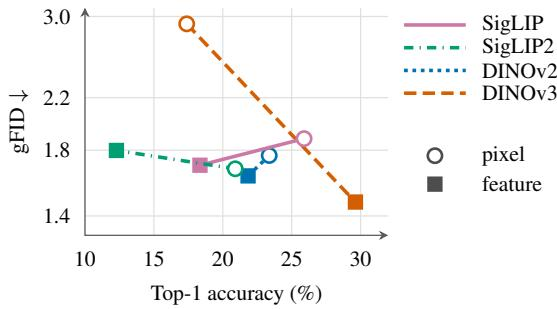  
Figure 7 Linear separability and generation. Discrete-token probe accuracy on 25K test images versus patch-only gFID on 50K samples without guidance. The gFID axis is log-scaled.

Discrete-token linear probes. We fit linear classifiers on mean-pooled patch bits using 100K training images, select the learning rate and weight decay on 10K validation images, and evaluate on 25K test images held out from probe fitting, averaging accuracy over three training seeds. As in Fig. 3b, Fig. 7 pairs each tokenizer with the gFID of its patch-only generator from Tab. 11. Replacing the pixel target by the feature target lowers probe accuracy but improves gFID for SigLIP and DINOv2. For SigLIP2, probe accuracy and gFID both worsen, and for DINOv3, both improve. Thus, this measure of linear separability does not consistently track class-conditional generation quality, unlike the spatial dependence in Fig. 3b.

## D Evaluation protocol

This section collects the experimental setup and measurement conventions used in Sec. 3.

Experimental setup. We evaluate class-conditioned image generation on ImageNet-1k (Russakovsky et al., 2015) at 256×256 and 512×512, and text-conditioned generation on GenEval (Ghosh et al., 2023), GenAI-Bench (Li et al., 2024a), and DPG-Bench (Hu et al., 2024).

Reconstruction and generation metrics. For a fixed feature extractor, Fréchet distance compares the empirical means and covariances of real and reconstructed or generated image features. rFID is the tokenizer’s reconstruction measurement that compares the reconstructed images and original images in the Inception space using the ImageNet-1k validation set. gFID compares generated images with the original training images using Fréchet distance in Inception space. We re-use the released reference statistics from Li and He (2026). We also report gFDr6 introduced by Yang et al. (2026), which reports generative Fréchet distance in six diferent feature spaces. The six-space evaluation uses Inception-v3 (Szegedy et al., 2016), ConvNeXt V2 (Woo et al., 2023), DINOv2 (Oquab et al., 2024), MAE (He et al., 2022), SigLIP2 (Tschannen et al., 2025), and CLIP (Radford et al., 2021), with the checkpoints of Yang et al. (2026): ConvNeXt V2-B, DINOv2 ViT-L/14, MAE ViT-L/16, SigLIP2 So400m/16, and CLIP ViT-L/14. In each space, the Fréchet-distance ratio divides the measured distance by that space’s fixed reference normalization constant, i.e., the distance computed between the training and validation sets. gFDr6 averages these six ratios for generated images, and rFDr6 averages them for reconstructions. We re-use the released reference statistics from Yang et al. (2026). All generation distribution metrics use 50K generated samples, and PRDC compares them with 10K real reference images.

Measured here versus transcribed. For the ImageNet comparisons in Tabs. 1, 2, 3, and 4, all per-representation gFDr and gFDr6 values are evaluated by us using 50k samples, except the guided continuous-baseline results in Tab. 2, transcribed from Tab. 7 of Singh et al. (2026), and the Drift results and guided iMF and pMF results in Tab. 3, transcribed from Yang et al. (2026) for the original models without FD-loss post-training. We evaluate the original iMF and pMF checkpoints without guidance ourselves, at guidance scale 1 with their released guidance intervals. Drift’s released models already sample without guidance, so its transcribed results fill both column groups of Tab. 3. Fig. 1 uses the same unguided one-step values. For text-to-image generation, the continuous-baseline results in Tab. 5 are taken from Singh et al. (2026), whereas the discrete-baseline (BAR-L) results use our own implementations and evaluations. All FeaTok results, reward scores in Fig. 5, and appendix ablations are evaluated by us. For its final models, BAR (Yu et al., 2026) fine-tunes the pixel decoder for 40 additional epochs. Our primary BAR comparison excludes this decoder-only post-training for both methods, which separates the efect of the proposed tokenization and generation recipe from an additional decoder-refinement stage. BAR’s original and refined decoders consume the same discrete tokens. The original decoder is used in Tabs. 1 and 14, Figs. 1 and 5, and the qualitative samples in App. H. Tab. 15 additionally reports BAR with the refined decoder at the same sampling settings. Baselines use their released sampling settings when available, and otherwise settings selected by a sweep (App. E), and App. F additionally reports gFDr6 for FeaTok at gFID-selected configurations (Tab. 15).

Table 13 Sampling configurations of FeaTok for the 256 × 256 results in Tab. 1.
<table><tr><td></td><td></td><td colspan="3">patch branch</td><td colspan="3">global branch</td></tr><tr><td>model</td><td>guidance</td><td>alloc.</td><td>gs</td><td>temp</td><td>alloc.</td><td>gs</td><td>temp</td></tr><tr><td colspan="8">base generator (0.4B)</td></tr><tr><td>FeaTok-SigLIP</td><td>without</td><td>[4, 4, 4, 4]</td><td>1.0</td><td>1.8</td><td>[4, 4, 4, 4]</td><td>1.0</td><td>1.4</td></tr><tr><td></td><td>with</td><td>[4, 4, 4, 4]</td><td>4.0</td><td>1.6</td><td>[4, 4, 4, 4]</td><td>1.0</td><td>2.0</td></tr><tr><td>FeaTok-SigLIP2</td><td>without</td><td>[4, 4, 4, 4]</td><td>1.0</td><td>1.6</td><td>[3, 3, 5, 5]</td><td>1.0</td><td>2.0</td></tr><tr><td></td><td>with</td><td>[4, 4, 4, 4]</td><td>4.0</td><td>1.6</td><td>[4, 4, 4, 4]</td><td>1.0</td><td>2.0</td></tr><tr><td>FeaTok-DINOv2</td><td>without</td><td>[4, 4, 4, 4]</td><td>1.0</td><td>2.0</td><td>[4, 4, 4, 4]</td><td>1.0</td><td>2.0</td></tr><tr><td></td><td>with</td><td>[4, 4, 4, 4]</td><td>3.0</td><td>2.0</td><td>[4, 4, 4, 4]</td><td>1.5</td><td>2.0</td></tr><tr><td>FeaTok-DINOv3</td><td>without</td><td>[4, 4, 4, 4]</td><td>1.0</td><td>1.75</td><td>[3, 3, 5, 5]</td><td>1.0</td><td>2.0</td></tr><tr><td></td><td>with</td><td>[4, 4, 4, 4]</td><td>3.0</td><td>1.6</td><td>[4, 4, 4, 4]</td><td>1.0</td><td>2.0</td></tr><tr><td colspan="8">large generator (1.1B)</td></tr><tr><td>FeaTok-SigLIP</td><td>without</td><td>[4, 4, 4, 4]</td><td>1.0</td><td>1.8</td><td>[2, 2, 5, 7]</td><td>1.0</td><td>2.0</td></tr><tr><td></td><td>with</td><td>[4, 4, 4, 4]</td><td>2.0</td><td>1.8</td><td>[4, 4, 4, 4]</td><td>1.5</td><td>2.4</td></tr><tr><td>FeaTok-SigLIP2</td><td>without</td><td>[4, 4, 4, 4]</td><td>1.0</td><td>1.75</td><td>[4, 4, 4, 4]</td><td>1.0</td><td>2.0</td></tr><tr><td></td><td>with</td><td>[4, 4, 4, 4]</td><td>2.5</td><td>1.6</td><td>[4, 4, 4, 4]</td><td>1.0</td><td>2.0</td></tr><tr><td>FeaTok-DINOv2</td><td>without</td><td>[4, 4, 4, 4]</td><td>1.0</td><td>2.0</td><td>[4, 4, 4, 4]</td><td>1.0</td><td>2.0</td></tr><tr><td></td><td>with</td><td>[2, 2, 5, 7]</td><td>3.0</td><td>2.5</td><td>[4, 4, 4, 4]</td><td>1.5</td><td>2.5</td></tr><tr><td>FeaTok-DINOv3</td><td>without</td><td>[3, 3, 5, 5]</td><td>1.0</td><td>2.0</td><td>[3, 3, 5, 5]</td><td>1.0</td><td>2.0</td></tr><tr><td></td><td>with</td><td>[4, 4, 4, 4]</td><td>2.0</td><td>1.9</td><td>[4, 4, 4, 4]</td><td>1.5</td><td>2.0</td></tr></table>

## E Sampling hyperparameters

We report the sampling hyperparameters for all the main results we presented in the paper.

The knobs. FeaTok samples two branches, and they are configured independently: the 256 patch positions and the single global position each carry their own guidance scale, temperature and bit-group allocation. We write an allocation as its list of group sizes, so [2, 2, 5, 7] unmasks a token’s 16 bits in four groups of 2, 2, 5 and 7 bits, and [bk] abbreviates k groups of b bits. The list sums to the bits per token (16 at 2562, 10 at 5122) and its length sets the sampling cost, since a k-group schedule issues k+1 forwards per position. A guidance scale of 1.0 is no-guidance, so every row without guidance carries patch guidance 1.0. The global branch is unguided in every configuration without guidance and in half of the guided ones.

Reduced-step RAEv2. The released RAEv2 sampling configuration for ImageNet 256 × 256 (https://github .com/nanovisionx/RAEv2/blob/8a0d238/configs/stage2/sampling/imagenet-dinov3l-k7.yaml) uses 100 ODE steps and an internal-guidance scale of 1.78, which we use for all other RAEv2 results. For the 3- and 6-step RAEv2 rows of Tab. 3, we select the internal-guidance scale with the lowest gFDr6 among the evaluated settings, rather than keeping the released scale of 1.78. The selected scales are 4.0 and 2.6, respectively.

Sampling hyperparameters for resolution 512 × 512. At 512 a token carries 10 bits, so the allocations sum to 10 rather than 16. Without guidance, FeaTok-L-DINOv3 in Tab. 4 samples the patch branch with allocation [2, 2, 3, 3], scale 1.0, and temperature 2.4, and the global branch with allocation [2, 2, 2, 4], scale 1.0, and temperature 2.0. With guidance, the patch branch uses allocation [2, 2, 2, 4], scale 3.5, and temperature 2.6, and the global branch uses allocation [2, 2, 2, 4], scale 1.0, and temperature 2.5. Guided BAR-L (Yu et al.,

Table 14 ImageNet-1k generation at 256 × 256, without and with guidance, evaluated by gFID and PRDC. Bold and underline mark the highest and second-highest precision, recall, density, and coverage within each discrete generator-scale block, with ties at the displayed precision sharing a rank.
<table><tr><td rowspan="2">method</td><td colspan="5">generation@256 w/o guidance</td><td colspan="5">generation@256 w</td></tr><tr><td>gFID</td><td>Prec. ↑</td><td>Rec. ↑</td><td>Dens. ↑</td><td>Cov. ↑</td><td>gFID ↓</td><td>Prec. ↑</td><td>Rec. ↑</td><td>Dens. ↑</td><td>Cov. ↑</td></tr><tr><td>base generator</td><td></td><td></td><td></td><td></td><td></td><td></td><td></td><td></td><td></td><td></td></tr><tr><td>BAR-B (Yu et al., 2026)</td><td>1.64</td><td>0.800</td><td>0.614</td><td>1.153</td><td>0.997</td><td>1.13</td><td>0.775</td><td>0.660</td><td>1.060</td><td>0.994</td></tr><tr><td>FeaTok-B-SigLIP</td><td>1.61</td><td>0.807</td><td>0.621</td><td>1.146</td><td>0.996</td><td>1.27</td><td>0.778</td><td>0.654</td><td>1.068</td><td>0.994</td></tr><tr><td>FeaTok-B-SigLIP2</td><td>1.53</td><td>0.802</td><td>0.621</td><td>1.142</td><td>0.995</td><td>1.12</td><td>0.782</td><td>0.655</td><td>1.067</td><td>0.996</td></tr><tr><td>FeaTok-B-DINOv2</td><td>1.47</td><td>0.782</td><td>0.645</td><td>1.085</td><td>0.996</td><td>1.10</td><td>0.784</td><td>0.659</td><td>1.069</td><td>0.995</td></tr><tr><td>FeaTok-B-DINOv3</td><td>1.34</td><td>0.783</td><td>0.647</td><td>1.082</td><td>0.996</td><td>1.07</td><td>0.789</td><td>0.652</td><td>1.088</td><td>0.996</td></tr><tr><td>large generator</td><td></td><td></td><td></td><td></td><td></td><td></td><td></td><td></td><td></td><td></td></tr><tr><td>BAR-L (Yu et al., 2026)</td><td>1.36</td><td>0.798</td><td>0.631</td><td>1.121</td><td>0.995</td><td>1.02</td><td>0.780</td><td>0.667</td><td>1.059</td><td>0.996</td></tr><tr><td>FeaTok-L-SigLIP</td><td>1.37</td><td>0.800</td><td>0.633</td><td>1.134</td><td>0.995</td><td>1.26</td><td>0.801</td><td>0.636</td><td>1.128</td><td>0.996</td></tr><tr><td>FeaTok-L-SigLIP2</td><td>1.33</td><td>0.801</td><td>0.631</td><td>1.127</td><td>0.996</td><td>1.07</td><td>0.785</td><td>0.656</td><td>1.070</td><td>0.994</td></tr><tr><td>FeaTok-L-DINOv2</td><td>1.26</td><td>0.787</td><td>0.643</td><td>1.091</td><td>0.996</td><td>1.15</td><td>0.784</td><td>0.652</td><td>1.070</td><td>0.994</td></tr><tr><td>FeaTok-L-DINOv3</td><td>1.15</td><td>0.791</td><td>0.651</td><td>1.092</td><td>0.995</td><td>1.05</td><td>0.781</td><td>0.665</td><td>1.053</td><td>0.996</td></tr><tr><td>continuous latents</td><td></td><td></td><td></td><td></td><td></td><td></td><td></td><td></td><td></td><td></td></tr><tr><td>RAEv2 (Singh et al., 2026)</td><td>1.61</td><td>0.790</td><td>0.634</td><td>1.116</td><td>0.995</td><td>1.04</td><td>0.792</td><td>0.652</td><td>1.099</td><td>0.996</td></tr></table>

2026) and RAE (Zheng et al., 2026b) use the sampling settings released with those models. BAR does not release an unguided 512 configuration, so we did a hyperparameter sweep and set its unguided sampling configuration as allocation [2, 2, 3, 3], scale 1.0, and temperature 2.4.

## F Comparison using conventional gFID and PRDC metrics.

In the main paper, we report results in gFDr6 (Yang et al., 2026). We compare our method with baselines using gFID (Heusel et al., 2017) and Precision, Recall (Kynkäänniemi et al., 2019), Density, and Coverage (Naeem et al., 2020) in Tab. 14. Per conventions, we use diferent hyperparameters during sampling for gFID evaluation than gFDr6.

gFID measures the Fréchet distance in the feature space of an Inception-v3 network (Szegedy et al., 2016) trained for ImageNet classification. Its sensitivity to ImageNet class information means that it can be lowered substantially without improving the images (Kynkäänniemi et al., 2023), and Inception features represent the content of modern generators poorly, so gFID often disagrees with human raters (Stein et al., 2023; Jayasumana et al., 2024). These problems are most severe at the low values reached by current ImageNet generators. ImageNet validation images score a gFID of 1.68 against the training set (Yang et al., 2026), so generators below 2.0, and especially below 1.68, appear as close to the training data as real images, although their samples remain clearly distinguishable from real ones (Yang et al., 2026). In this regime, gFID can also be optimized directly: post-training a generator on Inception features lowers its gFID from 3.31 to 0.81 without producing the best samples, whereas post-training on modern representations improves object structure while gFID becomes worse (Yang et al., 2026). gFDr6 addresses these issues by averaging Fréchet distances over six representation spaces, each normalized by the distance between the training and validation sets, so no single feature space dominates and a value of 1 means as close to the training data as real validation images.

Tab. 14 provides additional evidence. At these low-gFID operating points, improvements in Inception Fréchet distance do not consistently agree with the fidelity diagnostics. Across the ten BAR and FeaTok models, the guided configuration has lower gFID and higher recall in every case, but lower precision in seven and lower density in nine. For example, BAR-B’s gFID improves from 1.64 to 1.13, while precision falls from 0.800 to 0.775 and density from 1.153 to 1.060. Recall rises from 0.614 to 0.660. Thus, rather than demonstrating a uniform fidelity gain, these selected configurations often show a fidelity–recall trade-of in the opposite direction to the usual motivation for guidance. Coverage remains near saturation (0.994–0.997). The results caution against interpreting a small gFID improvement as an unambiguous improvement in generation quality, motivating evaluation across multiple representations and complementary reward measures.

Without guidance, every FeaTok-B model has a lower gFID than BAR-B (1.34–1.61 against 1.64), three of the four FeaTok-L models improve on BAR-L (1.15–1.33 against 1.36, with FeaTok-L-SigLIP at 1.37), and

Table 15 gFDr6 on ImageNet-1k 256 × 256 at gFID-selected sampling configurations. BAR uses its released settings, and each FeaTok model uses the configuration of Tab. 14. Refined-decoder rows replace BAR’s pixel decoder by the one fine-tuned for 40 additional epochs, with the same tokens and sampling settings. Columns follow Tab. 1. Bold and underline mark the best and second-best values within each generator size in each metric column.
<table><tr><td></td><td colspan="6">without guidance</td><td colspan="6">with guidance</td><td></td><td></td></tr><tr><td>method</td><td>gFDr6i incep. cvnx2 dino2</td><td></td><td></td><td></td><td>mae</td><td>siglip2</td><td>clip</td><td>gFDr6 incep. cvnx2</td><td></td><td></td><td>dino2</td><td>mae</td><td>siglip2</td><td>clip</td></tr><tr><td>BAR-B (Yu et al., 2026)</td><td>5.15</td><td>1.01</td><td>1.70</td><td>5.21</td><td>5.82</td><td>9.40</td><td>7.73</td><td>4.89</td><td>0.69</td><td>0.95</td><td>4.63</td><td>5.89</td><td>9.32</td><td>7.86</td></tr><tr><td>BAR-B (refined decoder)</td><td>4.62</td><td>0.99</td><td>1.65</td><td>4.71</td><td>5.23</td><td>8.39</td><td>6.76</td><td>4.36</td><td>0.67</td><td>0.90</td><td>4.08</td><td>5.35</td><td>8.32</td><td>6.81</td></tr><tr><td>FeaTok-B-SigLIP</td><td>5.08</td><td>1.01</td><td>1.31</td><td>5.63</td><td>6.11</td><td>9.28</td><td>7.15</td><td>4.63</td><td>0.79</td><td>1.03</td><td>4.77</td><td>5.77</td><td>8.91</td><td>6.51</td></tr><tr><td>FeaTok-B-SigLIP2</td><td>4.66</td><td>0.96</td><td>1.29</td><td>4.97</td><td>5.14</td><td>8.85</td><td>6.73</td><td>4.03</td><td>0.70</td><td>0.85</td><td>3.88</td><td>4.71</td><td>7.65</td><td>6.39</td></tr><tr><td>FeaTok-B-DINOv2</td><td>4.40</td><td>0.92</td><td>1.36</td><td>4.12</td><td>4.93</td><td>8.31</td><td>6.74</td><td>3.87</td><td>0.69</td><td>0.85</td><td>3.37</td><td>4.51</td><td>7.34</td><td>6.43</td></tr><tr><td>FeaTok-B-DINOv3</td><td>4.21</td><td>0.87</td><td>1.24</td><td>4.26</td><td>4.87</td><td>7.73</td><td>6.30</td><td>3.80</td><td>0.68</td><td>0.75</td><td>3.66</td><td>4.61</td><td>7.01</td><td>6.07</td></tr><tr><td>BAR-L (Yu et al., 2026)</td><td>4.57</td><td>0.83</td><td>1.38</td><td>4.59</td><td>5.22</td><td>8.14</td><td>7.26</td><td>4.11</td><td>0.61</td><td>0.79</td><td>3.72</td><td>5.02</td><td>7.49</td><td>7.06</td></tr><tr><td>BAR-L (refined decoder)</td><td>4.10</td><td>0.81</td><td>1.34</td><td>4.11</td><td>4.72</td><td>7.34</td><td>6.26</td><td>3.67</td><td>0.60</td><td>0.76</td><td>3.29</td><td>4.56</td><td>6.77</td><td>6.00</td></tr><tr><td>FeaTok-L-SigLIP</td><td>4.75</td><td>0.85</td><td>1.09</td><td>5.23</td><td>5.59</td><td>8.69</td><td>7.08</td><td>4.42</td><td>0.78</td><td>0.92</td><td>4.73</td><td>5.14</td><td>8.19</td><td>6.74</td></tr><tr><td>FeaTok-L-SigLIP2</td><td>4.02</td><td>0.84</td><td>1.13</td><td>4.30</td><td>4.33</td><td>7.47</td><td>6.05</td><td>3.91</td><td>0.66</td><td>0.89</td><td>3.83</td><td>4.17</td><td>7.52</td><td>6.41</td></tr><tr><td>FeaTok-L-DINOv2</td><td>3.57</td><td>0.78</td><td>0.88</td><td>3.25</td><td>4.21</td><td>6.58</td><td>5.72</td><td>3.91</td><td>0.71</td><td>0.86</td><td>3.17</td><td>4.43</td><td>7.38</td><td>6.90</td></tr><tr><td>FeaTok-L-DINOv3</td><td>3.35</td><td>0.74</td><td>0.75</td><td>3.36</td><td>4.03</td><td>5.98</td><td>5.25</td><td>3.45</td><td>0.65</td><td>0.68</td><td>3.39</td><td>4.00</td><td>6.34</td><td>5.63</td></tr></table>

FeaTok-L-DINOv3 reaches 1.15 against 1.61 for RAEv2. With guidance, three of the four FeaTok-B models improve over BAR-B, while BAR-L reaches the lowest large-model gFID, 1.02, against 1.04 for RAEv2 and 1.05 for FeaTok-L-DINOv3. These guided values are all well below the 1.68 of real validation images, in the regime where gFID no longer tracks sample quality. Under gFDr6, which accounts for all six representation spaces, FeaTok-L-DINOv3 improves over BAR-L by 25% with guidance (Tab. 1).

The baselines in Tab. 1 use their released sampling settings, which were selected for gFID, whereas the FeaTok settings there are selected for gFDr6. Tab. 15 therefore also reports gFDr6 for every FeaTok model at its gFID-selected configuration, the one used in Tab. 14, so that both sides follow the same selection criterion. Under this criterion, all four FeaTok-B models and three of the four FeaTok-L models still improve on the original-decoder BAR model of the same size, with and without guidance. FeaTok-L-DINOv3 reduces gFDr6 from 4.57 to 3.35 without guidance and from 4.11 to 3.45 with guidance, while FeaTok-L-SigLIP is the exception, at 4.75 and 4.42. FeaTok does not use the additional 40 epochs of decoder-only fine-tuning, yet its DINOv3 tokenizers still improve on BAR with the refined decoder in all four settings, e.g., FeaTok-L-DINOv3 reduces gFDr6 from 4.10 to 3.35 without guidance and from 3.67 to 3.45 with guidance, and its DINOv2 tokenizers do so in three of the four settings.

## G Sampling-cost measurement

TFLOPs. TFLOPs is arithmetic per image, counted with torch.utils.flop\_counter in the 2×MAC convention, and is therefore hardware-independent unlike wall-clock throughput. It covers the full sampling loop of the generator plus one decoder pass that maps the generated tokens or latents to pixels. Classifier-free guidance duplicates the generator batch and roughly doubles its cost (BAR, FeaTok, SiT, LightningDiT, DDT and the discrete baselines), whereas REPA-E and REG gate the doubled forward to a guidance interval and pay 1.8×, RAEv2’s internal guidance reuses a single forward and costs nothing, and RAE’s autoguidance adds a smaller second network for +30%. Guidance never duplicates the decoder, since only the conditional sample is decoded. Each decoder is built from its oficial release and driven through the released sampler’s decode call. Decoder costs range from 0.16 TFLOPs for the pixel decoder shared by BAR and FeaTok to 0.62 for the SD-VAE decoder of the latent difusion baselines. They are small relative to multi-step continuous generators, but not negligible for the cheapest samplers: the pixel decoder adds 15–32% to the generator cost of BAR and FeaTok, and the SD-VAE decoder exceeds the generator cost of the latent one-step models.

Throughput and memory. Tab. 16 measures sampling on one NVIDIA L40S GPU in bf16 without compilation. Each run times the generation of the discrete tokens or continuous latents and the subsequent pixel decoding separately, so we report generation-only and end-to-end throughput from the same run. Throughput is the number of images produced per second, computed as batch size divided by the generation time, or by the generation and decoding time for end-to-end throughput. Memory is peak GPU memory usage during sampling and decoding at the stated batch size, reported in GiB, not memory per image.

Table 16 Sampling throughput and peak GPU memory on one L40S (bf16, uncompiled). Throughput is in generated images per second (img/s, higher is better), and memory is the peak GPU memory in GiB (lower is better). gen. counts generation only, and e2e includes pixel decoding. We report a matched batch size of 256, and each model/setting’s best end-to-end throughput over the batch sweep, with the batch size (bsz) at which it is reached and its memory. Guided rows use classifier-free guidance for BAR and FeaTok (scale 5.0 for base and 5.3 for large models) and internal guidance (1.78) for RAEv2, which needs no extra forward pass. FeaTok rows use the DINOv3 tokenizer, and throughput does not depend on the encoder. RAEv2 uses 100 ODE steps, the setting of its released sampling configuration (https://github.com/nanovisionx/RAEv2/blob/8a0d238/configs/stage2/sampling/imagenet-dinov3l-k7.yaml).
<table><tr><td rowspan="2">system</td><td rowspan="2">guidance</td><td colspan="3">matched batch 256</td><td colspan="3">peak e2e over the batch sweep</td></tr><tr><td></td><td>gen. img/s ↑ e2e img/s ↑</td><td>GiB↓</td><td>img/s ↑</td><td>bsz</td><td>GiB↓</td></tr><tr><td rowspan="3">BAR-B (Yu et al., 2026)</td><td>without</td><td>28.93</td><td>27.69</td><td>10.6</td><td>34.32</td><td>1024</td><td>32.2</td></tr><tr><td>with</td><td>17.06</td><td>16.59</td><td>17.8</td><td>17.49</td><td>512</td><td>32.2</td></tr><tr><td>without</td><td>27.49</td><td>26.36</td><td>10.4</td><td>31.82</td><td>1024</td><td>31.3</td></tr><tr><td rowspan="2"></td><td>with</td><td>15.97</td><td>15.57</td><td>17.4</td><td>16.31</td><td>512</td><td>31.4</td></tr><tr><td>without</td><td>16.02</td><td>15.61</td><td>22.1</td><td>17.02</td><td>512</td><td>36.8</td></tr><tr><td rowspan="2">BAR-L (Yu et al., 2026) FeaTok-L</td><td>with</td><td>8.71</td><td>8.59</td><td>36.8</td><td>8.59</td><td>256</td><td>36.8</td></tr><tr><td>without</td><td>14.69</td><td>14.36</td><td>22.0</td><td>15.35</td><td>512</td><td>36.7</td></tr><tr><td rowspan="2"></td><td>with</td><td>7.85</td><td>7.75</td><td>36.7</td><td>7.75</td><td>256</td><td>36.7</td></tr><tr><td>without</td><td>1.10</td><td>1.09</td><td>13.4</td><td>1.89</td><td>8</td><td>7.5</td></tr><tr><td rowspan="2">RAEv2 (Singh et al., 2026)</td><td>with</td><td>1.09</td><td>1.09</td><td>14.2</td><td>1.85</td><td>8</td><td>7.5</td></tr></table>

For peak throughput, we compare each model and guidance setting at its own best end-to-end batch size, selected from {1, 8, 32, 128, 256, 512, 1024, 2048}. Larger batches benefit autoregressive models, whose end-toend peaks occur at batches 256–1024. RAEv2 instead peaks at batch 8 with 1.89 images/s and slows to about 1.1 images/s at larger batches on this GPU. FeaTok-B peaks at 31.82 images/s without guidance and 16.31 with guidance. FeaTok-L reaches 15.35 and 7.75 images/s, which is 8.1× and 4.2× the corresponding peak of RAEv2. Decoding takes 1.3–4.3% of end-to-end time at batch 256 for BAR and FeaTok and 0.4% for RAEv2, and it never raises peak memory. We report the corresponding batch size and memory alongside each peak.

## H Qualitative samples across tokenizer encoders

Figs. 8–11 compare the released BAR-L model against our FeaTok models with multiple encoders. For each block, the five rows are labelled on the left in the order BAR-L, then FeaTok-L with SigLIP2, DINOv2, DINOv3, and SigLIP, top to bottom. The eight images in each row are drawn with a fixed random seed from that class’s 50 generated samples.

## I Qualitative text-to-image samples

Fig. 12 shows samples for MJHQ-30K (Li et al., 2024b) prompts in the animals and food categories. Prompts beneath the images are abbreviated for space. The full prompts used for the T2I visuals are in Tab. 17.

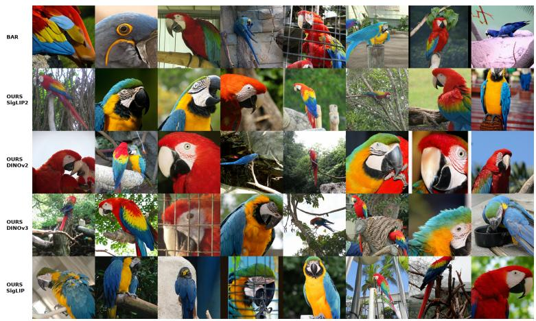

macaw (88)  
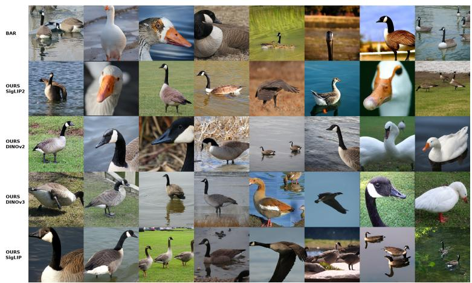

goose (99)  
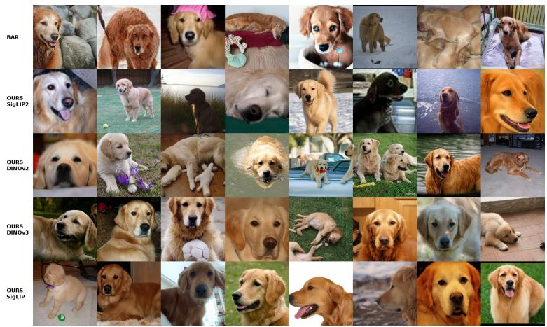  
golden retriever (207)  
Figure 8 ImageNet qualitative samples (1/4). Rows: BAR-L, then FeaTok-L with SigLIP2, DINOv2, DINOv3, and SigLIP, at their respective guided settings (App. E).

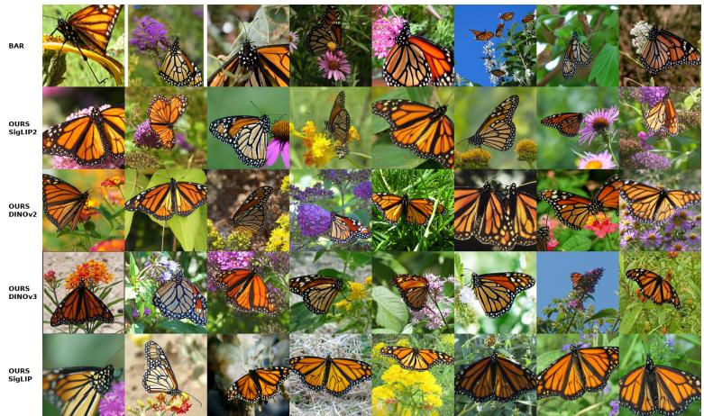

monarch butterfly (323)  
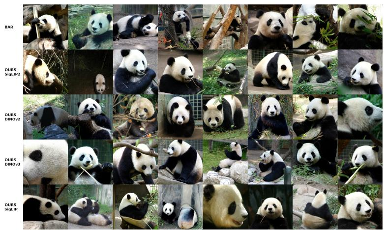

giant panda (388)  
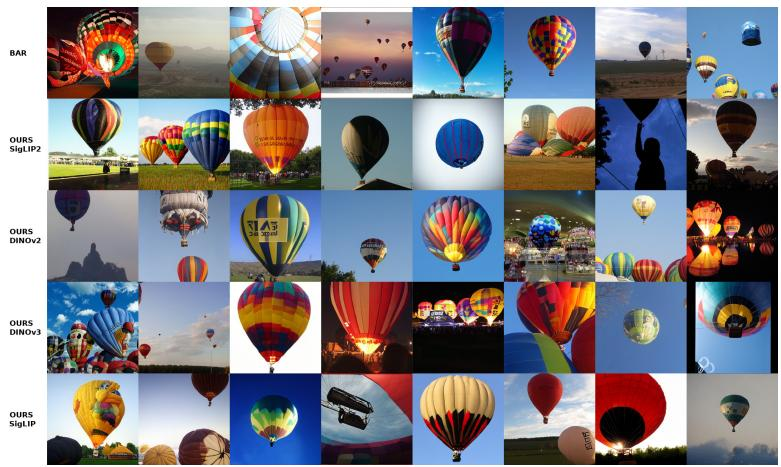  
balloon (417)  
Figure 9 ImageNet qualitative samples (2/4). Rows: BAR-L, then FeaTok-L with SigLIP2, DINOv2, DINOv3, and SigLIP, at their respective guided settings (App. E).

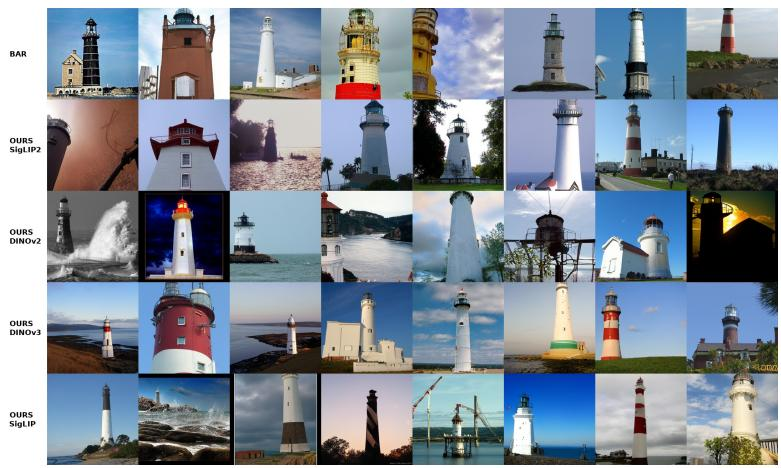

lighthouse (437)  
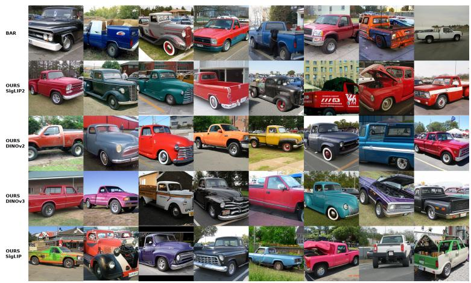

pickup truck (717)  
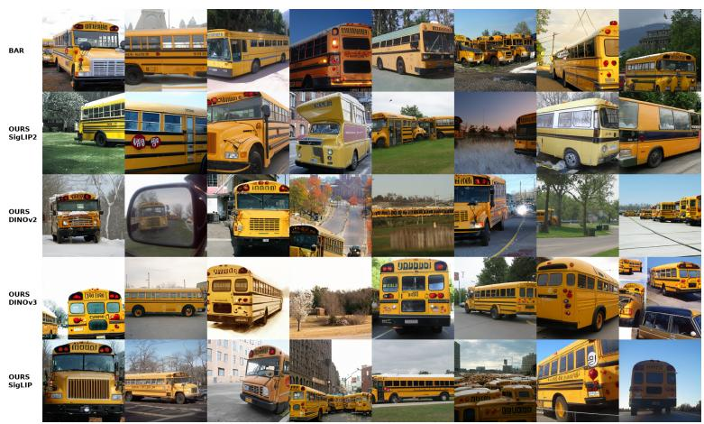  
school bus (779)  
Figure 10 ImageNet qualitative samples (3/4). Rows: BAR-L, then FeaTok-L with SigLIP2, DINOv2, DINOv3, and SigLIP, at their respective guided settings (App. E).

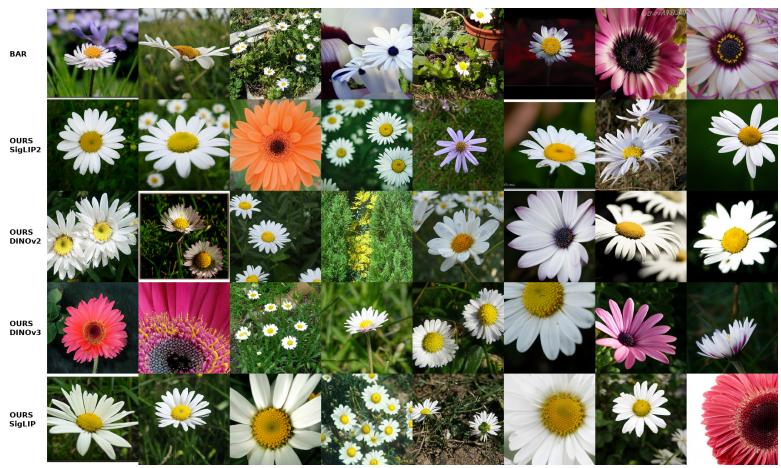

daisy (985)  
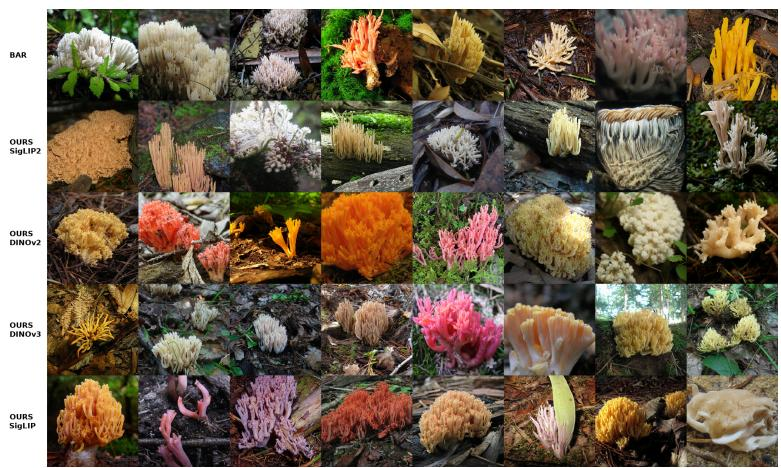

coral fungus (991)  
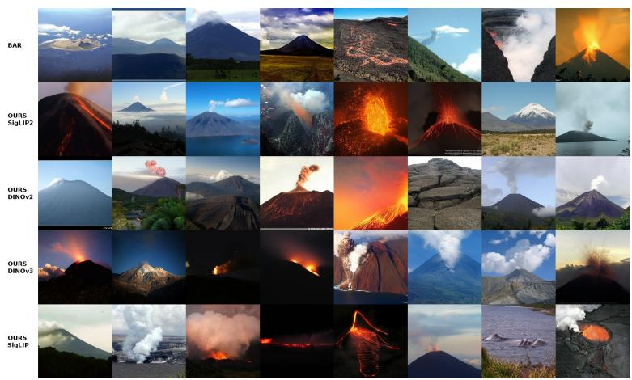  
volcano (980)  
Figure 11 ImageNet qualitative samples (4/4). Rows: BAR-L, then FeaTok-L with SigLIP2, DINOv2, DINOv3, and SigLIP, at their respective guided settings (App. E).

Table 17 Full MJHQ-30K (Li et al., 2024b) prompts for the panels of Fig. 12, numbered in the figure’s reading order (left to right, top to bottom); the number appears in front of each panel’s truncated caption. Prompts are reproduced verbatim, including the trailing keyword lists and the original capitalisation and punctuation, since these are part of what the model was conditioned on. Panels 1, 2, 6, 15, 13 are the five reproduced in Fig. 6.

## # prompt

1 a butterfly gently touching the vast surface of the lake, peace, serenity, 2 a photo of a cat and a dog on the beach wearing fancy hats 3 abstract photo of a cat jumping through a flower field on a bright sunny day 4 american traditional tiger drinking a beer, sticker, square 5 cute beautiful flamingo, floral garnish, tropical flowers, watercolor vibrant illustration, png 6 grizzly bear wearing medieval armor looking fierce and roaring 7 photorealistic image of a golden retriever happily running through a green field with a lake in the background with cinematic lighting, high definition, depth of field superresolution, insanely detailed 8 Realistic painting of flowers and kittens 9 realistic photo of a pug having drinks at the bar   
10 realistic photo, sunset over a lake, bass jumping out of lake, 8k   
11 a chocolate bar on a plate, 3d, very clean   
12 A colorful still life with a variety of vegetables, fruits and berries arranged on a wooden table, creating an atmosphere of a healthy and balanced diet.   
13 a hyperrealistic image of half a lemon dropping into clear water, but on a transparent background   
14 a photo of a breakfast sandwich,   
15 a realistic photo of a margarita cocktail   
16 a sandwich made with cotton candy and chocolate   
17 close up photograph of underwater strawberry with water splash, fine art food photography, low angle perspective, dramatic studio lighting, color graded, strong contrast, sharp focus, hyper detailed, realistic, highquality retouching, food, awardwinning photography, editorial photography,   
18 closeup photo of golden honey being poured, sunny day   
19 delicious eggs in ramen bowl, anime style   
20 fruit basket, water colour, white background   
21 many beautiful sweets, delicate colors, mouthwatering and beautiful sweets   
22 slice of strawberry cheesecake, hyper realistic,   
23 sweets cakes, commercial photoshot on a solid pastel background, realistic   
24 vegetable monsters being cooked realistic 4k   
25 Vegetables on a countertop in a well lit kitchen, 3D photo realistic, cinematic lighting

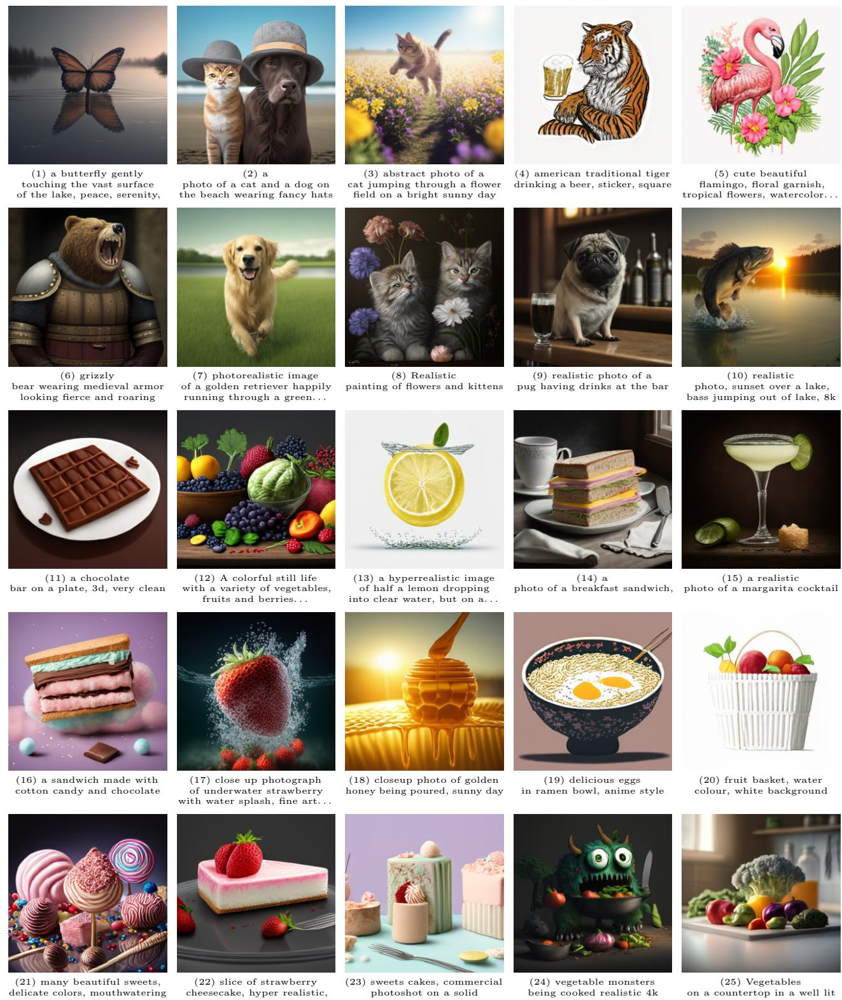  
(21) many beautiful sweets, delicate colors, mouthwatering and beautiful sweets  
(23) sweets cakes, commercial photoshot on a solid pastel background, realistic  
(25) Vegetables on a countertop in a well lit kitchen, 3D photo realistic. . .

Figure 12 Text-to-image samples at 256 × 256 from MJHQ-30K animal (first two rows) and food prompts. Full numbered prompts are in Tab. 17.