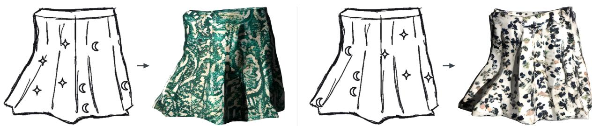
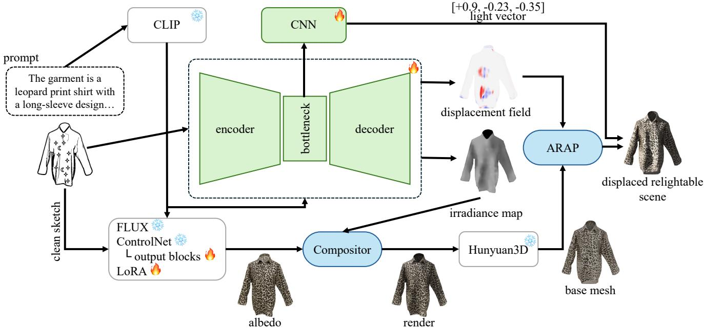
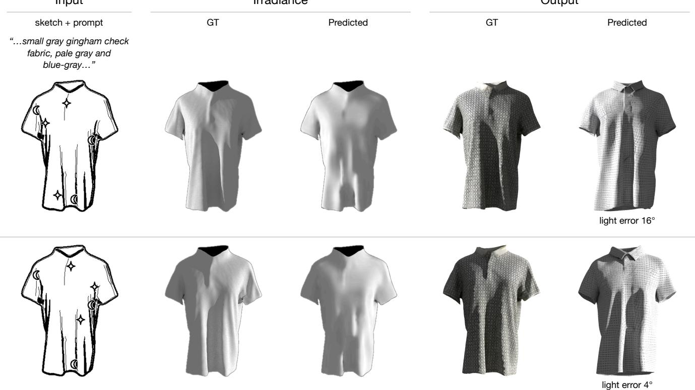
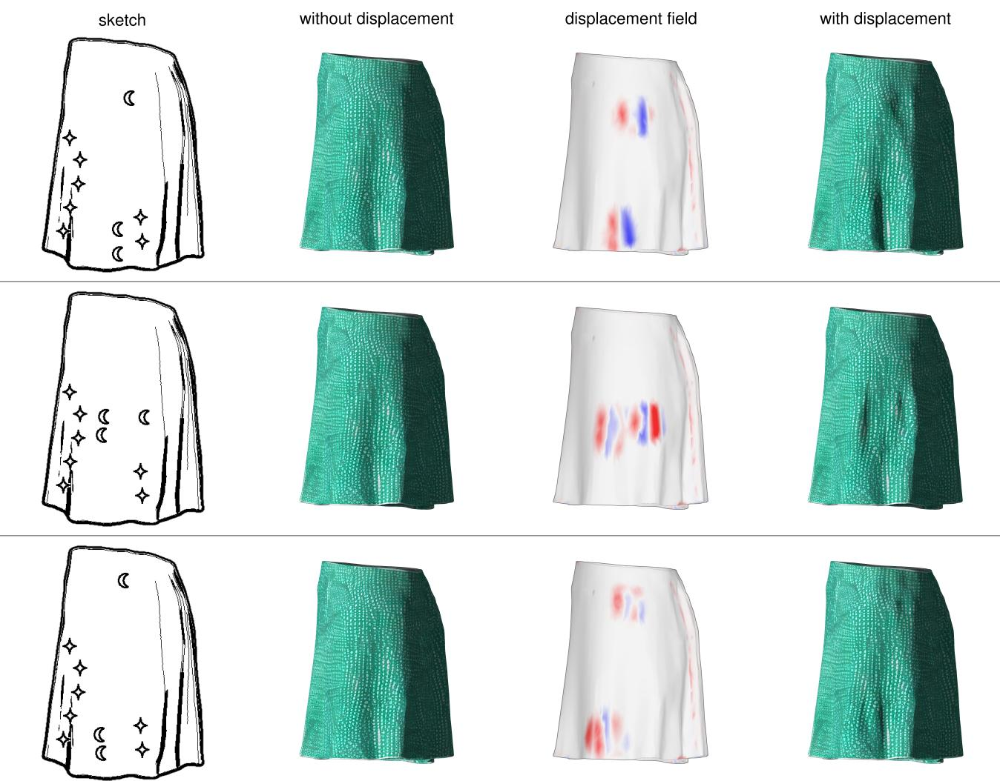
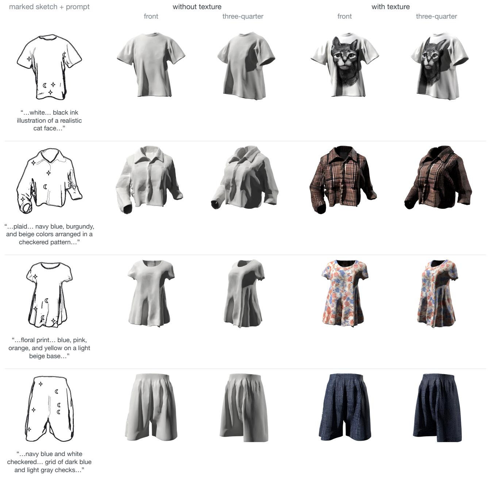

# From Sketch to Scene: Relightable Garment Reconstruction from Marked Sketches

Ahmet Neçirvan Dogan˘ 1,∗ Eren Acar Ba¸saran1,∗ Metin Sezgin1 Zahra Montazeri2

1 Koç University, Türkiye 2 University of Manchester, UK

∗ Equal contribution

  
“…teal color… paisley print on a cream ground…”  
“…cream base color… small flowers with navy blue, pink and green leaves…”

Figure 1: From a marked sketch to a relightable garment A hand-drawn sketch with star marksfor highlights and moon marksfor shadows, together with a texture prompt, is turned into a textured 3D garment rendered under the directional light predictedfrom its marks. Left: one placement ofthe marks and one prompt. Right: the same sketch with the marks moved and a different prompt.

## Abstract

Sketching is one ofthe most natural waysforpeople to express visual ideas. Unlike the text prompts that most generative systems rely on today, a sketch captures spatial structure and intent directly, including where a designer wants highlights and shadows to appear. Yet current sketch-to-3D pipelines have no input for that intent: they bake the drawn shading into the texture as dark paint, and the light cannot be moved. We propose a system that transforms a rough garment sketch, marked with sparse annotations—a starfor a highlight and a moon for a shadow—and a short text prompt describing the texture, into a textured 3D mesh with an explicit directional light, as a scene that can be relit and edited after generation. The two symbols are the most frequent proposals in an elicitation study with art students. From the marked sketch the system predicts the scene’s directional light and, separately, a displacementfield that bends the surface so that the moon-marked regions fall into shadow under that light, rather than being painted dark in the texture.

CCS Concepts

• Computing methodologies → Shape modeling; Reconstruction; • Human-centered computing → Interaction techniques;

## 1. Introduction

Fashion design begins on paper. A designer sketches a garment’s silhouette, then adds how the fabric catches the light: its folds, its shadows and its highlights [Rie12]. Today, a sketch can be turned into a textured 3D model without a 3D artist: an image generator produces a plausible rendering from it [ZRA23], and a reconstruction method lifts that rendering into a mesh [XLX+25, Hun25]. Such pipelines have no input for the designer’s shading intent:

shading strokes are either treated as line art or reproduced as appearance.

The result is that a designer can specify what a garment looks like but not how it is lit. Text prompts do not help much here. A phrase such as “a soft shadow under the left sleeve” describes a location, but a text-conditioned generator has no explicit way to tie the phrase to a region of the drawing, and follows it only loosely.

We propose treating shading marks as a first-class input. A designer marks the sketch with a two-symbol notation elicited from art students: a star where a highlight should fall, and a moon where the fabric folds into shadow. The marks are placed on the drawing itself. Our pipeline reads them and produces a relightable 3D garment whose lighting and surface both follow where the marks were placed (Figure 1).

In summary, we make the following contributions:

• We conduct an elicitation study with art students and derive from it a two-symbol shading notation: a star for a highlight and a moon for a shadow (Secs. 3.2 and 3.3).

• We predict the scene’s directional light from these marks, so the light is an editable part of the scene rather than fixed in the texture (Secs. 4.2 and 5.2).

• We predict a displacement field from the marks and use it to displace the generated mesh, so that the marked regions fall into shadow under the predicted light (Secs. 4.3, 4.6 and 5.3).

• We combine these into a pipeline that turns a marked sketch and a texture prompt into a relightable 3D scene (Sec. 4.1).

## 2. Related work

Our input is a sketch with shading marks and a prompt specifying the texture, and our output is a 3D garment with an explicit directional light. We therefore review sketch-based modeling (Sec. 2.1), how artists and 3D tools go about specifying lighting (Sec. 2.2), and the text- and image-conditioned 3D generation our pipeline builds on (Sec. 2.3).

## 2.1. Sketch-based modeling

Early interactive systems read strokes as geometric operations: Teddy [IMT99] inflates a closed contour into a freeform surface, and FiberMesh [NISA07] keeps the drawn curves as editable handles on the result. Structured annotations [GIZ09] let the user place primitives and constraints, such as symmetry and equal length, on a 2D drawing to settle its 3D interpretation. Garments have their own line of work, because a drawn garment is defined relative to a body. Turquin et al. [TWB+07] lift contours drawn over a view of a 3D body model into a garment around it, and FoldSketch [LSGV18] lets a designer draw fold strokes on an existing garment and solves for a sewing pattern that physically reproduces them.

Learned methods replace these rules with priors taken from data. From a single drawing, networks predict multi-view depth and normal maps [LGK+17,LPL+18] or infer shape and viewpoint jointly [ZGG21]. For clothing, Wang et al. [WCPM18] let the user sketch the fold patterns they want and recover the garment and body-shape parameters that produce them. Diffusion models have since made the sketch one condition among several [ZPW+23, BHSH+24]. A common route today passes the sketch through a conditioned image generator [ZRA23] and lifts the result with a single-image 3D generator (Sec. 2.3).

A related thread reads shading out of line drawings [HGPS19]. Lumo [Joh02] interpolates normals from contours to light cel animation; CrossShade [SBSS12] infers surface normals from the cross-section curves of concept sketches; Ink-and-Ray [SKCˇ +14] builds bas-relief proxies so that hand-drawn characters receive global illumination; and Zheng et al. [ZLB20] add shadows to line art given a light direction. They recover normals, shading or a proxy shape, and leave the light for the user to supply; none reads it from the drawing.

In all of this work the sketch describes geometry. Shading a designer draws is read as more line work, or, in data-driven pipelines, comes back as texture on the result. To our knowledge, no existing method reads a drawing for where the designer intends light to fall and returns that intent as a light in the scene.

## 2.2. Specifying lighting

Our marks specify lighting on a drawing, so we look at how light is handled in two settings: how artists draw it, by showing where it falls and where shadows form, and how 3D tools set it, as an object the user can move and edit.

How artists draw light Artists usually draw light through what it does to a form. Painting manuals teach a small vocabulary of shading events on a form: the highlight, the terminator where the surface turns away from the light, the core shadow beyond it, and the cast shadow [Gur10]. Non-photorealistic rendering reproduces these conventions from 3D, placing hatching according to a known light [HZ00]; there the light is an input. Our elicitation (Sec. 3.2) asks a different question: which symbols people would use to indicate where light and shadow fall.

How 3D tools set light 3D tools instead expose the light source itself. Blender, for example, exposes light as an explicit object, such as a point, spot, area or directional (sun) source, whose orientation, color and intensity the artist edits in the viewport [Ble24], and glTF carries the same parameters between tools [Khr18]. Light is then editable after the fact, but the user must reason about causes: to put a highlight in a chosen place, the artist moves the source and watches the result. Some research methods remove this step: the user specifies the effect, such as a highlight or a painted target, and the method solves for the light [OMSI07, Pel10]. Poulin and Fournier [PF92] recover light positions from highlights and shadows sketched onto a rendered scene, and Pellacini et al. [PBMF07] solve for light parameters that reproduce a painted target illumination; Schmidt et al. [SPN+16] survey the wider space. Our marks are closest to Poulin and Fournier’s highlight and shadow sketches. These methods, however, operate on an existing 3D scene, where each candidate light can be rendered and compared with the user’s target. In our setting there is no scene yet, only a drawing, so the light has to be inferred before any geometry exists.

## 2.3. Text- and image-conditioned 3D generation

Current 3D generators work feed-forward. Novel-view diffusion and large reconstruction models lift a single image to a mesh in seconds [LWVH+23, HZG+24], and native 3D latent generators such as TRELLIS [XLX+25] and Hunyuan3D [Hun25] produce highquality geometry, textured by a separate multi-view painting stage. Commercial services such as Meshy [Mes25] put the same pipeline behind a text or image prompt.

For our purposes these systems share two properties. First, their control channels are text and images, so shading can only be specified by handing them a picture that already contains it. Second, they return geometry and material but no light. Recent texture stages output physically based materials instead of a single color map [Hun25], so their assets can be relit in principle. However, the illumination of the conditioning image is treated as a nuisance and removed from the albedo [ZCQ+24]; where removal is incomplete, it stays in the texture. Either way, the output carries no light of its own, and any lighting left in the texture cannot be moved. We use such a generator to build the mesh and paint its texture, and add the light as a separate element of the scene.

## 3. Shading marks

This section introduces the shading marks, the input that separates our system from other sketch-to-3D pipelines. We first set out what the notation must achieve (Sec. 3.1), then describe the study we used to choose the symbols (Sec. 3.2), and finally define what each symbol means and how it is placed (Sec. 3.3).

## 3.1. Motivation

Our goal is to let a designer say, directly on the sketch, how the garment should be lit: where light falls and where the fabric should be in shadow. For such marks to be useful, they need two properties. A designer without training in shading should be able to make them and to guess what each one means without being taught. Both depend on the symbols themselves, so instead of inventing symbols we asked people which ones they would use (Sec. 3.2).

## 3.2. Elicitation

To choose the symbols, we asked art students which symbols they would use to mark a highlight and a shadow. We first describe the questionnaire and how the drawn answers were coded, then report which symbols were proposed most often and how the two categories differed.

Participants and procedure We ran an elicitation study [WARM05,WMW09] with 28 art students at our university in April 2026. The study was introduced in an information session during class, and participation was voluntary. Participants completed a paper questionnaire: two background items (drawing experience and formal training in light and shading), a free drawing task, two items on how they had depicted highlights and shadows, and the target item: “If you had to encode shading using ONLY symbols, what would you choose? Fill one symbol per category: Highlight: , Shadow: \_\_\_”. Answers were free-form drawings. Most participants were novices: 18 described themselves as beginners with no formal training, 8 as intermediate and 2 as advanced, and 5 of 28 had studied light and shading formally.

Coding Each drawn answer was transcribed to the nearest symbol class. One rule separates a symbol from a technique: hatching, meaning multiple parallel strokes, describes how to shade rather than naming a symbol, and is excluded as off-task, while a single stroke counts as a mark. The rule is applied identically to both categories. Blank answers are non-responses. This leaves 25 highlight and 22 shadow proposals (Table 1). We report the share of the modal proposal with a Wilson 95% interval [Wil27], the agreement rate A [WARM05], and its bias-corrected form AR, for which Vatavu and Wobbrock define magnitude bands [VW15].

Table 1: Symbols proposedfor highlight and shadow by 28 participants. Hatching is a shading technique instead of a symbol and is excluded before agreement is computed. “Other” groups proposals made by a single participant each.
<table><tr><td>Proposal</td><td>Highlight</td><td>Shadow</td></tr><tr><td>Star / sparkle</td><td>14</td><td>一</td></tr><tr><td>Moon</td><td>一</td><td>6</td></tr><tr><td>Circle</td><td>3</td><td>4</td></tr><tr><td>Line / dash</td><td>2</td><td>2</td></tr><tr><td>Spiral</td><td>一</td><td>2</td></tr><tr><td>Other (one each)</td><td>6</td><td>8</td></tr><tr><td>Valid proposals</td><td>25</td><td>22</td></tr><tr><td>Hatching (excluded)</td><td>0</td><td>6</td></tr><tr><td>Blank</td><td>3</td><td>0</td></tr><tr><td>Modal share</td><td>56.0% (37–73)</td><td>27.3% (13–48)</td></tr><tr><td>A</td><td>0.344</td><td>0.140</td></tr><tr><td>AR</td><td>0.317</td><td>0.100</td></tr></table>

Findings Both symbols we use are the modal proposals. For highlight, 14 of 25 participants drew a four-pointed star or sparkle (56.0%), and agreement falls in the high band (AR = 0.317). For shadow, the crescent moon is the most frequent proposal, 6 of 22 (27.3%), and agreement sits on the boundary between the low and medium bands (AR = 0.100). The moon’s lead over its runner-up, the circle (6 against 4), is too small to be reliable at this sample size. We adopt the moon because it is the modal proposal, and because a circle is already common in garment drawings, as buttons, eyelets and dots.

Differences between categories The two categories differ in more than agreement. No participant answered the highlight item with hatching, while 6 of 28 did so for shadow, under the same instruction on the same sheet (paired, exact McNemar test [McN47], p = 0.031). The preceding item listed hatching as one way to depict shadow, and 10 participants ticked it, but only 2 of those 10 were among the 6 who gave hatching as their symbol.

Scope Most participants had no formal training, so the preference for the star is unlikely to come from a convention taught in class. The study is large enough to establish the star as the highlight symbol and the difference in hatching between the two categories, but not the moon’s lead over the circle; its other limits are discussed in Sec. 6.

## 3.3. Representation

Two symbols, two roles A star marks where light falls: the surface under it faces the light and is among the brightest parts of the garment. Like the highlight sketches of Poulin and Fournier [PF92], stars specify the light through its effect, and their placement carries the direction. A moon marks where the garment should be in shadow, but says nothing about where the light is. The split follows the elicitation (Sec. 3.2): highlight had a clear symbol and shadow did not, and a fifth of the participants answered the shadow item with a shading technique rather than a symbol. In the notation, therefore, the light direction is carried by the stars, and a moon asks only that its location be in shadow; the network itself reads both symbols together (Sec. 4.2).

Moon marks and geometry A shadow has one of three causes: a surface turned away from the light, a shadow cast by another part of the garment, or a crease. The first already follows from the light the stars set, so a moon marks shadow that the light alone does not produce. We produce it by changing the surface: the system bends the garment so that the marked region falls into shadow under the light the stars define (Sec. 4.6). Existing pipelines would instead paint the region dark in the texture.

Marked sketch and clean sketch The designer draws the garment, then stamps the marks as fixed-size icons on a layer above the drawing. Stamping the marks fixes their shape and size, so the network reads where a mark is placed rather than how it was drawn, and keeps them on a separate layer that can be removed for the albedo. The pipeline therefore receives two images: the marked sketch, with the layer, and the clean sketch, the drawing alone. The U-Net reads the marked sketch, and the light CNN reads it through the U-Net’s bottleneck; the albedo generator sees only the clean sketch, so the marks never enter the albedo.

Placement A mark lies inside the garment, clear of the silhouette, and a star and a moon never overlap. Marks are stamped at one fixed size, the size used in training. An input sketch carries at least one star and at least one moon.

## 4. Method

This section describes the pipeline of Figure 2. Secs. 4.2–4.6 describe each stage in the order of the figure.

## 4.1. Overview

Figure 2 shows the pipeline. A U-Net reads the marked sketch and the prompt and predicts an irradiance map and a signed field describing folds; a light CNN reads the U-Net’s bottleneck for the light direction (Sec. 4.2, 4.3). A FLUX ControlNet paints the albedo from the clean sketch and the prompt (Sec. 4.4). Albedo and irradiance are composited and reconstructed by Hunyuan3D-2.1 (Sec. 4.5), and the predicted field is combined with crests placed using the predicted light to form the displacement field, which is applied to the mesh; the result is exported with the predicted light (Sec. 4.6).

## 4.2. Predicting irradiance and light direction

The U-Net [RFB15] takes the marked sketch as its only image input, both symbols together, and is conditioned on the prompt through a frozen CLIP text encoder [RKH+21] by cross-attention at the encoder, the bottleneck and the decoder. Its first output, from a 1 × 1 convolution on the decoder, is an irradiance map. To build its target we render the training scene again with the garment made white and matte, which leaves only the light that reaches each point, shadows included.

The light direction comes from the bottleneck. A small light CNN takes the same tensor the decoder reads and returns a unit vector for the scene’s directional light.

## 4.3. Predicting where the surface folds

The U-Net’s second output is a predicted field, a single signed value at every point of the garment from a 1 × 1 convolution on the decoder. Positive values push the surface out along its normal and negative values pull it in. Together with the crests of Sec. 4.6, it forms the displacement field that drives the mesh.

Its target is built from the reference garment’s surface normals: we measure how fast they turn horizontally and vertically and combine the two rates into a signed value that responds to bending rather than to depth. The head is supervised inside a disc of radius 24 pixels around each visible moon mark and nowhere else, except on the training sketches we draw without moons, where it is supervised to predict no displacement anywhere, so that it does not displace a garment no one has marked. Because the target carries both signs, a disc around a mark holds both the fold and the cloth beside it, and the head learns the shape of a crease rather than only its depth. The target is rescaled per garment, so the prediction ranks crease strength within a garment rather than measuring an absolute distance.

One caveat on the training signal: the dataset places moon marks at the negative extrema of this same measure, so during training the head usually finds a crease at a mark. Sec. 5.3 therefore also evaluates on marks we place ourselves, which that measure did not choose.

## 4.4. Albedo synthesis

Surface color is produced by FLUX.1 [Bla24] with a ControlNet [ZRA23, Sha24] that conditions it on the clean sketch and the text prompt. Because a sketch carries no color, the prompt is the only input that specifies it. What the branch has to produce is base color without the scene’s illumination, so that the predicted irradiance can be applied afterwards rather than being baked into the color. A pretrained image generator does not do this by default, since it is trained to produce lit, shaded pictures. We therefore train two parts of the ControlNet and leave both it and FLUX otherwise frozen: a rank-64 LoRA adapter [HSW+22] on its attention and MLP layers, 69M parameters, and the output layers of its double-stream blocks, the last stage before it passes its signal to FLUX, 47M.

  
Figure 2: Pipeline overview From a marked sketch and a text prompt to a relightable garment scene. The U-Net predicts an irradiance map and a field from the marked sketch and the prompt; a light CNN reads its bottleneck for the light direction; a FLUX ControlNet paints the albedofrom the clean sketch and the prompt. Albedo and irradiance are composited into the image Hunyuan3D reconstructs. The predicted field together with its crests forms the displacement field, which an as-rigid-as-possible solve applies to that mesh. Snowflakes mark frozen weights, flames mark trained ones; the U-Net is trained first, then frozen, and the light CNN trained on top of it. Prompt: “a leopard prin shirt with a long-sleeve design. . . ”

## 4.5. Composition and reconstruction

The predicted irradiance E and the albedo $\rho ,$ decoded from sRGB, are combined in linear space into a shaded image

$$
\begin{array} { r l } & { C = \rho \left( E + a \right) + s \left( 1 - r \right) f ( \rho ) \left( \cfrac { E } { E _ { \mathrm { m a x } } } \right) ^ { n ( r ) } , } \\ & { n ( r ) = \mathrm { m i n } \big ( \mathrm { m a x } \left( \frac { 2 } { r ^ { 2 } } - 2 , 1 \right) , 5 1 2 \big ) . } \end{array}\tag{1}
$$

Both terms are restricted to the garment silhouette. The ambient term $a = 0 . 1 5$ keeps regions the light does not reach, such as the inside of a collar, at the color of the albedo instead of black. The second term adds a highlight. We have no surface normals in image space, but the irradiance varies largely with the cosine of the angle to the light, so we raise $E / E _ { \mathrm { m a x } } ,$ , with $E _ { \mathrm { m a x } }$ the larger of 1 and the maximum of E, to a Blinn–Phong exponent [Bli77] derived from the roughness r [WMLT07]. The roughness is a constant looked up from the prompt; (1 − r) weakens the highlight on rough fabric, $s = 0 . 2 5$ sets its strength, and $f ( \rho )$ , a smoothstep from 0 to 1 as the largest sRGB channel of $\rho$ rises from 0 to 0.02, suppresses it at black and near-black albedo, so that silhouette pixels where the albedo branch painted no garment are not turned grey; a garment painted pure black loses its highlight as well. When more than a quarter of the garment receives almost no predicted irradiance, which happens on some hand-drawn sketches, we first raise the garment to a floor of 0.35 of the median of the lit pixels, so that the image is not mostly black. The result is normalised by its peak and gamma-encoded.

The silhouette becomes the alpha channel of this image, and the image is passed to Hunyuan3D-2.1 [Hun25], which builds the shape and paints the texture from it. The composite does not set the lighting of the output, which is carried by the directional light (Sec. 4.6); it gives Hunyuan3D the kind of input it is built for, a lit image rather than flat color. Its painting stage is designed to remove that illumination from the albedo it paints (Sec. 2.3); where the removal is incomplete, some of the composited shading stays in the painted texture. The mesh it returns is a thin shell, an outer wall facing the camera with an inner wall just behind it, which the displacement stage must respect (Sec. 4.6).

## 4.6. Displacement and scene assembly

The goal of the displacement is to put each moon-marked region into shadow under the predicted light. After adding the crests described below, we use the resulting field to request movement at mesh vertices. At vertex i, the field value $d _ { i }$ requests motion along the vertex normal, outward if positive and inward if negative, and a larger magnitude requests more movement. The combined field is normalised by its own 95th-percentile magnitude on that garment and scaled to the size of the mesh; inward requests are then capped at a fraction of the local shell thickness, so that no dent asks the outer wall to pass through the inner one. The same value sets the

Input

Irradiance

Output

  
Figure 3: Light prediction The same garment is marked twice: the moon marks stay in the same place, and only the star marks move. Input: the marked sketch and the text prompt. Irradiance: the ground-truth irradiance map of the reference garment under the true light (GT), and the irradiance map predicted by our network. Output: the reference garment under the true light (GT), and our displaced, textured mesh under the predicted light. The number under each output is the angle between the predicted and the true light direction. Moving the star marks moves the predicted light to the other side ofthe garment. The prompt is the same in both rows, so the predicted albedo is identical.

weight of the request, $w _ { i } = \lambda ( | d _ { i } | / \operatorname* { m a x } | d | ) ^ { \gamma } ,$ , where γ = 0.5 and λ balances the requests against rigidity. These weighted requests are soft positional constraints on camera-facing vertices. Vertices facing away from the camera are anchored to their original positions. An as-rigid-as-possible solve [SA07], using the spokes-andrims energy of Chao et al. [CPSS10], computes the final mesh by following the requests while preserving the surrounding surface. The solve and subsequent smoothing can still carry a few vertices through the shell (Sec. 6).

The predicted field decides where the surface folds, which way and how strongly. But the field head is trained on crease shape alone (Sec. 4.3), so a fold it predicts may fall on either side of the mark, and only one side casts a shadow onto it under the predicted light. To secure that side, we place one bump per mark alongside the predicted field, which we call the crest: beside each moon mark, on the side facing the predicted light, the surface is raised so that the mark lies on its shadowed side. The crest’s size is set against that garment’s own predicted field, through the 95th percentile of its magnitude, so it sits in proportion to the folds the network predicted there. It secures a rise rather than imposing one: inside its footprint we keep whichever is larger, the crest or the predicted field. The predicted light sets which side of the mark the crest sits on; its footprint and its distance from the mark are set by a rule. Figure 4 shows the result for different placements of the moon marks on the same garment.

The displaced mesh is exported as a glTF scene [Khr18] with the painted base-color texture, a single roughness value selected from the prompt (Sec. 4.5), and the predicted directional light as an explicit directional source.

## 5. Results

We evaluate the two things the marks control: the light and the shading of the displaced garment. Figure 5 shows outputs on four garments.

## 5.1. Setup

We evaluate on DeepFashion3D [ZCJ+20], split at the garment level so that no garment appears in more than one part, stratified by garment type: 968 garments for training, 122 for validation and 122 held out. Each garment is rendered with Mitsuba 3 [JSR+22] under each of three lights drawn uniformly by area from the directions that face the camera, with elevations above −15◦, giving 366 heldout renders. Each render gets its own marked sketch, within the placement constraints of Sec. 3.3: star marks where that render’s ground-truth irradiance is brightest, and moon marks where the reference garment creases most sharply, by the measure of Sec. 4.3. A sketch carries about nine moon marks and eight star marks.

  
Figure 4: Geometry displacement Each row is the same garment with the moon marks in a different place; the star marks stayfixed. sketch: the marked input. without displacement: the reconstruction our displacement stage startsfrom. displacement field: what drives the solve, the predictedfield together with its crests, red outward and blue inward. with displacement: the same mesh after it is applied. One reconstruction is reused across all three rows, so every difference comesfrom the displacement stage

The two claims need different data. The light direction is predicted before any mesh exists, so it is measured on all 366 heldout renders. Displacement needs a reconstructed mesh, which we build for all of them, and two checks remove the ones that came out wrong: one rejects a garment seen from the wrong side, the other a silhouette that departs too far from the sketch it was conditioned on. Together they remove 26, leaving 340 renders over 121 garments.

Placing the moon marks at the reference garment’s own creases has a consequence for evaluation: the reconstruction may already have a fold where a mark sits, and the displacement has little left to add there. To measure it where nothing helps it, we annotate 112 renders ourselves, placing the moon marks on flat cloth where the undisplaced reconstruction is slightly brighter than the garment’s average, so nothing there is shaded yet. We keep the reconstructions those renders already have, so this measures the displacement stage alone rather than the whole pipeline. On these renders we also check whether a mark ends up darker than the garment’s average, scored on a simpler shading estimate computed directly from the mesh; because that estimate differs slightly from the render the marks were placed on, a few marks already fall below the average before displacement.

8 of 11

Do˘gan, Ba¸saran, Sezgin, Montazeri / From Sketch to Scene

Input

Output

Figure 5: End-to-end results The light and the shading follow the marks. Each row shows one garment. Input: the marked sketch and an excerpt of the text prompt. Output: the displaced mesh under the directional light predicted from its marks, first without texture and then textured, each from the front and at a three-quarter view. Without texture columns show the shading most clearly; with texture, prints such as the plaid and thefloral pattern hide much ofthe shading the displacement adds.

Shading at a mark is the mean brightness inside a disc at the mark, measured on a render of the mesh under the predicted light.

Implementation details The U-Net is trained for 60 epochs with Adam [KB15] at a learning rate of $3 \times 1 0 ^ { - 4 }$ and batch size 8 on 512 × 512 sketches, taking about 26 GPU-hours on one A40. The light CNN is then fitted for 60 epochs on the frozen U-Net, 50 minutes on the same hardware, selecting the epoch with the best validation angle. The FLUX branch (Sec. 4.4) is trained for 2500 steps at $1 \times 1 0 ^ { { - 4 } }$ with an effective batch of 4, just under four hours. One garment takes about seven minutes end to end on a single A40: 3.3 minutes in Hunyuan3D-2.1, 2.4 minutes in the albedo branch, and under a minute in everything else.

## 5.2. Lighting recovery

On the 366 held-out renders the light CNN recovers the light direction to $2 2 . 9 ^ { \circ }$ mean and 20.0◦ median angular error, against 47.5◦ for the best fixed direction fitted on the training split. The result does not depend on which reconstructions succeeded: restricted to the 340 renders of Sec. 5.1, the mean error and the baseline are unchanged to one decimal. Figure 3 shows one garment annotated with the star marks on either side.

## 5.3. Mark-driven shading

Darkening at the marks We use the change in brightness inside each moon mark’s disc as our measure of the intended shadow. After displacement, 79% of the moon marks are darker than before, against 44% of equally sized discs placed away from any mark on the same garments (3020 scored discs and 68000 control discs). The control rate sits near half because displacing a mesh shifts unmarked cloth a little in both directions, so whether such a disc ends up lighter or darker is close to arbitrary. Requiring a brightness decrease of at least eight grayscale levels, the marks darken in 51% of cases against 13.5% of control discs. We also run the displacement with the crest disabled: the predicted field alone darkens 61% of the marks against 47% of the control discs for that arm.

Marks the reconstruction does not already satisfy On the 112 renders we annotate ourselves (Sec. 5.1), the displacement has no existing fold to deepen. After displacement 86% of these moon marks are darker than they were, against 45% of control discs on the same garments, and with the crest disabled the field alone darkens 57% against 47%. Against the garment’s average, 9% of marks are darker before displacement and 73% after.

## 6. Limitations

Our system has limitations in how far a mark can be driven, in how the crest is placed, in the artifacts the displacement can leave, in the scene and material model, and in what we have evaluated. We discuss each in turn.

Why some marks do not darken Two things limit how far a mark can be driven. The field head learns from the DeepFashion3D garment, but the field it predicts is applied to Hunyuan3D’s reconstruction, which shares a silhouette but not a surface. And inward motion is capped at a fraction of the shell’s wall thickness; the cap binds on 314 of the 340 evaluated renders, and where it binds the requested depth is typically several times what the shell allows.

Crest placement Beside each mark we add one crest, and its footprint and its distance from the mark are set by a rule rather than predicted from the sketch. The rest of the displaced surface comes from the predicted field.

Artifacts On 100 of the 340 held-out renders the displacement leaves a visible artifact, most often a small blob-like distortion, or the outer wall passing through the inner one. We exclude those renders from our figures, though not from the measurements above.

Scene and material assumptions We assume a single directional light, with no colored or area sources, no translucency and no interreflection. Roughness is looked up from the material named in the prompt, and is constant over a garment. Where Hunyuan3D does not fully remove the shading we composite into its input, that shading stays in the texture (Sec. 4.5) and does not follow the light. The displacement is shaped for the predicted directional light, so moving the light afterwards keeps the folds but not necessarily the shadow each fold casts onto its mark.

Coverage The elicitation study involved art students from a single institution, so we cannot say whether professional designers would choose the same symbols. Our quantitative evaluation uses synthetic sketches rendered from DeepFashion3D, with marks placed by rule or by us rather than drawn by hand; hand-drawn sketches, such as the one in Figure 1, appear only in qualitative results. We have also not tested whether people read the symbols as intended, or how far a mark can be moved before the result changes.

## 7. Conclusion

We have presented a system that reads the star and moon marks a designer places on a garment sketch and returns a 3D scene in which the light is an explicit, editable source and the shadows the marks ask for are made by displacing the surface. Two marks, a star where light falls and a moon where the garment should be in shadow, came out of an elicitation study with art students and are stamped on the sketch itself. From the marked sketch and a text prompt, the network predicts the light’s direction and where the fabric should fold, recovering the light direction to 22.9◦ against 47.5◦ for the best fixed direction fitted on the training split. Displacing the surface darkens 79% of the moon marks on held-out renders, and 86% on renders we mark ourselves on flat cloth, where the reconstruction offers no fold to deepen.

One part remains open. The crest beside each mark takes its height from the predicted field and its side from the predicted light, but its footprint and its distance from the mark are fixed by a rule. Predicting those is our next step.

## Acknowledgments

We thank Dr. ˙Irem ¸Sot for her help in preparing the elicitation study and for hosting the information sessions in her class, and the students who took part.

## References

[BHSH+24] Alexandre Binninger, Amir Hertz, Olga Sorkine-Hornung, Daniel Cohen-Or, and Raja Giryes. SENS: Part-aware sketch-based implicit neural shape modeling. Computer Graphics Forum, 43(2), 2024. 2

[Bla24] Black Forest Labs. FLUX.1 [dev]. https://huggingface. co/black-forest-labs/FLUX.1-dev, 2024. 4

[Ble24] Blender Foundation. Blender manual: Lights. https://docs. blender.org/manual/en/latest/render/lights/, 2024. 2

[Bli77] James F. Blinn. Models of light reflection for computer synthesized pictures. In Proceedings of the 4th Annual Conference on Computer Graphics and Interactive Techniques (SIGGRAPH), pages 192– 198, 1977. 5

[CPSS10] Isaac Chao, Ulrich Pinkall, Patrick Sanan, and Peter Schröder. A simple geometric model for elastic deformations. ACM Transactions on Graphics, 29(4), 2010. 6

[GIZ09] Yotam Gingold, Takeo Igarashi, and Denis Zorin. Structured annotations for 2D-to-3D modeling. ACM Transactions on Graphics, 28(5), 2009. 2

[Gur10] James Gurney. Color and Light: A Guide for the Realist Painter. Andrews McMeel Publishing, 2010. 2

[HGPS19] Matis Hudon, Mairéad Grogan, Rafael Pagés, and Aljoša Smolic.´ Deep normal estimation for automatic shading of hand-drawn characters. In Computer Vision – ECCV 2018 Workshops, Lecture Notes in Computer Science, pages 246–262. Springer, 2019. 2

[HSW+22] Edward J. Hu, Yelong Shen, Phillip Wallis, Zeyuan Allen-Zhu, Yuanzhi Li, Shean Wang, Lu Wang, and Weizhu Chen. LoRA: Lowrank adaptation of large language models. In International Conference on Learning Representations (ICLR), 2022. 4

[Hun25] Hunyuan3D Team. Hunyuan3D 2.1: From images to highfidelity 3D assets with production-ready PBR material. arXiv preprint arXiv:2506.15442, 2025. 1, 2, 3, 5

[HZ00] Aaron Hertzmann and Denis Zorin. Illustrating smooth surfaces. In Proceedings of the 27th Annual Conference on Computer Graphics and Interactive Techniques (SIGGRAPH), pages 517–526, 2000. 2

[HZG+24] Yicong Hong, Kai Zhang, Jiuxiang Gu, Sai Bi, Yang Zhou, Difan Liu, Feng Liu, Kalyan Sunkavalli, Trung Bui, and Hao Tan. LRM: Large reconstruction model for single image to 3D. In International Conference on Learning Representations (ICLR), 2024. 2

[IMT99] Takeo Igarashi, Satoshi Matsuoka, and Hidehiko Tanaka. Teddy: A sketching interface for 3D freeform design. In Proceedings of the 26th Annual Conference on Computer Graphics and Interactive Techniques (SIGGRAPH), pages 409–416, 1999. 2

[Joh02] Scott F. Johnston. Lumo: Illumination for cel animation. In Proceedings ofthe 2nd International Symposium on Non-Photorealistic Animation and Rendering (NPAR), pages 45–52, 2002. 2

[JSR+22] Wenzel Jakob, Sébastien Speierer, Nicolas Roussel, Merlin Nimier-David, Delio Vicini, Tizian Zeltner, Baptiste Nicolet, Miguel Crespo, Vincent Leroy, and Ziyi Zhang. Mitsuba 3 renderer. https: //mitsuba-renderer.org, 2022. 6

[KB15] Diederik P. Kingma and Jimmy Ba. Adam: A method for stochastic optimization. In International Conference on Learning Representations (ICLR), 2015. 8

[Khr18] Khronos Group. KHR\_lights\_punctual: glTF 2.0 extension. https://github.com/KhronosGroup/glTF/tree/main/ extensions/2.0/Khronos/KHR\_lights\_punctual, 2018. 2, 6

[LGK+17] Zhaoliang Lun, Matheus Gadelha, Evangelos Kalogerakis, Subhransu Maji, and Rui Wang. 3D shape reconstruction from sketches via multi-view convolutional networks. In Proceedings of the International Conference on 3D Vision (3DV), pages 67–77, 2017. 2

[LPL+18] Changjian Li, Hao Pan, Yang Liu, Xin Tong, Alla Sheffer, and Wenping Wang. Robust flow-guided neural prediction for sketch-based freeform surface modeling. ACM Transactions on Graphics, 37(6), 2018. 2

[LSGV18] Minchen Li, Alla Sheffer, Eitan Grinspun, and Nicholas Vining. FoldSketch: Enriching garments with physically reproducible folds. ACM Transactions on Graphics, 37(4), 2018. 2

[LWVH+23] Ruoshi Liu, Rundi Wu, Basile Van Hoorick, Pavel Tokmakov, Sergey Zakharov, and Carl Vondrick. Zero-1-to-3: Zero-shot one image to 3D object. In Proceedings ofthe IEEE/CVF International Conference on Computer Vision (ICCV), pages 9264–9275, 2023. 2

[McN47] Quinn McNemar. Note on the sampling error of the difference between correlated proportions or percentages. Psychometrika, 12(2):153– 157, 1947. 3

[Mes25] Meshy. Meshy: AI 3D model generator. https://www.meshy. ai, 2025. 2

[NISA07] Andrew Nealen, Takeo Igarashi, Olga Sorkine, and Marc Alexa. FiberMesh: Designing freeform surfaces with 3D curves. ACM Transactions on Graphics, 26(3), 2007. 2

[OMSI07] Makoto Okabe, Yasuyuki Matsushita, Li Shen, and Takeo Igarashi. Illumination brush: Interactive design of all-frequency lighting. In Proceedings ofthe 15th Pacific Conference on Computer Graphics and Applications (PG), pages 171–180, 2007. 2

[PBMF07] Fabio Pellacini, Frank Battaglia, R. Keith Morley, and Adam Finkelstein. Lighting with paint. ACM Transactions on Graphics, 26(2), 2007. 2

[Pel10] Fabio Pellacini. envyLight: An interface for editing natural illumination. ACM Transactions on Graphics, 29(4), 2010. 2

[PF92] Pierre Poulin and Alain Fournier. Lights from highlights and shadows. In Proceedings of the 1992 Symposium on Interactive 3D Graphics (I3D), pages 31–38, 1992. 2, 3

[RFB15] Olaf Ronneberger, Philipp Fischer, and Thomas Brox. U-Net: Convolutional networks for biomedical image segmentation. In Medical Image Computing and Computer-Assisted Intervention (MICCAI), Lecture Notes in Computer Science, pages 234–241. Springer, 2015. 4

[Rie12] Nancy Riegelman. 9 Heads: A Guide to Drawing Fashion. Pearson, 2012. 1

[RKH+21] Alec Radford, Jong Wook Kim, Chris Hallacy, Aditya Ramesh, Gabriel Goh, Sandhini Agarwal, Girish Sastry, Amanda Askell, Pamela Mishkin, Jack Clark, Gretchen Krueger, and Ilya Sutskever. Learning transferable visual models from natural language supervision. In Proceedings of the 38th International Conference on Machine Learning (ICML), 2021. 4

[SA07] Olga Sorkine and Marc Alexa. As-rigid-as-possible surface modeling. In Proceedings of the Eurographics Symposium on Geometry Processing (SGP), pages 109–116, 2007. 6

[SBSS12] Cloud Shao, Adrien Bousseau, Alla Sheffer, and Karan Singh. CrossShade: Shading concept sketches using cross-section curves. ACM Transactions on Graphics, 31(4), 2012. 2

[Sha24] Shakker Labs. FLUX.1-dev-ControlNet-Union-Pro. https://huggingface.co/Shakker-Labs/FLUX. 1-dev-ControlNet-Union-Pro, 2024. 4

[SKCˇ +14] Daniel Sýkora, Ladislav Kavan, Martin Cadík, Ondˇ ˇrej Jamriška, Alec Jacobson, Brian Whited, Maryann Simmons, and Olga Sorkine-Hornung. Ink-and-ray: Bas-relief meshes for adding global illumination effects to hand-drawn characters. ACM Transactions on Graphics, 33(2), 2014. 2

[SPN+16] Thorsten-Walther Schmidt, Fabio Pellacini, Derek Nowrouzezahrai, Wojciech Jarosz, and Carsten Dachsbacher. State of the art in artistic editing of appearance, lighting and material. Computer Graphics Forum, 35(1):216–233, 2016. 2

[TWB+07] Emmanuel Turquin, Jamie Wither, Laurence Boissieux, Marie-Paule Cani, and John F. Hughes. A sketch-based interface for clothing virtual characters. IEEE Computer Graphics and Applications, 27(1):72–81, 2007. 2

[VW15] Radu-Daniel Vatavu and Jacob O. Wobbrock. Formalizing agreement analysis for elicitation studies. In Proceedings of the 33rd Annual ACM Conference on Human Factors in Computing Systems (CHI), pages 1325–1334, 2015. 3

[WARM05] Jacob O. Wobbrock, Htet Htet Aung, Brandon Rothrock, and Brad A. Myers. Maximizing the guessability of symbolic input. In CHI ’05 Extended Abstracts on Human Factors in Computing Systems, pages 1869–1872, 2005. 3

[WCPM18] Tuanfeng Y. Wang, Duygu Ceylan, Jovan Popovic, and Niloy J.´ Mitra. Learning a shared shape space for multimodal garment design. ACM Transactions on Graphics, 37(6), 2018. 2

[Wil27] Edwin B. Wilson. Probable inference, the law of succession, and statistical inference. Journal of the American Statistical Association, 22(158):209–212, 1927. 3

[WMLT07] Bruce Walter, Stephen R. Marschner, Hongsong Li, and Kenneth E. Torrance. Microfacet models for refraction through rough surfaces. In Proceedings of the Eurographics Symposium on Rendering (EGSR), pages 195–206. The Eurographics Association, 2007. 5

[WMW09] Jacob O. Wobbrock, Meredith Ringel Morris, and Andrew D. Wilson. User-defined gestures for surface computing. In Proceedings of the SIGCHI Conference on Human Factors in Computing Systems (CHI), pages 1083–1092, 2009. 3

[XLX+25] Jianfeng Xiang, Zelong Lv, Sicheng Xu, Yu Deng, Ruicheng Wang, Bowen Zhang, Dong Chen, Xin Tong, and Jiaolong Yang. Structured 3d latents for scalable and versatile 3d generation. In Proceedings of the IEEE/CVF Conference on Computer Vision and Pattern Recognition (CVPR), pages 21469–21480, 2025. 1, 2

[ZCJ+20] Heming Zhu, Yu Cao, Hang Jin, Weikai Chen, Dong Du, Zhangye Wang, Shuguang Cui, and Xiaoguang Han. Deep Fashion3D: A dataset and benchmark for 3D garment reconstruction from single images. In Computer Vision – ECCV 2020, Lecture Notes in Computer Science, pages 512–530. Springer, 2020. 6

[ZCQ+24] Xianfang Zeng, Xin Chen, Zhongqi Qi, Wen Liu, Zibo Zhao, Zhibin Wang, Bin Fu, Yong Liu, and Gang Yu. Paint3D: Paint anything 3D with lighting-less texture diffusion models. In Proceedings of the IEEE/CVF Conference on Computer Vision and Pattern Recognition (CVPR), pages 4252–4262, 2024. 3

[ZGG21] Song-Hai Zhang, Yuan-Chen Guo, and Qing-Wen Gu. Sketch2Model: View-aware 3D modeling from single free-hand sketches. In Proceedings of the IEEE/CVF Conference on Computer Vision and Pattern Recognition (CVPR), 2021. 2

[ZLB20] Qingyuan Zheng, Zhuoru Li, and Adam Bargteil. Learning to shadow hand-drawn sketches. In Proceedings of the IEEE/CVF Conference on Computer Vision and Pattern Recognition (CVPR), pages 7434– 7443, 2020. 2

[ZPW+23] Xin-Yang Zheng, Hao Pan, Peng-Shuai Wang, Xin Tong, Yang Liu, and Heung-Yeung Shum. Locally attentional SDF diffusion for controllable 3D shape generation. ACM Transactions on Graphics, 42(4), 2023. 2

[ZRA23] Lvmin Zhang, Anyi Rao, and Maneesh Agrawala. Adding conditional control to text-to-image diffusion models. In Proceedings of the IEEE/CVF International Conference on Computer Vision (ICCV), pages 3813–3824, 2023. 1, 2, 4