# FutureLift: Lifting Trajectory Proposals into Bidirectional Future Graphs for Motion Forecasting

Daniel Grimm J. Marius Zollner¨ FZI Research Center for Information Technology {grimm,zoellner}@fzi.de

## Abstract

Accurate motion prediction is critical for safe autonomous driving, yet even strong forecasters leave residual errors in their multimodal proposals. Existing refiners compress complete proposals or update their segments sequentially, preventing the full proposed future from serving as explicit relational context for correction. We introduce Future-Lift, a backbone-agnostic refiner that represents each multimodal proposal as a heterogeneousfuture graph, with spatially grounded temporal nodes connected to agent histories, map elements, alternative modes, and,forjoint prediction, other agents future trajectories. Bidirectional temporal edges allow later evidence to revise earlier segments in a single pass, and the updated nodes predict residual coordinate and confidence corrections. Requiring only proposals, scores, and scene context, FutureLift provides a common refinement interface for structurally differentforecasting backbones. On Argoverse 2 and the Waymo Open Motion Dataset, it consistently improves frozen proposals and outperforms native and specialized refiners across marginal and joint forecasting. On the WOMD motion-prediction leaderboard, FutureLift ranks first in minADE (0.5049 m) and minFDE (0.9942 m) among the compared standardinput methods, without LiDAR or ensembling, while achieving a competitive 0.4874 Soft mAP.

## 1. Introduction

Accurate motion forecasting enables autonomous vehicles to anticipate traffic participants and plan safely. Given agent histories and an HD map, models must represent multiple plausible futures over an extended prediction horizon. Modern methods use vectorized scene representations [4, 13], graph- or attention-based context encoders [5, 21, 24], and expressive trajectory decoders [10, 33]. Yet even strong predictors leave residual displacement and ranking errors in their multimodal proposals.

Trajectory refinement can correct such errors without redesigning the underlying predictor. Existing refiners encode trajectory features, retrieve context around selected anchors, or model trajectory–trajectory and trajectory–lane relations [27, 32]. However, compressed embeddings, sparse anchors, and pairwise summaries do not spatially instantiate the complete proposed horizon. This is especially limiting for temporal correction: within a causal segmentwise sweep, later evidence cannot revise an earlier segment [10, 32]. Iterative relational refiners can revisit predictions [27], but require repeated computation and still reason primarily at the trajectory level. We instead argue that the complete proposed future should be explicit before correction, allowing every segment to interact jointly with the map, agent histories, alternative modes, and other predicted agents while exchanging evidence in both temporal directions.

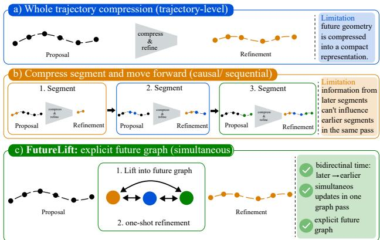  
Figure 1. Refinement representations. Top: Trajectory-level methods compress proposal geometry into a shared representation. Middle: Causal segment-wise methods pass information forward, so later evidence cannot reach earlier segments within a forwardonly sweep. Bottom: FutureLift lifts proposal segments into spatial nodes with bidirectional temporal relations, enabling later context to correct earlier segments in one graph pass. Social future relations are used only for coherent joint proposals.

Based on this insight, we introduce FutureLift, a backbone-agnostic refiner that lifts multimodal proposals into bidirectional heterogeneous future graphs, as illustrated in Fig. 1. FutureLift discretizes each trajectory proposal into spatially grounded temporal nodes connected to agent histories, map elements, alternative modes, and compatible predictions of other agents. This graph represents a hypothetical future scene rather than a compressed trajectory token. A bidirectional graph network refines the complete horizon in one pass and predicts residual coordinate and confidence updates. Requiring only proposal coordinates, scores, and scene context, FutureLift attaches to structurally different backbones without modifying their proposal mechanisms. The same interface supports marginal and coherent joint-world proposals, enabling social future relations only for the latter.

We evaluate FutureLift on Argoverse 2 and the Waymo Open Motion Dataset using multiple backbones in marginal and joint settings, including within-backbone comparisons with native and specialized refiners. These experiments test interface compatibility rather than transferring a learned refiner between backbones or datasets: each refiner is trained for its target setting. FutureLift consistently improves the underlying proposals; on the WOMD test set, it achieves 0.5049 minADE and 0.9942 minFDE, the best results among the compared standard-input methods, while maintaining competitive Soft mAP. A separate horizonresolved analysis on the WOMD validation split shows that backward temporal information flow becomes increasingly beneficial at longer horizons.

In summary, our main contributions are:

• Proposal-to-Future-Graph Lifting: A backboneagnostic interface transforms multimodal proposals into heterogeneous future graphs for temporal, map, modal, and joint-only social reasoning.

• One-Shot Bidirectional Refinement: One fixed-graph pass lets later future context correct earlier errors without repeated causal sweeps.

• Interface Compatibility and Temporal-Direction Analysis: Experiments with multiple backbones on two datasets and in marginal and joint tasks establish consistent gains after setting-specific training, while horizon-resolved validation analysis measures how the contribution of backward temporal information changes with prediction horizon.

## 2. Related Work

## 2.1. Structured Representations for Motion Forecasting

Vectorized representations preserve agent and map geometry without the quantization and computational cost of rasterized scene encodings. VectorNet [4] represents scene elements as polylines, while LaneGCN [13] constructs a lane graph with explicit actor–map interactions. Later approaches capture richer relational structure: HDGT [9] introduces heterogeneous node and edge types, GoRela [2] uses viewpoint-invariant relative representations, and Holi-Graph [5] retains fine-grained spatial and temporal entities in a heterogeneous scene graph. These representations primarily organize the observed scene from which future trajectories are decoded.

Recent architectures increasingly place relational reasoning in the decoder. Query-centric methods such as MTR [19], QCNet [33], and DeMo [28] progressively decode multimodal futures; FutureNet [25] incorporates predicted future context into joint forecasting; and DONUT [10] formulates trajectory generation as decoderonly autoregressive modeling. Foresight in Motion [16] applies bidirectional state-space modeling to trajectory-state queries within a hierarchical end-to-end decoder, while NDPNet [7] separates near- and distant-horizon decoding and promotes kinematically coherent transitions. In these methods, the future representation is part of a specific forecasting architecture. FutureLift instead operates after proposal generation: it lifts the temporal segments of already generated proposals into a common graph for backboneindependent refinement.

## 2.2. Trajectory Refinement

Refinement is often integrated into the forecasting decoder. MTR [19], for example, repeatedly updates intention queries using local motion information, while QCNet [33] follows proposal generation with a dedicated refinement stage. Such refiners can exploit backbone features directly, but this coupling makes them difficult to transfer across proposal generators.

Post-hoc methods provide a clearer interface between proposal generation and correction. SmartRefine [32] uses scenario-adaptive anchors and local context to recurrently refine trajectory segments, with optional outer iterations for difficult cases. Within a forward sweep, information propagates only from earlier to later segments, while outer iterations repeat the causal refinement process. SRefiner [27] targets multi-agent refinement by constructing a soft-braid topology over trajectory–trajectory and trajectory–lane relations and iteratively updating joint predictions. Although its paper formulates the initial trajectory representation as an encoding of proposal geometry and agent pose, the released AV2 implementation additionally consumes a precomputed 134-dimensional per-mode embedding exported with each proposal. SRefiner is therefore the closest prior work in combining post-hoc joint refinement with an explicit relational structure, but its released interface is not strictly proposal-only.

FutureLift differs in both representation and interface. Every temporal segment of each multimodal proposal becomes a graph node, and bidirectional temporal edges expose the complete horizon during a refinement pass. The refiner reconstructs its scene representation from proposal coordinates, confidence scores, and original scene inputs; it does not require the proposal backbone’s exported embeddings, queries, or intermediate activations.

## 2.3. Marginal and Joint Motion Forecasting

Marginal forecasting predicts each agent’s future distribution independently, whereas joint forecasting represents scene-level hypotheses whose agent trajectories are mutually consistent. Many high-performing forecasters focus on marginal prediction [28, 33], while FJMP [17], FutureNet [25] explicitly model multi-agent futures. This distinction constrains relational refinement: equally indexed modes from independent marginal predictions need not describe the same joint world, and connecting them can therefore introduce artificial dependencies.

FutureLift preserves this distinction through conditional graph construction. Marginal proposals are refined without cross-agent mode correspondence, whereas sceneconsistent joint hypotheses additionally receive social future edges. This design supports both settings without imposing joint semantics on marginal predictions.

## 3. Method

FutureLift is a post-hoc refinement module that turns trajectory proposals into an explicit hypothesis of the future scene. Its central operation is lifting: rather than compressing a complete proposal into one latent token, we instantiate its temporal segments as spatially anchored graph nodes. This representation makes the proposal geometry available to map, history, modal, and social reasoning. A single bidirectional graph update then predicts residual corrections to the proposal coordinates and confidence scores. We first formalize the proposal interface, then describe proposal-tograph lifting, one-shot refinement, and the training objective.

## 3.1. Problem Formulation and Proposal Interface

Let a scene contain observed agent histories ${ \mathcal { H } } ,$ an HD map M, and A agents to be predicted over T future steps. A proposal backbone B produces K candidate trajectories and their logits,

$$
( \widehat { \mathbf { Y } } , \ell ) = B ( \mathcal { H } , \mathcal { M } ) , \qquad \widehat { \mathbf { Y } } \in \mathbb { R } ^ { A \times K \times T \times 2 } .\tag{1}
$$

For marginal forecasting, k indexes an agent-specific mode and $\ell _ { a , k }$ is an agent-level logit. For joint forecasting, k indexes a coherent scene-level future shared by all predicted agents and $\ell _ { k }$ is a scene logit. FutureLift accesses only $\widehat { \mathbf Y }$ $\ell ,$ and the original scene description; it does not consume backbone queries, decoder features, or intermediate activations. We therefore treat B as frozen and stop gradients at the interface in Eq. (1). This contract permits the same refiner architecture to operate on structurally different proposal generators after setting-specific training.

FutureLift outputs coordinate and logit residuals,

$$
\begin{array} { r } { \widetilde { \mathbf Y } = \widehat { \mathbf Y } + \Delta { \mathbf Y } , \qquad \widetilde { \boldsymbol \ell } = \boldsymbol \ell + \Delta { \boldsymbol \ell } , } \end{array}\tag{2}
$$

which preserves the backbone’s modes while allowing their geometry and ranking to change. The residual parameterization is important for a reusable refiner: the proposal remains the reference solution, and FutureLift learns only the correction supported by the lifted scene context.

## 3.2. Proposal-to-Future-Graph Lifting

Spatially grounded future nodes. We partition the horizon into R contiguous intervals $\{ \mathcal { T } _ { r } \} _ { r = 1 } ^ { R }$ and create one future node $v _ { a , k , r }$ for every agent, mode, and interval. Hence, lifting produces AKR future nodes without changing the number of trajectory hypotheses. Node $v _ { a , k , r }$ is anchored at the proposal endpoint

$$
\mathbf { c } _ { a , k , r } = \widehat { \mathbf { y } } _ { a , k , t _ { r } } ,\tag{3}
$$

$$
\theta _ { a , k , r } = \mathrm { a t a n 2 } ( [ \Delta \widehat { \mathbf { y } } _ { a , k , r } ] _ { y } , [ \Delta \widehat { \mathbf { y } } _ { a , k , r } ] _ { x } ) ,\tag{4}
$$

where $\Delta \widehat { { \bf y } } _ { a , k , r } = \widehat { { \bf y } } _ { a , k , t _ { r } } - \widehat { { \bf y } } _ { a , k , t _ { r - 1 } } , t _ { r }$ is the final step of interval $\mathcal { T } _ { r }$ , and the last observed state supplies the predecessor for $r = 1$ . Anchoring at the predicted future location is what turns a trajectory array into a spatial hypothesis: neighborhood queries are evaluated where the agent is predicted to be, rather than at its last observation or at a learned, geometry-free query.

Each node also retains the complete proposal segment in its local frame. For $t \in \mathcal { Z } _ { r }$ , we transform the proposed states as

$$
\begin{array} { r l } & { \mathbf { z } _ { a , k , r , t } = \mathbf { R } ( \theta _ { a , k , r } ) ^ { \top } \left( \widehat { \mathbf { y } } _ { a , k , t } - \mathbf { c } _ { a , k , r } \right) , } \\ & { \mathbf { h } _ { a , k , r } ^ { 0 } = \mathrm { G R U } ( \{ \psi ( \mathbf { z } _ { a , k , r , t } ) \} _ { t \in \mathbb { Z } _ { r } } ) , } \end{array}\tag{5}
$$

where ψ is a point-wise Fourier/MLP embedding. Thus, the node position determines where context is retrieved, while its feature preserves the motion pattern within the interval. This separation avoids reducing a segment to its endpoint alone.

Scene nodes and relative geometry. The lifted future nodes are combined with a heterogeneous scene graph containing historical agent states, lane elements, and finegrained map points. FutureLift uses the QCNet scene encoder [33] to encode this context. The encoder is trained as part of FutureLift from the original scene inputs; Future-Lift does not reuse encoder activations or other latent features from the frozen proposal backbone. Following established target-local relative-pose encodings in motion forecasting [2, 31, 33], all spatial messages use relative geometry. For an edge from source u to target $v ,$ we embed

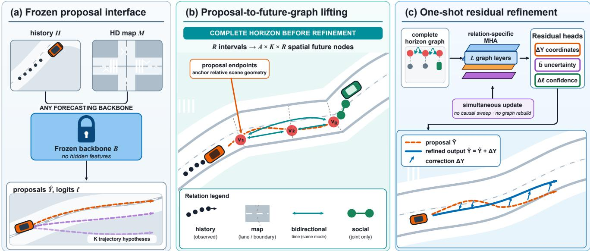  
Figure 2. FutureLift method overview. (a) Scene history and map context flow through an arbitrary frozen forecasting backbone which exposes only multimodal trajectory proposals $\widehat { \mathbf Y }$ and logits ℓ; FutureLift does not access backbone queries or intermediate features. (b) Each proposal is partitioned into R intervals and lifted into spatially anchored future nodes. For clarity, the panel visualizes one representative mode k of the K instantiated modes. Typed relations connect the full node set to agent histories, map context, other modes, and for coherent joint-scenes proposals also to other predicted agents, while bidirectional temporal edges expose the complete horizon before correction. (c) Relation-specific attention updates all future nodes on this fixed graph and simultaneously decodes coordinate residuals, uncertainty parameters, and confidence residuals. Thus, later evidence can revise earlier segments in one graph pass without a causal sweep or graph reconstruction.

$$
\begin{array} { r } { \mathbf { e } _ { u  v } = \phi \Big ( [ \rho _ { u v } , \sin \beta _ { u v } , \cos \beta _ { u v } , \ } \\ { \sin \Delta \theta _ { u v } , \cos \Delta \theta _ { u v } , \Delta t _ { u v } ] \Big ) . } \end{array}\tag{6}
$$

where $( \rho _ { u v } , \beta _ { u v } )$ is the source position in the target’s local polar frame, $\Delta \theta _ { u v }$ is their heading difference, and $\Delta t _ { u v }$ is their temporal offset. Static map relations use $\Delta t _ { u v } = 0$ . Rebuilding these attributes around the proposal anchors makes the lifted graph equivariant to global translation and rotation while retaining proposal-specific geometry.

Typed future relations. We define the lifted edge set as

$$
\mathcal { E } _ { \mathrm { l i f t } } = \mathcal { E } _ { \mathrm { h i s t } } \cup \mathcal { E } _ { \mathrm { m a p } } \cup \mathcal { E } _ { \mathrm { t e m p } } \cup \mathcal { E } _ { \mathrm { m o d e } } \cup \mathcal { E } _ { \mathrm { s o c i a l } } .\tag{7}
$$

Each relation has a distinct role:

${ \mathcal { E } } _ { \mathrm { h i s t } }$ connects each future node to its own recent observations and nearby agents, grounding it in motion history and current interactions.

${ \mathcal { E } } _ { \mathrm { m a p } }$ connects each future node to nearby lane context and high-resolution map points around $\mathbf { c } _ { a , k , r } ,$ providing route structure and local boundary geometry.

$\mathcal { E } _ { \mathrm { t e m p } } = \{ ( v _ { a , k , r } , v _ { a , k , s } ) ~ | ~ r \neq s \}$ connects all intervals of a proposal bidirectionally, so an edge from $s > r$ to r carries later evidence to an earlier segment within the same pass.

$\mathcal { E } _ { \mathrm { m o d e } }$ connects $v _ { a , k , r }$ to $v _ { a , k ^ { \prime } , r }$ for $k ^ { \prime } \neq k ,$ allowing an agent’s alternative futures to exchange context without merging their identities.

$\mathcal { E } _ { \mathrm { s o c i a l } }$ connects spatially neighboring agents at interval r within joint future k. It is disabled for marginal proposals because equal mode indices across agents do not identify corresponding hypotheses and would encode unsupported interactions.

This conditional topology supports both tasks without assigning joint semantics to independent marginal modes.

## 3.3. One-Shot Bidirectional Future Refinement

The lifted graph exposes the complete proposed horizon before any coordinate is corrected. We update its future nodes with L layers of standard edge-enhanced, relation-specific multi-head attention [8, 9, 15, 24]. For relation q and target node v, one attention head computes

$$
s _ { u v } ^ { q } = \frac { ( \mathbf { W } _ { Q } ^ { q } \mathbf { h } _ { v } ) ^ { \top } ( \mathbf { W } _ { K } ^ { q } \mathbf { h } _ { u } + \mathbf { W } _ { K _ { E } } ^ { q } \mathbf { e } _ { u  v } ) } { \sqrt { d } } ,\tag{8}
$$

$$
\begin{array} { r } { \alpha _ { u v } ^ { q } = \mathrm { s o f t m a x } _ { u \in \mathcal { N } _ { q } ( v ) } \left( s _ { u v } ^ { q } \right) , } \end{array}\tag{9}
$$

$$
{ { \bf { m } } _ { v } ^ { q } } = \sum _ { u \in \mathcal { N } _ { q } ( v ) } { \alpha _ { u v } ^ { q } \left( { { \bf { W } } _ { V } ^ { q } } { { \bf { h } } _ { u } } + { \bf { W } } _ { V _ { E } } ^ { q } { { \bf { e } } _ { u \to v } } \right) } ,\tag{10}
$$

The typed messages $\{ \mathbf { m } _ { v } ^ { q } \} _ { q }$ are aggregated and added to the target-node state through a residual update. A position-wise feed-forward network (FFN) then transforms the aggregated state, followed by a second residual update; both sublayers use pre-LayerNorm. Separate relation parameters preserve the different semantics of history, map, temporal, modal, and social evidence.

The phrase one-shot refers to the refinement topology, not to using only one neural layer: all L layers operate on one graph constructed from the initial proposal, and all segments are updated simultaneously. There is no causal segment sweep, intermediate coordinate update, or graph reconstruction. Because $\mathcal { E } _ { \mathrm { t e m p } }$ is bidirectional, a path from a later map or social observation to an earlier future node exists immediately. Reconstructing a causal graph after each sweep can refine the updated coordinates again, but its forward-only temporal edges still provide no direct path from later to earlier nodes. The effect of applying multiple outer refinement passes is evaluated in Tab. 9.

After message passing, a type-specific MLP decodes a local coordinate correction and raw uncertainty parameters for every interval. We rotate the coordinate corrections back to the trajectory frame and concatenate them in temporal order to form ∆Y in Eq. (2); positive Laplace scales are obtained as $\begin{array} { r } { \widetilde { \mathbf { b } } = \mathrm { E L U } ( \mathbf { b } _ { \mathrm { r a w } } ) + 1 + \epsilon , } \end{array}$ with $\epsilon = 0 . 1$ . For marginal prediction, the updated states of one agent–mode pair are concatenated and decoded into $\Delta \ell _ { a , k }$ . For joint prediction, future states are pooled over the agents belonging to future scene k before decoding the shared scene-logit residual $\Delta \ell _ { k }$ . Coordinate, uncertainty, and confidence refinement therefore use the same proposal-conditioned future representation.

## 3.4. Training Objective

We train FutureLift with winner-takes-all trajectory regression and likelihood-based mode scoring while keeping proposal generation fixed. Let $\widetilde { \mathbf { Y } } ^ { k }$ denote a refined mode and Y the ground truth. In marginal forecasting, the winning mode is selected independently for each agent,

$$
k _ { a } ^ { * } = \arg \operatorname* { m i n } _ { k } \frac { 1 } { \left| \mathcal { T } _ { a } \right| } \sum _ { t \in \mathcal { T } _ { a } } \left\| \widetilde { \mathbf { y } } _ { a , k , t } - \mathbf { y } _ { a , t } \right\| _ { 2 } ,\tag{11}
$$

where $\mathcal { T } _ { a }$ contains valid future steps. In joint forecasting, we select one coherent future scene by aggregating the displacement error over all valid agents,

$$
k ^ { * } = \arg \operatorname* { m i n } _ { k } \frac { 1 } { \sum _ { a } \left| \mathcal { T } _ { a } \right| } \sum _ { a } \sum _ { t \in \mathcal { T } _ { a } } \left\| \widetilde { \mathbf { y } } _ { a , k , t } - \mathbf { y } _ { a , t } \right\| _ { 2 } .\tag{12}
$$

For trajectory regression, we minimize the coordinate-wise Laplace negative log-likelihood of the selected mode, |y − $\widetilde { y } \vert / \widetilde { b } + \log ( 2 \widetilde { b } )$ , summed over the x and y coordinates and averaged over valid agents and time steps. For score refinement, we minimize the negative log-likelihood of the endpoint Laplace mixture over all modes. This loss uses the refined softmax probabilities as mixture weights and stops gradients through the endpoint Laplace terms, so it updates only the refined logits. In marginal forecasting the score loss is computed per agent; in joint forecasting the endpoint likelihood is first averaged over valid agents in each scene. Both losses have unit weight. We also stop gradients through winner selection, proposal coordinates, and proposal logits. Consequently, training cannot modify the proposal mechanism or rely on backbone-specific latent features; it learns only how to lift and correct the supplied hypotheses.

Temporal resolution. We use $R = 3$ temporal nodes for the six-second Argoverse 2 horizon and $R = 4$ for the eightsecond Waymo horizon; all remaining implementation and training details are provided in Sec. A.

## 4. Evaluation

We organize the evaluation around five questions. First, is FutureLift’s proposal-only interface compatible with structurally different forecasting backbones? Second, how does it compare with native and specialized refiners when the proposal backbone is controlled? Third, do the gains hold in marginal and joint prediction and on both Argoverse 2 (AV2) and the Waymo Open Motion Dataset (WOMD) after setting-specific training? Fourth, which relations in the lifted future graph are responsible for the improvement? Fifth, how does the temporal resolution of the lifted graph trade forecasting accuracy against refinement latency? We conclude with representative failure cases; qualitative corrections are provided in Sec. A.8. Unless otherwise stated, validation results for refiners trained in our study are means over the same three random seeds; metric-wise standard deviations do not exceed $3 \times 1 0 ^ { - 3 }$ . Published comparison rows are marked separately. The seed values and full training protocol are provided in Sec. A.

## 4.1. AV2 Marginal Prediction

We first isolate the effect of the refinement module on the AV2 marginal task. We evaluate proposal sets from QC-Net [33], DenseTNT [6], and DONUT [10], comparing the proposal-stage output with each available native or specialized refiner. FutureLift and the unrefined or native baselines within each block use the same frozen proposal coordinates and logits. Following its official implementation, SmartRefine additionally receives the corresponding backbone trajectory features. Its QCNet row uses the authors’ matchedcheckpoint export rather than our bit-identical proposal file and is marked with †; the DenseTNT comparison uses an identical proposal stage. FutureLift replaces rather than follows the native refiner and receives no backbone latent features.

Table 1. Backbone-interface compatibility on the AV2 marginal validation split. Displacement errors are in meters; runtime is reported in Tab. 8. †SmartRefine result using the authors’ matchedcheckpoint export and backbone trajectory features.
<table><tr><td>Backbone</td><td>Refiner</td><td> ${ \bf b - m i n F D E _ { 6 } } \downarrow$ </td><td> $\operatorname* { m i n F D E } _ { 6 } \downarrow$ </td><td> $\operatorname* { m i n A D E } _ { 6 } \downarrow$ </td><td> ${ \mathrm { M R } } _ { 6 } \downarrow$ </td></tr><tr><td rowspan="4">QCNet [33]</td><td>None</td><td>1.912</td><td>1.304</td><td>0.729</td><td>0.164</td></tr><tr><td>Native</td><td>1.856</td><td>1.253</td><td>0.720</td><td>0.157</td></tr><tr><td>SmartRefine†</td><td>1.852</td><td>1.258</td><td>0.718</td><td>0.157</td></tr><tr><td>FutureLift</td><td>1.772</td><td>1.124</td><td>0.593</td><td>0.131</td></tr><tr><td rowspan="3">DenseTNT [6]</td><td>None</td><td>2.231</td><td>1.624</td><td>0.964</td><td>0.233</td></tr><tr><td>SmartRefine</td><td>2.109</td><td>1.553</td><td>0.834</td><td>0.221</td></tr><tr><td>FutureLift</td><td>1.996</td><td>1.382</td><td>0.718</td><td>0.161</td></tr><tr><td rowspan="3">DONUT [10]</td><td>None</td><td>1.838</td><td>1.193</td><td>0.728</td><td>0.146</td></tr><tr><td>Native</td><td>1.807</td><td>1.176</td><td>0.722</td><td>0.144</td></tr><tr><td>FutureLift</td><td>1.742</td><td>1.097</td><td>0.582</td><td>0.124</td></tr></table>

FutureLift improves every metric for all three proposal backbones. Relative to its shared unrefined proposals, it reduces minFDE by 13.8%, 14.9%, and 8.0% on QCNet, DenseTNT, and DONUT, respectively; the corresponding minADE reductions are 18.7%, 25.5%, and 20.1%. Relative to the matched QCNet and identical-stage DenseTNT baselines, SmartRefine reduces minFDE by 3.5% and 4.4% and minADE by 1.5% and 13.5%, respectively. FutureLift’s metrics are respectively 10.7% and 11.0% lower in minFDE and 17.4% and 13.9% lower in minADE than SmartRefine’s. The identical-input FutureLift gains across QC-Net, DenseTNT, and DONUT demonstrate compatibility of its proposal-only interface; the specialized-refiner comparisons additionally control the backbone setting but, where marked, not the exact export or input contract.

## 4.2. AV2 Joint Prediction

We next test whether the same proposal-only FutureLift interface is compatible with joint forecasting. Future-Lift is attached to frozen FJMP [17], Forecast-MAE [1], and DONUT proposal models and trained separately for each backbone. FutureLift and each unrefined baseline use the same frozen proposal coordinates and logits. The SRefiner [27] rows reproduce the authors’ published results for matched FJMP and Forecast-MAE backbones; these use the authors’ proposal exports rather than our bit-identical proposal files. Moreover, following its released AV2 implementation, SRefiner receives a precomputed 134-dimensional per-mode embedding in addition to trajectory coordinates and map context. We mark these protocol differences with † and interpret SRefiner as a matched-backbone specialized-refiner comparison rather than a proposal-only interface comparison. The DONUT block uses a stronger proposal distribution, so raw metrics should be compared within rather than across backbone

blocks.

Table 2. Backbone-interface compatibility on the AV2 joint validation split. Displacement errors are in meters; runtime is reported in Tab. 8. †Published result using the SRefiner authors’ matchedbackbone proposal export and additional per-mode embeddings.
<table><tr><td>Backbone</td><td>Refiner</td><td>avgBrier- minFDE6↓</td><td>avgMin avgMin  $\mathrm { F D E _ { 6 } \ d }$ </td><td> $\mathrm { A D E _ { 6 } \downarrow }$ </td><td>Actor  ${ \mathrm { M R } } _ { 6 } \downarrow$ </td></tr><tr><td rowspan="3">FJMP [17]</td><td>None</td><td>2.478</td><td>1.921</td><td>0.812</td><td>0.237</td></tr><tr><td>SRefiner†</td><td>2.354</td><td>1.736</td><td>0.747</td><td>0.221</td></tr><tr><td>FutureLift</td><td>2.114</td><td>1.512</td><td>0.699</td><td>0.187</td></tr><tr><td rowspan="3">Forecast- MAE [1]</td><td>None</td><td>2.412</td><td>1.642</td><td>0.713</td><td>0.195</td></tr><tr><td>SRefiner†</td><td>2.251</td><td>1.477</td><td>0.658</td><td>0.183</td></tr><tr><td>FutureLift</td><td>2.012</td><td>1.391</td><td>0.642</td><td>0.169</td></tr><tr><td rowspan="3">DONUT [10]</td><td>None</td><td>1.944</td><td>1.262</td><td>0.584</td><td>0.162</td></tr><tr><td>FutureLift w/o social</td><td>1.831</td><td>1.157</td><td>0.561</td><td>0.148</td></tr><tr><td>FutureLift</td><td>1.816</td><td>1.142</td><td>0.552</td><td>0.146</td></tr></table>

Relative to the shared unrefined proposals, FutureLift reduces avgMinFDE by 21.3%, 15.3%, and 9.5% on FJMP, Forecast-MAE, and DONUT, respectively; the corresponding ActorMR reductions are 21.1%, 13.3%, and 9.9%. Relative to the matched FJMP and Forecast-MAE baselines reported by its authors, SRefiner reduces avgMinFDE by 9.6% and 10.0% and ActorMR by 6.8% and 6.2%, respectively. FutureLift’s resulting metrics are 12.9% and 5.8% lower in avgMinFDE and 15.4% and 7.7% lower in ActorMR than the corresponding published SRefiner metrics. Because SRefiner uses a different proposal export and additional per-mode embeddings, these differences compare matched backbone settings but do not isolate the refiner under an identical proposal-only input contract. On DONUT, adding social future relations to FutureLift further reduces avgMinFDE by 1.3% and ActorMR by 1.4%. Because the AV2 leaderboard is closed to new submissions, we report locally evaluated marginal and joint test-set comparisons in Tabs. 6 and 7.

## 4.3. WOMD Evaluation and Horizon Dependence

WOMD evaluates FutureLift after setting-specific training on a second dataset with an eight-second horizon. Panel (a) of Tab. 3 reports official test results; FutureLift uses one model selected randomly from three trained seeds, and protocol-different systems are separated as leaderboard context. Panel (b) compares causal and bidirectional variants on the validation split, reporting mean and standard deviation over three seeds. For each variant and seed, the same model is evaluated at 3, 5, and 8 seconds without horizonspecific retraining.

FutureLift achieves the lowest valid horizon-averaged minADE and minFDE among the listed standard-input methods, with competitive Soft mAP. Its single model also outperforms all listed ensembles on every reported displacement metric. At 8 s, its 1.6815 m minFDE improves over the next-best standard-input result, NDPNet’s 1.7513 m, by 4.0%. DONUT-NLL uses metric-specific output selection [11] and therefore serves only as leaderboard context. Relative to the causal graph, bidirectional reasoning increases minADE/minFDE by 1.2%/0.2% at 3 s, but reduces them by 0.5%/2.7% at 5 s and 2.2%/4.5% at 8 s. This growing advantage supports backward temporal information flow over longer horizons.

Table 3. WOMD evaluation. (a) Official test metrics averaged over agent types and the 3, 5, and 8-second horizons, except the all-object minFDE@8s. FutureLift uses one randomly selected trained seed; bold denotes the best standard-input result. Protocol-different systems are shown only for context. (b) Horizon-resolved validation mean and standard deviation over three seeds; each model is evaluated at all horizons without retraining.  
(a) Official WOMD test results
<table><tr><td>Method</td><td>Soft mAP ↑</td><td>mAP ↑</td><td>minADE↓(m)</td><td>minFDE↓(m)</td><td>minFDE@8s ↓(m)</td><td>MR↓</td><td>OR↓</td></tr><tr><td colspan="8">Published methods with standard WOMD inputs</td></tr><tr><td>MTR++ [20]</td><td>0.4410</td><td>0.4329</td><td>0.5906</td><td>1.1939</td><td></td><td>0.1298</td><td>0.1281</td></tr><tr><td>ModeSeq [34]</td><td>0.4487</td><td>0.4450</td><td>0.5304</td><td>1.0836</td><td>2.153</td><td>0.1244</td><td></td></tr><tr><td>NDPNet [7]</td><td>0.4504</td><td>0.4441</td><td>0.5164</td><td>1.0321</td><td>1.7513</td><td>0.1238</td><td>0.1291</td></tr><tr><td>IMPACT [23]</td><td>0.4721</td><td>0.4609</td><td>0.5641</td><td>1.1540</td><td>1.9563</td><td>0.1143</td><td>0.1255</td></tr><tr><td>FutureLift (DONUT)</td><td>0.4874</td><td>0.4780</td><td>0.5049</td><td>0.9942</td><td>1.6815</td><td>0.1146</td><td>0.1283</td></tr><tr><td colspan="8">Protocol-different leaderboard context</td></tr><tr><td>Modeseq* [34]</td><td>0.4737</td><td>0.4665</td><td>0.5680</td><td>1.1766</td><td>2.0072</td><td>0.1204</td><td>0.1275</td></tr><tr><td> $\mathrm { I M P A C T ^ { * } } \left[ 2 3 \right]$ </td><td>0.4801</td><td>0.4598</td><td>0.5563</td><td>1.1295</td><td>1.9131</td><td>0.1087</td><td>0.1258</td></tr><tr><td> $\mathbf { M T R } \mathbf { v } 3 ^ { * \dagger } \ [ 1 8 ]$ </td><td>0.4967</td><td>0.4859</td><td>0.5554</td><td>1.1062</td><td>1.8500</td><td>0.1098</td><td>0.1279</td></tr><tr><td>DONUT-NLL (window policy)‡ [11]</td><td>0.5018</td><td>0.4987</td><td></td><td>1.3280</td><td>2.2270</td><td>0.0900</td><td>0.1127</td></tr></table>

∗Ensemble. †Additional LiDAR input. ‡Metric-specific output policy; the anomalous leaderboard minADE is excluded because the cited comparison does not report a valid value.

(b) WOMD validation by evaluation horizon
<table><tr><td></td><td colspan="6">SD after ± is reported in units of 10  $^ { \cdot 3 } \mathrm { \ w h e r e \ s h o w n } .$ </td></tr><tr><td>Method</td><td colspan="2">3s</td><td colspan="2">5s</td><td colspan="2">8s</td></tr><tr><td></td><td>minADE↓</td><td>minFDE↓</td><td>minADE↓</td><td>minFDE↓</td><td>minADE↓</td><td>minFDE↓</td></tr><tr><td>DONUT (native)</td><td>0.2674</td><td>0.4962</td><td>0.5245</td><td>1.0531</td><td>0.9358</td><td>2.0145</td></tr><tr><td>DONUT + FutureLift (causal)</td><td> $\mathbf { 0 . 2 3 7 3 { \pm } } 0 . 2$ </td><td>0.4210±0.2</td><td> $0 . 4 5 3 8 { \pm } 0 . 1$ </td><td> $0 . 8 7 3 7 { \pm } 0 . 6 $ </td><td> $0 . 8 1 6 0 { \pm } 0 . 3 \ $ </td><td> $1 . 7 4 4 3 { \pm } 1 . 2 $ </td></tr><tr><td>DONUT + FutureLift (bidirectional)</td><td> $0 . 2 4 0 1 { \scriptstyle \pm 0 . 4 }$ </td><td> $0 . 4 2 1 7 { \scriptstyle \pm 0 . 4 }$ </td><td> $\mathbf { 0 . 4 5 1 5 { \pm 0 . 2 } }$ </td><td> $\mathbf { 0 . 8 4 9 8 { \pm } } 0 . 5$ </td><td> $\mathbf { 0 . 7 9 8 1 } \pm 0 . 4$ </td><td> $\mathbf { 1 . 6 6 6 6 6 { \pm } 1 . 4 }$ </td></tr></table>

## 4.4. What Makes Future-Graph Lifting Effective?

We build FutureLift cumulatively on one frozen DONUT checkpoint on the AV2 joint validation split. Starting from the unrefined proposals, we add history, map, and crossmode context. We then compare one to three forward-only causal sweeps with one bidirectional sweep before introducing the joint-specific social topology. Here, “xJ” denotes J repeated causal sweeps, each reconstructing the graph from the latest coordinates. This design tests whether direct backward information flow adds value beyond repeated forwardonly refinement.

Repeated causal computation saturates after two sweeps: a third sweep leaves avgMinFDE at 1.191 m. In contrast, one bidirectional sweep reduces avgMinFDE to 1.157 m and ActorMR from 0.151 to 0.148, showing that direct backward temporal edges are more effective than up to three forward-only sweeps in this controlled configuration. Adding social future relations then yields a further 0.015 m avgMinFDE reduction and completes the joint model.

Table 4. FutureLift component build-up on the AV2 joint validation split using one frozen DONUT checkpoint. Context relations are added cumulatively; the temporal rows compare J repeated causal sweeps (xJ) with one bidirectional sweep.
<table><tr><td></td><td>SD after ± is reported in units of 10−3 where shown. avgBrier-</td><td>avgMin</td><td>avgMin</td><td>Actor</td></tr><tr><td>Configuration No refinement</td><td>minFDE6 ↓</td><td>FDE6↓</td><td>ADE6↓</td><td>MR6↓</td></tr><tr><td>+ History grounding</td><td>1.944</td><td>1.262</td><td>0.584</td><td>0.162</td></tr><tr><td></td><td>1.924 1.886</td><td>1.253 1.216</td><td>0.581 0.572</td><td>0.158 0.154</td></tr><tr><td>+ Map grounding</td><td>1.862</td><td>1.204</td><td>0.570</td><td>0.153</td></tr><tr><td>+ Cross-mode grounding + Causal temp. reasoning x1</td><td>1.857</td><td></td><td>0.569</td><td>0.152±0.1</td></tr><tr><td></td><td>1.853</td><td> $1 . 1 9 9 { \pm } 1 . 5$   $1 . 1 9 1 { \pm } 1 . 2 $ </td><td>0.568</td><td>0.152±0.1</td></tr><tr><td>+ Causal temp. reasoning x2</td><td>1.851</td><td> $1 . 1 9 1 { \pm } 1 . 4 $ </td><td>0.567</td><td></td></tr><tr><td>+ Causal temp. reasoning x3 + Bidirectional temp. reasoning</td><td>1.821</td><td> $1 . 1 5 7 { \pm } 1 . 1 $ </td><td>0.561</td><td>0.151±0.1 0.148±0.1</td></tr><tr><td>+ Social future relations (full)</td><td>1.816</td><td> ${ \bf 1 . 1 4 2 \pm 1 . 3 }$ </td><td>0.552</td><td>0.146±0.1</td></tr><tr><td></td><td></td><td></td><td></td><td></td></tr></table>

Claim–evidence summary. Tables 1 and 2 test proposalinterface compatibility and comparisons with specialized refiners; Tab. 3 evaluates the method on a second dataset and analyzes horizon dependence; Tab. 4 compares bidirectional reasoning with repeated causal sweeps; and Tab. 5 characterizes the accuracy–latency trade-off. We reserve full leaderboard context and detailed cross-method efficiency measurements for the appendix.

## 4.5. Temporal Resolution

The number of lifted intervals controls the trade-off between temporal granularity and graph cost. At R = 1, the complete six-second proposal is encoded as a single future node. We vary R while keeping the DONUT checkpoint, FutureLift capacity, and AV2 joint training protocol fixed.

Table 5. Temporal-resolution sensitivity on the AV2 joint validation split. The default setting is $R = 3$
<table><tr><td colspan="6">SD after ± is reported in units of 10—3 where shown.</td></tr><tr><td>Resolution</td><td>avgBrier-  $\operatorname* { m i n F D E } _ { 6 } \downarrow$ </td><td>avgMin  $\mathrm { F D E 6 ~ \downarrow }$ </td><td>avgMin  $\mathrm { \ A D E _ { 6 } \downarrow }$ </td><td>Actor  ${ \mathrm { M R } } _ { 6 } \downarrow$ </td><td>Latency (ms)</td></tr><tr><td> $R = 1 ( 6 \mathrm { s } / \mathrm { n o d e } )$ </td><td>1.884</td><td>1.221</td><td>0.599</td><td>0.161</td><td>59</td></tr><tr><td> $R = 2 ( 3 \mathrm { s } / \mathrm { n o d e } )$ </td><td>1.827</td><td>1.162</td><td>0.574</td><td>0.153</td><td>76</td></tr><tr><td> $R = 3 ( 2 \mathrm { s } / \mathrm { n o d e } )$ </td><td>1.816</td><td> $1 . 1 4 2 { \pm } 1 . 0 $ </td><td> $0 . 5 5 2 { \pm } 0 . 8 $ </td><td>0.146</td><td>90</td></tr><tr><td> $R = 6 ( 1 \mathrm { s } / \mathrm { n o d e } )$ </td><td>1.810</td><td> $\mathbf { 1 . 1 3 9 \pm 0 . 9 }$ </td><td> $\mathbf { 0 . 5 5 1 \pm 0 . 6 }$ </td><td>0.144</td><td>136</td></tr></table>

Accuracy improves substantially from one to three temporal nodes, whereas increasing the resolution from $R = 3$ to $R = 6$ changes avgMinFDE by only 0.003 m and avg-MinADE by 0.001 m while increasing latency from 90 to 136 ms. We therefore select $R \ : = \ : 3$ as the knee of the accuracy–latency trade-off.

## 4.6. Limitations and Failure Modes

FutureLift inherits important limitations from post-hoc proposal refinement. First, it preserves the number of input modes and predicts residual corrections to their coordinates and scores. It therefore cannot reliably recover a maneuver that is absent from the frozen proposal set, as illustrated in Fig. 3a. Second, the coordinate decoder does not explicitly enforce vehicle dynamics, so aggressive corrections can occasionally produce excessive curvature (Fig. 3b). Finally, our evaluation uses open-loop forecasting metrics and does not establish that the observed geometric improvements translate directly to closed-loop planning or safety. These limitations motivate dynamics-aware residual constraints, proposal-diversity mechanisms, and planner-level evaluation.

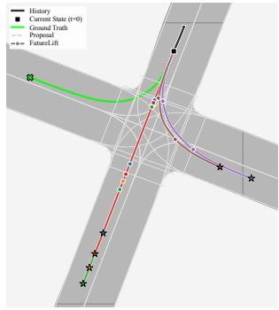  
(a) Mode Collapse

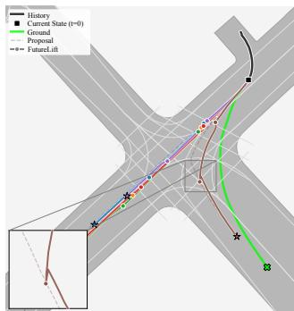  
(b) Kinematic Feasibility  
Figure 3. Representative failure cases. Left: The frozen proposal set omits the correct maneuver; post-hoc refinement cannot recover a mode absent from its inputs. Right: FutureLift produces excessive curvature because its residual decoder does not explicitly enforce vehicle dynamics.

## 5. Conclusion

We introduced FutureLift, a backbone-agnostic trajectory refiner that turns multimodal proposals into explicit heterogeneous future graphs. By representing proposal segments as spatially grounded nodes connected to history, map, modal, and for coherent joint proposals to social context, FutureLift exposes the complete proposed future before correction. Its bidirectional temporal relations allow later evidence to revise earlier segments in one graph pass, while its proposal-only interface supports structurally different forecasting backbones without backbone-specific adaptation. Across Argoverse 2 and WOMD, separately trained FutureLift models improve frozen proposals in marginal and joint forecasting and outperform native and specialized refiners in within-backbone comparisons. On the locally evaluated AV2 test split, FutureLift is competitive with the strongest listed marginal methods and achieves the lowest listed avgMinADE and avgMinFDE in joint prediction. On the WOMD test leaderboard, the single-model Future-Lift system ranks first in horizon-averaged minADE and minFDE among the listed entries with valid reported values and achieves the lowest listed 8-second minFDE; it outperforms all listed ensembles on these displacement metrics and exceeds two of the three ensembles on Soft mAP. Component analysis shows that one bidirectional sweep outperforms up to three causal sweeps, with a larger advantage at longer WOMD horizons.

Our evaluation is limited to offline motion-forecasting benchmarks with HD-map context, so it does not yet establish gains for map-light settings or downstream closed-loop planning. Future work should extend future-graph lifting to less structured scene context and evaluate whether the refined forecasts translate into safer planning decisions under closed-loop interaction.

## References

[1] Jie Cheng, Xiaodong Mei, and Ming Liu. Forecast-MAE: Self-supervised pre-training for motion forecasting with masked autoencoders. Proceedings of the IEEE/CVF International Conference on Computer Vision, 2023. 6, 12

[2] Alexander Cui, Sergio Casas, Kelvin Wong, Simon Suo, and Raquel Urtasun. Gorela: Go relative for viewpoint-invariant motion forecasting. In 2023 IEEE International Confer ence on Robotics and Automation (ICRA), pages 7801–7807. IEEE, 2023. 2, 3

[3] Scott Ettinger, Shuyang Cheng, Benjamin Caine, Chenxi Liu, Hang Zhao, Sabeek Pradhan, Yuning Chai, Ben Sapp, Charles R. Qi, Yin Zhou, Zoey Yang, Aur’elien Chouard, Pei Sun, Jiquan Ngiam, Vijay Vasudevan, Alexander Mc-Cauley, Jonathon Shlens, and Dragomir Anguelov. Large scale interactive motion forecasting for autonomous driving: The waymo open motion dataset. In Proceedings of

the IEEE/CVF International Conference on Computer Vision (ICCV), pages 9710–9719, 2021. 11

[4] Jiyang Gao, Chen Sun, Hang Zhao, Yi Shen, Dragomir Anguelov, Congcong Li, and Cordelia Schmid. Vectornet: Encoding hd maps and agent dynamics from vectorized representation. In Proceedings ofthe IEEE/CVF Conference on Computer Vision and Pattern Recognition (CVPR), 2020. 1, 2

[5] Daniel Grimm, Philip Schorner, Moritz Dreßler, and J-¨ Marius Zollner. Holistic graph-based motion prediction. In¨ 2023 IEEE International Conference on Robotics and Automation (ICRA), pages 2965–2972. IEEE, 2023. 1, 2

[6] Junru Gu, Chen Sun, and Hang Zhao. Densetnt: End-to-end trajectory prediction from dense goal sets. In Proceedings of the IEEE/CVF International Conference on Computer Vision (ICCV), pages 15303–15312, 2021. 5, 6

[7] Hua Hu, Zikang Zhou, Qian Zhou, Zihao Wen, Junjie Hu, Xinhong Chen, Zhengmin Jiang, Yung-Hui Li, and Jianping Wang. Perceiving the near, reasoning the distant: Coherent long-horizon trajectory prediction for autonomous driving. In Proceedings of the IEEE/CVF Conference on Computer Vision and Pattern Recognition, pages 24875–24884, 2026. 2, 7, 12

[8] Ziniu Hu, Yuxiao Dong, Kuansan Wang, and Yizhou Sun. Heterogeneous graph transformer. In Proceedings of The Web Conference 2020, page 2704–2710, New York, NY, USA, 2020. Association for Computing Machinery. 4

[9] Xiaosong Jia, Penghao Wu, Li Chen, Hongyang Li, Yu Liu, and Junchi Yan. Hdgt: Heterogeneous driving graph transformer for multi-agent trajectory prediction via scene encoding, 2022. 2, 4

[10] Markus Knoche, Daan de Geus, and Bastian Leibe. DONUT: A Decoder-Only Model for Trajectory Prediction. In ICCV, 2025. 1, 2, 5, 6, 12

[11] Markus Knoche, Daan de Geus, and Bastian Leibe. Towards metric-agnostic trajectory forecasting, 2026. 7

[12] Zhiqian Lan, Yuxuan Jiang, Yao Mu, Chen Chen, and Shengbo Eben Li. SEPT: towards efficient scene representation learning for motion prediction. In The Twelfth International Conference on Learning Representations, ICLR 2024, Vienna, Austria, May 7-11, 2024. OpenReview.net, 2024. 12

[13] Ming Liang, Bin Yang, Rui Hu, Yun Chen, Renjie Liao, Song Feng, and Raquel Urtasun. Learning lane graph representations for motion forecasting. In Computer Vision – ECCV 2020, pages 541–556, Cham, 2020. Springer International Publishing. 1, 2

[14] Ilya Loshchilov and Frank Hutter. Decoupled weight decay regularization. arXiv preprint arXiv:1711.05101, 2017. 12

[15] Xiaoyu Mo, Yang Xing, and Chen Lv. Heterogeneous edgeenhanced graph attention network for multi-agent trajectory prediction, 2021. 4

[16] Muleilan Pei, Shaoshuai Shi, Xuesong Chen, Xu Liu, and Shaojie Shen. Foresight in motion: Reinforcing trajectory prediction with reward heuristics. In Proceedings of the IEEE/CVF International Conference on Computer Vision (ICCV), pages 28303–28312, 2025. 2

[17] Luke Rowe, Martin Ethier, Eli-Henry Dykhne, and Krzysztof Czarnecki. FJMP: Factorized joint multi-agent

motion prediction over learned directed acyclic interaction graphs. In Proceedings of the IEEE/CVF Conference on Computer Vision and Pattern Recognition (CVPR), 2023. 3, 6, 12

[18] Chen Shi, Shaoshuai Shi, and Li Jiang. MTR v3: 1st place solution for 2024 waymo open dataset challenge—motion prediction. Technical report, Waymo Open Dataset Challenge, 2024. 7

[19] Shaoshuai Shi, Li Jiang, Dengxin Dai, and Bernt Schiele. Motion transformer with global intention localization and local movement refinement. Advances in Neural Information Processing Systems, 35:6531–6543, 2022. 2

[20] Shaoshuai Shi, Li Jiang, Dengxin Dai, and Bernt Schiele. Mtr++: Multi-agent motion prediction with symmetric scene modeling and guided intention querying, 2024. 7

[21] Yunsheng Shi, Zhengjie Huang, Shikun Feng, Hui Zhong, Wenjin Wang, and Yu Sun. Masked label prediction: Unified message passing model for semi-supervised classifica tion, 2020. 1

[22] Nan Song, Bozhou Zhang, Xiatian Zhu, and Li Zhang. Motion forecasting in continuous driving. In NeurIPS, 2024. 12

[23] Jiawei Sun, Xibin Yue, Jiahui Li, Tianle Shen, Chengran Yuan, Shuo Sun, Sheng Guo, Quanyun Zhou, and Marcelo H Ang Jr. Impact: Behavioral intention-aware multimodal trajectory prediction with adaptive context trimming. IEEE Robotics and Automation Letters, 11(1):610–617, 2026. 7

[24] Ashish Vaswani, Noam Shazeer, Niki Parmar, Jakob Uszkoreit, Llion Jones, Aidan N Gomez, Ł ukasz Kaiser, and Illia Polosukhin. Attention is all you need. In Advances in Neural Information Processing Systems. Curran Associates, Inc., 2017. 1, 4

[25] Mingkun Wang, Xiaoguang Ren, Ruochun Jin, Minglong Li, Xiaochuan Zhang, Changqian Yu, Mingxu Wang, and Wenjing Yang. Futurenet-lof: Joint trajectory prediction and lane occupancy field prediction with future context encoding. In 2025 IEEE International Conference on Robotics and Automation (ICRA), pages 8841–8848, 2025. 2, 3, 12

[26] Benjamin Wilson, William Qi, Tanmay Agarwal, John Lambert, Jagjeet Singh, Siddhesh Khandelwal, Bowen Pan, Ratnesh Kumar, Andrew Hartnett, Jhony Kaesemodel Pontes, et al. Argoverse 2: Next generation datasets for self-driving perception and forecasting. arXiv preprint arXiv:2301.00493, 2023. 11

[27] Liwen Xiao, Zhiyu Pan, Zhicheng Wang, Zhiguo Cao, and Wei Li. Srefiner: Soft-braid attention for multi-agent trajectory refinement. In Proceedings of the IEEE/CVF International Conference on Computer Vision, pages 960–969, 2025. 1, 2, 6

[28] Bozhou Zhang, Nan Song, and Li Zhang. Demo: Decoupling motion forecasting into directional intentions and dynamic states. In Advances in Neural Information Processing Systems, pages 106582–106606. Curran Associates, Inc., 2024. 2, 3, 12

[29] Bozhou Zhang, Nan Song, Xiatian Zhu, and Li Zhang. Demo++: Motion decoupling for autonomous driving, 2025. 12

[30] Bozhou Zhang, Nan Song, Bingzhao Gao, and Li Zhang. Relative position matters: Trajectory prediction and planning with polar representation. ICRA, 2026. 12

[31] Zhejun Zhang, Alexander Liniger, Christos Sakaridis, Fisher Yu, and Luc Van Gool. Real-time motion prediction via heterogeneous polyline transformer with relative pose encoding. In Advances in Neural Information Processing Systems (NeurIPS), 2023. 3

[32] Yang Zhou, Hao Shao, Letian Wang, Steven L. Waslander, Hongsheng Li, and Yu Liu. Smartrefine: A scenario-adaptive refinement framework for efficient motion prediction, 2024. 1, 2, 12

[33] Zikang Zhou, Jianping Wang, Yung-Hui Li, and Yu-Kai Huang. Query-centric trajectory prediction. In Proceedings of the IEEE/CVF Conference on Computer Vision and Pattern Recognition, pages 17863–17873, 2023. 1, 2, 3, 5, 6, 12

[34] Zikang Zhou, Hengjian Zhou, Haibo Hu, Zihao Wen, Jianping Wang, Yung-Hui Li, and Yu-Kai Huang. Modeseq: Taming sparse multimodal motion prediction with sequential mode modeling. In Proceedings of the IEEE/CVF Conference on Computer Vision and Pattern Recognition (CVPR), pages 1612–1621, 2025. 7

## A. Experimental Setup

## A.1. Datasets and Tasks

Argoverse 2 (AV2) contains 199,908 training, 24,988 validation, and 24,984 test scenarios [26]. Each scenario provides five seconds of history and requires six seconds of prediction at 10 Hz. Models predict the future positions of the scored actors. In marginal forecasting, each actor receives an independently ranked set of trajectories; in joint forecasting, each mode is a coherent scene-level world containing one trajectory per scored actor. All AV2 experiments use K = 6 modes, while the K = 1 appendix metrics evaluate the highest-confidence mode.

The Waymo Open Motion Dataset (WOMD) contains 486,995 training, 44,097 validation, and 44,920 test scenarios [3]. It provides one second of history and an eightsecond prediction horizon at 10 Hz, and designates up to eight agents per scenario for evaluation. We use the marginal prediction setting with K = 6 trajectories per designated agent. The official metrics are computed separately for vehicles, pedestrians, and cyclists at evaluation cutoffs of 3, 5, and 8 seconds and then averaged. We additionally retain the per-cutoff validation metrics to test whether refinement gains change with horizon length.

## A.2. Metrics

Let ${ \bf y } _ { a , t }$ and $\hat { \mathbf { y } } _ { a , } ^ { k }$ denote the ground-truth and mode-k positions of actor a at future step t. Average displacement error (ADE) averages ${ \left\| \hat { \mathbf { y } } _ { a , t } ^ { k } - \mathbf { y } _ { a , t } \right\| } _ { 2 }$ over the prediction horizon, whereas final displacement error (FDE) evaluates it at the final step. For AV2 marginal prediction, the mode with the smallest FDE is selected; minFDE and minADE report its FDE and ADE, respectively. MR is the fraction of actors for which every mode has an FDE greater than 2 m. Brier-minFDE additionally accounts for confidence as $\mathrm { m i n F D E } + ( 1 - s _ { k ^ { * } } ) ^ { 2 }$ , where $s _ { k } \mathrm { : }$ ∗ is the normalized confidence of the selected mode. Unless otherwise stated, AV2 metrics use K = 6 and displacement errors are measured in meters.

For AV2 joint prediction, ADE and FDE are first averaged over the scored actors within each predicted world, and the world with the smallest average FDE is selected. We report its avgMinADE and avgMinFDE. ActorMR is the fraction of actors in the selected world whose final error exceeds 2 m, and avgBrier-minFDE adds the same confidence penalty to the selected world’s avgMinFDE.

For WOMD, minADE and minFDE take the minimum displacement error over the K predictions at each evaluation cutoff. A prediction is a match when its endpoint lies within the official lateral and longitudinal thresholds after rotating the error into the ground-truth agent frame. The base threshold pairs are (1.0, 2.0), (1.8, 3.6), and (3.0, 6.0) meters at 3, 5, and 8 seconds, respectively, and are scaled between 0.5 and 1.0 according to the agent’s initial speed. MR is the fraction of agents for which no mode matches. Overlap rate (OR) measures how often the highest-confidence prediction overlaps another object visible at the prediction time at any step up to the cutoff.

Mean average precision (mAP) evaluates confidence ranking after grouping ground-truth trajectories into motion buckets. Matching predictions are true positives and misses are false positives, with at most one true positive per agent; precision–recall curves are computed per bucket and then averaged. Soft mAP differs only in its treatment of additional matching modes: after the highest-confidence match is counted as the true positive, further matches are ignored instead of counted as false positives. The main benchmark table reports the official mAP v2 and Soft mAP v2 values averaged over the three agent types and the 3, 5, and 8- second cutoffs; minFDE@8s is the corresponding all-object result at the 8-second cutoff. The horizon analysis reports minADE and minFDE at each cutoff separately using the same trained model.

## A.3. Training and Evaluation Protocol

FutureLift receives frozen proposal coordinates and logits from each backbone and does not access backbone queries, exported embeddings, or intermediate decoder features. Because this interface consists only of trajectories and scores, no backbone-specific architectural adaptation is required, although FutureLift is trained separately for each setting. For marginal experiments, FutureLift replaces the native refinement stage of QCNet or DONUT. For joint experiments, it refines the final proposal sets produced by FJMP, Forecast-MAE, or DONUT. We run the trained comparison refiners from their official repositories using the authors’ released hyperparameters; accordingly, SmartRefine also receives the backbone trajectory features required by its official implementation. The daggered SRefiner results are instead reproduced from the authors’ AV2 evaluation with matched FJMP and Forecast-MAE backbones. While the SRefiner paper defines its initial feature as an encoding of proposal geometry and agent pose, its released AV2 implementation loads both proposal coordinates and a precomputed 134-dimensional per-mode tensor named embeds final; this tensor is projected to initialize refinement. Thus, these SRefiner rows neither use our bitidentical proposal files nor satisfy FutureLift’s proposalonly input contract. Except for the explicitly daggered SRefiner rows, refiners compared within a backbone block use the same frozen proposal files, split, preprocessing, K, evaluator version, and random seeds.

Future and scene features have dimension d = 128, and the default refiner uses two heterogeneous attention layers with eight heads. Each attention block uses pre-LayerNorm, dropout of 0.1, and a feed-forward network with hidden dimension $4 d \ : = \ : 5 1 2$ and LeakyReLU activation. We use $R = 3$ temporal nodes for the six-second AV2 horizon and $R \ : = \ : 4$ for the eight-second WOMD horizon. Map and social neighborhoods are radius-based, keeping the lifted graph sparse as the number of agents grows. We optimize FutureLift with AdamW [14] using a total batch size of 64. Training lasts 40 epochs: the learning rate is linearly warmed up to $5 \times 1 0 ^ { - 4 }$ during the first epoch and then decayed to zero with a cosine schedule over the remaining 39 epochs. We apply no data augmentation. For every AV2 and WOMD validation experiment trained in our study, we use seeds 42, 1337, and 2026 and report the arithmetic mean over the three runs. The same seeds are used for every comparison refiner that we train; the daggered SRefiner values are published results and are therefore excluded from this seed-averaging statement. Metric-wise standard deviations do not exceed $3 \times 1 0 ^ { - 3 }$ across our validation runs, so we report the means in the main tables and summarize dispersion here rather than appending a deviation to every cell. For each run, we select the checkpoint with the lowest validation loss. This seed averaging applies only to validationsplit results. For the official WOMD test submission, we randomly select one of the three trained seeds rather than choosing a model based on test performance.

Table 6. Additional AV2 marginal test-set context. Asterisks denote ensembles. FutureLift is evaluated locally with the released test annotations and official evaluator because the leaderboard is closed to new submissions. These results complement, but are distinct from, the controlled validation comparisons in Tab. 1.
<table><tr><td>Method</td><td> $\mathsf { b { \mathrm { - } m i n F D E } _ { 6 } } \downarrow ( \mathrm { m } )$ </td><td> $\mathrm { m i n F D E _ { 6 } \downarrow ( m ) }$ </td><td>minADE6 ↓ (m)</td><td> ${ \mathrm { M R } } _ { 6 } \downarrow$ </td><td> $\mathrm { m i n F D E } _ { 1 } \downarrow ( \mathrm { m } )$ </td><td>minADE1↓(m)</td></tr><tr><td>QCNet [33]</td><td>1.91</td><td>1.29</td><td>0.65</td><td>0.16</td><td>4.30</td><td>1.69</td></tr><tr><td>SmartRefine [32]</td><td>1.86</td><td>1.23</td><td>0.63</td><td>0.15</td><td>4.17</td><td>1.65</td></tr><tr><td>DeMo [28]</td><td>1.84</td><td>1.17</td><td>0.61</td><td>0.13</td><td>3.74</td><td>1.49</td></tr><tr><td>Polaris [30]</td><td>1.80</td><td>1.15</td><td>0.62</td><td>0.13</td><td>3.78</td><td>1.53</td></tr><tr><td>DONUT [10]</td><td>1.79</td><td>1.16</td><td>0.63</td><td>0.14</td><td>4.06</td><td>1.66</td></tr><tr><td>NDPNet [7]</td><td>1.83</td><td>1.17</td><td>0.61</td><td>0.14</td><td>4.08</td><td>1.62</td></tr><tr><td>DeMo++ [29]</td><td>1.74</td><td>1.12</td><td>0.61</td><td>0.12</td><td>3.70</td><td>1.50</td></tr><tr><td>FutureLift (DONUT)</td><td>1.74</td><td>1.09</td><td>0.58</td><td>0.12</td><td>3.90</td><td>1.56</td></tr><tr><td>QCNet* [33]</td><td>1.78</td><td>1.19</td><td>0.62</td><td>0.14</td><td>3.96</td><td>1.56</td></tr><tr><td>SEPT* [12]</td><td>1.74</td><td>1.15</td><td>0.61</td><td>0.14</td><td>3.70</td><td>1.48</td></tr><tr><td>DeMo* [28]</td><td>1.73</td><td>1.11</td><td>0.60</td><td>0.12</td><td>3.70</td><td>1.49</td></tr><tr><td>Polaris* [30]</td><td>1.71</td><td>1.11</td><td>0.61</td><td>0.12</td><td>3.78</td><td>1.53</td></tr><tr><td>FutureNet-LOF* [25]</td><td>1.63</td><td>1.07</td><td>0.58</td><td>0.12</td><td>3.63</td><td>1.46</td></tr><tr><td>NDPNet* [7]</td><td>1.71</td><td>1.09</td><td>0.58</td><td>0.13</td><td>3.71</td><td>1.47</td></tr></table>

Table 7. Additional AV2 joint test-set context. FutureLift is evaluated locally with the released test annotations and official evaluator be cause the leaderboard is closed to new submissions. These results complement, but are distinct from, the controlled validation comparisons in Tab. 2.
<table><tr><td>Method</td><td>avgBrier-minFDE6 ↓ (m)</td><td> $\mathrm { a v g M i n F D E _ { 6 } \downarrow ( m ) }$ </td><td> $\mathrm { a v g M i n A D E _ { 6 } \downarrow ( m ) }$ </td><td> ${ \bf A c t o r M R } _ { 6 } \downarrow$ </td><td> $\mathrm { a v g M i n F D E } _ { 1 } \downarrow ( \mathrm { m } )$ </td><td> $\mathrm { a v g M i n A D E _ { 1 } \downarrow ( m ) }$ </td></tr><tr><td>FJMP [17]</td><td>2.59</td><td>1.89</td><td>0.81</td><td>0.23</td><td>4.00</td><td>1.52</td></tr><tr><td>Forecast-MAE [1]</td><td>2.24</td><td>1.55</td><td>0.69</td><td>0.19</td><td>3.33</td><td>1.30</td></tr><tr><td>RealMotion [22]</td><td>2.01</td><td>1.32</td><td>0.62</td><td>0.18</td><td>2.87</td><td>1.14</td></tr><tr><td>DeMo [28]</td><td>1.93</td><td>1.24</td><td>0.58</td><td>0.16</td><td>2.78</td><td>1.12</td></tr><tr><td>Polaris [30]</td><td>1.86</td><td>1.18</td><td>0.56</td><td>0.15</td><td>2.67</td><td>1.07</td></tr><tr><td>FutureLift (DONUT)</td><td>1.82</td><td>1.14</td><td>0.55</td><td>0.15</td><td>2.63</td><td>1.07</td></tr></table>

## A.4. Efficiency Protocol

We report only the computation added by refinement. Parameter counts exclude the frozen proposal backbone, while GFLOPs and latency cover the refiner under a common batch and scene protocol. Measurements use an NVIDIA RTX 6000 Ada Generation GPU with PyTorch 2.5, FP32 precision, and a batch size of one. After 50 warm-up runs, latency is reported as the arithmetic mean over 10 timed runs. The timing includes both graph construction and the refiner forward pass.

## A.5. Complete AV2 Benchmark Context

The main tables prioritize controlled refinement comparisons. For completeness, Tabs. 6 and 7 place the strongest FutureLift systems alongside additional published methods and include the official K = 1 displacement metrics. For both AV2 test tasks, we report the FutureLift configuration selected on the validation split, which uses frozen DONUT proposals. Because the AV2 motion-forecasting leaderboard no longer accepts new submissions, we evaluate this configuration locally using the test annotations released by the dataset authors and the official evaluator. The resulting values are computed on the AV2 test split but therefore do not appear on the archived leaderboard. Published leaderboard values are included for benchmark context and are not used as evidence for identical-input refinement comparisons.

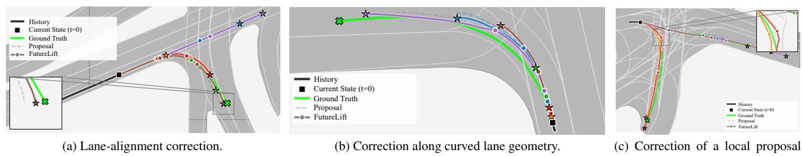  
(c) Correction of a local proposal discontinuity.  
Figure 4. Representative FutureLift corrections on the AV2 validation split. Each panel compares a frozen backbone proposal with the corresponding FutureLift-refined hypothesis and ground truth. FutureLift corrects lateral drift, curved-lane misalignment, and a loca trajectory discontinuity.

## A.6. Detailed Refinement Cost

Table 8. Refinement-only efficiency under the common protocol in Sec. A.4. Latency includes graph construction and is averaged over 10 timed runs.
<table><tr><td>Dataset / task</td><td>Backbone</td><td>Refiner</td><td>Params (M)</td><td>GFLOPs</td><td>Mean latency (ms)</td></tr><tr><td>AV2 marginal</td><td>QCNet</td><td>Native</td><td>7.7</td><td>55.8</td><td>95</td></tr><tr><td>AV2 marginal</td><td>QCNet</td><td>SmartRefine</td><td>8.0</td><td>56.2</td><td>112</td></tr><tr><td>AV2 marginal</td><td>QCNet</td><td>FutureLift</td><td>13.8</td><td>84.4</td><td>131</td></tr><tr><td>AV2 joint</td><td>FJMP</td><td>SRefiner</td><td>5.9</td><td>45.6</td><td>83</td></tr><tr><td>AV2 joint</td><td>FJMP</td><td>FutureLift</td><td>13.1</td><td>78.0</td><td>98</td></tr><tr><td>AV2 joint</td><td>DONUT</td><td>FutureLift</td><td>12.2</td><td>94.6</td><td>110</td></tr><tr><td>WOMD marginal</td><td>DONUT</td><td>Native</td><td>9.0</td><td>76.2</td><td>175</td></tr><tr><td>WOMD marginal</td><td>DONUT</td><td>FutureLift</td><td>12.1</td><td>98.1</td><td>136</td></tr></table>

## A.7. Number of Refinement Passes

We evaluate whether repeatedly applying the refinement stage improves over FutureLift’s default single-pass design. Here, J denotes the number of outer refinement passes and is distinct from the number of attention layers within one pass. For J ≥ 1, the winning mode used for supervision is selected after refinement, consistent with the training objective in Sec. 3; J = 0 leaves the initial predictions unrefined.

Table 9. Effect of the number of refinement passes J on the AV2 marginal validation split. Displacement errors are in meters, and latency is measured on an NVIDIA H100 GPU.
<table><tr><td>J</td><td>b-minFDE6 ↓</td><td>↓</td><td>minFDE6 minADE6 ↓</td><td>MR₆ ↓</td><td>Latency (ms) ↓</td></tr><tr><td>0</td><td>1.875</td><td>1.235</td><td>0.644</td><td>0.162</td><td>69</td></tr><tr><td>1</td><td>1.743</td><td>1.091</td><td>0.584</td><td>0.124</td><td>90</td></tr><tr><td>2</td><td>1.771</td><td>1.135</td><td>0.602</td><td>0.133</td><td>105</td></tr><tr><td>3</td><td>1.797</td><td>1.167</td><td>0.621</td><td>0.141</td><td>120</td></tr></table>

A single refinement pass provides the best accuracy, reducing minFDE by 11.7% and minADE by 9.3% relative to no refinement. Additional passes increase latency and consistently degrade the spatial metrics, supporting the singlepass design used throughout the paper.

## A.8. Qualitative Analysis

Figure 4 illustrates representative geometric corrections made by FutureLift on the AV2 validation split. Each scene compares the same trajectory hypothesis before and after refinement. In Fig. 4a, FutureLift reduces lateral drift from the local lane geometry. In Fig. 4b, it better follows a curved lane segment, while Fig. 4c shows the correction of a localized discontinuity in the initial proposal. These examples illustrate the local corrections enabled by proposalconditioned future-graph reasoning; they do not by themselves establish physical feasibility or closed-loop safety.

## B. Detailed Node and Edge Descriptions

The scene depicted in Fig. 5 is used in the following to visualize all different edges. The scene consists of a green and purple vehicle, each with 4 timesteps. There are 4 lanes in the scene. For better visibility the area of the lane is also colorized. Every lane holds multiple point nodes. Lastly the example scene holds agent-future nodes for 2 modes, each consisting of 3 segments.

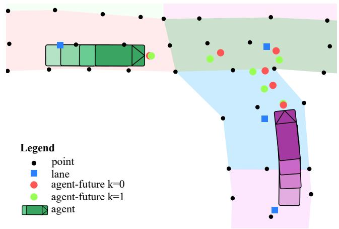  
Figure 5. Example scene

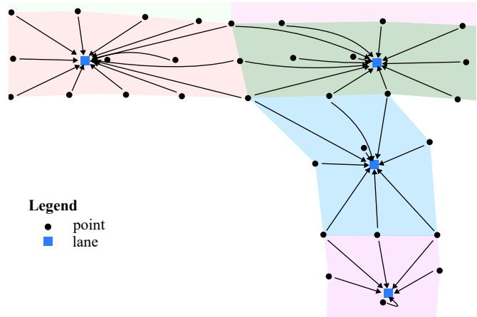  
Figure 6. (point, belongs-to, lane): All points belonging to the same lane, are connected to their respected lane node.

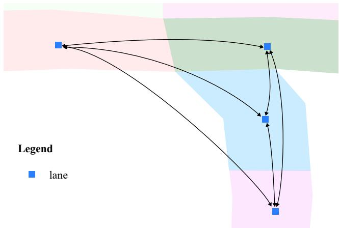  
Figure 7. (lane, to, lane): Lane nodes are connected to all neighbors within a radius of 150m.

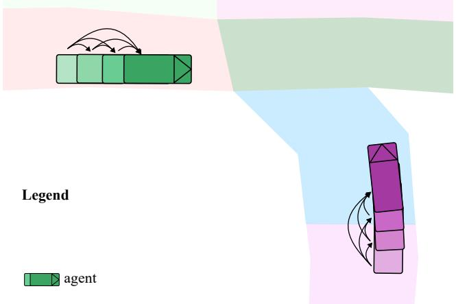  
Figure 8. (agent, self, agent): Agent nodes are connected to up to 10 subsequent neighbors.

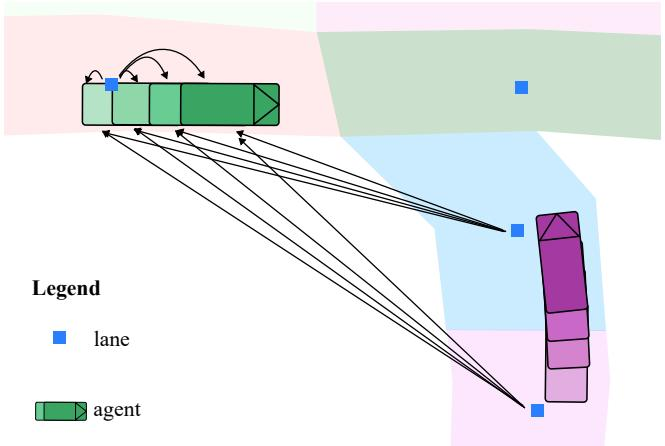  
Figure 9. (lane, gives-traffic-info, agent): Lanes are connected to all agents within a radius of 150m. For better visibility only edges to the green vehicle are depicted.

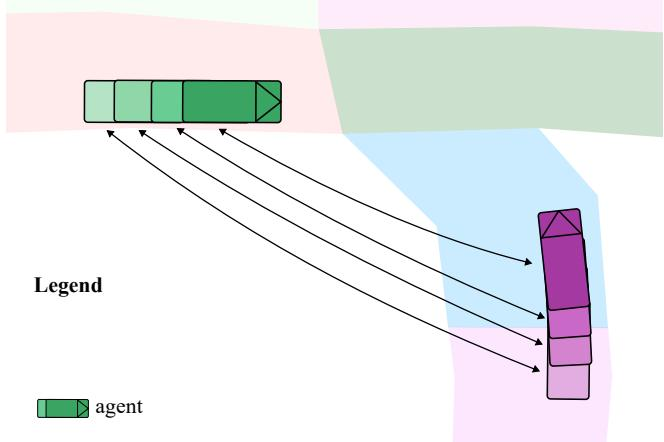  
Figure 10. (agent, social, agent): Agent nodes are connected to agent nodes from neighboring traffic participants at the concurrent timestamp within a 50m radius.

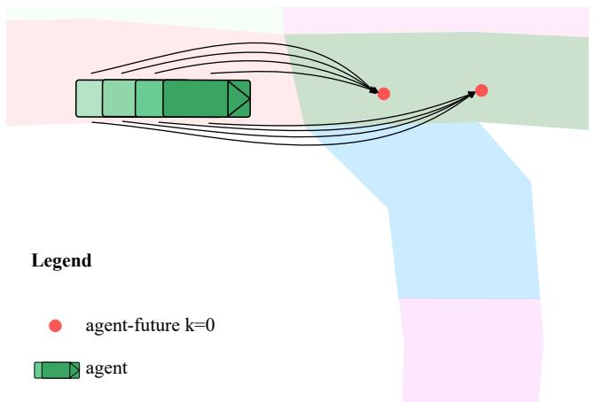  
Figure 11. (agent, self, agent-future): Agent-future nodes receive information from up to 30 previous agent nodes.

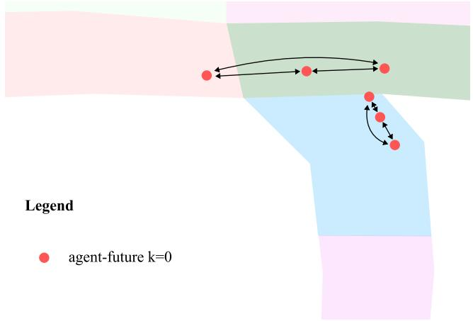  
Figure 12. (agent-future, self, agent-future): Agent-future nodes receive updates from other agent-future nodes belonging to the same trajectory, i.e. the same mode. For greater visibility only nodes for k = 0 are depicted.

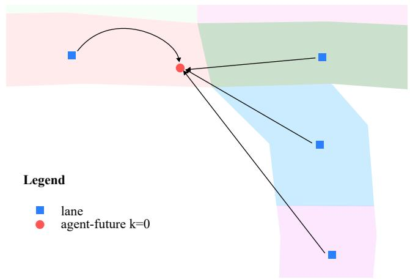  
Figure 13. (lane, gives-traffic-info, agent-future): Lane nodes are connected to agent future nodes within a radius of 150m.

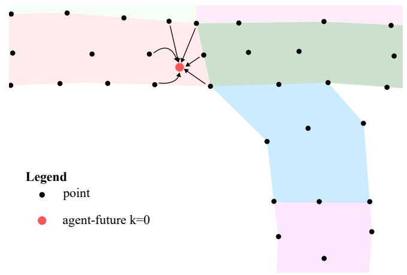  
Figure 14. (point, gives-traffic-info, agent-future): Point nodes are connected to agent-future nodes within a radius of 10m.

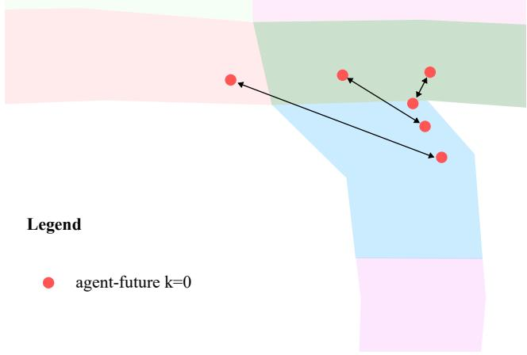  
Figure 15. (agent-future, social, agent-future): Agent-future nodes are connected to neighboring traffic participants in the same joint mode and future interval within a 150m radius. Only k = 0 is depicted for simplicity.

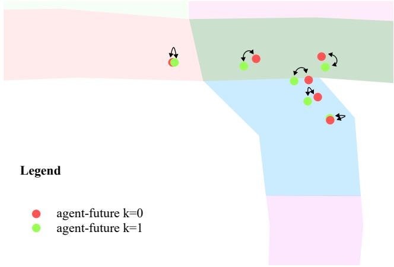  
Figure 16. (agent-future, mode, agent-future): Agent-future nodes belonging to the same future interval and traffic participant are connected across different modes.