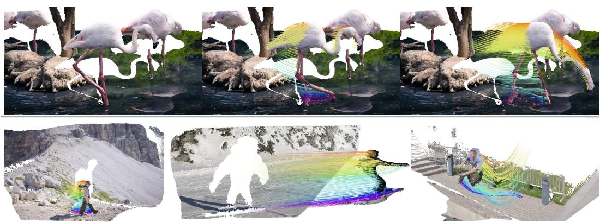
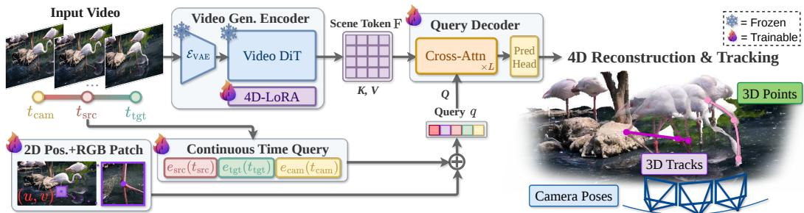
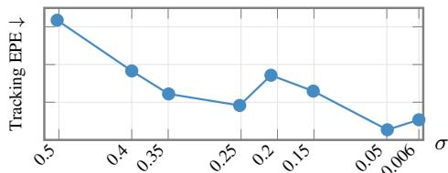
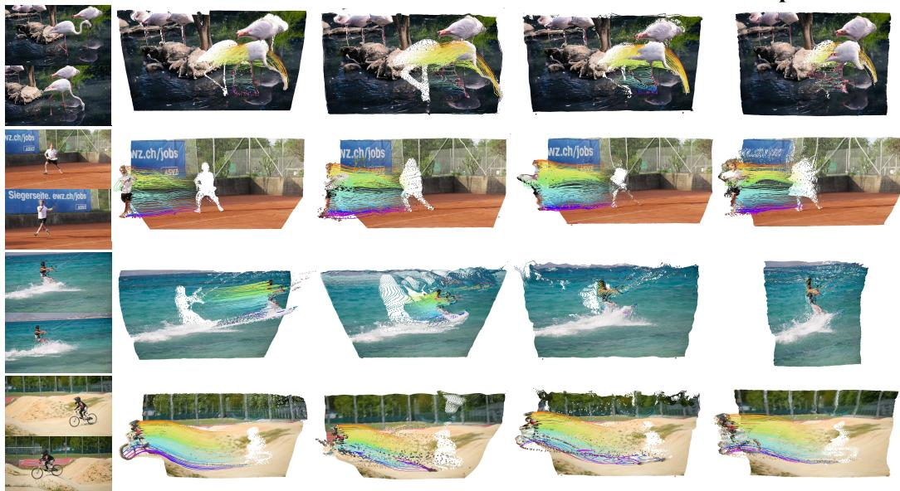
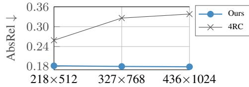
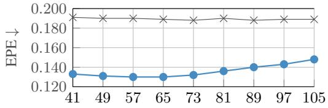
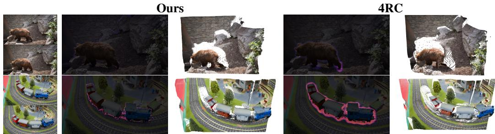
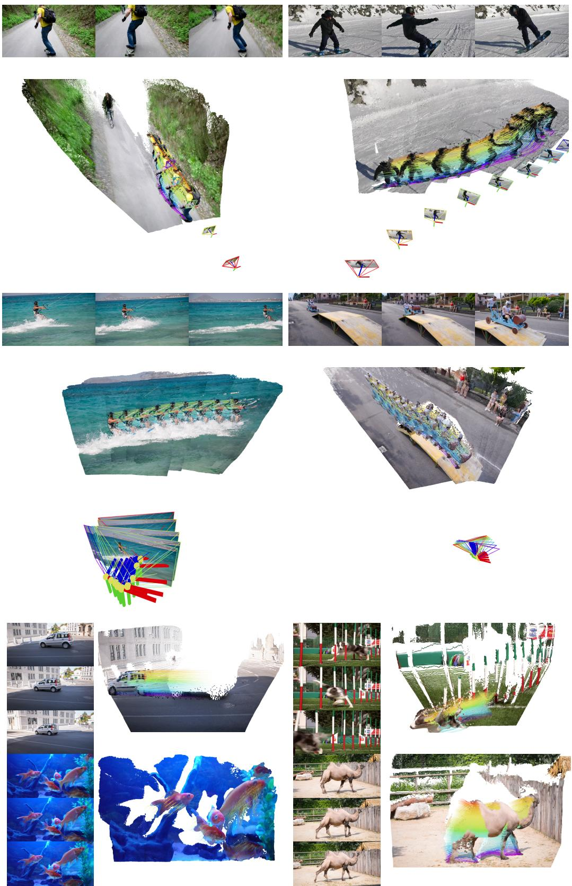
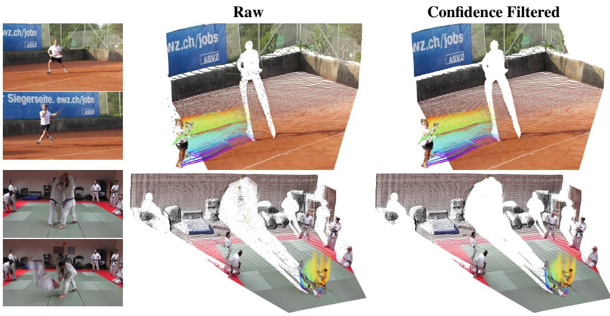

# GEN4P: VIDEO GENERATORS ARE 4D PERCEIVERS

Yitong Xia1 Zeren Jiang2 Chuanxia Zheng1

1PVG, Nanyang Technological University 2VGG, University of Oxford

  
Figure 1: Gen4P repurposes a multi-step Video Generator into a single-step 4D Perceiver, enabling unified feed-forward prediction of dense 3D tracks, point maps, depth maps, and camera poses from a video input. Gen4P is able to track complex motion while maintaining the delicate structure of in-the-wild content, like the thin legs of the flamingo and long-range skiing motion.

## ABSTRACT

We introduce Gen4P, a unified framework for recovering 4D geometry and motion from monocular video. We show that a pretrained multi-step video generator can be repurposed into a feed-forward 4D perceiver without iterative denoising. Building on on-demand querying, Gen4P processes clean video latents in a single encoder pass and predicts the requested 4D attributes through a lightweight crossattention decoder. The on-demand query formulation enables flexible spatial sampling, and our proposed continuous-time queries further provide temporal flexibility. To strengthen geometric knowledge, we propose a straightforward plug-in solution by incorporating a pretrained video-depth LoRA as a frozen geometry prior, improving overall performance without adding extra trainable parameters. Gen4P achieves state-of-the-art or competitive performance on tasks of 3D point tracking, video depth and camera pose estimation. Qualitative results on in-the-wild videos illustrate its capability of tracking complex motion while maintaining the delicate structure. Together, these results demonstrate the potential of video generative pretraining for unified 4D perception. See https://gen4p. github.io/ for more visual results.

## 1 INTRODUCTION

We consider the problem offeed-forwardfull 4D reconstruction from monocular video. A unified 4D representation of scene geometry, depth, camera poses, and 3D point trajectories provides a foundation for simulating and interacting with the physical environment. However, recovering such a representation remains challenging: it requires accurately capturing both the static geometry and the dynamic motion of the scene across viewpoints and over time.

Recent advances in feed-forward reconstruction demonstrate the value of pretrained foundational vision models. Geometry Foundation Models (GFMs), including VGGT (Wang et al., 2025a), VGGT-Ω (Wang et al., 2026a), and DA3 (Lin et al., 2025), build on pretrained vision models (Oquab et al., 2023; Simeoni et al., 2025), adapting them through large-scale geometric supervision. These GFMs´ then provide strong geometry priors for subsequent 4D reconstruction: V-DPM (Sucar et al., 2026) and 4RC (Luo et al., 2026), for instance, extend VGGT and DA3 to jointly recover geometry and motion. However, geometry priors alone do not explicitly model how points should evolve over time in dynamic scenes.

Meanwhile, foundational generative models offer a complementary source of priors over appearance, geometry, and motion, by learning to synthesize images and videos (Wan et al., 2025; ByteDance Seed Team, 2026). Recent studies have exploited generative priors for 2D correspondence (Hedlin et al., 2023), depth estimation (Ke et al., 2024; Hu et al., 2025), 3D geometry recovery (Zhang et al., 2025b; Lu et al., 2025; Jiang et al., 2025), motion tracking (Zhu et al., 2026; Nam et al., 2026a), and general perception (Wang et al., 2026b). However, they still address 4D perception through task-specific approaches. Besides, they often require dense, frame-aligned supervision, limiting their flexibility in handling arbitrary spatiotemporal video inputs.

In this work, we introduce Gen4P, a 4D perceiver that leverages rich priors from large-scale pretrained video generators for full 4D reconstruction. Specifically, Gen4P tames a multi-step video generator into a single-step feed-forward 4D perceiver. To this end, the objective is formulated as learning a direct regression network, instead of the iterative denoising for geometric reconstruction in prior works (Ke et al., 2024; Jiang et al., 2025; Lu et al., 2025). Such a formulation requires only one encoder forward pass per input clip. The resulting scene tokens are then shared across queries, reducing the encoding cost over repeated 4D predictions.

We obtain the full 4D attributes by querying the scene tokens using a lightweight cross-attention decoder. It decouples the output sampling from pre-extracted feature grids, allowing spatial flexibility in the output resolution. Additionally, we introduce a continuous-time query mechanism to handle variable-length video sequences effectively. Furthermore, we discover that a pretrained video-depth LoRA can further be incorporated as a frozen plug-in geometric prior, strengthening geometry without introducing additional trainable parameters.

Our key contributions are summarized as follows: (i) we repurpose a video generator into a feedforward 4D perceiver under sparse query supervision, offering an alternative to GFM-based methods; (ii) we introduce a continuous-time query mechanism together with on-demand decoding to provide temporal and spatial flexibility; (iii) we incorporate a frozen depth LoRA as a plug-in geometry prior, improving overall 4D reconstruction without adding trainable parameters; and (iv) we provide a comprehensive evaluation of our method on a set of 4D reconstruction tasks, complemented by qualitative results on in-the-wild videos, demonstrating its effectiveness and generalization.

## 2 RELATED WORK

Feed-forward GFMs directly regress pixel-aligned geometry, from pairwise point maps (Wang et al., 2024) to sequence models that use spatial memory (Wang & Agapito, 2025), recurrent scene states (Wang et al., 2025b), or joint multi-view attention with multiple prediction heads (Wang et al., 2025a). Later models remove the reference view (Wang et al., 2026c), accept optional geometric inputs (Keetha et al., 2026), or learn unified depth–ray targets (Lin et al., 2025).

Point Tracking in 2D and 3D. 2D point tracking has been extensively studied in both sparse and dense settings (Doersch et al., 2022; Karaev et al., 2024; 2025; Lai et al., 2026). 3D point tracking methods lift pixels with monocular depth and iterative refinement (Xiao et al., 2024), improve dense long-range estimation through optimized surrogate queries (Ngo et al., 2025b;a), or jointly estimate geometry, camera, and object motion (Xiao et al., 2025). GFM-based 4D perceivers represent dynamic 3D scenes through per-frame point maps (Zhang et al., 2025a), dynamic point maps (Sucar et al., 2026), conditional frame-wise decoding (Luo et al., 2026), or motion bases (Lin et al., 2026). Other approaches include common-time point-map pairs (Feng et al., 2025), parametric trajectories (Liu et al., 2026), and scene flow (Zhu et al., 2026; Karhade et al., 2026; Qian et al., 2026). Most rely on frame-aligned grid decoding, coupling output sampling and cost to spatial resolution, whereas D4RT (Zhang et al., 2026a) decouples prediction from predefined grids through on-demand queries.

Generative Priors for Geometry and Motion. Large pretrained generators encode geometry and motion priors transferable to perception tasks (Zhan et al., 2024; Huang et al., 2026). Image adaptations estimate depth through iterative denoising (Ke et al., 2024) or single-step regression (He et al., 2025). Video adaptations predict depth (Hu et al., 2025), point maps (Xu et al., 2025), fused point–ray maps (Jiang et al., 2025), or scene flow (Zhu et al., 2026). Feature-based trackers instead exploit internal temporal correspondences for 2D tracking (Nam et al., 2026b; Son et al., 2025). Recent feed-forward adaptations repurpose video generators for direct video depth regression (Zhang et al., 2026b), dense 3D tracking (Nam et al., 2026a), or multimodal unified perception (Wang et al., 2026b).

  
Figure 2: Overview of Gen4P. The input video is encoded into scene tokens F in a single pass by the Video Generative Encoder, which consists of a frozen VAE encoder and DiT, an optional frozen Depth-LoRA, and a trainable 4D-LoRA. The cross-attention Query Decoder is queried independently for each query $\mathbf { q } ( u , v , t _ { \mathrm { s r c } } , t _ { \mathrm { t g t } } , t _ { \mathrm { c a m } } )$ , where the query timestamps are parameterized as continuous time embeddings. The decoder outputs the corresponding 3D and 2D point attributes, enabling the full construction of 3D tracks, depth maps and camera poses.

## 3 METHODS

Given an input video $V = \{ I _ { t } \} _ { t = 1 } ^ { T } \in \mathbb { R } ^ { T \times H \times W \times 3 }$ , our goal is to learn a neural network $p _ { \pmb { \theta } }$ to predict a full set of 4D attributes, including 3D tracking, 3D point clouds, video depths, and camera parameters. Instead of training a large-scale 4D geometric network from scratch, in Gen4P we repurpose a pretrained video generator $p _ { \mathrm { p r e } }$ as a feed-forward 4D perceiver.

As illustrated in Fig. 2, Gen4P adopts an on-demand query-based formulation inspired by D4RT (Sec. 3.1). A lightweight decoder queries spatiotemporal features from the pretrained video generator (Sec. 3.2.1) to predict 4D attributes at specified locations and times. Since real-world videos vary in duration, a practical 4D reconstruction method should accommodate different sequence lengths. Unlike D4RT, we introduce a continuous time query (Sec. 3.2.2) to enhance flexibility. We further introduce a plug-in geometry prior (Sec. 3.3) to enhance geometric performance. The training objective is described in Sec. 3.4. We detail each component below.

## 3.1 PRELIMINARIES: D4RT

D4RT (Zhang et al., 2026a) formulates full 4D reconstruction as on-demand point querying. Given a fixed-length input video $V \in \mathbb { R } ^ { 4 8 \times H \times W \times 3 }$ , a VideoMAE-initialized (Wang et al., 2023) encoder E first encodes it into a global scene representation F that is shared by all subsequent point queries:

$$
\mathbf { F } = { \mathcal { E } } ( V ) \in \mathbb { R } ^ { N _ { e } \times C } .\tag{1}
$$

Then F is decoded to produce 3D points and auxiliary 2D attributes, including positions, normals, visibility, and confidence, through parallelized independent point queries. Each input query token is parameterized as

$$
\begin{array} { r } { \mathbf { q } ( u , v , t _ { \mathrm { s r c } } , t _ { \mathrm { t g t } } , t _ { \mathrm { c a m } } ) = \mathrm { M L P } _ { q } \left( \phi _ { \mathrm { u v } } ( u , v ) + \phi _ { \mathrm { p a t c h } } ( \mathbf { p } _ { u , v } ) \right. } \\ { \left. + \mathbf { e } _ { \mathrm { s r c } } ( t _ { \mathrm { s r c } } ) + \mathbf { e } _ { \mathrm { t g t } } ( t _ { \mathrm { t g t } } ) + \mathbf { e } _ { \mathrm { c a m } } ( t _ { \mathrm { c a m } } ) \right) \in \mathbb { R } ^ { C } , } \end{array}\tag{2}
$$

where $\phi _ { \mathrm { u v } }$ is the encoded query coordinate, $\phi _ { \mathrm { p a t c h } } ( \mathbf { p } _ { u , v } )$ denotes the MLP-encoded local $9 \times 9$ RGB patch centered at $( u , v )$ , and $\mathbf { e } _ { \mathrm { s r c } } , \mathbf { e } _ { \mathrm { t g t } }$ , and $\mathbf { e } _ { \mathrm { c a m } }$ represent the temporal embeddings. The query $\mathbf { q } ( u , v , t _ { \mathrm { s r c } } , t _ { \mathrm { t g t } } , t _ { \mathrm { c a m } } )$ asks “what are the 3D position and the other attributes of the 3D point corresponding to the pixel at $( u , v )$ in sourceframe $t _ { \mathrm { s r c } } ,$ , at time $t _ { \mathrm { t g t } } ,$ , expressed in the camera coordinate system of $\dot { \tau } _ { \mathrm { c a m } } \stackrel { \mathrm { , , } } { }$ . Specifically, each temporal embedding is implemented as a discrete lookup table with 48 independently learnable entries, one for each temporal position (Jiang, 2026).

q is decoded by attending to F via a multi-layer cross-attention decoder D:

$$
\mathbf { z } _ { q } = \mathcal { D } ( \mathbf { q } , \mathbf { F } ) \in \mathbb { R } ^ { C } .\tag{3}
$$

The feature $\mathbf { z } _ { q }$ is then fed into an MLP prediction head H to produce the desired 3D and 2D attributes:

$$
\left( \hat { \mathbf { X } } ^ { 3 D } , \hat { \mathbf { x } } ^ { 2 D } , \hat { \mathbf { n } } , \hat { \mathbf { d } } , \hat { v } , \hat { c } \right) = \mathcal { H } ( \mathbf { z } _ { q } ) .\tag{4}
$$

For each queried point $( u , v , t _ { \mathrm { s r c } } )$ , H outputs its 3D position $\hat { \mathbf { X } } ^ { 3 D }$ and surface normal nˆ at $t _ { \mathrm { t g t } }$ , as well as its dynamic 3D displacement dˆ from $t _ { \mathrm { s r c } }$ to $t _ { \mathrm { t g t } }$ , all expressed in the $t _ { \mathrm { c a m } }$ camera coordinate system. Besides, H also outputs the 2D image-plane position $\hat { \mathbf { x } } ^ { 2 D }$ and visibility vˆ of the queried point. Finally, a confidence score cˆ is predicted, indicating the network’s certainty about its estimates. The attributes are defined by corresponding losses and preprocessed targets. For more details, see Zhang et al. (2026a) and Li & Team (2026).

## 3.2 VIDEO GENERATORS AS 4D PERCEIVERS

Gen4P repurposes a video generator into a single-pass feed-forward 4D perceiver, without multi-step denoising (Ke et al., 2024; Jiang et al., 2025) or noise injection (Zhan et al., 2024; Huang et al., 2026) to read out diffusion features. This formulation enables direct feature extraction while avoiding the overhead of iterative denoising. Specifically, Gen4P consists of a video-generator-based encoder with a LoRA-adapted video DiT backbone, and a cross-attention query decoder, as described next.

## 3.2.1 VIDEO GENERATIVE ENCODER

Feed-forward Encoder with LoRA. We adopt Wan2.1-1.3B (Wan et al., 2025) as our encoder backbone. To repurpose a multi-step diffusion model into a single-passfeed-forward encoder, we first investigate how the amount of noise corruption applied to the input video latent affects the quality of the extracted DiT features. Here, the noise level σ denotes the corruption strength applied to the input video latents.

We start from $\sigma \ = \ 0 . 5 .$ , a noise level used by a prior Wan2.1-based perception method (Huang et al., 2026). We train identical models at decreasing noise levels and report the tracking End-Point Errors (EPEs). As shown in Fig. 3, low-noise features $( e . g . , \sigma = 0 . 0 5 )$ in general outperform the relatively high-noise features $( e . g . , \sigma = 0 . 3 5 \sim 0 . 5 )$ . This observation is consistent with recent feed-forward

  
Figure 3: Noise Level – Tracking.

perception methods (Zhu et al., 2026; Wang et al., 2026b).

Motivated by the stronger performance of low-noise features, and to further achieve a simple deterministic feed-forward formulation, we directly pass clean video latents to the DiT without noise corruption, and use its final-block features before the velocity prediction head for query decoding. Specifically, we process each input video $V \in \mathbb { R } ^ { T \times H \times W \times 3 }$ through the Wan VAE encoder ${ \mathcal { E } } _ { \mathrm { V A E } }$ and DiT blocks $\mathcal { F } _ { \mathrm { D i T } }$ , obtaining the scene tokens F as:

$$
\begin{array} { r l } & { \mathbf { z } _ { 0 } = \mathcal { E } _ { \mathrm { V A E } } ( V ) \in \mathbb { R } ^ { ( \frac { T - 1 } { 4 } + 1 ) \times h \times w \times 1 6 } , } \\ & { \mathbf { F } = \mathcal { F } _ { \mathrm { D i T } } ( \mathrm { P a t c h i f y } ( \mathbf { z } _ { 0 } ) ; \tau _ { \mathrm { l a s t } } , \mathbf { c } _ { \emptyset } ) \in \mathbb { R } ^ { N _ { \mathrm { F } } \times 1 5 3 6 } , } \end{array}\tag{5}
$$

where $\tau _ { \mathrm { l a s t } }$ denotes the final scheduler step time condition, c∅ denotes the empty text prompt condition, and $\begin{array} { r } { N _ { \mathrm { F } } = \left( \frac { T - 1 } { 4 } + 1 \right) \cdot \frac { h } { 2 } \cdot \frac { w } { 2 } } \end{array}$ is the number of scene tokens obtained by flattening the spatiotemporal dimensions. During training, we freeze both ${ \mathcal { E } } _ { \mathrm { V A E } }$ and $\mathcal { F } _ { \mathrm { D i T } }$ , and adapt the DiT using a rank-512 LoRA (Hu et al., 2021), referred to as 4D-LoRA $( \Delta W _ { \mathrm { 4 D } } ^ { \mathrm { 5 1 2 } } )$ .

## 3.2.2 QUERY DECODER

Continuous Time Query is a key component that allows the model to handle real-world videos of variable lengths. Rather than using discrete lookup tables for a fixed 48-frame horizon (Zhang et al., 2026a), we introduce a continuous temporal parameterization that allows the model to operate on

variable-length sequences during both training and inference. Taking source time $t _ { \mathrm { s r c } }$ as an example, we define:

$$
\begin{array} { c l l } { \displaystyle \alpha ( t _ { \mathrm { s r c } } ) = \frac { t _ { \mathrm { s r c } } } { T - 1 } , t _ { \mathrm { s r c } } \in \{ 0 , \ldots , T - 1 \} , } \\ { \displaystyle \mathbf { e } _ { \mathrm { s r c } } ( t _ { \mathrm { s r c } } ) : = \left( 1 - \alpha ( t _ { \mathrm { s r c } } ) \right) \mathbf { e } _ { \mathrm { s r c } , 0 } + \alpha ( t _ { \mathrm { s r c } } ) \mathbf { e } _ { \mathrm { s r c } , 1 } , } \end{array}\tag{6}
$$

where $\mathbf { e } _ { \mathrm { s r c } , 0 }$ and $\mathbf { e } _ { \mathrm { s r c } , 1 }$ are two learnable temporal embeddings representing the start and end of the video clip, respectively. This parameterization represents each timestamp by its normalized position within the clip, making the time query independent of the absolute sequence length $T$ and thereby enhancing the model’s temporal flexibility.

Cross-Attention Decoder. The decoder consists of multiple cross-attention blocks, where the query attends to the scene tokens F at each layer. We construct the query embedding q from the continuous time query embeddings $\mathbf { e } _ { \mathrm { s r c } } , \mathbf { e } _ { \mathrm { t g t } }$ , and $\mathbf { e } _ { \mathrm { c a m } } .$ , the 2D position embedding $\phi _ { \mathrm { u v } } ( u , v )$ and the RGB patch embedding $\phi _ { \mathrm { p a t c h } } ( \mathbf { p } _ { u , v } )$ . Then we feed q and F into a cross-attention decoder D to obtain the query feature $\mathbf { z } _ { q } ,$ , which is further mapped by an MLP head H to the complete set of 4D attributes, as defined in Eqs. (3) and (4).

## 3.3 PLUG-IN GEOMETRY PRIOR

Recent GFM-finetuned 4D perceivers (Sucar et al., 2026; Luo et al., 2026; Lin et al., 2026) benefit from geometry priors, which are learned through large-scale dense 3D pretraining. In contrast, Gen4P adapts a pretrained video generator to exploit its motion prior, while its sparse query-based supervision alone provides a weaker signal for learning geometry than the GFM-finetuned methods. To narrow this gap, we propose a natural solution within our framework: by plugging in a pretrained video-depth adapter as a frozen geometry prior, we are able to reuse knowledge learned from dense depth estimation without a separate dense 3D pretraining stage.

Double-LoRA Architecture. To incorporate pretrained dense geometric knowledge, we adopt a plug-in geometry prior from a pretrained video depth estimation model, DVD (Zhang et al., 2026b), which is also built upon Wan2.1. We combine the pretrained Depth-LoRA $( \Delta W _ { \mathrm { D e p t h } } )$ with our 4D-LoRA $( \Delta W _ { \mathrm { 4 D } } )$ (Sec. 3.2.1), forming a double-LoRA architecture. For each adapted layer, the effective weight is

$$
W = W _ { \mathrm { D i T } } + \Delta W _ { \mathrm { D e p t h } } ^ { 5 1 2 } + \Delta W _ { \mathrm { 4 D } } ^ { 5 1 2 } ,\tag{7}
$$

where $W _ { \mathrm { D i T } }$ denotes the DiT weight of the pretrained video generator, and $\Delta W _ { \mathrm { D e p t h } } ^ { 5 1 2 }$ and $\Delta W _ { \mathrm { 4 D } } ^ { \mathrm { 5 1 2 } }$ are the depth and 4D weight updates with a rank of 512, respectively.

Lightweight Training. Following prior work on retaining pretrained adapters during task adaptation (Yu et al., 2025), we freeze the VAE encoder, $W _ { \mathrm { D i T } }$ and $\Delta W _ { \mathrm { D e p t h } }$ , and jointly optimize $\Delta W _ { \mathrm { 4 D } }$ the query embeddings, the query decoder, and the prediction head. Thus, the pretrained depth update is retained while a separate update is learned for 4D perception under the task objective. We point out that the double-LoRA variant requires no additional dense prediction head and has the same number oftrainable parameters as the variant using 4D-LoRA alone. In Sec. 4.5, we compare several adaptation strategies, providing empirical support for our design.

## 3.4 TRAINING OBJECTIVE

Our method predicts a full set of 4D attributes and is trained with a composite loss:

$$
\mathcal { L } = \lambda _ { 3 D } \mathcal { L } _ { 3 D } + \lambda _ { \mathrm { { c o n f } } } \mathcal { L } _ { \mathrm { { c o n f } } } + \lambda _ { 2 D } \mathcal { L } _ { 2 D } + \lambda _ { \mathrm { { v i s } } } \mathcal { L } _ { \mathrm { { v i s } } } + \lambda _ { \mathrm { { d i s p } } } \mathcal { L } _ { \mathrm { { d i s p } } } + \lambda _ { \mathrm { { n o r m a l } } } \mathcal { L } _ { \mathrm { { n o r m a l } } } ,\tag{8}
$$

where $\mathcal { L } _ { 3 D } , \mathcal { L } _ { \mathrm { c o n f } } , \mathcal { L } _ { 2 D } , \mathcal { L } _ { \mathrm { v i s } } , \mathcal { L } _ { \mathrm { d i s p } } ,$ , and $\mathcal { L } _ { \mathrm { n o r m a l } }$ denote the 3D position, confidence, 2D position, visibility, 3D displacement, and surface-normal losses, respectively. See Sec. C for more details.

## 4 EXPERIMENTS

## 4.1 TRAINING SETUPS

Training Datasets. We use approximately 200K video clips from 11 public datasets for training: Syn4D (Jiang et al., 2026), Dynamic Replica (Karaev et al., 2023), PointOdyssey (Zheng et al., 2023),

Ours  
4RC  
V-DPM  
OpenD4RT  
  
Figure 4: Qualitative Results of 3D Tracking across different methods, consisting of both static and dynamic content. We colorize the dynamic foreground tracklines.

Kubric CoTracker (Karaev et al., 2025), DL3DV (Ling et al., 2024), ScanNet++ (Yeshwanth et al., 2023), Virtual KITTI 2 (Cabon et al., 2020), MVS-Synth (Huang et al., 2018), Spring (Mehl et al., 2023), Waymo (Sun et al., 2020), and Aria Digital Twin (Pan et al., 2023).

Data Usage. We distinguish two types of input frames: encoder frames, which are input to the encoder to extract scene tokens, and query frames, which provide local RGB patches for decoder queries. They share the same aspect ratio but may differ in resolution. Encoder frames are maximally center-cropped to one of five predefined aspect ratios and uniformly resized to the largest resolution within a $4 8 0 \times 8 3 2$ bound, while query frames generally retain their original resolution. To speed up training, we use ${ \mathcal { E } } _ { \mathrm { V A E } }$ to pre-encode all video clips into latents and discard the VAE during training.

We also apply temporal augmentation to handle varying motion speeds. To this end, each raw video is subsampled into 49-frame clips with temporal intervals ranging from 1 to 4. During training, we randomly slice the first 21 ∼ 49 frames in steps of 4, and head-truncate the video latent accordingly. We also apply downsizing-only spatial augmentation to the query frames, so that the model sees a variety of query-patch fields of view. See Secs. B.1 and B.2 for more details about datasets and data preprocessing & sampling, respectively.

Architecture. We evaluate two adaptation variants. The basic variant, denoted as ‘Ours’, leverages motion priors from a large-scale video generator, with a trainable rank-512 4D-LoRA, $\Delta W _ { \mathrm { 4 D } } ^ { \mathrm { 5 1 2 } }$ . The double-LoRA variant, denoted as ‘Ours-II’, additionally incorporates geometry priors through the frozen rank-512 Depth-LoRA, $\Delta W _ { \mathrm { D e p t h } } ^ { 5 1 2 }$ (Sec. 3.3). Both variants have 0.70B trainable encoder parameters. We use an 8-block cross-attention decoder, which has 0.18B trainable parameters.

Optimization. We train for 75K optimization steps using AdamW (Loshchilov & Hutter, 2017) on 8 NVIDIA H200 GPUs. Gradient accumulation yields an effective batch size of 32 video clips. The learning rate is linearly warmed up to a peak of $1 0 ^ { - 4 }$ over the first 2.5K steps and then follows a cosine decay schedule to $1 0 ^ { - 6 }$ . We apply a maximum gradient norm clipping of 10.

## 4.2 WORLD-COORDINATE TRACKING

Evaluation Protocol. We evaluate the performance of 3D tracking on WorldTrack (Feng et al., 2025), which includes Aria Digital Twin (ADT), Dynamic Replica (DR), PointOdyssey (PO), and Panoptic Studio (PS) (Joo et al., 2015). We report results for All and Dynamic points on ADT, DR, and PO, and for all points on PS, whose evaluated tracks are entirely dynamic. Dynamic points are identified by accumulated ground-truth displacements exceeding a certain threshold, default set to $5 \times 1 0 ^ { - 3 }$ m.

Table 1: Quantitative Results on World-Coordinate Tracking. We report the standard Average Percent of Points within Delta (APD ↑) and End-Point Error (EPE ↓) for All points and only Dynamic points in separate groups. Each group is aligned to the GT tracks using a global median alignment over 64 frames. We highlight the best, second and third best results.
<table><tr><td rowspan="2">Method</td><td colspan="2">ADT</td><td colspan="2">DR</td><td colspan="2">PO</td><td colspan="2">PStudio</td></tr><tr><td>APD↑ All / Dyn.</td><td>EPE↓ All / Dyn.</td><td>APD↑ All / Dyn.</td><td>EPE↓ All / Dyn.</td><td>APD↑ All / Dyn.</td><td>EPE↓ All / Dyn.</td><td>APD↑ All</td><td>EPE↓ All</td></tr><tr><td>MonST3R (Zhang et al., 2025a)</td><td>73.58 / 82.17</td><td>0.326 / 0.176</td><td>53.79 / 52.87</td><td>0.514 / 0.547</td><td>32.95 / 35.02</td><td>0.902 / 1.095</td><td>58.14</td><td>0.454</td></tr><tr><td>STv2 (Xiao et al., 2025)</td><td>91.89 84.44</td><td>0.095 0.143</td><td>70.71 / 68.52</td><td>0.287 / 0.333</td><td>69.48 / 65.35</td><td>0.388 / 0.500</td><td>73.52</td><td>0.237</td></tr><tr><td>St4RTrack (Feng et al., 2025)</td><td>73.02 / 78.01</td><td>0.294 / 0.209</td><td>74.34 / 77.35</td><td>0.260 / 0.207</td><td>67.34 / 72.03</td><td>0.317 / 0.247</td><td>70.67</td><td>0.249</td></tr><tr><td>Any4D (Karhade et al., 2026)</td><td>58.47 / 69.73</td><td>0.408 / 0.271</td><td>79.14 / 70.31</td><td>0.217 / 0.309</td><td>67.28 / 68.69</td><td>0.347 / 0.366</td><td>64.31</td><td>0.296</td></tr><tr><td>TraceAnything (Liu et al., 2026)</td><td>75.67 / 73.85</td><td>0.251 / 0.259</td><td>60.62 / 60.44</td><td>0.570 / 0.463</td><td>39.47 / 47.03</td><td>1.053 / 0.744</td><td>71.41</td><td>0.272</td></tr><tr><td>V-DPM (Sucar et al., 2026)</td><td>85.74 / 74.46</td><td>0.170 / 0.271</td><td>75.33 / 78.35</td><td>0.249 / 0.220</td><td>81.27 82.54</td><td>0.189 0.176</td><td>78.75</td><td>0.179</td></tr><tr><td>4RC (Luo et al., 2026)</td><td>84.20 / 72.94</td><td>0.176 / 0.270</td><td>82.73/ 73.82</td><td>0.190/ 0.289</td><td>80.28/ 76.11</td><td>0.268 / 0.360</td><td>69.01</td><td>0.261</td></tr><tr><td>OpenD4RT (Li &amp; Team, 2026)</td><td>72.18 / 74.22</td><td>0.275 / 0.309</td><td>76.68 /82.06</td><td>0.243 /0.185</td><td>67.98 / 74.25</td><td>0.317 / 0.258</td><td>79.61</td><td>0.175</td></tr><tr><td>Ours</td><td>91.37 86.43</td><td>0.121/ 0.170</td><td>85.78 91.69</td><td>0.146 0.095</td><td>74.49/ 82.76</td><td>0.230 0.166</td><td>81.92</td><td>0.157</td></tr><tr><td>Ours-II</td><td>91.93 86.82</td><td>0.112 0.160</td><td>88.18 92.52</td><td>0.130 0.090</td><td>78.11 / 84.92</td><td>0.196 0.138</td><td>82.11</td><td>0.149</td></tr></table>

Table 2: Quantitative Results on Video Depth Estimation. Results are reported for three unseen datasets: Bonn, Sintel, and KITTI. We highlight the best, second and third best results.
<table><tr><td rowspan="2">Method</td><td colspan="2">Bonn</td><td colspan="2">Sintel</td><td colspan="2">KITTI</td></tr><tr><td>AbsRel↓</td><td> $\delta _ { < 1 . 2 5 } \uparrow$ </td><td>AbsRel↓</td><td> $\delta _ { < 1 . 2 5 } $  个</td><td>AbsRel ↓</td><td> $\delta _ { < 1 . 2 5 }$  ←</td></tr><tr><td>MonST3R (Zhang et al., 2025a)</td><td>0.062</td><td>96.36</td><td>0.300</td><td>58.01</td><td>0.089</td><td>91.11</td></tr><tr><td>Spann3R (Wang &amp; Agapito, 2025)</td><td>0.139</td><td>83.21</td><td>0.306</td><td>68.14</td><td>0.114</td><td>89.49</td></tr><tr><td>VGGT (Wang et al., 2025a)</td><td>0.049</td><td>97.40</td><td>0.211</td><td>72.55</td><td>0.059</td><td>96.15</td></tr><tr><td>DepthAnythingv3 (Lin et al., 2025)</td><td>0.049</td><td>97.28</td><td>0.200</td><td>70.80</td><td>0.043</td><td>97.98</td></tr><tr><td>MapAnything (Keetha et al., 2026)</td><td>0.058</td><td>96.00</td><td>0.293</td><td>69.70</td><td>0.057</td><td>97.28</td></tr><tr><td>Any4D (Karhade et al., 2026)</td><td>0.051</td><td>97.31</td><td>0.218</td><td>69.42</td><td>0.063</td><td>96.95</td></tr><tr><td>V-DPM (Sucar et al., 2026)</td><td>0.072</td><td>95.87</td><td>0.243</td><td>67.60</td><td>0.076</td><td>94.88</td></tr><tr><td>4RC (Luo et al., 2026)</td><td>0.051</td><td>97.10</td><td>0.258</td><td>66.61</td><td>0.054</td><td>95.71</td></tr><tr><td>OpenD4RT (Li &amp; Team, 2026)</td><td>0.058</td><td>97.23</td><td>0.302</td><td>60.39</td><td>0.089</td><td>93.62</td></tr><tr><td>Ours</td><td>0.074</td><td>96.49</td><td>0.180</td><td>76.13</td><td>0.062</td><td>96.68</td></tr><tr><td>Ours-II</td><td>0.059</td><td>97.33</td><td>0.182</td><td>74.99</td><td>0.059</td><td>97.32</td></tr></table>

We report the standard 3D tracking metrics: Average percent of points within delta error (APD) and End-Point Error (EPE). Following MonST3R (Zhang et al., 2025a), predictions are aligned to ground truth with a single median scale factor per evaluation group over all frames. To satisfy the VAE’s temporal constraint, we process 65 frames and evaluate the first 64. See Sec. D.1 for more details.

Quantitative Results. As shown in Tab. 1, Gen4P outperforms prior methods by a clear margin on DR and PS, where PS is a challenging, fully dynamic human–object benchmark on which no method has been trained with comparable data. Meanwhile, our method remains competitive on ADT and PO, especially for the dynamic points. Note that the basic variant ‘Ours’ already surpasses many prior methods, highlighting the effectiveness of motion priors from a pretrained video generator. The depth prior further improves every reported tracking metric over the basic variant. This provides a new strategy for leveraging motion and geometry priors in 4D tasks.

Qualitative Results. We visualize the 3D tracking results of our method on in-the-wild DAVIS (Perazzi et al., 2016), along with 4RC, V-DPM and OpenD4RT in Figs. 4 and 7. As shown in Fig. 4, our method produces more visually plausible motion tracking (e.g., the articulated body and arm motion in Tennis, the body and board motion in Kite-surf) and better preserves delicate structures (e.g., the thin legs in Flamingo, the front wheel in Bmx-bumps). For more qualitative results, please see Sec. A and the video page either at https://gen4p.github.io/ or in supplementary material.

## 4.3 VIDEO DEPTH ESTIMATION

Evaluation Protocol. To demonstrate the out-of-domain generalization ability, we directly evaluate video depth estimation on three unseen datasets: Bonn (Palazzolo et al., 2019), Sintel (Butler et al., 2012), and KITTI (Geiger et al., 2013), covering realistic indoor scenes with moving people, synthetic

Table 3: Quantitative Results on Camera Pose Estimation. We report the standard Absolute Translation Error (ATE ↓), Relative Pose Error-Translation (RPE ↓), and Relative Pose Error-Rotation (RPER ↓). We highlight the best and second best results.
<table><tr><td rowspan="2">Method</td><td colspan="3">Sintel</td><td colspan="3">TUM-Dynamics</td><td colspan="3">ScanNetv2</td></tr><tr><td>ATE↓</td><td> $\mathrm { R P E } _ { \mathrm { T } } \downarrow$ </td><td> $\mathrm { R P E } _ { \mathrm { R } } \downarrow$ </td><td>ATE↓</td><td> $\mathrm { R P E } _ { \mathrm { T } } \downarrow$ </td><td> $\mathrm { R P E } _ { \mathrm { R } } \downarrow$ </td><td>ATE↓</td><td>RPET ↓</td><td> $\mathrm { R P E } _ { \mathrm { R } } \downarrow$ </td></tr><tr><td>VGGT (Wang et al., 2025a)</td><td>0.172</td><td>0.061</td><td>0.471</td><td>0.012</td><td>0.010</td><td>0.309</td><td>0.034</td><td>0.015</td><td>0.376</td></tr><tr><td>DepthAnythingv3 (Lin et al., 2025)</td><td>0.122</td><td>0.043</td><td>0.348</td><td>0.012</td><td>0.008</td><td>0.310</td><td>0.032</td><td>0.012</td><td>0.355</td></tr><tr><td>MapAnything (Keetha et al., 2026)</td><td>0.218</td><td>0.075</td><td>0.655</td><td>0.028</td><td>0.023</td><td>0.372</td><td>0.051</td><td>0.024</td><td>0.719</td></tr><tr><td>Any4D (Karhade et al., 2026)</td><td>0.212</td><td>0.121</td><td>2.650</td><td>0.044</td><td>0.023</td><td>0.439</td><td>0.063</td><td>0.028</td><td>1.061</td></tr><tr><td>V-DPM (Sucar et al., 2026)</td><td>0.139</td><td>0.053</td><td>0.454</td><td>0.023</td><td>0.010</td><td>0.321</td><td>0.035</td><td>0.014</td><td>0.394</td></tr><tr><td>4RC (Luo et al., 2026)</td><td>0.138</td><td>0.052</td><td>0.429</td><td>0.011</td><td>0.009</td><td>0.312</td><td>0.031</td><td>0.012</td><td>0.384</td></tr><tr><td>OpenD4RT (Li &amp; Team, 2026)</td><td>0.131</td><td>0.040</td><td>0.654</td><td>0.038</td><td>0.009</td><td>0.600</td><td>0.063</td><td>0.015</td><td>0.570</td></tr><tr><td>Ours</td><td>0.114</td><td>0.024</td><td>0.310</td><td>0.026</td><td>0.007</td><td>0.516</td><td>0.060</td><td>0.015</td><td>0.577</td></tr><tr><td>Ours-II</td><td>0.104</td><td>0.023</td><td>0.306</td><td>0.024</td><td>0.007</td><td>0.497</td><td>0.042</td><td>0.013</td><td>0.527</td></tr></table>

Figure 5: Spatial and Temporal Flexibility of our method, with 4RC as baseline. (a) Video depth estimation across different input resolutions on Sintel, with 4RC evaluated on the closest valid resolution. (b) Point tracking across different sequence lengths on DR.  
  
(a) Query Resolutions – Video Depth.

  
(b) Inference Length – Tracking.  
scenes with substantial camera and character motion, and real driving scenes captured with LiDAR sensors, respectively. We report the standard Absolute Relative Error (AbsRel ↓) and Inlier Ratio at a threshold of 1.25 $( \delta _ { < 1 . 2 5 } ~ \uparrow )$ . Following MonST3R (Zhang et al., 2025a), we evaluate up to 110 frames per sequence. We infer our method using 49-frame chunks with a 24-frame overlap. For fair comparison, our query frames are resized to a maximum side length of 512 pixels while preserving the aspect ratio, and the encoder frames are resized to the predefined resolutions. Regarding the evaluation protocols and inference setups, see Sec. D.2 for more details.

Results. As shown in Tab. 2, our method outperforms others on Sintel, which is the most challenging dataset due to its motion complexity (Zhang et al., 2026a), while remaining competitive on Bonn and KITTI, second best on Bonn and KITTI for $\delta _ { < 1 . 2 5 }$ , two realistic datasets of body motion and driving scenes, respectively. These results demonstrate our method’s generalization to both realistic and synthetic scenes with strong camera and foreground motion.

## 4.4 CAMERA POSE ESTIMATION

Evaluation Protocol. We evaluate camera pose estimation on Sintel, TUM-Dynamics (Sturm et al., 2012) and ScanNetv2 (Dai et al., 2017). Following MonST3R (Zhang et al., 2025a), we evaluate on the 14-sequence subset of Sintel, and the first 90-frame evaluation setup with a temporal stride of three for TUM-Dynamics and ScanNetv2. Our model processes 49-frame chunks with 34 overlapping frames. Regarding the evaluation protocols and inference setups, see Sec. D.3 for more details.

Results. Ours-II achieves the lowest errors on all three Sintel metrics among the compared methods (Tab. 3). Both variants also achieve the lowest relative translation error on TUM-Dynamics, at 0.007, and remain competitive on ScanNetv2.

## 4.5 ANALYSIS

We run a number of ablations to analyze Gen4P. All variants are trained for 45K steps at an effective batch size of 16, on a mixture of DR, PO, Kubric CoTracker and Syn4D with an encoder frame resolution of 256 × 512 and a 6-layer decoder. We evaluate on both world-coordinate tracking and video depth, aligning to GT using a global scale and shift factor.

Flexibility. Rows (a)–(b) of Tab. 4 ablate our time-embedding design, showing large improvements in ADT, while maintaining strong performance on other metrics. As shown in Fig. 5b, Gen4P is naturally flexible in handling variable lengths, from sequences within the 49-frame training length to substantially longer sequences of up to 105 frames, without significant degradation in performance. We also evaluate the spatial flexibility of our method by testing it on different query resolutions. Results in Fig. 5a show that AbsRel remains stable across a wide range of query resolutions.

  
Figure 6: Displacement Map and Point Cloud. Points are mean-normalized to unit scale before computing accumulated motions.

Table 4: Ablation Study on Different Modules. We report 3D tracking on 64 evaluated frames on DR and ADT as All / Dynamic groups, and video depth estimation on 110 evaluated frames with 49-frame inference chunks on Bonn. † denotes discrete time embedding.
<table><tr><td rowspan="2">Item</td><td rowspan="2">Adaptation</td><td rowspan="2">Params. (B)</td><td colspan="4">Tracking</td><td colspan="2">Video Depth</td></tr><tr><td>APD↑</td><td>DR EPE↓</td><td>ADT APD↑</td><td>EPE↓</td><td>Bonn</td><td> $\delta _ { < 1 . 2 5 } \uparrow$ </td></tr><tr><td></td><td></td><td></td><td>All / Dyn.</td><td> $\operatorname { A l l } / \operatorname { D y n } .$ </td><td>All / Dyn.</td><td>All / Dyn.</td><td>AbsRel ↓</td><td></td></tr><tr><td>(a)</td><td> $\Delta W _ { \mathrm { 4 D } } ^ { \mathrm { 5 1 2 \dag } }$ </td><td>0.84</td><td>83.51 / 91.26</td><td>0.186 / 0.101</td><td>74.16/91.37</td><td>0.358 / 0.101</td><td>0.074</td><td>97.13</td></tr><tr><td>(b)</td><td> $\Delta W _ { 4 \mathrm { D } } ^ { 5 1 2 }$ </td><td>0.84</td><td>83.24 / 91.31</td><td>0.186 / 0.098</td><td>77.54/92.19</td><td>0.312 / 0.077</td><td>0.074</td><td>97.14</td></tr><tr><td>(c)</td><td> $\Delta W _ { 4 \mathrm { D } } ^ { \mathrm { 1 0 2 4 } }$ </td><td>1.54 1.53</td><td>82.80 / 91.54</td><td>0.195 / 0.096</td><td>76.83 / 92.83</td><td>0.325 / 0.077</td><td>0.078</td><td>96.96</td></tr><tr><td>(d)</td><td> $W _ { \mathrm { D i T } }$   $\Delta W _ { \mathrm { D e p } } ^ { 5 1 2 }$ </td><td>0.84</td><td>81.85 / 90.63 84.23 / 91.24</td><td>0.207 / 0.105 0.172 / 0.098</td><td>76.34 /92.37 77.92 / 91.79</td><td>0.328 / 0.079 0.295 / 0.082</td><td>0.081 0.071</td><td>96.62 97.22</td></tr><tr><td>(e)</td><td></td><td></td><td></td><td></td><td></td><td>79.99 / 92.900.273 / 0.075</td><td>0.069</td><td></td></tr><tr><td>(f)</td><td> $\Delta W _ { \mathrm { D e p } } ^ { \mathrm { 5 1 2 } } { } ^ { \ast } + \mathrm { \dot { \Delta } D _ { 4 D } ^ { 5 1 2 } }$ </td><td>0.84</td><td>84.28 / 91.33</td><td>0.168 / 0.098</td><td></td><td></td><td></td><td>97.28</td></tr></table>

\* ∆Wr{4D,Dep} = Rank-r {4D, Depth}-LoRA fine-tuning. WDiT = Full DiT fine-tuning.  = Frozen.

Displacement Map. To further analyze motion leakage around foreground boundaries, we compare the background motion of our method and 4RC. For both methods, we mean-normalize the queryframe points, compute their accumulated 3D displacement, and colorize the displacement magnitudes over a shared range of [0, 0.5]. We retain only the background region, where non-zero displacement indicates erroneous motion. As shown in Fig. 6, our method exhibits less background motion leakage and a clearer motion boundary, consistent with the corresponding point-cloud visualization.

Ablation on Adaptation. Rows (b)–(d) of Tab. 4 ablate different adaptation strategies. Both (c) & (d) nearly double the trainable parameters. However, using a wider LoRA does not guarantee overall better performance, while full DiT fine-tuning results in degraded performance on several metrics despite using more trainable parameters

Importance of geometry prior. Another important aspect in our method is the incorporation of the geometry prior. To measure its impact, we compare different variants of our method, with and without the geometry prior. Comparing (b) and (e) in Tab. 4, the geometry prior clearly contributes to the performance along all metrics. Combining $\Delta W _ { \mathrm { 4 D } }$ and $\Delta W _ { \mathrm { d e p } }$ in (f) further improves the overall performance, demonstrating the complementary benefits of both components.

## 5 CONCLUSION

We present Gen4P, a feed-forward 4D perceiver that processes monocular video input for full 4D reconstruction. The key to its success is to leverage prior knowledge from pretrained video generators in a single-step manner, which differs from traditional multi-step denoising-based 4D perceivers. Our on-demand decoder enables flexible spatial and temporal querying, while a frozen video-depth LoRA provides a plug-in geometry prior without additional trainable parameters. Crucially, we demonstrate that Gen4P achieves state-of-the-art and flexible 4D reconstruction, with future improvement expected as video generative pretraining continues to advance. We also demonstrate its capability to accurately capture dynamic motion and intricate details in real-world videos. Together, these findings support video generators as a promising foundation for unified 4D reconstruction.

## ACKNOWLEDGEMENT

This research is supported by the NTU SUG-NAP and National Research Foundation, Singapore, under its NRF Fellowship Award NRF-NRFF17-2025-0009. We would like to acknowledge the High Performance Computing Centre of Nanyang Technological University Singapore, for providing the computing resources, facilities, and services that have contributed significantly to this work.

## AI USE STATEMENT

We used LLM-based AI tools to assist with grammar correction, language polishing, and adjustments to figure and table layouts in the manuscript. The authors reviewed and revised the AI-assisted text and verified its consistency with the methods and experimental results. The authors assume full responsibility for the final manuscript, including its scientific claims and reported results.

## REPRODUCIBILITY STATEMENT

Sec. 3 describes the model architecture, the continuous-time query, the plug-in geometry prior, and the training objective; Sec. C gives the definition and weight of each loss term. Sec. 4 reports the training data, model variants, and optimization settings, and Secs. B.1 and B.2 detail the frame resolutions, dataset sampling probabilities, preprocessing, and query sampling, with the ADT sequences excluded from training listed in Tab. A2. Secs. D.1 to D.3 specify the evaluation protocols, metrics, alignment procedures, inference setups, and baseline configurations. All training datasets are publicly available, and the Wan2.1 backbone (Wan et al., 2025) and the depth LoRA (Zhang et al., 2026b) have been publicly released.

## REFERENCES

Daniel J Butler, Jonas Wulff, Garrett B Stanley, and Michael J Black. A naturalistic open source movie for optical flow evaluation. In European conference on computer vision, pp. 611–625. Springer, 2012.

ByteDance Seed Team. One-take creation, flexible referencing: Introducing Seedance 2.5. https://seed.bytedance.com/en/blog/ one-take-creation-flexible-referencing-introducing-seedance-2-5, July 2026. Accessed: 2026-09-26.

Yohann Cabon, Naila Murray, and Martin Humenberger. Virtual kitti 2. arXiv preprint arXiv:2001.10773, 2020.

Tiancheng Chen, Sheng Tang, Wenhua Jin, Weiqi Zhang, Juntong Fang, Junsheng Zhou, and Zesong Li. UniQuery4R: Unified 4D scene reconstruction from a single query. arXiv preprint arXiv:2608.17283, 2026.

Angela Dai, Angel X. Chang, Manolis Savva, Maciej Halber, Thomas Funkhouser, and Matthias Nießner. Scannet: Richly-annotated 3d reconstructions of indoor scenes. In Proc. Computer Vision and Pattern Recognition (CVPR), IEEE, 2017.

Carl Doersch, Ankush Gupta, Larisa Markeeva, Adria Recasens, Lucas Smaira, Yusuf Aytar, Joao Carreira, Andrew Zisserman, and Yi Yang. TAP-vid: A benchmark for tracking any point in a video. NeurIPS, 35:13610–13626, 2022.

Haiwen Feng, Junyi Zhang, Qianqian Wang, Yufei Ye, Pengcheng Yu, Michael J Black, Trevor Darrell, and Angjoo Kanazawa. St4rtrack: Simultaneous 4d reconstruction and tracking in the world. In 2025 IEEE/CVF International Conference on Computer Vision (ICCV), pp. 8503–8513. IEEE, 2025.

Andreas Geiger, Philip Lenz, Christoph Stiller, and Raquel Urtasun. Vision meets robotics: The kitti dataset. The international journal ofrobotics research, 32(11):1231–1237, 2013.

Jing He, Haodong Li, Wei Yin, Yixun Liang, Leheng Li, Kaiqiang Zhou, Hongbo Zhang, Bingbing Liu, and YingCong Chen. Lotus: Diffusion-based visual foundation model for high-quality dense prediction. In International Conference on Learning Representations, volume 2025, pp. 89454–89467, 2025.

Eric Hedlin, Gopal Sharma, Shweta Mahajan, Hossam Isack, Abhishek Kar, Andrea Tagliasacchi, and Kwang Moo Yi. Unsupervised semantic correspondence using stable diffusion. NeurIPS, 2023. URL https://openreview.net/forum?id=sovxUzPzLN.

Edward J Hu, Yelong Shen, Phillip Wallis, Zeyuan Allen-Zhu, Yuanzhi Li, Shean Wang, Lu Wang, and Weizhu Chen. Lora: Low-rank adaptation of large language models. arXiv preprint arXiv:2106.09685, 2021.

Wenbo Hu, Xiangjun Gao, Xiaoyu Li, Sijie Zhao, Xiaodong Cun, Yong Zhang, Long Quan, and Ying Shan. DepthCrafter: Generating consistent long depth sequences for open-world videos. In Proceedings ofthe IEEE/CVF Conference on Computer Vision and Pattern Recognition (CVPR), pp. 2005–2015, 2025.

Po-Han Huang, Kevin Matzen, Johannes Kopf, Narendra Ahuja, and Jia-Bin Huang. Deepmvs: Learning multi-view stereopsis. In 2018 IEEE/CVF Conference on Computer Vision and Pattern Recognition, pp. 2821–2830. IEEE, 2018.

Zixuan Huang, Xiang Li, Zhaoyang Lv, and James M Rehg. How much 3d do video foundation models encode? In Proceedings ofthe IEEE/CVF Conference on Computer Vision and Pattern Recognition, pp. 384–394, 2026.

Yurong Jiang. d4rt-pytorch: Pytorch implementation of D4RT. https://github.com/ jiangyurong609/d4rt-pytorch, 2026. GitHub repository.

Zeren Jiang, Chuanxia Zheng, Iro Laina, Diane Larlus, and Andrea Vedaldi. Geo4d: Leveraging video generators for geometric 4d scene reconstruction. In ICCV, 2025.

Zeren Jiang, Yushi Lan, Yihang Luo, Yufan Deng, Zihang Lai, Edgar Sucar, Christian Rupprecht, Iro Laina, Diane Larlus, Chuanxia Zheng, et al. Syn4d: A multiview synthetic 4d dataset. In ECCV, 2026.

Hanbyul Joo, Hao Liu, Lei Tan, Lin Gui, Bart Nabbe, Iain Matthews, Takeo Kanade, Shohei Nobuhara, and Yaser Sheikh. Panoptic studio: A massively multiview system for social motion capture. In Proceedings of the IEEE international conference on computer vision, pp. 3334–3342, 2015.

Nikita Karaev, Ignacio Rocco, Benjamin Graham, Natalia Neverova, Andrea Vedaldi, and Christian Rupprecht. DynamicStereo: Consistent dynamic depth from stereo videos. In CVPR, 2023.

Nikita Karaev, Ignacio Rocco, Benjamin Graham, Natalia Neverova, Andrea Vedaldi, and Christian Rupprecht. Cotracker: It is better to track together. In ECCV, pp. 18–35. Springer, 2024.

Nikita Karaev, Yuri Makarov, Jianyuan Wang, Natalia Neverova, Andrea Vedaldi, and Christian Rupprecht. Cotracker3: Simpler and better point tracking by pseudo-labelling real videos. In ICCV, pp. 6013–6022, 2025.

Jay Karhade, Nikhil Keetha, Yuchen Zhang, Tanisha Gupta, Akash Sharma, Sebastian Scherer, and Deva Ramanan. Any4d: Unified feed-forward metric 4d reconstruction. In Proceedings of the IEEE/CVF Conference on Computer Vision and Pattern Recognition, pp. 14578–14589, 2026.

Bingxin Ke, Anton Obukhov, Shengyu Huang, Nando Metzger, Rodrigo Caye Daudt, and Konrad Schindler. Repurposing diffusion-based image generators for monocular depth estimation. In CVPR, pp. 9492–9502, 2024.

Nikhil Keetha, Norman Muller, Johannes Sch¨ onberger, Lorenzo Porzi, Yuchen Zhang, Tobias Fischer,¨ Arno Knapitsch, Duncan Zauss, Ethan Weber, Nelson Antunes, et al. Mapanything: Universal feed-forward metric 3d reconstruction. In 2026 International Conference on 3D Vision (3DV), pp. 499–509. IEEE, 2026.

Zihang Lai, Eldar Insafutdinov, Edgar Sucar, and Andrea Vedaldi. CoWTracker: Tracking by warping instead of correlation. In Proceedings of the IEEE/CVF Conference on Computer Vision and Pattern Recognition (CVPR), 2026.

Jiaxin Li and RHOS Team. OpenD4RT: An unofficial pytorch/gpu implementation of D4RT. https: //github.com/Lijiaxin0111/Open-d4rt, 2026. GitHub repository.

Haotong Lin, Sili Chen, Junhao Liew, Donny Y Chen, Zhenyu Li, Guang Shi, Jiashi Feng, and Bingyi Kang. Depth anything 3: Recovering the visual space from any views. arXiv preprint arXiv:2511.10647, 2025.

Shing Ho J. Lin, Wenzhao Zheng, Dong Zhuo, Yuqi Wu, Jie Zhou, and Jiwen Lu. Sm4rt: Learning structured motion geometry for 4d reconstruction. arXiv preprint arXiv:2607.22534, 2026.

Lu Ling, Yichen Sheng, Zhi Tu, Wentian Zhao, Cheng Xin, Kun Wan, Lantao Yu, Qianyu Guo, Zixun Yu, Yawen Lu, et al. Dl3dv-10k: A large-scale scene dataset for deep learning-based 3d vision. In 2024 IEEE/CVF Conference on Computer Vision and Pattern Recognition (CVPR), pp. 22160–22169. IEEE, 2024.

Xinhang Liu, Yuxi Xiao, Donny Y Chen, Jiashi Feng, Yu-Wing Tai, Chi-Keung Tang, and Bingyi Kang. Trace anything: Representing any video in 4d via trajectory fields. In International Conference on Learning Representations, volume 2026, pp. 37738–37767, 2026.

Ilya Loshchilov and Frank Hutter. Decoupled weight decay regularization. arXiv preprint arXiv:1711.05101, 2017.

Yuanxun Lu, Jingyang Zhang, Tian Fang, Jean-Daniel Nahmias, Yanghai Tsin, Long Quan, Xun Cao, Yao Yao, and Shiwei Li. Matrix3d: Large photogrammetry model all-in-one. In CVPR, 2025.

Yihang Luo, Shangchen Zhou, Yushi Lan, Xingang Pan, and Chen Change Loy. 4rc: 4d reconstruction via conditional querying anytime and anywhere. In ICML, 2026.

Lukas Mehl, Jenny Schmalfuss, Azin Jahedi, Yaroslava Nalivayko, and Andres Bruhn. Spring: A´ high-resolution high-detail dataset and benchmark for scene flow, optical flow and stereo. In Proc. IEEE/CVF Conference on Computer Vision and Pattern Recognition (CVPR), pp. 4981–4991, 2023.

Jisu Nam, Jahyeok Koo, Soowon Son, Jaewoo Jung, Honggyu An, Junhwa Hur, and Seungryong Kim. TrackCraft3R: Repurposing video diffusion transformers for dense 3D tracking. arXiv preprint arXiv:2605.12587, 2026a.

Jisu Nam, Soowon Son, Dahyun Chung, Jiyoung Kim, Siyoon Jin, Junhwa Hur, and Seungryong Kim. Emergent temporal correspondences from video diffusion transformers. Advances in Neural Information Processing Systems, 38:123683–123727, 2026b.

Tuan Duc Ngo, Ashkan Mirzaei, Guocheng Qian, Hanwen Liang, Chuang Gan, Evangelos Kalogerakis, Peter Wonka, and Chaoyang Wang. Deltav2: Accelerating dense 3d tracking. arXiv preprint arXiv:2508.01170, 2025a.

Tuan Duc Ngo, Peiye Zhuang, Chuang Gan, Evangelos Kalogerakis, Sergey Tulyakov, Hsin-Ying Lee, and Chaoyang Wang. DELTA: Dense efficient long-range 3D tracking for any video. In International Conference on Learning Representations (ICLR), 2025b.

Maxime Oquab, Timothee Darcet, Th´ eo Moutakanni, Huy V Vo, Marc Szafraniec, Vasil Khalidov,´ Pierre Fernandez, Daniel Haziza, Francisco Massa, Alaaeldin El-Nouby, et al. Dinov2: Learning robust visual features without supervision. TMLR, 2023.

Emanuele Palazzolo, Jens Behley, Philipp Lottes, Philippe Giguere, and Cyrill Stachniss. Refusion: 3d reconstruction in dynamic environments for rgb-d cameras exploiting residuals. In 2019 IEEE/RSJ International Conference on Intelligent Robots and Systems (IROS), pp. 7855–7862. IEEE, 2019.

Xiaqing Pan, Nicholas Charron, Yongqian Yang, Scott Peters, Thomas Whelan, Chen Kong, Omkar Parkhi, Richard Newcombe, and Yuheng Carl Ren. Aria digital twin: A new benchmark dataset for egocentric 3d machine perception. In 2023 IEEE/CVF International Conference on Computer Vision (ICCV), pp. 20076–20086. IEEE, 2023.

Federico Perazzi, Jordi Pont-Tuset, Brian McWilliams, Luc Van Gool, Markus Gross, and Alexander Sorkine-Hornung. A benchmark dataset and evaluation methodology for video object segmentation. In Proceedings ofthe IEEE conference on computer vision and pattern recognition, pp. 724–732, 2016.

Shenhan Qian, Ganlin Zhang, Shangzhe Wu, and Daniel Cremers. Flow4r: Unifying 4d reconstruction and tracking with scene flow. arXiv preprint arXiv:2602.14021, 2026.

Oriane Simeoni, Huy V. Vo, Maximilian Seitzer, Federico Baldassarre, Maxime Oquab, Cijo Jose,´ Vasil Khalidov, Marc Szafraniec, Seungeun Yi, Michael Ramamonjisoa, Francisco Massa, Daniel¨ Haziza, Luca Wehrstedt, Jianyuan Wang, Timothee Darcet, Th´ eo Moutakanni, Leonel Sentana,´ Claire Roberts, Andrea Vedaldi, Jamie Tolan, John Brandt, Camille Couprie, Julien Mairal, Herve´ Jegou, Patrick Labatut, and Piotr Bojanowski. Dinov3, 2025. URL´ https://arxiv.org/ abs/2508.10104.

Soowon Son, Honggyu An, Jisu Nam, Hyunah Ko, Chaehyun Kim, Dahyun Chung, Siyoon Jin, Jung Yi, Junhwa Hur, and Seungryong Kim. Probing and leveraging video diffusion transformer features for robust point tracking. arXiv preprint arXiv:2512.20606, 2025.

Jurgen Sturm, Nikolas Engelhard, Felix Endres, Wolfram Burgard, and Daniel Cremers. A benchmark¨ for the evaluation of rgb-d slam systems. In 2012 IEEE/RSJ international conference on intelligent robots and systems, pp. 573–580. IEEE, 2012.

Edgar Sucar, Eldar Insafutdinov, Zihang Lai, and Andrea Vedaldi. V-DPM: 4d video reconstruction with dynamic point maps. In Proceedings of the IEEE/CVF Conference on Computer Vision and Pattern Recognition (CVPR), 2026.

Pei Sun, Henrik Kretzschmar, Xerxes Dotiwalla, Aurelien Chouard, Vijaysai Patnaik, Paul Tsui, James Guo, Yin Zhou, Yuning Chai, Benjamin Caine, et al. Scalability in perception for autonomous driving: Waymo open dataset. In 2020 IEEE/CVF Conference on Computer Vision and Pattern Recognition (CVPR), pp. 2443–2451. IEEE, 2020.

Shinji Umeyama. Least-squares estimation of transformation parameters between two point patterns. IEEE Transactions on pattern analysis and machine intelligence, 13(4):376–380, 1991.

Team Wan, Ang Wang, Baole Ai, Bin Wen, Chaojie Mao, Chen-Wei Xie, Di Chen, Feiwu Yu, Haiming Zhao, Jianxiao Yang, Jianyuan Zeng, Jiayu Wang, Jingfeng Zhang, Jingren Zhou, Jinkai Wang, Jixuan Chen, Kai Zhu, Kang Zhao, Keyu Yan, Lianghua Huang, Mengyang Feng, Ningyi Zhang, Pandeng Li, Pingyu Wu, Ruihang Chu, Ruili Feng, Shiwei Zhang, Siyang Sun, Tao Fang, Tianxing Wang, Tianyi Gui, Tingyu Weng, Tong Shen, Wei Lin, Wei Wang, Wei Wang, Wenmeng Zhou, Wente Wang, Wenting Shen, Wenyuan Yu, Xianzhong Shi, Xiaoming Huang, Xin Xu, Yan Kou, Yangyu Lv, Yifei Li, Yijing Liu, Yiming Wang, Yingya Zhang, Yitong Huang, Yong Li, You Wu, Yu Liu, Yulin Pan, Yun Zheng, Yuntao Hong, Yupeng Shi, Yutong Feng, Zeyinzi Jiang, Zhen Han, Zhi-Fan Wu, and Ziyu Liu. Wan: Open and advanced large-scale video generative models. arXiv preprint arXiv:2503.20314, 2025.

Hengyi Wang and Lourdes Agapito. 3d reconstruction with spatial memory. In 2025 International Conference on 3D Vision (3DV), pp. 78–89. IEEE, 2025.

Jianyuan Wang, Minghao Chen, Nikita Karaev, Andrea Vedaldi, Christian Rupprecht, and David Novotny. Vggt: Visual geometry grounded transformer. In CVPR, pp. 5294–5306, 2025a.

Jianyuan Wang, Minghao Chen, Shangzhan Zhang, Nikita Karaev, Johannes Schonberger, Patrick¨ Labatut, Piotr Bojanowski, David Novotny, Andrea Vedaldi, and Christian Rupprecht. Vggt-omega. In CVPR, 2026a.

Letian Wang, Chuhan Zhang, Rishabh Kabra, Jasper Uijlings, Steven Waslander, Andrew Zisserman, Joao Carreira, Kaiming He, Misha Andriluka, Eduard Gabriel Bazavan, et al. Video generation models are general-purpose vision learners. arXiv preprint arXiv:2607.09024, 2026b.

Limin Wang, Bingkun Huang, Zhiyu Zhao, Zhan Tong, Yinan He, Yi Wang, Yali Wang, and Yu Qiao. Videomae v2: Scaling video masked autoencoders with dual masking. In Proceedings of the IEEE/CVF Conference on Computer Vision and Pattern Recognition (CVPR), pp. 14549–14560, June 2023.

Qianqian Wang, Yifei Zhang, Aleksander Holynski, Alexei A Efros, and Angjoo Kanazawa. Continuous 3d perception model with persistent state. In CVPR, June 2025b.

Shuzhe Wang, Vincent Leroy, Yohann Cabon, Boris Chidlovskii, and Jerome Revaud. Dust3r: Geometric 3d vision made easy. In CVPR, pp. 20697–20709, 2024.

Yifan Wang, Jianjun Zhou, Haoyi Zhu, Wenzheng Chang, Yang Zhou, Zizun Li, Junyi Chen, Jiangmiao Pang, Chunhua Shen, and Tong He. π3: Permutation-equivariant visual geometry learning. In ICLR, 2026c.

Yuxi Xiao, Qianqian Wang, Shangzhan Zhang, Nan Xue, Sida Peng, Yujun Shen, and Xiaowei Zhou. Spatialtracker: Tracking any 2d pixels in 3d space. In 2024 IEEE/CVF Conference on Computer Vision and Pattern Recognition (CVPR), pp. 20406–20417. IEEE, 2024.

Yuxi Xiao, Jianyuan Wang, Nan Xue, Nikita Karaev, Yuri Makarov, Bingyi Kang, Xing Zhu, Hujun Bao, Yujun Shen, and Xiaowei Zhou. Spatialtrackerv2: Advancing 3d point tracking with explicit camera motion. In 2025 IEEE/CVF International Conference on Computer Vision (ICCV), pp. 6726–6737. IEEE, 2025.

Tian-Xing Xu, Xiangjun Gao, Wenbo Hu, Xiaoyu Li, Song-Hai Zhang, and Ying Shan. Geometrycrafter: Consistent geometry estimation for open-world videos with diffusion priors. In ICCV, October 2025.

Chandan Yeshwanth, Yueh-Cheng Liu, Matthias Nießner, and Angela Dai. Scannet++: A high-fidelity dataset of 3d indoor scenes. In Proceedings ofthe International Conference on Computer Vision (ICCV), 2023.

Yahan Yu, Duzhen Zhang, Yong Ren, Xuanle Zhao, Xiuyi Chen, and Chenhui Chu. Progressive lora for multimodal continual instruction tuning. In Findings of the Association for Computational Linguistics: ACL 2025, pp. 2779–2796, 2025.

Guanqi Zhan, Chuanxia Zheng, Weidi Xie, and Andrew Zisserman. What does stable diffusion know about the 3d scene? In NeurIPS, 2024.

Chuhan Zhang, Guillaume Le Moing, Skanda Koppula, Ignacio Rocco, Liliane Momeni, Junyu Xie, Shuyang Sun, Rahul Sukthankar, Joelle K. Barral, Raia Hadsell, Zoubin Ghahramani, Andrew¨ Zisserman, Junlin Zhang, and Mehdi S. M. Sajjadi. Efficiently reconstructing dynamic scenes one d4rt at a time. In CVPR, 2026a.

Hongfei Zhang, Harold Haodong Chen, Chenfei Liao, Jing He, Zixin Zhang, Haodong Li, Yihao Liang, Kanghao Chen, Bin Ren, Xu Zheng, et al. Dvd: Deterministic video depth estimation with generative priors. In ICML 2026 Workshop on Foundations of Deep Generative Models: Understanding Memorization, Generalization, and Reasoning, 2026b.

Junyi Zhang, Charles Herrmann, Junhwa Hur, Varun Jampani, Trevor Darrell, Forrester Cole, Deqing Sun, and Ming-Hsuan Yang. Monst3r: A simple approach for estimating geometry in the presence of motion. In International Conference on Learning Representations, volume 2025, pp. 82863– 82886, 2025a.

Qihang Zhang, Shuangfei Zhai, Miguel Angel Bautista, Kevin Miao, Alexander Toshev, Joshua Susskind, and Jiatao Gu. World-consistent video diffusion with explicit 3d modeling. In CVPR, 2025b.

Yang Zheng, Adam W Harley, Bokui Shen, Gordon Wetzstein, and Leonidas J Guibas. Pointodyssey: A large-scale synthetic dataset for long-term point tracking. In ICCV, pp. 19855–19865, 2023.

Ruijie Zhu, Jiahao Lu, Wenbo Hu, Xiaoguang Han, Jianfei Cai, Ying Shan, and Chuanxia Zheng. Motioncrafter: Dense geometry and motion reconstruction with a 4d vae. In CVPR, 2026.

## APPENDIX CONTENTS

A Additional Results 17   
A.1 Additional Qualitative Results 17   
A.2 Confidence Filtering 17   
B Training Preparation 17   
B.1 Datasets . 17   
B.2 Preprocessing and Sampling 17   
B.3 Regarding Aria Digital Twin (ADT) 19   
C Training Objectives 20   
D Evaluation Protocols 21   
D.1 World-coordinate Tracking . 21   
D.2 Video Depth Estimation . 22   
D.3 Camera Pose Estimation 23

## A ADDITIONAL RESULTS

## A.1 ADDITIONAL QUALITATIVE RESULTS

In Fig. 7, we show additional qualitative results, including merged point clouds, tracking and camera pose estimation, and additional 3D tracking showcases.

## A.2 CONFIDENCE FILTERING

We use the expp1 confidence activation, $\mathrm { i . e . , } c = 1 + \exp ( \hat { c } )$ with cˆ denoting the raw confidence output, following VGGT (Wang et al., 2025a). This allows us to apply percentile-based confidence filtering to remove points that the model predicts with low confidence, typically distributed at the far-away background or foreground boundaries.

In Fig. 8, we demonstrate an application of confidence filtering. As shown in the Raw column, the direct tracking outputs are already visually clean, but may contain a small number of flying points. By applying confidence filtering, with a percentile as low as 2%, these flying points can be effectively suppressed, resulting in cleaner foreground and background content.

We hereby clarify that for fair comparisons, the visualization results for any method in Fig. 4 and Fig. 6 are NOT applied with confidence-based suppression.

## B TRAINING PREPARATION

## B.1 DATASETS

We distinguish two types of input frames: encoderframes, which are fed to the encoder to extract scene tokens, and query frames, from which local RGB patches are extracted to construct decoder queries. The two share the same aspect ratio but may differ in spatial resolution.

For encoder frames, each raw video is maximally center-cropped to one of five predefined aspect ratios. The cropped frames are then uniformly resized to the largest resolution within a 480 × 832 bound, resulting in five encoder frame sizes: $4 8 0 \times 4 8 0 , 4 8 0 \times 6 4 0 , 4 8 0 \times 8 3 2 , 3 5 2 \times 8 3 2$ , and $2 5 6 \times 8 3 2$ . The corresponding query frames use the same cropped content before resizing, and their resolutions therefore depend on the native resolution of each dataset.

The resulting encoder frame and query frame resolutions are reported in Tab. A1. We preprocess each dataset under these spatial configurations and report the approximate number of resulting subclips for each configuration in the “Est. Subclip Count Per Size” column. During training, datasets are sampled according to the probabilities reported in the final column. In practice, we tolerate a slight distortion between them.

To vary the effective field of view of query patches, we apply downsizing-only augmentation to the query frames. For each training clip, we first resize them within a 960 × 1664 bound, then sample a side length scale factor from [0.5, 1.0], and resize all query frames by the same factor. This augmentation is applied only to the query frames for the decoder, while the pre-encoded latents remain unchanged.

We don’t apply random content cropping, color jittering or Gaussian blurring.

## B.2 PREPROCESSING AND SAMPLING

Preprocessing. Each raw video is subsampled into 49-frame clips with frame intervals ranging from 1 to 4. We then pre-encode each clip with the Wan-VAE (Wan et al., 2025) and store the normalized latents.

For each clip, camera poses are defined in the first-frame relative world coordinate. The 3D position GT is expressed in the $t _ { \mathrm { c a m } }$ camera coordinate. We adopt mean normalization as in MotionCrafter (Zhu et al., 2026): valid visible 3D GT points are centered and normalized by their mean distance to the origin. Then they are transformed to $t _ { \mathrm { c a m } } \mathrm { \hat { s } }$ camera coordinate system. The displacement and normal GTs are represented in the same camera coordinate system.

  
Figure 7: Additional Qualitative Results of motion tracking, point cloud reconstruction and camera pose estimation.

  
Figure 8: Confidence Filtering for flying point suppression.

Table A1: Dataset statistics. The middle five columns are indexed by ‘Encoder Frame ${ \bf S i z e } ^ { \prime }$ , with each entry recording the corresponding query frame size with the same aspect ratio.
<table><tr><td rowspan="2">Dataset</td><td rowspan="2">Native Res.</td><td rowspan="2">Native AR.</td><td colspan="5">Encoder Frame Size</td><td rowspan="2">Est. Subclip Count Per Size</td><td rowspan="2">Sampling Prob.</td></tr><tr><td>480 × 480</td><td>480 × 640</td><td>480 × 832</td><td>352×832</td><td>256 × 832</td></tr><tr><td>Syn4D</td><td>720 × 1280</td><td>9:16</td><td> $7 2 0 \times 7 2 0$ </td><td> $7 2 0 \times 9 6 0$ </td><td> $7 2 0 \times 1 2 4 8$ </td><td>528 × 1248</td><td>384 × 1248</td><td>25k</td><td>16.064%</td></tr><tr><td>DynamicReplica</td><td>720 × 1280</td><td>9:16</td><td>720× 720</td><td>720 × 960</td><td> $7 2 0 \times 1 2 4 8$ </td><td>528 × 1248</td><td>384 × 1248</td><td>13k</td><td>16.064%</td></tr><tr><td>PointOdyssey</td><td>540 × 960</td><td>9:16</td><td>540 × 540</td><td>540 × 720</td><td>540 × 936</td><td>396 × 936</td><td>288 × 936</td><td>20k</td><td>16.064%</td></tr><tr><td>Kubric Cotracker3</td><td>512 × 512</td><td>1:1</td><td>512 × 512</td><td></td><td>285 × 494</td><td></td><td></td><td>45k</td><td>12.851%</td></tr><tr><td>DL3DV</td><td>528–539 × 927–972</td><td>~4:7</td><td>525 × 525</td><td>525 × 700</td><td>525 × 910</td><td>385 × 910</td><td>280 × 910</td><td>18K</td><td>3.213%</td></tr><tr><td>ScanNet++</td><td>1168 × 1752</td><td>2:3</td><td>1005 × 1005</td><td>1005 × 1340</td><td>1005 × 1742</td><td>737 × 1742</td><td>536 × 1742</td><td>28k</td><td>8.032%</td></tr><tr><td>VKitti2</td><td>375 × 1242</td><td>1:3.3</td><td>368 × 368</td><td>368 × 491</td><td>368 × 638</td><td>368×870</td><td>368 × 1200</td><td>4k</td><td>8.032%</td></tr><tr><td>MVS-Synth</td><td>1080 × 1920</td><td>9:16</td><td>1080 × 1080</td><td>1080 × 1440</td><td>1080 × 1872</td><td>792 × 1872</td><td>576 × 1872</td><td>0.3k</td><td>1.606%</td></tr><tr><td>Spring</td><td>1080 × 1920</td><td>9:16</td><td>1080 × 1080</td><td>1080 × 1440</td><td>1080 × 1872</td><td>792× 1872</td><td>576 × 1872</td><td>0.1k</td><td>0.402%</td></tr><tr><td>Waymo</td><td>1280 × 1920</td><td>2:3</td><td>1095 × 1095</td><td>1095 × 1460</td><td>1095 × 1898</td><td>803 × 1898</td><td>584 × 1898</td><td>12k</td><td>8.032%</td></tr><tr><td>Aria Digital Twin</td><td>1480 × 1480</td><td>1:1</td><td>960 × 960</td><td></td><td>554 × 960</td><td></td><td></td><td>35k</td><td>9.639%</td></tr></table>

The 2D position and visibility GTs in practice are both defined in the observed $t _ { \mathrm { t g t } }$ frame, regardless of $t _ { \mathrm { c a m } }$ . While a 3D point can be projected into any camera view to obtain a 2D position, visibility in that cross-time view is not directly available from the dataset annotations. Defining both targets in the $t _ { \mathrm { t g t } }$ view keeps their physical definitions consistent, and we empirically find that they work well as auxiliary losses, consistent with the design in Li & Team (2026).

Frame and Query Sampling. Since the Wan-VAE uses causal temporal convolutions, the latent at each timestamp doesn’t encode future RGB frames and thus can be safely head-truncated. Its encoding is first-frame anchored: the first latent corresponds to the first RGB frame, while each subsequent latent encodes four additional RGB frames. Thus, for $T = 4 N + 1$ , we slice the first T query frames and the first N + 1 latent frames. In practice, we randomly sample the query clip length from {21, 25, . . . , 49}. A too-short clip will fail to provide adequate context for motion learning and lead to a performance drop.

During training, we sample at most 2048 queries per training clip, with $t _ { \mathrm { s r c } }$ independently sampled for each query. Temporally, we enforce $t _ { \mathrm { t g t } } = t _ { \mathrm { c a m } }$ for 40% of the queries, while the rest are randomly sampled. Spatially, 40% is sampled from the foreground and 10% is sampled from the foreground boundaries marked by Sobel-filtered depth maps.

## B.3 REGARDING ARIA DIGITAL TWIN (ADT)

We include ADT (Pan et al., 2023) in our training data because recent Geometry Foundation Models (GFMs) such as VGGT (Wang et al., 2025a) and DA3 (Lin et al., 2025) include ADT for geometry training, while subsequent GFM-based 4D perception methods (Sucar et al., 2026; Luo et al., 2026;

Lin et al., 2026; Chen et al., 2026) build upon these pretrained models. We therefore include ADT to provide comparable geometric supervision during training.

Since ADT does not provide an official train-test split like DR or PO, to ensure a legal training, we strictly EXCLUDE all sequences used by the WorldTrack-ADT benchmark from our training set, as shown in Tab. A2.

And as shown in Tab. A3, including ADT in training overall improves tracking performance on the held-out ADT and PO, while performance on the remaining benchmarks stays consistent.

Table A2: Excluded ADT test sequences during data preprocessing. One of the 50 evaluation clips contains no visible frame-0 query points, leaving 49 valid evaluation results.
<table><tr><td>Scene Group</td><td>Excluded IDs</td><td>#Raw Sequences</td><td>#WT Clips</td><td>#Valid Clips</td></tr><tr><td>Apartment_release_clean</td><td>131, 133–136, 138, 140–150</td><td>17</td><td>19</td><td>19</td></tr><tr><td>Apartment_release_decoration</td><td>131-140</td><td>10</td><td>11</td><td>11</td></tr><tr><td>Apartment_release_decoration_skeleton</td><td>131-140</td><td>10</td><td>11</td><td>10</td></tr><tr><td>Apartment_release-golden_skeleton</td><td>100</td><td>1</td><td>1</td><td>1</td></tr><tr><td>Apartment_release_meal</td><td>131–133, 136, 138–140</td><td>7</td><td>8</td><td>8</td></tr><tr><td>Total</td><td>WorldTrack-ADT Test Set</td><td>45</td><td>50</td><td>49</td></tr></table>

Table A3: Additional quantitative results on world-coordinate tracking.
<table><tr><td rowspan="2">Setting</td><td colspan="2">ADT</td><td colspan="2">DR</td><td colspan="2">PO</td><td colspan="2">PStudio</td></tr><tr><td>APD↑ All / Dyn.</td><td>EPE↓ All / Dyn.</td><td>APD↑ All / Dyn.</td><td>EPE↓ All / Dyn.</td><td>APD↑ All / Dyn.</td><td>EPE↓ All / Dyn.</td><td>APD↑ All</td><td>EPE↓ All</td></tr><tr><td>Ours-II</td><td>91.93 / 86.82</td><td>0.112 / 0.160</td><td>88.18 / 92.52</td><td>0.130 / 0.090</td><td>78.11 / 84.92</td><td>0.196 / 0.138</td><td>82.11</td><td>0.149</td></tr><tr><td>- w/o ADT</td><td>74.69 / 84.79</td><td>0.261 / 0.148</td><td>87.50 / 92.57</td><td>0.136 / 0.090</td><td>76.07 / 83.60</td><td>0.214 / 0.149</td><td>82.38</td><td>0.147</td></tr></table>

## C TRAINING OBJECTIVES

For each query, our method jointly predicts its 3D position, confidence, 2D position, visibility, 3D displacement, and surface normal. We reference the general loss design of D4RT (Zhang et al., 2026a) and open-sourced repositories (Jiang, 2026; Li & Team, 2026).

For each loss type $k \in \{ 3 D$ , conf, 2D, vis, disp, normal}, we use $m _ { i } ^ { k } \in \{ 0 , 1 \}$ to indicate whether query i has valid GT supervision for that loss. For a per-query scalar $a _ { i }$ , we define the masked average as

$$
\langle a _ { i } \rangle _ { m ^ { k } } = \frac { \sum _ { i = 1 } ^ { N _ { q } } m _ { i } ^ { k } a _ { i } } { \sum _ { i = 1 } ^ { N _ { q } } m _ { i } ^ { k } + \epsilon } ,\tag{C1}
$$

where $N _ { q }$ is the number of queries and $\epsilon > 0$ prevents division by zero. Each loss below is averaged using its corresponding validity mask.

The complete training objective is

$$
\mathcal { L } = \lambda _ { 3 D } \mathcal { L } _ { 3 D } + \lambda _ { \mathrm { { c o n f } } } \mathcal { L } _ { \mathrm { { c o n f } } } + \lambda _ { 2 D } \mathcal { L } _ { 2 D } + \lambda _ { \mathrm { { v i s } } } \mathcal { L } _ { \mathrm { { v i s } } } + \lambda _ { \mathrm { { d i s p } } } \mathcal { L } _ { \mathrm { { d i s p } } } + \lambda _ { \mathrm { { n o r m a l } } } \mathcal { L } _ { \mathrm { { n o r m a l } } } .\tag{C2}
$$

We use $\lambda _ { 3 D } = 1 . 0 , \lambda _ { \mathrm { c o n f } } = 0 . 2 , \lambda _ { 2 D } = 0 . 1 , \lambda _ { \mathrm { v i s } } = 0 . 1 , \lambda _ { \mathrm { d i s p } } = 0 . 1 , \mathrm { a n d } \lambda _ { \mathrm { n o r m a l } } = 0 . 5$ in all experiments.

3D Position and Confidence. Let $\mathbf { P } _ { i } ^ { \mathrm { G T } }$ and $\hat { { \bf P } } _ { i }$ denote the GT and predicted 3D positions of query i, respectively. We compute scene-wise normalization statistics from all valid and visible trajectory points expressed in the camera coordinate system of the first frame. After mean normalization, the target position at $t _ { \mathrm { t g t } }$ is expressed in the camera frame specified by $t _ { \mathrm { c a m } }$

We independently normalize the predicted and GT positions by their respective mean absolute depths over valid queries, denoted by $\hat { s }$ and $s ^ { \mathrm { G T } }$ . We then apply the signed logarithmic transform $\phi ( { \bar { x } } ) = \mathrm { s i g n } ( x ) \log ( 1 + | x | )$ element-wise to reduce the influence of distant points. The per-query 3D error is

$$
\ell _ { 3 D , i } = \left\| \phi \left( \frac { \hat { { \mathbf { P } } } _ { i } } { \hat { s } } \right) - \phi \left( \frac { { \mathbf { P } } _ { i } ^ { \mathrm { G T } } } { s ^ { \mathrm { G T } } } \right) \right\| _ { 1 } .\tag{C3}
$$

Given the raw logit $\hat { c } _ { i } ^ { \phantom { \dagger } } ,$ , we parameterize the confidence as $c _ { i } = 1 + \exp ( \hat { c } _ { i } )$ . The 3D position and confidence losses are

$$
\begin{array} { r } { \mathcal { L } _ { 3 D } = \left. c _ { i } \ell _ { 3 D , i } \right. _ { m ^ { 3 D } } , } \\ { \mathcal { L } _ { \mathrm { c o n f } } = \left. - \log c _ { i } \right. _ { m ^ { 3 D } } . } \end{array}\tag{C4}
$$

The confidence-weighted 3D error and logarithmic regularizer jointly learn query-wise confidence while preventing trivial collapse.

2D Position and Visibility. Let $\mathbf { p } _ { i } ^ { \mathrm { G T } }$ and $\hat { { \bf p } } _ { i }$ denote the GT and predicted 2D positions in imagenormalized coordinates $( x / W , y / \dot { H } )$ . We apply an element-wise Huber loss with unit transition point:

$$
\mathcal { L } _ { 2 D } = \left. \sum _ { d \in \{ x , y \} } \mathrm { H u b e r } _ { 1 } \left( \hat { p } _ { i , d } - p _ { i , d } ^ { \mathrm { G T } } \right) \right. _ { m ^ { 2 D } } .\tag{C5}
$$

Let $v _ { i } ^ { \mathrm { G T } } \in \{ 0 , 1 \}$ denote the GT visibility and $\hat { v } _ { i }$ the predicted visibility logit. We supervise visibility using binary cross-entropy:

$$
\begin{array} { r } { \mathcal { L } _ { \mathrm { v i s } } = \left. \mathrm { B C E } \left( \hat { v } _ { i } , v _ { i } ^ { \mathrm { G T } } \right) \right. _ { m ^ { \mathrm { v i s } } } . } \end{array}\tag{C6}
$$

Here, $v _ { i } ^ { \mathrm { G T } } = 1$ only when the point is physically visible, has positive depth, and lies inside the target image.

3D Displacement. The displacement target describes motion from $t _ { \mathrm { s r c } }$ to $t _ { \mathrm { t g t } }$ in the camera frame specified by $t _ { \mathrm { c a m } }$ . Let $\Delta \mathbf { P } _ { i } ^ { \mathrm { G T } }$ and $\Delta \hat { \mathbf { P } }$ i denote the GT and predicted displacements, respectively. We use

$$
\mathcal { L } _ { \mathrm { d i s p } } = \left. \left. \Delta \hat { \mathbf { P } } _ { i } - \Delta \mathbf { P } _ { i } ^ { \mathrm { G T } } \right. _ { 1 } \right. _ { m ^ { \mathrm { d i s p } } } .\tag{C7}
$$

Surface Normal. We normalize the predicted and GT normals to unit length and supervise their angular discrepancy using cosine distance:

$$
\mathcal { L } _ { \mathrm { n o r m a l } } = \left. 1 - \left( \frac { \hat { \bf n } _ { i } } { \Vert \hat { \bf n } _ { i } \Vert _ { 2 } } \right) ^ { \top } \left( \frac { { \bf n } _ { i } ^ { \mathrm { G T } } } { \Vert { \bf n } _ { i } ^ { \mathrm { G T } } \Vert _ { 2 } } \right) \right. _ { m ^ { \mathrm { n o r m a l } } } .\tag{C8}
$$

The normals are expressed in the camera frame specified by $t _ { \mathrm { c a m } }$

## D EVALUATION PROTOCOLS

## D.1 WORLD-COORDINATE TRACKING

Motion Threshold. ADT, DR and PO contain both static and dynamic tracks, whereas PS contains only dynamic tracks. To reliably distinguish dynamic points from static ones for evaluation, we need to select an appropriate motion threshold that suppresses numerical noise in static GT tracks while preserving dynamic tracks with small motions.

We measure the motion of each GT track by accumulating adjacent-frame 3D displacements over 64 frames in meters. As shown in Tab. A4, increasing the threshold from $5 \times 1 0 ^ { - 3 } \to 1 \times 1 0 ^ { - 2 }$ changes the average static ratio only marginally from $5 6 . 8 2 \% \to 5 7 . 2 9 \%$ , indicating that $5 \times 1 0 ^ { - 3 }$ is adequate for removing the majority of the numerical noise.

In contrast, increasing the threshold from $5 \times 1 0 ^ { - 3 } \to 5 \times 1 0 ^ { - 2 }$ may lead to noticeably more wrongly classified static tracks. The static ratio on ADT shows 67.23% → 74.30%, a non-negligible 7.07%, while on PStudio, despite being fully dynamic, increases to 2.00%.

We therefore use $5 \times 1 0 ^ { - 3 }$ as the dynamic-motion threshold throughout our world-coordinate tracking evaluation.

Metric Evaluation. We follow the protocol of MonST3R (Zhang et al., 2025a) using the single global median scale alignment to the GT tracks in the frame-0 world coordinate over the 64-frame tracks.

Table A4: Percentage of frame-0 visible tracks classified as static under different motion thresholds.
<table><tr><td>Track / %</td><td> $5 \times 1 0 ^ { - 3 } \mathrm { m }$ </td><td> $1 \times 1 0 ^ { - 2 } \mathrm { m }$ </td><td> $5 \times 1 0 ^ { - 2 } \mathrm { m }$ </td></tr><tr><td>ADT</td><td>67.23</td><td>68.45</td><td>74.30</td></tr><tr><td>DR</td><td>71.81</td><td>72.33</td><td>73.62</td></tr><tr><td>PO</td><td>47.07</td><td>47.25</td><td>48.49</td></tr><tr><td>PStudio</td><td>0.00</td><td>0.00</td><td>2.00</td></tr><tr><td>Average</td><td>56.82</td><td>57.29</td><td>59.34</td></tr></table>

Let the predicted tracks be $\hat { \mathbf { X } } ^ { \mathrm { w o r l d } } \in \mathbb { R } ^ { T \times N \times 3 }$ , where $\hat { \mathbf { X } } _ { t , n } ^ { \mathrm { w o r l d } } \in \mathbb { R } ^ { 3 }$ denotes the 3D position of the n-th track at frame t.

The global scale factor s is computed as:

$$
s = \frac { \mathrm { m e d i a n } _ { t , n } \left\| \mathbf { X } _ { t , n } ^ { \mathrm { G T } , \mathrm { w o r l d } } \right\| _ { 2 } } { \mathrm { m e d i a n } _ { t , n } \left\| \hat { \mathbf { X } } _ { t , n } ^ { \mathrm { w o r l d } } \right\| _ { 2 } } .\tag{D1}
$$

The per-point error and End-Point Error (EPE) are computed as:

$$
\begin{array} { r l } & { \ : e _ { t , n } = \left\| s \hat { \mathbf { X } } _ { t , n } ^ { \mathrm { w o r l d } } - \mathbf { X } _ { t , n } ^ { \mathrm { G T } , \mathrm { w o r l d } } \right\| _ { 2 } , } \\ & { \mathrm { E P E } = \operatorname* { m e a n } _ { t , n } e _ { t , n } . } \end{array}\tag{D2}
$$

Average Percent of Points within Delta (APD) measures the average percentage of points whose errors fall below multiple distance thresholds. Specifically, given thresholds $\Delta \stackrel { < } { = } \{ 0 . { \dot { 1 } } , 0 . 3 , 0 . 5 , 1 . 0 \}$ m, we compute:

$$
\mathrm { A P D } = 1 0 0 \times \frac { 1 } { \left| \Delta \right| } \sum _ { \delta \in \Delta } \operatorname* { m e a n } _ { t , n } \mathbb { I } [ e _ { t , n } < \delta ] ,\tag{D3}
$$

where $\mathbb { I } [ * ]$ is the indicator function.

Setups. For our method, to satisfy the VAE temporal constraint, we infer 65 frames and discard the last frame before aligning to and evaluating on GT, yielding $T = 6 4$ . We keep the query frame in its raw resolution and set the encoder frame to have the same aspect ratio with resolution bounded within $4 8 0 \times 8 3 2$

For SpatialTrackerV2 (STv2) (Xiao et al., 2025), we choose their Type I - Monocular RGB model, i.e., RGB inputs go through its own Front model, which predicts the initial depth and cameras, and Offline model, which jointly refines the point tracks and camera poses, without GT intrinsics or extrinsics.

For OpenD4RT (Li & Team, 2026), we choose their ‘OpenD4RT 48CLIP 9Mix NoCropAUG checkpoint, which can infer at most 48 frames at a time. For the frames beyond 48, following its published anchor-clip evaluation code, we fix the first frame in every at-most-48-frame input clip and shift the remaining frames to include each target frame.

For the remaining methods, we directly follow their official inference guidelines.

## D.2 VIDEO DEPTH ESTIMATION

Metric Evaluation. We follow the protocol of MonST3R (Zhang et al., 2025a) by applying datasetspecific validity ranges when computing depth metrics:

For Sintel, evaluation is applied to pixels with GT depth $0 < d _ { \mathrm { G T } } < 7 0 \mathrm { m }$ . After aligning the predicted depth to the GT, predicted depths are additionally clipped to a maximum of 70 m before metric computation. For Bonn, evaluation is also applied to pixels with GT depth $0 < d _ { \mathrm { G T } } < 7 0 \mathrm { m }$ but we do not clip the aligned predictions. For KITTI, no maximum-depth threshold is applied, and all valid GT depth pixels are used for evaluation.

We distinguish two types of alignment. For merging chunks of multi-chunk methods, we globally optimize several (scale, shift) pairs over overlapped frames while fixing the first chunk to have (scale=1, shift=0). Specifically, we predict K overlapping chunks of video depth maps. Let $\mathcal { T } _ { k }$ denote the global frames for which chunk k actually predicts depth, and let $\hat { D } _ { t , p } ^ { ( k ) }$ be its prediction at frame t and pixel $p .$ We align each chunk using a scale-shift pair $( s _ { k } , b _ { k } )$

$$
\tilde { D } _ { t , p } ^ { ( k ) } = s _ { k } \hat { D } _ { t , p } ^ { ( k ) } + b _ { k } .\tag{D4}
$$

For adjacent chunks, let $\mathcal { O } _ { k } = \mathcal { T } _ { k } \cap \mathcal { T } _ { k + 1 }$ denote their overlapped predicted frame indices. Let $\nu _ { k , \nu }$ denote the pixels at frame t whose depth predictions are valid in both chunks. We globally estimate the alignments by:

$$
\{ s _ { k } ^ { * } , b _ { k } ^ { * } \} _ { k = 1 } ^ { K } = \operatorname* { m i n } _ { \{ s _ { k } , b _ { k } \} } \frac { 1 } { K - 1 } \sum _ { k = 1 } ^ { K - 1 } \frac { t \in \mathcal { O } _ { k } p \in \mathcal { V } _ { k , t } } { t \in \mathcal { O } _ { k } } \frac { \left| \tilde { D } _ { t , p } ^ { ( k ) } - \tilde { D } _ { t , p } ^ { ( k + 1 ) } \right| } { \sum _ { k \in \mathcal { O } _ { k } } | \mathcal { V } _ { k , t } | } , \mathrm { ~ s . t . ~ } s _ { 1 } ^ { * } = s _ { 1 } = 1 , \ : b _ { 1 } ^ { * } = b _ { 1 } = 0 .\tag{D5}
$$

For prediction-GT alignment, we resize the complete depth predictions $\tilde { \tilde { D } } _ { t , p }$ to the GT size using bicubic interpolation. We separately fit a single (scale, shift) pair over pixels valid in GT. Then we compute AbsRel and $\delta _ { < 1 . 2 5 } $

$$
s ^ { * } , b ^ { * } = \arg \operatorname* { m i n } _ { s , b } \sum _ { ( t , p ) \in \mathcal { V } } \left| s \tilde { \tilde { D } } _ { t , p } + b - D _ { t , p } ^ { \mathrm { G T } } \right| , \mathrm { w h e r e } \mathcal { V } = \left\{ ( t , p ) \ \left| \ D _ { t , p } ^ { \mathrm { G T } } \mathrm { \ i s \ v a l i d } \right. \right\} ,\tag{D6}
$$

$$
D _ { t , p } ^ { \mathrm { p r e d } } = s ^ { * } \tilde { \tilde { D } } _ { t , p } + b ^ { * } ,\tag{D7}
$$

$$
\mathrm { A b s R e l } = \frac { 1 } { | \mathcal V | } \sum _ { ( t , p ) \in \mathcal V } \frac { | D _ { t , p } ^ { \mathrm { p r e d } } - D _ { t , p } ^ { \mathrm { G T } } | } { D _ { t , p } ^ { \mathrm { G T } } } ,\tag{D8}
$$

$$
\delta _ { < 1 . 2 5 } = 1 0 0 \times \frac { 1 } { | \mathcal { V } | } \sum _ { ( t , p ) \in \mathcal { V } } \mathbb { I } \left[ \operatorname* { m a x } \left( \frac { D _ { t , p } ^ { \mathrm { p r e d } } } { D _ { t , p } ^ { \mathrm { G T } } } , \frac { D _ { t , p } ^ { \mathrm { G T } } } { D _ { t , p } ^ { \mathrm { p r e d } } } \right) < 1 . 2 5 \right] .\tag{D9}
$$

For each benchmark, scene-level metrics are averaged, with the number of valid evaluation pixels in each scene used as the weight, rather than a direct averaging across scenes.

Setups. For MonST3R, VGGT, DepthAnythingv3, MapAnything and 4RC, we infer all required frames in a single run. For Spann3R, Any4D, V-DPM and OpenD4RT, we infer in multiple chunks of 48 frames with an overlap of 24 frames, i.e., $| \mathcal { T } _ { k } | = 4 8 , \ | \mathcal { O } _ { k } | = 2 4$

Our method also uses chunked inference, with $| \mathcal { T } _ { k } | = 4 9$ and $| \mathcal { O } _ { k } | = 2 4$ to maintain a comparable inference setting. For a few Sintel videos that are shorter than the chunk length, we pad the sequence with the repeated last frame until its length reaches the next valid length of $4 N + \bar { 1 }$ , as required by the Wan-VAE. The padded frames are used only for encoding and are discarded before aligning to and evaluating on GT.

Our method naturally supports high-resolution depth estimation. This can be achieved simply by querying on high-resolution query frames. However, for a fair comparison in Tab. 2, we use query frames with a maximum side length of 512 pixels, following a resolution setting comparable to other methods. The raw query frames are resized while preserving their aspect ratio, and the corresponding encoder frames are resized to the encoder input resolution with the same aspect ratio.

## D.3 CAMERA POSE ESTIMATION

Metric Evaluation. For aligning to GT cameras, we estimate a single scene-level $\mathrm { S i m ( 3 ) }$ transformation from the corresponding estimated and GT camera centers at all valid frames using Umeyama alignment (Umeyama, 1991), and apply it to the estimated camera-to-world poses. We compute the trajectory metrics using the evo library while following the evaluation protocol of MonST3R (Zhang et al., 2025a).

We report the root-mean-square Absolute Trajectory Error (ATE), Relative Pose Error in translation $( \mathrm { R P E } _ { \mathrm { T } } )$ , and Relative Pose Error in rotation $( \mathrm { R P E _ { R } } )$ , measured in meters, meters, and degrees, respectively. Each metric is first computed per scene and then averaged over the per-scene values with equal weight.

Let $\hat { \mathbf { T } } _ { t } , \mathbf { T } _ { t } ^ { \mathrm { G T } } \in S E ( 3 )$ denote the aligned estimated and GT camera-to-world poses at frame $t ,$ respectively. For each valid adjacent frame pair (t, t + 1), we compute

$$
\Delta \hat { \mathbf { T } } _ { t } = \hat { \mathbf { T } } _ { t } ^ { - 1 } \hat { \mathbf { T } } _ { t + 1 } , \qquad \Delta \mathbf { T } _ { t } ^ { \mathrm { G T } } = \left( \mathbf { T } _ { t } ^ { \mathrm { G T } } \right) ^ { - 1 } \mathbf { T } _ { t + 1 } ^ { \mathrm { G T } } ,\tag{D10}
$$

and define the relative-pose error transformation as

$$
\mathbf { E } _ { t } = \left( \Delta \mathbf { T } _ { t } ^ { \mathrm { G T } } \right) ^ { - 1 } \Delta \hat { \mathbf { T } } _ { t } = \left[ \mathbf { R } _ { t } ^ { E } \quad \mathbf { t } _ { t } ^ { E } \right] .\tag{D11}
$$

Let $\mathcal { P }$ denote the set of originally adjacent frame pairs $( t , t + 1 )$ for which both GT poses are valid. The relative translation and rotation errors are:

$$
\mathrm { R P E } _ { \mathrm { T } } = \sqrt { \frac { 1 } { \left| \mathcal { P } \right| } \sum _ { t \in \mathcal { P } } \left\| \mathbf { t } _ { t } ^ { E } \right\| _ { 2 } ^ { 2 } } , \qquad \mathrm { R P E } _ { \mathrm { R } } = \sqrt { \frac { 1 } { \left| \mathcal { P } \right| } \sum _ { t \in \mathcal { P } } \theta \big ( \mathbf { R } _ { t } ^ { E } \big ) ^ { 2 } } ,\tag{D12}
$$

where

$$
\theta ( \mathbf { R } ) = { \frac { 1 8 0 } { \pi } } \cos ^ { - 1 } \left( \mathrm { c l a m p } \left( { \frac { \mathrm { t r } ( \mathbf { R } ) - 1 } { 2 } } , - 1 , 1 \right) \right)\tag{D13}
$$

is the rotation angle in degrees.

Invalid frames are not skipped to form additional relative-pose pairs. GT alignment is used exclusively for evaluation.

Inference Setup. Our method estimates the camera trajectory in three stages: cross-camera relative pose estimation, within-chunk pose graph optimization, and global chunk alignment and fusion.

Cross-camera relative pose estimation. We divide the input video into overlapping temporal chunks and encode each chunk once to obtain a shared scene representation $\mathbf { F } _ { b }$ . Using chunk-local frame indices, we construct sliding three-frame windows $\mathcal { W } _ { s } = \bar { \{ s , s + 1 , s + 2 \} }$ within each chunk b and sparsely sample queries $( u _ { k } , v _ { k } )$ from the first frame s of each window.

Using the query formulation introduced in Sec. 3.1, we fix both the source and target times to s and vary only the camera time:

$$
\hat { \mathbf { X } } _ { k , i } ^ { 3 D , ( s ) } \equiv \hat { \mathbf { X } } ^ { 3 D } ( u _ { k } , v _ { k } , s , s , i ) = \mathcal { H } _ { 3 D } ( \mathcal { D } ( \mathbf { q } ( u _ { k } , v _ { k } , s , s , i ) , \mathbf { F } _ { b } ) ) , \qquad i \in \mathcal { W } _ { s } ,\tag{D14}
$$

where the arguments of $\mathbf { q }$ follow the order $( u , v , t _ { \mathrm { s r c } } , t _ { \mathrm { t g t } } , t _ { \mathrm { c a m } } )$ , and $\mathcal { H } _ { 3 D }$ denotes the 3D-position component of the prediction head. Since $t _ { \mathrm { s r c } } = t _ { \mathrm { t g t } } = s ,$ , different values of i represent the same instantaneous geometry in different camera coordinate systems rather than tracking the point across time.

For each camera pair $i \ < \ j$ in $\mathcal { W } _ { s } .$ , we score each correspondence by the minimum of its two predicted confidences and retain the top 50% of valid correspondences. We then estimate the rigid transformation from camera $j$ to camera i using an unweighted Kabsch fit:

$$
\left( \hat { \mathbf { R } } _ { i j } ^ { ( s ) } , \hat { \mathbf { t } } _ { i j } ^ { ( s ) } \right) = \arg \operatorname* { m i n } _ { \mathbf { R } \in S O ( 3 ) , \mathbf { t } \in \mathbb { R } ^ { 3 } } \sum _ { k \in \mathcal { K } _ { i j } ^ { ( s ) } } \left\| \hat { \mathbf { X } } _ { k , i } ^ { 3 D , ( s ) } - \left( \mathbf { R } \hat { \mathbf { X } } _ { k , j } ^ { 3 D , ( s ) } + \mathbf { t } \right) \right\| _ { 2 } ^ { 2 } ,\tag{D15}
$$

where ${ \ K } _ { i j } ^ { ( s ) }$ denotes the retained correspondence set obtained from the query window with source frame s. We write the resulting relative transformation as $\hat { \mathbf { T } } _ { i j } ^ { ( s ) } \in S E ( 3 )$

Intra-chunk pose graph optimization. We construct a camera pose graph by adding an edge for every camera pair within each window $\mathcal { W } _ { s }$ . Measurements of the same camera pair obtained from different query windows are retained as separate constraints.

Let $\mathbf { T } _ { i } \in S E ( 3 )$ denote the chunk-local camera-to-world pose of camera $i ,$ mapping points from camera i to the reference coordinate system of chunk b:

$$
\begin{array} { r } { \overline { { \mathbf { X } } } _ { \mathrm { r e f } } = \mathbf { T } _ { i } \overline { { \mathbf { X } } } _ { \mathrm { c a m } , i } , \qquad \overline { { \mathbf { X } } } = \left[ \mathbf { X } ^ { \top } \quad \mathbf { 1 } \right] ^ { \top } . } \end{array}\tag{D16}
$$

Under this left-multiplication convention, the transformation from camera $j$ to camera i is $\mathbf { T } _ { i } ^ { - 1 } \mathbf { T } _ { j }$ Therefore, each relative-pose measurement obtained from query window s provides the constraint:

$$
\begin{array} { r } { \hat { \mathbf { T } } _ { i j } ^ { \left( s \right) } \simeq \mathbf { T } _ { i } ^ { - 1 } \mathbf { T } _ { j } , \qquad \mathbf { E } _ { i j } ^ { \left( s \right) } = \left( \hat { \mathbf { T } } _ { i j } ^ { \left( s \right) } \right) ^ { - 1 } \mathbf { T } _ { i } ^ { - 1 } \mathbf { T } _ { j } . } \end{array}\tag{D17}
$$

We fix the first camera pose to $\mathbf { T } _ { 0 } = \mathbf { I } .$ , initialize the remaining poses by traversing the pose graph, and jointly refine them through robust nonlinear least squares while keeping $\mathbf { T } _ { 0 }$ fixed. Specifically, we apply a soft- $L _ { 1 }$ loss with equal weights to the axis–angle rotation and translation residuals extracted from each $\mathbf { E } _ { i j } ^ { ( s ) }$

Global chunk alignment and trajectory fusion. Camera trajectories inferred independently from different chunks are expressed in separate reference frames and may differ in scale. Let $\mathbf { R } _ { b , t }$ and $\mathbf { c } _ { b , t }$ denote the camera-to-reference orientation and camera center of frame t estimated within chunk b. We assign each chunk b a Sim(3) transformation $\mathbf { S } _ { b } = \left( a _ { b } , \mathbf { Q } _ { b } , \mathbf { d } _ { b } \right)$ , which maps its local reference frame to the global reference frame.

The globally aligned orientation and camera center are:

$$
\widetilde { \mathbf { R } } _ { b , t } = \mathbf { Q } _ { b } \mathbf { R } _ { b , t } , \qquad \widetilde { \mathbf { c } } _ { b , t } = a _ { b } \mathbf { Q } _ { b } \mathbf { c } _ { b , t } + \mathbf { d } _ { b } .\tag{D18}
$$

We initialize these transformations sequentially by estimating pairwise Sim(3) alignments from the orientations and camera centers of overlapping frames. We then fix the first chunk transformation and jointly optimize the remaining chunk transformations using orientation and center consistency over all overlapping chunk pairs.

Finally, let $B _ { t }$ denote the set of chunks containing frame t. We fuse their predictions by averaging the aligned camera centers and projecting the sum of the aligned rotation matrices onto $\bar { S } O ( 3 )$

$$
\mathbf { c } _ { t } = \frac { 1 } { \left| \mathcal { B } _ { t } \right| } \sum _ { b \in \mathcal { B } _ { t } } \widetilde { \mathbf { c } } _ { b , t } , \qquad \mathbf { R } _ { t } = \mathrm { P r o j } _ { S O ( 3 ) } \left( \sum _ { b \in \mathcal { B } _ { t } } \widetilde { \mathbf { R } } _ { b , t } \right) .\tag{D19}
$$

This produces a single camera trajectory covering the complete input sequence.

Implementation. We use 49-frame chunks with an overlap of 34 frames. The final chunk is shifted backward when necessary to cover the end of the sequence. Within each chunk, the query windows Ws advance with stride one. Image-plane queries are sampled on an 8-pixel grid.

For the query-based OpenD4RT, we adopt the same inference implementation for fair comparison.