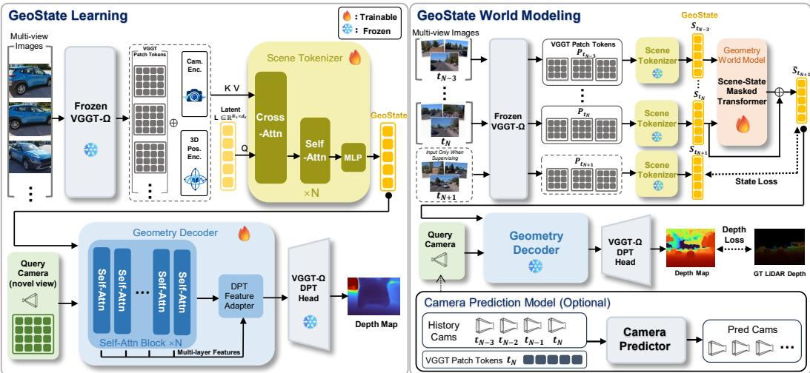
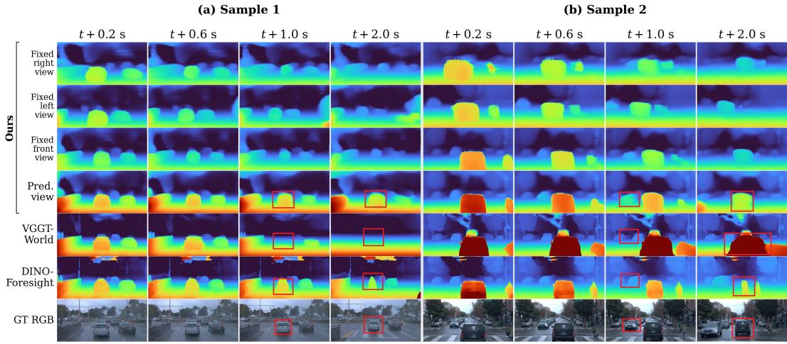
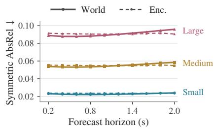

# GEOSTATE: LEARNING VIEW-DECOUPLED GEOMETRY STATES FOR 3D WORLD MODELING

Hongchang Liu1, Jian Liu1, Yujuan Ding2, Liang Peng3, Xun Jiang1, Fei Ma4, Xing Xu1, Yi Bin1,∗

1Tongji University

2Hong Kong Polytechnic University

3Tencent

4Guangdong Laboratory of Artificial Intelligence and Digital Economy (SZ) Hongchang\_Liu@outlook.com, yi.bin@hotmail.com

## ABSTRACT

Recent 3D world models increasingly use features from geometry foundation models (GFMs) as predictive world states, benefiting from their rich geometric priors. However, the view dependence of these features entangles scene dynamics with camera-induced variation, making the resulting state evolution harder to predict. We propose GeoState, a view-decoupled geometry representation for predictive 3D world modeling that separates scene-state evolution from camera-dependent observation. Specifically, a scene tokenizer aggregates multiview GFM features into a view-decoupled scene state, which a geometry decoder queries using camera rays. An autoregressive world model then predicts future scene states, while camera motion is modeled separately. The predicted states can therefore be decoded under either predicted or externally specified cameras, while retaining a single context-derived scale throughout the rollout without perframe scale alignment. Experiments show that GeoState outperforms prior 3D world models on Waymo, supports geometrically consistent cross-view querying, and generalizes zero-shot to KITTI and nuScenes. Project page: https: //hongchang-liu.github.io/GeoState-project-page/.

## 1 INTRODUCTION

Learning to predict how the physical world evolves is a central goal of world modeling (Ha & Schmidhuber, 2018), with direct relevance to autonomous driving, robotics, and embodied intelligence. Visual world models predict the future in pixel space (Hu et al., 2023; Wang et al., 2024b; Gao et al., 2024; NVIDIA et al., 2025), which can introduce substantial representational redundancy and make geometric consistency difficult to maintain. This has motivated increasing interest in 3D world models, which represent and predict future environments in geometrically grounded state spaces. By explicitly encoding spatial structure and 3D relationships, these representations provide a structured and geometrically grounded state space that more directly reflects the real world.

Recent 3D world models have explored a range of structured geometric state spaces, including depth, occupancy, point-based representations, and 3D Gaussians (Zheng et al., 2024; Zhang et al., 2024; Yang et al., 2024; Zhu et al., 2025; Chen et al., 2025; Zuo et al., 2025). In parallel, geometry foundation models (GFMs) have substantially advanced feed-forward 3D perception by learning rich geometric representations directly from RGB observations (Wang et al., 2024a; Yang et al., 2025; Wang et al., 2025b;a; 2026). Benefiting from large-scale pretraining, these representations capture strong geometric priors that generalize across scenes and tasks, making them attractive state spaces for predictive world modeling. Building on this capability, recent approaches have begun to directly model temporal evolution in pretrained geometry feature spaces (Sun et al., 2026; Lu et al., 2026). In particular, VGGT-World (Sun et al., 2026) treats frozen VGGT features as world states and predicts their future evolution, demonstrating the potential of GFM representations for 3D forecasting.

Despite the strong performance achieved by recent GFM-based 3D world models, a strong representation for geometric perception is not necessarily an appropriate state representation for world dynamics. GFM features are typically constructed from and organized around the observing views, so changes in camera viewpoint can induce substantial changes in the representation even when the underlying physical scene remains unchanged. When such features are directly used as predictive states, a temporal model would account simultaneously for genuine scene evolution and camera induced variation, although these arise from fundamentally different sources. In particular, even a static scene can undergo substantial changes in feature space as the camera moves, forcing the temporal model to predict viewpoint-dependent transformations that do not correspond to physical scene evolution. This unnecessary variation makes the latent dynamics more complex and therefore harder to predict over long horizons. FR3D (Morbitzer et al., 2026) also shows that separating egomotion from scene forecasting can improve temporal modeling, but its predictive state still inherits the view-dependent structure of the underlying reconstruction representation. We argue that such separation should instead be built into the representation itself: the state should describe what the world is, while the camera should determine only how that world is observed.

To this end, we introduce GeoState, a view-decoupled geometry state learned from pretrained GFM features. Given multi-view observations, a scene tokenizer compresses their geometry features into a compact scene state represented in a shared scene coordinate system, while the query viewpoint is introduced only during decoding. Specifically, a geometry decoder takes the scene state together with rays from a query camera and predicts the geometry observed from that viewpoint. Consequently, the same scene state can be queried repeatedly from different viewpoints without re-encoding the scene. This transforms view-conditioned GFM features into a representation in which scene geometry is explicitly separated from camera-dependent observation.

Building on this representation, we formulate 3D world modeling directly in the scene-state space. The temporal model can therefore focus solely on predicting scene dynamics, while camera evolution is modeled independently. At inference time, a predicted future state can be decoded using either a separately predicted camera trajectory or a user-controlled camera. Our formulation also maintains a consistent scene gauge throughout temporal prediction and geometry decoding, avoid ing the need for per-frame scale alignment during rollout.

We evaluate our approach on large-scale dynamic driving scenes, using Waymo (Sun et al., 2020) for in-domain evaluation and KITTI (Geiger et al., 2012) and nuScenes (Caesar et al., 2020) for zeroshot transfer. Our approach outperforms the compared world models in depth forecasting across all reported horizons, while maintaining a consistent scale throughout the forecasting rollout. Experiments further demonstrate geometrically consistent querying across viewpoints and generalization across driving datasets. Ablation results show that view decoupling makes the scene representation more predictable. Together, these findings support view-decoupled geometry states derived from pretrained GFMs as an effective representation for predictive 3D world modeling.

Our contributions are threefold:

• We identify viewpoint coupling in geometry foundation model features as a limitation when using them as predictive world states, and introduce GeoState, a view-decoupled geometry state derived from pretrained GFM representations that separates scene content from how the scene is observed.

• We develop a scene-state learning framework that realizes GeoState through a Scene Tokenizer that aggregates multi-view GFM features into a shared scene state and a queryconditioned Geometry Decoder that introduces the query viewpoint only at decoding time.

• We formulate a 3D world model that predicts scene evolution directly in GeoState space while modeling camera evolution separately, and demonstrate long-horizon geometry forecasting, geometrically consistent cross-view querying, and zero-shot generalization across driving datasets without per-frame scale alignment.

## 2 RELATED WORK

## 2.1 3D WORLD MODELS

Recent world models increasingly move beyond pixel-space prediction toward structured 3D scene modeling and forecasting. Copilot4D (Zhang et al., 2024) and ViDAR (Yang et al., 2024) forecast future point clouds, while OccWorld (Zheng et al., 2024) and DOME (Gu et al., 2024) predict scene evolution in semantic occupancy space. DIO (Diehl et al., 2025) represents future scene geometry and motion through decomposable implicit occupancy-flow fields, and GaussianWorld (Zuo et al., 2025) models scene evolution in 3D Gaussian space for streaming occupancy prediction. More recently, several approaches directly use learned geometry representations as predictive world states. VGGT-World (Sun et al., 2026) forecasts future VGGT features, while GeoWAM (Lu et al., 2026) learns geometry-aware predictive states for autonomous driving. FR3D (Morbitzer et al., 2026) predicts the latent state of a pretrained 3D reconstruction model while modeling ego-motion separately. In contrast, we remove viewpoint dependence from the geometry state itself and introduce viewpoint only as a query condition during decoding.

## 2.2 GEOMETRY FOUNDATION MODELS

Geometry foundation models provide strong pretrained priors for multi-view 3D perception. DUSt3R (Wang et al., 2024a) formulates reconstruction through pointmap prediction, while Fast3R (Yang et al., 2025) scales joint reconstruction to larger collections of views. CUT3R (Wang et al., 2025b) introduces a persistent latent state for continuously integrating observations, and VGGT (Wang et al., 2025a) unifies camera estimation, depth, point maps, and tracking in a feedforward architecture. VGGT-Ω (Wang et al., 2026) further strengthens this paradigm for dynamic 3D scenes, making it a natural geometry backbone for our setting. We build on its pretrained geometric features and reformulate them into a compact, view-decoupled scene-level representation better suited for temporal world modeling.

## 2.3 COMPACT 3D REPRESENTATIONS

A related line of work compresses multi-view observations into compact scene representations. LVSM (Jin et al., 2025) encodes input views into a fixed-length set of latent tokens for novelview synthesis, while Surflo (Guedon et al., 2026) aggregates dense VGGT features into a fixed-size´ global latent representation for efficient 3D surface reconstruction. 3DRAE (Wei et al., 2026) further learns a fixed-length, view-decoupled 3D latent space that can be queried from arbitrary cameras. These works demonstrate that multi-view observations can be represented without retaining a separate dense representation for each view. While they focus primarily on static scene reconstruction or novel-view synthesis, our work investigates whether such scene-level representations can serve as predictive states for temporal world modeling.

## 3 METHOD

## 3.1 METHOD OVERVIEW

Our goal is to predict future scene geometry without requiring the world model to simultaneously account for variations induced by camera motion. To this end, as illustrated in Figure 1, we first con struct a view-decoupled geometry state from multi-view observations, and then model its temporal evolution while handling camera evolution separately.

GeoState learning. Given multi-view RGB observations $\mathcal { T } _ { t } = \{ I _ { t } ^ { v } \} _ { v \in \mathcal { V } _ { t } }$ , a frozen geometry foundation model extracts geometry-aware features ${ { \mathbf { M } } _ { t } } ,$ with the multi-view geometry expressed in a shared scene coordinate system defined by a common anchor view. A learnable Scene Tokenizer $E _ { \phi }$ then aggregates $\mathbf { M } _ { t }$ into a fixed-length scene state:

$$
S _ { t } = E _ { \phi } ( \mathbf { M } _ { t } ) .\tag{1}
$$

The state is not tied to any single observation viewpoint; we refer to it as a view-decoupled geometry state, or GeoState. A faithful GeoState should capture the underlying 3D scene geometry, which could be reflected in accurate and geometrically consistent depth reconstruction across different viewpoints. We therefore introduce a query-conditioned geometry decoder that reconstructs a depth map from $S _ { t }$ for a given query camera $Q \colon$

$$
\widehat { \cal D } _ { \cal Q } = { \cal G } _ { \psi } ( S _ { t } , { \cal Q } ) .\tag{2}
$$

Thus, the same GeoState can be queried from different viewpoints without re-encoding the scene.

  
Figure 1: Overview of GeoState. GeoState Learning constructs view-decoupled scene states with a scene tokenizer and query-conditioned geometry decoder. GeoState World Modeling predicts future states directly in this representation space.

GeoState world modeling. With viewpoint variation removed from the predictive state, temporal modeling can focus on scene dynamics rather than camera-induced changes in the representation. Given four historical GeoStates $\{ S _ { t - 3 } , S _ { t - 2 } , S _ { t - 1 } , S _ { t } \}$ , a temporal world model autoregressively predicts future states using a sliding four-state context. Each predicted state $\widehat { S } _ { t + h }$ is then queried under a future camera $Q _ { t + h }$ to obtain $\widehat { D } _ { t + h } = G _ { \psi } ( \widehat { S } _ { t + h } , Q _ { t + h } )$ . The query camera can be externally specified or provided by a separately trained camera prediction model, whose architecture and training details are given in Appendix A.2.

## 3.2 VIEW-DECOUPLED GEOMETRY STATE

Given synchronized multi-view images $\mathcal { T } _ { t } = \{ I _ { t } ^ { v } \} _ { v \in \mathcal { V } _ { t } }$ , let ${ \mathcal { T } } ^ { \mathrm { i n } }$ denote the observations jointly processed by the frozen VGGT-Ω (Wang et al., 2026). To maintain a common coordinate anchor across timestamps, ${ \mathcal { T } } ^ { \mathrm { i n } }$ may include observations from multiple timestamps that share the same first input view. After the joint VGGT-Ω forward pass, however, the Scene Tokenizer uses only the outputs associated with the current synchronized observations $\textstyle { \mathcal { T } } _ { t } :$

$$
\left\{ \{ F _ { t } ^ { v , ( \ell ) } \} _ { \ell \in \{ 4 , 1 1 , 1 7 , 2 3 \} } , X _ { t } ^ { v } , C _ { t } ^ { v } , \widetilde { Q } _ { t } ^ { v } \right\} _ { v \in \mathcal { V } _ { t } } = \mathcal { G } _ { \Omega } ( \mathcal { T } ^ { \mathrm { i n } } ) \big | _ { t } .\tag{3}
$$

Here, $F _ { t } ^ { v , ( \ell ) }$ denotes intermediate patch features from the four levels used by the VGGT-Ω dense prediction head, $X _ { t } ^ { v }$ and $C _ { t } ^ { v }$ denote the pixel-aligned 3D point map and its confidence, respectively, and $\widetilde Q _ { t } ^ { v } \ = \ ( \widetilde K _ { t } ^ { v } , \widetilde P _ { t } ^ { v } )$ is the GFM-estimated camera. Thus, cross-time observations are used by VGGT-Ω to establish a shared coordinate frame, while each GeoState is constructed only from the outputs corresponding to its own timestamp. For the observed context states, all context observations are processed in a single forward pass; future target states use growing observation prefixes as described in Sec. 3.5. We omit the time index t below for notational simplicity.

Geometry-conditioned GFM tokens. For each patch $p$ in source view v, we project and fuse the GFM features $\{ F _ { p , v } ^ { ( \ell ) } \} _ { \ell \in \{ 4 , 1 1 , 1 7 , 2 3 \} }$ with per-level linear projections and an MLP to obtain $e _ { p , v } ^ { \mathrm { f e a t } } \in \mathbb { R } ^ { 5 1 2 }$ . To facilitate cross-view feature aggregation and reduce scale inconsistency across GFM forwards, following Surflo (Guedon et al., 2026), we augment the GFM patch features with´ explicit geometric cues derived from $X ^ { v } , C ^ { v }$ , and $\widetilde { Q } ^ { v }$ . For each patch, we obtain its 3D location and confidence, source-camera pose, and viewing ray, and encode them as $e _ { p , v } ^ { \mathrm { p o i n t } } , e _ { v } ^ { \mathrm { p o s e } }$ , and $e _ { p , v } ^ { \mathrm { r a y } }$ , respectively, after median-normalizing their explicit spatial scale. These embeddings form the explicit geometric encoding

$$
g _ { p , v } = [ e _ { p , v } ^ { \mathrm { p o i n t } } , e _ { v } ^ { \mathrm { p o s e } } , e _ { p , v } ^ { \mathrm { r a y } } ] ,\tag{4}
$$

which is fused with the GFM feature through

$$
m _ { p , v } = \mathrm { L N } \big ( e _ { p , v } ^ { \mathrm { f e a t } } + \mathrm { M L P } \big ( [ e _ { p , v } ^ { \mathrm { f e a t } } , g _ { p , v } ] \big ) \big ) .\tag{5}
$$

Scene-state aggregation. To obtain a scene representation independent of the number of views, we collect the geometry-conditioned tokens from all source views into a variable-length memory

$$
\mathbf { M } _ { t } = \mathbf { C } \mathrm { o n c a t } _ { v , p } m _ { p , v } \in \mathbb { R } ^ { N _ { t } \times { 5 1 2 } } .\tag{6}
$$

A Perceiver-style Tokenizer (Jaegle et al., 2021) $E _ { \phi }$ then aggregates this memory using learned scene queries $\mathbf { L } \in \mathbb { R } ^ { N _ { s } \times d _ { s } }$ :

$$
S _ { t } = E _ { \phi } ( \mathbf { M } _ { t } ; \mathbf { L } ) \in \mathbb { R } ^ { N _ { s } \times d _ { s } } .\tag{7}
$$

We use $N _ { s } = d _ { s } = 5 1 2$ and share the same learned scene queries across timestamps. The resulting GeoState has a fixed size independent of the number of source views. Detailed encoder architecture is provided in Appendix A.1.1.

## 3.3 QUERY-CONDITIONED GEOMETRY DECODER

The query viewpoint is introduced only during geometry decoding. Given a query camera $Q =$ $( K , { \bar { P } } )$ , we construct a Plucker ray field (Sitzmann et al., 2021) from its intrinsics and camera-to-¨ world pose. The rays are expressed in the same coordinate frame and scale as the encoded scene geometry, then Fourier-encoded (Tancik et al., 2020) and patchified into query tokens $R _ { Q }$

We first process the scene state with a scene-only self-attention conditioner, then concatenate it with $R _ { Q }$ . A joint Transformer exchanges information among scene and ray tokens to produce viewconditioned representations:

$$
Z _ { Q } = \Psi _ { \mathrm { q u e r y } } ( S _ { t } , R _ { Q } ) ,\tag{8}
$$

where $\Psi _ { \mathrm { q u e r y } }$ denotes the query Transformer. A feature decoder $\Phi _ { \mathrm { d e c } }$ maps $Z _ { Q }$ to the four feature levels expected by the frozen VGGT-Ω dense prediction head $H _ { \mathrm { G F M } }$ , which produces the depth:

$$
\widehat { D } _ { Q } ^ { \mathrm { n o r m } } = H _ { \mathrm { G F M } } ( \Phi _ { \mathrm { d e c } } ( Z _ { Q } ) ) .\tag{9}
$$

The normalized prediction is converted back to metric depth using the same context-derived scale convention used by the scene representation. Reusing the frozen GFM head constrains the decoder to recover geometry-compatible features while avoiding relearning dense geometry prediction. Detailed model architectures are provided in Appendix A.1.2.

## 3.4 SCENE-STATE WORLD MODEL

The world model predicts future evolution directly in GeoState space. By separating scene geometry from the query viewpoint, GeoState allows camera-induced observation changes to be handled during decoding, making scene persistence a natural prior for temporal prediction. We therefore formulate future-state prediction as a residual update to the latest state:

$$
\widehat S _ { t + 1 } = S _ { t } + \Delta S _ { t + 1 } , \qquad \Delta S _ { t + 1 } = F _ { \theta } ( S _ { t - 3 : t } ) .\tag{10}
$$

We adopt the masked factorized Transformer architecture of FR3D (Morbitzer et al., 2026) for scenestate prediction. A masked prediction state is appended to the four historical states, followed by factorized temporal and scene attention. The predicted state is produced through a residual head, which is zero-initialized so that the model is exactly equivalent to latent Copy-Last at initialization, and outputs $\Delta S _ { t + 1 }$ in Eq. 10.

Future GeoStates are generated autoregressively using a sliding four-state context:

$$
\widehat { S } _ { t + h } = \widetilde { S } _ { t + h - 1 } + F _ { \theta } \Big ( \widetilde { S } _ { t + h - 4 : t + h - 1 } \Big ) , \qquad h \geq 1 ,\tag{11}
$$

where $\widetilde { S } _ { \tau } = S _ { \tau }$ for observed timestamps $\tau \leq t$ and $\widetilde { S } _ { \tau } = \widehat { S } _ { \tau }$ otherwise. Detailed world-model architecture is provided in Appendix A.1.3.

## 3.5 LEARNING OBJECTIVES

Geometry-state learning. We train the scene tokenizer and decoder for geometry reconstruction and novel-view querying, keeping the GFM and its dense head frozen. The objective is

$$
\mathcal { L } _ { \mathrm { r e p } } = \mathcal { L } _ { \mathrm { l o g } D } + \lambda _ { \mathrm { g r a d } } \mathcal { L } _ { \mathrm { g r a d } } ,\tag{12}
$$

where $\mathcal { L } _ { \mathrm { l o g } D }$ measures mean absolute log-depth error over valid pixels, and $\mathcal { L } _ { \mathrm { g r a d } }$ supervises local depth gradients. The learned tokenizer and decoder are frozen during world-model training.

World-model training. We train the world model in two stages: single-step initialization followed by autoregressive rollout training.

Target-state construction. To construct future supervision in a consistent scene coordinate frame, target GeoStates are constructed by feeding growing observation prefixes into the frozen VGGT-Ω. For the target at $t + h$ , the prefix terminates at $t + h$ , while all prefixes share the same first input view to maintain a common coordinate anchor across time. Only the outputs corresponding to the synchronized observations at $t + h$ are retained and passed to the Scene Tokenizer to construct $S _ { t + h } ^ { * }$

Since VGGT-Ω predictions may vary in scale across forward passes, we normalize the metric spatial quantities in ${ g _ { p , v } }$ (Eq. 4) using a calibration derived from the observed context before fusing them with the GFM features. This gives target GeoStates a consistent context-derived scale without targetframe alignment. Further details are provided in Appendix A.3.

Single-step initialization. We first train $F _ { \theta }$ for one-step 4 → 1 prediction with joint state and geometric supervision:

$$
\begin{array} { r } { \mathcal { L } _ { \mathrm { i n i t } } = \lambda _ { \mathrm { s t a t e } } \mathcal { L } _ { \mathrm { s t a t e } } + \lambda _ { \mathrm { d e p t h } } \mathcal { L } _ { \log D } ( \widehat { D } _ { t + 1 } , D _ { t + 1 } ) , } \end{array}\tag{13}
$$

where $\mathcal { L } _ { \mathrm { s t a t e } }$ combines Smooth L1 and cosine losses between the predicted state $\widehat { S } _ { t + 1 }$ and the encoded target $S _ { t + 1 } ^ { * }$ The predicted state is also decoded as $\widehat { D } _ { t + 1 } = G _ { \psi } ( \widehat { S } _ { t + 1 } , Q _ { t + 1 } )$ using the ground-truth future FRONT camera $Q _ { t + 1 }$ and supervised against LiDAR depth $D _ { t + 1 }$ . Thus, state supervision directly guides prediction toward the encoded target, while depth supervision constrains the geometry decoded from the predicted state.

Autoregressive rollout training. We then unroll the world model for $H = 7$ future steps and supervise each predicted state through its decoded geometry. At each step, $\widehat { D } _ { t + h } \ = \ G _ { \psi } ( \widehat { S } _ { t + h } , Q _ { t + h } )$ is decoded using the ground-truth future FRONT camera $Q _ { t + h } \colon$

$$
\mathcal { L } _ { \mathrm { r o l l } } = \frac { 1 } { H } \sum _ { h = 1 } ^ { H } \mathcal { L } _ { \log D } ( \widehat { D } _ { t + h } , D _ { t + h } ) ,\tag{14}
$$

Unlike single-step initialization, we omit direct state matching during rollout, allowing autoregressive states to be optimized for their decoded geometry rather than exact agreement with GFM features. We examine the role of state supervision in both training stages in Section 4.5.

## 4 EXPERIMENTS

## 4.1 EXPERIMENTAL SETUP

Datasets. We pretrain the Scene Tokenizer and ray-conditioned decoder on approximately 10k multi-view scenes from DL3DV (Ling et al., 2024), TartanAir (Wang et al., 2020), RealEstate10K (Zhou et al., 2018), CO3D (Reizenstein et al., 2021), and WildRGB-D (Xia et al., 2024), using ground-truth depth where available and VGGT-Ω (Wang et al., 2026) pseudo-depth otherwise. We then adapt both modules on a subset of the Waymo Open Dataset (Sun et al., 2020) selected for static scene content. World Model training uses approximately 140k windows from 800 segments, each containing four context and seven future states at 0.2 s intervals, with FRONT, FRONT LEFT, and FRONT RIGHT context views. We evaluate on 100 Waymo windows held out from model selection, 113 eligible KITTI (Geiger et al., 2012) drives, and all 150 scenes in the nuScenes (Caesar et al., 2020) validation split. Further dataset selection and sampling details are provided in Appendix A.5.

Table 1: Long-horizon depth forecasting on Waymo. Bold and underlined values indicate the best and second-best results among methods using predicted future cameras.
<table><tr><td rowspan="2">Method</td><td rowspan="2">Camera</td><td rowspan="2">Per-frame alignment</td><td colspan="2">t+0.2 s</td><td colspan="2">t+0.6 s</td><td colspan="2"> $t { + } 1 . 0 ~ \mathrm { s }$ </td><td colspan="2">t+2.0 s</td></tr><tr><td>AbsRel↓</td><td> $\delta _ { 1 } \uparrow$ </td><td>AbsRel↓</td><td> $\overline { { \delta _ { 1 } \uparrow } }$ </td><td>AbsRel ↓</td><td> $\overline { { \delta _ { 1 } \uparrow } }$ </td><td>AbsRel ↓</td><td> $\delta _ { 1 } \uparrow$ </td></tr><tr><td>Copy-Last</td><td>Fixed View</td><td>No</td><td>0.094</td><td>0.906</td><td>0.147</td><td>0.840</td><td>0.184</td><td>0.797</td><td>0.248</td><td>0.734</td></tr><tr><td>DINO-Foresight</td><td>Pred.</td><td>Yes</td><td>0.119</td><td>0.841</td><td>0.138</td><td>0.825</td><td>0.151</td><td>0.798</td><td>0.243</td><td>0.663</td></tr><tr><td>VGGT-World</td><td>Pred.</td><td>Yes</td><td>0.073</td><td>0.931</td><td>0.112</td><td>0.892</td><td>0.143</td><td>0.826</td><td>0.213</td><td>0.731</td></tr><tr><td>FR3D</td><td>Pred.</td><td>Yes</td><td>0.110</td><td>0.879</td><td>0.121</td><td>0.858</td><td>0.131</td><td>0.840</td><td>0.152</td><td>0.800</td></tr><tr><td>Copy-Last</td><td>Pred.</td><td>No</td><td>0.071</td><td>0.933</td><td>0.088</td><td>0.905</td><td>0.100</td><td>0.882</td><td>0.132</td><td>0.827</td></tr><tr><td>GeoState</td><td>Pred.</td><td>No</td><td>0.065</td><td>0.939</td><td>0.079</td><td>0.921</td><td>0.092</td><td>0.902</td><td>0.127</td><td>0.848</td></tr><tr><td>Copy-Last</td><td>GT</td><td>No</td><td>0.068</td><td>0.934</td><td>0.082</td><td>0.913</td><td>0.092</td><td>0.894</td><td>0.108</td><td>0.865</td></tr><tr><td>GeoState</td><td>GT</td><td>No</td><td>0.062</td><td>0.940</td><td>0.071</td><td>0.929</td><td>0.081</td><td>0.915</td><td>0.099</td><td>0.888</td></tr></table>

Evaluation Metrics. We report frame-wise mean AbsRel (↓) and $\delta _ { 1 } \left( \uparrow \right)$ (Eigen et al., 2014) over valid pixels. Our method flexibly adapts VGGT-Ω’s default balanced resolution preprocessing to both training and evaluation, while baselines follow their original resolution settings. For scale handling, we follow the original evaluation procedure of each baseline: VGGT-World performs pertarget-frame scale alignment, while FR3D performs per-target-frame scale-and-shift alignment. For DINO-Foresight, we fit its relative inverse-depth predictions to the LiDAR measurements of each target frame. In contrast, we calibrate metric scale once using LiDAR at the last observed FRONT frame and retain this scale throughout the entire forecasting rollout without target-frame alignment.

We additionally measure cross-query geometric consistency using symmetric reprojection AbsRel. Given decoded depths $D _ { 0 } , D _ { i }$ and z-buffered reprojection $\mathcal { R } _ { a  b }$ , we compute

$$
E _ { \mathrm { s y m } } ( Q _ { 0 } , Q _ { i } ) = \frac { 1 } { 2 } \big [ \mathrm { A b s R e l } ( \mathcal { R } _ { 0  i } ( D _ { 0 } ) , D _ { i } ) + \mathrm { A b s R e l } ( \mathcal { R } _ { i  0 } ( D _ { i } ) , D _ { 0 } ) \big ] .\tag{15}
$$

Lower values indicate better geometric agreement.

Baselines. We compare with DINO-Foresight (Karypidis et al., 2025), which forecasts semantic image features, and geometry-based world models FR3D (Morbitzer et al., 2026) and VGGT-World (Sun et al., 2026). We train DINO-Foresight and VGGT-World on the same Waymo training data as our method, but following their respective training procedures. All FR3D results are taken directly from the original paper.

We also include three Copy-Last baselines. Fixed View repeats the last observed VGGT-Ω depth at every future timestamp, while GT Camera and Pred. Camera decode the last observed scene state from ground-truth or predicted future cameras. These baselines allow us to assess the effects of future camera motion and scene-state prediction.

Implementation Details. We pretrain the Scene Tokenizer and ray-conditioned decoder on the multi-view pretraining data for 200k steps with an initial learning rate of $1 0 ^ { - 5 }$ , and then finetune on the static Waymo subset for 50k steps with an initial learning rate of $5 \times 1 0 ^ { - 6 }$ . Both stages use a global effective batch size of 36, with the VGGT-Ω encoder frozen. We sample one to five source views per scene and supervise depth reconstruction at held-out query views. For static Waymo sequences, source and query views may span both cameras and timestamps. We then train the World Model in two stages: 20k steps of one-step prediction with an initial learning rate of $1 0 ^ { - 5 }$ followed by 35k steps of seven-step autoregressive rollout training with an initial learning rate of $1 0 ^ { - 6 }$ VGGT-Ω, the Scene Tokenizer, and the decoder remain frozen throughout World Model training, while gradients propagate through the decoder to the predicted states. Additional training details are provided in Appendix A.4.

## 4.2 LONG-HORIZON DEPTH FORECASTING ON WAYMO

Table 1 compares long-horizon depth forecasting performance on Waymo. With predicted cameras, our model consistently outperforms all compared methods on both depth metrics at every reported horizon. The advantage over VGGT-World increases with the forecasting horizon, reaching a 40.4% reduction in AbsRel at 2.0 s. These improvements are achieved while maintaining a single contextderived scale without per-frame alignment and persist beyond the 1.4 s rollout horizon used during training. These results demonstrate that GeoState supports effective long-horizon autoregressive geometry forecasting, including at horizons beyond those seen during training. Figure 2 visualizes depth forecasts across future horizons and query views, alongside comparisons with prior methods.

  
Figure 2: Qualitative multi-view depth forecasting. Red boxes highlight prediction differences.

<table><tr><td rowspan="2">∆t (s)</td><td colspan="2">Small</td><td colspan="2">Medium</td><td colspan="2">Large</td></tr><tr><td>World</td><td>Enc.</td><td>World</td><td>Enc.</td><td>World</td><td>Enc.</td></tr><tr><td>0.2</td><td>0.023</td><td>0.024</td><td>0.054</td><td>0.055</td><td>0.089</td><td>0.091</td></tr><tr><td>0.6</td><td>0.022</td><td>0.023</td><td>0.053</td><td>0.055</td><td>0.088</td><td>0.091</td></tr><tr><td>1.0</td><td>0.022</td><td>0.024</td><td>0.054</td><td>0.055</td><td>0.089</td><td>0.090</td></tr><tr><td>2.0</td><td>0.024</td><td>0.024</td><td>0.058</td><td>0.055</td><td>0.096</td><td>0.091</td></tr></table>

  
Figure 3: Cross-query geometric consistency on Waymo. We evaluate symmetric reprojection AbsRel (↓) across perturbation levels.

The Copy-Last variants further disentangle the effects of camera conditioning and scene-state evolution. Re-querying the last observed state with future cameras substantially outperforms simply repeating the last observed depth map, demonstrating that viewpoint-induced changes can be accounted for by querying a fixed scene state from future viewpoints without evolving the state itself. Our predicted states consistently outperform their camera-matched Copy-Last counterparts at every horizon under both GT and predicted cameras, showing that the World Model captures future scene evolution beyond what can be explained by camera re-querying alone. Motion-stratified evaluation further shows that these improvements are more pronounced in Dynamic than in Static windows under both GT and predicted cameras, supporting the effectiveness of GeoState in modeling scene dynamics. Detailed results are provided in Appendix A.8.2.

## 4.3 CROSS-QUERY GEOMETRIC CONSISTENCY

We evaluate whether a predicted scene state remains geometrically consistent when queried from different viewpoints. At each future timestamp, we decode the same state from the ground-truth FRONT camera $Q _ { 0 }$ and perturbed virtual cameras $Q _ { i } ,$ , jointly varying translation and rotation. We consider Small $( 0 { - } 0 . 5  { \mathrm { m } } , 0 { - } 2 ^ { \circ } )$ , Medium $( 0 . 5 { - } 1 . 0 \mathrm { m } , 2 { - } 5 ^ { \circ } )$ , and Large $( 1 . 0 { - } 1 . 5 \mathrm { m } , 5 { - } 1 0 ^ { \circ } )$ perturbations. Consistency is measured by symmetric reprojection AbsRel $E _ { \mathrm { s y m } }$ in Eq. 15 over valid overlap. We compare World Model-predicted states (World) with target-time states encoded from RGB observations (Enc.). Further protocol details are provided in Appendix A.6.

Table 2: Zero-shot depth forecasting on KITTI and nuScenes. Bold and underlined values indicate the best and second-best results among methods using predicted cameras.
<table><tr><td rowspan="3">Method</td><td rowspan="3">Camera</td><td colspan="6">KITTI</td><td colspan="6">nuScenes</td></tr><tr><td colspan="2">t+0.6 s</td><td colspan="2">t+1.0 s</td><td colspan="2">t+2.0 s</td><td colspan="2"> $\overline { { t + 0 . 7 5 \mathrm { ~ s ~ } } }$ </td><td colspan="2">t+1.25 s</td><td colspan="2">t+2.5 s</td></tr><tr><td>AbsRel↓</td><td> $\overline { { \delta _ { 1 } \uparrow } }$ </td><td>AbsRel↓</td><td> $\delta _ { 1 } \uparrow$ </td><td>AbsRel↓</td><td> $\delta _ { 1 } \uparrow$ </td><td>AbsRel↓</td><td>δ1 ↑</td><td>AbsRel↓ δ1 ↑</td><td></td><td>AbsRel↓</td><td>δ1 ↑</td></tr><tr><td>DINO-Foresight</td><td>Pred.</td><td>0.131</td><td>0.849</td><td>0.161</td><td>0.793</td><td>0.195</td><td>0.732</td><td>0.231</td><td>0.691</td><td>0.253</td><td>0.665</td><td>0.291</td><td>0.602</td></tr><tr><td>VGGT-World</td><td>Pred.</td><td>0.109</td><td>0.886</td><td>0.127</td><td>0.862</td><td>0.198</td><td>0.732</td><td>0.228</td><td>0.715</td><td>0.241</td><td>0.693</td><td>0.282</td><td>0.637</td></tr><tr><td>FR3D</td><td>Pred.</td><td>0.116</td><td>0.868</td><td>0.132</td><td>0.835</td><td>0.178</td><td>0.758</td><td>0.182</td><td>0.740</td><td>0.197</td><td>0.710</td><td>0.229</td><td>0.660</td></tr><tr><td>Copy-Last</td><td>Pred.</td><td>0.097</td><td>0.913</td><td>0.113</td><td>0.878</td><td>0.160</td><td>0.802</td><td>0.142</td><td>0.804</td><td>0.177</td><td>0.751</td><td>0.221</td><td>0.646</td></tr><tr><td>GeoState</td><td>Pred.</td><td>0.095</td><td>0.920</td><td>0.112</td><td>0.883</td><td>0.155</td><td>0.821</td><td>0.136</td><td>0.820</td><td>0.172</td><td>0.764</td><td>0.213</td><td>0.666</td></tr><tr><td>Copy-Last</td><td>GT</td><td>0.088</td><td>0.932</td><td>0.095</td><td>0.915</td><td>0.114</td><td>0.882</td><td>0.131</td><td>0.825</td><td>0.164</td><td>0.786</td><td>0.195</td><td>0.697</td></tr><tr><td>GeoState</td><td>GT</td><td>0.086</td><td>0.939</td><td>0.093</td><td>0.918</td><td>0.108</td><td>0.895</td><td>0.125</td><td>0.840</td><td>0.159</td><td>0.797</td><td>0.190</td><td>0.707</td></tr></table>

Table 3: Geometric reconstruction on Waymo.
<table><tr><td rowspan="3">Method</td><td colspan="2">t+0.2 s</td><td colspan="2">t+0.6 s</td><td colspan="2">t+1.0 s</td><td colspan="2">t+2.0 s</td></tr><tr><td>AbsRel↓</td><td>δ1 ↑</td><td>AbsRel↓</td><td>δ1 ↑</td><td>AbsRel↓</td><td>δ1 ↑</td><td>AbsRel↓</td><td>δ1 ↑</td></tr><tr><td>VGGT-Ω</td><td>0.074</td><td>0.934</td><td>0.079</td><td>0.932</td><td>0.076</td><td>0.932</td><td>0.078</td><td>0.930</td></tr><tr><td>GeoState Reconstruction</td><td>0.068</td><td>0.934</td><td>0.073</td><td>0.932</td><td>0.072</td><td>0.932</td><td>0.072</td><td>0.929</td></tr></table>

Figure 3 shows that world-model-predicted states closely match observation-encoded states across all perturbation levels at every forecast horizon. This indicates that although geometric supervision is provided only through depth, the model learns a scene state that captures the underlying geometric structure of the world and supports consistent querying from unseen cameras.

## 4.4 ZERO-SHOT GENERALIZATION

Table 2 evaluates zero-shot depth forecasting on KITTI and nuScenes. Without target-dataset adaptation, our model with predicted cameras outperforms DINO-Foresight, VGGT-World, and the reported FR3D results on both metrics across all reported horizons on both datasets. These results support that GeoState captures transferable geometric structure. Moreover, our predicted states consistently outperform camera-matched Copy-Last under both ground-truth and predicted cameras, showing that the learned scene dynamics also generalize beyond the training domain.

## 4.5 ABLATION STUDIES

Geometric Reconstruction Quality. We first examine whether compressing GFM features into GeoState preserves their geometric information. Table 3 compares direct VGGT-Ω depth predictions with depth reconstructed through our Scene Tokenizer and Geometry Decoder using groundtruth query cameras. Both use target-time RGB observations and are evaluated against ground-truth LiDAR depth. Their comparable accuracy shows that the fixed-length GeoState preserves the geometric information required for accurate reconstruction, providing a compact and geometrically faithful representation for subsequent world modeling.

Effect of the View-Decoupled Scene State. We compare GeoState with a feature-compression baseline that directly compresses VGGT-Ω features into a 512 × 512 latent state. For a fair comparison with the feature-compression baseline, only the target FRONT GFM output block is passed to the Scene Tokenizer. Both representations use the same world model, training data, forecasting objectives, optimization, and evaluation protocol; implementation details are provided in Ap pendix A.5.4. As shown in Table 4, the two representations achieve comparable reconstruction quality, but GeoState is substantially easier to predict, improving AbsRel and $\delta _ { 1 }$ at every horizon.

Because the two representations achieve comparable reconstruction quality, the forecasting gap is unlikely to arise from reconstruction accuracy. Instead, the results suggest that GeoState provides a more predictable state space for temporal modeling. By separating scene content from viewpointdependent observation, GeoState reduces camera-induced variation in the state dynamics, allowing the World Model to focus more directly on the underlying evolution of scene geometry.

Table 4: Representation ablation.
<table><tr><td rowspan="2" colspan="2">Mode State</td><td colspan="2">t+0.6s</td><td colspan="2">t+1.0s</td><td colspan="2">t+2.0s</td></tr><tr><td colspan="4">AbsRel↓  $\delta _ { 1 } \uparrow$  AbsRel↓  $\delta _ { 1 } \uparrow \ \mathrm { A b s R e l \downarrow }$ </td></tr><tr><td>Rec.</td><td>Compressor</td><td></td><td></td><td>0.073</td><td></td><td></td></tr><tr><td></td><td>Ours</td><td>0.075 0.073</td><td>0.930</td><td>0.072</td><td>0.930 0.932</td><td>0.074 0.928 0.072</td></tr><tr><td>Pred.</td><td>Compressor</td><td>0.092</td><td>0.932 0.896</td><td>0.111</td><td></td><td>0.929</td></tr><tr><td></td><td></td><td></td><td></td><td>0.863</td><td>0.144</td><td>0.804</td></tr><tr><td>Ours</td><td></td><td>0.081</td><td>0.919 0.095</td><td>0.896</td><td>0.133</td><td>0.834</td></tr></table>

Table 5: State supervision ablation.
<table><tr><td>One-step Rollout</td><td></td><td colspan="2">t+0.6s</td><td colspan="2">t+1.0s</td><td colspan="2">t+2.0s</td></tr><tr><td></td><td>AbsRel↓</td><td></td><td> $\delta _ { 1 } \uparrow \ \mathrm { A b s R e l \downarrow }$ </td><td></td><td> $\delta _ { 1 } \uparrow \ \mathrm { \ A b s R e l { \downarrow } }$ </td><td></td><td> $\delta _ { 1 } \uparrow$ </td></tr><tr><td>×</td><td>√</td><td>0.077</td><td>0.919</td><td>0.086</td><td>0.902</td><td>0.108</td><td>0.878</td></tr><tr><td>×</td><td>×</td><td>0.075</td><td>0.922</td><td>0.084</td><td>0.909</td><td>0.104</td><td>0.879</td></tr><tr><td>√</td><td>√</td><td>0.071</td><td>0.928</td><td>0.082</td><td>0.913</td><td>0.107</td><td>0.879</td></tr><tr><td>√</td><td>×</td><td>0.071</td><td>0.929</td><td>0.081</td><td>0.915</td><td>0.099</td><td>0.888</td></tr></table>

Effect of State Supervision. We ablate state supervision during one-step initialization and autoregressive rollout while retaining decoded-depth supervision in all settings. Table 5 shows that onestep state supervision consistently improves forecasting, providing a useful target for initializing local state transitions. In contrast, extending latent matching throughout the rollout degrades longhorizon performance. This may be attributed to context-dependent variations in GFM features that do not necessarily correspond to changes in scene geometry, as further analyzed in Appendix A.7. These findings support using state matching to initialize local transitions while supervising autoregressive predictions through decoded geometry rather than enforcing a unique latent trajectory.

## 5 CONCLUSION

We presented GeoState, a view-decoupled geometry state learned from GFM features for predictive 3D world modeling. By separating scene evolution from camera-dependent observation, GeoState provides a scene representation that can be predicted more effectively over time and queried from different viewpoints. Future work may extend this framework to embodied settings, where predictive scene states could support perception, planning, and interaction in dynamic environments.

## REFERENCES

Holger Caesar, Varun Bankiti, Alex H. Lang, Sourabh Vora, Venice Erin Liong, Qiang Xu, Anush Krishnan, Yu Pan, Giancarlo Baldan, and Oscar Beijbom. nuScenes: A Multimodal Dataset for Autonomous Driving. In Proceedings of the IEEE/CVF Conference on Computer Vision and Pattern Recognition, pp. 11621–11631, 2020. URL https: //openaccess.thecvf.com/content\_CVPR\_2020/html/Caesar\_nuScenes\_ A\_Multimodal\_Dataset\_for\_Autonomous\_Driving\_CVPR\_2020\_paper.html.

Junyi Chen, Haoyi Zhu, Xianglong He, Yifan Wang, Jianjun Zhou, Wenzheng Chang, Yang Zhou, Zizun Li, Zhoujie Fu, Jiangmiao Pang, and Tong He. DeepVerse: 4D Autoregressive Video Generation as a World Model. arXiv preprint arXiv:2506.01103, 2025. URL https://arxiv. org/abs/2506.01103.

Christopher Diehl, Quinlan Sykora, Ben Agro, Thomas Gilles, Sergio Casas, and Raquel Urtasun. DIO: Decomposable implicit 4D occupancy-flow world model. In Proceedings of the IEEE/CVF Conference on Computer Vision and Pattern Recognition (CVPR), pp. 27456–27466, June 2025. URL https://openaccess.thecvf.com/content/CVPR2025/html/Diehl\_ DIO\_Decomposable\_Implicit\_4D\_Occupancy-Flow\_World\_Model\_CVPR\_ 2025\_paper.html.

David Eigen, Christian Puhrsch, and Rob Fergus. Depth Map Prediction from a Single Image Using a Multi-Scale Deep Network. In Advances in Neural Information Processing Systems, volume 27, 2014. URL https://papers.nips.cc/paper\_files/paper/2014/hash/ 91c56ce4a249fae5419b90cba831e303-Abstract.html.

Shenyuan Gao, Jiazhi Yang, Li Chen, Kashyap Chitta, Yihang Qiu, Andreas Geiger, Jun Zhang, and Hongyang Li. Vista: A Generalizable Driving World Model with High Fidelity and Versatile Controllability. In Advances in Neural Information Processing Systems, 2024. URL https: //arxiv.org/abs/2405.17398.

Andreas Geiger, Philip Lenz, and Raquel Urtasun. Are we ready for Autonomous Driving? The KITTI Vision Benchmark Suite. In Conference on Computer Vision and Pattern Recognition (CVPR), 2012. URL https://www.cvlibs.net/datasets/kitti/.

Songen Gu, Wei Yin, Bu Jin, Xiaoyang Guo, Junming Wang, Haodong Li, Qian Zhang, and Xiaoxiao Long. DOME: Taming diffusion model into high-fidelity controllable occupancy world model. arXiv preprint arXiv:2410.10429, 2024. URL https://arxiv.org/abs/2410.10429.

Antoine Guedon, Shu Nakamura, Nicolas Dufour, Jiahui Lei, Ko Nishino, and Angjoo Kanazawa.´ Surflo: Consistent 3d surface flow model with global state. NeurIPS, 2026.

David Ha and Jurgen Schmidhuber. World Models.¨ arXiv preprint arXiv:1803.10122, 2018. URL https://arxiv.org/abs/1803.10122.

Anthony Hu, Lloyd Russell, Hudson Yeo, Zak Murez, George Fedoseev, Alex Kendall, Jamie Shotton, and Gianluca Corrado. GAIA-1: A Generative World Model for Autonomous Driving. arXiv preprint arXiv:2309.17080, 2023. URL https://arxiv.org/abs/2309.17080.

Andrew Jaegle, Felix Gimeno, Andy Brock, Oriol Vinyals, Andrew Zisserman, and Joao Carreira. Perceiver: General Perception with Iterative Attention. In Proceedings of the 38th International Conference on Machine Learning, volume 139 of Proceedings of Machine Learning Research, pp. 4651–4664. PMLR, 2021. URL https://proceedings.mlr.press/v139/ jaegle21a.html.

Haian Jin, Hanwen Jiang, Hao Tan, Kai Zhang, Sai Bi, Tianyuan Zhang, Fujun Luan, Noah Snavely, and Zexiang Xu. LVSM: A Large View Synthesis Model with Minimal 3D Inductive Bias. In The Thirteenth International Conference on Learning Representations, 2025. URL https: //openreview.net/forum?id=QQBPWtvtcn.

Efstathios Karypidis, Ioannis Kakogeorgiou, Spyros Gidaris, and Nikos Komodakis. DINO-Foresight: Looking into the Future with DINO. In The Thirty-ninth Annual Conference on Neural Information Processing Systems, 2025. URL https://openreview.net/forum?id= gimtybo07H.

Lu Ling, Yichen Sheng, Zhi Tu, Wentian Zhao, Cheng Xin, Kun Wan, Lantao Yu, Qianyu Guo, Zixun Yu, Yawen Lu, Xuanmao Li, Xingpeng Sun, Rohan Ashok, Aniruddha Mukherjee, Hao Kang, Xiangrui Kong, Gang Hua, Tianyi Zhang, Bedrich Benes, and Aniket Bera. DL3DV-10K: A Large-Scale Scene Dataset for Deep Learning-based 3D Vision. In Proceedings of the IEEE/CVF Conference on Computer Vision and Pattern Recognition, pp. 22160–22169, 2024. URL https://openaccess.thecvf.com/content/CVPR2024/html/Ling\_ DL3DV-10K\_A\_Large-Scale\_Scene\_Dataset\_for\_Deep\_Learning-based\_ 3D\_Vision\_CVPR\_2024\_paper.html.

Yiren Lu, Xin Ye, Jiaming Liu, Philip Jacobson, Jin Yao, Yi-chung Chen, Liam Merino, Dhruva Dixith Kurra, Min Cai, Tom Lampo, Yu Yin, Danhua Guo, and Burhan Yaman. GeoWAM: Visual Geometry World Action Models for Autonomous Driving. arXiv preprint arXiv:2608.23486, 2026. URL https://arxiv.org/abs/2608.23486.

Nils Morbitzer, Jonathan Evers, Artem Savkin, Thomas Stauner, Nassir Navab, Federico Tombari, and Stefano Gasperini. Future dynamic 3d reconstruction: Toward 3d world modeling with disen tangled ego-motion. In Proceedings of the 43rd International Conference on Machine Learning, Proceedings of Machine Learning Research. PMLR, 2026. URL https://arxiv.org/abs/ 2606.18250.

NVIDIA, Niket Agarwal, Arslan Ali, Maciej Bala, Yogesh Balaji, Erik Barker, Tiffany Cai, Prithvijit Chattopadhyay, Yongxin Chen, Yin Cui, Yifan Ding, Daniel Dworakowski, Jiaojiao Fan, Michele Fenzi, Francesco Ferroni, Sanja Fidler, Dieter Fox, Songwei Ge, Yunhao Ge, Jinwei Gu, Siddharth Gururani, Ethan He, Jiahui Huang, Jacob Huffman, Pooya Jannaty, Jingyi Jin, Seung Wook Kim, Gergely Klar, Grace Lam, Shiyi Lan, Laura Leal-Taixe, Anqi Li, Zhaoshuo ´ Li, Chen-Hsuan Lin, Tsung-Yi Lin, Huan Ling, Ming-Yu Liu, Xian Liu, Alice Luo, Qianli Ma, Hanzi Mao, Kaichun Mo, Arsalan Mousavian, Seungjun Nah, Sriharsha Niverty, David Page, Despoina Paschalidou, Zeeshan Patel, Lindsey Pavao, Morteza Ramezanali, Fitsum Reda, Xiaowei

Ren, Vasanth Rao Naik Sabavat, Ed Schmerling, Stella Shi, Bartosz Stefaniak, Shitao Tang, Lyne Tchapmi, Przemek Tredak, Wei-Cheng Tseng, Jibin Varghese, Hao Wang, Haoxiang Wang, Heng Wang, Ting-Chun Wang, Fangyin Wei, Xinyue Wei, Jay Zhangjie Wu, Jiashu Xu, Wei Yang, Lin Yen-Chen, Xiaohui Zeng, Yu Zeng, Jing Zhang, Qinsheng Zhang, Yuxuan Zhang, Qingqing Zhao, and Artur Zolkowski. Cosmos world foundation model platform for physical ai, 2025. URL https://arxiv.org/abs/2501.03575.

Jeremy Reizenstein, Roman Shapovalov, Philipp Henzler, Luca Sbordone, Patrick Labatut, and David Novotny. Common Objects in 3D: Large-Scale Learning and Evaluation of Real-Life 3D Category Reconstruction. In Proceedings of the IEEE/CVF International Conference on Computer Vision, pp. 10901–10911, 2021. URL https://openaccess.thecvf.com/content/ICCV2021/html/Reizenstein\_ Common\_Objects\_in\_3D\_Large-Scale\_Learning\_and\_Evaluation\_of\_ Real-Life\_ICCV\_2021\_paper.html.

Vincent Sitzmann, Semon Rezchikov, William T. Freeman, Joshua B. Tenenbaum, and Fredo Durand. Light Field Networks: Neural Scene Representations with Single-Evaluation Rendering. In Advances in Neural Information Processing Systems, volume 34, 2021. URL https://arxiv.org/abs/2106.02634.

Pei Sun, Henrik Kretzschmar, Xerxes Dotiwalla, Aurelien Chouard, Vijaysai Patnaik, Paul Tsui, James Guo, Yin Zhou, Yuning Chai, Benjamin Caine, Vijay Vasudevan, Wei Han, Jiquan Ngiam, Hang Zhao, Aleksei Timofeev, Scott Ettinger, Maxim Krivokon, Amy Gao, Aditya Joshi, Yu Zhang, Jonathon Shlens, Zhifeng Chen, and Dragomir Anguelov. Scalability in Perception for Autonomous Driving: Waymo Open Dataset. In Proceedings of the IEEE/CVF Conference on Computer Vision and Pattern Recognition, pp. 2446–2454, 2020. URL https://openaccess.thecvf.com/content\_CVPR\_2020/html/ Sun\_Scalability\_in\_Perception\_for\_Autonomous\_Driving\_Waymo\_Open\_ Dataset\_CVPR\_2020\_paper.html.

Xiangyu Sun, Shijie Wang, Fengyi Zhang, Lin Liu, Caiyan Jia, Ziying Song, Zi Huang, and Yadan Luo. Vggt-world: Transforming vggt into an autoregressive geometry world model. In Paolo Favaro, Zuzana Kukelova, Atsuto Maki, Anna Rohrbach, Konrad Schindler, and Federico Tombari (eds.), Computer Vision – ECCV 2026, pp. 382–400, Cham, 2026. Springer Nature Switzerland. ISBN 978-3-032-37271-0. URL https://link.springer.com/chapter/ 10.1007/978-3-032-37271-0\_21.

Matthew Tancik, Pratul P. Srinivasan, Ben Mildenhall, Sara Fridovich-Keil, Nithin Raghavan, Utkarsh Singhal, Ravi Ramamoorthi, Jonathan T. Barron, and Ren Ng. Fourier Features Let Networks Learn High Frequency Functions in Low Dimensional Domains. In Advances in Neural Information Processing Systems, volume 33, 2020. URL https://papers.nips.cc/paper\_files/paper/2020/hash/ 55053683268957697aa39fba6f231c68-Abstract.html.

Jianyuan Wang, Minghao Chen, Nikita Karaev, Andrea Vedaldi, Christian Rupprecht, and David Novotny. VGGT: Visual Geometry Grounded Transformer. In Proceedings of the IEEE/CVF Conference on Computer Vision and Pattern Recognition, pp. 5294–5306, 2025a. URL https://openaccess.thecvf.com/content/CVPR2025/html/Wang\_VGGT\_ Visual\_Geometry\_Grounded\_Transformer\_CVPR\_2025\_paper.html.

Jianyuan Wang, Minghao Chen, Shangzhan Zhang, Nikita Karaev, Johannes Schonberger, Patrick¨ Labatut, Piotr Bojanowski, David Novotny, Andrea Vedaldi, and Christian Rupprecht. VGGT-Ω. In Proceedings of the IEEE/CVF Conference on Computer Vision and Pattern Recognition (CVPR), 2026. URL https://arxiv.org/abs/2605.15195.

Qianqian Wang, Yifei Zhang, Aleksander Holynski, Alexei A. Efros, and Angjoo Kanazawa. Continuous 3D Perception Model with Persistent State. In Proceedings of the IEEE/CVF Conference on Computer Vision and Pattern Recognition, pp. 10510–10522, 2025b. URL https: //openaccess.thecvf.com/content/CVPR2025/html/Wang\_Continuous\_ 3D\_Perception\_Model\_with\_Persistent\_State\_CVPR\_2025\_paper.html.

Shuzhe Wang, Vincent Leroy, Yohann Cabon, Boris Chidlovskii, and Jerome Revaud. DUSt3R: Geometric 3D Vision Made Easy. In Proceedings of the IEEE/CVF Conference on Computer Vision and Pattern Recognition, pp. 20697–20709, 2024a. URL https://openaccess.thecvf.com/content/CVPR2024/html/Wang\_DUSt3R\_ Geometric\_3D\_Vision\_Made\_Easy\_CVPR\_2024\_paper.html.

Wenshan Wang, Delong Zhu, Xiangwei Wang, Yaoyu Hu, Yuheng Qiu, Chen Wang, Yafei Hu, Ashish Kapoor, and Sebastian Scherer. Tartanair: A dataset to push the limits of visual slam. In 2020 IEEE/RSJ International Conference on Intelligent Robots and Systems (IROS), pp. 4909– 4916, 2020. doi: 10.1109/IROS45743.2020.9341801. URL https://ieeexplore.ieee. org/document/9341801/.

Xiaofeng Wang, Zheng Zhu, Guan Huang, Xinze Chen, Jiagang Zhu, and Jiwen Lu. DriveDreamer: Towards Real-World-Drive World Models for Autonomous Driving. In Computer Vision – ECCV 2024, volume 15106 of Lecture Notes in Computer Science, pp. 55–72. Springer, 2024b. doi: 10.1007/978-3-031-73195-2 4. URL https://link.springer.com/chapter/ 10.1007/978-3-031-73195-2\_4.

Dongxu Wei, Qi Xu, Zhiqi Li, Hangning Zhou, Cong Qiu, Hailong Qin, Mu Yang, Zhaopeng Cui, and Peidong Liu. Any 3D Scene is Worth 1K Tokens: 3D-Grounded Representation for Scene Generation at Scale. arXiv preprint arXiv:2604.11331, 2026. URL https://arxiv.org/ abs/2604.11331.

Hongchi Xia, Yang Fu, Sifei Liu, and Xiaolong Wang. RGBD Objects in the Wild: Scaling Real-World 3D Object Learning from RGB-D Videos. In Proceedings of the IEEE/CVF Conference on Computer Vision and Pattern Recognition, pp. 22378–22389, 2024. URL https://openaccess.thecvf.com/content/CVPR2024/html/Xia\_RGBD\_ Objects\_in\_the\_Wild\_Scaling\_Real-World\_3D\_Object\_Learning\_CVPR\_ 2024\_paper.html.

Jianing Yang, Alexander Sax, Kevin J. Liang, Mikael Henaff, Hao Tang, Ang Cao, Joyce Chai, Franziska Meier, and Matt Feiszli. Fast3R: Towards 3D Reconstruction of 1000+ Images in One Forward Pass. In Proceedings of the IEEE/CVF Conference on Computer Vision and Pattern Recognition, pp. 21924–21935, 2025. URL https://openaccess.thecvf.com/ content/CVPR2025/html/Yang\_Fast3R\_Towards\_3D\_Reconstruction\_of\_ 1000\_Images\_in\_One\_Forward\_CVPR\_2025\_paper.html.

Zetong Yang, Li Chen, Yanan Sun, and Hongyang Li. Visual Point Cloud Forecasting enables Scalable Autonomous Driving. In Proceedings of the IEEE/CVF Conference on Computer Vision and Pattern Recognition, pp. 14673–14684, 2024. URL https://openaccess.thecvf. com/content/CVPR2024/html/Yang\_Visual\_Point\_Cloud\_Forecasting\_ enables\_Scalable\_Autonomous\_Driving\_CVPR\_2024\_paper.html.

Lunjun Zhang, Yuwen Xiong, Ze Yang, Sergio Casas, Rui Hu, and Raquel Urtasun. Copilot4D: Learning Unsupervised World Models for Autonomous Driving via Discrete Diffusion. In The Twelfth International Conference on Learning Representations, 2024. URL https: //openreview.net/forum?id=Psl75UCoZM.

Wenzhao Zheng, Weiliang Chen, Yuanhui Huang, Borui Zhang, Yueqi Duan, and Jiwen Lu. Occworld: Learning a 3d occupancy world model for autonomous driving. In Ales Leonardis, Elisaˇ Ricci, Stefan Roth, Olga Russakovsky, Torsten Sattler, and Gul Varol (eds.),¨ Computer Vision – ECCV 2024, pp. 55–72, Cham, 2024. Springer Nature Switzerland. ISBN 978-3-031-72624-8. URL https://link.springer.com/chapter/10.1007/978-3-031-72624-8\_ 4.

Tinghui Zhou, Richard Tucker, John Flynn, Graham Fyffe, and Noah Snavely. Stereo Magnification: Learning View Synthesis using Multiplane Images. In SIGGRAPH, 2018. URL https:// tinghuiz.github.io/projects/mpi/.

Haoyi Zhu, Yifan Wang, Jianjun Zhou, Wenzheng Chang, Yang Zhou, Zizun Li, Junyi Chen, Chunhua Shen, Jiangmiao Pang, and Tong He. Aether: Geometric-Aware Unified World Modeling. In Proceedings of the IEEE/CVF International Conference on Computer Vision, pp. 8535–8546,

2025. URL https://openaccess.thecvf.com/content/ICCV2025/html/Zhu\_ Aether\_Geometric-Aware\_Unified\_World\_Modeling\_ICCV\_2025\_paper. html.

Sicheng Zuo, Wenzhao Zheng, Yuanhui Huang, Jie Zhou, and Jiwen Lu. GaussianWorld: Gaussian World Model for Streaming 3D Occupancy Prediction. In Proceedings of the IEEE/CVF Conference on Computer Vision and Pattern Recognition, pp. 6772–6781, 2025. URL https://openaccess.thecvf.com/content/CVPR2025/html/Zuo\_ GaussianWorld\_Gaussian\_World\_Model\_for\_Streaming\_3D\_Occupancy\_ Prediction\_CVPR\_2025\_paper.html.

## A APPENDIX

## A.1 ARCHITECTURE DETAILS

This section provides the implementation details of the Scene Tokenizer, geometry decoder, and world model used in the main experiments. Table 6 summarizes their principal architectural configurations and parameter counts.

## A.1.1 GEOMETRY-CONDITIONED MEMORY AND SCENE TOKENIZER

Each selected GFM feature level is independently normalized and projected from 2,048 to 512 channels. The four projected features are concatenated and fused by an MLP with dimensions $2 0 4 8  2 0 4 8  5 \bar { 1 } 2$ . For each spatial patch, confidence-weighted pooling of the dense point map provides a representative 3D point. Its coordinates, normalized by the scene scale, are Fourierencoded with ten bands and concatenated with $\log ( 1 + c )$ , where c is the pooled confidence, before projection to a 512-dimensional geometry embedding.

Source-camera conditioning uses a six-dimensional rotation representation formed from the first two rotation-matrix columns and a four-band Fourier encoding of normalized translation. A camera MLP produces a 512-dimensional embedding shared by all patches in that view. The source-ray branch encodes six-dimensional Plucker coordinates with four Fourier bands and applies a convolution with¨ kernel size and stride 16, followed by LayerNorm, to produce one 512-dimensional embedding per patch.

The feature, point, camera, and ray embeddings are concatenated. A 2048 → 1024 → 512 fusion MLP predicts a correction to the feature embedding; their sum is normalized to form the patch memory. A bank of 512 learned queries of width 512 is updated by eight Perceiver layers, each comprising latent-to-memory cross-attention and latent self-attention. Each attention block uses eight heads, pre-normalization, residual connections, and a feed-forward network with expansion ratio four. A final LayerNorm produces $S \in \mathbb { R } ^ { 5 1 2 \times 5 1 2 }$

## A.1.2 QUERY-CONDITIONED GEOMETRY DECODER

For a camera-to-world pose $P = ( R , { \bf o } )$ and intrinsic matrix K, a pixel $\mathbf { u } = ( u , v , 1 ) ^ { \top }$ defines the unit direction

$$
\mathbf { d } ( \mathbf { u } ) = \frac { R K ^ { - 1 } \mathbf { u } } { \| R K ^ { - 1 } \mathbf { u } \| _ { 2 } } .\tag{16}
$$

In normalized scene coordinates, the ray representation is $[ \mathbf { d } , \bar { \mathbf { o } } \times \mathbf { d } ]$ , where o¯ is the normalized camera center. Query rays are Fourier-encoded with six bands and patchified by a stride-16 convolution. At $4 1 6 \times 6 2 4$ resolution, this produces $2 6 \times 3 9 = 1 , 0 1 4$ query tokens, which are concatenated with the 512 scene tokens to form a sequence of $^ { 1 , 5 2 6 }$ tokens.

The scene tokens first pass through LayerNorm, a linear projection, and two scene-only self-attention blocks. The resulting scene tokens and query-ray tokens are then processed jointly by sixteen selfattention Transformer blocks, allowing each query to retrieve view-dependent geometry from the shared scene state. Query-token representations are retained after blocks 4, 8, 12, and 16, providing multi-layer features at four stages of the decoder.

These multi-layer features are subsequently processed by a DPT Feature Adapter, whose role is to transform the decoder representations into the feature interface expected by the frozen VGGT-Ω DPT head. For each level, the final query representation is fused with the corresponding intermediate representation through a learned sigmoid gate and a level embedding. Two additional Perceiver layers allow the query tokens to attend to the final scene tokens, and an independent MLP maps each level as $5 1 2 \stackrel { - } {  } 1 0 2 4  1 0 2 4  2 0 4 8$

The resulting four feature maps are passed directly to the frozen VGGT-Ω DPT head to predict camera z-depth. The decoder receives only the scene state, query camera, and output dimensions, such that all scene information must pass through the fixed-size state bottleneck. During world-model training, both the Geometry Decoder and DPT head remain fixed, while gradients are propagated through them with respect to the input scene state.

Table 6: Detailed architecture of the model.
<table><tr><td>Component</td><td>Configuration</td></tr><tr><td>Scene Tokenizer</td><td>512 queries of width 512; eight Perceiver layers; eight attention heads; MLP expansion ratio 4; 70.46M parameters</td></tr><tr><td>Geometry decoder</td><td>Width 512; two scene-conditioning blocks; 16 joint scene-ray blocks; four output branches with two Perceiver layers each; 135.55M parameters</td></tr><tr><td>World Model</td><td>Four-state context; 12 factorized blocks; width 1,152; eight heads; MLP expansion ratio 4; dropout 0.1; 256.55M parameters</td></tr></table>

## A.1.3 RESIDUAL WORLD MODEL

The four observed scene states form an input tensor of shape $4 \times 5 1 2 \times 5 1 2 .$ corresponding to four time steps, 512 spatial slots per state, and 512 feature channels per slot. Each token is first linearly projected from 512 to a model width of 1,152. A learned mask token is then replicated over 512 slots to construct a fifth state, which serves as the prediction position. To encode token identity, we use learned temporal and slot embeddings of 576 dimensions each. Their concatenation forms a 1,152-dimensional positional embedding, which is added to the projected tokens.

Each Transformer block factorizes attention over time and space. Temporal attention is first applied across the five time positions independently for each of the 512 slots. Spatial attention then operates across the 512 slots independently within each time position. The two attention operations are followed by a 1152 → 4608 → 1152 feed-forward network with GELU. All sublayers use prenormalization, residual connections, and dropout. After the final block, the tokens at the fifth, masked prediction position are mapped back to 512 channels by a bias-free linear residual head. The head is zero-initialized, such that the model initially predicts a zero residual and therefore exactly recovers the Copy-Last prediction.

## A.2 CAMERA PREDICTOR

The camera predictor forecasts future FRONT-camera poses from the observed ego-motion and the current FRONT image. The predicted trajectory is used as the future query-camera sequence for both GeoState (Pred. Camera) and Copy-Last (Pred. Camera).

## A.2.1 ARCHITECTURE

The camera predictor contains 8.99M parameters and follows a motion-prior-plus-visual-refinement design. Given four historical metric FRONT poses at $t - 0 . 6 , t - 0 . 4 , t - 0 . 2$ , and t seconds, we first compute the three consecutive relative transformations and map them to six-dimensional motion vectors using the SE(3) logarithm. The motion vectors and their first differences are standardized, projected to width 256, and encoded by a four-layer Transformer with eight attention heads, an MLP expansion ratio of four, and dropout 0.1. Future poses are initialized from a constant-bodytwist extrapolation of the latest observed motion. Learned horizon queries attend to the encoded motion features through three decoding layers and predict residual corrections to this extrapolated trajectory. Future time is represented using linear and quadratic terms together with eight Fourier bands.

To incorporate scene-dependent cues, the predictor additionally conditions on the current FRONT image. Frozen VGGT-Ω spatial features are extracted from a separate forward pass and pooled to a $6 \times 8$ grid, yielding 48 tokens of width 2,048. After projection to width 256 and the addition of learned spatial embeddings, two cross-attention layers compress these features into eight visual tokens. The visual tokens are appended to the encoded motion memory, and two additional horizonquery decoding layers, with eight attention heads and an MLP expansion ratio of two, predict a six-dimensional visual correction $\Delta \xi _ { h }$ for each requested horizon.

For each requested horizon $h ,$ the final relative pose is

$$
\widehat { P } _ { t + h } = \widehat { P } _ { t + h } ^ { \mathrm { m o t i o n } } \operatorname { E x p } _ { \operatorname { S E } ( 3 ) } ( \Delta \xi _ { h } ) .\tag{17}
$$

Table 7: Camera prediction results on Waymo.
<table><tr><td>Horizon (s)</td><td>ATE (m) ↓</td><td>RTE (m) ↓</td><td>RRE (°)↓</td></tr><tr><td>0.2</td><td>0.0125</td><td>0.0125</td><td>0.1894</td></tr><tr><td>0.6</td><td>0.0379</td><td>0.0246</td><td>0.2462</td></tr><tr><td>1.0</td><td>0.0840</td><td>0.0361</td><td>0.2783</td></tr><tr><td>2.0</td><td>0.3117</td><td>0.0785</td><td>0.3755</td></tr></table>

The visual correction is bounded by a scaled tanh output, with a limit of 2.0 in normalized residual coordinates and horizon-dependent motion scales. Its final projection is initialized to zero, so the complete model initially reduces to the motion-only prediction and learns visual corrections during training. At inference, we use direct multi-horizon camera prediction for Waymo and KITTI, while nuScenes adopts autoregressive prediction at 0.25 s intervals, recursively updating the pose history with predicted poses.

## A.2.2 TRAINING

We train the camera predictor in three stages. First, we optimize the motion backbone using metric FRONT-camera trajectories from Waymo. Each training sample contains four observed poses at t−0.6, t−0.4, t−0.2, and t, together with ten future poses at 0.2 s intervals. The objective combines absolute pose error, adjacent relative-pose error, and ray-endpoint error with weights 1.0, 0.5, and 0.2, respectively. Rotation errors are converted to metric displacement using a 10 m lever arm. We first train for 12,000 steps with direct ten-horizon supervision using AdamW, batch size 1,024, weight decay 0.05, and a cosine learning-rate schedule from $1 0 ^ { - 4 } { \mathrm { ~ t o ~ } } 1 0 ^ { - 6 }$ after 300 warm-up steps. We then continue for another 12,000 steps with closed-loop training, recursively applying the predictor over four consecutive rollout chunks. The closed-loop loss is weighted by 0.5. This phase uses batch size 384, a 100-step warm-up, and a cosine learning-rate schedule from $5 \times 1 0 ^ { - 5 }$ to $5 \times 1 0 ^ { - 7 }$ . Gradients are clipped to norm 1.0 throughout motion training.

Second, we train the visual adapter while keeping the motion backbone frozen. We use the same pose-based supervision, with the relative-pose and ray-endpoint terms both weighted by 0.5 and a 20 m rotation lever arm. Turning and speed-changing windows are assigned sample weights of 1.5 and 0.5, respectively. Training uses 123,789 windows for 20 epochs with AdamW, batch size 256, weight decay 0.02, and a cosine learning-rate schedule from $\mathrm { 2 ^ { - } \times 1 0 ^ { - 4 } ~ t o ~ 2 \times 1 0 ^ { - 6 } }$ . Gradients are clipped to norm 1.0.

Finally, we adapt the visual adapter to the downstream depth-query task through the frozen geometry decoder. The last observed GeoState $S _ { t }$ is held fixed across future horizons and decoded using the predicted future camera poses. The decoded depth is supervised against future Waymo LiDAR. To account for the horizon-dependent difficulty of querying a fixed scene state, we normalize the AbsRel at each horizon by the corresponding GT-camera Copy-Last AbsRel estimated over the training set. This depth objective is combined with the trajectory loss and a parameter-anchor regularizer, weighted by 0.05 and 0.02, respectively. Only the visual adapter is updated in this stage. We train for 1,200 steps using AdamW with learning rate $5 \times 1 0 ^ { - 6 }$ , weight decay 0.01, and gradient clipping at 1.0.

## A.2.3 EVALUATION RESULTS

We evaluate on the same Waymo validation windows as depth forecasting. Predicted and GT camera-to-world poses share the metric frame of the last observed FRONT camera, with no post-hoc trajectory alignment. At each reported horizon, errors are pooled over all 100 sequences and all future steps up to that horizon before computing RMSE. ATE measures camera-center error. RTE and RRE measure the translation magnitude and rotation angle of $( T _ { k - 1 } ^ { - 1 } T _ { k } ) ^ { - 1 } ( \widehat { T } _ { k - 1 } ^ { - 1 } \widehat { T } _ { k } )$ over adjacent 0.2 s transitions, including the first transition from the observed anchor. Table 7 reports the results.

## A.3 COORDINATE AND SCALE CONVENTIONS

GFM reconstruction is defined up to an unknown scale. For each temporal window, we therefore calibrate its scale using the latest observed FRONT view, which serves as the anchor. Let $D _ { 0 } ^ { \Omega }$ and

$D _ { 0 } ^ { \mathrm { L i D A R } }$ denote the raw GFM and LiDAR depths at the anchor, respectively, and let $\Omega _ { 0 }$ denote the set of valid pixels with matched GFM and LiDAR depths. We estimate

$$
a _ { 0 } = \exp \bigl [ \mathrm { m e d i a n } _ { p \in \Omega _ { 0 } } \bigl ( \log D _ { 0 } ^ { \Omega } ( p ) - \log D _ { 0 } ^ { \mathrm { L i D A R } } ( p ) \bigr ) \bigr ] ,\tag{18}
$$

where $a _ { 0 }$ converts metric distances to GFM units. Matched pixels are required to have finite and positive GFM depth, LiDAR depth, and GFM confidence, and LiDAR depth is restricted to 80 m. Calibration is performed only when at least 128 valid matches are available.

We additionally define a scene-normalization depth $s _ { 0 }$ from the observed views as a confidenceweighted trimmed median of valid GFM depths. The lowest and highest 2% of cumulative confidence weight are discarded before computing the weighted median. The physical length represented by one normalized scene unit is therefore

$$
L _ { 0 } = { \frac { s _ { 0 } } { a _ { 0 } } } \quad { \mathrm { m e t e r s } } .\tag{19}
$$

Point coordinates, camera translations, and ray origins are divided by $s _ { 0 }$ in the reference GFM frame, while rotations and unit ray directions remain unchanged. Plucker moments are constructed using ¨ the normalized ray origins.

All four observed states within a temporal window are extracted from the same 12-image GFM forward pass and therefore share the same $a _ { 0 } , \ s _ { 0 }$ , and $L _ { 0 }$ . A normalized decoder prediction is converted to metric depth as

$$
\widehat { D } _ { Q } ^ { \mathrm { m e t r i c } } = L _ { 0 } \widehat { D } _ { Q } ^ { \mathrm { n o r m } } .\tag{20}
$$

This conversion is fixed by the observed context and retained throughout the entire forecasting rollout; no future target frame is used to re-estimate the scale.

When geometry is obtained from a separate GFM forward pass, its raw scale may differ from that of the observed context. Let $a _ { k }$ denote the metric calibration factor of such a pass. Setting

$$
s _ { k } = a _ { k } L _ { 0 }\tag{21}
$$

expresses its geometry in the same normalized physical unit, since

$$
{ \frac { \mathbf { x } _ { \mathrm { G F M } , k } } { s _ { k } } } \approx { \frac { \mathbf { x } _ { \mathrm { m e t r i c } } } { L _ { 0 } } } .\tag{22}
$$

This normalization applies only to explicit geometric quantities (Eq. 4); the intermediate GFM feature vectors are not rescaled.

## A.4 TRAINING DETAILS

In this section, we provide the sampling procedures, loss implementations, and optimization settings that supplement Sections 3.5 and 4.1.

## A.4.1 WAYMO DATA CONSTRUCTION

We use a binary motion partition for Waymo. Motion labels are derived from the annotated 3D tracks of vehicles, pedestrians, and cyclists over each eleven-state window (four observed and seven future states at 0.2 s intervals). A box observation must contain at least three LiDAR points and a track must be observed in at least two states. We mark a track as moving when its median speed exceeds 0.75 m/s for a vehicle, 0.25 m/s for a pedestrian, or 0.50 m/s for a cyclist. A window is Dynamic if it contains at least one such visible moving track and Static otherwise. This partition yields 114,735 Dynamic and 24,632 Static training windows.

## A.4.2 SCENE TOKENIZER AND DECODER TRAINING

Multi-view pretraining uses 9,496 scenes, comprising 2,834 from DL3DV, 2,818 from TartanAir, 2,142 from RealEstate10K, 941 from CO3D, and 761 from WildRGB-D. To train the tokenizer with different visible-view configurations, anchor-view and random-view dropout each use probability 0.4 at the memory level. For each training sample with at least two source views, we apply one of three mutually exclusive memory-level operations: mask the anchor-view patch block with probability 0.4, mask one uniformly sampled non-anchor view block with probability 0.4, or retain all view blocks with probability 0.2. Single-view samples retain their only view.

During Waymo adaptation, we use the Static subset described in Section A.4.1. Since these windows contain no visible moving tracks under our motion criterion, we allow temporal source–query separations up to 2.0 s while the observation and query cameras move. This sampling covers both nearby and more distant query viewpoints, so that viewpoints far from the anchor remain within the training distribution. The adaptation schedule uses a 2k-step warmup followed by cosine learningrate decay; training budgets, initial learning rates, and effective batch sizes follow Section 4.1. For the geometry objective defined in Eq. 12, we set the gradient-loss weight to 0.1, yielding

$$
\mathcal { L } _ { \mathrm { r e p } } = \mathcal { L } _ { \log D } + 0 . 1 \mathcal { L } _ { \mathrm { g r a d } } .\tag{23}
$$

## A.4.3 WORLD-MODEL TRAINING

World Model training uses 139,367 windows from 798 usable Waymo training segments covering static and dynamic content. Each window contains four context states and seven future states at 0.2 s intervals, corresponding to a forecast horizon of 1.4 s from the last context state. For one-step initialization, each window supplies seven 4 → 1 transitions with observation-encoded histories.

The concrete loss corresponding to Eq. 13 is

$$
\mathcal { L } _ { \mathrm { i n i t } } = \mathrm { S m o o t h L I } _ { 0 . 1 } ( \widehat { S } , S ^ { * } ) + 0 . 0 5 \left[ 1 - \cos \Bigl ( \mathrm { v e c } \widehat { S } , \mathrm { v e c } S ^ { * } \Bigr ) \right] + 0 . 2 4 \mathcal { L } _ { \mathrm { l o g } } D .\tag{24}
$$

The SmoothL1 transition parameter is 0.1, and cosine similarity is computed between flattened states. During autoregressive training, Eq. 14 weights the FRONT log-depth losses equally across horizons. Each window requires one GFM forward pass on its twelve context images; future LiDAR depth supplies the reconstruction targets.

We use AdamW with $\beta = ( 0 . 9 , 0 . 9 5 )$ , weight decay 0.05, gradient clipping at 1.0, and learning-rate warmup followed by cosine decay.

## A.5 DATA AND EVALUATION PROTOCOLS

## A.5.1 DATASETS AND TEMPORAL SAMPLING

We construct one candidate window per sequence. Each window contains four historical observations ending at anchor t and ten future targets. Eligibility is determined solely by the availability of the required RGB images, camera poses, and LiDAR measurements, together with timestamp matching. Using a fixed temporal position and at most one window per sequence prevents longer sequences from receiving greater weight.

For Waymo, the candidate pool contains one window from each of the 202 segments in the official validation split. We define logical states at 5 Hz and place the anchor at the tenth logical state, 1.8 s after the first complete timestamp. A complete timestamp contains FRONT, FRONT LEFT, and FRONT RIGHT images together with the vehicle pose. The four observations occur at $t - 0 . 6 ,$ $t - 0 . 4 , t - 0 . 2$ , and t, and the ten targets span $t + 0 . 2$ through $t + 2 . 0 \mathrm { s }$ . For each nominal time, we select the nearest complete timestamp within 20 ms. We partition the 202 segments into 102 segments used for checkpoint selection and 100 held-out segments reserved for final evaluation. The evaluation subset is sampled uniformly without replacement using seed 20260804, after which its segment identities and anchors are fixed for all paired comparisons. No segment in the held-out evaluation subset is used for checkpoint selection. This fixed sample contains 79 Dynamic and 21 Static windows under the partition defined in Appendix A.4.1.

For KITTI, we consider the 151 sequences covered by the KITTI Depth Completion annotations and construct at most one fixed window per sequence. Logical states follow the VGGT-World two-rawframe stride, with the anchor placed at the tenth logical state, corresponding to raw-frame offset 18 from the first image. We retain a drive when all four historical and ten future RGB, pose, and Li DAR records are available on this stride, yielding 113 eligible drives. Ineligible drives are recorded as skipped and are not replaced. This common anchor placement keeps the temporal position comparable to Waymo while respecting KITTI’s native sampling cadence.

For nuScenes, we construct one window for each of the 150 scenes in the official validation split. Because CAM FRONT is sampled asynchronously, the anchor is defined as the image nearest to 1.8 s after the scene start, subject to a 120 ms tolerance, rather than as the tenth stored image. Historical observations occur at $\dot { t } - 0 . 7 5 , t - 0 . 5 0 , t - 0 . 2 5 , t .$ , and ten future targets follow at 0.25 s intervals. Each target is paired with the nearest LIDAR TOP sweep within 50 ms. This construction preserves a comparable fixed temporal anchor across datasets while accommodating the native nuScenes sensor timing.

## A.5.2 INPUT AND QUERY CONSTRUCTION

Our method follows the balanced-resolution preprocessing rule of VGGT-Ω. It preserves the nominal patch-token budget while adapting the height and width to the source aspect ratio and rounding both dimensions to multiples of the 16-pixel patch size; a centered crop is applied only when needed to limit extreme aspect ratios. The resulting evaluation rasters (height×width) are $4 1 6 \times 6 2 4$ for Waymo, $3 6 8 \times 7 2 0$ for KITTI, and 384 × 688 for nuScenes. Camera intrinsics are updated using the same resize factors and crop offsets. Since VGGT-Ω assumes a centered principal point, its predicted intrinsics can introduce systematic errors in viewing-ray directions when the actual principal point is off-center. We therefore use dataset-calibrated intrinsics together with VGGT-Ω-estimated camera poses for source-view geometric conditioning. External baselines retain their respective preprocessing conventions.

At each Waymo observation time, we use synchronized FRONT, FRONT LEFT, and FRONT RIGHT images. VGGT-Ω jointly processes all twelve historical images, placing the latest FRONT image first to define a shared reference frame. A timestamp-specific memory mask exposes only the three view blocks belonging to each state to the Scene Tokenizer. The four states are then supplied to the World Model in chronological order. KITTI and nuScenes use one camera view per timestamp.

The World Model predicts ten successive states with a four-state sliding window. GT-camera and predicted-camera evaluations share this state trajectory and differ in the decoder query poses. The camera predictor receives four observed metric poses and the current forward-facing image, as detailed in Appendix A.2. Within each camera setting, Copy-Last and forecasting share query cameras and LiDAR evaluation masks.

Camera-matched Copy-Last holds $S _ { t }$ fixed and evaluates $G _ { \psi } ( S _ { t } , Q _ { t + h } )$ , retaining the representation, decoder, and query trajectory used by forecasting. Fixed-View Copy-Last repeats the raw VGGT-Ω FRONT depth map from the observed anchor at every future timestamp. The map remains fixed while the future LiDAR reference changes.

## A.5.3 DEPTH, SCALE, AND METRIC COMPUTATION

Depth is evaluated against projected LiDAR measurements in the query-camera frame. For a transformed point $( x _ { c } , y _ { c } , z _ { c } )$ , the reference depth is $z _ { c } .$ . The valid set Ω contains projected measurements with finite depth satisfying $0 < D \le 8 0$ m. Predictions and references are compared at corresponding pixels of the evaluation raster:

$$
\mathrm { A b s R e l } ( \widehat { D } , D ) = \frac { 1 } { | \Omega | } \sum _ { p \in \Omega } \frac { | \widehat { D } ( p ) - D ( p ) | } { D ( p ) } ,\tag{25}
$$

$$
\delta _ { 1 } ( \widehat { D } , D ) = \frac { 1 } { | \Omega | } \sum _ { p \in \Omega } { \bf 1 } \left[ \operatorname* { m a x } \left( \frac { \widehat { D } ( p ) } { D ( p ) } , \frac { D ( p ) } { \widehat { D } ( p ) } \right) < 1 . 2 5 \right] .\tag{26}
$$

For all depth-forecasting results, we compute each metric independently on every target frame and then average over frames, giving every frame equal weight regardless of its number of valid LiDAR pixels.

Our forecasts calibrate metric scale once from same-pixel VGGT-Ω/LiDAR depth pairs at the observed anchor. The conversion and scene-normalization unit defined in Appendix A.3 are shared by the input states, query-camera translations, and decoded depths throughout the rollout. Future LiDAR provides the scoring reference, while decoded predictions retain the context-derived scale. Fixed-View Copy-Last uses the same-pixel anchor calibration for its raw GFM depth raster.

For VGGT-World, we follow its original per-target-frame scale-alignment protocol. FR3D numbers are quoted from its original evaluation, which uses per-target-frame scale-and-shift alignment. DINO-Foresight relative inverse-depth predictions are fitted to target-frame LiDAR for depth scoring.

## A.5.4 COMPRESSED VGGT STATE BASELINE

Architecture. The representation ablation uses an autoencoder of VGGT-Ω patch features. For each training example, the frozen GFM jointly processes four historical timestamps and one target timestamp, with FRONT, FRONT LEFT, and FRONT RIGHT at each timestamp. We retain the target FRONT features from GFM layers {4, 11, 17, 23}; each layer provides a $2 6 \times 3 9$ grid of 2,048-dimensional patch features. Four independent linear projections reduce each feature vector from 2,048 to 128 dimensions. The projected features are concatenated channel-wise and spatially average-pooled from $2 6 \times 3 9 6 0 1 6 \times \bar { 3 } 2 .$ producing a compressed state $Z \in \mathbb { R } ^ { 5 1 2 \times 5 1 2 }$ . To reconstruct the GFM features, the state is bilinearly upsampled to $2 6 \times 3 9$ , split into four 128-dimensional groups, and mapped back to four 2,048-dimensional feature grids by independent linear layers. A frozen VGGT-Ω DPT head decodes the reconstructed features into FRONT depth. The compressor has 2.11M trainable parameters.

Training. We follow the same two-stage training paradigm as the Scene Tokenizer. The compressor is first pretrained for 200k steps on the same 9,496-scene multi-view dataset, after which the best checkpoint is selected and further fine-tuned on Waymo for 50k steps.

The training procedure is identical in both stages. For each training sample, we extract the VGGT-Ω features of the target image and compress them into the latent state $\dot { Z } .$ The compressor then reconstructs the original multi-layer VGGT-Ω features, which are passed through the frozen VGGT-Ω DPT head to obtain the predicted depth. The prediction is supervised directly against the corresponding ground-truth depth using

$$
\mathcal { L } _ { \mathrm { r e p } } = \mathcal { L } _ { \log D } + 0 . 1 \mathcal { L } _ { \mathrm { g r a d } } .\tag{27}
$$

The VGGT-Ω backbone and DPT head remain frozen throughout both stages, and gradients are propagated through the DPT head to optimize only the compressor.

## A.6 CROSS-QUERY GEOMETRIC CONSISTENCY

## A.6.1 FORECAST AND OBSERVATION-ENCODED STATES

We use the same 100 Waymo validation windows and all ten future timestamps. World denotes the world model autoregressive prediction. Enc. denotes an independent target-time reconstruction from exactly three images. For Enc., a separate historical pass provides the normalization length $L _ { 0 }$ defined in Eq. 19.

For Enc., raw target FRONT GFM depth is calibrated using target-time LiDAR, and the normalization scale is set to its paired scale times $L _ { 0 }$ . World retains its historical-anchor calibration. Both decode under the same GT FRONT reference query and the same camera perturbations, without independently aligning decoded depths. Enc. is therefore an observation-based reference with privileged target-time scale information.

## A.6.2 CAMERA PERTURBATIONS AND COVERAGE

Each perturbation combines a 3D translation with an axis–angle rotation. Translation directions and rotation axes are independently sampled uniformly on the unit sphere, while their magnitudes are sampled uniformly within one of three perturbation levels. Small perturbations use translation magnitudes in [0, 0.5] m and rotation magnitudes in $[ 0 , 2 ] ^ { \circ } ;$ Medium uses [0.5, 1.0] m and $[ 2 , 5 ] ^ { \circ } ;$ and Large uses [1.0, 1.5] m and $[ 5 , 1 0 ] ^ { \circ }$ . Rotation magnitudes refer to the total axis–angle rotation, and translation magnitudes to Euclidean displacement. For a reference camera-to-world pose $P _ { 0 }$ the perturbed pose is $P _ { i } ~ = ~ P _ { 0 } \Delta _ { i }$ Perturbations are expressed in the reference camera’s local coordinates, with $+ x { \mathrm { ~ r i g h t , } } + y$ down, and +z forward.

Using seed 20260804, we initially sample 250 perturbations at each level. For each perturbation, we compute its mean bidirectional coverage across all evaluation windows, timestamps, and both state variants, and retain the 200 perturbations with the highest coverage within each level. This produces a fixed set of 600 perturbations from 750 initial samples. The target-three-view evaluation reuses this fixed subset.

## A.6.3 REPROJECTION, MASKS, AND AGGREGATION

We back-project $D _ { a }$ using $K _ { a } ^ { - 1 }$ , transform points into camera $b ,$ and project them using $K _ { b } .$ Destination pixels are rounded to their nearest integer location. A z-buffer retains the smallest positive destination depth when points collide. Out-of-frame projections and points with destination $z \leq 1 0 ^ { - 4 }$ m are excluded. Let $\Omega _ { a  b }$ contain pixels with finite, positive reprojected and decoded destination depths. The directional error is

$$
e _ { a  b } = \frac { 1 } { | \Omega _ { a  b } | } \sum _ { p \in \Omega _ { a  b } } \frac { | \mathcal { R } _ { a  b } ( D _ { a } ) ( p ) - D _ { b } ( p ) | } { \operatorname* { m a x } ( D _ { b } ( p ) , 1 0 ^ { - 8 } ) } .\tag{28}
$$

We report $( e _ { 0 \to i } + e _ { i \to 0 } ) / 2$ . This dense consistency comparison uses neither the sparse LiDAR evaluation mask nor the 80 m depth cutoff. No additional depth-agreement threshold filters the overlapping pixels.

Coverage is $( | \Omega _ { 0  i } | + | \Omega _ { i  0 } | ) / ( 2 H W )$ . Each horizon equally averages 100 windows and 200 perturbations per level; the overall mean averages all ten horizons. There are $1 0 0 \times 1 0 \times 6 0 0 =$ 600,000 query pairs per method. This metric measures geometric agreement across queries and complements the evaluation of accuracy against physical ground truth.

## A.7 FEATURE ANALYSIS OF VGGT-Ω

VGGT-Ω jointly processes multiple images, so the representation of an image may depend on the other images included in the same forward pass. This property is relevant to state supervision: an observation-derived target can encode both scene geometry and context-specific variation introduced by the GFM. We therefore examine whether the features of an unchanged image remain stable when only its surrounding context changes.

We conduct a controlled diagnostic on all 100 Waymo validation windows. For each window, the same FRONT image at the first future timestamp (t+0.2 s) is retained at the same input index, with its image content, camera, and reference frame fixed. The reference frame is defined by the FRONT image at the observed anchor t. Each timestamp contributes three views. The shortest prefix containing the probed image comprises four observed timestamps and the first future timestamp, giving $5 \times 3 = 1 5$ images. The complete diagnostic window contains the same four observed timestamps and seven future timestamps, giving $1 1 \times 3 = 3 3$ images. We compare the probedimage features produced under these two contexts. For feature layer ${ \overline { { \ell } } } ,$ we measure Relative L2

$$
E _ { F } ^ { ( \ell ) } = \frac { \| F _ { 3 3 } ^ { ( \ell ) } - F _ { 1 5 } ^ { ( \ell ) } \| _ { 2 } } { \| F _ { 1 5 } ^ { ( \ell ) } \| _ { 2 } } .\tag{29}
$$

We additionally compare the dense DPT depth maps predicted for the same t+0.2 s FRONT image under both unaligned and calibrated settings. The unaligned comparison is performed directly on the raw DPT outputs. For the calibrated comparison, both forwards estimate their VGGT-Ω-to-metric factors from the same matched VGGT-Ω/LiDAR depths at the observed anchor $t ,$ following the physical-unit convention in Eq. 19.

As shown in Table 8, context dependence is small in the early representation but becomes pronounced in deeper layers. Relative feature differences increase from 1.38% at layer 4 to 33.55% and 31.15% at layers 17 and 23, respectively, with a four-layer mean of 19.32%. The raw DPT outputs differ by 12.08% AbsRel. After expressing both outputs in the anchor-calibrated metric unit, the difference decreases to 3.82%. Although feature relative L2 and depth AbsRel are not directly commensurate, this controlled contrast shows that substantial variation in the VGGT-Ω feature coordinates can coexist with considerably more stable metric geometry. The features therefore carry context-conditioned information that is not uniquely determined by scene geometry, in addition to the geometric information used by the DPT head.

This property inevitably affects a state representation built on VGGT-Ω features. The Scene Tokenizer can suppress part of the context-specific variation, but its observation-derived targets are still constructed from GFM features that are not purely geometric. This observation helps explain the state-supervision ablation in Table 5. During one-step initialization, latent supervision provides a useful local target for learning the state transition. During autoregressive rollout, however, exact latent matching then asks the World Model to reproduce both scene geometry and context-specific feature variation, including directions with limited influence on scene geometry. Supervising rollout states through decoded depth instead constrains the scene geometry required at inference while allowing flexibility in these context-sensitive latent directions. This analysis supports our use of latent supervision for one-step initialization and decoded-geometry supervision for closed-loop rollout.

Table 8: Context dependence of frozen VGGT-Ω. All metrics come from the same image while varying only its jointly processed context. Values are sample mean ± standard deviation.
<table><tr><td>Quantity</td><td>Measure</td><td>15 vs. 33 images</td></tr><tr><td colspan="3">GFM patch features</td></tr><tr><td>Layer-4 patch features</td><td>Relative L2</td><td> $1 . 3 8 \pm 0 . 5 9 \%$ </td></tr><tr><td>Layer-11 patch features</td><td>Relative L2</td><td> $1 1 . 2 1 \pm 1 . 9 6 \%$ </td></tr><tr><td>Layer-17 patch features</td><td>Relative L2</td><td> $3 3 . 5 5 \pm 8 . 7 1 \%$ </td></tr><tr><td>Layer-23 patch features</td><td>Relative L2</td><td> $3 1 . 1 5 \pm 5 . 9 7 \%$ </td></tr><tr><td>Four-layer mean</td><td>Relative L2</td><td> $\mathbf { 1 9 . 3 2 \pm 4 . 1 6 \% }$ </td></tr><tr><td colspan="3">DPT depth of the same image</td></tr><tr><td>Raw DPT depth</td><td>AbsRel</td><td> $1 2 . 0 8 \pm 7 . 5 9 \%$ </td></tr><tr><td>Anchor-calibrated DPT depth</td><td>AbsRel</td><td> $\mathbf { 3 . 8 2 \pm 1 . 5 8 \% }$ </td></tr></table>

Table 9: Long-horizon depth forecasting on Waymo with FRONT-only history. GeoState receives only the FRONT image at each observed timestamp; Bold and underlined values indicate the best and second-best results among methods using predicted future cameras.
<table><tr><td rowspan="2">Method</td><td rowspan="2"></td><td rowspan="2">Camera Per-frame alignment</td><td colspan="2">t+0.2 s</td><td colspan="2">t+0.6 s</td><td colspan="2"> $t { + } 1 . 0 ~ \mathrm { s }$ </td><td colspan="2"> $t + 2 . 0 ~ \mathrm { s }$ </td></tr><tr><td>AbsRel↓</td><td> $\delta _ { 1 } \uparrow$ </td><td>AbsRel↓</td><td> $\delta _ { 1 } \uparrow$ </td><td>AbsRel↓</td><td> $\delta _ { 1 } \uparrow$ </td><td>AbsRel ↓</td><td> $\delta _ { 1 } \uparrow$ </td></tr><tr><td>DINO-Foresight</td><td>Pred.</td><td>Yes</td><td>0.119</td><td>0.841</td><td>0.138</td><td>0.825</td><td>0.151</td><td>0.798</td><td>0.243</td><td>0.663</td></tr><tr><td>VGGT-World</td><td>Pred.</td><td>Yes</td><td>0.073</td><td>0.931</td><td>0.112</td><td>0.892</td><td>0.143</td><td>0.826</td><td>0.213</td><td>0.731</td></tr><tr><td>FR3D</td><td>Pred.</td><td>Yes</td><td>0.110</td><td>0.879</td><td>0.121</td><td>0.858</td><td>0.131</td><td>0.840</td><td>0.152</td><td>0.800</td></tr><tr><td>GeoState</td><td>Pred.</td><td>No</td><td>0.070</td><td>0.936</td><td>0.089</td><td>0.914</td><td>0.105</td><td>0.881</td><td>0.143</td><td>0.813</td></tr></table>

## A.8 ADDITIONAL QUANTITATIVE RESULTS

## A.8.1 SINGLE-VIEW-CONTROLLED BASELINE COMPARISON

The main GeoState evaluation uses the synchronized FRONT, FRONT LEFT, and FRONT RIGHT images at each observed timestamp, whereas our compared methods use a single image. To control for this difference in input-view count, we re-evaluate GeoState on the same 100 Waymo evaluation windows using only FRONT. Both the frozen GFM and the Scene Tokenizer therefore receive four historical images in total, one from each observed timestamp. The model checkpoints, timestamps, query cameras, metric-scale calibration, and LiDAR masks remain unchanged. Table 9 compares this FRONT-only variant with the external forecasting baselines from Table 1.

Under predicted future cameras, FRONT-only GeoState outperforms FR3D, VGGT-World, and DINO-Foresight in both AbsRel and $\delta _ { 1 }$ at every reported horizon. At t+2.0 s, it obtains an AbsRel of 0.143 and a $\delta _ { 1 }$ of 0.813, compared with 0.152/0.800 for FR3D, 0.213/0.731 for VGGT-World, and 0.243/0.663 for DINO-Foresight. This comparison removes the additional side-view observations available to the main GeoState configuration, while GeoState continues to use a single context-derived scale rather than per-target-frame alignment. The performance advantage over the external forecasting baselines therefore cannot be attributed solely to using three camera views per observed timestamp.

## A.8.2 MOTION-STRATIFIED FORECASTING RESULTS

We further report results under the Dynamic/Static partition defined in Appendix A.4.1. Dynamic combines all windows containing at least one qualifying visible moving track, while Static contains the remaining windows. Table 10 averages each subset over all ten forecasting horizons and compares GeoState with the camera-matched Copy-Last reference.

Table 10: Motion-stratified forecasting on Waymo. Results are frame-wise means over all ten horizons on the Waymo validation set. “Improve” is the relative AbsRel reduction of GeoState over the camera-matched Copy-Last, and $\Delta \delta _ { 1 }$ is the absolute accuracy gain.
<table><tr><td colspan="2"></td><td colspan="3">AbsRel↓</td><td colspan="3"> $\delta _ { 1 } \uparrow$ </td></tr><tr><td>Subset</td><td>Camera</td><td>Copy-Last</td><td>GeoState</td><td>Improve</td><td>Copy-Last</td><td>GeoState</td><td> $\Delta \delta _ { 1 }$ </td></tr><tr><td>Dynamic</td><td>GT</td><td>0.0980</td><td>0.0852</td><td>13.10%</td><td>0.8842</td><td>0.9077</td><td>+0.0236</td></tr><tr><td>Dynamic</td><td>Pred.</td><td>0.1070</td><td>0.0967</td><td>9.63%</td><td>0.8717</td><td>0.8946</td><td>+0.0229</td></tr><tr><td>Static</td><td>GT</td><td>0.0710</td><td>0.0675</td><td>4.92%</td><td>0.9245</td><td>0.9337</td><td>+0.0092</td></tr><tr><td>Static</td><td>Pred.</td><td>0.0915</td><td>0.0895</td><td>2.17%</td><td>0.8917</td><td>0.8995</td><td>+0.0078</td></tr></table>

GeoState improves both subsets under GT and predicted query cameras. On the Dynamic subset, it reduces AbsRel by 13.10% with GT cameras and 9.63% with predicted cameras, with corresponding $\delta _ { 1 }$ gains of 0.0236 and 0.0229. The gains on Static windows are smaller but remain positive: 4.92% and 2.17% relative AbsRel reductions, respectively. The substantially larger gains on Dynamic windows indicate that the World Model effectively captures temporal changes in scene geometry. The same pattern under GT query cameras further shows that this dynamic-scene advantage is present independently of future-camera prediction error.