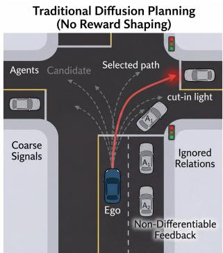
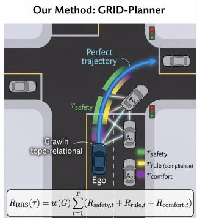
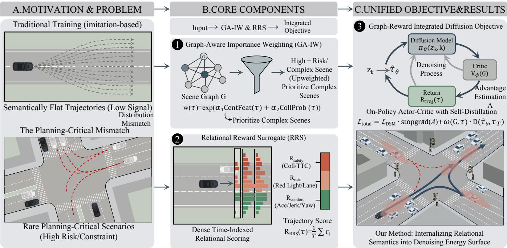
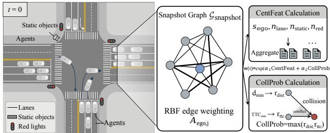
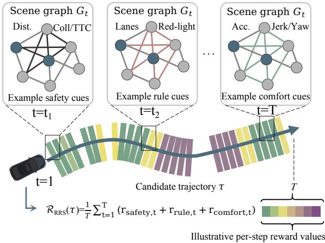
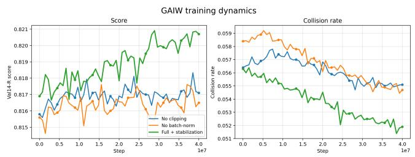
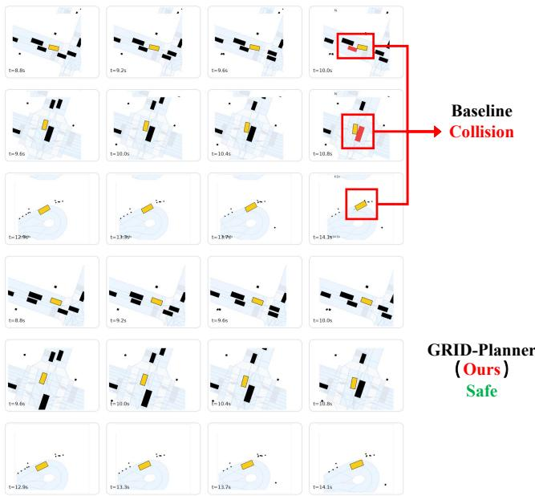
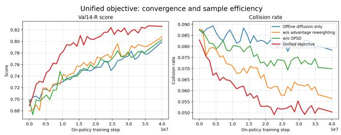

# GRID-Planner: Graph-Structured Relational Reward Shaping for Difusion Planning

Zhao Yang   
lingxi.yz950701@gmail.com   
Xi’an Jiaotong University   
Xi’an, China

Zezhong Qian zezhongqian@stu.xjtu.edu.cn Xi’an Jiaotong University Xi’an, China

Longjun Liu   
liulongjun@xjtu.edu.cn   
Xi’an Jiaotong University   
Xi’an, China

Yinan Shi syn1211@outlook.com Cytoderm Intelligent Technology Beijing, China

Yawei Jueluo jueluo.yawei@cybopal.com Cytoderm Intelligent Technology Beijing, China

## Abstract

Autonomous driving planning requires selecting trajectories that remain safe, rule-compliant, and comfortable under complex multiagent interactions, yet robust closed-loop decision making in planning critical scenes remains challenging. Existing difusion- and RLbased planners often rely on generic rewards and use relational structure mainly for representation, limiting how planning-critical rollouts shape policy improvement. We present GRID-Planner, a graph–reward integrated difusion planning framework that aligns generative planning with structured relational signals. Specifically, GRID-Planner combines graph-aware importance weighting, a timeindexed relational reward surrogate, and an advantage-weighted difusion objective with on-policy self-distillation, forming a rolloutreturn-advantage-update loop without explicit likelihoods. Exper iments on nuPlan and interPlan show that, compared with the difusion-only baseline, GRID-Planner reduces collision rate, lane deviation, and jerk by 35.8%, 60.8%, and 27.4%, respectively, and improves the planning score by 3.4%. Project website: https:// github.com/yangzhaojason/GRID-Planner.

## CCS Concepts

• Computing methodologies → Robotic planning; Reinforcement learning; Machine learning algorithms.

## Keywords

Autonomous Driving, Motion Planning, Difusion Models, Rein forcement Learning, Scene Graphs, Closed-Loop Planning

## ACM Reference Format:

Zhao Yang, Zezhong Qian, Yinan Shi, Longjun Liu, and Yawei Jueluo. 2026. GRID-Planner: Graph-Structured Relational Reward Shaping for Difusion Planning. In Proceedings of the 34th ACM International Conference on Multimedia (MM ’26), November 10–14, 2026, Rio de Janeiro, Brazil. ACM, New York, NY, USA, 9 pages. https://doi.org/10.1145/3767308.3835263

  
Figure 1: Overview of GRID-Planner. Traditional difusion planning may miss planning-critical relational semantics, whereas GRID-Planner combines Graph-Aware Importance Weighting and RRS to prioritize high-risk trajectories and evaluate safety, lane/route consistency, and comfort.

## 1 Introduction

Autonomous driving planning requires selecting ego trajectories that are safe, rule-compliant, and comfortable under complex multiagent interactions [2, 6, 8, 11, 13]. Despite rapid progress in learningbased planning, robust closed-loop decision making in dense urban scenes remains challenging [2, 6, 13]. A core challenge is that planning performance depends not only on average-case trajectory realism but on learning from a small set of planning-critical trajectories—those arising in highly interactive, safety-sensitive, and rule-constrained scenarios such as merging, yielding, and intersection conflicts [2, 6, 13]. In practice, however, most training trajectories are semantically flat, weakly constrained, and lowconflict, contributing limited signals to the decision boundaries that matter most for planning [6]. This long-tail structure makes pure imitation learning insuficient, since abundant easy trajectories dominate supervision, while naive reinforcement learning is also inadequate because generic rewards are dificult to design stably for complex multi-agent interactions. These challenges motivate graph-structured relational modeling to prioritize planning-critical trajectories and support planning-oriented policy improvement.

Existing methods improve planning from diferent angles, but the core issue remains unresolved. Strong imitation-based planners, such as UrbanDriver [21], PlanTF [5], and PLUTO [4], optimize similarity to expert behavior, allowing abundant easy trajectories to dominate training and under-emphasizing safety-critical and rule-sensitive cases. Interaction-centric methods, such as Game-Former [10], improve multi-agent relation modeling, but mainly at the representation level, without explicitly using relational structure to determine trajectory value or optimization priority. Difusionbased planners, such as Difusion Planner [31], provide flexible multi-modal trajectory generation, while reward-guided variants such as Difusion-ES [28] demonstrate the promise of reward-driven optimization. However, existing approaches still rely either on behavior cloning objectives, which sufer from compounding errors and exposure bias in closed-loop inference, or on generic rewarddriven optimization, which does not explicitly encode planningoriented relational semantics. This leaves open how relational semantics should shape both the training distribution and the optimization objective, rather than serving only as scene representations or sampling-time guidance.

To address this gap, we propose GRID-Planner, a Graph-Reward Integrated Difusion planner that uses graph-structured scene semantics to directly shape the optimization signal of generative planning. Rather than treating graph structure as just an input representation, we use it to define both trajectory importance and planning-oriented return. Our framework answers three questions left open by prior planners: which trajectories should matter more during training, how their quality should be evaluated for plan ning, and how relational signals should reshape difusion-based policy learning. Specifically, our framework contains three tightly coupled components: ❶ Graph-Aware Importance Weighting, which upweights trajectories from complex, high-risk scenes us ing scene-interaction centrality and collision-risk cues; ❷ Relational Reward Surrogate (RRS), which evaluates candidate rollouts through time-indexed ego-centric scene graphs, producing a dense trajectory-level signal with smooth bounded penalties over safety, lane/route consistency, and comfort; and ❸ Graph-Reward Integrated Difusion Objective, which incorporates structured returns into a low-variance advantage-weighted difusion objective, coupled with an advantage-gated on-policy self-distillation (OPSD) mechanism. The resulting advantage reweights difusion denoising and gates OPSD teacher selection and updates, forming a rollout–return–advantage–update loop in which graph-reward signals directly drive policy improvement.

The main contributions of this work are:

• We propose GRID-Planner, a unified graph-reward integrated difusion framework that redefines how scene graphs are used in autonomous driving planning: rather than serving only as input representations, they directly shape optimization priority and trajectory value for closed-loop decision making.

• We introduce a planning-oriented relational learning mechanism, instantiated by Graph-Aware Importance Weighting and a Relational Reward Surrogate, which together focus training on planning-critical trajectories and score candidate rollouts using safety, lane/route consistency, and comfort criteria.

• We develop a unified on-policy difusion objective that combines advantage-weighted difusion with advantage-gated self-distillation to support stable on-policy refinement and consolidate high-return behaviors, yielding consistent gains over strong baselines on nuPlan and interPlan.

## 2 Related Work

Imitation-Based and Interaction-Centric Planning. A major line ofwork learns autonomous driving policies from expert demonstrations [2, 6, 8, 11, 12, 20, 27]. UrbanDriver [21], PlanTF [5], and PLUTO [4] achieve strong closed-loop performance through carefully designed imitation objectives, while UniAD [8], VAD [14], VADv2 [3], SparseDrive [23], DTPP [9], GameFormer [10], Inter-Fuser [22], and Causal-Planner [29] improve scene representation and interaction modeling. However, these approaches mainly optimize expert imitation or relational representations, without explicitly using scene relations to determine trajectory importance or planner-oriented value. GRID-Planner instead uses graph structure to prioritize planning-critical trajectories and construct relational returns over safety, lane/route consistency, and comfort.

Generative Planning with Difusion. Generative planners model future trajectories as samples from expressive distributions, supporting multi-modal driving behaviors [15, 25]. GenAD [30], Diffusion Planner [31], and Difusion-ES [28] explore latent generation, difusion-based closed-loop planning, and reward-guided sampling, respectively. Flow Planner [24], DifusionDrive [16], and BridgeDrive [17] further improve interactive modeling and difusionpolicy design. These methods primarily focus on trajectory generation or sampling-time guidance, whereas GRID-Planner incorporates structured relational signals into training through trajectory prioritization, relational evaluation, and difusion-policy refinement.

RL-Based Policy Improvement for Generative Planning. Reinforcement learning has been combined with difusion policies for reward-driven optimization. DDPO [1], advantage-weighted regression methods [18, 19], and difusion policies [26] adapt policyimprovement principles to expressive generative models. However, they generally rely on generic scalar rewards rather than planningoriented relational semantics. GRID-Planner couples graph-weighted relational returns with advantage-weighted denoising and advantagegated on-policy self-distillation, allowing relational signals to directly shape policy updates.

## 3 Methodology

## 3.1 Preliminaries

Notation. We denote an ego candidate trajectory by ${ \boldsymbol { \tau } } = \{ ( s _ { t } , a _ { t } ) \} _ { t = 1 } ^ { T }$ over horizon steps $t \in \{ 1 , . . . , T \}$ , where $s _ { t }$ is the ego kinematic state (position $\boldsymbol { p } _ { t } ^ { \mathrm { \tilde { e g } o } } \in \mathbb { R } ^ { \dot { 2 } } \mathrm { o r } \mathbb { R } ^ { 3 }$ , velocity, and heading), and $a _ { t }$ is the control action in an ego-centric frame. Neighboring trajectories are $\{ s _ { 1 : T } ^ { ( j ) } \} _ { j = 1 } ^ { N }$ with neighbor index $j \in \{ 1 , . . . , N \}$ . We use $t = 0$ to denote the current step (the last observed frame), with positions $p _ { 0 } ^ { \mathrm { e g o } }$ and $\boldsymbol { p } _ { 0 } ^ { ( j ) }$ . We define $\mathrm { c l i p } ( x , 0 , 1 ) = \operatorname* { m i n } ( \operatorname* { m a x } ( x , 0 ) , 1 )$

Difusion trajectory model and energy shaping. We model the trajectory distribution $\pi _ { \boldsymbol { \theta } } ( \tau )$ using a score-based difusion process. Given a data trajectory $\tau _ { \mathrm { d a t a } }$ , the forward noising process at difusion step $k \in ( 0 , 1 ]$ is:

$$
z _ { k } = \sqrt { \bar { \alpha } _ { k } } \tau _ { \mathrm { d a t a } } + \sqrt { 1 - \bar { \alpha } _ { k } } \epsilon , \epsilon \sim N ( 0 , I ) ,\tag{1}
$$

  
Figure 2: Overall framework of GRID-Planner. We address the mismatch between semantically flat imitation signals and rare planning-critical scenarios through two components, graph-aware importance weighting (GA-IW) and relational reward surrogate (RRS), which are unified in the final graph-reward integrated difusion objective.

where the model predicts the score $\epsilon _ { \theta } ( z _ { k } , k ) = - \sigma _ { k } s _ { \theta } ( z _ { k } , k )$ with $\sigma _ { k } ^ { 2 } = 1 - \bar { \alpha } _ { k }$ , trained by

$$
\mathcal { L } _ { \mathrm { D S M } } = \mathbb { E } _ { k , \tau _ { \mathrm { d a t a } } , \epsilon } \left[ \Vert \epsilon - \epsilon _ { \theta } ( z _ { k } , k ) \Vert ^ { 2 } \right] .\tag{2}
$$

Sampling proceeds by running the reverse denoising dynamics from $z _ { 1 } \sim { \cal N } ( 0 , I )$ , yielding $\tau \sim \pi _ { \theta }$ . Under maximum-entropy RL, the optimal trajectory distribution can be expressed as $\pi ^ { \star } ( \tau ) ~ \propto$ $\exp ( Q ^ { \star } ( \tau ) / \lambda )$ , motivating us to shape �� (�) using trajectory energies derived from surrogate return functions.

## 3.2 Problem Statement

At each planning step, we represent the driving scene as a relational graph $G = \left( V , E \right)$ , where nodes � include the ego vehicle, surrounding agents, lane polylines, and trafic signals, and edges � encode geometric relations and trafic-rule priorities. We consider trajectory planning over a candidate trajectory � and define the trajectory-level relational score

$$
\mathcal { R } _ { \mathrm { R R S } } ( \tau ) = R _ { \mathrm { s a f e t y } } ( \tau ) + R _ { \mathrm { r u l e } } ( \tau ) + R _ { \mathrm { c o m f o r t } } ( \tau ) ,\tag{3}
$$

which evaluates safety, rule compliance, and ride comfort (each term is specified in the next subsection).

To align this trajectory-level evaluator with entropy-regularized distribution shaping, we use a trajectory return surrogate:

$$
R _ { \mathrm { t r a j } } ( \tau ) = w ( \tau ) \mathcal { R } _ { \mathrm { R R S } } ( \tau ) ,\tag{4}
$$

where $w ( \tau ) \geq 0$ is an importance weight used to diferentiate candidate rollouts. Our goal is to learn a graph-conditioned trajectory distribution $\pi _ { \boldsymbol { \theta } } ( \tau | \boldsymbol { G } )$ that concentrates probability mass on trajectories with higher $R _ { \mathrm { t r a j } } ( \tau )$ , while maintaining diversity and eficient inference. To achieve this, we employ a unified graph-reward integrated difusion objective (Sec. 3.5), which combines advantage-weighted difusion updates with a state-value baseline and on-policy selfdistillation, aligning training with planner-induced rollouts and consolidating high-reward behaviors, as illustrated in Fig. 2.

## 3.3 Graph-Aware Weighting for Semantic Alignment

Real-world driving scenarios are highly imbalanced, with most trajectories being semantically flat and only a small fraction being planning-critical: most trajectories are “flat” (neither risky nor strongly constrained), while only a small fraction is safety-critical. To prevent gradients from being dominated by abundant "flat" samples, we introduce a graph-aware importance weight �(�) that emphasizes structurally complex and high-risk trajectories. The “graph” here is a lightweight scene-interaction proxy used only for weighting (distinct from the model conditioning graph), as illustrated in Fig. 3.

Weight definition. For each candidate ego trajectory ${ \tau } = \{ ( s _ { t } , a _ { t } ) \} _ { t = 1 } ^ { T } ,$ we define

$$
w ( \tau ) = \exp \bigl ( \alpha _ { 1 } \mathrm { C e n t F e a t } ( \tau ) + \alpha _ { 2 } \mathrm { C o l l P r o b } ( \tau ) \bigr ) ,\tag{5}
$$

which yields the trajectory-level return $R _ { \mathrm { t r a j } } ( \tau ) = w ( \tau ) { \mathcal R } _ { \mathrm { R R S } } ( \tau )$ Here $\alpha _ { 1 } , \alpha _ { 2 }$ are scalar weights. CentFeat(�) measures local interaction and map complexity at the current step (� = 0) to prioritize complex scenes, while $\operatorname { C o l l P r o b } ( \tau ) \in [ 0 , 1 ]$ is a bounded collisionrisk score that combines future proximity along the rollout and current time-to-collision (TTC) computed at � = 0. Although written as CentFeat(�) for notational simplicity, it depends only on the current snapshot scene at $t \ = \ 0 .$ Notably, $w ( \tau )$ serves as a training-time factor rather than a reward bonus for risk-taking. Past-snapshot interaction graph and centrality. We construct a snapshot interaction graph at � = 0 from the last observed frame, denoted by $\mathcal { G } _ { \mathrm { s n a p s h o t } } .$ . Its nodes are $\{ \mathbf { e g o } , 1 , \ldots , N \}$ , with ego-frame positions $p _ { 0 } ^ { \mathrm { e g o } }$ and $\boldsymbol { p } _ { 0 } ^ { ( j ) }$ . We connect ego–agent pairs within a radius $R _ { g }$ and assign an RBF edge weight

  
Figure 3: Illustration of the graph-aware weighting mechanism. CentFeat is computed from a snapshot interaction graph at � = 0 and map-element counts, while CollProb is estimated from future proximity and TTC. They are combined to form the importance weight �(�) in Eq. (5).

$$
A _ { \mathrm { e g o } , j } = \exp \left( - \frac { \| \boldsymbol { \hat { p } } _ { 0 } ^ { \mathrm { e g o } } - \boldsymbol { \hat { p } } _ { 0 } ^ { ( j ) } \| ^ { 2 } } { 2 \sigma _ { \mathrm { r b f } } ^ { 2 } } \right) \cdot \mathbf { 1 } \left[ \| \boldsymbol { p } _ { 0 } ^ { \mathrm { e g o } } - \boldsymbol { \hat { p } } _ { 0 } ^ { ( j ) } \| \leq R _ { g } \right] ,\tag{6}
$$

where $\sigma _ { \mathrm { r b f } }$ is the kernel bandwidth and 1[·] is the indicator. The ego interaction strength (weighted degree) is $\begin{array} { r } { s _ { \mathrm { e g o } } = \sum _ { j = 1 } ^ { N } A _ { \mathrm { e g o } , j \cdot } \top } \end{array}$ To reflect local map complexity, we count nearby map elements around the ego at $t = 0$ (with fixed radii): the number of lane polylines $n _ { \mathrm { l a n e } } .$ , static objects $n _ { \mathrm { s t a t i c } }$ , and red-light signal points $n _ { \mathrm { r e d } }$ . The final centrality feature is

$$
\begin{array} { r l } { \mathrm { C e n t F e a t } ( \tau ) } & { = \log ( 1 + s _ { \mathrm { e g o } } ) + \beta _ { \mathrm { l a n e } } \log ( 1 + n _ { \mathrm { l a n e } } ) } \\ & { \phantom { = } + \beta _ { \mathrm { s t a t i c } } \log ( 1 + n _ { \mathrm { s t a t i c } } ) + \beta _ { \mathrm { r e d } } \log ( 1 + n _ { \mathrm { r e d } } ) , } \end{array}\tag{7}
$$

where $\beta _ { \mathrm { l a n e } } , \beta _ { \mathrm { s t a t i c } } , \beta _ { \mathrm { r e d } }$ are scalar coeficients.

Collision-risk proxy. We estimate CollProb(�) from (i) future proximity over the horizon and (ii) current TTC at $t = 0 _ { : }$ , where TTC is computed from relative position and velocity. To avoid numerical instability and singularities, we convert the current TTC into a bounded inverse-TTC (iTTC) risk metric. For future proximity, over neighbors $j \in \{ 1 , \ldots , N \}$ and horizon steps $t \in \{ 1 , \ldots , T \}$ , we compute

$$
\begin{array} { l } { { \displaystyle d _ { \mathrm { m i n } } = \operatorname* { m i n } _ { j , t } \Big \| \boldsymbol p _ { t } ^ { ( j ) } - \boldsymbol p _ { t } ^ { \mathrm { e g o } } \Big \| , } } \\ { { \displaystyle r _ { \mathrm { d i s t } } = \mathrm { c l i p } \bigg ( \frac { R _ { \mathrm { c o l l } } - d _ { \mathrm { m i n } } } { R _ { \mathrm { c o l l } } } , ~ 0 , ~ 1 \bigg ) , } } \end{array}\tag{8}
$$

where $p _ { t } ^ { \mathrm { { e g o } } }$ is the ego position from �, while $\mathbf { \Lambda } _ { p _ { t } ^ { ( j ) } }$ uses log-replay futures ofline and constant-velocity extrapolation on-policy; the same sources are used by RRS safety, and no neighbor futures are queried at inference. $R _ { \mathrm { c o l l } }$ is a collision-distance threshold, and $\mathrm { c l i p } ( \cdot , 0 , 1 )$ bounds the score to [0, 1].

  
Figure 4: Illustration of the relational reward surrogate (RRS). Along the candidate trajectory $\tau , { \mathfrak { a } }$ time-indexed scene graph $G _ { t }$ is queried at each step to evaluate safety, rule-compliance, and comfort terms. Selected steps are shown for illustration, and the per-step scores are aggregated over the horizon to form the dense trajectory-level reward RRRS(�).

For the current TTC risk at $t = 0 _ { \mathrm { { ; } } }$ let $\boldsymbol { v } _ { 0 , j } ^ { \mathrm { r e l } }$ denote the line-of-sight relative speed of neighbor �. We compute the risk proxy $r _ { \mathrm { t t c } }$ via

$$
\begin{array} { r l } & { \mathrm { i T T C } _ { \mathrm { m a x } } = \displaystyle \operatorname* { m a x } _ { j } ~ \mathrm { c l i p } \left( \frac { \operatorname* { m a x } \left( 0 , - v _ { 0 , j } ^ { \mathrm { r e l } } \right) } { \operatorname* { m a x } \left( \varepsilon , \| \boldsymbol { \mathcal { P } } _ { 0 } ^ { \mathrm { e g o } } - \boldsymbol { \mathcal { P } } _ { 0 } ^ { ( j ) } \| \right) } , ~ 0 , \mathrm { i T T C } _ { \mathrm { c a p } } \right) , } \\ & { \quad \quad \quad r _ { \mathrm { t t c } } = 1 - \exp ( - \mathrm { i T T C } _ { \mathrm { m a x } } \cdot s _ { \mathrm { t t c } } ) , } \\ & { \mathrm { o l l P r o b } ( \tau ) = \operatorname* { m a x } \left( r _ { \mathrm { d i s t } } , ~ r _ { \mathrm { t t c } } \right) , } \end{array}\tag{9}
$$

where $s _ { \mathrm { t t c } }  &  > 0$ controls the decay scale and $\mathrm { i T T C _ { \mathrm { c a p } } }$ is an upper bound. In practice, we stabilize training by clipping �(�) to $[ w _ { \mathrm { m i n } } , w _ { \mathrm { m a x } } ]$ and normalizing it by the batch mean.

## 3.4 Relational Reward Surrogate

We introduce a Relational Reward Surrogate (RRS) that assigns each ego candidate rollout a dense trajectory-level score by querying a time-indexed ego-centric scene graph, as illustrated in Fig. 4. It decomposes into safety, rule-compliance, and comfort terms, and provides the trajectory-level supervision used in our unified objective.

Time-expanded surrogate. Given a candidate trajectory $\tau =$ $\{ ( s _ { t } , a _ { t } ) \} _ { t = 1 } ^ { T }$ , where $s _ { t }$ denotes the ego state (including pose and velocity) and $a _ { t }$ the control action at step �, we construct at each step a lightweight ego-centric scene graph $G _ { t } = \left( V _ { t } , E _ { t } \right)$ that encodes nearby agents, map elements, and trafic signals in a unified relational form. The graph serves as a common interface for querying heterogeneous interactions among agents, lanes, signals, and ego motion. RRS evaluates all three components at every step and aggregates them into a trajectory-level score:

$$
\begin{array} { r l l } & { { \mathcal { R } } _ { \mathrm { R R S } } ( \tau ) = \displaystyle \frac { 1 } { T } \sum _ { t = 1 } ^ { T } \Big ( r _ { \mathrm { s a f e t y } , t } ( s _ { t } , a _ { t } , G _ { t } ) + r _ { \mathrm { r u l e } , t } ( s _ { t } , a _ { t } , G _ { t } ) } \\ & { ~ + r _ { \mathrm { c o m f o r t } , t } ( s _ { t } , a _ { t } , G _ { t } ) \Big ) . } \end{array}\tag{10}
$$

In practice, each reward component is defined as the negative of a nonnegative penalty, such that $\mathcal { R } _ { \mathrm { R R S } } ( \tau ) = - \mathcal { P } _ { \mathrm { R R S } } ( \tau ) \leq 0 ;$ hence, a larger value (closer to zero) indicates fewer violations and better planning quality.

Safety term. Let $\mathcal { A } _ { t }$ be the set of neighboring agent indices in $G _ { t }$ . We extract the ego position $p _ { t } ^ { \mathrm { e g o } }$ from $s _ { t } ,$ and denote the �-th neighbor position by $\mathbf { \Lambda } _ { p _ { t } ^ { ( j ) } }$ . We define the closest distance

$$
d _ { t } = \operatorname* { m i n } _ { j \in \mathcal { A } _ { t } } \ \| \boldsymbol { p } _ { t } ^ { \mathrm { e g o } } - \boldsymbol { p } _ { t } ^ { ( j ) } \| .\tag{11}
$$

If $\mathcal { A } _ { t } ~ = \emptyset$ , we set $d _ { t } = + \infty .$ . To capture imminent collision risk while avoiding singularities, we further define an inverse time-tocollision (iTTC) metric from relative position and velocity in the ego frame. Let $v _ { t } ^ { \mathrm { r e l } }$ denote the most critical line-of-sight relative speed. Then

$$
\mathrm { i T T C } _ { t } = \frac { \operatorname* { m a x } ( 0 , - v _ { t } ^ { \mathrm { r e l } } ) } { \operatorname* { m a x } ( \varepsilon , d _ { t } ) } ,\tag{12}
$$

where $\varepsilon > 0$ avoids division by zero; when $\mathcal { A } _ { t } = \emptyset$ , we set $\mathrm { i T T C } _ { t } =$ 0. We also include a binary collision indicator ${ \displaystyle \mathbf { 1 } _ { \mathrm { c o l } , t } }$ . Using smooth barrier penalties $\phi _ { \mathrm { t t c } } ( \cdot )$ and $\phi _ { d } ( \cdot )$ , we define

$$
r _ { \mathrm { s a f e t y } , t } = - \lambda _ { \mathrm { c o l } } \mathbf { 1 } _ { \mathrm { c o l } , t } - \lambda _ { \mathrm { t t c } } \phi _ { \mathrm { t t c } } ( \mathrm { i T T C } _ { t } ; \mathrm { t h _ { t t c } } ) - \lambda _ { d } \phi _ { d } ( d _ { t } ; \mathrm { t h } _ { d } ) ,\tag{13}
$$

where $\operatorname { t h } _ { \operatorname { t t c } }$ and $\mathrm { t h } _ { d }$ are thresholds, and $\lambda _ { \mathrm { c o l } } , \lambda _ { \mathrm { t t c } } , \lambda _ { d } > 0$ are scalar weights.

Rule compliance and comfort. From map-related nodes and edges in $G _ { t } ,$ , we query the lateral deviation $\Delta { y } _ { t }$ , an optional redlight indicator $1 _ { \mathrm { r e d } , t } ,$ , and the local speed limit $v _ { t } ^ { \operatorname* { m a x } }$ . Let $v _ { t }$ denote ego speed. We define

$$
\begin{array} { r l } & { r _ { \mathrm { r u l e } , t } = - \lambda _ { \mathrm { r e d } } \mathbf { 1 } _ { \mathrm { r e d } , t } - \lambda _ { \mathrm { l a n e } } \phi _ { \mathrm { l a n e } } ( | \Delta y _ { t } | ) } \\ & { ~ - \lambda _ { \mathrm { s p d } } \phi _ { \mathrm { s p d } } \left( \operatorname* { m a x } \left( 0 , \frac { v _ { t } - v _ { t } ^ { \operatorname* { m a x } } } { \operatorname* { m a x } \left( \varepsilon _ { v } , v _ { t } ^ { \operatorname* { m a x } } \right) } \right) \right) , } \end{array}\tag{14}
$$

where $\varepsilon _ { v } > 0$ is a small constant for numerical stability. For comfort, we penalize acceleration $\operatorname { a c c } _ { t }$ , jerk $\mathrm { j e r k } _ { t }$ , and yaw rate $\omega _ { t } \colon$

$$
r _ { \mathrm { c o m f o r t } , t } = - \lambda _ { \mathrm { a c c } } | \mathrm { a c c } _ { t } | ^ { 2 } - \lambda _ { \mathrm { j e r k } } | \mathrm { j e r k } _ { t } | ^ { 2 } - \lambda _ { \omega } \omega _ { t } ^ { 2 } ,\tag{15}
$$

with $\lambda _ { \mathrm { a c c } } , \lambda _ { \mathrm { j e r k } } , \lambda _ { \omega } > 0 .$ Here $\mathrm { j e r k } _ { t }$ is computed by finite diferences of acceleration, with standard boundary handling at the horizon end.

## 3.5 Graph-Reward Integrated Difusion Objective

At each planning step, conditioned on the current scene graph $G ,$ the difusion planner samples a rollout $\tau \sim \pi _ { \theta } ( \cdot \mid G )$ and evaluates it using the graph-weighted relational return

$$
R _ { \mathrm { t r a j } } ( \tau ) = w ( \tau ) \mathcal { R } _ { \mathrm { R R S } } ( \tau ) ,\tag{16}
$$

where �(�) is the graph-aware importance weight defined in Sec. 3.3, and $\mathcal { R } _ { \mathrm { R R S } } ( \tau )$ is the relational reward surrogate defined in Sec. 3.4. Our objective is to bias the difusion policy toward higher-return closed-loop rollouts while preserving the stable denoising structure of the base planner.

Value baseline and advantage estimation. We introduce a value baseline $V _ { \phi } ( G )$ that predicts the expected return under the current rollout policy. It is trained by on-policy regression:

$$
\mathcal { L } _ { V } ( \phi ) = \mathbb { E } _ { G , \tau \sim \pi _ { \theta } ( \cdot | G ) } \left[ \left( V _ { \phi } ( G ) - R _ { \mathrm { t r a j } } ( \tau ) \right) ^ { 2 } \right] .\tag{17}
$$

The corresponding trajectory-level advantage is

$$
A ( G , \tau ) = R _ { \mathrm { t r a j } } ( \tau ) - V _ { \phi } ( G ) .\tag{18}
$$

Here $A ( G , \tau )$ is used only as a stop-gradient improvement signal for reweighting and gating, rather than as a direct policy-gradient estimator.

Advantage-weighted difusion surrogate. Since difusion planners do not provide a tractable log $\pi _ { \boldsymbol { \theta } } ( \tau \mid G )$ , we use the per-sample denoising loss as a surrogate optimization signal. For difusion step $k ,$ we perturb the trajectory as

$$
z _ { k } = \sqrt { \bar { \alpha } _ { k } } \tau + \sqrt { 1 - \bar { \alpha } _ { k } } \epsilon , \qquad \epsilon \sim N ( 0 , I ) ,\tag{19}
$$

and define the per-sample difusion loss

$$
\ell _ { \mathrm { d i f f } } ( \theta ; G , \tau , k , \epsilon ) = \left\| \epsilon - \epsilon _ { \theta } ( z _ { k } , k , G ) \right\| ^ { 2 } .\tag{20}
$$

To emphasize improved rollouts, we modulate this loss using an advantage-derived weight

$$
\gamma ( G , \tau ) = \mathrm { c l i p } \left( \exp \left( \frac { \mathrm { s t o p g r a d } \left( A ( G , \tau ) \right) } { \lambda _ { A } } \right) , \gamma _ { \mathrm { m i n } } , \gamma _ { \mathrm { m a x } } \right) ,\tag{21}
$$

where $\lambda _ { A } > 0$ is a temperature and $\gamma _ { \mathrm { m i n } } , \gamma _ { \mathrm { m a x } } > 0$ bound the dynamic range. The resulting advantage-weighted difusion objective is

$$
\begin{array} { r } { \mathcal { L } _ { \mathrm { A W D } } ( \theta ) = \mathbb { E } _ { G , \tau \sim \pi _ { \theta } ( \cdot | G ) , k , \epsilon } \left[ \gamma ( G , \tau ) \ell _ { \mathrm { d i f f } } ( \theta ; G , \tau , k , \epsilon ) \right] . } \end{array}\tag{22}
$$

This preserves the standard difusion training form while assigning a larger learning weight to trajectories whose graph-conditioned return exceeds the current value baseline.

On-policy self-distillation. To further consolidate improved behaviors, we introduce an on-policy self-distillation (OPSD) term. For each scene graph $G ,$ we sample multiple candidate trajectories using the same difusion model with a more expensive multi-step denoising process and select the highest-return candidate as the teacher $\tau _ { \mathrm { T } } ( G )$ , which is distilled into a cheaper student prediction ${ \hat { \tau } } _ { \theta } ( G )$ . The teacher is treated as a stop-gradient target. We use the advantage only as an improvement gate:

$$
\omega ( G , \tau ) = \mathrm { m i n } \Bigl ( \mathrm { R e L U } \bigl ( \mathrm { s t o p g r a d } ( A ( G , \tau ) ) \bigr ) , \omega _ { \mathrm { m a x } } \Bigr ) ,\tag{23}
$$

where $\omega _ { \mathrm { m a x } } > 0$ caps extreme outliers. The OPSD loss is

$$
{ \mathcal { L } } _ { \mathrm { O P S D } } ( \theta ) = \mathbb { E } _ { G , \tau \sim \pi _ { \theta } ( \cdot | G ) } \left[ \omega ( G , \tau ) D \bigl ( \hat { \tau } _ { \theta } ( G ) , \tau _ { \mathrm { T } } ( G ) \bigr ) \right] ,\tag{24}
$$

where $D ( \cdot , \cdot )$ is a trajectory distance, e.g., the averaged ℓ distance over future planning states such as positions or headings.

Unified training objective. Finally, we combine the advantageweighted difusion loss and the self-distillation term:

$$
\begin{array} { r } { \mathcal { L } _ { \mathrm { t o t a l } } ( \theta ) = \mathcal { L } _ { \mathrm { A W D } } ( \theta ) + \lambda _ { \mathrm { O P S D } } \mathcal { L } _ { \mathrm { O P S D } } ( \theta ) , } \end{array}\tag{25}
$$

where $\lambda _ { \mathrm { O P S D } } > 0$ balances distribution shaping and policy consolidation, while $V _ { \phi }$ is updated via Eq. (17). This unified objective preserves the generative stability of difusion learning, while graphweighted relational returns bias training toward trajectories that are safer, more rule-consistent, and more comfortable under closedloop rollouts.

## 4 Experiment

## 4.1 Datasets and Metrics.

nuPlan and interPlan Datasets. We evaluate GRID-Planner in closed-loop simulation on two established autonomous driving benchmarks. Following the standard protocol [5, 31], we report nuPlan [2] results on Val14, Test14-random, and Test14-hard, covering general performance and long-tail robustness. We further evaluate on interPlan [7], which emphasizes interaction-intensive scenarios such as nudging around parked vehicles, unprotected overtaking, and jaywalker encounters.

Evaluation Metrics. For nuPlan, we report the oficial Closed-Loop Score (CLS) under Non-Reactive (NR) and Reactive (R) simulation [2]. CLS aggregates route progress, comfort, and rule compli ance while penalizing safety failures such as at-fault collisions. For interPlan, we report the Overall Score and representative scores on Nudge Around, High Trafic Density, and Jaywalk.

Diagnostic Metrics. Beyond the oficial scores, we report Collision Rate, corresponding to $R _ { \mathrm { s a f e t y } }$ ; Lane Deviation, a lane/routeconsistency proxy corresponding to $R _ { \mathrm { r u l e } } ;$ Jerk, a smoothness indicator corresponding to $R _ { \mathrm { c o m f o r t } } ;$ and Latency, the average plannerside inference time. These metrics are diagnostic only. Red-light violations are not evaluated separately due to limited trafic-signal state extraction.

## 4.2 Implementation Details

GRID-Planner uses 2 seconds of history to predict an 8-second trajectory at 10 Hz, with 21 historical timestamps including the current frame and 80 future steps. Each waypoint is represented as (�, �, cos �, sin �) in the ego-centric frame. The scene encoder retains up to 32 neighboring agents, 70 lane polylines, 25 route-lane polylines, and 5 static control elements. Training has three stages: (1) base difusion training for 400 epochs with AdamW (batch size 2048, learning rate $1 0 ^ { - 4 }$ , weight decay 0.01, and EMA decay 0.999), CFG, and 0.3 neighbor dropout; (2) graph-aware reward fine-tuning with GAIW and RRS for 10 epochs at $5 \times 1 0 ^ { - 5 }$ ; and (3) online self distillation for 2 epochs, sampling four candidates per scene and ranking their graph-weighted returns to select the teacher and supervise the student. At inference, the distilled planner uses four update steps with a CFG scale of 1.8. Latency is the mean plannerside compute\_trajectory runtime at batch size 1 on the same hardware, excluding simulator overhead, and is reported only as a relative runtime diagnostic.

## 4.3 Main Results

nuPlan benchmark. Table 1 reports closed-loop planning results on nuPlan under both non-reactive (NR) and reactive (R) protocols. Among learning-based planners, GRID-Planner achieves the best performance on five ofthe six splits. Compared with the strong Flow Planner baseline (reproduced locally using its oficial open-source implementation1), our method improves Val14-R from 79.90 to 82.59 and, more importantly, raises the highly challenging Test14-hard R score from 66.88 to 71.15, an absolute gain of +4.27. The gains are consistently larger on reactive and hard splits, indicating that GRID-Planner is particularly efective in planning-critical settings, where success depends on resolving dense interactions rather than merely generating plausible nominal trajectories. Similar trends also hold on the non-reactive splits, suggesting that the proposed training strategy improves not only interaction robustness but also overall closed-loop planning quality.

Table 1: Closed-loop planning results of learning-based planners on the nuPlan benchmark under non-reactive (NR) and reactive (R) evaluation protocols. Flow Planner [24] is reproduced locally using its oficial repository. The best learning-based result in each column is highlighted in bold. ∗ denotes methods that directly leverage the road centerline extracted from the map.
<table><tr><td rowspan="2">Planner</td><td colspan="2">Val14</td><td colspan="2">Test14-hard</td><td colspan="2">Test14</td></tr><tr><td>NR</td><td>R</td><td>NR</td><td>R</td><td>NR</td><td>R</td></tr><tr><td>PDM-Open* [6]</td><td>53.53</td><td>54.24</td><td>33.51</td><td>35.83</td><td>52.81</td><td>57.23</td></tr><tr><td>UrbanDriver [21]</td><td>68.57</td><td>64.11</td><td>50.40</td><td>49.95</td><td>51.83</td><td>67.15</td></tr><tr><td>GameFormer w/o refine. [10]</td><td>13.32</td><td>8.69</td><td>7.08</td><td>6.69</td><td>11.36</td><td>9.31</td></tr><tr><td>PlanTF [5]</td><td>84.27</td><td>76.95</td><td>69.70</td><td>61.61</td><td>85.62</td><td>79.58</td></tr><tr><td>PLUTO w/o refine.* [4]</td><td>88.89</td><td>78.11</td><td>70.03</td><td>59.74</td><td>89.90</td><td>78.62</td></tr><tr><td>Flow Planner [24]</td><td>88.21</td><td>79.90</td><td>72.17</td><td>66.88</td><td>88.29</td><td>83.07</td></tr><tr><td>GRID-Planner (Ours)</td><td>89.92</td><td>82.59</td><td>73.86</td><td>71.15</td><td>89.45</td><td>85.18</td></tr></table>

Table 2: Closed-loop planning results on the interPlan benchmark [7]. We report the overall score together with representative scenario-specific scores. The best scores in each column are highlighted in bold.
<table><tr><td>Planner</td><td>Overall Score</td><td>Nudge Around</td><td>High Traffic Density</td><td>Jaywalk</td></tr><tr><td>PlanTF [5]</td><td>47.70</td><td>49.40</td><td>58.85</td><td>33.94</td></tr><tr><td>Diffusion Planner [31]</td><td>52.90</td><td>60.48</td><td>49.71</td><td>26.20</td></tr><tr><td>Flow Planner [24]</td><td>54.83</td><td>58.02</td><td>56.41</td><td>41.64</td></tr><tr><td>GRID-Planner (Ours)</td><td>57.25</td><td>58.77</td><td>65.37</td><td>43.20</td></tr></table>

interPlan benchmark. Table 2 further evaluates interactive decision making on interPlan, which emphasizes long-tail interactive scenarios beyond standard lane following. GRID-Planner achieves the best overall score of57.25, outperforming both Difusion Planner and Flow Planner (52.90 and 54.83, respectively). The improvement is especially evident in spatially constrained and highly uncertain scenarios, including High Trafic Density (65.37 vs. 56.41 against Flow Planner) and Jaywalk (43.20 vs. 41.64 against Flow Planner, and 26.20 against Difusion Planner). Since success in these categories depends on resolving ambiguous right-of-way conflicts rather than nominal path tracking, these results support the role of the proposed relational learning mechanism in shaping safer and more interaction-aware behavior. The gains are not uniform across all categories: in Nudge Around, GRID-Planner slightly exceeds Flow Planner (58.77 vs. 58.02) but remains below Difusion Planner (60.48), suggesting that our method is most advantageous in scenarios where relational reasoning and safety–progress tradeofs under dynamic uncertainty dominate the planning dificulty. Qualitative rollouts in Fig. 5 further support this observation: in several challenging intersection scenarios, the baseline collides while GRID-Planner remains safe on the same scenes, showing improved closed-loop handling of interactive conflicts.

## 4.4 Ablation Studies

Main ablation. Table 3 shows that the major components of GRID-Planner provide complementary gains. Starting from the pure diffusion baseline, progressively introducing graph-aware weighting, relational return shaping, and on-policy optimization steadily improves the oficial score from 79.90 to 82.59. Specifically, adding GAIW raises the score to 80.92 while reducing collision rate, lane deviation, and jerk, indicating that prioritizing planning-critical scenes already strengthens the efective training signal. Adding the graph-weighted trajectory return $R _ { \mathrm { t r a j } }$ further improves the score to 81.31 and yields the strongest comfort and lane-keeping performance at this stage, suggesting better alignment with planningoriented safety and rule constraints. Building on this, on-policy actor–critic optimization increases the score to 81.92 and substantially reduces collisions, although jerk slightly increases, indicating a temporary comfort–safety trade-of during rollout-based policy improvement. Adding OPSD partially recovers comfort and eficiency while preserving the score gain. The full model achieves the best overall score together with the lowest lane deviation and latency, while maintaining near-best safety and comfort metrics. Overall, these results support the intended role of each component: GAIW emphasizes planning-critical trajectories, $R _ { \mathrm { t r a j } }$ injects dense relational planning signals, and the on-policy objective with OPSD consolidates these signals into a stronger closed-loop planner.

  
Figure 5: Baseline collides while ours remains safe. We visualize closed-loop rollouts in several challenging intersection scenarios. The baseline (top) results in collisions, while our method (bottom) navigates the same scenes. The ego vehicle is highlighted in yellow and collisions are shown in red.

Table 3: Main ablation on the full benchmark suite. Score (↑; nuPlan Val14 Benchmark), safety violations (↓), comfort (jerk, ↓), and planning latency (↓). All variants use the same training budget and evaluation protocol.
<table><tr><td>Variant</td><td>Score ↑</td><td>Coll. ↓</td><td>Lane dev. ↓</td><td>Jerk ↓</td><td>Latency ↓</td></tr><tr><td> $\operatorname { D i f f u s i o n } \ \mathrm { o n l y } \ ( \mathcal { L } _ { \mathrm { d i f f } } )$ </td><td>79.90</td><td>0.0783</td><td>0.0268</td><td>0.1606</td><td>353.98</td></tr><tr><td>+ GAIW (w(τ))</td><td>80.92</td><td>0.0699</td><td>0.0201</td><td>0.1302</td><td>347.56</td></tr><tr><td> $+ R _ { \mathrm { t r a j } } ( { \dot { R } } _ { \mathrm { t r a j } } ( \tau ) = w ( \tau ) { \mathcal { R } } _ { \mathrm { R R S } } ( \tau ) )$ </td><td>81.31</td><td>0.0604</td><td>0.0154</td><td>0.1153</td><td>343.72</td></tr><tr><td> $+ \mathrm { O n - p o l i c y ~ a c t o r - c r i t i c }$ </td><td>81.92</td><td>0.0503</td><td>0.0147</td><td>0.1266</td><td>345.28</td></tr><tr><td> $+ { \mathrm { O n - p o l i c y } }$  self-distillation</td><td>82.10</td><td>0.0501</td><td>0.0123</td><td>0.1191</td><td>341.59</td></tr><tr><td>Full model</td><td>82.59</td><td>0.0503</td><td>0.0105</td><td>0.1166</td><td>340.53</td></tr></table>

Table 4: GAIW ablation. Efects of centrality, collision-risk, and stabilization in �(�). We report Val14 score (↑), collision rate (↓), lane deviation (↓), jerk (↓), and latency (↓). All variants share the same backbone and training budget; only the weighting strategy difers.
<table><tr><td>Variant</td><td>Score ↑</td><td>Coll. ↓</td><td>Lane ↓</td><td>Jerk ↓</td><td>Latency ↓</td></tr><tr><td>No weighting (w=1)</td><td>81.61</td><td>0.0568</td><td>0.0163</td><td>0.1440</td><td>332.14</td></tr><tr><td>Centrality only (w= exp(α1CentFeat))</td><td>81.74</td><td>0.0559</td><td>0.0161</td><td>0.1368</td><td>332.41</td></tr><tr><td>Risk only (w= exp(α2CollProb))</td><td>81.82</td><td>0.0546</td><td>0.0159</td><td>0.1384</td><td>332.53</td></tr><tr><td>Full w/o w-clipping</td><td>81.71</td><td>0.0551</td><td>0.0159</td><td>0.1349</td><td>332.22</td></tr><tr><td>Full w/o mean-norm</td><td>81.65</td><td>0.0547</td><td>0.0158</td><td>0.1315</td><td>332.07</td></tr><tr><td>Full + stabilization</td><td>82.07</td><td>0.0519</td><td>0.0154</td><td>0.1252</td><td>332.41</td></tr></table>

Figure 6: Training dynamics of GAIW. The full GAIW design with clipping and mean-normalization achieves higher closed-loop score (left) and lower collision rate (right) than variants without clipping or mean-normalization, indicating improved training stability in planning-critical scenarios.

Ablating the graph-aware weighting mechanism. Table 4 and Fig. 6 validate both the efectiveness of GAIW and the necessity of its stabilization design. Compared with no weighting $( w ( \tau ) = 1 )$ using either graph centrality or collision-risk weighting alone already improves the score (81.74/81.82 vs. 81.61) while reducing collision rate, lane deviation, and jerk, showing that both structural complexity and explicit risk cues help prioritize planning-critical trajectories. Among the single-factor variants, risk-only weighting yields slightly better score and safety metrics than centrality-only, whereas centrality-only achieves slightly lower jerk, suggesting that the two cues capture complementary aspects of planning dificulty. When both cues are combined, stabilization becomes crucial: removing either �-clipping or mean-normalization degrades performance, while Full + stabilization achieves the best overall result, with the highest score (82.07) and the lowest collision rate (0.0519), lane deviation (0.0154), and jerk (0.1252). This trend is consistent with Fig. 6, where the stabilized variant maintains higher reactive closed-loop score and lower collision rate throughout training than variants without clipping or normalization, indicating improved optimization stability. Latency remains nearly unchanged across all variants, showing that the gain comes from better training signals rather than additional inference cost. Overall, these results support our design intuition: centrality emphasizes structurally complex scenes, collision-risk weighting highlights immediate safety-critical interactions, and clipping plus mean-normalization prevents overly heavy-tailed importance weights from destabilizing optimization. Ablating the relational reward surrogate (RRS). Table 5 shows that the three components of RRS play distinct yet complementary roles, and that the full surrogate yields the best overall planning behavior. Using the complete reward under the full training pipeline, the planner achieves the highest score (82.59) together with the best collision rate (0.0503), lane deviation (0.0105), and jerk (0.1166), confirming that jointly modeling safety, rule consistency, and comfort is necessary for balanced closed-loop performance. Removing the rule term substantially degrades lane deviation (from 0.0105 to 0.0150) and lowers the overall score, showing that explicit ruleaware shaping is important for route-consistent behavior. Removing the comfort term leaves safety-related metrics relatively stable but worsens jerk (0.1538 vs. 0.1166) and increases latency, indicating that the comfort term is important for motion smoothness. The largest degradation occurs when removing the safety term: the score drops markedly to 74.85, while collision rate and lane deviation worsen to 0.0708 and 0.0287, respectively, demonstrating that safety remains the dominant constraint in closed-loop planning. The single-term variants further support this decomposition: safety only preserves relatively better collision performance, rule only better preserves lane consistency, and comfort only achieves the smoothest trajectories with the lowest jerk but performs poorly on overall planning quality and safety. Overall, these results match the intended design of RRS: the safety term anchors collision avoidance, the rule term enforces scene-consistent behavioral constraints, and the comfort term regularizes motion smoothness; only their combination provides a dense and well-balanced planning signal aligned with the full closed-loop objective.

Table 5: RRS ablation. Removing individual components of $\mathcal { R } _ { \mathrm { R R S } } ( \tau )$ reveals their targeted impact on safety, rule consistency, and comfort. Score (↑; nuPlan Val14 Benchmark), safety violations (↓), comfort (jerk, ↓), and planning latency (↓) are reported. All variants use the full training pipeline and difer only in the reward surrogate.
<table><tr><td>Variant</td><td>Score ↑</td><td>Coll. ↓</td><td>Lane dev. ↓</td><td>Jerk ↓</td><td>Latency ↓</td></tr><tr><td>Full RRS  $( R _ { \mathrm { s a f e t y } } + R _ { \mathrm { r u l e } } + R _ { \mathrm { c o m f o r t } } )$ </td><td>82.59</td><td>0.0503</td><td>0.0105</td><td>0.1166</td><td>340.53</td></tr><tr><td>w/o rule term (  $\dot { \gtrsim } _ { \mathrm { s a f e t y } } + R _ { \mathrm { c o m f o r t } } )$ </td><td>80.12</td><td>0.0568</td><td>0.0150</td><td>0.1325</td><td>344.87</td></tr><tr><td>w/o comfort term  $\mathrm { \Omega } ( R _ { \mathrm { s a f e t y } } ^ { - } + R _ { \mathrm { r u l e } } )$ </td><td>81.05</td><td>0.0527</td><td>0.0116</td><td>0.1538</td><td>345.92</td></tr><tr><td>w/o safety term  $( R _ { \mathrm { r u l e } } + { \bf \dot { R } } _ { \mathrm { c o m f o r t } } )$ </td><td>74.85</td><td>0.0708</td><td>0.0287</td><td>0.1786</td><td>348.21</td></tr><tr><td>Safety only  $( R _ { \mathrm { { s a f e t y } } } )$ </td><td>79.62</td><td>0.0555</td><td>0.0248</td><td>0.1451</td><td>342.96</td></tr><tr><td>Rule only  $\smash { \cdot ( R _ { \mathrm { r u l e } } ) }$ </td><td>78.91</td><td>0.0613</td><td>0.0158</td><td>0.1546</td><td>340.82</td></tr><tr><td>Comfort only (Rcomfort)</td><td>72.95</td><td>0.0739</td><td>0.0538</td><td>0.1288</td><td>333.41</td></tr></table>

Table 6: Unified on-policy objective ablation. Each row removes one ingredient from Eq. 25 while keeping the graphaware return $R ( \tau , G )$ , rollout budget, and evaluation protocol fixed. We report Score (↑; nuPlan Val14 Benchmark), together with collision rate (↓), lane deviation (↓), comfort measured by jerk (↓), and latency (↓). The last two rows ablate OPSDspecific choices (advantage gating and teacher selection).
<table><tr><td>Variant</td><td>Score ↑</td><td>Coll. ↓</td><td>Lane dev. ↓</td><td>Jerk↓</td><td>Latency ↓</td></tr><tr><td>Offline diffusion only (Ldiff)</td><td>79.90</td><td>0.0783</td><td>0.0268</td><td>0.1606</td><td>353.98</td></tr><tr><td>Unified objective (Eq. 25)</td><td>82.59</td><td>0.0503</td><td>0.0105</td><td>0.1166</td><td>340.53</td></tr><tr><td>w/o critic baseline  $( V _ { \phi } ( G ) = 0 )$ </td><td>80.03</td><td>0.0754</td><td>0.0264</td><td>0.1558</td><td>345.26</td></tr><tr><td>w/o advantage reweighting</td><td>80.76</td><td>0.0564</td><td>0.0220</td><td>0.1315</td><td>344.41</td></tr><tr><td>w/o OPSD term</td><td>80.29</td><td>0.0699</td><td>0.0235</td><td>0.1321</td><td>344.46</td></tr><tr><td>w/o advantage gate (ω(G) = 1)</td><td>80.89</td><td>0.0559</td><td>0.0176</td><td>0.1272</td><td>340.53</td></tr><tr><td>w/ random teacher</td><td>79.57</td><td>0.0894</td><td>0.0397</td><td>0.1753</td><td>372.02</td></tr></table>

Ablating the graph-reward integrated objective. Table 6 and Fig. 7 show that the full on-policy objective is essential for achieving the best overall closed-loop performance. Compared with ofline difusion only, the unified objective improves the score from 79.90 to 82.59, while substantially reducing collision rate (0.0783 → 0.0503), lane deviation (0.0268 → 0.0105), and jerk (0.1606 → 0.1166), suggesting that graph-reward shaping is most efective when coupled with on-policy optimization rather than used as a purely ofline surrogate. Removing the critic baseline yields only marginal gain over the ofline baseline (80.03 vs. 79.90), indicating that value estimation is important for producing a usable low-variance improvement signal. Removing advantage reweighting or the OPSD term also degrades performance, with score dropping to 80.76 and 80.29, respectively, together with worse safety and tracking metrics, showing that reweighting helps focus learning on better rollouts while OPSD helps consolidate these improvements into the policy. The OPSD-specific ablations further clarify this efect: removing the advantage gate preserves relatively competitive collision, lane, jerk, and latency metrics, but still lowers the score to 80.89, suggesting that ungated distillation weakens overall policy improvement; using a random teacher causes the largest degradation (79.57 score, 0.0894 collision rate, 0.1753 jerk), demonstrating that teacher quality is crucial for successful consolidation. This trend is also reflected in Fig. 7, where the full objective exhibits faster convergence and consistently lower collision rate during training. Overall, the results support the intended role of each component: the critic baseline stabilizes advantage estimation, advantage reweighting emphasizes better trajectories, and OPSD transfers these gains into a stronger closed-loop planner.

  
Figure 7: Training dynamics of the unified on-policy objective. The full graph-reward integrated objective shows faster convergence and lower collision rate than ofline difusion and partial ablations, demonstrating better sample eficiency and more stable closed-loop adaptation.

## 5 Conclusion

We presented GRID-Planner, a graph–reward integrated difusion planner that aligns generative planning with structured relational signals for autonomous driving. By combining Graph-Aware Importance Weighting (GAIW), a Relational Reward Surrogate (RRS), and a unified on-policy difusion objective with actor–critic and self-distillation, our framework improves trajectory prioritization, rollout evaluation, and policy refinement in a coherent manner. Limitations and Future Work. Experiments on nuPlan and interPlan show that GRID-Planner consistently improves closedloop performance, especially in reactive and interaction-intensive scenarios, while our current design still relies on hand-crafted graph weighting and a limited set of relational reward signals; future work will explore richer relational cues, more adaptive graph-based weighting, and more eficient on-policy optimization for large-scale real-world autonomous driving deployment.

## Acknowledgment

This work was supported by the Fundamental and Interdisciplinary Disciplines Breakthrough Plan ofthe Ministry ofEducation ofChina under Grant No. JYB2025XDXM504; the National Natural Science Foundation of China under Grant Nos. 62573343 and 62088102; the National Basic Strengthen Research Program of ReRAM under Grant No. 2022-00-03; the Fundamental Research Funds for the Central Universities under Grant No. xzy012024066; and the Open-End Fund of Beijing Institute of Control Engineering under Grant No. OBCandETL-2024-04.

## References

[1] Kevin Black, Michael Janner, Yilun Du, Ilya Kostrikov, and Sergey Levine. 2024. Training Difusion Models with Reinforcement Learning. arXiv:2305.13301 [cs.LG] https://arxiv.org/abs/2305.13301

[2] Holger Caesar, Juraj Kabzan, Kok Seang Tan, Whye Kit Fong, Eric Wolf, Alex Lang, Luke Fletcher, Oscar Beijbom, and Sammy Omari. 2021. nuPlan: A Closed-Loop ML-Based Planning Benchmark for Autonomous Vehicles. arXiv preprint arXiv:2106.11810 (2021).

[3] Shaoyu Chen, Bo Jiang, Hao Gao, Bencheng Liao, Qing Xu, Qian Zhang, Chang Huang, Wenyu Liu, and Xinggang Wang. 2024. VADv2: End-to-End Vectorized Autonomous Driving via Probabilistic Planning. arXiv preprint arXiv:2402.13243 (2024).

[4] Jie Cheng, Yingbing Chen, and Qifeng Chen. 2024. PLUTO: Pushing the Limit of Imitation Learning-based Planning for Autonomous Driving. arXiv preprint arXiv:2404.14327 (2024).

[5] Jie Cheng, Yingbing Chen, Xiaodong Mei, Bowen Yang, Bo Li, and Ming Liu. 2023. Rethinking Imitation-based Planner for Autonomous Driving. arXiv preprint arXiv:2309.10443 (2023).

[6] Daniel Dauner, Marcel Hallgarten, Andreas Geiger, and Kashyap Chitta. 2023. Parting with Misconceptions about Learning-based Vehicle Motion Planning. In Conference on Robot Learning (CoRL).

[7] M. Hallgarten, J. Zapata, M. Stoll, K. Renz, and A. Zell. 2024. Can Vehicle Motion Planning Generalize to Realistic Long-Tail Scenarios?. In 2024 IEEE/RSJ International Conference on Intelligent Robots and Systems (IROS). IEEE, 5388–5395.

[8] Yihan Hu, Jingnan Yang, Li Chen, et al. 2023. Planning-Oriented Autonomous Driving. In Proceedings of the IEEE/CVF Conference on Computer Vision and Pattern Recognition (CVPR).

[9] Zhiyu Huang, Peter Karkus, Boris Ivanovic, Yuxiao Chen, Marco Pavone, and Chen Lv. 2023. DTPP: Diferentiable Joint Conditional Prediction and Cost Evaluation for Tree Policy Planning in Autonomous Driving. arXiv preprint arXiv:2310.05885 (2023).

[10] Zhiyu Huang, Haochen Liu, and Chen Lv. 2023. GameFormer: Game-theoretic Modeling and Learning ofTransformer-based Interactive Prediction and Planning for Autonomous Driving. In Proceedings ofthe IEEE/CVF International Conference on Computer Vision (ICCV).

[11] Xiaosong Jia, Yulu Gao, Li Chen, Junchi Yan, Patrick Langechuan Liu, and Hongyang Li. 2023. DriveAdapter: Breaking the Coupling Barrier of Perception and Planning in End-to-End Autonomous Driving. In Proceedings ofthe IEEE/CVF International Conference on Computer Vision (ICCV).

[12] Xiaosong Jia, Penghao Wu, Li Chen, Jiangwei Xie, Conghui He, Junchi Yan, and Hongyang Li. 2023. Think Twice Before Driving: Towards Scalable Decoders for End-to-End Autonomous Driving. In Proceedings ofthe IEEE/CVF Conference on Computer Vision and Pattern Recognition (CVPR).

[13] Xiaosong Jia, Zhenjie Yang, Qifeng Li, Zhiyuan Zhang, and Junchi Yan. 2024. Bench2Drive: Towards Multi-Ability Benchmarking of Closed-Loop End-To-End Autonomous Driving. In Advances in Neural Information Processing Systems.

[14] Bo Jiang, Shaoyu Chen, Qing Xu, Bencheng Liao, Jiajie Chen, Helong Zhou, Qian Zhang, Wenyu Liu, Chang Huang, and Xinggang Wang. 2023. VAD: Vectorized Scene Representation for Eficient Autonomous Driving. In Proceedings of the

IEEE/CVF International Conference on Computer Vision (ICCV).

[15] Chiyu Max Jiang, Andre Cornman, Cheolho Park, Benjamin Sapp, Yin Zhou, and Dragomir Anguelov. 2023. MotionDifuser: Controllable Multi-Agent Motion Prediction Using Difusion. In Proceedings of the IEEE/CVF Conference on Computer Vision and Pattern Recognition (CVPR). 9644–9653.

[16] Bencheng Liao, Shaoyu Chen, Haoran Yin, Bo Jiang, Cheng Wang, Sixu Yan, Xinbang Zhang, Xiangyu Li, Ying Zhang, Qian Zhang, and Xinggang Wang. 2025. DifusionDrive: Truncated Difusion Model for End-to-End Autonomous Driving. In Proceedings ofthe IEEE/CVFConference on Computer Vision and Pattern Recognition (CVPR).

[17] Shu Liu, Wenlin Chen, Weihao Li, Zheng Wang, Lijin Yang, Jianing Huang, Yipin Zhang, Zhongzhan Huang, Ze Cheng, and Hao Yang. 2026. BridgeDrive: Difusion Bridge Policy for Closed-Loop Trajectory Planning in Autonomous Driving. In International Conference on Learning Representations (ICLR).

[18] Ashvin Nair, Abhishek Gupta, Murtaza Dalal, and Sergey Levine. 2021. AWAC: Accelerating Online Reinforcement Learning with Ofline Datasets. arXiv:2006.09359 [cs.LG] https://arxiv.org/abs/2006.09359

[19] Xue Bin Peng, Aviral Kumar, Grace Zhang, and Sergey Levine. 2019. Advantage-Weighted Regression: Simple and Scalable Of-Policy Reinforcement Learning. arXiv:1910.00177 [cs.LG] https://arxiv.org/abs/1910.00177

[20] Aditya Prakash, Kashyap Chitta, and Andreas Geiger. 2021. Multi-Modal Fusion Transformer for End-to-End Autonomous Driving. In Proceedings ofthe IEEE/CVF Conference on Computer Vision and Pattern Recognition (CVPR).

[21] Oliver Scheel, Luca Bergamini, Maciej Wolczyk, Błażej Osiński, and Peter Ondruska. 2022. Urban Driver: Learning to Drive from Real-world Demonstrations Using Policy Gradients. In Conference on Robot Learning (CoRL) (Proceedings of Machine Learning Research, Vol. 164). 718–728.

[22] Hao Shao, Letian Wang, Ruobing Chen, Hongsheng Li, and Yu Liu. 2023. Safety-Enhanced Autonomous Driving Using Interpretable Sensor Fusion Transformer. In Proceedings of The 6th Conference on Robot Learning (Proceedings of Machine Learning Research, Vol. 205). 726–737.

[23] Wenchao Sun, Xuewu Lin, Yining Shi, Chuang Zhang, Haoran Wu, and Sifa Zheng. 2024. SparseDrive: End-to-End Autonomous Driving via Sparse Scene Representation. arXiv preprint arXiv:2405.19620 (2024).

[24] Tianyi Tan, Yinan Zheng, Ruiming Liang, Zexu Wang, Kexin Zheng, Jinliang Zheng,Jianxiong Li, Xianyuan Zhan, andJingjing Liu. 2025. Flow Matching-Based Autonomous Driving Planning with Advanced Interactive Behavior Modeling. In Advances in Neural Information Processing Systems (NeurIPS).

[25] Yuqi Wang, Jiawei He, Lue Fan, Hongxin Li, Yuntao Chen, and Zhaoxiang Zhang. 2024. Driving into the Future: Multiview Visual Forecasting and Planning with World Model for Autonomous Driving. In Proceedings of the IEEE/CVF Conference on Computer Vision and Pattern Recognition (CVPR).

[26] Zhendong Wang, Jonathan J Hunt, and Mingyuan Zhou. 2023. Difusion Policies as an Expressive Policy Class for Ofline Reinforcement Learning. arXiv:2208.06193 [cs.LG] https://arxiv.org/abs/2208.06193

[27] Penghao Wu, Xiaosong Jia, Li Chen, Junchi Yan, Hongyang Li, and Yu Qiao. 2022. Trajectory-guided Control Prediction for End-to-end Autonomous Driving: A Simple yet Strong Baseline. In Advances in Neural Information Processing Systems (NeurIPS).

[28] Brian Yang, Huangyuan Su, Nikolaos Gkanatsios, Tsung-Wei Ke, Ayush Jain, Jef Schneider, and Katerina Fragkiadaki. 2024. Difusion-ES: Gradient-free Planning with Difusion for Autonomous Driving and Zero-Shot Instruction Following. In Proceedings of the IEEE/CVF Conference on Computer Vision and Pattern Recognition (CVPR).

[29] Yibo Yuan, Jianwu Fang, Yang Zhou, Zhao Yang, Chen Lv, and Jianru Xue. 2025. Causal-Planner: Causal Interaction Disentangling with Episodic Memory Gating for Autonomous Planning. In 2025 IEEE/RSJ International Conference on Intelligent Robots and Systems (IROS). IEEE, 335–341. doi:10.1109/IROS60139.2025.11245887

[30] Wenzhao Zheng, Ruiqi Song, Xianda Guo, Chenming Zhang, and Long Chen. 2024. GenAD: Generative End-to-End Autonomous Driving. arXiv preprint arXiv:2402.11502 (2024).

[31] Yinan Zheng, Ruiming Liang, Kexin Zheng, Jinliang Zheng, Liyuan Mao, Jianxiong Li, Weihao Gu, Rui Ai, Shengbo Eben Li, Xianyuan Zhan, and Jingjing Liu. 2025. Difusion-Based Planning for Autonomous Driving with Flexible Guidance. In International Conference on Learning Representations (ICLR).